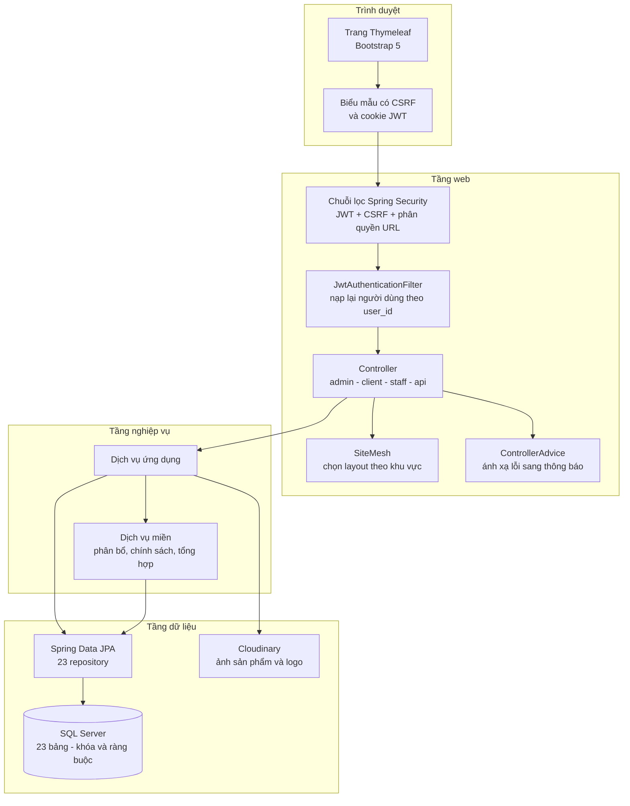
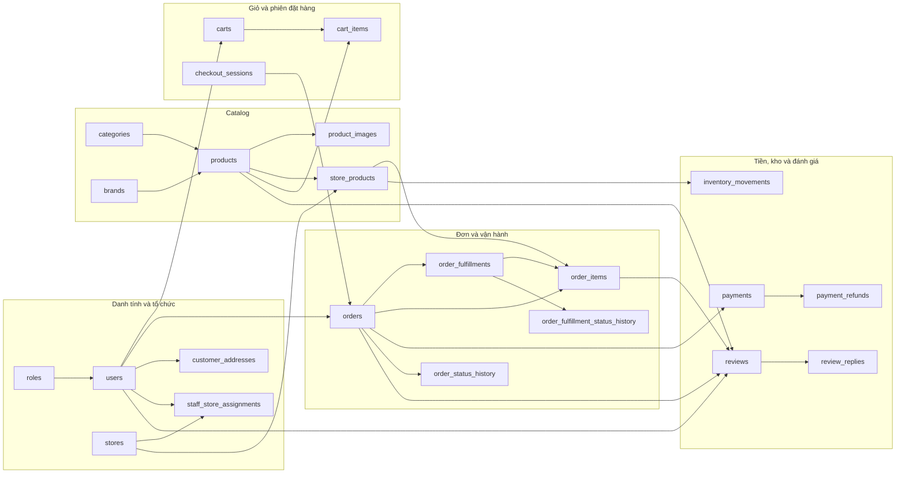
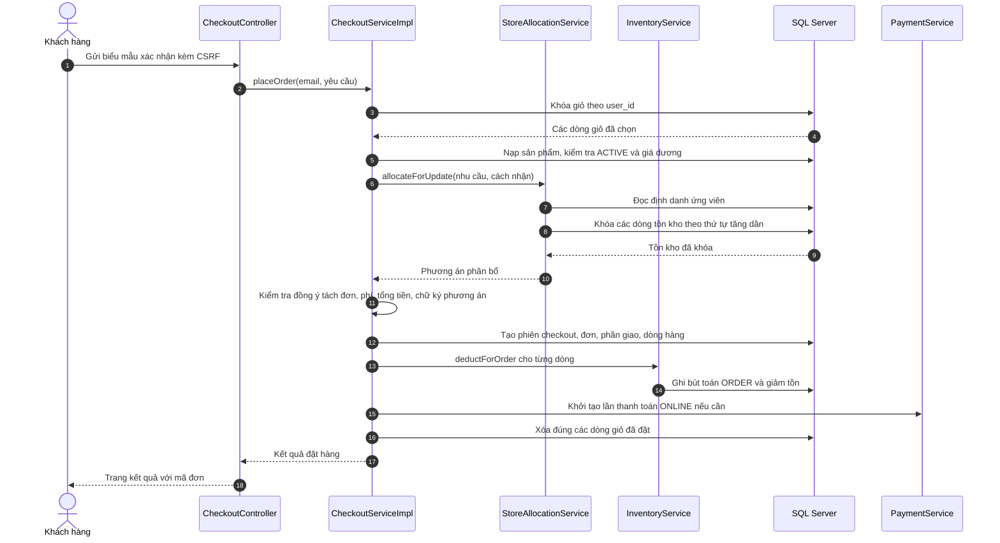
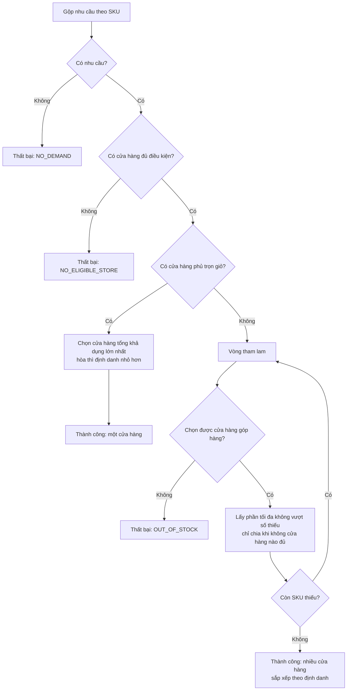
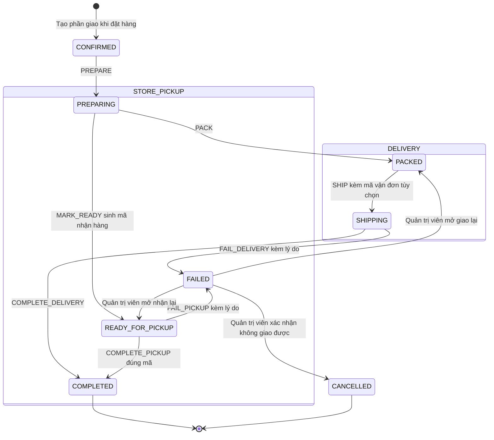
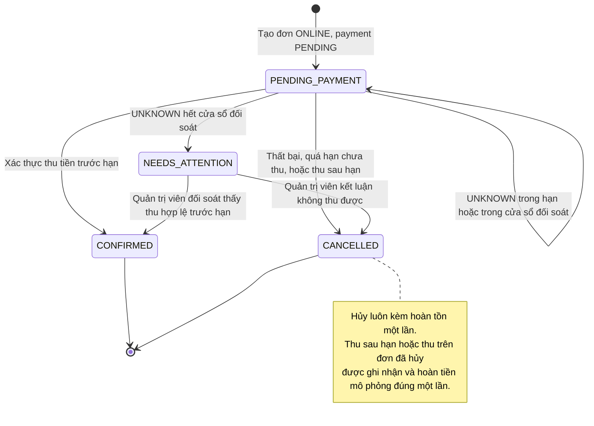

# BÁO CÁO ĐỒ ÁN

## XÂY DỰNG HỆ THỐNG THƯƠNG MẠI ĐIỆN TỬ ONESHOP THEO MÔ HÌNH CHUỖI CỬA HÀNG

**Loại báo cáo:** [CẦN BỔ SUNG: báo cáo môn học / đồ án cơ sở / đồ án tốt nghiệp]  
**Đơn vị đào tạo:** [CẦN BỔ SUNG: trường, khoa, ngành]  
**Sinh viên thực hiện:** [CẦN BỔ SUNG: họ tên, mã số sinh viên]  
**Giảng viên hướng dẫn:** [CẦN BỔ SUNG: học hàm, học vị, họ tên]  
**Thời gian thực hiện:** [CẦN BỔ SUNG: từ tháng/năm đến tháng/năm]  
**Địa điểm, thời gian hoàn thiện:** [CẦN BỔ SUNG: địa danh], tháng 10 năm 2026

---

## LỜI CAM ĐOAN

[CẦN BỔ SUNG: nội dung cam đoan theo quy định của đơn vị đào tạo. Báo cáo không nên dùng lời cam đoan do người soạn thảo tự tạo khi chưa có xác nhận của sinh viên thực hiện.]

---

## LỜI CẢM ƠN

[CẦN BỔ SUNG: lời cảm ơn giảng viên hướng dẫn, đơn vị thực tập, gia đình và bạn bè. Phần này cần được viết lại theo quan hệ thực tế, không dùng nội dung mẫu.]

---

## MỤC LỤC

Bản thảo Markdown không gắn số trang; mục lục dưới đây phản ánh cấu trúc nội dung và sẽ được tạo số trang tự động khi chuyển sang bản in.

- Lời cam đoan
- Lời cảm ơn
- Danh mục từ viết tắt
- Danh mục bảng
- Danh mục hình và sơ đồ
- Ghi chú về phương pháp và mức độ kiểm chứng
- Tóm tắt báo cáo
- **Chương 1. Tổng quan về đề tài và hệ thống OneShop**
  - 1.1. Bối cảnh và lý do chọn đề tài
  - 1.2. Mục tiêu của đề tài
  - 1.3. Đối tượng và phạm vi nghiên cứu
  - 1.4. Căn cứ xác định phiên bản V3 và quan hệ với V2
  - 1.5. Phương pháp khảo sát và xây dựng báo cáo
  - 1.6. Bố cục báo cáo
- **Chương 2. Phân tích yêu cầu hệ thống**
  - 2.1. Tác nhân và phạm vi quyền
  - 2.2. Yêu cầu chức năng
  - 2.3. Đặc tả Use Case 1: Đăng ký tài khoản và đăng nhập
  - 2.4. Đặc tả Use Case 2: Xem và tìm sản phẩm
  - 2.5. Đặc tả Use Case 3: Quản lý giỏ hàng
  - 2.6. Đặc tả Use Case 4: Đặt hàng giao tận nơi
  - 2.7. Đặc tả Use Case 5: Nhận tại cửa hàng
  - 2.8. Đặc tả Use Case 6: Thanh toán trực tuyến mô phỏng
  - 2.9. Đặc tả Use Case 7: Hủy đơn
  - 2.10. Đặc tả Use Case 8: Nhân viên xử lý phần giao
  - 2.11. Đặc tả Use Case 9: Quản trị viên xử lý ngoại lệ giao hàng
  - 2.12. Đặc tả Use Case 10: Đánh giá và phản hồi đánh giá
  - 2.13. Quy tắc nghiệp vụ
  - 2.14. Yêu cầu phi chức năng
- **Chương 3. Thiết kế hệ thống**
  - 3.1. Mục tiêu thiết kế và các ràng buộc chi phối
  - 3.2. Kiến trúc tổng thể
  - 3.3. Tổ chức mã nguồn và phân vùng trách nhiệm
  - 3.4. Thiết kế dữ liệu
  - 3.5. Thiết kế luồng đặt hàng
  - 3.6. Thiết kế thuật toán phân bổ nguồn hàng
  - 3.7. Máy trạng thái phần giao và suy diễn trạng thái đơn
  - 3.8. Thiết kế thanh toán, hủy đơn và hoàn tiền
  - 3.9. Thiết kế bảo mật và kiểm soát truy cập
  - 3.10. Thiết kế giao diện và trải nghiệm
  - 3.11. Thiết kế triển khai và vận hành
  - 3.12. Nợ kỹ thuật và các quyết định cần hoàn thiện
  - 3.13. Tổng kết chương
- **Chương 4. Triển khai và kiểm chứng chức năng**
  - 4.1. Môi trường và cấu hình chạy
  - 4.2. Khung khởi động, hạ tầng dùng chung và kiểm tra lược đồ
  - 4.3. Xác thực, JWT và kiểm soát phiên
  - 4.4. Phân quyền URL, vai trò và phạm vi cửa hàng
  - 4.5. Catalog, trang chủ và tìm kiếm
  - 4.6. Giỏ hàng và kiểm tra tồn kho trước khi đặt
  - 4.7. Xem trước checkout và dấu vân tay phương án
  - 4.8. Giao dịch đặt hàng và trật tự khóa
  - 4.9. Phân bổ nguồn hàng và ý nghĩa của khóa dòng
  - 4.10. Thanh toán trực tuyến mô phỏng
  - 4.11. Đối soát, quá hạn và can thiệp của quản trị viên
  - 4.12. COD, thu tại cửa hàng và giới hạn thu tiền
  - 4.13. Vòng đời phần giao và suy diễn trạng thái đơn
  - 4.14. Hủy đơn, hoàn tồn và hoàn tiền
  - 4.15. Giao thất bại và quyết định của quản trị viên
  - 4.16. Đánh giá, phản hồi và kiểm duyệt
  - 4.17. Phân hệ quản trị và vận hành cửa hàng
  - 4.18. Xử lý lỗi, thông điệp và ghi log
  - 4.19. Tải ảnh Cloudinary và tính toàn vẹn tài nguyên
  - 4.20. Đóng gói, khởi tạo cơ sở dữ liệu và khả năng tái lập
  - 4.21. Tổng kết chương
- **Chương 5. Kiểm thử và đánh giá**
  - 5.1. Mục tiêu, phạm vi và nguồn bằng chứng
  - 5.2. Kết quả kiểm thử đơn vị và kiểm thử thành phần
  - 5.3. Kết quả kiểm thử tích hợp và cơ sở dữ liệu
  - 5.4. Phân tích các thất bại và lỗi ghi nhận
  - 5.5. Kiểm thử end-to-end, hiệu năng, bảo mật và triển khai
  - 5.6. Đánh giá mức độ đáp ứng yêu cầu
  - 5.7. Rủi ro và khoảng trống kiểm thử
  - 5.8. Tổng kết chương
- **Chương 6. Kết luận và hướng phát triển**
  - 6.1. Những kết quả đã đạt được
  - 6.2. Những hạn chế và khoảng trống
  - 6.3. Bài học kinh nghiệm
  - 6.4. Lộ trình phát triển và hoàn thiện
  - 6.5. Kết luận
- **Tài liệu tham khảo**
  - A. Tài liệu và mã nguồn của dự án
  - B. Tài liệu kỹ thuật tham khảo
  - C. Quy ước sử dụng nguồn
- **PHỤ LỤC A. MA TRẬN TRUY VẾT YÊU CẦU – USE CASE – THIẾT KẾ – KIỂM THỬ**
  - A.1. Truy vết yêu cầu chức năng
  - A.2. Truy vết Use Case
  - A.3. Truy vết yêu cầu phi chức năng
- **PHỤ LỤC B. DANH MỤC ĐIỂM TRUY CẬP GIAO DIỆN VÀ API**
  - B.1. Tuyến công khai, xác thực và tài nguyên
  - B.2. Tuyến khách hàng
  - B.3. Tuyến nhân viên
  - B.4. Tuyến quản trị
  - B.5. API và định dạng lỗi
- **PHỤ LỤC C. TỪ ĐIỂN DỮ LIỆU 23 BẢNG**
  - C.1. Danh tính, địa chỉ và tổ chức
  - C.2. Catalog và tồn kho vật lý
  - C.3. Giỏ hàng, phiên đặt hàng, đơn và phần giao
  - C.4. Thanh toán, tồn kho, lịch sử trạng thái và đánh giá
- **PHỤ LỤC D. DANH MỤC TRẠNG THÁI, MÃ LỖI, DỮ LIỆU MẪU VÀ KẾT QUẢ KIỂM THỬ**
  - D.1. Tập giá trị trạng thái và nơi cưỡng chế
  - D.2. Ánh xạ lỗi HTTP
  - D.3. Mã lỗi nghiệp vụ ổn định
  - D.4. Số lượng dữ liệu mẫu
  - D.5. Kết quả toàn bộ 96 lớp kiểm thử có báo cáo
- **PHỤ LỤC E. QUY TRÌNH TÁI LẬP VÀ DANH MỤC KIỂM CHỨNG CÒN THIẾU**
  - E.1. Checklist tái lập từ môi trường trống
  - E.2. Danh mục ảnh và minh chứng giao diện cần chụp
  - E.3. Điều kiện tối thiểu trước khi nghiệm thu
- **PHỤ LỤC F. DANH SÁCH THÔNG TIN CẦN BỔ SUNG TRƯỚC KHI HOÀN THIỆN BÁO CÁO**
  - F.1. Thông tin hành chính và học thuật
  - F.2. Tài liệu nghiệp vụ và nguồn dữ liệu
  - F.3. Bằng chứng kỹ thuật và kiểm thử
  - F.4. Hình ảnh, sơ đồ và minh chứng trình bày

---

## DANH MỤC TỪ VIẾT TẮT

| Từ viết tắt | Tiếng Anh / thuật ngữ đầy đủ | Diễn giải trong báo cáo |
|---|---|---|
| API | Application Programming Interface | Giao diện lập trình ứng dụng |
| BCrypt | Blowfish-based password hashing | Hàm băm mật khẩu có salt, dùng bởi Spring Security |
| COD | Cash on Delivery | Thanh toán khi nhận hàng |
| CSRF | Cross-Site Request Forgery | Giả mạo yêu cầu từ nguồn khác |
| DB | Database | Cơ sở dữ liệu |
| DTO | Data Transfer Object | Đối tượng chuyển dữ liệu giữa các tầng |
| ERD | Entity–Relationship Diagram | Sơ đồ thực thể – quan hệ |
| FK | Foreign Key | Khóa ngoại |
| HTTP | Hypertext Transfer Protocol | Giao thức truyền tải siêu văn bản |
| JPA | Jakarta Persistence API | Chuẩn ánh xạ đối tượng – quan hệ |
| JSON | JavaScript Object Notation | Định dạng dữ liệu có cấu trúc |
| JWT | JSON Web Token | Token xác thực có chữ ký |
| NVARCHAR | National Variable Character | Kiểu chuỗi Unicode của SQL Server |
| ONLINE | Online payment | Phương thức thanh toán trực tuyến mô phỏng |
| PAY_AT_STORE | Pay at Store | Thanh toán tại cửa hàng khi nhận |
| PK | Primary Key | Khóa chính |
| REST | Representational State Transfer | Phong cách thiết kế API |
| SHA-256 | Secure Hash Algorithm 256-bit | Hàm băm dùng tạo dấu vân tay kế hoạch đặt hàng |
| SKU | Stock Keeping Unit | Mã đơn vị lưu kho |
| SQL | Structured Query Language | Ngôn ngữ truy vấn dữ liệu |
| STAFF | Store staff | Nhân viên thuộc một hoặc nhiều chi nhánh |
| UI | User Interface | Giao diện người dùng |
| URL | Uniform Resource Locator | Địa chỉ tài nguyên |
| V2, V3 | Phiên bản 2, Phiên bản 3 | Hai mốc mô hình nghiệp vụ được đối chiếu |
| XSS | Cross-Site Scripting | Chèn mã độc vào nội dung hiển thị |

---

## DANH MỤC BẢNG

Danh mục dưới đây liệt kê toàn bộ bảng có tiêu đề trong báo cáo. Các bảng C.1–C.23 tương ứng với 23 bảng dữ liệu; bảng D.5 gồm 96 dòng kết quả kiểm thử.

| Số hiệu | Tên bảng |
|---|---|
| Bảng 1.1 | Đối chiếu dấu vết mô hình V2 và mô hình V3 đang triển khai |
| Bảng 2.1 | Tác nhân và phạm vi quyền |
| Bảng 2.2 | Danh mục yêu cầu chức năng |
| Bảng 2.3 | Đặc tả Use Case đăng ký, đăng nhập |
| Bảng 2.4 | Đặc tả Use Case xem và tìm sản phẩm |
| Bảng 2.5 | Đặc tả Use Case quản lý giỏ hàng |
| Bảng 2.6 | Đặc tả Use Case đặt hàng giao tận nơi |
| Bảng 2.7 | Đặc tả Use Case nhận tại cửa hàng |
| Bảng 2.8 | Đặc tả Use Case thanh toán trực tuyến mô phỏng |
| Bảng 2.9 | Đặc tả Use Case hủy đơn |
| Bảng 2.10 | Đặc tả Use Case xử lý phần giao của nhân viên |
| Bảng 2.11 | Đặc tả Use Case xử lý ngoại lệ giao hàng của quản trị viên |
| Bảng 2.12 | Đặc tả Use Case đánh giá và phản hồi đánh giá |
| Bảng 2.13 | Quy tắc nghiệp vụ cốt lõi |
| Bảng 2.14 | Yêu cầu phi chức năng |
| Bảng 3.1 | Đối chiếu cụm yêu cầu với quyết định thiết kế |
| Bảng 3.2 | Nguyên tắc thiết kế và hệ quả |
| Bảng 3.3 | Trách nhiệm và quy tắc phụ thuộc của các tầng |
| Bảng 3.4 | Bản đồ gói mã nguồn chính |
| Bảng 3.5 | Nhóm controller, đường dẫn gốc và trách nhiệm |
| Bảng 3.6 | Phân vùng dịch vụ nghiệp vụ |
| Bảng 3.7 | Đối chiếu repository với bảng dữ liệu |
| Bảng 3.8 | Tóm tắt 23 bảng dữ liệu của OneShop V3 |
| Bảng 3.9 | Các cơ chế toàn vẹn then chốt ở tầng dữ liệu |
| Bảng 3.10 | Đối chiếu cột di sản V2 và nguồn sự thật V3 |
| Bảng 3.11 | Các bước xác nhận đặt hàng |
| Bảng 3.12 | Kịch bản phân bổ và kết quả mong đợi |
| Bảng 3.13 | Ma trận chuyển trạng thái phần giao |
| Bảng 3.14 | Quy tắc suy diễn trạng thái tổng của đơn |
| Bảng 3.15 | Bảng quyết định xử lý đơn trực tuyến |
| Bảng 3.16 | Các thành phần của sổ hoàn tiền |
| Bảng 3.17 | Ma trận kiểm soát truy cập |
| Bảng 3.18 | Rủi ro bảo mật còn lại |
| Bảng 3.19 | Bản đồ màn hình chính |
| Bảng 3.20 | Biến môi trường và ý nghĩa vận hành |
| Bảng 3.21 | Nợ kỹ thuật và hướng xử lý |
| Bảng 4.1 | Cấu hình theo hồ sơ chạy và tham số khởi động |
| Bảng 4.2 | Các thành phần hạ tầng dùng chung |
| Bảng 4.3 | Chuỗi kiểm soát xác thực và phân quyền |
| Bảng 4.4 | Trình tự khóa và kiểm tra trong `placeOrder` |
| Bảng 4.5 | Ánh xạ trạng thái của `MockLedger` |
| Bảng 4.6 | Ma trận thao tác trên một phần giao |
| Bảng 4.7 | Quy tắc hủy, hoàn tiền và xử lý ngoại lệ |
| Bảng 4.8 | Truy vết yêu cầu chức năng tới lớp triển khai và bằng chứng kiểm thử ghi nhận |
| Bảng 5.1 | Tổng hợp bộ báo cáo kiểm thử mới nhất |
| Bảng 5.2 | Kết quả kiểm thử đơn vị và kiểm thử thành phần |
| Bảng 5.3 | Kết quả kiểm thử tích hợp tiêu biểu |
| Bảng 5.4 | Các thất bại khẳng định được ghi nhận |
| Bảng 5.5 | Các cụm lỗi chặn kiểm thử |
| Bảng 5.6 | Kết quả kiểm thử vận hành, end-to-end và triển khai |
| Bảng 5.7 | Tổng hợp mức độ chứng cứ theo nhóm chức năng |
| Bảng 5.8 | Rủi ro và khoảng trống kiểm thử |
| Bảng 6.1 | Lộ trình phát triển và điều kiện chuyển pha |
| Bảng A.1 | Truy vết 33 yêu cầu chức năng tới Use Case, quy tắc, thiết kế và bằng chứng |
| Bảng A.2 | Truy vết 10 Use Case tới yêu cầu, quy tắc và bằng chứng |
| Bảng A.3 | Đối chiếu 13 yêu cầu phi chức năng với thiết kế và bằng chứng |
| Bảng B.1 | Điểm truy cập công khai và xác thực |
| Bảng B.2 | Điểm truy cập khách hàng |
| Bảng B.3 | Điểm truy cập nhân viên |
| Bảng B.4 | Điểm truy cập quản trị |
| Bảng B.5 | Điểm truy cập API |
| Bảng C.1 | Từ điển dữ liệu bảng `roles` |
| Bảng C.2 | Từ điển dữ liệu bảng `users` |
| Bảng C.3 | Từ điển dữ liệu bảng `customer_addresses` |
| Bảng C.4 | Từ điển dữ liệu bảng `stores` |
| Bảng C.5 | Từ điển dữ liệu bảng `staff_store_assignments` |
| Bảng C.6 | Từ điển dữ liệu bảng `categories` |
| Bảng C.7 | Từ điển dữ liệu bảng `brands` |
| Bảng C.8 | Từ điển dữ liệu bảng `products` |
| Bảng C.9 | Từ điển dữ liệu bảng `product_images` |
| Bảng C.10 | Từ điển dữ liệu bảng `store_products` |
| Bảng C.11 | Từ điển dữ liệu bảng `carts` |
| Bảng C.12 | Từ điển dữ liệu bảng `cart_items` |
| Bảng C.13 | Từ điển dữ liệu bảng `checkout_sessions` |
| Bảng C.14 | Từ điển dữ liệu bảng `orders` |
| Bảng C.15 | Từ điển dữ liệu bảng `order_fulfillments` |
| Bảng C.16 | Từ điển dữ liệu bảng `order_fulfillment_status_history` |
| Bảng C.17 | Từ điển dữ liệu bảng `order_items` |
| Bảng C.18 | Từ điển dữ liệu bảng `payments` |
| Bảng C.19 | Từ điển dữ liệu bảng `payment_refunds` |
| Bảng C.20 | Từ điển dữ liệu bảng `inventory_movements` |
| Bảng C.21 | Từ điển dữ liệu bảng `order_status_history` |
| Bảng C.22 | Từ điển dữ liệu bảng `reviews` |
| Bảng C.23 | Từ điển dữ liệu bảng `review_replies` |
| Bảng D.1 | Tập giá trị trạng thái của lược đồ V3 |
| Bảng D.2 | Ánh xạ ngoại lệ sang HTTP và định dạng phản hồi |
| Bảng D.3 | Mã lỗi nghiệp vụ ổn định |
| Bảng D.4 | Số lượng bản ghi của 23 bảng trong seed |
| Bảng D.5 | Kết quả 96 lớp kiểm thử trong bộ báo cáo ngày 22/10/2026 |
| Bảng E.1 | Checklist tái lập và trạng thái bằng chứng |
| Bảng E.2 | Danh mục ảnh minh chứng cần chụp |
| Bảng F.1 | Thông tin hành chính và học thuật cần bổ sung |
| Bảng F.2 | Tài liệu nghiệp vụ và nguồn dữ liệu cần bổ sung |
| Bảng F.3 | Bằng chứng kỹ thuật và kiểm thử cần bổ sung |
| Bảng F.4 | Hình ảnh, sơ đồ và minh chứng trình bày cần bổ sung |

---

## DANH MỤC HÌNH VÀ SƠ ĐỒ

Sáu hình 3.1–3.6 đã được vẽ bằng Mermaid trong thân báo cáo. Ba hình 3.7–3.9 là vị trí dự kiến cho ảnh chụp giao diện, chưa có tệp trong kho; danh mục ảnh cần chụp được trình bày tại Bảng E.2.

| Số hiệu | Nội dung | Trạng thái |
|---|---|---|
| Hình 3.1 | Kiến trúc phân tầng của OneShop V3 | Sơ đồ Mermaid trong thân báo cáo |
| Hình 3.2 | Bản đồ miền dữ liệu của OneShop V3 | Sơ đồ Mermaid trong thân báo cáo |
| Hình 3.3 | Trình tự xác nhận đặt hàng | Sơ đồ Mermaid trong thân báo cáo |
| Hình 3.4 | Luồng quyết định của thuật toán phân bổ | Sơ đồ Mermaid trong thân báo cáo |
| Hình 3.5 | Máy trạng thái của phần giao | Sơ đồ Mermaid trong thân báo cáo |
| Hình 3.6 | Vòng đời đơn trực tuyến và đối soát | Sơ đồ Mermaid trong thân báo cáo |
| Hình 3.7 | Trang xem trước đặt hàng với cảnh báo tách đơn COD nhiều cửa hàng | Chưa chèn; vị trí tại Phụ lục E.2 |
| Hình 3.8 | Hàng đợi phần giao của nhân viên | Chưa chèn; vị trí tại Phụ lục E.2 |
| Hình 3.9 | Bảng điều khiển thanh toán của quản trị viên | Chưa chèn; vị trí tại Phụ lục E.2 |

---

## GHI CHÚ VỀ PHƯƠNG PHÁP VÀ MỨC ĐỘ KIỂM CHỨNG

Báo cáo này được xây dựng như một bản thảo nội dung thô, phục vụ việc rà soát học thuật trước khi chuyển sang định dạng in. Mọi mô tả chức năng đều xuất phát từ việc khảo sát mã nguồn đang hiện diện, tập lệnh tạo lược đồ, tập lệnh dữ liệu mẫu, cấu hình chạy và các tệp kết quả kiểm thử đã ghi nhận. Báo cáo không suy diễn một chức năng là “đã có” chỉ vì tên lớp, tên gói hay một dòng mô tả trong tài liệu; mỗi khẳng định nghiệp vụ đều được đối chiếu với luồng thực thi hoặc ràng buộc dữ liệu tương ứng.

Ba mức ghi chú được dùng xuyên suốt:

- `[CẦN XÁC MINH: ...]`: thông tin có dấu hiệu tồn tại nhưng chưa đủ bằng chứng để khẳng định, hoặc kết quả phụ thuộc môi trường bên ngoài.
- `[CẦN BỔ SUNG: ...]`: nội dung hành chính, số liệu, minh chứng hoặc phần diễn giải còn thiếu, phải bổ sung trước khi hoàn thiện.
- `[CHÈN HÌNH: ...]`, `[CHÈN SƠ ĐỒ: ...]`: vị trí dành cho hình ảnh hoặc sơ đồ cần được tạo từ hệ thống thật.

Các kết quả kiểm thử trong Chương 5 là bằng chứng ghi nhận, không phải tuyên bố rằng toàn bộ hệ thống đã vượt qua kiểm thử tại thời điểm đọc báo cáo. Trong đó, lần chạy đầy đủ ngày 18/10/2026 ghi nhận 1.590 bài kiểm thử, 25 lỗi và 1 lỗi ngoại lệ; các tệp kết quả ngày 22/10/2026 ghi nhận 1.641 bài kiểm thử, 13 lỗi và 661 lỗi ngoại lệ. Các con số này được trình bày trung thực, kèm phân tích nguyên nhân có thể có và giới hạn kết luận. Báo cáo không dùng các con số đó để tuyên bố chất lượng tuyệt đối, cũng không che giấu các lần thất bại.

Một số tài liệu nội bộ được README của dự án tham chiếu nhưng không có tệp khả dụng trong thư mục tài liệu tại thời điểm khảo sát. Vì vậy, báo cáo không trích dẫn nội dung của các tài liệu đó như thể đã đọc; khi cần, báo cáo ghi rõ `[CẦN XÁC MINH]` và chỉ sử dụng mã nguồn, lược đồ, dữ liệu mẫu và nhật ký kiểm thử làm nguồn sự thật.

---

## TÓM TẮT BÁO CÁO

OneShop là một hệ thống thương mại điện tử bán mỹ phẩm theo mô hình chuỗi cửa hàng, được xây dựng dưới dạng ứng dụng nguyên khối trên nền Spring Boot, Java 21, Thymeleaf, Bootstrap, SiteMesh, Spring Security với JWT, Spring Data JPA và SQL Server. Điểm đặc trưng của bài toán không nằm ở một website bán hàng thông thường, mà ở việc một đơn hàng trực tuyến có thể được phục vụ bởi nhiều chi nhánh, trong khi tồn kho, trách nhiệm xử lý và trạng thái giao hàng lại thuộc về từng phần giao (Fulfillment) của từng cửa hàng.

Báo cáo xác định phiên bản đang triển khai là V3. Trong mô hình này, giá bán trực tuyến là một giá thống nhất trên sản phẩm; giỏ hàng tham chiếu sản phẩm; tồn kho vật lý nằm ở từng cặp cửa hàng – sản phẩm; một đơn hàng có thể có nhiều phần giao; và trạng thái tổng của đơn được suy ra từ trạng thái các phần giao. Hệ thống đã hiện thực các luồng: duyệt và tìm sản phẩm, giỏ hàng, đặt hàng giao tận nơi hoặc nhận tại cửa hàng, phân bổ hàng theo chi nhánh, thanh toán COD và tại cửa hàng, thanh toán trực tuyến mô phỏng, hủy đơn và hoàn tồn, xử lý phần giao của nhân viên, xử lý ngoại lệ giao hàng của quản trị viên, đánh giá sản phẩm và phản hồi đánh giá.

Báo cáo cũng chỉ rõ các giới hạn cần được nhìn nhận đúng bản chất: thanh toán trực tuyến hiện là cổng mô phỏng phía máy chủ, không phải giao dịch ngân hàng thật; cấu hình production đóng phương thức ONLINE; hệ thống chưa có SMTP, chưa có sổ địa chỉ khách hàng đầy đủ và chưa có cơ chế giữ tồn kho theo thời gian. Tồn kho được trừ đồng bộ ngay khi tạo đơn, với khóa dòng trên các bản ghi tồn kho. Các kết quả kiểm thử được báo cáo theo đúng mức độ bằng chứng: có phần đã đạt, có phần còn lỗi, có phần chưa chạy hoặc chưa thể xác minh trong môi trường hiện tại.

---

# CHƯƠNG 1. TỔNG QUAN VỀ ĐỀ TÀI VÀ HỆ THỐNG ONESHOP

## 1.1. Bối cảnh và lý do chọn đề tài

Thương mại điện tử bán lẻ đã chuyển từ mô hình một kho hàng duy nhất sang mô hình phân phối nhiều điểm. Với một chuỗi mỹ phẩm, cùng một mã sản phẩm có thể được trưng bày và lưu kho ở nhiều chi nhánh; khách hàng lại mua qua một giao diện trực tuyến thống nhất. Khoảng cách giữa “một catalog chung” và “nhiều kho vật lý” tạo ra ba bài toán không thể giải quyết bằng một website bán hàng đơn giản.

Thứ nhất, giá và tồn kho không còn là một cặp thuộc tính duy nhất. Giá bán trực tuyến cần thống nhất để khách hàng không nhìn thấy cùng một sản phẩm với nhiều giá khác nhau, nhưng tồn kho lại phải phản ánh số lượng thực tế tại từng cửa hàng. Thứ hai, một đơn hàng có thể cần hàng từ nhiều chi nhánh. Nếu hệ thống vẫn buộc mỗi đơn chỉ thuộc một cửa hàng, đơn hàng sẽ bị từ chối oan hoặc phải tách đơn mà không có sự đồng ý của khách. Thứ ba, trách nhiệm vận hành phải được phân tách: nhân viên chi nhánh chỉ được xử lý phần hàng thuộc chi nhánh mình, còn quản trị viên mới có quyền nhìn toàn chuỗi và xử lý các tình huống bất thường.

Đề tài OneShop được lựa chọn để giải quyết ba bài toán trên trong một hệ thống có quy mô đồ án, nhưng vẫn giữ được tính nhất quán nghiệp vụ. Hệ thống hướng tới một trải nghiệm mua sắm liền mạch cho khách hàng, đồng thời tạo ra một mô hình vận hành đủ rõ để nhân viên và quản trị viên có thể kiểm soát đơn hàng, tồn kho, thanh toán và đánh giá.

## 1.2. Mục tiêu của đề tài

Mục tiêu tổng quát là xây dựng một website thương mại điện tử cho chuỗi cửa hàng mỹ phẩm, trong đó dữ liệu bán hàng trực tuyến và dữ liệu vận hành tại cửa hàng được liên kết nhưng không trộn lẫn. Các mục tiêu cụ thể gồm:

1. Xây dựng catalog sản phẩm thống nhất, có danh mục, thương hiệu, hình ảnh, tìm kiếm, lọc và trang chi tiết.
2. Cho phép khách hàng quản lý giỏ hàng theo sản phẩm, chọn các dòng hàng cần mua và xem trước phương án phân bổ từ các chi nhánh.
3. Hiện thực quy trình đặt hàng với hai hình thức nhận hàng: giao tận nơi và nhận tại cửa hàng; ba phương thức thanh toán: COD, thanh toán tại cửa hàng và thanh toán trực tuyến mô phỏng.
4. Bảo đảm một đơn hàng có thể gồm nhiều phần giao, mỗi phần gắn với một chi nhánh, nhưng vẫn có một trạng thái tổng hợp quán lý được.
5. Kiểm soát tồn kho theo từng cặp cửa hàng – sản phẩm, ghi nhận mọi biến động kho bằng sổ cái bất biến về mặt nghiệp vụ.
6. Phân quyền rõ ràng giữa khách hàng, nhân viên và quản trị viên; nhân viên chỉ thao tác trong phạm vi chi nhánh được phân công.
7. Cho phép khách hàng hủy đơn trong giới hạn trạng thái hợp lệ; hệ thống hoàn tồn đúng một lần và không làm sai lệch kho.
8. Xây dựng chức năng đánh giá gắn với dòng hàng đã nhận, phản hồi của nhân viên đúng chi nhánh nguồn và kiểm duyệt của quản trị viên.
9. Tổ chức mã nguồn, cấu hình và tài liệu kỹ thuật đủ để có thể chạy cục bộ, đóng gói bằng Docker và triển khai theo mô hình ứng dụng web.
10. Nhận diện trung thực các giới hạn của phiên bản hiện tại để đề xuất hướng phát triển thay vì che giấu chúng bằng các tuyên bố không có bằng chứng.

## 1.3. Đối tượng và phạm vi nghiên cứu

**Đối tượng nghiên cứu** là quy trình bán hàng trực tuyến của một chuỗi cửa hàng mỹ phẩm, bao gồm catalog, giỏ hàng, phân bổ hàng, đặt hàng, thanh toán, giao hàng, hủy đơn, tồn kho, đánh giá và phân quyền vận hành.

**Phạm vi chức năng** của báo cáo giới hạn ở các chức năng đang có trong mã nguồn hiện tại. Báo cáo không mô tả các chức năng chỉ xuất hiện trong kế hoạch, không mặc định rằng một giao diện quản trị đồng nghĩa với nghiệp vụ đã hoàn chỉnh, và không coi dữ liệu mẫu là dữ liệu kinh doanh thật.

**Phạm vi kỹ thuật** gồm ứng dụng Spring Boot nguyên khối, giao diện phía máy chủ bằng Thymeleaf, lớp bảo mật Spring Security dùng JWT, lớp truy cập dữ liệu JPA trên SQL Server, tích hợp lưu trữ ảnh Cloudinary và các thành phần kiểm thử. Báo cáo không đánh giá hạ tầng mạng, cấu hình tường lửa, chứng chỉ TLS của nhà cung cấp đám mây hoặc chất lượng dịch vụ của SQL Server.

**Phạm vi dữ liệu** sử dụng bộ dữ liệu mẫu gồm sản phẩm mỹ phẩm có thật về tên và giá tham khảo, nhưng tồn kho, tài khoản, đơn hàng, thanh toán và đánh giá là dữ liệu mô phỏng. Báo cáo không khẳng định các đơn hàng mẫu là giao dịch thương mại thật.

**Phạm vi thời gian** phản ánh trạng thái mã nguồn và bằng chứng kiểm thử được ghi nhận trong tháng 10 năm 2026. Các kết quả đo hiệu năng, kiểm thử xâm nhập bảo mật, kiểm thử tải và kiểm thử trên môi trường công khai không nằm trong phạm vi đã kiểm chứng của báo cáo.

## 1.4. Căn cứ xác định phiên bản V3 và quan hệ với V2

Trong quá trình khảo sát, có thể bắt gặp đồng thời các dấu vết của mô hình cũ V2 và mô hình mới V3. Việc chỉ dựa vào tên gói, tên bảng hoặc một dòng mô tả sẽ dễ dẫn đến kết luận sai. Báo cáo sử dụng ba nhóm bằng chứng độc lập để xác định mô hình đang thực sự vận hành:

- Lược đồ tạo cơ sở dữ liệu mới nhất tuyên bố rõ là V3, có 23 bảng và tự kiểm tra cấu trúc.
- Các thực thể và dịch vụ trung tâm sử dụng giá trên sản phẩm, giỏ hàng theo sản phẩm, tồn kho theo cửa hàng – sản phẩm, đơn hàng có nhiều phần giao và sổ cái hoàn tiền.
- README của dự án mô tả V3, đồng thời phân biệt rõ các cột tương thích V2 còn giữ lại.

Bảng 1.1 tổng hợp cách phân biệt. Cột “V3 đang dùng” là nguồn sự thật nghiệp vụ; cột “Dấu vết V2” chỉ là thành phần tương thích hoặc dữ liệu lịch sử, không được dùng để suy ra quyền hạn hay giá trị hiện hành.

**Bảng 1.1. Đối chiếu dấu vết mô hình V2 và mô hình V3 đang triển khai**

| Thành phần | Dấu vết V2 còn trong lược đồ/mã nguồn | V3 đang dùng làm nguồn sự thật | Hệ quả nghiệp vụ |
|---|---|---|---|
| Giá bán | `store_products.price` vẫn tồn tại và có giá trị mẫu | `products.price` là giá bán trực tuyến thống nhất | Không cho phép mỗi chi nhánh tự đặt giá khác nhau trên catalog |
| Giỏ hàng | `cart_items.store_product_id` có thể khác NULL | `cart_items.product_id` và ràng buộc duy nhất theo cặp giỏ – sản phẩm | Khách chọn sản phẩm; nguồn hàng được quyết định khi đặt |
| Đơn hàng | `orders.store_id` có thể NULL, chỉ mang nghĩa tương thích hoặc chi nhánh nhận hàng | `order_fulfillments.store_id` xác định chi nhánh của từng phần giao | Một đơn có thể do nhiều chi nhánh phục vụ |
| Phân bổ | Không còn là quy tắc “mỗi dòng gắn cứng một kho” | Bộ máy phân bổ chọn một cửa hàng đủ toàn bộ giỏ, nếu không thì chia theo nhu cầu còn thiếu | Đơn có thể có một hoặc nhiều phần giao |
| Tồn kho | `reserved_quantity` là trường tồn tại từ mô hình cũ | Tồn khả dụng là `quantity - reserved_quantity`; đơn hàng trừ trực tiếp `quantity` | Không có cơ chế giữ hàng theo thời gian trong V3 |
| Thanh toán | Dấu vết trạng thái thanh toán cũ | `payments` gắn với Order; ONLINE có cổng mô phỏng và sổ cái hoàn tiền riêng | Thanh toán là theo đơn, không theo từng phần giao |
| Hoàn tiền | Trường tổng hợp trên `payments` | Bảng `payment_refunds` ghi từng khoản hoàn theo hàng hóa, phí vận chuyển hoặc toàn đơn | Chống hoàn trùng bằng chỉ mục duy nhất có điều kiện |
| Đánh giá | `reviews.order_id`, `reply`, `replied_by`, `replied_at` là cột cũ | `reviews.order_item_id` và bảng `review_replies` | Đánh giá gắn với dòng hàng đã nhận; phản hồi do nhân viên đúng chi nhánh thực hiện |
| Số bảng | Bản xác minh cũ ghi nhận 22 bảng | Lược đồ hiện tại tạo và tự kiểm tra 23 bảng | Bảng hoàn tiền là bổ sung V3, không có trong baseline cũ |

Việc V3 vẫn giữ các cột V2 là một quyết định tương thích có chủ đích, không phải bằng chứng rằng nghiệp vụ V2 đang có hiệu lực. Tuy nhiên, sự tồn tại song song này tạo ra nợ kỹ thuật: người đọc lược đồ dễ nhầm `orders.store_id` là nguồn xác định chi nhánh, hoặc nhầm `store_products.price` là giá bán. Báo cáo sẽ luôn nêu rõ nguồn sự thật V3 khi mô tả nghiệp vụ.

Một điểm cần phân biệt nữa là số lượng bảng. Bản xác minh cơ sở dữ liệu ghi ngày 18/10/2026 đạt 12/12 kiểm tra trên một baseline 22 bảng. Lược đồ hiện tại đã bổ sung bảng `payment_refunds`, nâng tổng số lên 23 bảng và có phần tự kiểm tra riêng. Báo cáo không dùng kết quả 22 bảng để kết luận cho lược đồ 23 bảng; việc xác minh lại trên một cơ sở dữ liệu mới là `[CHƯA CHẠY]` trong phạm vi bằng chứng hiện có.

## 1.5. Phương pháp khảo sát và xây dựng báo cáo

Quy trình khảo sát được thực hiện theo bốn bước. Bước thứ nhất là lập bản đồ cấu trúc dự án: xác định các gói chức năng, số lượng lớp, giao diện, cấu hình, tài nguyên tĩnh và các tệp khởi tạo cơ sở dữ liệu. Bước thứ hai là đọc lược đồ và dữ liệu mẫu để xác định mô hình dữ liệu thực tế, không dựa vào tên gọi. Bước thứ ba là lần theo các luồng nghiệp vụ từ controller đến service, repository và các ràng buộc cơ sở dữ liệu, đặc biệt ở các điểm có ghi dữ liệu, khóa dòng, tính tiền và phân quyền. Bước thứ tư là đối chiếu với bằng chứng kiểm thử đã ghi nhận, phân loại rõ kết quả nào là đạt, thất bại, chưa chạy hoặc chưa thể xác minh.

Báo cáo ưu tiên mô tả hành vi có thể kiểm chứng. Khi một quy tắc chỉ được thể hiện bằng tên hàm hoặc chú thích, quy tắc đó không được xem là đã hoàn chỉnh. Khi một chức năng có giao diện nhưng thiếu ràng buộc phía máy chủ, báo cáo ghi nhận cả hai mặt. Khi một kết quả kiểm thử thất bại nhưng nguyên nhân có dấu hiệu là dữ liệu mẫu cũ, báo cáo không quy kết ngay đó là lỗi chức năng; thay vào đó, báo cáo nêu hiện tượng, phạm vi ảnh hưởng và yêu cầu chạy lại trong môi trường chuẩn.

Cách tiếp cận này có ý nghĩa quan trọng với một đồ án có nhiều phiên bản. Một báo cáo chỉ liệt kê chức năng sẽ dễ biến mong muốn thành hiện thực. Một báo cáo chỉ dựa vào ảnh chụp giao diện sẽ bỏ qua các lỗ hổng như thiếu kiểm tra quyền hoặc thiếu ràng buộc dữ liệu. Báo cáo này cố gắng đứng ở giữa: mô tả đủ chi tiết để người đọc hình dung hệ thống, nhưng không vượt quá bằng chứng.

## 1.6. Bố cục báo cáo

Ngoài phần mở đầu, báo cáo gồm sáu chương. Chương 1 trình bày bối cảnh, mục tiêu, phạm vi và căn cứ xác định phiên bản. Chương 2 phân tích tác nhân, yêu cầu chức năng, đặc tả Use Case, quy tắc nghiệp vụ và yêu cầu phi chức năng. Chương 3 trình bày thiết kế kiến trúc, mô hình dữ liệu, thuật toán phân bổ, máy trạng thái, bảo mật, giao diện và triển khai. Chương 4 đi vào hiện thực từng luồng chính, cấu hình, xử lý lỗi và dữ liệu mẫu. Chương 5 đánh giá kết quả kiểm thử, phân tích lỗi và mức độ đáp ứng mục tiêu. Chương 6 kết luận, nêu hạn chế và đề xuất hướng phát triển. Các phụ lục cung cấp ma trận truy vết yêu cầu – thiết kế – kiểm thử, danh mục điểm truy cập giao diện và API, từ điển dữ liệu 23 bảng, danh mục trạng thái – mã lỗi – dữ liệu mẫu – kết quả kiểm thử, quy trình tái lập và danh sách thông tin cần bổ sung.

---

# CHƯƠNG 2. PHÂN TÍCH YÊU CẦU HỆ THỐNG

Chương 1 đã xác định OneShop V3 là một hệ thống bán hàng đa chi nhánh, trong đó đơn hàng trực tuyến và phần giao hàng tại từng cửa hàng là hai đơn vị nghiệp vụ khác nhau. Chương này chuyển từ bối cảnh sang yêu cầu: ai sử dụng hệ thống, mỗi tác nhân được làm gì, những luồng nào buộc phải có để mô hình đa chi nhánh vận hành được, và những quy tắc nào phải được kiểm soát ở phía máy chủ thay vì chỉ hiển thị trên giao diện.

Cần nói rõ ngay từ đầu rằng dự án không có một tài liệu đặc tả yêu cầu chính thức, đầy đủ và còn hiệu lực trong thư mục tài liệu tại thời điểm khảo sát. Vì vậy, chương này không trình bày lại một bản đặc tả có sẵn; các yêu cầu được suy ra từ ba nguồn có thể đối chiếu: hành vi thực tế của mã nguồn, các ràng buộc trong lược đồ cơ sở dữ liệu và các kịch bản đã được ghi nhận trong kiểm thử. Cách làm này có giới hạn nhất định: một yêu cầu có thể đã được hiện thực nhưng chưa từng được viết thành văn bản, và ngược lại, một mong muốn nghiệp vụ có thể tồn tại mà chưa có mã tương ứng. Báo cáo chỉ ghi nhận yêu cầu khi có dấu vết thực thi hoặc ràng buộc dữ liệu; những mong muốn không có dấu vết được nêu ở phần ngoài phạm vi.

## 2.1. Tác nhân và phạm vi quyền

Hệ thống có ba vai trò được lưu trong bảng `roles`: `CUSTOMER`, `STAFF` và `ADMIN`. Vai trò không phải một thuộc tính tự do của người dùng mà là quan hệ nhiều-một tới bảng vai trò; việc đăng ký công khai chỉ tạo được vai trò `CUSTOMER`. Tài khoản nhân viên và quản trị viên do quản trị viên tạo hoặc cập nhật. Trạng thái tài khoản là `ACTIVE` hoặc `INACTIVE`; tài khoản không hoạt động không thể đăng nhập và không thể thực hiện thao tác nghiệp vụ, kể cả khi token cũ còn hạn.

Điểm quan trọng của mô hình phân quyền là quyền truy cập được quyết định ở phía máy chủ, không dựa vào việc giao diện có hiển thị nút hay không. `SecurityConfig` giới hạn các đường dẫn theo vai trò: khu vực quản trị yêu cầu `ROLE_ADMIN`, khu vực nhân viên yêu cầu `ROLE_STAFF`, các chức năng giỏ hàng, đặt hàng, đơn hàng và đánh giá yêu cầu `ROLE_CUSTOMER`. Ngoài kiểm tra theo đường dẫn, nhiều dịch vụ còn kiểm tra lại vai trò và trạng thái tài khoản bằng `@PreAuthorize`, đồng thời kiểm tra phạm vi chi nhánh từ dữ liệu phân công. Vì vậy, một nhân viên không thể xem hoặc sửa phần giao hàng của chi nhánh khác chỉ bằng cách đổi mã định danh trong yêu cầu.

Bảng 2.1 tóm tắt các tác nhân. Cột “phạm vi” mô tả giới hạn quyền thực tế được kiểm soát trong mã nguồn, không phải quyền danh nghĩa.

**Bảng 2.1. Tác nhân và phạm vi quyền**

| Tác nhân | Định danh và phạm vi | Chức năng chính | Giới hạn cần lưu ý |
|---|---|---|---|
| Khách | Người chưa đăng nhập; chỉ truy cập các đường dẫn công khai | Xem trang chủ, catalog, chi tiết sản phẩm, tìm cửa hàng, đọc đánh giá công khai, đăng ký, đăng nhập | Không có giỏ hàng, không đặt hàng, không xem đơn hoặc đánh giá |
| Khách hàng (`CUSTOMER`) | Tài khoản `ACTIVE`, vai trò `CUSTOMER` | Quản lý giỏ hàng, xem trước và đặt hàng, thanh toán trực tuyến mô phỏng, xem và hủy đơn trong giới hạn, đánh giá dòng hàng đã nhận, cập nhật hồ sơ | Chỉ thấy dữ liệu của chính mình; không truy cập khu vực nhân viên hoặc quản trị |
| Nhân viên (`STAFF`) | Tài khoản `ACTIVE`, vai trò `STAFF`, có ít nhất một phân công `ACTIVE` tại cửa hàng | Xem dashboard, hàng đợi và chi tiết phần giao, thực hiện các bước xử lý phần giao, xem và điều chỉnh tồn kho, xem lịch sử kho, phản hồi đánh giá thuộc cửa hàng nguồn | Chỉ thao tác trong các cửa hàng được phân công; không đổi trạng thái đơn tùy ý; không xử lý ngoại lệ giao hàng |
| Quản trị viên (`ADMIN`) | Tài khoản `ACTIVE`, vai trò `ADMIN` | Xem toàn chuỗi, quản lý sản phẩm, thương hiệu, danh mục, cửa hàng, tồn cửa hàng, người dùng, phân công nhân viên; xem đơn; xử lý thanh toán và ngoại lệ giao hàng; kiểm duyệt đánh giá | Không trực tiếp sửa trạng thái đơn, số tiền hoặc thời điểm; không phản hồi đánh giá thay nhân viên |
| Hệ thống | Tiến trình nền và các dịch vụ nội bộ | Tổng hợp trạng thái đơn từ các phần giao, ghi lịch sử, ghi sổ cái tồn kho và hoàn tiền, quét thanh toán quá hạn khi được bật | Worker quét thanh toán mặc định tắt; không có giao diện người dùng |
| Cổng thanh toán mô phỏng | Thành phần phía máy chủ, không phải cổng ngân hàng thật | Tạo tham chiếu, ghi nhận kết quả `SUCCESS`, `FAILED`, `UNKNOWN` cho kịch bản trình diễn | Bị tắt trong cấu hình production; không xử lý tiền thật |

Cách tách vai trò như trên phản ánh một nguyên tắc thiết kế quan trọng: quyền vận hành gắn với đơn vị công việc, không gắn với toàn bộ đơn hàng. Một đơn hàng có thể có nhiều phần giao; mỗi phần giao thuộc một cửa hàng. Nhân viên của cửa hàng nào chỉ nhìn thấy và xử lý phần giao của cửa hàng đó. Quản trị viên là người duy nhất có góc nhìn toàn chuỗi và có quyền quyết định các tình huống mà nhân viên không được phép quyết định, chẳng hạn giao hàng thất bại hoặc một khoản thanh toán trực tuyến đang ở trạng thái không chắc chắn.

## 2.2. Yêu cầu chức năng

Các yêu cầu chức năng được nhóm theo hành trình sử dụng, từ khách chưa đăng nhập đến quản trị viên. Mỗi yêu cầu có mã ổn định để có thể truy vết sang Use Case, thiết kế và kiểm thử ở các chương sau. Bảng 2.2 không đánh giá mức độ hoàn thiện; cột “độ ưu tiên” phản ánh vai trò của yêu cầu đối với nghiệp vụ cốt lõi. Việc một yêu cầu có mã trong bảng không đồng nghĩa với việc mọi trường hợp biên của nó đã được kiểm chứng.

**Bảng 2.2. Danh mục yêu cầu chức năng**

| Mã | Nhóm | Yêu cầu chức năng | Tác nhân | Độ ưu tiên |
|---|---|---|---|---|
| FR-01 | Tài khoản | Cho phép khách tạo tài khoản khách hàng với họ tên, tên đăng nhập, email, số điện thoại tùy chọn và mật khẩu; kiểm tra tính duy nhất và độ mạnh tối thiểu | Khách | Cao |
| FR-02 | Tài khoản | Cho phép đăng nhập bằng email hoặc tên đăng nhập, cấp JWT và chuyển người dùng đến đúng khu vực theo vai trò; cho phép đăng xuất xóa cookie | Khách, người dùng | Cao |
| FR-03 | Tài khoản | Cho phép khách hàng xem và cập nhật họ tên, số điện thoại; không cho đổi tên đăng nhập và email | Khách hàng | Trung bình |
| FR-04 | Catalog | Hiển thị trang chủ với danh mục, thương hiệu, sản phẩm đang bán và cửa hàng tiêu biểu | Khách, khách hàng | Trung bình |
| FR-05 | Catalog | Cho phép duyệt, tìm theo từ khóa trên tên hoặc SKU, lọc theo danh mục và thương hiệu, phân trang kết quả | Khách, khách hàng | Cao |
| FR-06 | Catalog | Hiển thị chi tiết sản phẩm, hình ảnh, giá bán trực tuyến, tình trạng bán tại các cửa hàng và đánh giá đang hiển thị | Khách, khách hàng | Cao |
| FR-07 | Cửa hàng | Cho phép tìm cửa hàng theo tỉnh/thành và khu vực, chọn một cửa hàng đang hoạt động làm ngữ cảnh duyệt web | Khách, khách hàng | Thấp |
| FR-08 | Giỏ hàng | Hiển thị giỏ hàng của khách hàng với số lượng, đơn giá, thành tiền và tình trạng khả dụng của từng dòng | Khách hàng | Cao |
| FR-09 | Giỏ hàng | Cho phép thêm sản phẩm vào giỏ; nếu dòng đã tồn tại thì cộng dồn số lượng; kiểm tra số lượng tối thiểu và tồn khả dụng toàn chuỗi | Khách hàng | Cao |
| FR-10 | Giỏ hàng | Cho phép sửa số lượng hoặc xóa từng dòng; không cho sửa dòng không thuộc giỏ của mình | Khách hàng | Cao |
| FR-11 | Đặt hàng | Xem trước phương án phân bổ theo cửa hàng, số phần giao, tiền hàng, phí giao hàng, tổng tiền và các cửa hàng có thể nhận hàng | Khách hàng | Cao |
| FR-12 | Đặt hàng | Đặt hàng giao tận nơi với COD hoặc thanh toán trực tuyến; kiểm tra người nhận, số điện thoại và địa chỉ | Khách hàng | Cao |
| FR-13 | Đặt hàng | Đặt hàng nhận tại cửa hàng với thanh toán tại cửa hàng hoặc trực tuyến; chỉ cho chọn cửa hàng đủ toàn bộ giỏ | Khách hàng | Cao |
| FR-14 | Đặt hàng | Khi COD cần nhiều cửa hàng, yêu cầu khách đồng ý tách thành các đơn độc lập và xác nhận đúng phương án đã xem | Khách hàng | Cao |
| FR-15 | Thanh toán | Tạo lượt thanh toán trực tuyến mô phỏng cho đơn ONLINE; ghi nhận thành công, thất bại hoặc không chắc chắn qua cổng mô phỏng; xử lý quá hạn và đối soát | Khách hàng, quản trị viên | Cao |
| FR-16 | Đơn hàng | Cho phép khách xem danh sách đơn của mình và chi tiết từng đơn, gồm các phần giao, trạng thái, lịch sử, thanh toán và hoàn tiền | Khách hàng | Cao |
| FR-17 | Đơn hàng | Cho phép khách hủy đơn khi chưa chuẩn bị hàng; hoàn tồn đúng một lần; hoàn tiền mô phỏng nếu đơn ONLINE đã thanh toán | Khách hàng | Cao |
| FR-18 | Đánh giá | Cho phép khách đánh giá một dòng hàng đã nhận và thanh toán hợp lệ, một lần cho mỗi dòng, với 1–5 sao và nhận xét giới hạn độ dài | Khách hàng | Trung bình |
| FR-19 | Nhân viên | Hiển thị dashboard theo các cửa hàng được phân công: phần giao đang mở, việc cần xử lý, tồn thấp, hàng hết và phần giao gần đây | Nhân viên | Trung bình |
| FR-20 | Nhân viên | Hiển thị hàng đợi phần giao có lọc theo cửa hàng, trạng thái, loại nhận hàng, mã đơn và khoảng ngày; phân trang kết quả | Nhân viên | Cao |
| FR-21 | Nhân viên | Thực hiện các bước chuẩn bị, đóng gói, giao vận, sẵn sàng nhận, hoàn tất hoặc báo thất bại cho một phần giao theo đúng loại và trạng thái | Nhân viên | Cao |
| FR-22 | Nhân viên | Sinh mã nhận hàng khi phần giao sẵn sàng; xác minh mã khi khách nhận; giới hạn số lần nhập sai | Nhân viên | Cao |
| FR-23 | Nhân viên | Xem tồn kho theo cửa hàng, điều chỉnh số lượng tồn thực tế kèm ghi chú bắt buộc, xem lịch sử biến động | Nhân viên | Cao |
| FR-24 | Nhân viên | Xem và phản hồi đánh giá thuộc cửa hàng nguồn của dòng hàng đã nhận | Nhân viên | Trung bình |
| FR-25 | Quản trị | Xem dashboard toàn chuỗi và theo cửa hàng; xem danh sách, chi tiết đơn và các phần giao | Quản trị viên | Trung bình |
| FR-26 | Quản trị | Quản lý sản phẩm, hình ảnh sản phẩm, thương hiệu và danh mục; bật/tắt trạng thái hiển thị | Quản trị viên | Cao |
| FR-27 | Quản trị | Quản lý cửa hàng, cặp cửa hàng – sản phẩm, số lượng tồn, người dùng và phân công nhân viên | Quản trị viên | Cao |
| FR-28 | Quản trị | Xem tồn kho toàn chuỗi, phát hiện cửa hàng hết hàng hoặc tồn thấp | Quản trị viên | Trung bình |
| FR-29 | Quản trị | Xem console thanh toán, phân loại tình huống, đối soát lại, trả lời cổng mô phỏng và thử lại hoàn tiền | Quản trị viên | Cao |
| FR-30 | Quản trị | Xử lý phần giao thất bại: cho giao lại hoặc xác nhận không giao được, ghi lý do và tình trạng hàng, hoàn tồn và hoàn tiền theo quy tắc | Quản trị viên | Cao |
| FR-31 | Quản trị | Kiểm duyệt đánh giá bằng cách chuyển trạng thái hiển thị; không phản hồi thay nhân viên | Quản trị viên | Trung bình |
| FR-32 | Tích hợp | Cung cấp endpoint đăng nhập/đăng ký JSON cho client dùng Bearer token và endpoint kiểm tra sức khỏe không truy cập cơ sở dữ liệu | API client, hạ tầng | Thấp |
| FR-33 | Thông tin | Hiển thị trang ghi nguồn hình ảnh và thông tin liên quan đến tài nguyên trực quan | Khách | Thấp |

Bảng 2.2 cho thấy hệ thống không chỉ có luồng mua hàng. Phần lớn độ phức tạp nằm ở các yêu cầu vận hành: phân bổ hàng, xử lý phần giao, kiểm soát tồn kho, đối soát thanh toán và xử lý ngoại lệ. Đây là những yêu cầu mà một website bán hàng một kho sẽ không cần đến, nhưng lại quyết định tính đúng đắn của mô hình chuỗi cửa hàng.

Một số chức năng thường gặp ở thương mại điện tử nhưng không có trong phạm vi hiện tại cần được nêu rõ để tránh hiểu nhầm: không có chức năng quên mật khẩu hoặc gửi email xác minh; không có sổ địa chỉ với thao tác thêm, sửa, xóa đầy đủ; không có mã giảm giá, điểm thưởng, sản phẩm yêu thích, đánh giá theo bình luận nhiều cấp, hoặc hoàn trả sau khi đã nhận hàng; không có tích hợp đơn vị vận chuyển thật, cổng ngân hàng thật, email giao dịch, xuất báo cáo, đa ngôn ngữ hoặc ứng dụng di động. Việc thiếu các chức năng này không phải lỗi kỹ thuật che giấu, mà là giới hạn phạm vi của phiên bản đang được mô tả.

## 2.3. Đặc tả Use Case 1: Đăng ký tài khoản và đăng nhập

Use Case này gộp hai hành vi có chung mục tiêu là thiết lập danh tính trong hệ thống. Việc gộp không làm mất đi sự khác biệt giữa tạo tài khoản và xác thực; bảng đặc tả tách thành hai luồng chính để người đọc thấy rõ điều kiện và kết quả của từng luồng.

**Bảng 2.3. Đặc tả Use Case đăng ký, đăng nhập**

| Thành phần | Nội dung |
|---|---|
| Mã Use Case | UC-01 |
| Tên | Đăng ký tài khoản và đăng nhập |
| Tác nhân chính | Khách; người dùng đã có tài khoản |
| Tác nhân phụ | Cơ sở dữ liệu vai trò, thành phần xác thực Spring Security, dịch vụ JWT |
| Mục tiêu | Tạo một tài khoản khách hàng hợp lệ hoặc thiết lập phiên đăng nhập và đưa người dùng đến đúng khu vực |
| Tiền điều kiện | Vai trò `CUSTOMER` đã tồn tại trong dữ liệu; với đăng nhập, tài khoản phải `ACTIVE` và mật khẩu phải khớp |
| Luồng chính – đăng ký | 1. Khách mở `/register`. 2. Nhập họ tên, tên đăng nhập, email, số điện thoại tùy chọn và mật khẩu. 3. Hệ thống kiểm tra định dạng, độ dài, tính duy nhất của email và tên đăng nhập. 4. Mật khẩu được băm bằng BCrypt; tài khoản được gán vai trò `CUSTOMER` và trạng thái `ACTIVE`. 5. Hệ thống chuyển đến trang đăng nhập kèm thông báo đăng ký thành công. |
| Luồng chính – đăng nhập | 1. Người dùng mở `/login`. 2. Nhập email hoặc tên đăng nhập cùng mật khẩu. 3. Thành phần xác thực đối chiếu thông tin và trạng thái tài khoản. 4. Hệ thống cấp JWT có thời hạn 60 phút, ghi vào cookie `HttpOnly`. 5. Chuyển hướng theo vai trò: quản trị viên về `/admin`, nhân viên về `/staff`, khách hàng về trang chủ. |
| Luồng ngoại lệ | Dữ liệu nhập không hợp lệ: hiển thị lỗi theo trường. Email hoặc tên đăng nhập đã tồn tại: từ chối và báo lỗi. Sai thông tin đăng nhập: thông báo chung, không tiết lộ tài khoản có tồn tại hay không. Tài khoản `INACTIVE`: không thể xác thực. Không cho tự đăng ký vai trò `STAFF` hoặc `ADMIN`. |
| Hậu điều kiện | Tài khoản khách hàng mới được tạo, hoặc người dùng có cookie JWT hợp lệ. Đăng xuất xóa cookie phiên. |
| Quy tắc liên quan | QTN-24 |

## 2.4. Đặc tả Use Case 2: Xem và tìm sản phẩm

**Bảng 2.4. Đặc tả Use Case xem và tìm sản phẩm**

| Thành phần | Nội dung |
|---|---|
| Mã Use Case | UC-02 |
| Tên | Xem và tìm sản phẩm |
| Tác nhân chính | Khách; khách hàng |
| Tác nhân phụ | Dịch vụ catalog, dịch vụ tồn kho cửa hàng, dịch vụ đánh giá |
| Mục tiêu | Tìm được sản phẩm đang bán và hiểu được giá, hình ảnh, tình trạng cung ứng và đánh giá trước khi mua |
| Tiền điều kiện | Không cần đăng nhập |
| Luồng chính | 1. Người dùng mở `/products`. 2. Có thể nhập từ khóa, chọn danh mục, chọn thương hiệu và chuyển trang. 3. Hệ thống chỉ trả về sản phẩm đang ở trạng thái bán và hiển thị tối đa 12 sản phẩm mỗi trang. 4. Mỗi thẻ sản phẩm cho biết giá trực tuyến và các cửa hàng đang bán. 5. Người dùng mở chi tiết để xem hình ảnh, mô tả, tình trạng tại từng cửa hàng và đánh giá công khai. |
| Luồng ngoại lệ | Không có kết quả: hiển thị danh sách rỗng, không báo lỗi hệ thống. Sản phẩm không tồn tại hoặc không còn bán: trả về lỗi phù hợp thay vì hiển thị dữ liệu cũ. Từ khóa chứa ký tự đại diện: được xử lý như văn bản tìm kiếm, không làm sai lệch truy vấn. |
| Hậu điều kiện | Không thay đổi dữ liệu; người dùng có thông tin để quyết định thêm vào giỏ. |
| Quy tắc liên quan | QTN-03 |

## 2.5. Đặc tả Use Case 3: Quản lý giỏ hàng

**Bảng 2.5. Đặc tả Use Case quản lý giỏ hàng**

| Thành phần | Nội dung |
|---|---|
| Mã Use Case | UC-03 |
| Tên | Quản lý giỏ hàng |
| Tác nhân chính | Khách hàng |
| Tác nhân phụ | Dịch vụ giỏ hàng, dịch vụ sản phẩm, kho dữ liệu tồn kho |
| Mục tiêu | Tập hợp các sản phẩm muốn mua, điều chỉnh số lượng và kiểm tra tình trạng trước khi đặt |
| Tiền điều kiện | Người dùng đã đăng nhập với vai trò `CUSTOMER` |
| Luồng chính | 1. Khách hàng thêm sản phẩm từ danh sách hoặc trang chi tiết với số lượng mong muốn. 2. Hệ thống lấy hoặc tạo giỏ duy nhất của người dùng. 3. Nếu sản phẩm đã có trong giỏ, số lượng được cộng dồn; nếu chưa, một dòng mới được tạo. 4. Hệ thống kiểm tra sản phẩm còn bán, số lượng tối thiểu và tồn khả dụng toàn chuỗi. 5. Khách hàng có thể sửa số lượng hoặc xóa dòng; giỏ hiển thị thành tiền và tình trạng từng dòng. |
| Luồng ngoại lệ | Số lượng nhỏ hơn 1: từ chối. Sản phẩm ngừng bán hoặc không còn tồn: từ chối thêm hoặc đánh dấu không khả dụng. Số lượng vượt tồn khả dụng: từ chối và yêu cầu giảm. Dòng không thuộc giỏ của người dùng: coi như không tồn tại. |
| Hậu điều kiện | Giỏ hàng được cập nhật; không giữ hàng và không thay đổi tồn kho. |
| Quy tắc liên quan | QTN-01, QTN-02, QTN-03 |

## 2.6. Đặc tả Use Case 4: Đặt hàng giao tận nơi

**Bảng 2.6. Đặc tả Use Case đặt hàng giao tận nơi**

| Thành phần | Nội dung |
|---|---|
| Mã Use Case | UC-04 |
| Tên | Đặt hàng giao tận nơi |
| Tác nhân chính | Khách hàng |
| Tác nhân phụ | Dịch vụ phân bổ, dịch vụ tồn kho, dịch vụ thanh toán, cơ sở dữ liệu |
| Mục tiêu | Tạo đơn giao hàng đúng với giỏ đã chọn, phân bổ hàng từ một hoặc nhiều cửa hàng và ghi nhận nghĩa vụ thanh toán |
| Tiền điều kiện | Giỏ có ít nhất một dòng được chọn; khách hàng đã đăng nhập; chính sách giao hàng đang mở |
| Luồng chính | 1. Khách chọn các dòng trong giỏ và mở trang đặt hàng. 2. Chọn nhận giao tận nơi, chọn COD hoặc ONLINE, nhập tên, số điện thoại và địa chỉ. 3. Hệ thống xem trước phương án phân bổ, phí giao hàng và tổng tiền. 4. Khách xác nhận; hệ thống khóa giỏ và các bản ghi tồn kho liên quan. 5. Hệ thống kiểm tra lại sản phẩm, giá, tồn, địa chỉ và sự thay đổi của phương án. 6. Tạo phiên đặt hàng, một hoặc nhiều đơn, các phần giao, dòng hàng; trừ tồn và ghi sổ cái. 7. Xóa các dòng đã đặt khỏi giỏ và chuyển đến trang kết quả. |
| Luồng ngoại lệ | Giỏ hoặc dòng hàng đã thay đổi: từ chối, không tạo đơn. Sản phẩm ngừng bán hoặc hết hàng: từ chối kèm lý do. Địa chỉ không đủ cấu trúc: yêu cầu nhập lại. Tổng tiền hoặc phương án đã thay đổi so với lúc xem: từ chối để khách xác nhận lại. COD cần nhiều cửa hàng nhưng chưa đồng ý tách đơn: từ chối. Xung đột khóa hoặc deadlock: trả về thông báo bận, không để lại dữ liệu dở dang. |
| Hậu điều kiện | Đơn hàng và các phần giao được tạo; tồn kho bị trừ; lịch sử trạng thái được ghi; đơn ONLINE ở trạng thái chờ thanh toán. |
| Quy tắc liên quan | QTN-04, QTN-05, QTN-06, QTN-08, QTN-09, QTN-10, QTN-12 |

## 2.7. Đặc tả Use Case 5: Nhận tại cửa hàng

**Bảng 2.7. Đặc tả Use Case nhận tại cửa hàng**

| Thành phần | Nội dung |
|---|---|
| Mã Use Case | UC-05 |
| Tên | Đặt hàng nhận tại cửa hàng |
| Tác nhân chính | Khách hàng |
| Tác nhân phụ | Dịch vụ phân bổ, dịch vụ tồn kho, dịch vụ thanh toán |
| Mục tiêu | Đặt hàng và nhận tại một cửa hàng đủ toàn bộ giỏ, không phát sinh giao hàng |
| Tiền điều kiện | Giỏ có ít nhất một dòng; có ít nhất một cửa hàng đang hoạt động và cho nhận hàng, đủ số lượng toàn bộ giỏ |
| Luồng chính | 1. Khách chọn nhận tại cửa hàng. 2. Hệ thống chỉ liệt kê các cửa hàng có thể cung cấp đủ toàn bộ giỏ. 3. Khách chọn cửa hàng, chọn thanh toán tại cửa hàng hoặc trực tuyến. 4. Hệ thống xem trước phương án, xác nhận một phần giao duy nhất và phí giao hàng bằng 0. 5. Khách xác nhận; hệ thống khóa giỏ, khóa tồn, tạo đơn và phần giao, trừ tồn. 6. Khi nhân viên chuyển phần giao sang sẵn sàng nhận, hệ thống sinh mã nhận hàng. |
| Luồng ngoại lệ | Không có cửa hàng nào đủ hàng: không cho đặt nhận tại cửa hàng. Cửa hàng được chọn không còn hoạt động hoặc không cho nhận: từ chối. Chọn thanh toán COD cho đơn nhận tại cửa hàng: từ chối vì không thuộc cặp hợp lệ. Tồn thay đổi sau khi xem trước: từ chối và yêu cầu xem lại. |
| Hậu điều kiện | Một đơn và một phần giao tại cửa hàng được tạo; tồn bị trừ; mã nhận hàng chỉ xuất hiện ở bước sẵn sàng nhận. |
| Quy tắc liên quan | QTN-04, QTN-05, QTN-07, QTN-10 |

## 2.8. Đặc tả Use Case 6: Thanh toán trực tuyến mô phỏng

**Bảng 2.8. Đặc tả Use Case thanh toán trực tuyến mô phỏng**

| Thành phần | Nội dung |
|---|---|
| Mã Use Case | UC-06 |
| Tên | Thanh toán trực tuyến mô phỏng |
| Tác nhân chính | Khách hàng; quản trị viên |
| Tác nhân phụ | Cổng thanh toán mô phỏng, dịch vụ đối soát, dịch vụ hoàn tiền, dịch vụ tồn kho |
| Mục tiêu | Mô phỏng vòng đời thanh toán của đơn ONLINE, kể cả thành công, thất bại, không chắc chắn và quá hạn |
| Tiền điều kiện | Đơn dùng phương thức `ONLINE`, đang `PENDING_PAYMENT`, chưa thanh toán và còn trong thời hạn |
| Luồng chính | 1. Khi tạo đơn ONLINE, hệ thống tạo lượt thanh toán `PENDING` và đơn ở trạng thái chờ thanh toán. 2. Khách mở trang thanh toán của đơn. 3. Trong môi trường trình diễn, khách chọn một kịch bản `SUCCESS`, `FAILED` hoặc `UNKNOWN`; cổng mô phỏng ghi kết quả vào sổ cái nội bộ. 4. Hệ thống khóa đơn, đọc lại kết quả và áp dụng quy tắc tương ứng. 5. Thành công trong hạn: đơn chuyển `CONFIRMED`, thanh toán `PAID`. 6. Thất bại: đơn bị hủy, tồn được hoàn, thanh toán `FAILED`. 7. Không chắc chắn: giữ nguyên để đối soát; sau cửa sổ đối soát, đơn được đưa vào diện cần quản trị viên xử lý. |
| Luồng ngoại lệ | Kết quả đến sau hạn: ghi nhận khoản thu muộn, hủy đơn và hoàn tiền mô phỏng. Kết quả đến sau khi đơn đã hủy: ghi nhận và hoàn tiền một lần, không làm sống lại đơn. Khách cố xác nhận kết quả từ trình duyệt: bị từ chối; chỉ cổng mô phỏng được ghi kết quả. Quá hạn không có kết quả: quản trị viên đối soát hoặc trả lời cổng. Cấu hình production: phương thức ONLINE và cổng mô phỏng đều đóng. |
| Hậu điều kiện | Trạng thái thanh toán và trạng thái đơn phản ánh kết quả đã xác minh; tồn kho và sổ hoàn tiền nhất quán với quyết định. |
| Quy tắc liên quan | QTN-11, QTN-12, QTN-16 |

## 2.9. Đặc tả Use Case 7: Hủy đơn

**Bảng 2.9. Đặc tả Use Case hủy đơn**

| Thành phần | Nội dung |
|---|---|
| Mã Use Case | UC-07 |
| Tên | Hủy đơn hàng |
| Tác nhân chính | Khách hàng |
| Tác nhân phụ | Dịch vụ hủy đơn, dịch vụ tồn kho, dịch vụ hoàn tiền, dịch vụ đối soát |
| Mục tiêu | Hủy đơn trước khi cửa hàng bắt đầu chuẩn bị, hoàn tồn đúng một lần và xử lý tiền đã thu |
| Tiền điều kiện | Đơn thuộc khách hàng; trạng thái cho phép hủy; với đơn ONLINE, kết quả thanh toán không ở trạng thái không chắc chắn |
| Luồng chính | 1. Khách mở chi tiết đơn và chọn hủy. 2. Hệ thống khóa đơn theo khóa chính và kiểm tra quyền sở hữu. 3. Với đơn ONLINE, hệ thống đối soát kết quả mới nhất trước khi quyết định. 4. Nếu đơn chờ thanh toán và chưa thu tiền: hủy, hoàn tồn, đóng lượt thanh toán. 5. Nếu đơn đã xác nhận và mọi phần giao còn `CONFIRMED`: hủy các phần giao, hoàn tồn; đơn ONLINE đã trả tiền được hoàn tiền mô phỏng. 6. Ghi lịch sử trạng thái và chuyển về trang đơn. |
| Luồng ngoại lệ | Đơn đã hủy: trả kết quả đã hủy, không làm gì thêm. Đơn đang đối soát: từ chối cho đến khi có kết luận. Một phần giao đã chuẩn bị hoặc đi sau: từ chối hủy toàn đơn. Đơn đang cần quản trị viên xử lý: từ chối. Hoàn tiền mô phỏng lỗi: đơn vẫn hủy nhưng khoản hoàn ở trạng thái có thể thử lại. |
| Hậu điều kiện | Đơn và các phần giao bị hủy; tồn được hoàn một lần; lịch sử được ghi; khoản hoàn tiền (nếu có) nằm trong sổ cái. |
| Quy tắc liên quan | QTN-14, QTN-15, QTN-16 |

## 2.10. Đặc tả Use Case 8: Nhân viên xử lý phần giao

**Bảng 2.10. Đặc tả Use Case xử lý phần giao của nhân viên**

| Thành phần | Nội dung |
|---|---|
| Mã Use Case | UC-08 |
| Tên | Xử lý phần giao hàng |
| Tác nhân chính | Nhân viên |
| Tác nhân phụ | Dịch vụ phạm vi cửa hàng, dịch vụ phần giao, dịch vụ thanh toán, dịch vụ tồn kho |
| Mục tiêu | Đưa một phần giao từ trạng thái đã xác nhận đến hoàn tất hoặc báo thất bại, đúng cửa hàng và đúng thứ tự |
| Tiền điều kiện | Nhân viên `ACTIVE`; phần giao thuộc cửa hàng được phân công `ACTIVE`; đơn không ở trạng thái bị khóa bởi thanh toán hoặc ngoại lệ |
| Luồng chính | 1. Nhân viên mở hàng đợi, lọc theo cửa hàng, trạng thái, loại và khoảng ngày. 2. Mở chi tiết phần giao để xem dòng hàng, người nhận, địa chỉ hoặc cửa hàng nhận, lịch sử. 3. Chọn thao tác hợp lệ: chuẩn bị, đóng gói, giao vận, sẵn sàng nhận, hoàn tất hoặc thất bại. 4. Hệ thống kiểm tra lại phạm vi trên bản ghi đã khóa, kiểm tra loại và trạng thái hiện tại. 5. Áp dụng tác dụng phụ: mã vận đơn, mã nhận hàng, ghi nhận thu COD hoặc thu tại cửa hàng. 6. Ghi lịch sử phần giao và tổng hợp lại trạng thái đơn. |
| Luồng ngoại lệ | Phần giao của cửa hàng khác: từ chối truy cập. Trạng thái đã đổi do thao tác khác: từ chối và yêu cầu tải lại. Sai mã nhận hàng: không ghi nhận hoàn tất; sau 5 lần sai, khóa mã trong 15 phút. Đơn chưa thanh toán trực tuyến hoặc đang cần quản trị viên: chặn thao tác. Giao thất bại: bắt buộc nhập lý do; không tự hủy đơn, không hoàn tồn, không hoàn tiền. |
| Hậu điều kiện | Trạng thái phần giao và lịch sử được cập nhật; trạng thái đơn được suy ra lại; tồn kho không thay đổi trong luồng này. |
| Quy tắc liên quan | QTN-13, QTN-17, QTN-18, QTN-19 |

## 2.11. Đặc tả Use Case 9: Quản trị viên xử lý ngoại lệ giao hàng

**Bảng 2.11. Đặc tả Use Case xử lý ngoại lệ giao hàng của quản trị viên**

| Thành phần | Nội dung |
|---|---|
| Mã Use Case | UC-09 |
| Tên | Xử lý ngoại lệ giao hàng |
| Tác nhân chính | Quản trị viên |
| Tác nhân phụ | Dịch vụ ngoại lệ, dịch vụ tồn kho, dịch vụ hoàn tiền, dịch vụ tổng hợp trạng thái |
| Mục tiêu | Đưa một phần giao thất bại ra khỏi trạng thái treo bằng một quyết định có ghi lý do và có kiểm soát tồn kho, tiền |
| Tiền điều kiện | Đơn có ít nhất một phần giao `FAILED`; đơn đang `NEEDS_ATTENTION`; quyết định trước đó chưa được áp dụng |
| Luồng chính | 1. Quản trị viên mở đơn đang cần xử lý và xem phần giao thất bại. 2. Chọn “giao lại” nếu hàng còn tại cửa hàng và đủ điều kiện giao tiếp. 3. Hoặc chọn “không giao được”, ghi lý do và tình trạng hàng: đã trả về cửa hàng, bị mất hoặc chưa xác định. 4. Hệ thống khóa đơn, các phần giao và các bản ghi tồn theo thứ tự. 5. Giao lại đưa phần giao về bước đóng gói hoặc sẵn sàng nhận, không thay đổi tồn. 6. Không giao được và hàng đã trả về: hoàn tồn một lần; hàng mất: không hoàn tồn; chưa xác định: giữ treo và chỉ ghi chú. 7. Với đơn ONLINE đã thu tiền, hoàn tiền phần hàng; phí giao chỉ hoàn khi không còn phần nào được giao. 8. Tổng hợp lại trạng thái đơn từ các phần giao còn lại. |
| Luồng ngoại lệ | Phần giao không còn `FAILED`: coi như đã xử lý, không thay đổi. Không phải lỗi giao hàng: từ chối. Thiếu lý do hoặc lý do quá ngắn: từ chối. Hàng chưa xác định: không đóng ngoại lệ. Hoàn tiền mô phỏng lỗi: ghi nhận để quản trị viên thử lại. Yêu cầu lặp lại: không hoàn tồn hoặc hoàn tiền lần hai. |
| Hậu điều kiện | Phần giao được giao lại hoặc chuyển `CANCELLED`; tồn và sổ hoàn tiền nhất quán; trạng thái đơn được suy ra lại, không sửa trực tiếp. |
| Quy tắc liên quan | QTN-13, QTN-16, QTN-20 |

## 2.12. Đặc tả Use Case 10: Đánh giá và phản hồi đánh giá

**Bảng 2.12. Đặc tả Use Case đánh giá và phản hồi đánh giá**

| Thành phần | Nội dung |
|---|---|
| Mã Use Case | UC-10 |
| Tên | Đánh giá sản phẩm và phản hồi đánh giá |
| Tác nhân chính | Khách hàng; nhân viên; quản trị viên |
| Tác nhân phụ | Dịch vụ đánh giá, dịch vụ phạm vi cửa hàng |
| Mục tiêu | Ghi nhận đánh giá gắn với dòng hàng đã nhận, cho phép cửa hàng nguồn phản hồi và quản trị viên kiểm duyệt |
| Tiền điều kiện | Khách hàng sở hữu dòng hàng; dòng hàng thuộc phần giao đã hoàn tất và thanh toán hợp lệ; chưa có đánh giá cho dòng đó |
| Luồng chính | 1. Khách mở sản phẩm hoặc đơn hàng và chọn dòng hàng đủ điều kiện. 2. Nhập số sao 1–5 và nhận xét tùy chọn, tối đa 1.000 ký tự. 3. Hệ thống kiểm tra quyền sở hữu, trạng thái nhận hàng, thanh toán và tính duy nhất. 4. Đánh giá được lưu ở trạng thái hiển thị và xuất hiện công khai. 5. Nhân viên của cửa hàng nguồn xem đánh giá và gửi một phản hồi. 6. Quản trị viên có thể chuyển trạng thái hiển thị để kiểm duyệt. |
| Luồng ngoại lệ | Dòng hàng chưa nhận hoặc chưa thanh toán hợp lệ: từ chối. Đã đánh giá dòng hàng: từ chối, kể cả khi gửi đồng thời. Số sao ngoài 1–5 hoặc nhận xét quá dài: từ chối. Nhân viên không thuộc cửa hàng nguồn: từ chối phản hồi. Quản trị viên cố phản hồi: từ chối; quản trị viên chỉ kiểm duyệt. |
| Hậu điều kiện | Đánh giá và phản hồi được lưu; trạng thái hiển thị có thể bị thay đổi bởi quản trị viên; không ảnh hưởng tồn kho hoặc thanh toán. |
| Quy tắc liên quan | QTN-21, QTN-22 |

## 2.13. Quy tắc nghiệp vụ

Các quy tắc dưới đây là phần cốt lõi của hệ thống. Chúng được đánh số theo báo cáo (QTN) để tránh nhầm với các mã quy tắc xuất hiện rải rác trong chú thích mã nguồn. Một quy tắc chỉ được xem là “có kiểm soát” khi nó được kiểm tra ở tầng dịch vụ hoặc được bảo vệ bằng ràng buộc cơ sở dữ liệu; quy tắc chỉ tồn tại trên giao diện không được liệt kê như một bảo đảm.

**Bảng 2.13. Quy tắc nghiệp vụ cốt lõi**

| Mã | Quy tắc | Cơ chế kiểm soát và hệ quả |
|---|---|---|
| QTN-01 | Mỗi khách hàng có đúng một giỏ hàng; mỗi sản phẩm chỉ có một dòng trong giỏ | Giỏ được tạo khi cần; ràng buộc duy nhất theo cặp giỏ – sản phẩm; thêm trùng thì cộng số lượng |
| QTN-02 | Số lượng một dòng tối thiểu là 1 và không vượt tồn khả dụng toàn chuỗi tại thời điểm thêm hoặc sửa | Dịch vụ giỏ hàng kiểm tra lại mỗi lần hiển thị; giỏ không giữ hàng |
| QTN-03 | Chỉ sản phẩm đang bán, có giá dương, thuộc cửa hàng đang hoạt động mới được xem xét để bán | Catalog và checkout kiểm tra lại trạng thái; dữ liệu không còn hợp lệ bị loại khỏi phương án |
| QTN-04 | Giao tận nơi chỉ đi với COD hoặc ONLINE; nhận tại cửa hàng chỉ đi với thanh toán tại cửa hàng hoặc ONLINE | Kiểm tra ở controller và dịch vụ đặt hàng; cặp không hợp lệ bị từ chối |
| QTN-05 | Phí giao hàng là 30.000 đồng cho mỗi đơn giao, không phụ thuộc số phần giao; nhận tại cửa hàng miễn phí | Tính phía máy chủ bằng `BigDecimal`; mỗi đơn tách COD trả phí riêng; cấu hình có thể tắt giao hàng |
| QTN-06 | Ưu tiên một cửa hàng đủ toàn bộ giỏ; nếu không, phân bổ tham lam nhiều cửa hàng; chỉ tách số lượng một SKU khi không cửa hàng nào còn đủ phần còn thiếu | Bộ máy phân bổ thuần, tất định; không chuyển hàng giữa cửa hàng; không chia đôi một đơn vị |
| QTN-07 | Nhận tại cửa hàng yêu cầu một cửa hàng đang bật nhận hàng và đủ toàn bộ giỏ | Danh sách cửa hàng gợi ý được lọc bằng chính thuật toán phân bổ; không có nhận hàng nhiều cửa hàng |
| QTN-08 | COD giao hàng cần từ hai cửa hàng trở lên phải có đồng ý tách đơn và dấu vân tay phương án; ONLINE luôn tạo một đơn | Thiếu đồng ý hoặc thiếu chữ ký phương án: từ chối; tách COD tạo các đơn độc lập, mỗi đơn thu tiền riêng |
| QTN-09 | Phương án khách xác nhận phải khớp về người dùng, SKU, số lượng, cách nhận, cách trả, địa chỉ hoặc cửa hàng, phân bổ, phí, số đơn và tổng tiền | SHA-256 trên dữ liệu chuẩn hóa; lệch bất kỳ thành phần nào cũng bị từ chối |
| QTN-10 | Tồn kho được trừ đồng bộ khi tạo đơn, không có cơ chế giữ hàng theo thời gian | Khóa các bản ghi `store_products` theo thứ tự; ghi một bút toán `ORDER` cho mỗi dòng; hủy đơn ghi bút toán hoàn |
| QTN-11 | Đơn ONLINE có 15 phút để thanh toán và thêm 15 phút đối soát; kết quả muộn không làm đơn sống lại | Chính sách thời hạn ở dịch vụ; worker quét mặc định tắt; quá hạn hiển thị ở console quản trị |
| QTN-12 | Thanh toán gắn với đơn, không gắn với từng phần giao; COD và thanh toán tại cửa hàng chỉ được ghi nhận khi phần giao đủ điều kiện | Một khoản thanh toán thành công cho mỗi đơn; ghi nhận thu tại bước giao hoặc nhận hàng |
| QTN-13 | Trạng thái đơn là kết quả suy ra từ các phần giao, không phải trường nhập tay | Thứ tự ưu tiên: có phần thất bại thì cần xử lý; tất cả phần còn sống hoàn tất và đã trả tiền thì hoàn tất; một phần hoàn tất thì hoàn tất một phần; có phần đang giao thì đang giao; tất cả đã xác nhận thì đã xác nhận; còn lại là đang xử lý |
| QTN-14 | Khách chỉ hủy được đơn chờ thanh toán chưa thu tiền hoặc đơn đã xác nhận mà mọi phần giao còn ở bước xác nhận | Đơn đã chuẩn bị, đang giao, hoàn tất hoặc đang cần xử lý không được hủy |
| QTN-15 | Hủy đơn phải hoàn tồn đúng một lần và không được để lại phần giao còn sống | Khóa đơn, rồi phần giao, rồi tồn theo thứ tự tăng dần; kiểm tra dấu vết hoàn tồn trước khi ghi |
| QTN-16 | Hoàn tiền chỉ áp dụng cho khoản ONLINE đã thu; mỗi phần hàng, mỗi phí giao và mỗi toàn đơn có tối đa một khoản hoàn tương ứng | Sổ cái hoàn tiền và chỉ mục duy nhất có điều kiện; hoàn tiền là mô phỏng, không phải giao dịch ngân hàng |
| QTN-17 | Nhân viên chỉ thấy và thao tác trên phần giao, tồn kho, đánh giá thuộc cửa hàng được phân công `ACTIVE` | Phạm vi lấy từ cơ sở dữ liệu, kiểm tra lại trên bản ghi đã khóa; không tin tham số cửa hàng từ trình duyệt |
| QTN-18 | Mỗi loại phần giao có một chuỗi trạng thái cố định; thất bại bắt buộc có lý do và không tự hủy đơn, hoàn tồn hoặc hoàn tiền | Chỉ các thao tác được định nghĩa mới làm thay đổi trạng thái; lịch sử ghi lại người thực hiện |
| QTN-19 | Mã nhận hàng được sinh khi phần giao sẵn sàng; nhập sai 5 lần thì khóa 15 phút | Mã lưu theo phần giao; bộ đếm trong bộ nhớ; đúng mã mới hoàn tất và ghi nhận thanh toán tại cửa hàng |
| QTN-20 | Phần giao thất bại phải được quản trị viên quyết định: giao lại hoặc xác nhận không giao được; hàng trả về mới được hoàn tồn | Quyết định có lý do và tình trạng hàng; hoàn tồn một lần; hoàn tiền hàng cho đơn ONLINE; phí giao chỉ hoàn khi không còn hàng được giao |
| QTN-21 | Chỉ đánh giá dòng hàng đã nhận và thanh toán hợp lệ; mỗi dòng tối đa một đánh giá; số sao 1–5; nhận xét tối đa 1.000 ký tự | Kiểm tra sau khi khóa đơn; ràng buộc duy nhất theo dòng hàng; đánh giá mới hiển thị ngay |
| QTN-22 | Phản hồi đánh giá do nhân viên đúng cửa hàng nguồn thực hiện; mỗi đánh giá có một phản hồi; quản trị viên chỉ kiểm duyệt | Kiểm tra phạm vi từ phần giao của dòng hàng; khóa đánh giá khi tạo hoặc sửa phản hồi |
| QTN-23 | Điều chỉnh tồn kho không được âm, không được thấp hơn lượng đang giữ chỗ cũ và bắt buộc có ghi chú | Dịch vụ tồn kho kiểm tra và ghi bút toán `STOCK_ADJUST`; nhân viên chỉ điều chỉnh cửa hàng được phân công |
| QTN-24 | Đăng ký công khai chỉ tạo `CUSTOMER`; tài khoản `STAFF` và `ADMIN` do quản trị viên quản lý; tài khoản `INACTIVE` không được xác thực | Vai trò lấy từ bảng `roles`; kiểm tra trạng thái khi đăng nhập và khi nạp người dùng từ token |
| QTN-25 | Địa chỉ giao hàng là một dòng văn bản tự do, không có mã tỉnh/xã và không dùng để chọn cửa hàng gần nhất | Kiểm tra cấu trúc tối thiểu; mọi cửa hàng đang bật giao hàng đều có thể phục vụ địa chỉ hợp lệ trong Việt Nam |

Bảng 2.13 cho thấy nhiều quy tắc có quan hệ nhân quả với nhau. Ví dụ, QTN-06 quyết định số phần giao; QTN-08 quyết định số đơn; QTN-10 quyết định tồn kho bị trừ ngay; QTN-13 quyết định trạng thái tổng của đơn. Nếu một trong các quy tắc này bị thay đổi mà không cập nhật các quy tắc còn lại, hệ thống có thể vẫn chạy nhưng dữ liệu sẽ mâu thuẫn. Đây là lý do Chương 3 phải trình bày thiết kế như một tổng thể chứ không chỉ liệt kê bảng.

## 2.14. Yêu cầu phi chức năng

Các yêu cầu phi chức năng được đặt trong bối cảnh một đồ án học thuật, không phải một hệ thống thương mại đang vận hành với cam kết dịch vụ. Vì vậy, bảng dưới đây phân biệt rõ giữa “mục tiêu thiết kế” và “mức độ bằng chứng”. Một thuộc tính có thiết kế tốt nhưng chưa có phép đo tương ứng không được trình bày như đã đạt.

**Bảng 2.14. Yêu cầu phi chức năng**

| Mã | Thuộc tính | Yêu cầu | Cách hệ thống đáp ứng | Giới hạn bằng chứng |
|---|---|---|---|---|
| NFR-01 | Bảo mật xác thực | Mật khẩu không lưu dạng rõ; phiên không phụ thuộc session phía máy chủ; token hết hạn | BCrypt; JWT ký; cookie `HttpOnly`; thời hạn 60 phút; đăng xuất xóa cookie | Chưa có kiểm thử xâm nhập độc lập; chưa đánh giá rò rỉ token qua trình duyệt |
| NFR-02 | Phân quyền | Mọi thao tác nhạy cảm phải được kiểm tra ở máy chủ, không chỉ ẩn nút | Quy tắc URL trong `SecurityConfig`; `@PreAuthorize`; kiểm tra phạm vi cửa hàng ở dịch vụ | Đã có kiểm thử tích hợp phân quyền được ghi nhận; chưa kiểm thử toàn bộ ma trận đường dẫn |
| NFR-03 | Toàn vẹn giao dịch | Tạo đơn, trừ tồn, ghi lịch sử phải cùng thành công hoặc cùng thất bại | Một giao dịch cho luồng đặt hàng; khóa theo thứ tự; lỗi xung đột được trả về an toàn | Chưa có kiểm thử tải đồng thời quy mô lớn; một số lỗi kiểm thử ghi nhận còn tồn tại |
| NFR-04 | Toàn vẹn dữ liệu | Quan hệ, trạng thái và số tiền phải được ràng buộc ở cơ sở dữ liệu | Khóa ngoại, `CHECK`, chỉ mục duy nhất; lược đồ tự kiểm tra 23 bảng | Chưa có lần cài mới 23 bảng được ghi nhận đầy đủ trong bằng chứng hiện có |
| NFR-05 | Hiệu năng | Các trang danh sách phải phân trang, tránh tải toàn bộ dữ liệu | Catalog 12 dòng/trang; hàng đợi, tồn kho, đơn quản trị 20 dòng/trang; chỉ mục tra cứu | Chưa có đo thời gian phản hồi, chưa có kiểm thử tải |
| NFR-06 | Khả năng mở rộng | Ứng dụng không giữ trạng thái phiên trên máy chủ để có thể nhân bản | JWT stateless; không dùng session phân tán | Kiến trúc vẫn là nguyên khối; chưa có bằng chứng chạy nhiều thực thể |
| NFR-07 | Sẵn sàng | Có endpoint kiểm tra sống và tắt máy êm | `/health` không truy cập cơ sở dữ liệu; `server.shutdown=graceful` | Không có cam kết SLA, không có kiểm thử chuyển đổi dự phòng |
| NFR-08 | Khả năng quan sát | Thao tác quan trọng phải để lại dấu vết | Lịch sử trạng thái đơn và phần giao; sổ cái tồn kho; sổ cái hoàn tiền; log ứng dụng | Chưa có metrics, tracing tập trung hoặc cảnh báo tự động |
| NFR-09 | Khả dụng | Giao diện tiếng Việt, dùng được trên trình duyệt phổ biến, có phản hồi lỗi rõ ràng | Thymeleaf, Bootstrap; thông báo lỗi theo trường; trang lỗi | Chưa có kiểm thử khả năng tiếp cận, kiểm thử đa trình duyệt hoặc khảo sát người dùng |
| NFR-10 | Triển khai | Có thể chạy cục bộ và đóng gói bằng Docker với cấu hình qua biến môi trường | Java 21; Maven; Dockerfile; cấu hình `dev` và `prod`; Render blueprint | Chưa có bằng chứng triển khai công khai thành công; chưa có hướng dẫn vận hành đầy đủ |
| NFR-11 | Bảo trì | Mã nguồn phân tầng, có kiểm thử, có quy ước đặt tên | Gói controller, service, repository, entity, DTO; kiểm thử đơn vị và tích hợp | Còn cột tương thích V2; một số lớp kiểm thử thất bại do dữ liệu mẫu; nợ kỹ thuật được nêu ở Chương 3 |
| NFR-12 | Quyền riêng tư | Chỉ lưu dữ liệu cần thiết; không lộ thông tin nhận hàng cho người không có quyền | Phân quyền theo vai trò và cửa hàng; mã nhận hàng bị che trong lịch sử; mật khẩu băm | Chưa có đánh giá tác động quyền riêng tư; chưa có chính sách lưu trữ hoặc xóa dữ liệu |
| NFR-13 | An toàn thanh toán | Không cho trình duyệt tự xác nhận kết quả thanh toán; không bật cổng mô phỏng ở production | Kết quả chỉ qua cổng mô phỏng phía máy chủ; production đóng ONLINE và mock gateway | Không có cổng thanh toán thật; chưa kiểm thử bảo mật thanh toán độc lập |

Điều đáng chú ý là các yêu cầu phi chức năng về bảo mật và toàn vẹn dữ liệu có mức bằng chứng tốt hơn các yêu cầu về hiệu năng và khả dụng. Đây là hệ quả tự nhiên của cách xây dựng: mã nguồn tập trung mạnh vào kiểm soát quyền, khóa giao dịch và ràng buộc trạng thái, trong khi các phép đo tải, đo trải nghiệm và đánh giá bảo mật độc lập chưa được thực hiện. Báo cáo không lấp khoảng trống đó bằng các tuyên bố định tính; Chương 5 sẽ phân loại rõ phần nào đã được kiểm chứng và phần nào còn để mở.

Tổng hợp lại, Chương 2 đã xác định ba tác nhân chính cùng một số tác nhân phụ, 33 yêu cầu chức năng, 10 Use Case và 25 quy tắc nghiệp vụ. Các yêu cầu này không tồn tại độc lập: chúng tạo thành một chuỗi ràng buộc từ catalog đến giỏ hàng, phân bổ, tồn kho, thanh toán, phần giao, hủy đơn và đánh giá. Chương 3 sẽ chuyển các ràng buộc đó thành thiết kế cụ thể: kiến trúc phân tầng, mô hình dữ liệu 23 bảng, thuật toán phân bổ, máy trạng thái và ma trận kiểm soát truy cập.

---

# CHƯƠNG 3. THIẾT KẾ HỆ THỐNG

Chương 2 đã xác định các ràng buộc nghiệp vụ mà OneShop phải thỏa mãn. Chương 3 trình bày cách các ràng buộc đó được chuyển thành một thiết kế cụ thể, có thể kiểm chứng từ mã nguồn và lược đồ dữ liệu. Trọng tâm của chương không phải liệt kê màn hình hay mô tả giao diện, mà là giải thích cấu trúc xử lý: dữ liệu nào là nguồn sự thật, thao tác nào được khóa, trạng thái nào được suy diễn thay vì nhập tay, và mỗi quyết định thiết kế nhằm ngăn chặn rủi ro nào. Cách trình bày này là bắt buộc đối với OneShop V3, bởi phần lớn độ phức tạp của hệ thống nằm ở các luồng giao dịch — đặt hàng, trả tiền, hủy đơn, hoàn tiền — chứ không nằm ở các trang danh sách.

## 3.1. Mục tiêu thiết kế và các ràng buộc chi phối

### 3.1.1. Từ yêu cầu nghiệp vụ đến quyết định thiết kế

Thiết kế của OneShop V3 được hình thành từ một chuỗi quyết định có quan hệ nhân quả. Yêu cầu về giá bán thống nhất toàn chuỗi kéo theo việc giá phải nằm ở bảng `products` chứ không nằm ở `store_products`; yêu cầu về một cửa hàng phục vụ trọn giỏ kéo theo sự tồn tại của thuật toán phân bổ; yêu cầu về tách đơn COD theo chi nhánh kéo theo cơ chế đồng ý và dấu vân tay phương án; yêu cầu về tồn kho không bán quá kéo theo việc trừ kho đồng bộ trong cùng giao dịch đặt hàng; và yêu cầu về trạng thái đơn không được sửa tay kéo theo việc `orders.order_status` phải là trạng thái dẫn xuất từ các phần giao.

Bảng 3.1 đối chiếu tám cụm yêu cầu với quyết định thiết kế tương ứng và bằng chứng trong mã nguồn. Bảng này đóng vai trò bản đồ truy vết: mỗi dòng có thể được kiểm tra độc lập bằng cách đọc lớp hoặc bảng được nêu.

**Bảng 3.1. Đối chiếu cụm yêu cầu với quyết định thiết kế**

| Cụm yêu cầu | Quyết định thiết kế | Bằng chứng trong mã nguồn / lược đồ |
|---|---|---|
| Catalog và tồn kho theo chi nhánh | Giá bán đặt tại `products.price`; tồn kho đặt tại `store_products`; mỗi cặp cửa hàng – sản phẩm tối đa một dòng | `database/01_schema.sql` (bảng 8 và 10); `Product`, `StoreProduct`; `StoreProductRepository` |
| Giỏ hàng một người dùng | Mỗi người dùng có đúng một giỏ; dòng giỏ tham chiếu `product_id`, không tham chiếu tồn kho | `carts.UQ_carts_user`; `cart_items.UQ_cart_items_cart_product`; `CartServiceImpl` |
| Phân bổ nguồn hàng | Thuật toán thuần, tất định, ưu tiên một cửa hàng trọn giỏ rồi mới chia nhiều cửa hàng | `AllocationEngine`, `StoreAllocationServiceImpl` |
| Đặt hàng an toàn trước thao tác đồng thời | Khóa giỏ hàng rồi khóa các dòng tồn kho theo thứ tự tăng dần trong một giao dịch; trừ kho ngay, không giữ chỗ | `CheckoutServiceImpl.placeOrder`, `InventoryServiceImpl.deductForOrder` |
| Tách đơn COD theo chi nhánh | Mỗi cửa hàng một đơn độc lập khi COD giao hàng và giỏ cần nhiều cửa hàng; bắt buộc đồng ý và chữ ký phương án | `CheckoutServiceImpl`, `PlaceOrderRequest` |
| Thanh toán và hoàn tiền | Thanh toán gắn với đơn; hoàn tiền ghi sổ theo từng thành phần hàng/phí/toàn đơn; không có cổng thật | `payments`, `payment_refunds`; `PaymentReconciliationService`, `PartialRefundService` |
| Xử lý phần giao | Đơn vị công việc là `order_fulfillments`; nhân viên chỉ điều khiển phần giao, không sửa trạng thái đơn | `StaffFulfillmentService`, `FulfillmentAction`, `OrderStatusAggregator` |
| Ngoại lệ giao hàng | Phần giao thất bại chuyển đơn sang trạng thái cần xử lý; quản trị viên quyết định giao lại hoặc xác nhận không giao được | `AdminFulfillmentExceptionService`; trạng thái `NEEDS_ATTENTION` |

Điểm đáng chú ý là không có dòng nào trong Bảng 3.1 dựa trên một thành phần hạ tầng nặng. Hệ thống không dùng hàng đợi thông điệp, không dùng giao dịch phân tán và không dùng bộ lập lịch như một nguồn sự thật. Mọi quy tắc đều nằm trong giao dịch cơ sở dữ liệu, còn bộ lập lịch chỉ là một kênh kích hoạt dự phòng. Đây là lựa chọn phù hợp với một đồ án nguyên khối, nhưng cũng tạo ra giới hạn: khả năng mở rộng ngang và khả năng chịu tải chỉ có thể được chứng minh bằng thực nghiệm chứ không hiển nhiên từ kiến trúc.

### 3.1.2. Các ràng buộc kỹ thuật và nghiệp vụ

Thiết kế chịu tám ràng buộc chính. Thứ nhất, đây là đồ án học thuật, không có cổng thanh toán thật; vì vậy toàn bộ luồng trực tuyến được mô phỏng phía máy chủ và bị đóng ở môi trường production. Thứ hai, cơ sở dữ liệu là Microsoft SQL Server, nơi khóa ghi và mức cô lập mặc định chi phối hành vi đồng thời. Thứ ba, giao diện được kết xuất phía máy chủ bằng Thymeleaf, không có ứng dụng đơn trang riêng, nên mọi trạng thái hiển thị đều phải được tính lại từ máy chủ. Thứ tư, hệ thống là một khối triển khai duy nhất; không có dịch vụ tách rời để che giấu ranh giới giao dịch. Thứ năm, không có công cụ di trú lược đồ tự động; lược đồ được cài đặt bằng script và Hibernate chỉ kiểm tra ở chế độ `validate`. Thứ sáu, dữ liệu tiếng Việt đòi hỏi cột `NVARCHAR` và thuộc tính `hibernate.use_nationalized_character_data=true`. Thứ bảy, hình ảnh không được lưu cục bộ mà chuyển tiếp lên Cloudinary, nên môi trường chạy cần thông tin xác thực bên ngoài. Thứ tám, mục tiêu triển khai là gói Docker trên nền tảng miễn phí, nơi cơ sở dữ liệu vẫn là một dịch vụ bên ngoài.

Các ràng buộc này giải thích nhiều đặc điểm nhìn thấy trong mã nguồn. Việc chọn khóa bi quan thay vì khóa lạc quan xuất phát từ yêu cầu trừ kho chính xác trong một giao dịch ngắn; việc dùng chữ ký SHA-256 cho phương án đặt hàng xuất phát từ giao diện nhiều bước không lưu trạng thái phiên; việc dùng sổ cái hoàn tiền thay vì cập nhật đè xuất phát từ mong muốn giữ vết kiểm toán; và việc để worker quá hạn tắt mặc định xuất phát từ nguyên tắc không ghi vào cơ sở dữ liệu chỉ vì ứng dụng khởi động.

### 3.1.3. Các nguyên tắc thiết kế xuyên suốt

Tám nguyên tắc dưới đây được rút ra từ chính mã nguồn, không phải từ tài liệu bên ngoài. Chúng được trình bày kèm hệ quả trực tiếp, kể cả hệ quả bất lợi, để tránh biến báo cáo thành tuyên ngôn thiết kế.

**Bảng 3.2. Nguyên tắc thiết kế và hệ quả**

| Mã | Nguyên tắc | Cách thể hiện | Hệ quả tích cực | Hệ quả cần chấp nhận |
|---|---|---|---|---|
| TK-01 | Cơ sở dữ liệu là cơ quan tài phán cuối cùng | Ràng buộc `CHECK`, khóa ngoại, chỉ mục duy nhất có điều kiện; mã ứng dụng không thay thế được | Dữ liệu sai bị từ chối kể cả khi có lỗi ứng dụng; chống hoàn tiền trùng ở mức lược đồ | Một số quy tắc xuất hiện hai lần (ứng dụng và lược đồ), cần cập nhật đồng bộ |
| TK-02 | Không tin dữ liệu từ trình duyệt | Máy chủ tính lại tổng tiền, phí, phân bổ và chữ ký phương án | Sửa giá hoặc phí trên trình duyệt không tạo được đơn sai | Không thể tin các tham số hiển thị; cần nhiều phép kiểm tra lại |
| TK-03 | Đóng khi chưa quyết định | Chính sách `UNDECIDED` chặn giao hàng; production đóng ONLINE và cổng mô phỏng | Không vô tình mở luồng chưa đặc tả | Tính khả dụng thấp hơn trong môi trường production |
| TK-04 | Một thứ tự khóa duy nhất | Đơn → các phần giao → các dòng tồn kho, mỗi nhóm theo thứ tự tăng dần định danh | Giảm nguy cơ khóa chéo giữa các luồng | Luồng nào quên thứ tự sẽ bị phát hiện muộn, thường qua kiểm thử |
| TK-05 | Trạng thái tổng là dẫn xuất | `OrderStatusAggregator` suy ra `orders.order_status` từ các phần giao | Không có hai nguồn sự thật cho trạng thái đơn | Nhân viên phải hiểu mô hình phần giao; lịch sử dài hơn |
| TK-06 | Ghi vết trước khi thay đổi | Lịch sử trạng thái đơn, lịch sử phần giao, bút toán tồn kho, sổ cái hoàn tiền | Điều tra được ai làm gì, khi nào, vì sao | Nhiều bảng hơn và khối lượng ghi tăng theo mỗi thao tác |
| TK-07 | Thao tác phải bất biến khi lặp | Khóa trạng thái, kiểm tra dấu vết hoàn tồn, chỉ mục duy nhất của sổ hoàn tiền | Nhấp hai lần hoặc chạy lại an toàn hơn | Thông báo lỗi cần phân biệt "đã xử lý" với "sai trạng thái" |
| TK-08 | Tương thích V2 bị cô lập | Các cột V2 được đánh dấu rõ và không tham gia kiểm soát quyền hay tính tiền | Dữ liệu cũ đọc được, người đọc không bị đánh lừa | Lược đồ mang thêm cột và nghĩa kép, cần tài liệu hóa (xem 3.12) |

Nguyên tắc TK-08 đáng được nhấn mạnh. Các cột như `store_products.price`, `cart_items.store_product_id`, `orders.store_id` hay `orders.pickup_code` vẫn tồn tại trong lược đồ nhưng không còn là nguồn quyết định của V3. Ví dụ, `order_items.store_product_id` là nguồn sự thật cho việc trừ và hoàn kho, còn `orders.store_id` chỉ còn là cột tương thích cho trường hợp một cửa hàng duy nhất. Nếu người phát triển sau này nhầm `orders.store_id` là nguồn phân quyền, hệ thống có thể cho nhân viên sai chi nhánh xử lý phần giao; vì vậy thiết kế đã chủ động để mọi kiểm tra phạm vi dựa trên `order_fulfillments.store_id`.

## 3.2. Kiến trúc tổng thể

### 3.2.1. Kiến trúc phân tầng

OneShop V3 là một ứng dụng Spring Boot nguyên khối, kết xuất giao diện phía máy chủ, tổ chức theo bốn tầng chính: bảo mật và lọc yêu cầu; điều khiển; nghiệp vụ; truy cập dữ liệu. Quanh bốn tầng này là các thành phần hỗ trợ: cấu hình, ánh xạ DTO, xử lý lỗi, trang trí giao diện và các dịch vụ miền chuyên biệt như phân bổ, tổng hợp trạng thái, chính sách thời hạn.

Hình 3.1 dưới đây mô tả luồng đi của một yêu cầu HTTP từ trình duyệt tới cơ sở dữ liệu. Sơ đồ được viết bằng mã Mermaid để có thể hiển thị trực tiếp trong tệp Markdown; khi chuyển sang bản in, nhóm sinh viên có thể xuất thành hình vector. `[CHÈN SƠ ĐỒ: Hình 3.1 - Kiến trúc phân tầng của OneShop V3, bản vẽ draw.io đồng bộ với sơ đồ Mermaid bên dưới]`

**Hình 3.1. Kiến trúc phân tầng của OneShop V3 (nguồn: tổng hợp từ cấu trúc gói và `SecurityConfig`, `SiteMeshConfig`, `WebConfig`)**

### 3.2.2. Trách nhiệm của từng tầng

Bảng 3.3 mô tả trách nhiệm, quy tắc phụ thuộc và bằng chứng của từng tầng. Điểm cần lưu ý là tầng nghiệp vụ không chỉ có các lớp `*ServiceImpl`; nó còn chứa các lớp miền thuần túy không truy cập cơ sở dữ liệu, ví dụ `AllocationEngine`, `OrderTransitionPolicy` và `ShippingFeeCalculator`. Việc tách các lớp này ra khỏi dịch vụ ứng dụng cho phép kiểm thử logic mà không cần cơ sở dữ liệu.

**Bảng 3.3. Trách nhiệm và quy tắc phụ thuộc của các tầng**

| Tầng | Thành phần tiêu biểu | Trách nhiệm | Được phép phụ thuộc | Bằng chứng |
|---|---|---|---|---|
| Bảo mật | `SecurityConfig`, `JwtAuthenticationFilter`, `JwtCookieService`, `CustomUserDetailsService` | Xác thực bằng JWT, kiểm tra trạng thái và vai trò hiện tại, chống CSRF cho biểu mẫu, phân quyền theo vùng đường dẫn | Tầng dữ liệu để nạp người dùng | 6 tệp trong gói `security`, cấu hình `SecurityConfig` |
| Giao diện | `DecoratorController`, `CurrentUserAdvice`, SiteMesh | Chọn layout theo khu vực, cung cấp dữ liệu chung cho mọi trang, bảo vệ tài nguyên tĩnh | Không phụ thuộc nghiệp vụ (trừ dịch vụ cửa hàng cho phạm vi nhân viên) | `templates/layouts/`, `templates/fragments/` |
| Điều khiển | 34 lớp controller | Nhận tham số, kiểm tra định dạng đầu vào, gọi dịch vụ, chọn trang kết quả, chuyển lỗi cho `ControllerAdvice` | Tầng nghiệp vụ và DTO | `controller/client`, `controller/admin`, `controller/staff`, `controller/api` |
| Nghiệp vụ ứng dụng | `CheckoutServiceImpl`, `StaffFulfillmentService`, `PaymentReconciliationService` | Điều phối giao dịch, khóa, xác thực quyền sở hữu, gọi dịch vụ miền, ghi lịch sử | Tầng dữ liệu và dịch vụ miền | 82 tệp trong gói `service` |
| Nghiệp vụ miền | `AllocationEngine`, `OrderStatusAggregator`, `PaymentDeadlinePolicy`, `PickupAttemptLimiter` | Quy tắc thuần, tất định, không phụ thuộc thời gian thực trừ khi được tiêm đồng hồ | Chỉ kiểu dữ liệu miền | Các lớp miền trong `service/allocation`, `service/fulfillment`, `service/payment` |
| Truy cập dữ liệu | 23 repository | Truy vấn và khóa bản ghi, không chứa quy tắc nghiệp vụ | Entity | `repository/*.java`, các truy vấn `@Lock(PESSIMISTIC_WRITE)` |
| Ánh xạ | 4 lớp mapper | Chuyển entity sang DTO đọc | Entity và DTO | `mapper/` |
| Xử lý lỗi | 8 lớp ngoại lệ và các `ControllerAdvice` | Gán mã lỗi nghiệp vụ và thông báo tiếng Việt | Không phụ thuộc ngược lên controller | `exception/`, `WebExceptionHandler`, `GlobalExceptionHandler` |

Quy tắc phụ thuộc được thực thi chủ yếu bằng quy ước và cấu trúc gói, không bằng khung kiểm tra kiến trúc. Điều này có nghĩa một lớp controller về mặt kỹ thuật vẫn có thể gọi repository, nhưng khảo sát mã nguồn cho thấy các controller hiện tại chỉ làm việc với dịch vụ và DTO. Đây là một điểm mạnh về kỷ luật nhưng cũng là điểm yếu về khả năng bảo vệ trước thay đổi trong tương lai; một bài kiểm tra ArchUnit sẽ là cách phù hợp để cố định quy tắc nếu đồ án được phát triển tiếp.

### 3.2.3. Vòng đời một yêu cầu HTTP

Một yêu cầu gửi đến trải qua các bước sau. Đầu tiên, bộ lọc SiteMesh bị đăng ký ở thứ tự 0, tức sau chuỗi lọc bảo mật của Spring Security (thứ tự −100), nhờ đó các phản hồi chuyển hướng đăng nhập hoặc lỗi 401/403 không bị bọc bởi layout. Tiếp theo, `JwtAuthenticationFilter` tìm token trong header `Authorization: Bearer` hoặc trong cookie `ONESHOP_TOKEN`. Token mang định danh người dùng trong trường `sub`; bộ lọc nạp lại người dùng từ cơ sở dữ liệu theo định danh đó, không tin tên đăng nhập hay vai trò ghi trong token. Nhờ vậy, khi một tài khoản bị chuyển sang `INACTIVE` hoặc đổi vai trò, hiệu lực thay đổi ngay từ yêu cầu kế tiếp mà không cần thu hồi token.

Sau khi xác thực, `SecurityConfig` kiểm tra quy tắc đường dẫn: vùng `/admin/**` yêu cầu vai trò `ADMIN`, vùng `/staff/**` yêu cầu `STAFF`, các vùng `/cart/**`, `/checkout/**`, `/orders/**`, `/reviews/**` yêu cầu `CUSTOMER`, `/account/**` chỉ cần đăng nhập. Các đường dẫn công khai gồm trang chủ, đăng nhập, đăng ký, catalog, trang cửa hàng, trang ghi công hình ảnh, `/health`, `/error`, tài nguyên tĩnh và nhóm API xác thực. Đường dẫn `/decorators/**` bị từ chối tuyệt đối để tránh việc gọi thẳng vào layout. Với biểu mẫu, Spring Security yêu cầu token CSRF; ngoại lệ duy nhất là các yêu cầu API mang header Bearer và không trỏ vào các đường dẫn biểu mẫu nhạy cảm như `/orders/**`, `/staff/**`, `/admin/**`, `/reviews/**`.

Ở tầng điều khiển, controller chuyển tham số thành DTO, kiểm tra ràng buộc định dạng và gọi dịch vụ. Các dịch vụ mở giao dịch, thực hiện kiểm tra quyền sở hữu hoặc phạm vi cửa hàng trên bản ghi đã khóa, áp dụng quy tắc nghiệp vụ và ghi lịch sử. Khi có lỗi nghiệp vụ, ngoại lệ được chuyển thành thông báo phù hợp: `WebExceptionHandler` xử lý các trang HTML, còn `GlobalExceptionHandler` trả JSON cho nhóm `/api/**`. Cuối cùng, SiteMesh bọc nội dung HTML trong layout của khu vực tương ứng: `client`, `staff` hoặc `admin`. Đối với các trang lỗi do controller kết xuất, SiteMesh vẫn áp dụng layout của khu vực nhờ cấu hình `setIncludeErrorPages(true)`.

Hai bộ chặn bổ sung tham gia vào vòng đời này. `SelectedStoreInterceptor` ghi nhận cửa hàng mà khách đang xem cho các trang phía khách; `StaffStoreScopeInterceptor` nạp danh sách cửa hàng được phân công của nhân viên và đặt vào thuộc tính yêu cầu `assignedStores`. Nếu nhân viên không có phân công `ACTIVE` nào, mọi đường dẫn ngoài trang đích `/staff` đều trả về 403. Đây là lớp bảo vệ thứ nhất; lớp thứ hai nằm trong dịch vụ, nơi phạm vi cửa hàng được kiểm tra lại trên chính bản ghi đã khóa trước khi ghi.

### 3.2.4. Quan hệ giữa các miền nghiệp vụ

Kiến trúc luồng của OneShop có thể được hiểu như một chuỗi chuyển hóa trạng thái. Catalog tạo ra các SKU và tồn kho theo chi nhánh. Giỏ hàng chỉ giữ ý định mua. Checkout là điểm duy nhất biến ý định thành cam kết: nó phân bổ tồn kho, tạo đơn, tạo phần giao, tạo dòng hàng, trừ kho và khởi tạo thanh toán. Sau thời điểm đó, mọi thay đổi đều đi qua hai cửa: cửa thanh toán (xác nhận, hủy, hoàn tiền) và cửa phần giao (trạng thái vận hành). Đánh giá chỉ mở sau khi phần giao tương ứng hoàn tất. Quản trị viên đứng ngoài hai cửa này và chỉ can thiệp vào các trường hợp ngoại lệ hoặc cấu hình danh mục.

Cách bố trí này giải thích vì sao `CheckoutServiceImpl` là lớp dài và phức tạp nhất trong hệ thống. Nó không chỉ tạo đơn mà còn là nơi hội tụ của phân bổ, chính sách phí, chính sách vùng phục vụ, dấu vân tay phương án, tách đơn COD và trừ kho. Nếu tách nhỏ lớp này, cần giữ nguyên ranh giới giao dịch và thứ tự khóa; nếu không, tính bất biến của luồng sẽ bị phá vỡ. Đây là lý do Chương 4 trình bày luồng đặt hàng như một giao dịch duy nhất thay vì một chuỗi dịch vụ rời rạc.

## 3.3. Tổ chức mã nguồn và phân vùng trách nhiệm

### 3.3.1. Bản đồ gói mã nguồn

Mã nguồn chính gồm 295 tệp Java, chia thành mười gói chức năng cùng lớp khởi động. Bảng 3.4 thống nhất số lượng và vai trò của từng gói.

**Bảng 3.4. Bản đồ gói mã nguồn chính**

| Gói | Số tệp Java | Vai trò | Ghi chú thiết kế |
|---|---|---|---|
| `config` | 13 | Cấu hình bảo mật, JPA, SiteMesh, Cloudinary, thuộc tính nghiệp vụ, xác minh lược đồ | Chứa `SecurityConfig`, `WebConfig`, `V3SchemaCompatibilityVerifier` |
| `controller` | 34 | Điểm vào HTTP theo khu vực | Chia bốn gói con: `admin`, `client`, `staff`, `api`, cùng gói `web` cho tiện ích chung |
| `dto` | 83 | Hợp đồng dữ liệu vào/ra | Tách yêu cầu và phản hồi; hạn chế việc lộ entity |
| `entity` | 39 | Mô hình ánh xạ bảng và các kiểu liệt kê | Gồm lớp cơ sở `CreatedAtEntity`, `TimestampedEntity` |
| `exception` | 8 | Ngoại lệ nghiệp vụ và bộ xử lý toàn cục | Ngoại lệ mang mã lỗi ổn định cho kiểm thử |
| `mapper` | 4 | Chuyển entity sang DTO đọc | Tập trung ở các miền đọc nhiều |
| `repository` | 23 | Truy cập dữ liệu | Tương ứng một-một về mặt khái niệm với 23 bảng |
| `security` | 6 | JWT, phạm vi cửa hàng, chi tiết người dùng | Tách khỏi `config` để giữ cấu hình tối thiểu |
| `service` | 82 | Nghiệp vụ ứng dụng và nghiệp vụ miền | Chia tiếp thành `impl`, `allocation`, `fulfillment`, `payment`, `review` |
| `web` | 2 | Tiện ích web dùng chung | `SelectedStoreInterceptor`, tiện ích liên quan |
| Lớp khởi động | 1 | `OneShopApplication` | Điểm vào Spring Boot |
| **Tổng** | **295** | | Không tính 104 tệp kiểm thử |

Cấu trúc gói cho thấy ba đặc điểm thiết kế. Thứ nhất, số lượng DTO (83) lớn hơn số entity (39), phản ánh việc hệ thống ưu tiên hợp đồng rõ ràng thay vì truyền entity qua các tầng. Thứ hai, gói `service` chiếm gần một phần ba mã nguồn, trong đó có nhiều lớp miền nhỏ, tất định; đây là nơi tập trung độ phức tạp nghiệp vụ. Thứ ba, gói `repository` có đúng 23 tệp, khớp với 23 bảng, nhưng không có nghĩa mỗi bảng chỉ được truy cập từ một repository; các dịch vụ phối hợp nhiều repository trong cùng giao dịch.

### 3.3.2. Phân vùng controller theo khu vực chức năng

Bảng 3.5 nhóm 34 controller theo khu vực, nêu đường dẫn gốc và trách nhiệm. Cách chia này phản ánh mô hình ba vai trò đã xác định ở Chương 2: khách hàng, nhân viên chi nhánh và quản trị viên.

**Bảng 3.5. Nhóm controller, đường dẫn gốc và trách nhiệm**

| Khu vực | Số controller | Đường dẫn gốc tiêu biểu | Trách nhiệm chính |
|---|---|---|---|
| Trang khách | 11 | `/`, `/products`, `/stores`, `/cart`, `/checkout`, `/orders`, `/reviews`, `/account`, `/login`, `/register`, `/image-credits` | Catalog, cửa hàng, giỏ, đặt hàng, đơn của tôi, đánh giá, hồ sơ, xác thực, ghi công hình ảnh |
| Nhân viên | 4 | `/staff`, `/staff/fulfillments`, `/staff/stock`, `/staff/reviews` | Bảng điều khiển, hàng đợi phần giao, điều chỉnh tồn kho, phản hồi đánh giá |
| Quản trị | 15 | `/admin`, `/admin/products`, `/admin/brands`, `/admin/categories`, `/admin/stores`, `/admin/store-products`, `/admin/users`, `/admin/staff-assignments`, `/admin/orders`, `/admin/payments`, `/admin/reviews` | Quản lý danh mục, cửa hàng, tồn kho chuỗi, người dùng, phân công, đơn, thanh toán, duyệt đánh giá, ngoại lệ giao hàng |
| API và hạ tầng | 2 | `/api/auth`, `/health` | Đăng nhập và đăng ký qua JSON, kiểm tra sống không truy cập cơ sở dữ liệu |
| Tiện ích web | 2 | `/decorators`, lời khuyên dùng chung | Cung cấp layout và dữ liệu người dùng hiện tại cho mọi trang |

Hai điểm cần lưu ý về bảo trì. Thứ nhất, nhóm quản trị có số controller lớn nhất vì mỗi miền quản lý được tách riêng; điều này giúp định vị nhanh nhưng làm số lượng lớp tăng. Thứ hai, một số đường dẫn cũ của nhân viên như các thao tác giao hàng theo đơn chỉ còn là chuyển hướng đọc; nguồn thao tác thật nằm ở `/staff/fulfillments`. Đây là dấu vết chuyển đổi từ mô hình V2 sang V3 và được ghi nhận như nợ kỹ thuật ở mục 3.12.

### 3.3.3. Phân vùng dịch vụ nghiệp vụ

Gói `service` được chia thành các nhóm nhỏ hơn, mỗi nhóm có một trách nhiệm riêng. Bảng 3.6 tóm tắt các nhóm và lớp đại diện.

**Bảng 3.6. Phân vùng dịch vụ nghiệp vụ**

| Nhóm | Lớp đại diện | Trách nhiệm |
|---|---|---|
| Xác thực và tài khoản | `AuthService`, `AuthServiceImpl` | Đăng ký, đăng nhập, đổi hồ sơ, phát hành token |
| Catalog | `ProductService`, `StoreService`, `StoreProductService`, `ImageCreditsService` | Đọc catalog, cửa hàng, tồn kho hiển thị, ghi công hình ảnh |
| Giỏ hàng | `CartService`, `CartServiceImpl` | Một giỏ cho mỗi khách, kiểm tra số lượng theo tồn khả dụng toàn chuỗi |
| Đặt hàng | `CheckoutService`, `CheckoutServiceImpl`, `OrderService`, `OrderViewService` | Xem trước, xác nhận, tạo đơn, đọc đơn |
| Phân bổ | `AllocationEngine`, `StoreAllocationService`, `ShippingFeeCalculator`, `DeliveryServiceAreaPolicy`, `ShippingAddressValidator` | Chọn cửa hàng, tính phí, kiểm tra vùng và địa chỉ |
| Tồn kho | `InventoryService`, `StaffInventoryService` | Trừ kho khi đặt, hoàn kho khi hủy, điều chỉnh có bút toán |
| Thanh toán | `PaymentService`, `PaymentReconciliationService`, `PaymentTimeoutService`, `OrderCancellationService`, `PartialRefundService`, `MockPaymentGateway` | Vòng đời thanh toán, đối soát, hủy, hoàn tiền mô phỏng |
| Phần giao | `StaffFulfillmentService`, `FulfillmentAction`, `OrderStatusAggregator`, `PickupAttemptLimiter`, `AdminFulfillmentExceptionService` | Máy trạng thái phần giao, mã nhận hàng, tổng hợp trạng thái, ngoại lệ |
| Đánh giá | `ReviewService`, `ReviewReplyService`, `ReviewReadMapper` | Tạo đánh giá, trả lời, kiểm duyệt |
| Quản trị | `AdminOperationsService`, `AdminUserService`, `AdminStaffAssignmentService` | Cấu hình chuỗi và tài khoản quản trị |
| Phạm vi nhân viên | `StaffStoreScopeService` | Đọc phân công `ACTIVE`, cung cấp phạm vi cửa hàng |
| Phương tiện | `CloudinaryService` | Tải và xóa ảnh trên Cloudinary |

Điểm đáng chú ý là các lớp miền quan trọng nhất không nằm trong gói `impl`. `AllocationEngine` là lớp thuần túy, không có phụ thuộc Spring; `OrderTransitionPolicy` cố định các chuyển đổi hợp lệ; `PaymentDeadlinePolicy` tách khái niệm thời hạn khỏi nơi đo thời gian; `PickupAttemptLimiter` giữ bộ đếm trong bộ nhớ có chủ đích vì giao dịch nhập sai mã bị cuộn lại. Việc tách này tạo điều kiện kiểm thử đơn vị nhanh và ổn định, đồng thời khiến các sai sót về thứ tự khóa tập trung ở một số ít lớp dịch vụ ứng dụng.

Repository phục vụ các nhóm dịch vụ trên. Bảng 3.7 đối chiếu 23 repository với bảng dữ liệu tương ứng, làm cơ sở cho phần thiết kế dữ liệu tiếp theo.

**Bảng 3.7. Đối chiếu repository với bảng dữ liệu**

| Repository | Bảng chính | Ghi chú truy vấn đáng chú ý |
|---|---|---|
| `RoleRepository` | `roles` | Tra cứu theo tên vai trò |
| `UserRepository` | `users` | Tìm theo email hoặc tên đăng nhập; khóa ghi cho hồ sơ |
| `CustomerAddressRepository` | `customer_addresses` | Gợi ý địa chỉ mặc định cho trang thanh toán |
| `StoreRepository` | `stores` | Cửa hàng đang hoạt động và cờ giao/nhận |
| `StaffStoreAssignmentRepository` | `staff_store_assignments` | Phân công `ACTIVE` theo người dùng |
| `CategoryRepository` | `categories` | Danh mục hiển thị |
| `BrandRepository` | `brands` | Thương hiệu hiển thị |
| `ProductRepository` | `products` | Tìm kiếm, lọc, phân trang catalog |
| `ProductImageRepository` | `product_images` | Ảnh chính và thứ tự ảnh |
| `StoreProductRepository` | `store_products` | Truy vấn ứng viên phân bổ và khóa theo danh sách định danh |
| `CartRepository` | `carts` | Khóa giỏ của chính khách theo `user_id` |
| `CartItemRepository` | `cart_items` | Dòng giỏ theo giỏ, kèm sản phẩm |
| `CheckoutSessionRepository` | `checkout_sessions` | Phiên đặt hàng theo người dùng |
| `OrderRepository` | `orders` | Khóa đơn theo định danh; tra cứu đơn của khách và danh sách quản trị |
| `OrderFulfillmentRepository` | `order_fulfillments` | Khóa toàn bộ phần giao của đơn; hàng đợi theo cửa hàng và trạng thái |
| `OrderFulfillmentStatusHistoryRepository` | `order_fulfillment_status_history` | Lịch sử theo phần giao |
| `OrderItemRepository` | `order_items` | Dòng hàng theo phần giao |
| `PaymentRepository` | `payments` | Lần thanh toán của đơn đã khóa |
| `PaymentRefundRepository` | `payment_refunds` | Sổ hoàn tiền và tổng đã cam kết |
| `InventoryMovementRepository` | `inventory_movements` | Bút toán kho và dấu vết hoàn kho |
| `OrderStatusHistoryRepository` | `order_status_history` | Lịch sử trạng thái tổng của đơn |
| `ReviewRepository` | `reviews` | Đánh giá theo dòng hàng mua thực tế |
| `ReviewReplyRepository` | `review_replies` | Phản hồi duy nhất cho mỗi đánh giá |

Sự tương ứng một-một ở mức bảng không có nghĩa mỗi thao tác chỉ chạm một bảng. Một giao dịch đặt hàng có thể ghi đồng thời vào `carts`, `cart_items`, `checkout_sessions`, `orders`, `order_fulfillments`, `order_items`, `store_products`, `inventory_movements`, `payments` và hai bảng lịch sử. Chính vì vậy, thiết kế giao dịch và thứ tự khóa là nội dung trọng tâm của mục 3.5.

---

## 3.4. Thiết kế dữ liệu

### 3.4.1. Nguyên tắc mô hình hóa

Lược đồ OneShop V3 gồm 23 bảng và được thiết kế theo bốn nguyên tắc mô hình hóa. Thứ nhất, **tách đầu mối thương mại khỏi đơn vị vận hành**: `orders` là thỏa thuận giữa khách và chuỗi, còn `order_fulfillments` là một kiện hàng cụ thể do một chi nhánh chịu trách nhiệm. Một đơn có thể có nhiều phần giao; mỗi phần giao thuộc đúng một cửa hàng. Thứ hai, **tồn kho là quan hệ nhiều-nhiều có thuộc tính**: `store_products` vừa là liên kết giữa `stores` và `products`, vừa mang số lượng và trạng thái bán. Thứ ba, **mọi dòng hàng là ảnh chụp tại thời điểm đặt**: `order_items` lưu `product_name` và `unit_price` sao chép từ sản phẩm để hóa đơn không đổi khi giá niêm yết thay đổi. Thứ tư, **tiền và tồn kho chỉ di chuyển qua sổ cái có khóa duy nhất**: `inventory_movements` ghi từng biến động kho, `payment_refunds` ghi từng khoản hoàn tiền, và các chỉ mục duy nhất có điều kiện ngăn một nghĩa vụ bị thực hiện hai lần.

Hình 3.2 nhóm 23 bảng theo năm cụm miền. Sơ đồ không thay thế một lược đồ thực thể – quan hệ đầy đủ; nó chỉ cho thấy bảng nào là trung tâm và luồng khóa ngoại chính.

**Hình 3.2. Bản đồ miền dữ liệu của OneShop V3 (nguồn: `database/01_schema.sql`)**

Một ERD đầy đủ với khóa chính, khóa ngoại và chỉ mục chưa được chèn trong chương này; mục 32 của Phụ lục F.4 ghi nhận đây là minh chứng còn thiếu. `[CHÈN SƠ ĐỒ: ERD đầy đủ 23 bảng - hình bổ sung sau Hình 3.2, không thay thế bản đồ miền]`

### 3.4.2. Tóm tắt 23 bảng

Bảng 3.8 liệt kê toàn bộ 23 bảng theo nhóm, nêu vai trò, khóa chính, quan hệ chính và ràng buộc đáng chú ý. Đây là bảng tra cứu nền tảng cho các chương sau; mọi nhận định về dữ liệu trong báo cáo đều có thể đối chiếu với bảng này và với `database/01_schema.sql`.

**Bảng 3.8. Tóm tắt 23 bảng dữ liệu của OneShop V3**

| # | Bảng | Nhóm | Vai trò | Khóa chính | Quan hệ chính | Ràng buộc / chỉ mục đáng chú ý |
|---|---|---|---|---|---|---|
| 1 | `roles` | Danh tính | Ba vai trò cố định | `role_id` | Được `users` tham chiếu | `UQ_roles_name`; `CK_roles_name` giới hạn `CUSTOMER`, `STAFF`, `ADMIN` |
| 2 | `users` | Danh tính | Tài khoản | `user_id` | Thuộc một vai trò; sở hữu giỏ, đơn, đánh giá | `UQ_users_email`; chỉ mục duy nhất có điều kiện cho `user_name`; `status` chỉ `ACTIVE` hoặc `INACTIVE` |
| 3 | `customer_addresses` | Danh tính | Địa chỉ gợi ý | `address_id` | Thuộc người dùng | Không được `orders` tham chiếu trực tiếp; chỉ dùng để gợi ý |
| 4 | `stores` | Tổ chức | Chi nhánh | `store_id` | Sở hữu tồn kho, phần giao, phân công | `UQ_stores_code`; cờ `delivery_enabled`, `pickup_enabled`; `status` |
| 5 | `staff_store_assignments` | Tổ chức | Phân công nhân viên | `assignment_id` | Người dùng – cửa hàng | `UQ_ssa_user_store`; `status` quyết định phạm vi làm việc |
| 6 | `categories` | Catalog | Danh mục | `category_id` | Một danh mục có nhiều sản phẩm | `UQ_categories_name`; `image_public_id` cho Cloudinary |
| 7 | `brands` | Catalog | Thương hiệu | `brand_id` | Một thương hiệu có nhiều sản phẩm | `UQ_brands_name`; `logo_public_id` |
| 8 | `products` | Catalog | SKU bán được | `product_id` | Thuộc danh mục và thương hiệu; có ảnh, tồn kho, dòng hàng | `UQ_products_sku`; `CK_products_price` không âm; giá gốc nếu có phải lớn hơn hoặc bằng giá bán |
| 9 | `product_images` | Catalog | Ảnh sản phẩm | `image_id` | Thuộc sản phẩm | Cờ `is_primary`; `public_id` bắt buộc cho thao tác xóa |
| 10 | `store_products` | Catalog | Tồn kho theo cửa hàng | `store_product_id` | Cửa hàng – sản phẩm | `UQ_store_products_store_product`; `CK_store_products_quantity`; `reserved_quantity` không vượt quá `quantity` |
| 11 | `carts` | Giỏ | Một giỏ cho mỗi người dùng | `cart_id` | Thuộc người dùng | `UQ_carts_user` bảo đảm quan hệ một-một |
| 12 | `cart_items` | Giỏ | Dòng giỏ | `cart_item_id` | Thuộc giỏ, tham chiếu sản phẩm | `UQ_cart_items_cart_product`; `CK_cart_items_quantity` dương; `store_product_id` là cột V2 |
| 13 | `checkout_sessions` | Giỏ | Nhóm các đơn của một lần xác nhận | `checkout_id` | Thuộc người dùng; được đơn tham chiếu | `CK_checkout_sessions_status` cho bốn giá trị, nhưng hiện chỉ ghi `CREATED` |
| 14 | `orders` | Đơn | Đầu mối thương mại | `order_id` | Thuộc phiên checkout và người dùng; có nhiều phần giao, dòng hàng, thanh toán, lịch sử | `CK_orders_order_status` tám giá trị; `CK_orders_payment_status` bốn giá trị; ràng buộc địa chỉ cho đơn giao hàng; `store_id` là cột V2 |
| 15 | `order_fulfillments` | Đơn | Kiện hàng theo chi nhánh | `fulfillment_id` | Thuộc đơn và cửa hàng | `UQ_order_fulfillments_order_store`; `CK_order_fulfillments_status` tám trạng thái; các cột mốc thời gian |
| 16 | `order_fulfillment_status_history` | Đơn | Vết chuyển trạng thái phần giao | `history_id` | Thuộc phần giao, ghi người thực hiện | Hai ràng buộc `CK_ofsh_old` và `CK_ofsh_new` giới hạn tám trạng thái |
| 17 | `order_items` | Đơn | Dòng hàng đã mua | `order_item_id` | Thuộc đơn, thuộc phần giao, trỏ tới dòng tồn kho | `CK_order_items_subtotal` buộc `subtotal = unit_price × quantity` |
| 18 | `payments` | Tiền | Lần thanh toán của một đơn | `payment_id` | Thuộc đơn | Một trong ba phương thức; `CK_payments_paid_at` buộc có thời điểm thu khi thành công; trường hoàn tiền tổng hợp |
| 18b | `payment_refunds` | Tiền | Sổ hoàn tiền mô phỏng | `refund_id` | Thuộc thanh toán, đơn, có thể thuộc phần giao | Ba chỉ mục duy nhất có điều kiện cho `GOODS`, `SHIPPING`, `WHOLE_ORDER`; ràng buộc đích hoàn tiền |
| 19 | `inventory_movements` | Kho | Bút toán kho | `movement_id` | Thuộc dòng tồn kho, tham chiếu đơn và nhân viên | `CK_inventory_movements_math` buộc `after = before + change`; ràng buộc theo loại bút toán |
| 20 | `order_status_history` | Đơn | Vết trạng thái tổng của đơn | `history_id` | Thuộc đơn, ghi người thực hiện | Hai ràng buộc trạng thái giới hạn tám giá trị |
| 21 | `reviews` | Đánh giá | Đánh giá theo dòng hàng đã mua | `review_id` | Người dùng, sản phẩm, dòng hàng | `CK_reviews_rating` từ 1 đến 5; hai chỉ mục duy nhất có điều kiện: theo dòng hàng và theo cặp người dùng – sản phẩm cho dữ liệu di sản |
| 22 | `review_replies` | Đánh giá | Phản hồi của nhân viên | `reply_id` | Thuộc đánh giá, do nhân viên viết | `UQ_review_replies_review` bảo đảm một phản hồi cho mỗi đánh giá |

Danh sách có 23 dòng dù số thứ tự hiển thị đến 22: bảng `payment_refunds` được chèn sau `payments` và mang số 18b, phản ánh việc nó được thêm vào lược đồ sau giai đoạn đầu nhưng thuộc cùng nhóm tiền. Script `database/01_schema.sql` tự kiểm tra đúng 23 bảng, đủ khóa chính, đủ ràng buộc và chỉ mục bắt buộc trước khi kết thúc, nên một lần cài đặt thiếu bảng sẽ dừng ngay thay vì chạy trong trạng thái sai.

### 3.4.3. Quy ước dữ liệu xuyên bảng

Lược đồ dùng thống nhất một số quy ước. Khóa chính là `BIGINT IDENTITY(1,1)`. Tiền là `DECIMAL(18,2)`. Thời gian là `DATETIME2(0)`, tức độ chính xác đến giây; điều này buộc chính sách thời hạn thanh toán phải làm tròn thời điểm tạo đơn về giây trước khi so sánh, nếu không hạn thanh toán đọc lại từ cơ sở dữ liệu sẽ lệch với giá trị tính trong bộ nhớ ngay sau khi tạo. Chuỗi tiếng Việt dùng `NVARCHAR`; cơ sở dữ liệu được tạo với đối chiếu `Vietnamese_100_CI_AI`, phù hợp tìm kiếm không phân biệt hoa thường và dấu. Trạng thái được lưu bằng `NVARCHAR` kèm ràng buộc `CHECK` thay vì bảng tra cứu, ngoại trừ `roles`; cách này giữ lược đồ đơn giản nhưng khiến mỗi giá trị mới phải sửa cả ràng buộc lẫn kiểu liệt kê trong mã.

Ba cơ chế toàn vẹn dưới đây mang tính quyết định đối với nghiệp vụ và được tóm tắt trong Bảng 3.9.

**Bảng 3.9. Các cơ chế toàn vẹn then chốt ở tầng dữ liệu**

| Cơ chế | Đối tượng | Vấn đề được ngăn chặn | Hệ quả thiết kế |
|---|---|---|---|
| Khóa ngoại đầy đủ | Toàn bộ 23 bảng | Dòng mồ côi, dòng hàng không thuộc phần giao hợp lệ | Xóa cứng bị hạn chế; nghiệp vụ dùng trạng thái thay vì xóa |
| Ràng buộc `CHECK` số học | `order_items.subtotal`, `inventory_movements.quantity_after` | Dòng hàng hoặc bút toán sai số học | Ứng dụng phải tính đúng trước khi ghi; lỗi trở thành ngoại lệ giao dịch |
| Chỉ mục duy nhất có điều kiện | `reviews`, `payment_refunds`, `users.user_name` | Đánh giá trùng, hoàn tiền trùng, tên đăng nhập trùng | Tính bất biến được bảo đảm kể cả khi có lỗi ứng dụng hoặc hai yêu cầu đồng thời |
| Ràng buộc trạng thái theo loại | `inventory_movements` | Bút toán `ORDER` tăng kho, `STOCK_ADJUST` thiếu người thực hiện | Mỗi loại bút toán có dấu và ngữ cảnh bắt buộc |
| Ràng buộc mốc thời gian | `payments.paid_at`, `payment_refunds.refunded_at` | Bản ghi thành công nhưng thiếu thời điểm | Báo cáo và đối soát luôn có mốc để đối chiếu |
| Chỉ mục tra cứu theo luồng | Tồn kho, phần giao, đơn, lịch sử, dòng hàng | Truy vấn hàng đợi và lịch sử quét toàn bảng | Hỗ trợ các màn hình phân trang và hàng đợi nhân viên |

Cần phân biệt rõ vai trò của cơ sở dữ liệu và ứng dụng. Cơ sở dữ liệu bảo vệ **tính đúng đắn của từng bản ghi** và **tính duy nhất của nghĩa vụ hoàn tiền**; nó không bảo vệ thứ tự khóa giữa các giao dịch và không bảo vệ việc một trạng thái có được phép chuyển hay không. Những điều đó nằm ở mã dịch vụ và ở các lớp chính sách. Đây là lý do báo cáo trình bày song song hai lớp: ràng buộc dữ liệu ở mục này và máy trạng thái ở mục 3.7.

### 3.4.4. Di sản V2 và nguồn sự thật V3

Lược đồ hiện tại là kết quả của quá trình chuyển đổi từ mô hình V2, nơi đơn hàng gắn chặt với một cửa hàng và tồn kho được chọn ngay trong giỏ. V3 giữ lại một số cột để dữ liệu cũ vẫn đọc được, nhưng đã chuyển nguồn quyết định sang các bảng mới. Bảng 3.10 đối chiếu rõ từng trường hợp. Nguyên tắc trình bày là: một cột chỉ được coi là nguồn sự thật khi mã hiện tại thực sự đọc hoặc ghi nó để ra quyết định nghiệp vụ.

**Bảng 3.10. Đối chiếu cột di sản V2 và nguồn sự thật V3**

| Cột / bảng | Nghĩa trong V2 | Nguồn sự thật trong V3 | Cách xử lý trong mã hiện tại | Rủi ro nếu hiểu nhầm |
|---|---|---|---|---|
| `store_products.price` | Giá bán riêng của từng cửa hàng | `products.price` | Không dùng để tính tiền; được đánh dấu cột tương thích trong lược đồ | Hiển thị hoặc tính giá sai nếu truy vấn nhầm cột |
| `cart_items.store_product_id` | Dòng giỏ đã chọn sẵn cửa hàng | `cart_items.product_id` | Checkout cố ý không đọc cột này | Khóa cứng nguồn hàng vào một cửa hàng, phá vỡ phân bổ |
| `orders.store_id` | Cửa hàng của đơn | `order_fulfillments.store_id` | Chỉ được đặt cho đơn một cửa hàng như cột tương thích; không dùng để phân quyền | Nhân viên sai chi nhánh xử lý phần giao của đơn nhiều cửa hàng |
| `orders.pickup_code`, `orders.ready_at`, `orders.picked_up_at` | Thông tin nhận hàng cấp đơn | Các cột cùng tên trên `order_fulfillments` | V3 dùng cột của phần giao; cột cấp đơn còn cho dữ liệu mẫu | Tra cứu mã nhận hàng ở sai bảng |
| `reviews.order_id`, `reviews.reply`, `reviews.replied_by`, `reviews.replied_at` | Đánh giá gắn đơn, phản hồi lưu cùng dòng | `reviews.order_item_id` và bảng `review_replies` | Dữ liệu di sản không có dòng hàng vẫn được chấp nhận qua chỉ mục có điều kiện | Viết phản hồi vào cột cũ làm mất mô hình một phản hồi |
| `store_products.reserved_quantity` | Lượng giữ chỗ | Không có giữ chỗ trong V3 | Luôn bằng 0 trong luồng đặt hàng; chỉ được kiểm tra để không vi phạm ràng buộc | Tưởng rằng hệ thống có cơ chế giữ hàng theo thời gian |
| `checkout_sessions.status` | Trạng thái phiên đặt hàng | `CREATED` trong mã hiện tại | Chỉ ghi `CREATED`; các trạng thái còn lại chưa có luồng chuyển | Báo cáo sai rằng phiên có vòng đời đầy đủ |

Bảng 3.10 cũng là danh sách cảnh báo cho người đọc mã. Ví dụ, nếu một truy vấn báo cáo dùng `orders.store_id` để thống kê doanh thu theo chi nhánh, các đơn tách COD nhiều cửa hàng sẽ bị tính sai vì mỗi đơn tách chỉ có một cửa hàng, còn đơn ONLINE nhiều cửa hàng có `store_id` là `NULL` nhưng có nhiều phần giao. Truy vấn đúng phải đi qua `order_fulfillments` và `order_items`. Đây là minh chứng cụ thể cho nguyên tắc TK-08: di sản V2 tồn tại về mặt vật lý nhưng không được phép tham gia vào logic quyết định.

### 3.4.5. Các khoảng trống và bất đối xứng trong lược đồ

Bên cạnh các cột di sản, lược đồ có một số khoảng trống đã được xác nhận từ mã nguồn. Thứ nhất, `checkout_sessions.status` có bốn giá trị hợp lệ nhưng chỉ `CREATED` được ghi; không có luồng cập nhật sang `PARTIAL`, `COMPLETED` hay `CANCELLED`. Điều này không gây lỗi vì không truy vấn nào dựa vào trạng thái phiên, nhưng nó là một trường chết về mặt nghiệp vụ. Thứ hai, `customer_addresses` tồn tại và được dùng để gợi ý địa chỉ, nhưng đơn hàng chỉ lưu chuỗi văn bản `shipping_address`; không có khóa ngoại từ đơn sang địa chỉ, do đó sửa hoặc xóa địa chỉ không ảnh hưởng đến đơn cũ. Thứ ba, `reserved_quantity` không được dùng trong luồng đặt hàng; V3 chọn trừ kho ngay thay vì giữ chỗ. Thứ tư, kiểu `OrderStatus` trong mã có thêm các giá trị `PREPARING`, `PACKED`, `READY_FOR_PICKUP` không nằm trong ràng buộc `CK_orders_order_status`; các giá trị này thuộc về trạng thái phần giao, và bộ tổng hợp chỉ ghi các giá trị mà lược đồ cho phép. Đây là bất đối xứng kiểu dữ liệu cần được xử lý khi bảo trì (xem Bảng 3.21).

Một khoảng trống khác mang tính quy trình: script lược đồ tham chiếu thư mục `migrations/` cho các bản nâng cấp hiện hữu, nhưng trong bản làm việc được khảo sát thư mục này không tồn tại; tương tự, dữ liệu mẫu nhắc đến `docs/seed/` cho nguồn và ghi công ảnh nhưng thư mục đó cũng không hiện diện. Đây không phải lỗi chức năng, song là rủi ro tái lập: một lần cài đặt mới dùng được `database/01_schema.sql`, còn một cơ sở dữ liệu đang chạy sẽ không có đường nâng cấp được ghi nhận trong kho mã. `[CẦN XÁC MINH: thư mục migrations/ và docs/seed/ có tồn tại trong kho chính thức hay không]`

## 3.5. Thiết kế luồng đặt hàng

### 3.5.1. Mô hình tiền và phí

Tiền trong OneShop V3 được tính từ ba nguồn: giá niêm yết toàn chuỗi `products.price`, phí giao hàng theo đơn và tổng của từng nhóm cửa hàng. Mọi giá trị dùng `BigDecimal`; không có phép tính dấu phẩy động. Phí giao hàng được tính **một lần cho mỗi đơn giao hàng**, không phụ thuộc số phần giao hay số cửa hàng trong đơn. Với đơn nhận tại cửa hàng, phí bằng 0. Chính sách phí được điều khiển bằng cấu hình `oneshop.checkout.shipping-fee-policy` và giá trị `FIXED_PER_ORDER`; giá trị `UNDECIDED` đóng luồng giao hàng như một công tắc an toàn.

Hệ quả của quy tắc này là đơn COD tách theo chi nhánh trả phí riêng cho từng đơn. Nếu giỏ cần ba cửa hàng và khách chọn COD giao hàng, hệ thống tạo ba đơn độc lập, mỗi đơn có phí 30.000 đồng, tổng phí 90.000 đồng; khách phải đồng ý rõ với phương án này thay vì bị thu phí ngầm. Ngược lại, đơn ONLINE nhiều cửa hàng vẫn là một đơn duy nhất với một phí giao hàng và nhiều phần giao. Tổng tiền khách nhìn thấy trong bước xem trước chính là tổng của các đơn sẽ được tạo; giá trị `expectedTotal` do trình duyệt gửi lên chỉ được dùng để đối chiếu, không được dùng để tính tiền.

### 3.5.2. Trình tự xử lý khi xác nhận đặt hàng

Hình 3.3 mô tả trình tự từ lúc khách bấm xác nhận đến khi nhận kết quả. Sơ đồ nhấn mạnh hai đặc điểm: mọi bước ghi nằm trong một giao dịch, và máy chủ không tin bất kỳ con số nào từ trình duyệt.

**Hình 3.3. Trình tự xác nhận đặt hàng (nguồn: `CheckoutServiceImpl`, `StoreAllocationServiceImpl`)**

Bảng 3.11 mô tả từng bước, dữ liệu đọc/ghi và cách xử lý khi thất bại. Cột "bất biến được bảo vệ" nêu điều gì sẽ sai nếu bước đó bị bỏ qua.

**Bảng 3.11. Các bước xác nhận đặt hàng**

| Bước | Thao tác | Dữ liệu đọc / ghi | Bất biến được bảo vệ | Khi thất bại |
|---|---|---|---|---|
| 1 | Kiểm tra danh sách dòng giỏ được chọn không rỗng | Tham số yêu cầu | Không tạo đơn rỗng | Trả lỗi yêu cầu |
| 2 | Kiểm tra cặp hình thức nhận và phương thức thanh toán hợp lệ; kiểm tra tên, điện thoại, địa chỉ hoặc cửa hàng nhận | DTO yêu cầu | Chỉ tồn tại tổ hợp được đặc tả | Trả lỗi theo trường |
| 3 | Kiểm tra luồng đang mở: ONLINE bật, chính sách giao hàng không `UNDECIDED` | Cấu hình | Không mở luồng chưa hoàn thiện | Lỗi xung đột |
| 4 | Khóa giỏ của chính người dùng; đối chiếu các dòng được chọn còn tồn tại | `carts`, `cart_items` | Hai tab hoặc hai lần bấm không tạo trùng | Lỗi "giỏ đã thay đổi" |
| 5 | Đọc sản phẩm của từng dòng, kiểm tra đang bán và có giá dương | `products` | Không bán sản phẩm ngừng bán hoặc giá 0 | Trả lỗi yêu cầu |
| 6 | Phân bổ và khóa tồn kho theo thứ tự tăng dần | `store_products` | Không bán vượt tồn khả dụng | Lỗi "không thể phân bổ" kèm sản phẩm thiếu |
| 7 | Kiểm tra tách đơn COD: nếu nhiều phần giao thì bắt buộc đồng ý và có chữ ký phương án | Yêu cầu và kết quả phân bổ | Khách biết mình nhận nhiều đơn độc lập | Lỗi "cần đồng ý tách đơn" |
| 8 | Tính phí, tổng từng đơn và tổng phiên; đối chiếu `expectedTotal` | Cấu hình và giá sản phẩm | Số tiền khách xác nhận bằng số tiền tạo đơn | Lỗi "tổng tiền đã thay đổi" |
| 9 | Tính lại chữ ký phương án và so với giá trị khách gửi | Dữ liệu từ cơ sở dữ liệu | Nguồn hàng, phí, cách nhận không đổi giữa xem trước và xác nhận | Lỗi "phương án đã thay đổi" |
| 10 | Tạo phiên checkout, các đơn, phần giao, dòng hàng; trừ kho; ghi lịch sử | Nhiều bảng | Đơn, kho và lịch sử cùng thành công hoặc cùng hủy | Cuộn giao dịch, không dòng giỏ nào bị xóa |
| 11 | Khởi tạo lần thanh toán ONLINE cho đơn trực tuyến | `payments` | Mỗi đơn ONLINE có đúng một lần chờ | Cuộn giao dịch |
| 12 | Xóa đúng các dòng giỏ đã đặt | `cart_items` | Giỏ chỉ mất phần đã mua | Cuộn giao dịch |

Trình tự này cho thấy một đặc điểm quan trọng: việc xóa dòng giỏ diễn ra **sau cùng**. Nếu bất kỳ bước nào từ 4 đến 11 thất bại, giao dịch cuộn lại và giỏ của khách vẫn nguyên. Ngược lại, nếu việc xóa giỏ thất bại, đơn cũng không được tạo. Đây là cách hệ thống bảo vệ trải nghiệm người dùng mà không cần cơ chế bù trừ phân tán.

### 3.5.3. Khóa và cô lập giao dịch

Ba quyết định đồng thời tạo nên tính an toàn của luồng đặt hàng. Thứ nhất, giỏ của chính khách bị khóa bằng truy vấn theo `user_id`. Vì mỗi người dùng có đúng một giỏ, hai yêu cầu đồng thời từ cùng tài khoản buộc phải nối tiếp nhau; yêu cầu thứ hai tìm thấy các dòng đã bị xóa và trả lỗi thay vì tạo đơn thứ hai. Thứ hai, các dòng `store_products` ứng viên được đọc định danh trước, sau đó khóa bằng một truy vấn theo danh sách định danh đã sắp xếp tăng dần. Cách làm này tránh tình trạng hai giao dịch khóa cùng một tập dòng theo hai thứ tự khác nhau, nguyên nhân điển hình của khóa chéo. Thứ ba, sau khi khóa, hệ thống lọc lại điều kiện bán được — tồn kho `ACTIVE`, cửa hàng `ACTIVE`, sản phẩm `ACTIVE` — rồi mới chạy thuật toán phân bổ. Nhờ vậy, quyết định phân bổ được đưa ra trên dữ liệu đã khóa chứ không phải trên dữ liệu đọc trước đó.

Việc trừ kho diễn ra ngay trong cùng giao dịch, với bút toán loại `ORDER` và số thay đổi âm. Không có bước giữ chỗ, không có hẹn giờ giải phóng và không có bảng trung gian. Đánh đổi là: một đơn ONLINE chờ thanh toán vẫn chiếm dụng tồn kho thật cho đến khi bị hủy và hoàn kho; ngược lại, hệ thống không bao giờ bán quá tồn và không cần cơ chế dọn giữ chỗ hết hạn. Chính sách thời hạn 15 phút và worker quá hạn tồn tại để giới hạn thời gian chiếm dụng, nhưng worker mặc định tắt, nên trong vận hành thực tế quản trị viên phải xử lý các đơn quá hạn qua bảng điều khiển thanh toán.

### 3.5.4. Dấu vân tay phương án

Vì giao diện không lưu trạng thái phiên phía máy chủ, khách có thể mở trang xem trước, chờ một lúc, rồi quay lại xác nhận trong khi giá, tồn kho hoặc phí đã thay đổi. Hệ thống giải quyết bằng một dấu vân tay SHA-256 được tính ở cả hai thời điểm: xem trước và xác nhận. Dấu vân tay bao gồm định danh người dùng; hình thức nhận hàng; phương thức thanh toán; cửa hàng nhận hoặc địa chỉ giao đã chuẩn hóa; danh sách SKU kèm số lượng đã sắp xếp; chữ ký của kết quả phân bổ; phí mỗi đơn; số đơn sẽ tạo; và tổng tiền. Chuỗi đầu vào được băm và lấy 12 byte đầu, biểu diễn dạng hex.

Giá trị này được tính lại từ cơ sở dữ liệu trong `placeOrder`, không lấy từ trình duyệt. Nếu khác với giá trị khách đã xác nhận, giao dịch bị từ chối với thông báo yêu cầu kiểm tra lại. Với đơn COD tách nhiều cửa hàng, chữ ký là bắt buộc vì thiếu nó không thể chứng minh khách đã thấy phương án nhiều đơn. Với các trường hợp khác, cơ chế `expectedTotal` và kiểm tra lại phân bổ vẫn bảo vệ tính đúng đắn, còn chữ ký là lớp bảo vệ bổ sung. Đây là ví dụ điển hình của nguyên tắc TK-02 và TK-07: mọi thứ có thể thay đổi đều được băm lại, và việc lặp lại yêu cầu không tạo ra cam kết mới ngoài ý muốn.

### 3.5.5. Một đơn hay nhiều đơn

Quy tắc quyết định số đơn nằm ở một biểu thức duy nhất: tách đơn khi và chỉ khi phương thức là COD, hình thức là giao hàng, và kế hoạch phân bổ có nhiều hơn một phần giao. ONLINE luôn tạo một đơn vì tiền được thu một lần và việc chia kiện hàng không làm thay đổi nghĩa vụ thanh toán. Nhận tại cửa hàng luôn tạo một đơn vì thuật toán buộc một cửa hàng phục vụ trọn giỏ. COD giao hàng một cửa hàng tạo một đơn. Chỉ trường hợp COD giao hàng nhiều cửa hàng mới tạo nhiều đơn, mỗi đơn ứng với một phần giao và một khoản thu riêng.

Thiết kế này có hệ quả về trạng thái và về trải nghiệm. Về trạng thái, các đơn tách tiến triển độc lập: một đơn có thể đã giao xong trong khi đơn khác còn đang chuẩn bị; không có cơ chế đồng bộ trạng thái giữa các đơn vì chúng là các thỏa thuận riêng. Về trải nghiệm, trang kết quả nhóm các đơn theo phiên đặt hàng để khách thấy toàn cảnh, nhưng mỗi đơn có mã riêng, phí riêng và trạng thái riêng. Đây là đánh đổi có chủ đích: hệ thống không cố gắng mô phỏng một đơn ảo trải nhiều cửa hàng với một khoản thu, vì mô hình đó sẽ buộc phải định nghĩa ai thu tiền, thu khi nào và hoàn tiền thế nào khi một phần không giao được — những điều chưa được đặc tả.

### 3.5.6. Các trường hợp từ chối và tính bất biến khi lặp

Luồng đặt hàng có sáu mã từ chối chính: giỏ đã thay đổi, sản phẩm ngừng bán, không thể phân bổ, cần đồng ý tách đơn, tổng tiền đã thay đổi và phương án đã thay đổi. Mỗi mã tương ứng với một điều kiện kiểm tra cụ thể và một thông báo tiếng Việt hướng dẫn hành động tiếp theo. Về mặt thiết kế, các mã này được tách khỏi lỗi hệ thống để giao diện có thể phản hồi đúng: khách cần biết mình phải bỏ sản phẩm khỏi giỏ, chọn cửa hàng khác, chấp nhận tách đơn hay tải lại trang.

Tính bất biến khi lặp được bảo vệ ở ba tầng. Tầng thứ nhất là khóa giỏ: lần bấm thứ hai không tìm thấy dòng đã chọn. Tầng thứ hai là giao dịch: mọi thay đổi cùng thành công hoặc cùng thất bại. Tầng thứ ba là ràng buộc dữ liệu: các chỉ mục duy nhất và khóa ngoại ngăn dữ liệu nửa vời. Cần lưu ý rằng hệ thống chưa có khóa idempotency theo mã yêu cầu; nếu hai yêu cầu khác nhau về nội dung nhưng cùng ý định được gửi song song từ hai thiết bị khác nhau của cùng một tài khoản, khóa giỏ vẫn tuần tự hóa chúng, nhưng không có bảo đảm cấp ứng dụng rằng chỉ một yêu cầu được xử lý. Với quy mô đồ án, cơ chế hiện tại là đủ; với môi trường thương mại, cần thêm mã chống trùng ở tầng yêu cầu.

---

## 3.6. Thiết kế thuật toán phân bổ nguồn hàng

### 3.6.1. Đầu vào, đầu ra và điều kiện hợp lệ

Thuật toán phân bổ nhận hai tập hợp. Tập **nhu cầu** gồm các cặp định danh sản phẩm và số lượng; các dòng giỏ trùng sản phẩm được gộp lại thành một nhu cầu duy nhất. Tập **chào hàng** gồm các dòng `store_products` đủ điều kiện, mỗi dòng mang định danh dòng tồn kho, định danh cửa hàng, định danh sản phẩm và lượng khả dụng bằng `quantity − reserved_quantity`. Đầu ra là một trong hai khả năng: thành công với danh sách các cửa hàng được chọn, mỗi cửa hàng kèm các dòng hàng và định danh dòng tồn kho tương ứng; hoặc thất bại với một lý do cụ thể và danh sách sản phẩm thiếu.

Điều kiện hợp lệ của cửa hàng và dòng tồn kho do lớp gọi quyết định trước khi đưa vào thuật toán. Với giao hàng tận nơi, một cửa hàng chỉ hợp lệ khi đang `ACTIVE`, bật giao hàng và được chính sách vùng phục vụ chấp nhận. Chính sách hiện hành `ALL_DELIVERY_ENABLED_STORES` cho phép mọi cửa hàng `ACTIVE` có bật giao hàng phục vụ mọi địa chỉ hợp lệ trong Việt Nam; không có tính khoảng cách và không có dữ liệu tỉnh/xã chuẩn hóa. Với nhận tại cửa hàng, chỉ cửa hàng bật nhận hàng mới hợp lệ và khách phải chọn đúng một cửa hàng. Trong cả hai trường hợp, dòng tồn kho phải `ACTIVE`, sản phẩm phải `ACTIVE`, và sau khi khóa, các điều kiện này được kiểm tra lại lần nữa.

### 3.6.2. Chiến lược một cửa hàng trọn giỏ

Thuật toán chạy hai chiến lược theo thứ tự. Chiến lược thứ nhất tìm cửa hàng có thể cung cấp **toàn bộ** giỏ. Nếu có nhiều cửa hàng cùng thỏa mãn, hệ thống chọn cửa hàng có tổng lượng khả dụng của các SKU trong giỏ lớn nhất; nếu tổng bằng nhau, cửa hàng có định danh nhỏ hơn thắng vì vòng lặp duyệt theo thứ tự tăng dần và chỉ thay thế khi tổng lớn hơn hẳn. Quy tắc này ưu tiên sự đơn giản vận hành: một cửa hàng, một phần giao, một lần đóng gói, không chia kiện.

Cần nhấn mạnh rằng tiêu chí "tổng lượng khả dụng lớn nhất" không phải tiêu chí kinh doanh như "gần khách nhất" hay "ít tải nhất". Nó chỉ là cách phá thế bằng tất định để kết quả kiểm thử ổn định. Hệ quả là một cửa hàng ở xa nhưng tồn kho dồi dào có thể được chọn thay vì cửa hàng gần hơn. Trong phạm vi đồ án, điều này chấp nhận được vì dữ liệu địa lý chưa có; trong vận hành thật, tiêu chí chọn cửa hàng cần được đặc tả lại.

### 3.6.3. Chiến lược nhiều cửa hàng theo tham lam

Nếu không cửa hàng nào phủ trọn giỏ, thuật toán chuyển sang phủ tham lam theo từng vòng. Mỗi vòng duyệt các cửa hàng còn hàng và tính bộ điểm bốn thành phần: số dòng hàng mà cửa hàng cung cấp đủ, tổng số đơn vị có thể góp, việc cửa hàng đã tham gia kế hoạch hay chưa, và tổng lượng khả dụng của các SKU còn thiếu. Cửa hàng được chọn là cửa hàng có bộ điểm lớn nhất theo thứ tự ưu tiên: nhiều dòng đủ hơn, nhiều đơn vị hơn, đã dùng thì tốt hơn chưa dùng, còn lại nhiều hàng của SKU thiếu hơn; bằng nhau thì định danh nhỏ hơn thắng.

Việc ưu tiên cửa hàng đã tham gia kế hoạch là một tối ưu vận hành: nó không làm giảm số kiện hàng nhưng giữ số cửa hàng phải làm việc nhỏ. Tuy nhiên, thuật toán tham lam **không bảo đảm** tìm được phương án dùng ít cửa hàng nhất. Đây là giới hạn đã được ghi nhận ngay trong chú thích của lớp thuật toán, và là một trong những lý do cần kiểm thử theo kịch bản thay vì tin vào tính tối ưu. Với dữ liệu mẫu nhỏ, phương án tham lam luôn tìm được nếu tồn kho đủ; với giỏ lớn nhiều SKU, kết quả vẫn đúng về số lượng nhưng có thể dùng nhiều cửa hàng hơn mức tối thiểu.

### 3.6.4. Chia số lượng của một SKU

Quy tắc chia số lượng là phần tinh tế nhất. Một SKU chỉ được chia giữa nhiều cửa hàng khi **không còn cửa hàng nào có thể cung cấp trọn số lượng còn thiếu của SKU đó**. Khi đó, mỗi cửa hàng được chọn góp phần tối đa lượng khả dụng của mình nhưng không vượt quá số còn thiếu. Nhờ vậy, hệ thống tránh chia nhỏ một dòng hàng chỉ vì một cửa hàng khác có nhiều hơn: nếu vẫn còn cửa hàng đủ hàng, toàn bộ số lượng sẽ đi về cửa hàng đó. Quy tắc "không vượt quá số thiếu" cũng ngăn việc lấy dư hàng từ một cửa hàng rồi không dùng hết.

Kết quả là mỗi SKU có thể xuất hiện ở nhiều phần giao, mỗi phần giao có một dòng hàng riêng gắn với dòng tồn kho của cửa hàng đó. Bất biến của kết quả thành công là: tổng số lượng đã phân bổ của mỗi SKU đúng bằng số lượng yêu cầu; mỗi lượng phân bổ dương và không vượt quá lượng khả dụng của dòng tồn kho tương ứng; không dòng tồn kho nào bị dùng hai lần; và không có hàng nào được chuyển giữa các cửa hàng. Bất biến này được kiểm tra trong kiểm thử đơn vị của lớp `AllocationEngine` với các kịch bản chia nhỏ, thiếu hàng và nhiều cửa hàng.

### 3.6.5. Nhận tại cửa hàng

Luồng nhận tại cửa hàng dùng một hàm riêng, không chạy qua hai chiến lược trên. Hàm này kiểm tra cửa hàng khách chọn có phủ trọn giỏ hay không; nếu thiếu bất kỳ SKU nào, kết quả thất bại với danh sách sản phẩm thiếu và mã lý do riêng. Cơ chế này bảo đảm một điều kiện nghiệp vụ quan trọng: khách nhận hàng tại một địa điểm thì không thể nhận hàng từ cửa hàng khác. Danh sách cửa hàng gợi ý cho khách được tạo bằng cách chạy chính hàm này cho từng cửa hàng bật nhận hàng, lọc theo kết quả thành công và sắp xếp theo tên rồi định danh. Nhờ dùng chung một hàm, danh sách gợi ý và quyết định cuối cùng không thể lệch nhau.

### 3.6.6. Sơ đồ và kịch bản minh họa

Hình 3.4 mô tả luồng quyết định của thuật toán.

**Hình 3.4. Luồng quyết định của thuật toán phân bổ (nguồn: `AllocationEngine`)**

Bảng 3.12 mô tả tám kịch bản phân bổ tiêu biểu cùng kết quả mong đợi. Đây cũng là danh sách kịch bản cần có trong kiểm thử đơn vị của thuật toán.

**Bảng 3.12. Kịch bản phân bổ và kết quả mong đợi**

| Kịch bản | Nhu cầu | Tồn kho các cửa hàng | Kết quả mong đợi |
|---|---|---|---|
| SB-01: một cửa hàng đủ toàn bộ | SKU A × 2, B × 1 | Cửa hàng 1 đủ; cửa hàng 2 đủ ít hàng hơn | Một cửa hàng; chọn cửa hàng 1 nếu tổng khả dụng lớn hơn |
| SB-02: hòa tổng khả dụng | SKU A × 1 | Hai cửa hàng cùng đủ, cùng tổng | Chọn cửa hàng có định danh nhỏ hơn |
| SB-03: không cửa hàng nào đủ trọn giỏ | A × 2, B × 1 | Cửa hàng 1 có A, cửa hàng 2 có B | Nhiều cửa hàng; mỗi SKU về một cửa hàng |
| SB-04: chia số lượng một SKU | A × 5 | Cửa hàng 1 có 3, cửa hàng 2 có 2, không cửa hàng nào đủ 5 | SKU A xuất hiện ở hai phần giao với 3 và 2 |
| SB-05: không chia dù có thể | A × 3 | Cửa hàng 1 có 5, cửa hàng 2 có 10 | Toàn bộ A về một cửa hàng; không chia |
| SB-06: thiếu hàng toàn chuỗi | A × 4 | Tổng khả dụng của A là 3 | Thất bại `OUT_OF_STOCK` kèm SKU A |
| SB-07: không có cửa hàng hợp lệ | A × 1 | Không có cửa hàng `ACTIVE` hoặc đều tắt giao hàng | Thất bại `NO_ELIGIBLE_STORE` |
| SB-08: nhận tại cửa hàng thiếu hàng | A × 2, B × 2 | Cửa hàng được chọn chỉ có A × 2, B × 1 | Thất bại `INSUFFICIENT_AT_PICKUP_STORE` kèm SKU B |

Hai giới hạn của thuật toán cần được nêu thẳng thắn. Thứ nhất, thuật toán chỉ nhìn tồn kho, không nhìn khoảng cách, thời gian chuẩn bị hay tải của cửa hàng. Thứ hai, thuật toán không giữ chỗ: nó chạy trên dữ liệu đã khóa nên kết quả đúng tại thời điểm quyết định, nhưng nếu giao dịch kéo dài, các giao dịch khác phải chờ khóa thay vì thấy kết quả trung gian. Đổi lại, hệ thống có tính tất định cao, dễ kiểm thử và không có trạng thái giữ chỗ bị treo.

## 3.7. Máy trạng thái phần giao và suy diễn trạng thái đơn

### 3.7.1. Máy trạng thái của phần giao

Đơn vị công việc của nhân viên là `order_fulfillments`. Mỗi phần giao có kiểu `DELIVERY` hoặc `STORE_PICKUP` và đi theo một chuỗi trạng thái cố định. `FulfillmentAction` là kiểu liệt kê duy nhất định nghĩa các thao tác được phép: mỗi thao tác nêu rõ kiểu phần giao áp dụng, trạng thái nguồn và trạng thái đích. Không có thao tác nào khác được phép thay đổi trạng thái phần giao, và không thao tác nào chạm vào tồn kho, vì tồn kho đã bị trừ từ lúc tạo đơn.

Hình 3.5 mô tả hai chuỗi trạng thái song song.

**Hình 3.5. Máy trạng thái của phần giao (nguồn: `FulfillmentAction`, `StaffFulfillmentService`, `AdminFulfillmentExceptionService`)**

Bảng 3.13 mô tả từng chuyển đổi cùng điều kiện, hiệu ứng phụ và trách nhiệm.

**Bảng 3.13. Ma trận chuyển trạng thái phần giao**

| Thao tác | Kiểu áp dụng | Từ | Đến | Điều kiện bắt buộc | Hiệu ứng phụ |
|---|---|---|---|---|---|
| `PREPARE` | Cả hai | `CONFIRMED` | `PREPARING` | Đơn không bị chặn bởi cổng thanh toán; nhân viên thuộc cửa hàng | Ghi mốc `prepared_at`, lịch sử |
| `PACK` | Giao hàng | `PREPARING` | `PACKED` | Cùng trên | Ghi mốc `packed_at`, lịch sử |
| `SHIP` | Giao hàng | `PACKED` | `SHIPPING` | Mã vận đơn tùy chọn, nếu có phải đúng định dạng 3–50 ký tự | Ghi `shipped_at`, `tracking_code`, lịch sử |
| `MARK_READY` | Nhận tại cửa hàng | `PREPARING` | `READY_FOR_PICKUP` | Chưa có mã nhận hàng hoặc mốc sẵn sàng trước đó | Sinh mã nhận hàng duy nhất trong cửa hàng, ghi `ready_at`, lịch sử |
| `COMPLETE_DELIVERY` | Giao hàng | `SHIPPING` | `COMPLETED` | Đơn COD hoặc ONLINE đã thanh toán | Ghi nhận thu tiền COD trước khi đổi trạng thái; ghi `completed_at`, lịch sử |
| `COMPLETE_PICKUP` | Nhận tại cửa hàng | `READY_FOR_PICKUP` | `COMPLETED` | Mã nhận hàng đúng; chưa bị khóa do nhập sai quá nhiều | Ghi nhận thu tiền tại cửa hàng nếu cần; ghi `picked_up_at`, `completed_at`, lịch sử |
| `FAIL_DELIVERY` | Giao hàng | `SHIPPING` | `FAILED` | Lý do từ 5 đến 500 ký tự | Ghi lý do vào `note` và lịch sử; không hủy, không hoàn kho, không hoàn tiền |
| `FAIL_PICKUP` | Nhận tại cửa hàng | `READY_FOR_PICKUP` | `FAILED` | Lý do từ 5 đến 500 ký tự | Như trên |
| Giao lại | Giao hàng | `FAILED` | `PACKED` | Quản trị viên xác nhận hàng ở cửa hàng và cửa hàng đủ điều kiện | Xóa mã vận đơn và mốc gửi cũ; ghi lịch sử quản trị |
| Mở nhận lại | Nhận tại cửa hàng | `FAILED` | `READY_FOR_PICKUP` | Cửa hàng bật nhận hàng và còn mã nhận hàng | Ghi lịch sử quản trị |
| Xác nhận không giao được | Cả hai | `FAILED` | `CANCELLED` | Tình trạng hàng đã rõ: `RETURNED` hoặc `LOST` | Hoàn kho một lần nếu hàng đã về; hoàn tiền mô phỏng phần hàng nếu đơn ONLINE đã thu |

Một số chi tiết bảo vệ đáng lưu ý. Trước mọi thay đổi, dịch vụ khóa **đơn trước, rồi phần giao**, và kiểm tra lại cửa hàng của phần giao đã khóa có nằm trong phân công `ACTIVE` của nhân viên hay không. Cổng thanh toán chặn thao tác nếu đơn đang `PENDING_PAYMENT`, `NEEDS_ATTENTION` hoặc `CANCELLED`; với đơn ONLINE, đơn phải ở trạng thái đã thanh toán. Phương thức thanh toán cũng phải khớp kiểu phần giao: giao hàng chỉ đi với COD hoặc ONLINE, nhận tại cửa hàng chỉ đi với thanh toán tại cửa hàng hoặc ONLINE. Việc thu tiền COD được ghi nhận **trước** khi phần giao chuyển sang hoàn tất vì dịch vụ thu tiền kiểm tra trạng thái `SHIPPING`; nếu thứ tự bị đảo, giao dịch sẽ tự chặn. Với nhận tại cửa hàng, mã được xác minh bằng so sánh thời gian hằng số và bộ đếm sai được lưu trong bộ nhớ: sau năm lần sai, mã bị khóa 15 phút; khởi động lại ứng dụng xóa bộ đếm, một đánh đổi được ghi nhận có chủ đích vì giao dịch nhập sai bị cuộn lại.

### 3.7.2. Cổng thanh toán trước khi làm việc

Trước khi cho phép bất kỳ thao tác nào, dịch vụ kiểm tra điều kiện thanh toán của đơn. Ba trạng thái bị chặn tuyệt đối: `PENDING_PAYMENT` vì tiền chưa về, `NEEDS_ATTENTION` vì đang chờ quản trị viên xử lý ngoại lệ, và `CANCELLED` vì đơn đã kết thúc. Với đơn ONLINE, ngoài việc không nằm trong ba trạng thái trên, đơn phải có `payment_status = PAID`; điều này ngăn nhân viên chuẩn bị hàng cho một đơn trực tuyến chưa thu tiền. Với COD và thanh toán tại cửa hàng, đơn bắt đầu ở `CONFIRMED` và tiền được thu ở bước hoàn tất, nên cổng cho phép làm việc ngay.

Cổng này cũng là lý do trạng thái tổng của đơn quan trọng về mặt vận hành: nhân viên không tự đánh giá đơn đã đủ điều kiện hay chưa, mà đọc tín hiệu do hệ thống tính. Nếu cổng chặn, hàng đợi trả về mã lý do và không hiển thị nút thao tác, nhờ đó giao diện và máy chủ luôn nhất quán: nút bị ẩn không phải là biện pháp bảo vệ, mà chỉ là hệ quả của việc máy chủ từ chối.

### 3.7.3. Suy diễn trạng thái tổng của đơn

`OrderStatusAggregator` nhận danh sách trạng thái các phần giao và điều kiện thanh toán, rồi suy ra `orders.order_status` theo thứ tự ưu tiên. Bảng 3.14 mô tả quy tắc đầy đủ.

**Bảng 3.14. Quy tắc suy diễn trạng thái tổng của đơn**

| Thứ tự | Điều kiện trên các phần giao và thanh toán | Trạng thái đơn |
|---|---|---|
| 1 | Có ít nhất một phần giao `FAILED` | `NEEDS_ATTENTION` |
| 2 | Sau khi loại các phần `CANCELLED`, không còn phần nào | `CANCELLED` |
| 3 | Mọi phần còn sống đều `COMPLETED` và đơn đã thanh toán | `COMPLETED` |
| 4 | Mọi phần còn sống đều `COMPLETED` nhưng chưa thanh toán | `NEEDS_ATTENTION` |
| 5 | Có ít nhất một phần `COMPLETED`, còn phần khác đang xử lý | `PARTIALLY_COMPLETED` |
| 6 | Có ít nhất một phần `SHIPPING` | `SHIPPING` |
| 7 | Mọi phần còn sống đều `CONFIRMED` | `CONFIRMED` |
| 8 | Các trường hợp còn lại (đang chuẩn bị, đóng gói, sẵn sàng nhận) | `PROCESSING` |

Quy tắc ghi đè cũng quan trọng không kém quy tắc suy diễn. Bộ tổng hợp không bao giờ ghi đè `PENDING_PAYMENT`, `NEEDS_ATTENTION`, `CANCELLED` hoặc `COMPLETED`; nó không bao giờ tự đưa đơn ra khỏi `PENDING_PAYMENT` (chỉ cổng thanh toán làm việc đó) và không bao giờ xóa `NEEDS_ATTENTION` (chỉ quản trị viên làm việc đó). Đường duy nhất vào `NEEDS_ATTENTION` là một phần giao thất bại; đường duy nhất vào `CANCELLED` là luồng hủy đơn có hoàn kho. Nhờ các chốt này, một thao tác nhân viên không thể vô tình "chữa" một đơn đang có ngoại lệ hoặc làm sống lại một đơn đã hủy.

Mỗi lần trạng thái tổng thay đổi, một dòng `order_status_history` được ghi kèm trạng thái cũ, trạng thái mới, người thực hiện và ghi chú. Vì trạng thái tổng là dẫn xuất, lịch sử này không phải nguồn sự thật mà là vết kiểm toán: nó cho biết trạng thái đã đi qua những bước nào và ai đã kích hoạt mỗi bước. Khi cần điều tra một đơn, trình tự đúng là đọc các phần giao và lịch sử phần giao trước, rồi mới đối chiếu lịch sử trạng thái tổng.

### 3.7.4. Xử lý ngoại lệ giao hàng

Khi nhân viên báo giao hàng thất bại, phần giao chuyển `FAILED` và đơn chuyển `NEEDS_ATTENTION` theo quy tắc 1. Từ thời điểm đó, mọi thao tác nhân viên trên đơn bị chặn cho đến khi quản trị viên ra quyết định. Quản trị viên có hai nhánh. Nhánh thứ nhất là **giao lại**: xác nhận hàng vẫn ở cửa hàng và đủ điều kiện, phần giao trở về `PACKED` với giao hàng hoặc `READY_FOR_PICKUP` với nhận tại cửa hàng; mã vận đơn cũ bị xóa để nhân viên bàn giao lại và có thể nhập mã mới. Nhánh thứ hai là **xác nhận không giao được**, kèm tình trạng hàng: `RETURNED` nghĩa là hàng đã về cửa hàng và được hoàn vào tồn kho đúng một lần; `LOST` nghĩa là hàng thất lạc và tồn kho không đổi; `UNCONFIRMED` không phải quyết định, phần giao vẫn `FAILED`, đơn vẫn `NEEDS_ATTENTION` và chỉ một dòng ghi chú được thêm vào cho đến khi biết tình trạng hàng.

Khi quyết định không giao được được ghi nhận, tiền được xử lý theo phương thức thanh toán. Với đơn ONLINE đã thu tiền, giá trị hàng của phần giao đó được hoàn mô phỏng; phí giao hàng chỉ được hoàn nếu **không phần nào của đơn được giao** — nếu còn một phần đang giao hoặc đã giao thì phí được giữ. Với đơn COD hoặc thanh toán tại cửa hàng, phần hàng không giao được chưa từng thu tiền, nên không có khoản hoàn; tuy nhiên nhánh này chỉ mở khi mọi phần khác đã kết thúc, vì nếu còn phần đang giao của đơn COD, số tiền cần thu sẽ phải điều chỉnh — điều chưa được đặc tả trong V3. Sau mỗi quyết định, nếu không còn phần `FAILED` nào, trạng thái đơn được suy diễn lại; nếu còn phần khác đang thất bại, đơn giữ nguyên `NEEDS_ATTENTION` và chỉ ghi thêm vết kiểm toán.

Thiết kế này có một điểm mạnh và một điểm mở. Điểm mạnh là mọi quyết định đều gắn với một phần giao cụ thể, có lý do, có người thực hiện và có thể lặp lại an toàn: sau khi phần giao rời `FAILED`, yêu cầu thứ hai bị từ chối mà không thay đổi gì. Điểm mở là chưa có quy trình tự động nhắc quản trị viên, chưa có cơ chế hẹn xác minh tình trạng hàng và chưa có thống kê chất lượng giao hàng theo cửa hàng. Đây là các hướng phát triển được nêu ở Chương 6.

---

## 3.8. Thiết kế thanh toán, hủy đơn và hoàn tiền

### 3.8.1. Ba phương thức và thời điểm thu tiền

OneShop V3 hỗ trợ ba phương thức thanh toán: `ONLINE`, `COD` và `PAY_AT_STORE`. Mỗi phương thức gắn với một thời điểm thu tiền khác nhau, và thiết kế cưỡng chế sự khác biệt đó ở tầng dữ liệu lẫn tầng dịch vụ. `ONLINE` thu tiền trước khi đơn được xử lý: đơn được tạo ở `PENDING_PAYMENT`, chỉ chuyển sang `CONFIRMED` khi cổng xác nhận đã thu. `COD` thu tiền khi giao hàng thành công, ghi nhận ở bước hoàn tất phần giao giao hàng. `PAY_AT_STORE` thu tiền khi khách nhận hàng tại cửa hàng, ghi nhận ở bước hoàn tất phần giao nhận tại cửa hàng, sau khi mã nhận hàng được xác minh.

Một khoản thanh toán gắn với **đơn**, không gắn với từng phần giao. Điều này phù hợp với đơn ONLINE nhiều phần giao: khách trả một lần cho tổng đơn, còn việc chia kiện hàng là vấn đề vận hành. Với các đơn COD tách theo chi nhánh, mỗi đơn là một thỏa thuận riêng nên có khoản thu riêng; đây là hệ quả trực tiếp của quy tắc tách đơn ở mục 3.5.5. Bảng `payments` kiểm tra rằng một lần thanh toán thành công có thời điểm thu, và mã tham chiếu được sinh phía máy chủ, không lấy từ trình duyệt.

### 3.8.2. Vòng đời đơn trực tuyến và đối soát

Vòng đời của đơn ONLINE được điều khiển bởi một chính sách thời hạn và một bảng quyết định. Hạn thanh toán bằng `created_at + 15 phút`; hạn đối soát bằng hạn thanh toán cộng thêm 15 phút. Hai giá trị này được cấu hình qua `oneshop.payment.pending-timeout-minutes` và `oneshop.payment.reconciliation-window-minutes`, được tính từ dữ liệu đã lưu, không được gia hạn và không nhận giá trị từ trình duyệt. Thời điểm `created_at` được làm tròn về giây trước khi tính để khớp với độ chính xác `DATETIME2(0)` của cơ sở dữ liệu.

Hình 3.6 mô tả các trạng thái của đơn ONLINE và các đường chuyển chính.

**Hình 3.6. Vòng đời đơn trực tuyến và đối soát (nguồn: `PaymentReconciliationService`, `OrderCancellationService`)**

Bảng 3.15 là bảng quyết định đầy đủ, lấy đúng thứ tự kiểm tra trong mã nguồn. Điểm quan trọng là kết quả `UNKNOWN` **không bao giờ** bị coi là thất bại: một cổng không trả lời không chứng minh rằng tiền chưa được thu, nên hệ thống chờ và cuối cùng chuyển cho con người thay vì tự ý hủy.

**Bảng 3.15. Bảng quyết định xử lý đơn trực tuyến**

| Kết quả xác thực cổng | Thời điểm so với mốc | Trạng thái đơn | Trạng thái thanh toán | Tồn kho | Hoàn tiền |
|---|---|---|---|---|---|
| `SUCCESS` | Trước hạn thanh toán | `CONFIRMED` | `PAID` | Không đổi (đã trừ khi tạo đơn) | Không |
| `SUCCESS` | Từ hạn thanh toán trở đi | `CANCELLED` | `PAID`, sau đó `REFUNDED` khi hoàn đủ | Hoàn một lần | Có, mô phỏng, một lần cho toàn bộ khoản thu |
| `FAILED` | Bất kỳ | `CANCELLED` | `FAILED` | Hoàn một lần | Không (chưa thu được) |
| `NOT_PAID` | Trước hạn | Giữ `PENDING_PAYMENT` | `PENDING` | Giữ nguyên | Không |
| `NOT_PAID` | Từ hạn trở đi | `CANCELLED` | `FAILED` | Hoàn một lần | Không |
| `UNKNOWN` | Trước hạn | Giữ `PENDING_PAYMENT` | `PENDING` (đang chờ đối soát) | Giữ nguyên | Không |
| `UNKNOWN` | Trong cửa sổ đối soát | Giữ `PENDING_PAYMENT` | `PENDING` | Giữ nguyên | Không |
| `UNKNOWN` | Hết cửa sổ đối soát | `NEEDS_ATTENTION` | `PENDING` | **Giữ nguyên** | Chưa xử lý |
| Đơn đã `CANCELLED` nhưng phát sinh khoản thu | Bất kỳ | Giữ `CANCELLED` | `PAID`, sau đó `REFUNDED` | Không phục hồi đơn | Có, ghi nhận và hoàn một lần |

Ba bảo vệ kỹ thuật làm cho bảng quyết định này đáng tin. Thứ nhất, mọi điểm vào của bộ máy đối soát đều **khóa đơn trước rồi mới đọc** các dòng thanh toán, nên không có quyết định nào dựa trên dữ liệu đọc trước khóa. Thứ hai, số tiền của khoản thu phải khớp tổng của đơn; một khoản lệch tiền bị từ chối thay vì được áp dụng. Thứ ba, khi áp dụng kết quả, hệ thống kiểm tra lại trạng thái đơn đang chờ; nếu đơn đã bị hủy bởi luồng khác, nó đi vào nhánh "đơn đã hủy" và chỉ ghi nhận cùng hoàn tiền, không làm sống lại đơn.

Ba kênh kích hoạt cùng dùng một bộ máy: khách mô phỏng kết quả trên trình duyệt, worker quét định kỳ và quản trị viên kiểm tra lại. Worker mặc định tắt; khi bật, nó quét theo lô 200 đơn với chu kỳ 60 giây và áp dụng đúng bảng quyết định trên. Khi tắt, các đơn quá hạn vẫn xuất hiện trong bảng điều khiển thanh toán của quản trị viên ở nhóm "cần xử lý", nơi từng đơn được kiểm tra theo cùng quy tắc. Cách thiết kế này tách **quyền quyết định** khỏi **thời điểm chạy**: dù worker chạy lúc nào, kết quả vẫn do dữ liệu của cổng quyết định chứ không do thời điểm quét.

### 3.8.3. Cổng mô phỏng và giới hạn an toàn

Cổng thanh toán trong OneShop V3 là một thành phần mô phỏng phía máy chủ, không phải tích hợp ngân hàng. Trạng thái của cổng được suy ra từ chính các dòng `payments`, nên không có trạng thái ẩn nào bị mất khi khởi động lại. Trình duyệt chỉ được chọn **kịch bản** để cổng diễn: thành công, thất bại hoặc chưa xác định; số tiền, thời điểm thu và trạng thái cuối cùng do máy chủ xác minh từ sổ cái. Hai endpoint cũ cho phép trình duyệt tự báo thành công hoặc thất bại luôn ném ngoại lệ; kết quả chỉ có thể đến từ mô phỏng phía máy chủ hoặc từ quản trị viên. Ở môi trường production, cổng mô phỏng bị đóng và phương thức `ONLINE` cũng bị đóng, vì không có cổng thật để thu tiền. Đây là biểu hiện của nguyên tắc TK-03: thà đóng một phương thức thanh toán còn hơn mở một luồng không thể hoàn tất.

Cần phân biệt rõ "hoàn tiền" trong báo cáo này với giao dịch ngân hàng. `PartialRefundService` ghi các dòng vào sổ `payment_refunds` và gọi bộ mô phỏng; không có lệnh chuyển tiền nào được phát đi. Vì vậy, mọi tuyên bố về hoàn tiền trong báo cáo đều mang nghĩa **ghi nhận nghĩa vụ hoàn tiền và mô phỏng kết quả**, không phải tiền đã về tài khoản khách.

### 3.8.4. Hủy đơn và hoàn tồn

Hủy đơn là một thao tác duy nhất dùng chung cho nhiều tình huống: thanh toán trực tuyến thất bại, quá hạn thanh toán, thu tiền sau hạn, khách tự hủy và quản trị viên xác nhận không giao được. Trình tự thực hiện cố định: khóa đơn, khóa toàn bộ phần giao theo thứ tự tăng dần, từ chối nếu bất kỳ phần giao nào đã rời trạng thái chờ xử lý, kiểm tra dấu vết hoàn tồn để không hoàn hai lần, hoàn tồn theo từng dòng hàng vào đúng dòng tồn kho gốc, đóng các lần thanh toán còn chờ thành thất bại, rồi ghi trạng thái `CANCELLED` kèm lịch sử.

Hai chốt bảo vệ đáng chú ý. Thứ nhất, chỉ hủy được khi **mọi** phần giao còn ở `CONFIRMED` hoặc đã `CANCELLED`; nếu cửa hàng đã bắt đầu chuẩn bị, thao tác bị từ chối vì hàng có thể đã rời kệ. Thứ hai, bút toán hoàn tồn loại `CANCEL_ORDER` được kiểm tra trước khi ghi; một đơn đã có dấu vết hoàn tồn sẽ không được hoàn lần nữa. Nhờ đó, việc khách bấm hủy hai lần, worker chạy đồng thời với thao tác của khách, hay quản trị viên xử lý muộn đều dẫn đến cùng một kết quả: đơn bị hủy đúng một lần và tồn kho được hoàn đúng một lần. Về phía khách, `CustomerOrderCancellationService` chỉ cho hủy khi đơn chưa thu tiền và chưa được cửa hàng xử lý; với đơn ONLINE đang chờ thanh toán, thao tác này còn đóng lần thanh toán đang chờ và hoàn tồn.

### 3.8.5. Sổ hoàn tiền và hoàn tiền từng phần

Sổ `payment_refunds` là điểm thiết kế đáng chú ý nhất của giai đoạn V3 mở rộng. Thay vì chỉ có một trường "đã hoàn tiền" trên thanh toán, hệ thống ghi từng khoản hoàn theo ba thành phần: `GOODS` cho giá trị hàng của một phần giao, `SHIPPING` cho phí giao hàng của đơn, và `WHOLE_ORDER` cho toàn bộ khoản thu. Mỗi dòng ghi nhận số tiền, lý do, trạng thái mô phỏng, người yêu cầu và thời điểm. Bảng 3.16 tóm tắt quy tắc của từng thành phần.

**Bảng 3.16. Các thành phần của sổ hoàn tiền**

| Thành phần | Phạm vi | Điều kiện phát sinh | Tính duy nhất | Quy tắc số tiền |
|---|---|---|---|---|
| `GOODS` | Một phần giao | Phần giao được xác nhận không giao được | Một khoản cho mỗi phần giao | Bằng tổng dòng hàng của phần giao |
| `SHIPPING` | Một đơn | Không phần nào của đơn được giao | Một khoản cho mỗi đơn | Bằng phí giao hàng của đơn |
| `WHOLE_ORDER` | Một thanh toán | Hủy toàn bộ đơn đã thu tiền (quá hạn, thu muộn, hủy đơn online) | Một khoản cho mỗi thanh toán | Bằng toàn bộ khoản đã thu |

Tính duy nhất không chỉ được kiểm tra trong mã. Ba chỉ mục duy nhất có điều kiện trên `payment_refunds` bảo đảm ở mức cơ sở dữ liệu rằng một phần giao không thể có hai khoản hoàn hàng, một đơn không thể có hai khoản hoàn phí, và một thanh toán không thể có hai khoản hoàn toàn đơn — kể cả khi hai yêu cầu chạy song song hoặc khi có lỗi trong mã ứng dụng. Trước khi ghi, dịch vụ còn kiểm tra tổng các khoản đã cam kết không vượt quá số tiền đã thu; nếu vượt, thao tác bị từ chối. Khi tổng hoàn bằng đúng số đã thu, thanh toán và đơn được đánh dấu `REFUNDED`; nếu mô phỏng thất bại, dòng được ghi ở trạng thái `SIMULATION_FAILED` và có thể thử lại, còn số tiền coi như chưa chuyển.

Quy tắc hoàn phí giao hàng thể hiện một lựa chọn công bằng có chủ đích: nếu đơn có nhiều phần và chỉ một phần không giao được, khách vẫn nhận được hàng của phần khác nên phí đã phát sinh; chỉ khi toàn bộ đơn không giao được thì phí mới được hoàn. Với đơn COD và thanh toán tại cửa hàng, phần hàng không giao được chưa từng thu tiền nên không phát sinh khoản hoàn; đây cũng là lý do nhánh xác nhận không giao được của đơn COD chỉ mở khi mọi phần khác đã kết thúc, vì nếu còn phần đang giao thì số tiền cần thu phải điều chỉnh và V3 chưa đặc tả cơ chế đó.

### 3.8.6. Đối soát và vận hành thanh toán

Bảng điều khiển thanh toán của quản trị viên phân loại các trường hợp cần chú ý: đơn chờ thanh toán đã quá hạn, đơn ở trạng thái cần xử lý do đối soát chưa kết luận, khoản thu trên đơn đã hủy, và các khoản hoàn tiền mô phỏng thất bại. Mỗi trường hợp có màn hình chi tiết hiển thị các lần thanh toán, mã tham chiếu, số tiền đã thu, số tiền đã hoàn và nút kiểm tra lại hoặc thử lại mô phỏng. Điểm mạnh của thiết kế là mọi hành động của quản trị viên đều đi qua cùng bộ máy đối soát, nên không tạo ra trạng thái thứ hai ngoài bảng quyết định. Điểm yếu là khi worker tắt — mặc định — không có cơ chế chủ động thông báo cho quản trị viên; các đơn quá hạn chỉ được xử lý khi có người mở bảng điều khiển. Trong một hệ thống thật, đây là lỗ hổng vận hành cần được bù bằng cảnh báo định kỳ.

## 3.9. Thiết kế bảo mật và kiểm soát truy cập

### 3.9.1. Xác thực

OneShop dùng xác thực không trạng thái dựa trên JWT ký HMAC. Mật khẩu được băm bằng BCrypt. Người dùng có thể đăng nhập bằng email hoặc tên đăng nhập; giá trị chứa ký tự `@` được hiểu là email, còn lại là tên đăng nhập. Đăng ký công khai chỉ tạo tài khoản `CUSTOMER`; tài khoản nhân viên và quản trị viên do quản trị viên tạo hoặc gán vai trò. Tài khoản `INACTIVE` không được xác thực.

Token có đối tượng là `user_id`, không phải chuỗi người dùng nhập. Đây là quyết định thiết kế quan trọng: nếu đối tượng là email hoặc tên đăng nhập, việc đổi định danh có thể làm token cũ trỏ sang tài khoản khác; dùng khóa chính vĩnh viễn loại bỏ rủi ro đó. Token có thời hạn 60 phút và được lưu trong cookie `ONESHOP_TOKEN` với cờ `HttpOnly`, `SameSite=Lax`; cờ `Secure` bật ở production và tắt ở môi trường phát triển chạy HTTP. Mọi yêu cầu mang token đều nạp lại người dùng từ cơ sở dữ liệu theo `user_id`, rồi kiểm tra tài khoản còn hoạt động và vai trò hiện tại. Nhờ vậy, vai trò trong token không phải nguồn quyết định; token bị đánh cắp vẫn không vượt qua được kiểm tra nếu tài khoản đã bị khóa. Đăng xuất xóa cookie.

Khóa ký bắt buộc dài tối thiểu 32 byte; ứng dụng từ chối khởi động nếu biến `JWT_SECRET` thiếu hoặc quá ngắn. Đây là cơ chế fail-fast hiếm thấy ở đồ án và đáng được ghi nhận: nó ngăn tình trạng chạy production với khóa mặc định.

### 3.9.2. Phân quyền theo khu vực

Bảng 3.17 mô tả ma trận kiểm soát truy cập theo vùng chức năng. Cột "kiểm tra bổ sung" nêu các lớp bảo vệ nằm ngoài quy tắc đường dẫn.

**Bảng 3.17. Ma trận kiểm soát truy cập**

| Vùng chức năng | Khách ẩn danh | Khách hàng | Nhân viên | Quản trị viên | Kiểm tra bổ sung |
|---|---|---|---|---|---|
| Trang chủ, catalog, cửa hàng, ghi công hình ảnh, `/health` | Cho phép | Cho phép | Cho phép | Cho phép | Chỉ đọc dữ liệu đang hiển thị |
| Đăng nhập, đăng ký, API xác thực | Cho phép | Cho phép | Cho phép | Cho phép | CSRF bỏ qua có chủ đích cho API xác thực |
| Giỏ hàng, xem trước và xác nhận đặt hàng | Chặn | Cho phép | Chặn | Chặn | Dịch vụ kiểm tra giỏ thuộc đúng người dùng và khóa giỏ |
| Đơn của tôi, hủy đơn, thanh toán đơn của tôi, đánh giá | Chặn | Cho phép | Chặn | Chặn | Truy vấn theo người dùng; đánh giá kiểm tra dòng hàng đã mua và đã giao |
| Hồ sơ cá nhân | Chặn | Cho phép | Cho phép | Cho phép | Chỉ dữ liệu của chính người dùng |
| Hàng đợi phần giao, tồn kho, phản hồi đánh giá | Chặn | Chặn | Cho phép | Chặn | Phạm vi cửa hàng lấy từ phân công `ACTIVE`; kiểm tra lại trên bản ghi đã khóa |
| Quản lý danh mục, cửa hàng, tồn kho chuỗi, người dùng, phân công, đơn, thanh toán, duyệt đánh giá, ngoại lệ | Chặn | Chặn | Chặn | Cho phép | Quản trị viên không bị giới hạn theo cửa hàng |
| `/decorators/**` | Chặn | Chặn | Chặn | Chặn | Từ chối tuyệt đối để tránh gọi thẳng layout |

### 3.9.3. Phạm vi cửa hàng của nhân viên

Phạm vi cửa hàng là cơ chế phân quyền đặc thù của OneShop và được thực hiện ở ba lớp. Lớp thứ nhất là bộ chặn `StaffStoreScopeInterceptor`: mỗi yêu cầu vào `/staff/**` hoặc `/api/staff/**` nạp danh sách phân công `ACTIVE` từ cơ sở dữ liệu và đặt vào thuộc tính yêu cầu; nhân viên không có phân công nào chỉ vào được trang đích và nhận thông báo, mọi đường dẫn khác trả 403. Lớp thứ hai là dịch vụ phạm vi: các thao tác trên tồn kho, phần giao và phản hồi đánh giá đều yêu cầu cửa hàng mục tiêu nằm trong danh sách được phân công. Lớp thứ ba là kiểm tra lại trên bản ghi đã khóa: khi xử lý một phần giao, sau khi khóa đơn và phần giao, dịch vụ đọc cửa hàng thực tế của phần giao và kiểm tra lại phân công trước khi ghi. Lớp thứ ba quan trọng vì nó chống lại tình huống dữ liệu bị thay đổi giữa lúc kiểm tra và lúc ghi, đồng thời ngăn nhân viên dùng tham số cửa hàng từ trình duyệt để vượt phạm vi. Phạm vi không bao giờ được lấy từ token, tham số yêu cầu hay tiêu đề HTTP.

### 3.9.4. Chống CSRF, kiểm tra đầu vào và bảo vệ dữ liệu

Vì ứng dụng không dùng phiên máy chủ, Spring Security được cấu hình chiến lược phiên rỗng để token CSRF không bị thay mới trên mỗi lần xem trang — nguyên nhân khiến biểu mẫu mở ở tab cũ bị từ chối. Token CSRF vẫn bắt buộc trên mọi yêu cầu ghi biểu mẫu; yêu cầu API mang Bearer được miễn, trừ các đường dẫn biểu mẫu nhạy cảm như đơn hàng, thanh toán, phần giao, tồn kho, đánh giá và quản trị đơn. Sự phân biệt này ngăn việc dùng header Bearer để lách CSRF trên các luồng biểu mẫu.

Kiểm tra đầu vào được thực hiện ở nhiều tầng: DTO kiểm tra định dạng và độ dài; số điện thoại phải khớp mẫu 8–20 ký tự số, dấu cộng và khoảng trắng; địa chỉ giao hàng phải dài 10–500 ký tự, có ít nhất ba từ và ít nhất hai từ chứa chữ cái, không chứa ký tự điều khiển hay dấu nhỏ hơn/lớn hơn; mã vận đơn giới hạn 3–50 ký tự chữ, số, dấu chấm, gạch dưới hoặc gạch nối; lý do thất bại dài 5–500 ký tự. Tệp tải lên giới hạn 5 MB mỗi tệp và 6 MB mỗi yêu cầu, chỉ nhận JPEG, PNG hoặc WebP, kèm kiểm tra chữ ký tệp trước khi chuyển lên Cloudinary. Ảnh không được lưu trên máy chủ ứng dụng, nên không có rủi ro ghi đè đường dẫn cục bộ từ tên tệp.

Về bảo vệ dữ liệu hiển thị, mã nhận hàng được che trong lịch sử và ghi chú khi hiển thị cho nhân viên; mật khẩu chỉ lưu dạng băm; thông tin nhận hàng chỉ hiển thị cho chủ đơn, nhân viên đúng cửa hàng và quản trị viên. Thymeleaf tự động thoát ký tự HTML khi kết xuất, giảm nguy cơ chèn mã từ dữ liệu người dùng. Tuy nhiên, hệ thống chưa có Content Security Policy tùy chỉnh, chưa có cơ chế luân chuyển khóa ký và chưa có nhật ký kiểm toán riêng cho thao tác quản trị người dùng.

### 3.9.5. Rủi ro còn lại

Bảng 3.18 liệt kê các rủi ro bảo mật còn lại cùng mức độ và cách xử lý đề xuất. Việc nêu rõ các rủi ro này là bắt buộc để báo cáo không tạo cảm giác an toàn giả.

**Bảng 3.18. Rủi ro bảo mật còn lại**

| Rủi ro | Mức độ trong đồ án | Bằng chứng | Đề xuất |
|---|---|---|---|
| Không có giới hạn số lần đăng nhập sai hoặc khóa tạm tài khoản | Trung bình | Không tìm thấy cơ chế đếm hay khóa trong luồng đăng nhập | Thêm bộ đếm theo tài khoản và địa chỉ, khóa tạm sau ngưỡng |
| Không có xác minh email, quên mật khẩu hoặc đặt lại mật khẩu | Trung bình | Không có thành phần gửi thư; xác thực chỉ gồm đăng nhập, đăng ký, đổi mật khẩu khi đã đăng nhập | Bổ sung dịch vụ thư và luồng đặt lại có thời hạn |
| Bộ đếm nhập sai mã nhận hàng nằm trong bộ nhớ, mất khi khởi động lại | Thấp | `PickupAttemptLimiter` dùng `ConcurrentHashMap` | Chuyển sang lưu trữ bền vững nếu cần chống dò mã ở quy mô lớn |
| Chưa có CSP và chưa có đánh giá XSS độc lập | Trung bình | `SecurityConfig` không cấu hình CSP tùy chỉnh | Thêm CSP, kiểm thử xâm nhập, rà soát mọi chỗ kết xuất dữ liệu thô |
| Cookie CSRF đọc được bằng JavaScript theo thiết kế | Thấp | `CookieCsrfTokenRepository.withHttpOnlyFalse()` | Giữ nguyên nếu biểu mẫu cần; cân nhắc mô hình token theo phiên nếu có ứng dụng đơn trang |
| Chưa có kiểm thử xâm nhập hoặc quét phụ thuộc được ghi nhận | Trung bình | Không có bằng chứng trong kho mã và nhật ký kiểm thử | Chạy OWASP Dependency-Check và một đợt kiểm thử xâm nhập cơ bản |
| Cổng mô phỏng và dữ liệu mẫu có thể bị bật nhầm ở môi trường công khai | Cao nếu cấu hình sai | Production tắt mặc định nhưng phụ thuộc biến môi trường | Thêm kiểm tra khởi động từ chối cổng mô phỏng khi hồ sơ production hoạt động |

Điểm tích cực là các rủi ro có mức độ cao đều nằm ở cấu hình hoặc vận hành, không nằm ở lỗ hổng logic nghiệp vụ. Sai sót phổ biến nhất của đồ án thương mại — tin dữ liệu giá từ trình duyệt, để người dùng tự xác nhận thanh toán, hoặc để nhân viên xem dữ liệu cửa hàng khác — đều đã được xử lý bằng thiết kế và có thể kiểm chứng trong mã nguồn. Chương 5 sẽ trình bày mức độ bằng chứng thực nghiệm cho các nhận định này.

---

## 3.10. Thiết kế giao diện và trải nghiệm

### 3.10.1. Nguyên tắc kết xuất phía máy chủ

Giao diện OneShop được kết xuất bằng Thymeleaf và Bootstrap, không có ứng dụng đơn trang. Mọi trạng thái hiển thị — giá, tồn kho, nút thao tác, thông báo — đều được máy chủ tính lại cho từng yêu cầu. Cách làm này phù hợp với mô hình bảo mật: nút bị ẩn không phải biện pháp bảo vệ, mà chỉ là hệ quả của việc máy chủ sẽ từ chối thao tác. Ba layout được SiteMesh chọn theo khu vực: `layouts/client` cho khách, `layouts/staff` cho nhân viên, `layouts/admin` cho quản trị viên. Các mảnh giao diện dùng chung nằm trong `templates/fragments` và các thư mục `admin/fragments.html`, `orders/fragments.html`, `staff/fulfillments/fragments.html`.

Hệ thống có 56 tệp giao diện, chia thành ba khu vực và các trang lỗi. Bảng 3.19 là bản đồ màn hình chính, kèm tệp khuôn mẫu và thao tác chính. Bảng không liệt kê từng đường dẫn con để giữ tính khái quát; các đường dẫn gốc đã được nêu ở Bảng 3.5.

**Bảng 3.19. Bản đồ màn hình chính**

| Khu vực | Màn hình | Tệp khuôn mẫu tiêu biểu | Dữ liệu chính | Thao tác chính |
|---|---|---|---|---|
| Khách | Trang chủ | `home/index.html` | Sản phẩm nổi bật, danh mục, cửa hàng | Đi tới catalog hoặc chi tiết sản phẩm |
| Khách | Danh sách và chi tiết sản phẩm | `product/list.html`, `product/detail.html` | Ảnh, giá, tồn kho hiển thị, đánh giá | Thêm vào giỏ, xem đánh giá |
| Khách | Danh sách cửa hàng | `store/list.html` | Địa chỉ, giờ mở cửa, cờ giao/nhận | Chọn cửa hàng đang xem |
| Khách | Giỏ hàng | `cart/index.html` | Dòng giỏ, số lượng, tạm tính | Sửa số lượng, bỏ dòng, sang đặt hàng |
| Khách | Xem trước và xác nhận đặt hàng | `checkout/index.html` | Phương án phân bổ, phí, tổng tiền, cảnh báo tách đơn | Chọn cách nhận và thanh toán, xác nhận |
| Khách | Kết quả đặt hàng | `checkout/result.html` | Các đơn được tạo, phần giao, hạn thanh toán | Xem đơn, thanh toán trực tuyến |
| Khách | Đơn của tôi và chi tiết đơn | `orders/index.html`, `orders/detail.html` | Trạng thái, phần giao, dòng hàng, lịch sử | Hủy đơn khi đủ điều kiện, đánh giá |
| Khách | Trang thanh toán | `payment/index.html` | Số tiền, hạn, trạng thái đối soát, lần thanh toán | Mô phỏng kết quả cổng ở môi trường phát triển |
| Khách | Đăng nhập, đăng ký, hồ sơ | `auth/login.html`, `auth/register.html`, `account/profile.html` | Thông tin tài khoản | Đăng nhập, đăng ký, cập nhật hồ sơ |
| Nhân viên | Bảng điều khiển | `staff/dashboard.html` | Số phần giao đang mở, tồn kho thấp, đánh giá chờ | Đi tới hàng đợi hoặc tồn kho |
| Nhân viên | Hàng đợi phần giao | `staff/fulfillments/index.html`, `detail.html` | Phần giao theo cửa hàng, trạng thái, hành động hợp lệ | Chuẩn bị, đóng gói, gửi, sẵn sàng, hoàn tất, báo thất bại |
| Nhân viên | Tồn kho chi nhánh | `staff/stock/index.html`, `adjust.html`, `history.html` | Tồn hiện tại, bút toán gần đây | Điều chỉnh tồn kèm ghi chú |
| Nhân viên | Phản hồi đánh giá | `staff/reviews/index.html`, `detail.html` | Đánh giá thuộc cửa hàng | Viết hoặc sửa phản hồi |
| Quản trị | Bảng điều khiển | `admin/dashboard.html` | Số liệu tổng hợp toàn chuỗi | Đi tới các miền quản trị |
| Quản trị | Danh mục, thương hiệu, sản phẩm | `admin/products.html`, `product-form.html`, `categories.html`, `brands.html` | Dữ liệu catalog, ảnh | Tạo, sửa, ẩn sản phẩm, tải ảnh |
| Quản trị | Cửa hàng và tồn kho chuỗi | `admin/stores.html`, `store-form.html`, `store-products.html`, `store-product-form.html` | Cửa hàng, cờ phục vụ, tồn từng chi nhánh | Tạo cửa hàng, thêm SKU vào cửa hàng |
| Quản trị | Người dùng và phân công | `admin/users.html`, `user-form.html`, `staff-assignments.html` | Tài khoản, vai trò, phân công | Tạo, khóa tài khoản, gán cửa hàng |
| Quản trị | Đơn hàng | `admin/orders.html`, `order-detail.html` | Đơn, phần giao, thanh toán, lịch sử | Xem chi tiết, mở ngoại lệ |
| Quản trị | Thanh toán | `admin/payments/index.html`, `detail.html` | Ca thanh toán cần xử lý, lần thanh toán, hoàn tiền | Kiểm tra lại, xử lý đối soát |
| Quản trị | Đánh giá | `admin/reviews.html` | Đánh giá toàn chuỗi | Duyệt hoặc ẩn |
| Dùng chung | Trang lỗi | `error.html`, `error-message.html` | Mã lỗi, thông báo tiếng Việt | Quay lại hoặc đăng nhập lại |

### 3.10.2. Thiết kế luồng đặt hàng trên giao diện

Trang xem trước đặt hàng là màn hình phức tạp nhất phía khách. Nó hiển thị dòng hàng đã chọn, kết quả phân bổ dự kiến, cửa hàng gợi ý cho nhận tại chỗ, phí giao hàng, tổng tiền và cảnh báo nếu giỏ cần nhiều cửa hàng. Với COD giao hàng nhiều cửa hàng, màn hình phải hiển thị rõ số đơn sẽ tạo, phí của từng đơn và yêu cầu đồng ý; nếu khách không đồng ý, hệ thống gợi ý chuyển sang thanh toán trực tuyến để nhận một đơn duy nhất. Các trường hợp không thể phục vụ — hết hàng, cửa hàng không đủ hàng, chính sách giao hàng chưa mở — được hiển thị kèm lý do cụ thể thay vì thông báo chung.

`[CHÈN HÌNH: Hình 3.7 - Trang xem trước đặt hàng với cảnh báo tách đơn COD nhiều cửa hàng, chụp từ môi trường phát triển]`

Màn hình kết quả nhóm các đơn theo phiên đặt hàng, hiển thị hạn thanh toán cho đơn trực tuyến và lối vào trang thanh toán. Việc nhóm theo phiên giúp khách hiểu rằng nhiều đơn có thể thuộc cùng một lần mua, nhưng mỗi đơn vẫn là một thỏa thuận riêng. Với đơn ONLINE, trang thanh toán hiển thị số tiền, hạn còn lại và trạng thái đối soát; nút mô phỏng kết quả chỉ xuất hiện khi cổng mô phỏng được bật. Trang này không cho trình duyệt tự xác nhận kết quả: nút mô phỏng chỉ chọn kịch bản, còn kết quả do máy chủ quyết định và hiển thị lại.

### 3.10.3. Thiết kế hàng đợi và bảng điều khiển nội bộ

Hàng đợi phần giao của nhân viên được thiết kế quanh câu hỏi "tôi được phép làm gì với phần giao này". Mặc định hàng đợi lọc các trạng thái đang mở: `CONFIRMED`, `PREPARING`, `PACKED`, `SHIPPING`, `READY_FOR_PICKUP`. Mỗi dòng hiển thị cửa hàng, mã đơn, hình thức nhận, phương thức thanh toán, người nhận, số dòng và số lượng, cùng các nút hành động hợp lệ. Danh sách hành động được máy chủ tính từ trạng thái phần giao và cổng thanh toán; nếu đơn đang bị chặn, hàng đợi trả về mã lý do và không hiển thị nút. Bộ lọc hỗ trợ theo cửa hàng, trạng thái, hình thức, mã đơn và khoảng ngày; kết quả phân trang 20 dòng. Thiết kế này giảm nguy cơ nhân viên thao tác sai thứ tự vì giao diện không mời gọi thao tác không hợp lệ, đồng thời vẫn giữ máy chủ là nơi từ chối cuối cùng.

`[CHÈN HÌNH: Hình 3.8 - Hàng đợi phần giao của nhân viên với bộ lọc trạng thái và nút hành động theo trạng thái]`

Bảng điều khiển thanh toán của quản trị viên được thiết kế như một hàng đợi ngoại lệ: các ca cần xử lý được xếp trước, mỗi ca mở ra chi tiết gồm các lần thanh toán, mã tham chiếu, số tiền đã thu, số tiền đã hoàn, lịch sử trạng thái đơn và các hành động được phép. Nhóm hiển thị gồm đơn quá hạn, đối soát chưa kết luận, khoản thu trên đơn đã hủy và hoàn tiền mô phỏng thất bại. Cách trình bày này phản ánh đúng bảng quyết định ở mục 3.8.2: quản trị viên không cần nhớ quy tắc, chỉ cần chọn đúng hành động mà màn hình cho phép.

`[CHÈN HÌNH: Hình 3.9 - Bảng điều khiển thanh toán với danh sách ca cần xử lý và chi tiết đối soát]`

### 3.10.4. Phân trang, thông báo lỗi và khả dụng

Ba giới hạn phân trang đã được xác nhận: catalog 12 dòng mỗi trang; hàng đợi phần giao, danh sách tồn kho và danh sách đơn quản trị 20 dòng mỗi trang; danh sách đơn của khách chưa phân trang. Đây là điểm cần cải thiện khi dữ liệu tăng. Thông báo lỗi được thiết kế theo trường cho biểu mẫu, kèm thông báo toàn cục cho lỗi nghiệp vụ; các ngoại lệ xung đột như "phương án đã thay đổi" hoặc "trạng thái đã đổi" hướng dẫn người dùng tải lại trang thay vì đổ lỗi hệ thống.

Về khả dụng, giao diện dùng Bootstrap 5.3.3 với bố cục lưới, thanh điều hướng theo vai trò và tiếng Việt xuyên suốt. Tuy nhiên, chưa có kiểm thử khả năng tiếp cận, chưa có kiểm thử đa trình duyệt và chưa có khảo sát người dùng; thư mục ảnh chụp màn hình của kho mã trống, nên các hình minh họa trong báo cáo phải được chụp lại từ môi trường chạy. `[CẦN BỔ SUNG: ảnh chụp các màn hình chính và kết quả khảo sát người dùng nếu có]`

## 3.11. Thiết kế triển khai và vận hành

### 3.11.1. Hồ sơ cấu hình

Ứng dụng có hai hồ sơ cấu hình. Hồ sơ `dev` chạy trên HTTP cục bộ, tắt cờ `Secure` của cookie, bật nhật ký mức DEBUG, bật công cụ phát triển và tắt bộ nhớ đệm giao diện. Hồ sơ `prod` dùng Hibernate `validate`, bật bộ nhớ đệm giao diện, tin tiêu đề chuyển tiếp của proxy để nhận biết HTTPS, ghi nhật ký mức INFO, đóng cổng mô phỏng và đóng phương thức thanh toán trực tuyến. Cấu hình chung không chứa bí mật: mật khẩu cơ sở dữ liệu, khóa ký JWT và thông tin Cloudinary chỉ đến từ biến môi trường; tệp `.env` cục bộ được nạp tùy chọn và bị loại khỏi kho mã. Bảng 3.20 liệt kê các biến môi trường chính.

**Bảng 3.20. Biến môi trường và ý nghĩa vận hành**

| Nhóm | Biến | Mặc định | Ý nghĩa |
|---|---|---|---|
| Máy chủ | `PORT` | 8080 | Cổng lắng nghe |
| Cơ sở dữ liệu | `DB_HOST`, `DB_PORT`, `DB_NAME` | `localhost`, `1433`, `oneshop` | Địa chỉ và tên cơ sở dữ liệu |
| Cơ sở dữ liệu | `DB_USERNAME`, `DB_PASSWORD` | rỗng | Thông tin xác thực, bắt buộc khi chạy thật |
| Cơ sở dữ liệu | `DB_TRUST_SERVER_CERTIFICATE` | `false` | Tin chứng chỉ máy chủ SQL Server |
| Cơ sở dữ liệu | `DB_POOL_SIZE`, `DB_CONNECTION_TIMEOUT_MS` | 5, 10000 | Kích thước pool và thời gian chờ kết nối |
| Xác thực | `JWT_SECRET` | không có | Khóa ký, tối thiểu 32 byte; thiếu thì ứng dụng không khởi động |
| Xác thực | `JWT_EXPIRATION_MINUTES`, `JWT_COOKIE_SECURE` | 60, `true` | Thời hạn token và cờ Secure của cookie |
| Phương tiện | `CLOUDINARY_CLOUD_NAME`, `CLOUDINARY_API_KEY`, `CLOUDINARY_API_SECRET` | rỗng | Thông tin tải ảnh |
| Thanh toán | `ONESHOP_PAYMENT_PENDING_TIMEOUT_MINUTES`, `ONESHOP_PAYMENT_RECONCILIATION_WINDOW_MINUTES` | 15, 15 | Hạn thanh toán và cửa sổ đối soát |
| Thanh toán | `ONESHOP_PAYMENT_TIMEOUT_WORKER_ENABLED`, `ONESHOP_PAYMENT_SCAN_INTERVAL_MS`, `ONESHOP_PAYMENT_SCAN_BATCH_SIZE` | `false`, 60000, 200 | Worker quá hạn và nhịp quét |
| Thanh toán | `ONESHOP_PAYMENT_MOCK_GATEWAY_ENABLED` | `true` ở dev, `false` ở prod | Bật cổng mô phỏng |
| Đặt hàng | `ONESHOP_CHECKOUT_ONLINE_ENABLED` | `true` ở dev, `false` ở prod | Mở phương thức thanh toán trực tuyến |
| Đặt hàng | `ONESHOP_CHECKOUT_DELIVERY_SERVICE_AREA_POLICY`, `ONESHOP_CHECKOUT_SHIPPING_FEE_POLICY`, `ONESHOP_CHECKOUT_SHIPPING_FEE_PER_ORDER` | `ALL_DELIVERY_ENABLED_STORES`, `FIXED_PER_ORDER`, 30000 | Chính sách vùng phục vụ và phí giao hàng |

### 3.11.2. Đóng gói và triển khai

Dockerfile dùng mô hình hai tầng: tầng xây dựng dựa trên `eclipse-temurin:21-jdk`, sao chép tệp Maven wrapper và `pom.xml` trước để tận dụng bộ nhớ đệm phụ thuộc, sau đó sao chép mã nguồn và đóng gói bỏ qua kiểm thử; tầng chạy dựa trên `eclipse-temurin:21-jre`, tạo người dùng hệ thống riêng, sao chép tệp `oneshop.jar` và chạy bằng người dùng đó. Biến môi trường đặt hồ sơ `prod`, giới hạn bộ nhớ bằng `MaxRAMPercentage=75` và bật thoát khi hết bộ nhớ. Tệp `render.yaml` khai báo một dịch vụ web kiểu Docker, gói miễn phí, kiểm tra sức khỏe tại `/health`, tự động triển khai và yêu cầu nhập bí mật trong bảng điều khiển thay vì lưu trong kho mã. Cơ sở dữ liệu SQL Server không nằm trong tệp này; nó phải là một dịch vụ bên ngoài có thể truy cập từ môi trường chạy.

Endpoint `/health` không truy cập cơ sở dữ liệu, nên nó xác nhận tiến trình còn sống chứ không xác nhận hệ thống sẵn sàng phục vụ. Máy chủ bật tắt êm (`server.shutdown=graceful`), nén phản hồi và ép mã hóa UTF-8. Ứng dụng dùng Hikari với khả năng khởi động dù cơ sở dữ liệu chưa sẵn sàng (`initialization-fail-timeout=-1`), nghĩa là lỗi kết nối sẽ xuất hiện ở yêu cầu đầu tiên chứ không chặn khởi động. Đây là lựa chọn thuận tiện cho môi trường miễn phí nhưng cần được bù bằng giám sát.

### 3.11.3. Vòng đời lược đồ

Lược đồ do các script SQL sở hữu, không do Hibernate sinh ra. `database/01_schema.sql` tạo cơ sở dữ liệu mới, từ chối nếu cơ sở dữ liệu đã tồn tại, tạo đủ 23 bảng và tự kiểm tra cấu trúc; `database/02_seed.sql` chỉ chạy trên cơ sở dữ liệu trống, nạp dữ liệu thật cho catalog và dữ liệu mô phỏng cho vận hành, rồi tự kiểm tra tính nhất quán trước khi cam kết. Ở chế độ chạy, Hibernate chỉ kiểm tra (`validate`), và một thành phần khởi động đọc `sys.indexes` để xác nhận hai chỉ mục duy nhất có điều kiện của đánh giá và ba chỉ mục của sổ hoàn tiền còn nguyên vẹn; nếu thiếu, ứng dụng dừng với thông báo yêu cầu sao lưu và xin phép chạy script nâng cấp. Cơ chế này biến một lược đồ lệch thành lỗi khởi động rõ ràng thay vì lỗi dữ liệu âm thầm.

Hai khoảng trống cần được ghi nhận. Thứ nhất, thư mục `migrations/` được script lược đồ nhắc đến cho các bản nâng cấp nhưng không tồn tại trong bản làm việc được khảo sát; như vậy đường nâng cấp cho cơ sở dữ liệu đang chạy chưa được lưu trong kho. Thứ hai, dữ liệu mẫu nhắc đến `docs/seed/` cho nguồn và ghi công ảnh nhưng thư mục này cũng không tồn tại. Cả hai đều là rủi ro tái lập, không phải lỗi chức năng, và được đưa vào Bảng 3.21.

### 3.11.4. Giám sát và vận hành

Khả năng quan sát hiện tại dựa vào nhật ký ứng dụng và các bảng lịch sử trong cơ sở dữ liệu. Không có metrics tập trung, không có tracing, không có cảnh báo tự động và không có bảng điều khiển vận hành ngoài các màn hình quản trị của ứng dụng. Bù lại, các thao tác nhạy cảm đều để lại dấu vết trong cơ sở dữ liệu: lịch sử trạng thái phần giao, lịch sử trạng thái đơn, bút toán kho, sổ hoàn tiền, lịch sử thanh toán và mã tham chiếu. Với một đồ án, đây là mức bằng chứng đủ để điều tra; với vận hành thật, cần bổ sung giám sát chủ động, đặc biệt cho các đơn quá hạn và các khoản hoàn tiền mô phỏng thất bại.

Một điểm vận hành quan trọng là worker quá hạn mặc định tắt. Khi tắt, các đơn ONLINE quá hạn không tự động bị hủy và tồn kho tiếp tục bị chiếm dụng cho đến khi quản trị viên xử lý. Đây là lựa chọn có chủ đích ghi trong cấu hình: dữ liệu của môi trường demo hoặc bản sao cơ sở dữ liệu không bị thay đổi chỉ vì ứng dụng khởi động. Người vận hành phải biết điều này và hoặc bật worker một cách có ý thức, hoặc theo dõi bảng điều khiển thanh toán.

### 3.11.5. Bằng chứng triển khai

Các tệp triển khai tồn tại và đầy đủ về cấu trúc, nhưng trong phạm vi khảo sát không tìm thấy bằng chứng về một lần triển khai công khai thành công: không có địa chỉ dịch vụ đang chạy, không có nhật ký triển khai, không có ảnh chụp môi trường production. Tương tự, tích hợp Cloudinary có mã nguồn hoàn chỉnh và kiểm tra định dạng tệp, nhưng chưa có bằng chứng tải ảnh thành công bằng thông tin xác thực thật. Báo cáo chỉ khẳng định các tệp và cơ chế tồn tại; mọi tuyên bố về triển khai hoặc tải ảnh thật được để ở dạng cần xác minh. `[CẦN XÁC MINH: địa chỉ triển khai công khai và bằng chứng tải ảnh Cloudinary thực tế]`

## 3.12. Nợ kỹ thuật và các quyết định cần hoàn thiện

Thiết kế V3 có độ chặt chẽ cao ở các luồng giao dịch, nhưng vẫn tồn tại một số khoản nợ kỹ thuật. Bảng 3.21 tổng hợp chúng theo mức độ ảnh hưởng và hướng xử lý đề xuất. Bảng này không phải danh sách lỗi: một số mục là dấu vết chuyển đổi có chủ đích, một số là phần chưa được đặc tả, và một số là rủi ro vận hành.

**Bảng 3.21. Nợ kỹ thuật và hướng xử lý**

| # | Khoản nợ | Bằng chứng | Ảnh hưởng | Hướng xử lý |
|---|---|---|---|---|
| 1 | Kiểu `OrderStatus` chứa `PREPARING`, `PACKED`, `READY_FOR_PICKUP` không được `CK_orders_order_status` cho phép; các kiểu `DeliveryAction`, `PickupAction` cũ còn tham chiếu chúng | `entity/OrderStatus.java`; ràng buộc trong `01_schema.sql`; các controller cũ chỉ chuyển hướng đọc | Người đọc mã dễ tưởng nhầm trạng thái đơn có thể nhận các giá trị này; nếu một luồng tương lai ghi nhầm, cơ sở dữ liệu sẽ từ chối và gây lỗi 500 | Loại bỏ các giá trị không dùng khỏi `OrderStatus`, xóa các kiểu hành động cũ sau khi xác nhận không còn tham chiếu |
| 2 | `checkout_sessions.status` chỉ được ghi `CREATED`; các giá trị `PARTIAL`, `COMPLETED`, `CANCELLED` không có luồng chuyển | `CheckoutServiceImpl` và ràng buộc `CK_checkout_sessions_status` | Trường trạng thái phiên không có giá trị nghiệp vụ; báo cáo dựa vào nó sẽ sai | Hoặc cài đặt vòng đời phiên, hoặc ghi rõ trường dự trữ và không dùng để truy vấn |
| 3 | Cột di sản V2 còn nằm trong lược đồ: `store_products.price`, `cart_items.store_product_id`, `orders.store_id`, `orders.pickup_code/ready_at/picked_up_at`, các cột `reviews` cũ | `01_schema.sql`; các chú thích `V2 legacy` trong mã | Tăng nguy cơ truy vấn sai nguồn sự thật, đặc biệt khi báo cáo doanh thu theo cửa hàng | Duy trì tài liệu đối chiếu (Bảng 3.10); lên kế hoạch bỏ cột sau khi hết dữ liệu V2 cần đọc |
| 4 | `reserved_quantity` không được dùng; đơn ONLINE chờ thanh toán chiếm tồn kho thật đến khi hủy | `InventoryServiceImpl`; chính sách trừ kho đồng bộ | Tồn kho hiển thị thấp hơn thực tế trong thời gian chờ; các đơn treo lâu chiếm hàng | Cân nhắc cơ chế giữ chỗ có thời hạn hoặc tự động hủy khi quá hạn với worker bật có kiểm soát |
| 5 | Thư mục `migrations/` và `docs/seed/` được nhắc đến nhưng không tồn tại | Chú thích trong `01_schema.sql` và `02_seed.sql`; không có thư mục trong kho | Không có đường nâng cấp lược đồ được ghi nhận; nguồn dữ liệu thật không truy vết được | Bổ sung thư mục và script nâng cấp; hoặc sửa chú thích cho khớp thực tế |
| 6 | Danh sách đơn của khách chưa phân trang | `CustomerOrderService` và màn hình `orders/index.html` | Chậm khi khách có nhiều đơn; trải nghiệm giảm | Thêm phân trang như các danh sách quản trị |
| 7 | Không có cổng thanh toán thật, không có dịch vụ thư; production đóng ONLINE | `MockPaymentGateway`, `application-prod.properties`; không có thành phần SMTP | Không thể vận hành thương mại; không thể gửi xác nhận hoặc đặt lại mật khẩu | Tích hợp cổng thật và dịch vụ thư khi mục tiêu thay đổi khỏi phạm vi đồ án |
| 8 | Cổng mô phỏng bật tắt bằng biến môi trường; chưa có kiểm tra khởi động từ chối cổng mô phỏng khi chạy production | `MockPaymentGateway.enabled()` và `application-prod.properties` | Nếu cấu hình sai, môi trường công khai có thể cho phép mô phỏng thanh toán | Thêm kiểm tra khởi động chéo giữa hồ sơ và cổng mô phỏng |
| 9 | Bộ đếm nhập sai mã nhận hàng nằm trong bộ nhớ | `PickupAttemptLimiter` | Khởi động lại xóa bộ đếm; không dùng được khi chạy nhiều thực thể | Chuyển sang bảng đếm hoặc bộ nhớ chia sẻ nếu cần |
| 10 | Không có giới hạn đăng nhập sai, xác minh email, đặt lại mật khẩu | Không tìm thấy mã liên quan | Tăng rủi ro dò mật khẩu và mất tài khoản | Bổ sung theo lộ trình bảo mật ở Bảng 3.18 |
| 11 | Một số lớp kiểm thử thất bại trong các lần chạy được ghi nhận, phần lớn do dữ liệu mẫu lệch kỳ vọng | Nhật ký kiểm thử trong `backup/`; phân tích ở Chương 5 | Bộ kiểm thử chưa xanh, khó dùng làm cổng chặn hồi quy | Cập nhật kỳ vọng kiểm thử theo lược đồ V3; tách kiểm thử phụ thuộc cơ sở dữ liệu khỏi kiểm thử đơn vị |
| 12 | Địa chỉ giao hàng là văn bản tự do, chưa có sổ địa chỉ đầy đủ | `ShippingAddressValidator`; `customer_addresses` chỉ để gợi ý | Không chuẩn hóa được địa chỉ, không kiểm chứng được địa chỉ tồn tại | Giữ nguyên nếu phạm vi không đổi; bổ sung dữ liệu địa giới nếu cần tính phí theo vùng |
| 13 | Nhật ký kiểm toán thao tác quản trị người dùng và phân công chưa tập trung | Không có bảng lịch sử cho `users`, `staff_store_assignments` | Khó truy vết ai đổi vai trò, khóa tài khoản hoặc gán cửa hàng | Thêm bảng nhật ký quản trị chung hoặc cột người thực hiện |
| 14 | Không có metrics, tracing, cảnh báo; `/health` không kiểm tra cơ sở dữ liệu | Cấu hình và `HealthController` | Sự cố chỉ được phát hiện khi người dùng báo | Bổ sung chỉ số, kiểm tra sẵn sàng có cơ sở dữ liệu, cảnh báo đơn quá hạn |

Bảng 3.21 cho thấy phần lớn nợ kỹ thuật tập trung ở rìa hệ thống — cấu hình, vận hành, dữ liệu di sản, kiểm thử — chứ không nằm ở các quy tắc cốt lõi. Đây là hệ quả của cách xây dựng ưu tiên tính đúng đắn giao dịch trước tiên. Với một đồ án, thứ tự ưu tiên đó là hợp lý; nếu chuyển sang vận hành thật, thứ tự cần đảo lại: bảo đảm bộ kiểm thử xanh, bổ sung giám sát và hoàn thiện đường nâng cấp lược đồ trước khi mở rộng tính năng.

## 3.13. Tổng kết chương

Chương 3 đã trình bày thiết kế OneShop V3 qua bảy trục. Về kiến trúc, hệ thống là một ứng dụng nguyên khối phân tầng, xác thực không trạng thái, kết xuất phía máy chủ, với 295 tệp mã nguồn chính và 23 repository tương ứng 23 bảng. Về dữ liệu, lược đồ tách đầu mối thương mại khỏi đơn vị vận hành, dùng sổ cái cho kho và tiền, và cưỡng chế các bất biến then chốt bằng khóa ngoại, ràng buộc kiểm tra và chỉ mục duy nhất có điều kiện. Về luồng đặt hàng, toàn bộ quá trình xác nhận là một giao dịch duy nhất với thứ tự khóa cố định, trừ kho đồng bộ và chữ ký phương án chống thay đổi ngầm. Về phân bổ, thuật toán tất định ưu tiên một cửa hàng trọn giỏ rồi phủ tham lam nhiều cửa hàng, chỉ chia số lượng khi không còn lựa chọn nào khác. Về vận hành, trạng thái phần giao đi theo hai chuỗi cố định và trạng thái đơn là kết quả suy diễn, không sửa tay. Về thanh toán, đơn trực tuyến tuân theo một bảng quyết định dựa trên thời hạn và kết quả xác thực của cổng mô phỏng, với hủy đơn hoàn tồn một lần và sổ hoàn tiền ba thành phần. Về bảo mật, xác thực và phân quyền được kiểm tra ở cả tầng đường dẫn lẫn tầng dịch vụ, với phạm vi cửa hàng lấy từ cơ sở dữ liệu.

Điểm xuyên suốt của chương là mối quan hệ giữa **ràng buộc** và **bằng chứng**. Mỗi quyết định thiết kế đều được gắn với một lớp, một bảng hoặc một ràng buộc cụ thể, để Chương 4 có thể trình bày cách hiện thực hóa và Chương 5 có thể đánh giá mức độ kiểm chứng. Những phần chưa hoàn thiện — vòng đời phiên đặt hàng, đường nâng cấp lược đồ, giám sát, cổng thanh toán thật, xử lý ngoại lệ tự động — đã được nêu đúng vị trí thay vì che đi bằng tuyên bố định tính. Đây chính là cơ sở để chương tiếp theo mô tả triển khai thực tế mà không lặp lại phần thiết kế.

---

# CHƯƠNG 4. TRIỂN KHAI VÀ KIỂM CHỨNG CHỨC NĂNG

Chương 3 đã xác lập thiết kế ở mức mô hình: các bảng, quan hệ, máy trạng thái và thứ tự khóa. Chương 4 chuyển từ mô hình sang mã nguồn đang chạy, với câu hỏi trung tâm là: **thiết kế đó được hiện thực hóa bằng lớp nào, theo trình tự nào, và những bất biến nào thực sự được cưỡng chế trong mã?** Nội dung chương không lặp lại đặc tả yêu cầu hay sơ đồ dữ liệu; thay vào đó, mỗi mục đối chiếu một quyết định thiết kế với thành phần triển khai tương ứng, chỉ ra điểm mạnh, giới hạn và bằng chứng có thể kiểm tra lại.

Phương pháp trình bày dựa trên khảo sát trực tiếp mã nguồn, tệp cấu hình, script lược đồ, dữ liệu mẫu và các tệp triển khai trong kho. Báo cáo chỉ mô tả hành vi đọc được từ các tệp này; không suy diễn chức năng từ tên lớp, chú thích hay lộ trình. Ba nguyên tắc được giữ nhất quán. Thứ nhất, **mã là bằng chứng cuối cùng**: một tính năng chỉ được coi là có khi có điểm vào, dịch vụ và phép ghi tương ứng. Thứ hai, **phân biệt thiết kế với vận hành**: sự tồn tại của lớp cấu hình không đồng nghĩa với việc cấu hình đó đã được chạy trong môi trường thật. Thứ ba, **nêu rõ giới hạn**: các phần chưa kiểm chứng được đánh dấu bằng `[CẦN XÁC MINH: ...]` thay vì được mô tả như đã hoàn tất.

Mã nguồn chính gồm 295 tệp Java, tổ chức thành các gói `config`, `controller`, `dto`, `entity`, `exception`, `mapper`, `repository`, `security`, `service` và `web`. Số lượng này không tự nó chứng minh chất lượng, nhưng cho thấy hệ thống đã được phân tầng đủ rõ để mỗi trách nhiệm có một điểm neo. Chương được tổ chức theo trình tự vận hành: cấu hình và khởi động; xác thực và phân quyền; các luồng đọc catalog, giỏ hàng; luồng ghi quan trọng nhất là đặt hàng; sau đó là thanh toán, vòng đời phần giao, hủy đơn, hoàn tiền, đánh giá, khu vực quản trị và cuối cùng là đóng gói, dữ liệu mẫu.

## 4.1. Môi trường và cấu hình chạy

OneShop là ứng dụng nguyên khối Spring Boot, không phải hệ vi dịch vụ. Việc chọn nguyên khối là hệ quả trực tiếp của mô hình dữ liệu: đặt hàng, trừ kho, tạo phần giao và khởi tạo thanh toán phải nằm trong cùng một giao dịch cơ sở dữ liệu. Nếu tách các bước này thành dịch vụ riêng, hệ thống sẽ phải giải bài toán giao dịch phân tán hoặc chấp nhận quán tính cuối, trong khi phạm vi đồ án chưa cần đến mức đó. Kiến trúc nguyên khối cho phép dùng một `DataSource`, một `EntityManager` và một ranh giới `@Transactional` cho toàn bộ chuỗi, đổi lại khả năng mở rộng theo chiều ngang bị giới hạn bởi một tiến trình và một cơ sở dữ liệu.

Nền tảng kỹ thuật được khai báo trong `pom.xml`. Dự án dùng Java 21, Spring Boot 3.5.16, Maven Wrapper, Spring Web, Thymeleaf, Spring Data JPA, Spring Security, Bean Validation, JJWT 0.12.7, Cloudinary HTTP5 2.4.0 và SiteMesh 3.2.3. Một số thư viện được ghim phiên bản mới hơn BOM của Spring Boot: Tomcat 10.1.60, Jackson 2.21.7, Log4j2 2.25.5, commons-lang3 3.18.0, httpclient5 5.6.3 và httpcore5 5.4.3. Việc ghim này cho thấy nhóm phát triển đã chủ động xử lý các bản vá bảo mật thay vì chỉ dựa vào phiên bản mặc định; đổi lại, nó tạo thêm nghĩa vụ kiểm tra tương thích mỗi khi nâng Spring Boot. Java 21 không chỉ là yêu cầu hình thức: mã sử dụng bản ghi (`record`), biểu thức `switch`, chuỗi văn bản nhiều dòng và các API thời gian mới, nên hạ phiên bản JDK sẽ không biên dịch được.

Cấu hình được tách theo ba tầng: `application.properties` giữ giá trị mặc định dùng chung; `application-dev.properties` bật công cụ phát triển và tắt cache; `application-prod.properties` đóng các luồng mô phỏng và bật chế độ vận hành thật. Tất cả thông tin nhạy cảm đi qua biến môi trường, không có mật khẩu hay khóa bí mật nào nằm trong kho. Tệp `application.properties` còn khai báo `spring.config.import=optional:file:./.env[.properties]`, cho phép nạp tệp `.env` cục bộ khi phát triển mà không bắt buộc phải có. Cách tổ chức này phù hợp với nguyên tắc mười hai yếu tố, nhưng cũng có nghĩa một lần chạy chỉ đúng khi tập biến môi trường đầy đủ; thiếu `JWT_SECRET` thì ứng dụng dừng ngay, thiếu thông tin cơ sở dữ liệu thì lỗi xảy ra ở bước kiểm tra lược đồ.

**Bảng 4.1. Cấu hình theo hồ sơ chạy và tham số khởi động**

| Nhóm | Khóa / biến | Giá trị mặc định | Ý nghĩa triển khai |
|---|---|---|---|
| Hồ sơ | `spring.profiles.default` | `dev` | Chạy cục bộ dùng hồ sơ phát triển; production phải đặt `SPRING_PROFILES_ACTIVE=prod` |
| Máy chủ | `server.port` | `${PORT:8080}` | Cổng do nền tảng cấp hoặc 8080 khi chạy cục bộ |
| Máy chủ | `server.shutdown` | `graceful` | Cho phép hoàn tất yêu cầu đang xử lý khi dừng |
| Cơ sở dữ liệu | `spring.datasource.url` | `jdbc:sqlserver://${DB_HOST:localhost}:${DB_PORT:1433};databaseName=${DB_NAME:oneshop}` | SQL Server; bật `encrypt=true`, tin cậy chứng chỉ do biến `DB_TRUST_SERVER_CERTIFICATE` quyết định |
| Cơ sở dữ liệu | `spring.datasource.hikari.maximum-pool-size` | `${DB_POOL_SIZE:5}` | Giới hạn 5 kết nối; phù hợp tải đồ án, không phải tải thương mại |
| Cơ sở dữ liệu | `spring.jpa.hibernate.ddl-auto` | `validate` ở cả `dev` và `prod` | Hibernate không tạo hay sửa bảng; lược đồ do script SQL sở hữu |
| JPA | `spring.jpa.open-in-view` | `false` | Đóng EntityManager sau tầng dịch vụ, buộc lấy dữ liệu cần thiết trước khi trả về |
| JWT | `app.jwt.expiration-minutes` | `${JWT_EXPIRATION_MINUTES:60}` | Token sống 60 phút; không có cơ chế làm mới |
| JWT | `app.jwt.cookie-secure` | `true` toàn cục, `false` ở `dev` | Cookie chỉ gửi qua HTTPS ở production |
| Tệp tải lên | `spring.servlet.multipart.max-file-size` | `5MB` | Giới hạn một ảnh; yêu cầu tối đa 6MB |
| Thanh toán | `oneshop.payment.pending-timeout-minutes` | `15` | Hạn thanh toán ONLINE tính từ lúc tạo đơn |
| Thanh toán | `oneshop.payment.reconciliation-window-minutes` | `15` | Cửa sổ đối soát sau hạn thanh toán |
| Thanh toán | `oneshop.payment.timeout-worker-enabled` | `false` | Worker quá hạn mặc định tắt; bật có ý thức bằng biến môi trường |
| Thanh toán | `oneshop.payment.mock-gateway-enabled` | `true` toàn cục, `false` ở `prod` | Cổng mô phỏng chỉ dành cho demo và kiểm thử |
| Checkout | `oneshop.checkout.online-enabled` | `true` toàn cục, `false` ở `prod` | Production đóng ONLINE vì không có cổng thật |
| Checkout | `oneshop.checkout.shipping-fee-per-order` | `30000` | Phí cố định cho mỗi đơn giao hàng; nhận tại cửa hàng miễn phí |
| Giao diện | `spring.thymeleaf.cache` | `false` ở `dev`, `true` ở `prod` | Tắt cache khi phát triển để thấy thay đổi ngay |
| Log | `logging.level.com.oneshop` | `DEBUG` ở `dev`, `INFO` ở `prod` | Giảm nhiễu và tránh lộ chi tiết ở production |

Bảng 4.1 cho thấy hai quyết định vận hành quan trọng. Thứ nhất, **production đóng cả ONLINE lẫn cổng mô phỏng**. Đây không phải sự thiếu nhất quán mà là biện pháp phòng ngừa: nếu một đơn ONLINE được tạo ở production nhưng không có cổng thật, đơn sẽ nằm chờ và chiếm tồn kho cho đến khi bị hủy. Đóng luồng ngay từ đầu ngăn tình huống đó. Thứ hai, **worker quá hạn mặc định tắt ở mọi hồ sơ**. Lý do được ghi rõ trong cấu hình: worker là thành phần ghi, có thể hủy đơn và hoàn tồn; một cơ sở dữ liệu demo hoặc bản sao dùng để điều tra không nên bị thay đổi chỉ vì ứng dụng khởi động. Hệ quả là trách nhiệm xử lý đơn quá hạn chuyển sang quản trị viên qua màn hình thanh toán, và người vận hành phải biết điều này trước khi bật worker.

Có một điểm cần nêu rõ: các giá trị mặc định trong `application.properties` vẫn có thể bị biến môi trường ghi đè, kể cả ở production. Ví dụ, `ONESHOP_CHECKOUT_ONLINE_ENABLED=true` sẽ mở lại ONLINE dù hồ sơ `prod` đặt `false`. Bản thân mã không có kiểm tra chéo kiểu “nếu hồ sơ là prod thì cấm cổng mô phỏng”; việc bảo vệ phụ thuộc vào kỷ luật cấu hình. Đây là một khoảng trống đã được ghi nhận ở Chương 3 và sẽ được đánh giá lại ở Chương 5.

## 4.2. Khung khởi động, hạ tầng dùng chung và kiểm tra lược đồ

Lớp khởi động `OneShopApplication` chỉ gồm `@SpringBootApplication` và `@ConfigurationPropertiesScan`. Việc quét cấu hình cho phép các lớp như `CheckoutProperties`, `PaymentProperties`, `JwtProperties`, `CloudinaryProperties` được gắn kiểu an toàn thay vì đọc rải rác bằng `@Value`. Đây là lựa chọn nhỏ nhưng có hệ quả: khi một khóa sai kiểu hoặc thiếu giá trị bắt buộc, lỗi xuất hiện lúc khởi động chứ không phải lúc xử lý đơn.

Các thành phần hạ tầng dùng chung được tóm tắt trong Bảng 4.2. Điểm đáng chú ý là chúng không chỉ là “cấu hình kỹ thuật”; một số thành phần trực tiếp bảo vệ nghiệp vụ. `V3SchemaCompatibilityVerifier` kiểm tra các chỉ mục duy nhất có điều kiện — thứ mà Hibernate không thể xác thực — và dừng ứng dụng nếu thiếu. `PaymentSchedulingConfig` chỉ bật lập lịch khi worker được bật, tránh việc một tiến trình không mong muốn tự chạy. `PaymentWorkerStatusLogger` ghi rõ trạng thái worker ngay sau khi ứng dụng sẵn sàng, biến một cấu hình nguy hiểm thành thông báo có thể thấy trong log.

**Bảng 4.2. Các thành phần hạ tầng dùng chung**

| Thành phần | Vai trò triển khai | Bằng chứng |
|---|---|---|
| `ClockConfig` | Cung cấp một `Clock` duy nhất để tính hạn thanh toán và chèn đồng hồ cố định trong kiểm thử | `config/ClockConfig.java` |
| `JpaConfig` | Bật `@EnableJpaAuditing` cho các trường thời gian tạo/cập nhật | `config/JpaConfig.java` |
| `WebConfig` | Đăng ký interceptor chọn cửa hàng và interceptor phạm vi nhân viên; cache tài nguyên `/vendor/**` 30 ngày | `config/WebConfig.java` |
| `SecurityConfig` | Chuỗi lọc bảo mật, CSRF, phân quyền URL, entry point 401 cho API và chuyển hướng đăng nhập cho trang | `config/SecurityConfig.java` |
| `SiteMeshConfig` | Gắn bố cục client/staff/admin, bật bố cục cho trang lỗi, chặn truy cập trực tiếp `/decorators/**` | `config/SiteMeshConfig.java` |
| `V3SchemaCompatibilityVerifier` | Đọc `sys.indexes` để xác nhận hai chỉ mục đánh giá và ba chỉ mục sổ hoàn tiền; dừng khởi động nếu thiếu | `config/V3SchemaCompatibilityVerifier.java` |
| `PaymentSchedulingConfig` | Chỉ bật `@Scheduled` khi `oneshop.payment.timeout-worker-enabled=true` | `config/PaymentSchedulingConfig.java` |
| `PaymentWorkerStatusLogger` | Ghi log ON/OFF của worker và cảnh báo khi ONLINE mở nhưng worker tắt | `config/PaymentWorkerStatusLogger.java` |
| `HealthController` | Trả `{"status":"UP"}` tại `/health`, không truy cập cơ sở dữ liệu | `controller/api/HealthController.java` |

`V3SchemaCompatibilityVerifier` là ví dụ rõ nhất cho cách hệ thống biến một giả định thiết kế thành điều kiện khởi động. Lớp này được đánh dấu `@Profile("!test")`, triển khai `SmartInitializingSingleton`, nên chạy sau khi tất cả singleton đã được tạo nhưng trước khi ứng dụng phục vụ yêu cầu. Nó truy vấn `sys.indexes`, `sys.index_columns` và `sys.columns` để kiểm tra tên, tính duy nhất, bộ lọc, thứ tự cột và trạng thái của từng chỉ mục. Với đánh giá, lớp yêu cầu `UX_reviews_order_item` lọc `ORDER_ITEM_ID IS NOT NULL` trên cột `order_item_id`, và `UX_reviews_legacy_user_product` lọc `ORDER_ITEM_ID IS NULL` trên cặp `user_id, product_id`; sự tồn tại của chỉ mục cũ `UQ_reviews_user_product` bị coi là không tương thích. Với sổ hoàn tiền, lớp yêu cầu đúng ba chỉ mục `UX_payment_refunds_goods`, `UX_payment_refunds_shipping`, `UX_payment_refunds_whole`, đều duy nhất, có bộ lọc và đang bật.

Nếu thiếu, ứng dụng ném `IllegalStateException` với thông báo nêu rõ tên script cần xin phép chạy và nguyên tắc “không tự động chạy migration”. Cách xử lý này có hai mặt. Mặt tích cực là nó ngăn một cơ sở dữ liệu thiếu bất biến hoàn tiền hoặc đánh giá đi vào vận hành; lỗi xuất hiện sớm và có chỉ dẫn. Mặt hạn chế là nó biến một bản nâng cấp chưa hoàn tất thành sự cố khởi động, và trong kho hiện tại thư mục `migrations/` được nhắc đến nhưng không tồn tại, nên người vận hành không có sẵn script để chạy. Đây là lý do khoảng trống này được xếp vào nhóm rủi ro tái lập chứ không phải lỗi chức năng.

SiteMesh được đăng ký ở thứ tự 0, sau chuỗi lọc bảo mật (thứ tự -100), để phản hồi chuyển hướng hoặc 401/403 không bị bọc bởi bố cục. Bộ lọc áp dụng cho `/*` và chỉ với `DispatcherType.REQUEST`, tránh trang trí lại các forward nội bộ. Ba đường dẫn `/decorators/client`, `/decorators/staff`, `/decorators/admin` tương ứng ba bố cục; `SecurityConfig` chặn mọi truy cập trực tiếp vào `/decorators/**`, còn `SiteMeshConfig` loại trừ các tài nguyên tĩnh và `/health`. Cơ chế `setIncludeErrorPages(true)` cho phép trang lỗi do controller trả về vẫn có header/footer của khu vực, điều này cải thiện trải nghiệm nhưng cũng đặt ra yêu cầu bảo mật: nội dung lỗi không được chứa dữ liệu nhạy cảm. Hai lớp xử lý ngoại lệ ở mục 4.18 được thiết kế theo hướng đó.

## 4.3. Xác thực, JWT và kiểm soát phiên

OneShop không dùng phiên HTTP. Mọi yêu cầu được xác thực lại từ token, và `SecurityContext` chỉ tồn tại trong phạm vi một yêu cầu. Quyết định này loại bỏ nhu cầu lưu phiên, nhưng đặt toàn bộ trọng lượng lên chất lượng token và khả năng thu hồi. Phần này trình bày cách hệ thống tạo, gửi và kiểm tra token; phần đánh giá sẽ chỉ ra giới hạn của cách làm.

Đăng ký tài khoản đi qua `AuthServiceImpl.register`. Email được chuẩn hóa bằng `trim().toLowerCase(Locale.ROOT)`. Tên đăng nhập phải khớp `^[A-Za-z0-9_.]{4,30}$`, không chứa `@`; quy tắc này được kiểm tra ở DTO và kiểm tra lại ở dịch vụ để mọi caller đều bị ràng buộc. Mật khẩu bị giới hạn 72 byte UTF-8 — giới hạn thực của BCrypt — chứ không phải 72 ký tự, nên một mật khẩu tiếng Việt có dấu có thể chạm ngưỡng sớm hơn người dùng tưởng. Dịch vụ kiểm tra trùng email và tên đăng nhập trước khi ghi, nhưng vẫn bắt `DataIntegrityViolationException` để xử lý trường hợp hai yêu cầu đồng thời vượt qua kiểm tra. Vai trò được gán cứng là `CUSTOMER`; không có đường đăng ký nào tạo được `STAFF` hay `ADMIN`, đúng với yêu cầu phân quyền.

Đăng nhập đi qua `AuthenticationManager` với `CustomUserDetailsService`. Bộ nạp này quyết định loại định danh bằng sự hiện diện của ký tự `@`: có `@` là email, ngược lại là tên đăng nhập. Quy ước này đơn giản và khớp với ràng buộc tên đăng nhập không chứa `@`, nhưng nó cũng có nghĩa một email sai định dạng sẽ được tìm như tên đăng nhập và trả về cùng một lỗi xác thực. Thông báo “Sai tài khoản hoặc mật khẩu” được dùng cho cả hai trường hợp, tránh lộ việc tài khoản có tồn tại hay không.

`JwtService` tạo token HMAC bằng khóa lấy từ `JWT_SECRET`. Hàm khởi tạo từ chối khóa ngắn hơn 32 byte, nên không thể chạy với secret rỗng hoặc secret mẫu. Chủ thể (`sub`) là `user_id`, không phải email hay tên đăng nhập; đây là lựa chọn quan trọng vì `user_id` không đổi khi người dùng sửa hồ sơ. Token còn mang claim `roles` và thời điểm hết hạn. Khi kiểm tra, `JwtAuthenticationFilter` không tin claim `roles`: nó lấy `user_id` từ token, gọi `CustomUserDetailsService.loadUserById`, rồi dựng lại quyền từ cơ sở dữ liệu. Nhờ vậy, nếu quản trị viên đổi vai trò hoặc khóa tài khoản, hiệu lực đến ngay yêu cầu kế tiếp thay vì phải chờ token hết hạn. Đây là điểm mạnh đáng kể so với cách chỉ đọc claim.

Token được gửi theo hai đường. Với API, client dùng header `Authorization: Bearer <token>`. Với giao diện Thymeleaf, `JwtCookieService` đặt token vào cookie `ONESHOP_TOKEN` với `HttpOnly=true`, `SameSite=Lax`, `path=/`, thời gian sống bằng thời hạn token và cờ `Secure` theo hồ sơ. `HttpOnly` ngăn JavaScript đọc token, giảm thiệt hại của một lỗ hổng XSS; `SameSite=Lax` giảm nguy cơ gửi cookie trong yêu cầu chéo trang. Tuy nhiên cookie vẫn được gửi kèm các yêu cầu điều hướng top-level, nên CSRF vẫn phải được xử lý ở tầng ứng dụng.

CSRF được bật với `CookieCsrfTokenRepository.withHttpOnlyFalse()` để JavaScript có thể đọc token và gắn vào biểu mẫu. Cấu hình dùng `NullAuthenticatedSessionStrategy` vì không có phiên: nếu dùng chiến lược mặc định, mỗi yêu cầu mang JWT sẽ bị coi như đăng nhập mới và token CSRF bị thay, khiến biểu mẫu mở ở tab cũ bị 403. Việc bỏ qua CSRF chỉ áp dụng cho các yêu cầu Bearer không thuộc nhóm biểu mẫu nhạy cảm. Danh sách loại trừ được viết theo hướng ngược lại — liệt kê các đường dẫn **luôn** yêu cầu CSRF dù có header Bearer — gồm `/orders/**`, `/staff/orders/**`, `/staff/fulfillments/**`, `/staff/stock/**`, `/staff/reviews/**`, `/reviews/**`, `/admin/payments/**`, `/admin/reviews/**`, `/admin/orders/**`. Cách viết này thể hiện nguyên tắc “mặc định yêu cầu, ngoại lệ có tên”, tốt hơn việc liệt kê các đường dẫn được miễn.

Đăng xuất được xử lý bởi Spring Security tại `/logout`, xóa cookie và chuyển về `/login?logout`. Vì không có danh sách thu hồi, token đã phát vẫn hợp lệ đến khi hết hạn nếu kẻ tấn công đã lấy được. Đây là giới hạn cố hữu của JWT không trạng thái, không phải lỗi triển khai; nó được chấp nhận trong phạm vi đồ án và cần được nêu khi đánh giá bảo mật.

## 4.4. Phân quyền URL, vai trò và phạm vi cửa hàng

Phân quyền trong OneShop diễn ra ở ba lớp, không chỉ ở URL. Lớp thứ nhất là quy tắc đường dẫn trong `SecurityConfig`. Lớp thứ hai là interceptor và dịch vụ phạm vi cho nhân viên. Lớp thứ ba là kiểm tra quyền sở hữu hoặc quyền chi nhánh ngay trong dịch vụ, sau khi đã khóa bản ghi. Ba lớp này bổ sung cho nhau: lớp ngoài ngăn truy cập thô, lớp trong ngăn truy cập chéo bản ghi mà URL không thể hiện.

Ở lớp ngoài, các đường dẫn công khai gồm trang chủ, đăng nhập, đăng ký, catalog, cửa hàng, ghi nguồn ảnh, `/health`, trang lỗi, tài nguyên tĩnh và `/api/auth/**`. `/decorators/**` bị từ chối tuyệt đối. `/admin/**` và `/api/admin/**` yêu cầu `ROLE_ADMIN`; `/staff/**` và `/api/staff/**` yêu cầu `ROLE_STAFF`; `/account/**` yêu cầu đăng nhập; `/cart/**`, `/checkout/**`, `/orders/**`, `/reviews/**` yêu cầu `ROLE_CUSTOMER`. Các yêu cầu còn lại yêu cầu đăng nhập. Entry point được tách: `/api/**` trả 401, phần còn lại chuyển hướng `/login`. Cách tách này tránh việc một API client nhận về trang HTML đăng nhập.

Điểm đáng chú ý là quyền `ADMIN` không tự động bao trùm `STAFF`. Quản trị viên làm việc ở `/admin` với phạm vi toàn chuỗi; họ không vào `/staff` để thao tác phần giao. Quyết định này giữ cho mô hình quyền đơn giản và tránh việc một tài khoản quản trị vô tình thực hiện nghiệp vụ chi nhánh mà không có phân công. Đổi lại, khi quản trị viên cần xử lý ngoại lệ giao hàng, hệ thống có màn hình riêng trong `/admin/orders/{id}/fulfillments/{id}/...`, không tái sử dụng màn hình nhân viên.

Ở lớp giữa, `StaffStoreScopeInterceptor` chạy trước controller cho `/staff`, `/staff/**` và `/api/staff/**`. Nó lấy danh sách cửa hàng được phân công từ `StoreService.getAssignedStores(principal.getName())`, đặt vào request attribute `assignedStores`, và nếu danh sách rỗng thì chỉ cho vào trang đích `/staff`; mọi URL khác trả 403. Danh sách này được đọc lại từ cơ sở dữ liệu mỗi yêu cầu, không lấy từ tham số, header hay token. `StaffStoreScopeService` đi xa hơn: nó yêu cầu tài khoản đang xác thực có `ROLE_STAFF`, lấy các phân công `ACTIVE` trỏ tới cửa hàng `ACTIVE`, và ném `AccessDeniedException` nếu không có. Các repository của nhân viên nhận danh sách id này làm bộ lọc, nên một tham số `storeId` do trình duyệt gửi lên chỉ có thể thu hẹp trong phạm vi đã được cấp, không thể mở rộng.

Ở lớp trong, mỗi dịch vụ ghi kiểm tra lại quyền trên bản ghi đã khóa. `StaffFulfillmentService.perform` lấy khóa `fulfillmentId`, xác định cửa hàng thật của phần giao, rồi gọi `scope.requireAssignedStore` **sau khi** đã khóa đơn và phần giao. Điều này ngăn trường hợp phân công bị thu hồi giữa lúc đọc và lúc ghi: nếu phân công không còn, giao dịch dừng trước khi thay đổi. Với đơn hàng của khách, các dịch vụ dùng khóa theo khóa chính trước rồi mới kiểm tra chủ sở hữu, tránh join người dùng trong câu lệnh khóa trên SQL Server. `PaymentReconciliationService.lockOwnOrder`, `PaymentServiceImpl.ownLockedOrder` và `CustomerOrderCancellationService.cancel` đều theo mẫu này. Kết quả là một yêu cầu đến muộn không thể thao tác trên đơn của người khác, kể cả khi biết id.

**Bảng 4.3. Chuỗi kiểm soát xác thực và phân quyền**

| Nhóm yêu cầu | Quy tắc ngoài | Kiểm tra bổ sung | Kết quả khi vi phạm |
|---|---|---|---|
| Catalog, cửa hàng, trang chủ | `permitAll` | Không | Truy cập công khai |
| `/api/auth/**` | `permitAll`, CSRF được miễn | DTO validation, BCrypt, ràng buộc duy nhất | 400 hoặc 401 dạng JSON |
| `/account/**` | `authenticated` | Dịch vụ lấy người dùng từ `Principal`, không nhận id từ form | 302 về `/login` hoặc 403 |
| `/cart/**`, `/checkout/**`, `/orders/**`, `/reviews/**` | `hasRole('CUSTOMER')` | Kiểm tra chủ sở hữu giỏ, đơn, dòng hàng; khóa theo PK trước | 403 hoặc 404 |
| `/staff/**` | `hasRole('STAFF')` | Interceptor + `StaffStoreScopeService` + kiểm tra cửa hàng trên bản ghi đã khóa | 403; 404 nếu không thấy trong phạm vi |
| `/admin/**` | `hasRole('ADMIN')` | `@PreAuthorize` ở một số dịch vụ; `currentAdmin()` xác thực lại tài khoản | 403 |
| `/decorators/**` | `denyAll` | Không | 403 |
| `/api/**` khác | `authenticated` | Bearer token; entry point 401 | 401 JSON |
| `/health` | `permitAll` | Không truy cập cơ sở dữ liệu | 200 `UP` |

Bảng 4.3 cho thấy mô hình không dựa vào “ẩn nút trên giao diện”. Mọi nút bị ẩn vẫn có điểm vào tương ứng ở server, và mọi điểm vào đều có kiểm tra. Đây là khác biệt quan trọng giữa phân quyền thật và phân quyền hình thức. Tuy nhiên, hệ thống chưa có phân cấp vai trò, chưa có xác thực đa yếu tố, chưa có giới hạn số lần đăng nhập sai và chưa có cơ chế thu hồi token. Các khoảng trống này không làm sai luồng nghiệp vụ nhưng giới hạn mức độ sẵn sàng cho môi trường công cộng.

## 4.5. Catalog, trang chủ và tìm kiếm

Catalog của OneShop là catalog toàn chuỗi, không gắn với một cửa hàng đang chọn. Định nghĩa “nhìn thấy” được viết trong `ProductRepository.searchVisible`: sản phẩm phải `ACTIVE`, danh mục và thương hiệu của nó cũng phải `ACTIVE`; từ khóa so khớp trên tên hoặc SKU; bộ lọc danh mục và thương hiệu là tùy chọn; kết quả sắp theo tên rồi id. Truy vấn dùng `join fetch` cho danh mục và thương hiệu để tránh N+1, đồng thời có `countQuery` riêng cho phân trang. Từ khóa được chuyển thành mẫu `LIKE` đã thoát ký tự đặc biệt; nếu không thoát, một chuỗi chứa `%` hoặc `_` sẽ làm sai kết quả.

`ProductController` đặt kích thước trang 12. Con số này là quy ước giao diện, không phải ràng buộc nghiệp vụ. Điều đáng chú ý là catalog không yêu cầu tồn kho: một sản phẩm vẫn hiển thị dù mọi cửa hàng đã hết, và trạng thái mua được thể hiện ở danh sách cửa hàng. Cách tách “hiển thị” khỏi “bán được” phù hợp với mô hình chuỗi: khách cần thấy sản phẩm để biết nó tồn tại, nhưng quyết định mua phụ thuộc vào cửa hàng cụ thể.

Trang chi tiết sản phẩm lấy thông tin sản phẩm, ảnh, danh sách cửa hàng đang bán kèm số lượng khả dụng, tách cửa hàng đang chọn và các cửa hàng khác. Cửa hàng đang chọn được lưu trong cookie `ONESHOP_STORE` 30 ngày, nhưng cookie chỉ chứa id; `SelectedStoreInterceptor` kiểm tra id đó với cơ sở dữ liệu mỗi yêu cầu và bỏ qua nếu cửa hàng không còn hoạt động. Cookie này không cấp quyền và không ảnh hưởng đến phân bổ đơn hàng, vì phân bổ luôn tính lại từ tồn kho thực.

Trang chủ dùng một cơ chế chọn sản phẩm có chủ đích khác catalog. `HomeController` lấy tối đa 200 ứng viên đang có tồn khả dụng, xáo trộn bằng một seed tính từ giờ hiện tại và id cửa hàng đang chọn, rồi lấy 8 sản phẩm. Cùng một giờ và cùng cửa hàng cho cùng kết quả, nên tải lại trang không làm sản phẩm nhảy loạn; sang giờ kế tiếp, tập gợi ý đổi. Cách làm này tạo cảm giác mới mà không cần lưu trạng thái hay dùng số ngẫu nhiên không tái lập. Trang chủ còn hiển thị tối đa 4 cửa hàng, 12 thương hiệu có sản phẩm và 3 gợi ý tìm kiếm; ảnh danh mục được chuyển qua hàm tối ưu của Cloudinary với chiều rộng 800.

Về hiệu năng, các truy vấn catalog dùng phân trang và `join fetch`, nhưng từ khóa vẫn là `LIKE '%...%'` nên không thể dùng chỉ mục B-tree thông thường. Với 27 SKU trong dữ liệu mẫu, điều này không đáng kể; với catalog lớn, cần tìm kiếm toàn văn hoặc chỉ mục chuyên dụng. Báo cáo không có số đo tải thực tế, nên không đưa ra tuyên bố về thời gian đáp ứng. Đây là điểm sẽ được nêu lại ở Chương 5 khi bàn về giới hạn bằng chứng.

## 4.6. Giỏ hàng và kiểm tra tồn kho trước khi đặt

Giỏ hàng trong V3 là giỏ theo người dùng, không theo cửa hàng. Ràng buộc `UQ_carts_user` bảo đảm mỗi tài khoản chỉ có một giỏ, còn `UQ_cart_items_cart_product` bảo đảm một sản phẩm chỉ xuất hiện một lần trong giỏ. Hai ràng buộc này quan trọng hơn vẻ ngoài: chúng biến việc “thêm vào giỏ” thành một phép ghi có thể chạy song song mà không sinh dòng trùng. `CartServiceImpl.addItem` không giả định rằng kiểm tra trước khi ghi là đủ. Nó chạy trong một transaction, bắt `DataIntegrityViolationException`, rồi thử lại một lần. Lần thử thứ hai tìm thấy giỏ hoặc dòng đã được request song song tạo và cộng tiếp vào đó. Cách xử lý này thừa nhận đúng bản chất của kiểm tra “đọc rồi ghi”: giữa hai bước luôn có khe thời gian, và ràng buộc cơ sở dữ liệu mới là người phân xử cuối cùng.

Khi thêm hàng, dịch vụ khóa dòng giỏ (`findByUserIdForUpdate`) trước khi đọc dòng hàng. Khóa này tuần tự hóa các thao tác của cùng một khách, nên hai tab cùng cộng số lượng không làm mất phép cộng của nhau. Số lượng kết quả được tính bằng số lượng hiện có cộng số lượng mới, kiểm tra dương, kiểm tra trần `Integer.MAX_VALUE`, rồi so với tồn khả dụng toàn chuỗi. Tồn khả dụng ở đây là tổng `quantity - reserved_quantity` của mọi `StoreProduct` thuộc sản phẩm đang bán được, không phải tồn của một cửa hàng. Cách tính này phản ánh mô hình V3: khách chưa chọn nguồn hàng ở bước bỏ vào giỏ; việc chọn cửa hàng chỉ diễn ra khi phân bổ đơn. Nếu dùng tồn một cửa hàng, hệ thống sẽ từ chối những giỏ hoàn toàn có thể đáp ứng bằng nhiều cửa hàng.

Việc dùng `StoreProduct` của dòng giỏ cũng cần được hiểu đúng. Trường `cart_items.store_product_id` tồn tại từ V2 và vẫn được ghi khi khách thêm từ một cửa hàng cụ thể, nhưng V3 không dùng nó để quyết định nguồn hàng. Mã ghi rõ “A legacy StoreProduct only identifies the SKU; V3 Cart never chooses its inventory source.” Khi đọc giỏ, nếu dòng không có `store_product_id`, hệ thống lấy một `StoreProduct` bán được đầu tiên chỉ để hiển thị ngữ cảnh cửa hàng. Quyết định phân bổ thực tế vẫn nằm ở `StoreAllocationService`, nơi toàn bộ ứng viên của SKU được xét lại. Đây là ví dụ cho nguyên tắc “cột di sản không được trở thành nguồn sự thật” đã nêu ở Chương 3.

`CartServiceImpl.getSelection` là cửa vào của checkout. Nó chỉ chấp nhận các id thuộc giỏ của chính khách, không tra id đó ở bảng khác. Nếu số dòng tìm thấy nhỏ hơn số id yêu cầu, request bị từ chối với thông báo giỏ đã thay đổi. Sau đó mọi dòng phải ở trạng thái chọn được. Trạng thái này không chỉ là “còn hàng”: sản phẩm phải `ACTIVE`, có giá dương, danh mục và thương hiệu phải `ACTIVE`, và tồn toàn chuỗi phải ít nhất bằng số lượng. Một dòng “hết hàng”, “không đủ hàng” hoặc “ngừng bán” đều chặn toàn bộ lần đặt. Cách làm này tránh việc khách vô tình đặt một phần giỏ trong khi tưởng đang đặt tất cả.

Màn hình giỏ hàng dùng cùng dữ liệu nhưng không chặn hiển thị. Mỗi dòng được gắn một trong bốn trạng thái `AVAILABLE`, `OUT_OF_STOCK`, `INSUFFICIENT_STOCK`, `UNAVAILABLE`; chỉ dòng chọn được mới cộng vào tổng tiền tạm tính. Cách tách “hiển thị” khỏi “chọn được” cho phép khách thấy vì sao một món không mua được, thay vì để nó biến mất. Tổng tiền trên màn hình giỏ chỉ là tổng các dòng chọn được, chưa gồm phí giao hàng và chưa phải tổng của đơn sau phân bổ. Đây là con số tạm tính, không phải cam kết giá. Cam kết thực sự xuất hiện ở bước xem trước checkout, nơi phí và số đơn được tính lại.

Cần phân biệt ba mức kiểm tra tồn kho. Mức thứ nhất là kiểm tra khi thêm hoặc sửa giỏ, dùng tồn toàn chuỗi và không khóa `StoreProduct`; mức này chỉ có giá trị tư vấn. Mức thứ hai là kiểm tra khi dựng trang xem trước, dùng truy vấn ứng viên và thuật toán phân bổ nhưng không khóa; mức này có thể lỗi thời ngay sau khi đọc. Mức thứ ba là kiểm tra trong `placeOrder`, sau khi đã khóa các dòng `StoreProduct`; chỉ mức này mới có hiệu lực. Việc lặp lại kiểm tra ở ba nơi không phải là dư thừa mà là hệ quả của việc không giữ chỗ tồn kho. Nếu chỉ kiểm tra ở giỏ, một người khác có thể mua hết hàng trước khi khách xác nhận; nếu chỉ kiểm tra ở xem trước, kết quả vẫn có thể đổi giữa hai lần đọc. Chương 3 đã mô tả giới hạn này ở mức thiết kế; phần dưới cho thấy cách mã hiện thực hóa nó.

Một điểm bất đối xứng đáng nêu là việc sửa số lượng không khóa `StoreProduct`, chỉ khóa giỏ. Vì vậy, hai khách có thể cùng đặt số lượng mà tồn chuỗi chỉ đáp ứng một. Hệ thống chấp nhận điều đó vì checkout sẽ từ chối người đến sau. Đổi lại, khách không bị giữ hàng trong lúc cân nhắc. Đây là lựa chọn phù hợp với đồ án demo, nhưng không phù hợp với môi trường có tranh mua cao nếu không có cơ chế giữ chỗ hoặc hàng đợi. Báo cáo ghi nhận đây là giới hạn thiết kế, không phải lỗi chức năng, và sẽ đánh giá ở Chương 5.

## 4.7. Xem trước checkout và dấu vân tay phương án

Trang xem trước checkout là nơi hệ thống trả lời ba câu hỏi trước khi ghi bất cứ điều gì: hàng sẽ lấy từ những cửa hàng nào, khách trả bao nhiêu, và phương án đó có hợp lệ với cách nhận hàng đã chọn không. `CheckoutServiceImpl.preview` là một phương thức chỉ đọc. Nó lấy lựa chọn giỏ qua `getSelection`, lấy người dùng và địa chỉ mặc định, chuẩn hóa địa chỉ giao hàng, rồi quyết định phương thức thanh toán mặc định theo cách nhận hàng. Với `DELIVERY`, mặc định là `COD`; với `STORE_PICKUP`, mặc định là `PAY_AT_STORE`. Các giá trị này chỉ là gợi ý giao diện; `placeOrder` vẫn kiểm tra lại cặp phương thức và cách nhận.

Bước đầu tiên có thể chặn toàn bộ là chính sách giao hàng. `deliveryBlockedReason` trả về lý do khi `DeliveryServiceAreaPolicy` đang ở trạng thái `UNDECIDED`, hoặc khi phí giao hàng bị tắt. Trạng thái `UNDECIDED` là một công tắc “đóng an toàn”: nó làm mọi cửa hàng không đủ điều kiện giao, thay vì để hệ thống tự chọn một chính sách chưa được quyết. Khi chính sách đã quyết, `ALL_DELIVERY_ENABLED_STORES` cho phép mọi cửa hàng `ACTIVE` có `delivery_enabled` phục vụ mọi địa chỉ hợp lệ trên toàn quốc. Lớp này **không** dùng khoảng cách, tọa độ, tỉnh thành của cửa hàng hay của địa chỉ để chọn cửa hàng gần nhất. Đây là điểm cần nói rõ để tránh suy diễn rằng hệ thống có tối ưu logistics theo vị trí.

Với `STORE_PICKUP`, hệ thống lấy danh sách cửa hàng có thể phục vụ toàn bộ giỏ bằng `pickupStoresCovering`. Danh sách này không chỉ lọc theo cờ `pickup_enabled`; nó chạy lại thuật toán phân bổ cho từng cửa hàng và chỉ giữ những cửa hàng đủ toàn bộ nhu cầu. Vì vậy, một cửa hàng có nhận hàng nhưng thiếu một SKU sẽ không xuất hiện như một lựa chọn hợp lệ. Nếu khách chưa chọn cửa hàng, giao diện hiển thị lỗi tương ứng; nếu danh sách rỗng, thông báo nói rõ hiện không có chi nhánh nào đủ hàng. Cách làm này tránh việc khách chọn một cửa hàng rồi mới biết không đủ hàng ở bước cuối.

Khi phương án phân bổ thành công, `planOf` chuyển kết quả kỹ thuật thành mô hình hiển thị: từng phần gồm cửa hàng, địa chỉ, danh sách dòng, số lượng, đơn giá và thành tiền; tổng tiền hàng là tổng các phần. Đơn giá lấy từ `Product.price`, không lấy từ `StoreProduct.price`. Đây là quyết định V3 quan trọng: giá bán là giá toàn chuỗi, còn `store_products.price` chỉ là cột di sản. Nếu lấy giá theo cửa hàng, cùng một SKU có thể có nhiều giá và tổng đơn sẽ phụ thuộc vào việc phân bổ, điều mà mô hình V3 không quy định. Việc dùng một giá duy nhất giúp dấu vân tay và tổng tiền có thể tính lại ổn định.

Phí giao hàng được tính theo số đơn, không theo số phần giao. Với `DELIVERY`, `ShippingFeeCalculator` trả về 30.000 đồng cho mỗi đơn; với `STORE_PICKUP`, phí bằng 0. Nếu là COD và phân bổ cần nhiều cửa hàng, `splitConsent` được bật và `orderCount` bằng số cửa hàng; mỗi đơn độc lập chịu phí riêng. Nếu là ONLINE, `orderCount` vẫn là 1 dù có nhiều phần giao, vì một đơn có thể gồm nhiều `OrderFulfillment`. Tổng tiền hiển thị là tiền hàng cộng phí nhân số đơn. Cách tính này giải thích vì sao cùng một giỏ có thể có tổng khác nhau khi đổi từ COD sang ONLINE: không phải giá hàng đổi, mà số đơn chịu phí đổi.

Sau khi tính xong, hệ thống tạo dấu vân tay bằng `contextSignature`. Chuỗi đầu vào có dạng `v1|u=<userId>|f=<type>|m=<method>|p=<pickupStoreId hoặc ->|a=<địa chỉ chuẩn hóa hoặc ->|d=<productId>x<quantity>,...|r=<allocationSignature>|fee=<phí>|n=<số đơn>|t=<tổng>`. Các nhu cầu được sắp theo `productId`, địa chỉ được trim và gộp khoảng trắng, tiền được đặt hai chữ số thập phân. `allocationSignature` lại là một chuỗi `S<storeId>:<productId>x<quantity>@<storeProductId>;|` cho từng cửa hàng, băm SHA-256 và lấy 12 byte đầu. Dấu vân tay cuối cùng là 24 ký tự hex. Nó không phải token xác thực và không cấp quyền; nó chỉ là bằng chứng rằng phương án khách đã nhìn thấy vẫn là phương án sẽ được tạo.

Việc dùng hai lớp băm có chủ đích. Lớp trong khóa phương án phân bổ, gồm cả `StoreProduct` cụ thể; lớp ngoài khóa toàn bộ ngữ cảnh, gồm người dùng, cách nhận, phương thức, địa chỉ, phí, số đơn và tổng tiền. Nếu chỉ băm tổng tiền, hai phương án khác nguồn hàng nhưng cùng giá sẽ va nhau. Nếu chỉ băm phân bổ, thay đổi địa chỉ hoặc phương thức thanh toán sẽ không bị phát hiện. Cách ghép này cũng buộc việc xác nhận tách đơn COD phải gắn với đúng phương án: chữ ký trong form là chữ ký của phương án có số đơn và phí tương ứng, không phải một cờ boolean rời.

Một chi tiết quan trọng là `expectedTotal` và `planSignature` đều **không bắt buộc** ở DTO, trừ trường hợp tách COD cần chữ ký. Nếu khách hoặc client bỏ qua, server vẫn phân bổ lại và tính lại tổng từ cơ sở dữ liệu; request không thể áp đặt giá, phí hay nguồn hàng. Việc kiểm tra chữ ký chỉ có tác dụng phát hiện thay đổi giữa hai lần xem, không phải điều kiện để tin dữ liệu. Đây là cách thiết kế đúng: dữ liệu nhạy cảm luôn được tính lại ở server, còn chữ ký là lớp phát hiện xung đột lạc quan. Nếu chữ ký sai, hệ thống trả mã `PLAN_CHANGED`; nếu tổng sai, trả `TOTAL_CHANGED`; cả hai đều yêu cầu khách xem lại thay vì tự sửa.

Trang xem trước còn trả về thời hạn thanh toán `pendingTimeoutMinutes` để giao diện hiển thị đồng hồ đếm. Con số này là cấu hình, không phải hạn đã lưu trên đơn. Hạn thực tế được tính từ `orders.created_at` cộng số phút tại thời điểm đọc, và được làm tròn theo độ phân giải giây của `DATETIME2(0)` để tránh lệch giữa giá trị trong bộ nhớ và giá trị đọc lại từ cơ sở dữ liệu. Chi tiết này có vẻ nhỏ nhưng ảnh hưởng đến tính nhất quán của quyết định “trước hạn” và “sau hạn” trong đối soát.

Cuối cùng, xem trước không tạo `CheckoutSession`, không giữ chỗ và không ghi bất cứ dòng nào. Nó có thể được gọi lại nhiều lần mà không để lại dấu vết. Đổi lại, kết quả có thể thay đổi giữa hai lần gọi nếu tồn kho hoặc giá thay đổi. Giao diện phải đối mặt với điều đó bằng cách hiển thị lại phương án mới và yêu cầu xác nhận, thay vì cố che giấu sự thay đổi. Đây là cùng một triết lý với khóa lạc quan: không hứa rằng thế giới đứng yên, mà phát hiện khi nó đổi.

## 4.8. Giao dịch đặt hàng và trật tự khóa

`placeOrder` là phương thức duy nhất trong checkout ghi dữ liệu, và toàn bộ phương thức nằm trong một transaction mặc định. Điều này có nghĩa: nếu bất kỳ bước nào ném ngoại lệ, mọi thay đổi trước đó — kể cả tồn kho đã trừ — đều bị cuộn lại. Không có trạng thái “đơn đã tạo nhưng thiếu dòng hàng” hoặc “tồn đã trừ nhưng đơn không tồn tại”. Tính nguyên tử này là nền tảng của mọi lập luận về nhất quán ở các phần sau.

Trật tự khóa được mô tả trong Bảng 4.4. Điểm cốt lõi là khóa giỏ trước, rồi khóa các `StoreProduct` theo id tăng dần. Khóa giỏ bảo vệ tính duy nhất của lần đặt đối với một khách: hai request đồng thời từ hai tab sẽ nối tiếp nhau, request sau thấy các dòng đã bị xóa và nhận lỗi “giỏ đã thay đổi”. Khóa `StoreProduct` theo thứ tự tăng dần bảo vệ tồn kho và tránh deadlock giữa các giao dịch cùng mua các SKU theo thứ tự khác nhau. Đây là quy ước toàn cục, không chỉ của checkout: hủy đơn, hoàn tồn và xử lý ngoại lệ cũng dùng thứ tự này.

**Bảng 4.4. Trình tự khóa và kiểm tra trong `placeOrder`**

| Bước | Thao tác | Khóa / phạm vi | Kiểm tra chính | Khi thất bại |
|---|---|---|---|---|
| 0 | Chuẩn hóa `cartItemIds`, kiểm tra lựa chọn và luồng mở | Không khóa | Có ít nhất một dòng; cặp cách nhận – thanh toán hợp lệ; người nhận, điện thoại, địa chỉ; ONLINE đang mở; giao hàng đang mở | `BadRequestException` hoặc `CheckoutConflictException` |
| 1 | Khóa giỏ của khách | `carts` theo `user_id` | Giỏ tồn tại; các id đều thuộc giỏ; số dòng khớp | `CART_CHANGED` |
| 2 | Đọc sản phẩm của từng dòng | Không khóa thêm | `Product.status = ACTIVE`; `Product.price` khác null và dương | `BadRequestException` |
| 3 | Lấy id ứng viên rồi khóa `StoreProduct` | `store_products` theo id tăng dần | Ứng viên thuộc chuỗi, đang bán; sau khóa kiểm tra lại `StoreProduct`, `Store`, `Product` | `NOT_ALLOCATABLE` hoặc `OUT_OF_STOCK` |
| 4 | Xác nhận tách đơn COD | Không khóa mới | Nếu cần tách: `consentsToSplit = true` và có `planSignature` | `COD_SPLIT_CONSENT_REQUIRED` |
| 5 | Tính phí và chia nhóm đơn | Không khóa mới | Phí giao hàng đang mở; nhóm theo cửa hàng nếu tách, ngược lại một nhóm | `DELIVERY_POLICY_PENDING` |
| 6 | So tổng tiền và chữ ký | Không khóa mới | `expectedTotal` (nếu có) khớp; chữ ký (nếu có) khớp | `TOTAL_CHANGED` hoặc `PLAN_CHANGED` |
| 7 | Tạo `CheckoutSession`, `Order`, `OrderFulfillment`, `OrderItem` | Ghi trong transaction | Mỗi đơn có tổng riêng; mỗi phần giao thuộc đúng cửa hàng | Cuộn toàn bộ |
| 8 | Trừ tồn và ghi `InventoryMovement` | `StoreProduct` đã khóa | Số lượng dương; không vượt tồn khả dụng; ghi `ORDER` | Cuộn toàn bộ |
| 9 | Ghi lịch sử trạng thái | Không khóa mới | Trạng thái ban đầu `CONFIRMED` hoặc `PENDING_PAYMENT` | Cuộn toàn bộ |
| 10 | Khởi tạo lượt thanh toán ONLINE | Không khóa mới | Đơn ONLINE, chưa có payment, tổng khớp | Cuộn toàn bộ |
| 11 | Xóa các dòng giỏ đã chọn | Khóa giỏ đã giữ | Chỉ xóa đúng các dòng đã đặt | Cuộn toàn bộ |

Bước 2 có một quyết định đáng chú ý: hệ thống đọc `Product` từ dòng giỏ, nhưng **không** đọc `StoreProduct` của dòng giỏ để lấy giá hay tồn. Nếu dòng giỏ có `store_product_id`, trường đó bị bỏ qua trong tính toán. Điều này ngăn một request bị sửa có thể chỉ định cửa hàng hoặc mức giá cũ. Nó cũng có nghĩa một dòng giỏ trỏ đến `StoreProduct` đã ngừng bán vẫn có thể được đặt nếu sản phẩm và các ứng viên khác còn hàng; `store_product_id` chỉ còn là thông tin lịch sử. Đây là biểu hiện cụ thể của việc tách V2 khỏi V3.

Bước 3 là nơi thuật toán phân bổ gặp cơ sở dữ liệu. `StoreAllocationServiceImpl.allocateForUpdate` trước hết lấy **id** ứng viên, không lấy entity. Sau đó nó gọi `findAllByIdForUpdate(ids)`. Việc lấy id trước rồi mới khóa có hai mục đích: không giữ entity cũ trong persistence context trước khi khóa, và cho phép một câu lệnh khóa duy nhất theo thứ tự id. Sau khi khóa, danh sách được lọc lại theo `StoreProduct.active`, `Store.active`, `Product.status = ACTIVE`. Bộ lọc sau khóa không kiểm tra lại danh mục và thương hiệu; đây là bất đối xứng nhỏ với truy vấn ứng viên ban đầu. Nó không thể làm bán một sản phẩm bị ẩn danh mục nếu truy vấn ban đầu đã loại, nhưng nếu danh mục bị tắt đúng giữa hai bước, lần kiểm tra sau không phát hiện. Báo cáo ghi nhận đây là khe hở lý thuyết, không phải lỗi đã quan sát trong kiểm thử.

Bước 4 và 5 giải thích mô hình “một đơn hay nhiều đơn”. Với ONLINE, dù phân bổ ba cửa hàng, hệ thống tạo **một** `Order` và ba `OrderFulfillment`. Với COD, nếu phân bổ ba cửa hàng và khách đồng ý tách, hệ thống tạo **ba** `Order`, mỗi đơn một cửa hàng, mỗi đơn một phí giao hàng. Lý do là tiền được thu khi giao từng kiện; một đơn COD trải ba cửa hàng sẽ buộc một người thu tiền cho cả ba, điều mà mô hình V3 không hỗ trợ. Việc tách đơn là cách duy nhất để mỗi cửa hàng tự thu phần của mình. Đổi lại, khách phải trả phí giao hàng nhiều lần và nhận nhiều đơn độc lập. Thông báo trong mã nói rõ điều này trước khi khách đồng ý.

Bước 6 kiểm tra tổng và chữ ký. `sessionTotal` là tổng của tất cả các đơn, không phải tổng tiền hàng. Với COD tách ba đơn, `sessionTotal` gồm ba lần phí. Nếu `expectedTotal` được gửi lên và khác, giao dịch dừng. Nếu chữ ký được gửi lên và khác, giao dịch dừng. Điều đáng nói là chữ ký được tính lại bằng chính các tham số của request và kết quả phân bổ vừa khóa, không dùng chữ ký cũ trong request. Vì vậy, một kẻ tấn công không thể gửi chữ ký của phương án rẻ hơn để ép hệ thống tạo phương án đắt hơn; chữ ký chỉ là điều kiện cần, không phải nguồn dữ liệu.

Bước 7 đến 10 tạo dữ liệu theo thứ tự cha trước, con sau. `CheckoutSession` được lưu trước để có id cho các đơn. Mỗi `Order` được lưu trước khi tạo `OrderFulfillment`; mỗi phần giao được lưu trước khi tạo `OrderItem`; mỗi dòng hàng được lưu trước khi trừ tồn. Cách sắp xếp này phản ánh khóa ngoại và cho phép các thành phần con tham chiếu id đã sinh. `OrderItem` lưu `productName` và `unitPrice` tại thời điểm đặt, không chỉ tham chiếu sản phẩm. Đây là snapshot lịch sử: nếu sau này sản phẩm đổi tên hoặc đổi giá, đơn cũ vẫn hiển thị đúng thông tin khách đã mua. Trường `storeProduct` vẫn được lưu để truy vết nguồn hàng và phục vụ hoàn tồn.

`order.setStore(onlyStore)` chỉ được gọi khi đơn có đúng một phần giao. Với đơn nhiều cửa hàng, `store_id` để null. Đây là cột di sản V2, không phải nguồn phân quyền hay nguồn phân bổ. Mã ghi chú rõ “legacy column: kept for the single-Store case so V2 readers keep working; never an authorization source”. Việc giữ cột này giúp các truy vấn cũ không vỡ, nhưng nếu một đoạn mã mới dùng `order.store_id` để quyết định cửa hàng xử lý, nó sẽ sai với đơn nhiều cửa hàng. Các dịch vụ V3 đều đọc `order_fulfillments.store_id`, không đọc `orders.store_id`.

Bước 8 là điểm không thể đảo ngược về mặt nghiệp vụ. `InventoryService.deductForOrder` kiểm tra lại số lượng dương, không vượt `quantity` hiện tại và không vượt `availableQuantity`, rồi giảm `quantity`, ghi `InventoryMovement` loại `ORDER` với `quantityBefore`, `quantityChange` âm, `quantityAfter`, tham chiếu đơn và ghi chú chứa checkout id. Không có bước “giữ chỗ” riêng: tồn rời kho ngay trong transaction đặt hàng. Nếu transaction cuộn lại, tồn trở về; nếu commit, tồn đã giảm trước khi cửa hàng chuẩn bị hàng. Đây là mô hình “trừ ngay, hoàn khi hủy”, không phải mô hình “giữ chỗ rồi trừ khi giao”.

Bước 11 xóa các dòng giỏ đã chọn, không xóa cả giỏ. Đây là chi tiết dễ bị bỏ qua nhưng quan trọng: khách có thể đặt một phần giỏ và giữ phần còn lại để mua sau. `deleteAll(lines)` chỉ nhận các dòng đã đọc và xác thực ở bước 1, nên không thể xóa dòng của người khác. Lệnh `flush` ngay sau đó buộc cơ sở dữ liệu thực thi trước khi trả kết quả, giúp lỗi ràng buộc (nếu có) xuất hiện trong transaction thay vì bị trì hoãn.

Sau khi hoàn tất, `toResult` đọc lại đơn, phần giao và dòng hàng từ cơ sở dữ liệu để trả về. Việc đọc lại không chỉ để lấy id; nó kiểm chứng rằng dữ liệu đã ghi có thể đọc được với các quan hệ đúng. Kết quả gồm `checkoutId`, trạng thái, tổng tiền, thời điểm tạo và danh sách đơn tóm tắt. Mỗi đơn tóm tắt có thể có một cửa hàng hoặc nhãn “Nhiều chi nhánh (n)”. Đây là dữ liệu giao diện dùng để chuyển sang trang xác nhận, không phải một lần tính toán mới.

## 4.9. Phân bổ nguồn hàng và ý nghĩa của khóa dòng

Thuật toán phân bổ là một lớp thuần, không truy cập cơ sở dữ liệu, không đọc đồng hồ, không dùng số ngẫu nhiên. Đầu vào là danh sách nhu cầu `(productId, quantity)` và danh sách chào hàng `(storeProductId, storeId, productId, available)`. Đầu ra là danh sách phần giao, mỗi phần gồm một cửa hàng và các dòng `(productId, quantity, storeProductId)`, hoặc một mã lỗi cùng các SKU không đáp ứng. Tính thuần khiết này khiến cùng một đầu vào luôn cho cùng một đầu ra, điều kiện cần để dấu vân tay có ý nghĩa.

Chiến lược thứ nhất là “một cửa hàng trọn giỏ”. Nếu có ít nhất một cửa hàng đáp ứng toàn bộ nhu cầu, hệ thống chọn cửa hàng có tổng tồn khả dụng lớn nhất trong các SKU được hỏi; nếu bằng nhau, chọn id nhỏ hơn. Việc chọn theo tổng tồn thay vì theo khoảng cách là hệ quả của chính sách giao hàng toàn quốc: mọi cửa hàng đủ điều kiện đều ngang nhau về khả năng phục vụ, nên tiêu chí còn lại là khả năng đáp ứng. Cách chọn này cũng có lợi cho tính ổn định: nó không phụ thuộc vào dữ liệu vị trí chưa được mô hình hóa.

Nếu không cửa hàng nào đủ trọn giỏ, hệ thống chuyển sang “greedy cover”. Mỗi vòng chọn cửa hàng có điểm tốt nhất theo thứ tự: số dòng được đáp ứng **trọn vẹn**, tổng số đơn vị có thể cấp, cửa hàng đã được dùng trong phương án (ưu tiên để giảm số phần giao), tổng tồn của các SKU còn thiếu, rồi id nhỏ hơn. Sau khi chọn, hệ thống lấy từ cửa hàng đó những gì cần và có, cập nhật phần còn thiếu, rồi lặp. Thuật toán dừng khi hết nhu cầu hoặc khi không còn cửa hàng nào có thể giúp. Trong trường hợp sau, kết quả là `OUT_OF_STOCK` kèm danh sách SKU thiếu.

Quy tắc chia số lượng của một SKU chỉ được kích hoạt khi **không** cửa hàng nào còn đủ toàn bộ số lượng còn thiếu của dòng đó. Khi đó, mỗi cửa hàng được lấy phần tối đa nó có, nhưng không vượt số còn thiếu. Nhờ điều kiện này, thuật toán không chia một dòng thành nhiều phần giao một cách tùy tiện khi vẫn còn cửa hàng đủ hàng. Đây là khác biệt quan trọng so với cách “chia đều”: nó ưu tiên số phần giao ít nhất có thể trong giới hạn của thuật toán tham lam. Tuy nhiên, tham lam không bảo đảm số cửa hàng tối thiểu trong mọi trường hợp; đây là giới hạn đã biết, không phải tuyên bố tối ưu.

Với `STORE_PICKUP`, thuật toán không dùng greedy. Nó yêu cầu đúng cửa hàng khách chọn phải đáp ứng **toàn bộ** nhu cầu. Nếu thiếu bất kỳ SKU nào, kết quả là `INSUFFICIENT_AT_PICKUP_STORE` kèm danh sách thiếu. Không có phương án “lấy phần còn lại từ cửa hàng khác” vì khách chỉ đến một điểm nhận. Đây là ràng buộc nghiệp vụ, không phải giới hạn kỹ thuật. Nó cũng giải thích vì sao danh sách cửa hàng nhận hàng được tính bằng cách chạy lại phân bổ cho từng cửa hàng, thay vì chỉ kiểm tra cờ `pickup_enabled`.

Phần khóa dòng là nơi lý thuyết gặp thực tế. Truy vấn ứng viên ban đầu `findCheckoutCandidateIdsByProductIds` trả về id của các `StoreProduct` thuộc sản phẩm, đang hoạt động, cửa hàng hoạt động, sản phẩm `ACTIVE`, danh mục và thương hiệu `ACTIVE`. Sau đó `findAllByIdForUpdate` khóa các dòng này. Trong SQL Server, khóa ghi trên các dòng `StoreProduct` ngăn người khác giảm cùng dòng cho đến khi transaction kết thúc. Vì mọi luồng trừ tồn đều đi qua checkout hoặc hoàn tồn với cùng thứ tự khóa, hai giao dịch không thể cùng bán một đơn vị. Đây là lý do hệ thống không cần một bảng “reservation” riêng.

Tuy nhiên, khóa dòng không giải quyết mọi tranh chấp. Nếu hai giao dịch mua các SKU khác nhau nhưng cùng một cửa hàng, chúng có thể khóa các dòng khác nhau và vẫn chạy song song; điều này tốt cho thông lượng. Nếu chúng mua cùng SKU nhưng theo thứ tự id khác nhau, thứ tự khóa tăng dần ngăn deadlock. Nếu một giao dịch đã đọc ứng viên trước khi giao dịch khác commit, nó có thể thấy một tập id cũ; sau khi khóa, nó đọc lại trạng thái và tồn mới nhất, nên quyết định dựa trên dữ liệu đã commit. Đây là mô hình “đọc lại sau khóa” chứ không phải “đọc một lần rồi tin”.

Một chi tiết khác là truy vấn ứng viên không phân biệt cửa hàng gần hay xa, cũng không ưu tiên cửa hàng đang được chọn trong cookie. Cookie `ONESHOP_STORE` chỉ là ngữ cảnh duyệt web. Điều này có thể làm khách ngạc nhiên nếu họ đang xem một cửa hàng mà đơn lại được lấy từ cửa hàng khác. Giao diện xem trước giảm bất ngờ bằng cách hiển thị rõ từng phần giao và cửa hàng nguồn. Về mặt thiết kế, đây là lựa chọn có chủ đích: tối ưu khả năng đáp ứng thay vì tôn trọng ngữ cảnh duyệt. Báo cáo không tuyên bố hệ thống có tối ưu khoảng cách.

Cuối cùng, kết quả phân bổ có một bất biến: với mọi SKU thành công, tổng số lượng được phân bổ đúng bằng số lượng yêu cầu; mỗi phần được phân bổ dương và không vượt tồn khả dụng của `StoreProduct` tương ứng. Bất biến này được kiểm tra bằng mã và bằng kiểm thử đơn vị của `AllocationEngine`. Nó không bảo đảm rằng phương án là tối ưu toàn cục, nhưng bảo đảm rằng phương án không bán quá tồn và không bỏ sót nhu cầu. Đó là mức bảo đảm cần thiết để transaction đặt hàng có thể tin vào kết quả.

## 4.10. Thanh toán trực tuyến mô phỏng

OneShop không tích hợp cổng thanh toán thật. `MockPaymentGateway` là một lớp mô phỏng đọc và ghi trên chính bảng `payments`, không giữ trạng thái riêng trong bộ nhớ. Vì vậy, khởi động lại ứng dụng không làm mất kết quả; mọi câu trả lời đều được suy ra từ các dòng đã lưu. Đây là lựa chọn thiết kế quan trọng: nếu cổng mô phỏng giữ trạng thái trong một `Map`, một lần restart sẽ biến các giao dịch đang chờ thành không xác định và không thể tái lập. Việc dùng cơ sở dữ liệu làm ledger khiến hành vi có thể kiểm thử và có thể phục hồi.

`MockLedger` mã hóa năm trạng thái bằng ba cột sẵn có: `status`, `paid_at`, `transaction_code`. Bảng 4.5 là ánh xạ chính xác. `AWAITING` là `PENDING`, chưa có `paid_at`, mã bắt đầu bằng `MOCK-`. `IN_DOUBT` là `PENDING` nhưng `paid_at` đã được đặt và mã có hậu tố `~UNKNOWN`. `CAPTURED` là `PENDING`, `paid_at` có giá trị, mã không có hậu tố; tiền đã được cổng ghi nhận nhưng chưa áp vào đơn. `DECLINED` là `FAILED`, không có `paid_at`. `SETTLED` là `SUCCESS`, có `paid_at`. Việc dùng hậu tố chuỗi thay vì thêm cột là do lược đồ không có giá trị `UNKNOWN`; đây là giải pháp trong giới hạn hiện có, không phải mô hình lý tưởng.

**Bảng 4.5. Ánh xạ trạng thái của `MockLedger`**

| Trạng thái ledger | `payments.status` | `paid_at` | `transaction_code` | Ý nghĩa |
|---|---|---|---|---|
| `AWAITING` | `PENDING` | NULL | `MOCK-<ref>` | Đã tạo lượt, cổng chưa nhận kết quả |
| `IN_DOUBT` | `PENDING` | Thời điểm gửi | `MOCK-<ref>~UNKNOWN` | Cổng chưa xác định được đã thu hay chưa |
| `CAPTURED` | `PENDING` | Thời điểm thu | `MOCK-<ref>` | Cổng đã thu, chưa áp vào đơn |
| `DECLINED` | `FAILED` | NULL | `MOCK-<ref>` | Cổng từ chối, không thu tiền |
| `SETTLED` | `SUCCESS` | Thời điểm thu | `MOCK-<ref>` | Đã thu và đã áp vào đơn |

Khi tạo đơn ONLINE, `CheckoutServiceImpl.createOrder` gọi `paymentService.initializeOnlineAttempt(order)`. Dịch vụ này kiểm tra đơn đang `PENDING_PAYMENT`, chưa thanh toán, có tổng không âm và chưa có payment nào; sau đó tạo một dòng `Payment` với phương thức `ONLINE`, số tiền bằng **toàn bộ** tổng đơn, trạng thái `PENDING`, mã `MOCK-<uuid>`. Số tiền không bao giờ là tiền của một phần giao hay một cửa hàng. Đây là hệ quả của mô hình: ONLINE tạo một đơn duy nhất, nhiều phần giao; cổng thu một lần cho cả đơn. Nếu thu theo từng phần, hệ thống sẽ cần nhiều payment và một quy tắc phân bổ tiền, điều mà V3 không có.

Trình mô phỏng của khách không được phép gửi “thành công” hay “thất bại” như một trạng thái. Nó gửi một **kịch bản** (`SUCCESS`, `FAILED`, `UNKNOWN`); backend kiểm tra quyền sở hữu đơn, khóa đơn, tìm đúng lượt thanh toán, kiểm tra số tiền và phương thức, rồi mới để cổng mô phỏng thay đổi ledger. Sau đó, cùng một engine đối soát đọc lại ledger và quyết định trạng thái đơn. Nhờ vậy, một request sửa `paymentId` hoặc `orderId` không thể đánh dấu đơn người khác là đã trả; một request gửi `SUCCESS` cho lượt đã `FAILED` không thể hồi sinh lượt đó; và một callback lặp lại không tạo thêm lịch sử hay tiền.

`simulate` xử lý các trường hợp biên theo thứ tự. Nếu ledger đã `SETTLED`, trả `ALREADY_PAID` và không làm gì. Nếu đơn đã `CANCELLED` và kịch bản là `SUCCESS`, nó ghi nhận khoản thu muộn một lần rồi hoàn tiền mô phỏng, nhưng **không** hồi sinh đơn; nếu kịch bản khác, trả `ALREADY_CANCELLED`. Nếu đơn không còn `PENDING_PAYMENT` hoặc `NEEDS_ATTENTION`, trả lỗi `PAYMENT_NOT_PAYABLE`. Nếu ledger đang `IN_DOUBT`, trả `PAYMENT_RECONCILING` và không cho thử lại. Nếu ledger `AWAITING`, nó áp kịch bản: `capture`, `decline` hoặc `markInDoubt`. Các trạng thái `CAPTURED`/`DECLINED` đã có câu trả lời thì đi thẳng vào đối soát.

`MockPaymentGateway.verify` là một hàm thuần trên các dòng payment. Nó lọc các lượt `ONLINE`, kiểm tra tính nhất quán về đơn, số tiền và tham chiếu; nếu có bất kỳ dòng không nhất quán, trả `UNKNOWN` thay vì đoán. Sau đó nó tìm lượt `SETTLED` hoặc `CAPTURED` sớm nhất theo `paidAt` và trả `SUCCESS`; nếu không, tìm `IN_DOUBT` và trả `UNKNOWN`; nếu không, tìm `DECLINED` và trả `FAILED`; còn lại trả `NOT_PAID`. Thứ tự này quan trọng: một khoản đã thu luôn thắng một khoản bị từ chối, và một khoản không chắc chắn không bị coi là thất bại. Đây là nguyên tắc “không bao giờ biến sự không chắc chắn thành một quyết định tài chính”.

`enabled()` của cổng yêu cầu hai điều kiện: thuộc tính `oneshop.payment.mock-gateway-enabled` bật **và** hồ sơ đang chạy không phải `prod`. Điều kiện thứ hai được viết trong mã, không chỉ trong cấu hình. Vì vậy, dù ai đó đặt biến môi trường bật cổng mô phỏng ở production, cổng vẫn từ chối. Đây là lớp bảo vệ thứ hai cho một quyết định an toàn. Tuy nhiên, `oneshop.checkout.online-enabled` lại chỉ được kiểm tra từ cấu hình, không có điều kiện hồ sơ trong mã; nếu biến môi trường bật lại ONLINE ở production, checkout sẽ cho tạo đơn ONLINE trong khi cổng từ chối. Khi đó đơn nằm chờ và có thể bị hủy bởi worker hoặc quản trị viên. Đây là bất đối xứng cần nêu trong phần đánh giá.

Thời hạn thanh toán được tính từ `orders.created_at` cộng `pending-timeout-minutes`, mặc định 15 phút. Hạn không được lưu thành cột và không được gia hạn. `PaymentDeadlinePolicy` làm tròn `created_at` theo độ phân giải giây của `DATETIME2(0)` trước khi cộng, để giá trị vừa tạo trong bộ nhớ và giá trị đọc lại từ cơ sở dữ liệu cho cùng một hạn. Đây là chi tiết nhỏ nhưng nếu bỏ qua, một đơn tạo ở ranh giới giây có thể được coi là còn hạn khi đọc lại dù đã quá hạn. Việc dùng `Clock` tiêm vào thay vì `LocalDateTime.now()` rải rác cũng cho phép kiểm thử xác định thời điểm.

Một điều cần nói rõ: đây là thanh toán **mô phỏng**, không phải giao dịch ngân hàng. Không có số thẻ, không có 3-D Secure, không có webhook từ ngân hàng, không có đối soát với tổ chức thanh toán. Các trạng thái `SUCCESS`, `FAILED`, `UNKNOWN` do kịch bản mô phỏng tạo ra, không phải kết quả của một acquirer. Vì vậy, báo cáo không được dùng các kiểm thử này để tuyên bố hệ thống “đã thanh toán thật” hay “an toàn PCI DSS”. Chương 5 sẽ phân loại rõ đâu là bằng chứng chức năng và đâu là giới hạn của mô phỏng.

## 4.11. Đối soát, quá hạn và can thiệp của quản trị viên

Đối soát là cơ chế biến câu trả lời của cổng mô phỏng thành trạng thái của đơn. Nó không được viết rải rác trong controller hay trong worker; nó tập trung ở `PaymentReconciliationService.reconcileLocked`. Mọi điểm vào — callback của khách, quét quá hạn, khách hủy, quản trị viên đối soát lại, quản trị viên trả lời cổng — đều khóa đơn trước, đọc lại các dòng payment, rồi mới quyết định. Cách tập trung này là lý do hệ thống có thể có nhiều điểm vào mà không có nhiều bộ quy tắc lệch nhau.

Bảng quyết định có thể tóm tắt theo thời gian và kết quả xác minh. Nếu cổng báo `SUCCESS` và thời điểm thu **trước** hạn, đơn chuyển `CONFIRMED`, `payment_status = PAID`, dòng payment chuyển `SUCCESS`; tồn kho không đổi vì đã trừ lúc tạo đơn. Nếu `SUCCESS` nhưng thời điểm thu **bằng hoặc sau** hạn, đơn bị hủy, tồn được hoàn, dòng payment vẫn được giữ là `SUCCESS` để làm bằng chứng, và một khoản hoàn tiền mô phỏng được ghi. Đây là quyết định quan trọng: hệ thống không “cứu” một đơn đã quá hạn chỉ vì tiền đến muộn; nó bảo vệ tính nhất quán của cam kết thời hạn và xử lý tiền bằng hoàn trả.

Nếu cổng báo `FAILED`, đơn bị hủy, tồn được hoàn, `payment_status = FAILED`. Đây là kết thúc cuối; hệ thống không cho thử lại trên cùng đơn. Nếu cổng báo `NOT_PAID` trước hạn, đơn tiếp tục chờ; sau hạn, đơn bị hủy và hoàn tồn. Nếu cổng báo `UNKNOWN` trước hạn, đơn tiếp tục chờ; trong cửa sổ đối soát 15 phút sau hạn, đơn giữ nguyên và được coi là đang đối soát; khi cửa sổ kết thúc mà vẫn `UNKNOWN`, đơn chuyển `NEEDS_ATTENTION` và **tồn kho vẫn bị giữ**. Đây là điểm rủi ro có chủ đích: hệ thống không tự ý hoàn tồn khi chưa biết tiền đã thu hay chưa, vì hoàn tồn rồi bán cho người khác trong khi tiền đã thu sẽ tạo ra một khoản bán khống. Quản trị viên phải xử lý.

Trường hợp đơn đã `CANCELLED` mà sau đó cổng lại báo có tiền là trường hợp khó nhất. `lateOnCancelled` và `recordLateCollection` ghi nhận khoản thu **một lần**, dùng tham chiếu cổng để chống trùng, đặt `payment_status = PAID` nếu chưa `REFUNDED`, rồi gọi hoàn tiền mô phỏng **một lần**. Đơn vẫn `CANCELLED`; nó không được hồi sinh. Nếu khoản thu đến qua một lượt `CAPTURED` chưa áp, hệ thống chuyển lượt đó thành `SUCCESS` trước khi đối soát. Cách xử lý này thừa nhận một thực tế của thanh toán phân tán: tín hiệu thu tiền có thể đến sau khi đơn đã đóng, và hệ thống phải có đường ghi nhận thay vì im lặng bỏ qua.

Worker quá hạn là một thành phần tùy chọn. `PaymentTimeoutWorker` chỉ được tạo khi `oneshop.payment.timeout-worker-enabled=true`; mặc định là `false` ở mọi hồ sơ. Khi bật, nó chạy theo `fixedDelay` 60 giây, gọi `PaymentTimeoutService.scan()`. Mỗi lần quét lấy các id đơn ứng viên theo `created_at` trước cutoff, theo batch, với `afterId` tăng dần; mỗi đơn được đối soát trong transaction riêng. Không có Redis, không có queue, không có khóa phân tán: tính an toàn đến từ khóa đơn và việc đọc lại trạng thái, không từ việc chỉ một worker được chạy. Nếu hai instance cùng quét, instance thứ hai thấy trạng thái đã đổi và không có tác dụng phụ.

Việc tắt worker mặc định có hai hệ quả. Thứ nhất, một đơn ONLINE quá hạn có thể nằm chờ vô thời hạn nếu không ai can thiệp; nó không tự hủy. Thứ hai, trách nhiệm chuyển sang console thanh toán của quản trị viên, nơi các đơn quá hạn hoặc `UNKNOWN` được phân loại để xử lý. Đây là lựa chọn vận hành có ý thức: một tiến trình ghi tự động có thể hủy đơn và hoàn tồn không nên chạy trong môi trường demo hoặc trong một bản sao dùng để điều tra. Đổi lại, hệ thống không thể được mô tả là “tự động xử lý quá hạn” nếu worker chưa được bật.

Console thanh toán cung cấp ba thao tác có giới hạn. `recheck` chạy lại đối soát trên đơn đã khóa; nó có thể xác nhận, hủy, hoặc giữ nguyên nếu vẫn chưa đủ bằng chứng. `gateway` chỉ dành cho lượt đang `IN_DOUBT` và chỉ khi cổng mô phỏng đang bật; quản trị viên chọn `COLLECTED` hoặc `NOT_COLLECTED`, hệ thống áp vào ledger rồi đối soát lại. `refund` thử lại các khoản hoàn tiền bị `SIMULATION_FAILED`, không tạo khoản mới và không hoàn hai lần. Không có nút “đặt trạng thái thành PAID”, “đặt thành CANCELLED” hay “nhập số tiền hoàn”; mọi thay đổi phải đi qua bằng chứng và quy tắc.

Một điểm cần nêu là console không thay đổi tồn kho trực tiếp. Nếu quản trị viên chọn `COLLECTED` cho một đơn đang `NEEDS_ATTENTION`, engine sẽ xác nhận thanh toán và chuyển đơn về `CONFIRMED` nếu còn trong hạn; nếu đã quá hạn, nó hủy và hoàn tồn theo bảng quyết định. Quản trị viên không thể “bỏ qua hạn” bằng một cú nhấp. Tương tự, nếu chọn `NOT_COLLECTED`, hệ thống hủy và hoàn tồn. Đây là cách giữ cho console là công cụ cung cấp bằng chứng, không phải công cụ sửa trạng thái tùy ý.

## 4.12. COD, thu tại cửa hàng và giới hạn thu tiền

Hai phương thức offline có cùng một nguyên tắc: tiền được thu khi hàng đã sẵn sàng để bàn giao, không phải khi đặt. Với COD, thời điểm thu là khi phần giao `DELIVERY` đang `SHIPPING` và nhân viên xác nhận giao thành công. Với `PAY_AT_STORE`, thời điểm thu là khi phần giao `STORE_PICKUP` đang `READY_FOR_PICKUP`, có mã nhận và thời điểm sẵn sàng, và nhân viên xác nhận khách đã nhận. Trong cả hai trường hợp, đơn phải chưa thanh toán; nếu đã có một payment `SUCCESS`, hệ thống từ chối thu lần nữa.

`PaymentServiceImpl.recordOfflineCollected` là cửa vào chung. Nó kiểm tra đơn và phần giao cùng thuộc nhau, đơn chưa thanh toán, tổng không âm, trạng thái đơn không phải `PENDING_PAYMENT`, `CANCELLED`, `NEEDS_ATTENTION` hoặc `COMPLETED`. Sau đó nó xác định loại thu: COD chỉ hợp lệ với `DELIVERY` đang `SHIPPING`; `PAY_AT_STORE` chỉ hợp lệ với `STORE_PICKUP` đang `READY_FOR_PICKUP`, có mã và `readyAt`. Nếu không khớp, request bị từ chối. Cuối cùng, nó đếm số phần giao của đơn; nếu lớn hơn một, request bị từ chối vì hệ thống không có quy tắc thu tiền theo từng phần.

Giới hạn “một phần giao” là hệ quả trực tiếp của mô hình thanh toán. Một `Payment` gắn với `Order`, số tiền bằng toàn bộ `Order.total_amount`; không có trường `fulfillment_id` trên payment. Nếu một đơn COD có ba phần giao và mỗi phần được thu riêng, hệ thống sẽ cần ba payment với số tiền từng phần, hoặc một payment cộng dồn có trạng thái từng phần. Cả hai đều chưa được thiết kế. Vì vậy, COD nhiều cửa hàng buộc phải tách thành nhiều đơn ngay từ checkout, mỗi đơn một phần giao. Với `PAY_AT_STORE`, khách chỉ nhận tại một cửa hàng nên đơn cũng chỉ có một phần giao. ONLINE là ngoại lệ vì tiền được thu một lần cho cả đơn, trước khi chia phần giao.

Khi thu thành công, `collectOffline` tạo `Payment` với phương thức của đơn, số tiền bằng tổng đơn, trạng thái `SUCCESS`, mã `PAY-<uuid>`, thời điểm hiện tại; sau đó đặt `orders.payment_status = PAID`. Không có bước xác nhận thứ hai, không có webhook, không có đối soát ngân hàng. Đây là ghi nhận nội bộ rằng nhân viên đã thu tiền mặt hoặc đã nhận tiền tại quầy. Báo cáo không được mô tả đây là tích hợp với máy POS hay cổng thanh toán; nó chỉ là một dòng ledger.

Trình tự trong `StaffFulfillmentService` đặt việc thu tiền **trước** khi đổi trạng thái phần giao. Với COD, `recordOfflineCollected` được gọi trong nhánh `COMPLETE_DELIVERY` trước `setCompletedAt`. Với `PAY_AT_STORE`, nó được gọi trong nhánh `COMPLETE_PICKUP` sau khi mã đã xác minh và trước khi đặt `pickedUpAt`. Nếu việc thu tiền thất bại, transaction cuộn lại và phần giao không chuyển trạng thái. Cách sắp xếp này bảo đảm không có phần giao nào được đánh dấu hoàn tất mà tiền chưa được ghi nhận, và cũng không có tiền nào được ghi nhận cho một phần giao không hoàn tất.

Một hệ quả là thứ tự thao tác có thể nhìn thấy trong lịch sử: dòng payment được tạo trước, dòng lịch sử phần giao được tạo sau. Nếu transaction commit, cả hai cùng tồn tại; nếu rollback, cả hai cùng biến mất. Không có trạng thái trung gian “đã thu nhưng chưa hoàn tất” trong cơ sở dữ liệu. Đây là điểm mạnh so với việc gọi cổng ngoài trong transaction, nơi một lỗi mạng có thể để lại tiền đã thu mà trạng thái chưa đổi. Với mô phỏng nội bộ, tính nguyên tử dễ đạt hơn, nhưng cũng có nghĩa mô hình không chứng minh được cách xử lý một cổng thật bị timeout sau khi đã thu tiền.

## 4.13. Vòng đời phần giao và suy diễn trạng thái đơn

Phần giao là đơn vị công việc của cửa hàng. Mỗi `OrderFulfillment` thuộc một `Order` và một `Store`, có loại `DELIVERY` hoặc `STORE_PICKUP`, và đi qua một máy trạng thái hữu hạn. `FulfillmentAction` là nguồn sự thật duy nhất cho các bước chuyển: mỗi hành động khai báo đường dẫn POST, loại phần giao áp dụng (`null` là cả hai), trạng thái nguồn, trạng thái đích và nhãn hiển thị. Không có controller nào đặt trạng thái trực tiếp; controller ánh xạ đường dẫn thành enum, service kiểm tra và áp dụng. Bảng 4.6 tóm tắt ma trận.

**Bảng 4.6. Ma trận thao tác trên một phần giao**

| Hành động | Loại áp dụng | Từ trạng thái | Đến trạng thái | Dữ liệu bắt buộc | Ghi chú nghiệp vụ |
|---|---|---|---|---|---|
| `PREPARE` | Cả hai | `CONFIRMED` | `PREPARING` | Không | Bắt đầu chuẩn bị; đặt `prepared_at` |
| `PACK` | `DELIVERY` | `PREPARING` | `PACKED` | Không | Đặt `packed_at` |
| `SHIP` | `DELIVERY` | `PACKED` | `SHIPPING` | Mã vận đơn tùy chọn | Mã 3–50 ký tự chữ, số, `.`, `_`, `-`; đặt `shipped_at` |
| `MARK_READY` | `STORE_PICKUP` | `PREPARING` | `READY_FOR_PICKUP` | Không | Sinh mã 8 ký tự; đặt `ready_at`; từ chối nếu đã có mã/thời điểm |
| `COMPLETE_DELIVERY` | `DELIVERY` | `SHIPPING` | `COMPLETED` | Không | Thu COD trước khi đổi trạng thái; đặt `completed_at` |
| `COMPLETE_PICKUP` | `STORE_PICKUP` | `READY_FOR_PICKUP` | `COMPLETED` | Mã nhận hàng | Xác minh mã; thu `PAY_AT_STORE`; đặt `picked_up_at`, `completed_at` |
| `FAIL_DELIVERY` | `DELIVERY` | `SHIPPING` | `FAILED` | Lý do 5–500 ký tự | Không hủy, không hoàn tồn, không hoàn tiền |
| `FAIL_PICKUP` | `STORE_PICKUP` | `READY_FOR_PICKUP` | `FAILED` | Lý do 5–500 ký tự | Không hủy, không hoàn tồn, không hoàn tiền |

Trước khi kiểm tra trạng thái, service kiểm tra “cổng thanh toán” ở mức đơn. `blockedCode` trả lỗi nếu đơn `CANCELLED`, `NEEDS_ATTENTION` hoặc `PENDING_PAYMENT`; sau đó `PaymentDeadlinePolicy.allowsFulfillmentWork` yêu cầu đơn ONLINE phải `PAID`, còn COD và `PAY_AT_STORE` được phép vì tiền thu sau. Cổng này ngăn nhân viên chuẩn bị hàng cho một đơn ONLINE chưa trả, hoặc tiếp tục xử lý một đơn đang chờ quản trị viên. Nó cũng ngăn một đơn đã hủy được “cứu” bằng cách đẩy phần giao sang trạng thái khác.

Thứ tự khóa trong `perform` là: xác thực cửa hàng của phần giao từ khóa ngoại, khóa `Order`, khóa `Fulfillment`, kiểm tra lại cửa hàng thật trên dòng đã khóa, lấy nhân viên hiện tại, kiểm tra cổng thanh toán, kiểm tra hành động và trạng thái, kiểm tra phương thức thanh toán khớp loại phần giao, áp dụng tác dụng phụ, ghi lịch sử, cập nhật trạng thái, flush, rồi gọi `OrderStatusAggregator.recompute`. Không bước nào ghi vào `store_products` hay `inventory_movements`; tồn đã trừ lúc tạo đơn. Đây là điểm khác biệt cơ bản so với mô hình V2, nơi việc giao hàng có thể gắn với trừ tồn.

Việc kiểm tra lại cửa hàng trên dòng đã khóa là một biện pháp chống TOCTOU. `requireInScope` ban đầu đọc một “key” gồm id đơn, id cửa hàng và loại phần giao từ một truy vấn nhẹ; sau khi khóa, service đọc lại `f.getStore().getId()` và gọi `scope.requireAssignedStore`. Nếu phân công của nhân viên bị thu hồi giữa hai lần đọc, lần kiểm tra sau ném `AccessDeniedException` và transaction dừng. Nếu chỉ kiểm tra trước khi khóa, một thay đổi phân công đồng thời có thể lọt qua. Đây là chi tiết nhỏ nhưng thể hiện cách hệ thống xử lý quyền trên bản ghi, không chỉ trên URL.

Mã nhận hàng được sinh bằng `SecureRandom` từ bảng chữ 32 ký tự đã loại `I`, `O`, `0`, `1`, nên mỗi mã có 8 ký tự và không chứa ký tự dễ nhầm. Service thử tối đa 8 lần để tránh trùng trong cùng cửa hàng; nếu không được, trả lỗi thay vì treo. Khi xác minh, mã được strip, chuyển chữ hoa và so sánh bằng `MessageDigest.isEqual` để tránh lệch thời gian. Mã 6 ký tự của dữ liệu mẫu cũ được chấp nhận như một định dạng di sản **chỉ khi** mã đã lưu đúng 6 ký tự; đây là cách tương thích có kiểm soát, không phải nới lỏng cho mọi mã ngắn.

Giới hạn nhập sai nằm trong bộ nhớ, không trong cơ sở dữ liệu. `PickupAttemptLimiter` cho phép 5 lần sai, sau đó khóa 15 phút; bộ đếm bị xóa khi thành công. Lý do dùng bộ nhớ là một lần nhập sai làm transaction cuộn lại, nên bộ đếm trong cơ sở dữ liệu sẽ bị cuộn theo và không bao giờ tăng. Đổi lại, khởi động lại ứng dụng xóa bộ đếm và mở lại vài lần thử; đây là giới hạn đã biết. Trong môi trường nhiều instance, mỗi instance có bộ đếm riêng, nên số lần thử hiệu dụng có thể tăng theo số instance. Báo cáo ghi nhận đây là hạn chế của thiết kế hiện tại.

Sau mỗi thay đổi phần giao, `OrderStatusAggregator` suy diễn trạng thái đơn từ trạng thái các phần giao và cờ thanh toán. Quy tắc ưu tiên: nếu có bất kỳ phần `FAILED`, đơn `NEEDS_ATTENTION`; nếu không còn phần “sống” (mọi phần `CANCELLED`), đơn `CANCELLED`; nếu mọi phần sống `COMPLETED` và đã thanh toán, đơn `COMPLETED`; nếu mọi phần sống `COMPLETED` nhưng chưa thanh toán, đơn `NEEDS_ATTENTION`; nếu có ít nhất một phần `COMPLETED`, đơn `PARTIALLY_COMPLETED`; nếu có ít nhất một phần `SHIPPING`, đơn `SHIPPING`; nếu mọi phần `CONFIRMED`, đơn `CONFIRMED`; còn lại `PROCESSING`. Hàm thuần `derive` được kiểm thử độc lập, còn `recompute` chỉ ghi khi trạng thái đổi.

`mayWrite` là lớp bảo vệ thứ hai. Nó không cho ghi đè `PENDING_PAYMENT`, `NEEDS_ATTENTION`, `CANCELLED` hoặc `COMPLETED`; không cho ghi `CANCELLED` từ aggregator; và không ghi nếu trạng thái đích trùng trạng thái hiện tại. Nhờ vậy, một nhân viên hoàn tất phần giao cuối cùng không thể vô tình “mở lại” một đơn đã hủy, và một đơn đang chờ quản trị viên không bị aggregator xóa cờ. Việc thoát khỏi `NEEDS_ATTENTION` chỉ xảy ra qua `AdminFulfillmentExceptionService.settle`, nơi quản trị viên đã xử lý tất cả phần thất bại.

Một bất đối xứng đáng chú ý là enum `OrderStatus` có `PREPARING`, `PACKED`, `READY_FOR_PICKUP`, nhưng ràng buộc `CK_orders_order_status` của cơ sở dữ liệu không cho phép ba giá trị này. Trong thực tế, aggregator không ghi ba giá trị đó vào `orders.order_status`; chúng chỉ tồn tại trên `order_fulfillments.status`. Vì vậy, ràng buộc không bị vi phạm trong luồng bình thường. Tuy nhiên, sự hiện diện của các giá trị “mồ côi” trong enum là nợ kỹ thuật: một đoạn mã tương lai có thể gán chúng và gây lỗi cơ sở dữ liệu. Đây là điểm cần dọn dẹp, không phải lỗi hiện tại.

## 4.14. Hủy đơn, hoàn tồn và hoàn tiền

Hủy đơn là một giao dịch có nhiều tác dụng phụ: đổi trạng thái đơn, đổi trạng thái từng phần giao, hoàn tồn, đóng các lượt thanh toán đang chờ, và có thể hoàn tiền. `OrderCancellationService.cancelAndRestore` là điểm duy nhất thực hiện phần lõi. Nó giả định người gọi đã khóa đơn; nó khóa các phần giao theo id tăng dần; nó từ chối nếu bất kỳ phần nào không phải `CONFIRMED` hoặc `CANCELLED`. Điều này có nghĩa: một khi cửa hàng đã bắt đầu chuẩn bị, không thể hủy toàn đơn. Đây là quy tắc nghiệp vụ, không phải giới hạn kỹ thuật, và nó bảo vệ công sức đã bỏ ra cũng như tránh hoàn tồn cho hàng đã rời kệ.

Sau khi kiểm tra trạng thái, service kiểm tra `hasRestorationForLockedOrder`. Nếu đã có một movement hoàn tồn cho đơn, nó từ chối thay vì hoàn lần hai. Đây là lớp bảo vệ thứ hai sau kiểm tra trạng thái; nó xử lý trường hợp dữ liệu bị gọi lại theo một đường không thông thường. Sau đó `restoreForCancelledOrder` khóa từng `StoreProduct` theo id tăng dần, cộng lại số lượng, ghi movement `CANCEL_ORDER` với số dương. Mỗi dòng hàng được hoàn về đúng `StoreProduct` đã bán, không phải về một cửa hàng khác. Đây là lý do `OrderItem.storeProduct` phải được lưu lúc đặt hàng.

Tiếp theo, các phần giao chưa hủy được chuyển `CANCELLED`, ghi lịch sử và ghi `cancel_reason`. Các lượt payment đang `PENDING` được chuyển `FAILED`, `paid_at` bị xóa, nhưng tham chiếu cổng vẫn được giữ để một khoản thu đến muộn có thể được khớp. Không có trạng thái `CANCELLED` cho payment trong lược đồ; dùng `FAILED` là cách gần nhất và đã được ghi chú trong mã. Cuối cùng, `orders.payment_status` được đặt theo tham số của người gọi và trạng thái đơn được ghi `CANCELLED` kèm lịch sử.

Khách hủy đơn đi qua `CustomerOrderCancellationService.cancel`, nơi có nhiều nhánh hơn. Với đơn `PENDING_PAYMENT`, hệ thống kiểm tra cổng trước: nếu kết quả là `UNKNOWN`, từ chối hủy vì có thể tiền đã được thu; nếu không, hủy và hoàn tồn, giữ `payment_status = UNPAID`. Với `CONFIRMED` và mọi phần còn `CONFIRMED`, đơn COD hoặc `PAY_AT_STORE` chưa thanh toán được hủy và hoàn tồn; đơn ONLINE đã `PAID` được hủy, hoàn tồn và hoàn tiền mô phỏng toàn phần. Với `NEEDS_ATTENTION`, hệ thống từ chối cho đến khi quản trị viên xử lý. Với trạng thái khác, hệ thống từ chối vì cửa hàng đã bắt đầu làm việc.

Điểm tinh tế là thứ tự “thanh toán trước, hủy sau” đối với đơn ONLINE. `cancel` khóa đơn, gọi `reconcileLocked` để áp dụng bất kỳ kết quả rõ ràng nào đang chờ, rồi mới đọc trạng thái. Nếu một callback thành công đã đến trước, đơn có thể đã `CONFIRMED` hoặc `CANCELLED`; nếu đã `CANCELLED` do quá hạn, khách nhận `ALREADY_CANCELLED`. Nếu hủy đến trước, callback muộn sẽ được xử lý như một khoản thu trên đơn đã hủy và được hoàn. Cách tuần tự hóa này ngăn hai quyết định trái ngược cùng thắng.

Hoàn tiền toàn phần đi qua `RefundService.simulate`. Nó chỉ áp dụng cho các dòng `ONLINE` có `status = SUCCESS`; nếu không có, trả `NOT_APPLICABLE`. Nếu một phần tiền đã được hoàn cho giao thất bại, nó từ chối hoàn toàn phần còn lại để tránh trả hai lần. Nếu chưa, nó đặt `refund_status = PENDING_SIMULATION`, gọi `RefundSimulator`, rồi đặt `SIMULATED_REFUNDED` hoặc `SIMULATION_FAILED`. Khi tất cả tiền đã được hoàn, `orders.payment_status = REFUNDED`. Dòng payment gốc vẫn `SUCCESS` và được giữ làm bằng chứng; trạng thái hoàn tiền nằm ở các cột `refund_*` và bảng `payment_refunds`.

Hoàn tiền từng phần đi qua `PartialRefundService.refundUndeliverable`. Nó tính giá trị hàng của đúng phần giao bị hủy, và chỉ tính phí giao hàng khi **không còn phần nào khác có thể giao** — tức mọi phần khác đã `CANCELLED`. Nếu còn một phần đang xử lý hoặc đã giao, phí được giữ. Tổng hoàn không được vượt số tiền còn có thể hoàn của payment; nếu vượt, từ chối. Mỗi khoản được ghi thành một dòng `payment_refunds` với thành phần `GOODS` hoặc `SHIPPING`; nếu mô phỏng thất bại, dòng ở `SIMULATION_FAILED` và có thể thử lại, không tạo khoản mới.

Tính duy nhất của hoàn tiền được bảo vệ ở tầng cơ sở dữ liệu bằng ba chỉ mục có điều kiện: một `GOODS` cho mỗi `fulfillment_id`, một `SHIPPING` cho mỗi `order_id`, một `WHOLE_ORDER` cho mỗi `payment_id`. Các chỉ mục này chỉ áp dụng cho trạng thái không phải `SIMULATION_FAILED`, nên một lần thử lại có thể ghi đè cùng dòng thay vì tạo dòng thứ hai. Đây là ví dụ về việc đặt bất biến ở tầng dữ liệu thay vì chỉ tin vào mã. `V3SchemaCompatibilityVerifier` kiểm tra sự tồn tại và hình dạng của các chỉ mục này lúc khởi động, nên một cơ sở dữ liệu thiếu chúng sẽ không phục vụ.

Bảng 4.7 tóm tắt các quy tắc hủy, hoàn tiền và ngoại lệ. Bảng không thay thế các quy tắc chi tiết trong mã; nó là bản đồ để đối chiếu khi kiểm thử và khi vận hành.

**Bảng 4.7. Quy tắc hủy, hoàn tiền và xử lý ngoại lệ**

| Tình huống | Trạng thái đầu | Hành động | Hoàn tồn | Hoàn tiền | Trạng thái cuối |
|---|---|---|---|---|---|
| Khách hủy trước khi trả | `PENDING_PAYMENT`, chưa thu, không `UNKNOWN` | Hủy toàn đơn | Có, một lần | Không | `CANCELLED`, `UNPAID` |
| Khách hủy khi kết quả chưa rõ | `PENDING_PAYMENT`, cổng `UNKNOWN` | Từ chối | Không | Không | `PENDING_PAYMENT` |
| Khách hủy đơn COD đã xác nhận | `CONFIRMED`, `UNPAID`, mọi phần `CONFIRMED` | Hủy toàn đơn | Có, một lần | Không | `CANCELLED`, `UNPAID` |
| Khách hủy đơn ONLINE đã trả | `CONFIRMED`, `PAID`, mọi phần `CONFIRMED` | Hủy, hoàn tiền toàn phần | Có, một lần | Có, mô phỏng | `CANCELLED`, `REFUNDED` |
| Hủy khi đã chuẩn bị | Bất kỳ phần `PREPARING` hoặc muộn hơn | Từ chối | Không | Không | Không đổi |
| Thanh toán thất bại | `PENDING_PAYMENT` | Hủy, đóng payment | Có, một lần | Không | `CANCELLED`, `FAILED` |
| Quá hạn chưa thu | `PENDING_PAYMENT`, `NOT_PAID` sau hạn | Hủy | Có, một lần | Không | `CANCELLED`, `FAILED` |
| Thu sau hạn | `PENDING_PAYMENT`, `SUCCESS` sau hạn | Hủy, giữ payment làm bằng chứng | Có, một lần | Có, mô phỏng | `CANCELLED`, `PAID` rồi `REFUNDED` |
| Thu trên đơn đã hủy | `CANCELLED` | Ghi nhận một lần, không hồi sinh | Không thêm | Có, một lần | `CANCELLED`, `REFUNDED` |
| Giao thất bại, hàng về kho | Phần `FAILED` | Quản trị xác nhận không giao được | Có, cho phần đó | Hàng hóa; phí nếu không còn phần nào | `CANCELLED` hoặc `COMPLETED` theo phần còn lại |
| Giao thất bại, hàng mất | Phần `FAILED` | Quản trị xác nhận không giao được | Không | Hàng hóa; phí nếu không còn phần nào | `CANCELLED` hoặc `COMPLETED` theo phần còn lại |
| Giao thất bại, chưa rõ hàng | Phần `FAILED` | Ghi chú chờ xác minh | Không | Không | Giữ `NEEDS_ATTENTION` |

## 4.15. Giao thất bại và quyết định của quản trị viên

Khi nhân viên báo giao thất bại, hệ thống **không** hủy đơn, không hoàn tồn và không hoàn tiền. Hành động `FAIL_DELIVERY` hoặc `FAIL_PICKUP` chỉ đặt phần giao thành `FAILED`, ghi lý do vào `note` và lịch sử, rồi để aggregator suy diễn đơn thành `NEEDS_ATTENTION`. Đây là điểm dừng có chủ đích: hàng có thể đang trên đường về, có thể đã mất, hoặc có thể vẫn ở cửa hàng; hệ thống chưa biết. Quyết định tài chính và tồn kho phải chờ con người xác nhận tình trạng hàng.

`AdminFulfillmentExceptionService` cung cấp hai quyết định. Quyết định A là giao lại: phần giao `FAILED` chuyển về `PACKED` nếu là `DELIVERY`, hoặc `READY_FOR_PICKUP` nếu là `STORE_PICKUP`. Với `DELIVERY`, service xóa `shipped_at` và `tracking_code` để nhân viên bàn giao lại với mã mới. Với `STORE_PICKUP`, nó giữ mã và `ready_at` đã có; nếu thiếu một trong hai, giao lại bị chặn. Trước khi cho giao lại, service kiểm tra cửa hàng còn `ACTIVE`, còn bật hình thức nhận tương ứng, và trạng thái thanh toán phù hợp: ONLINE phải `PAID`, COD/`PAY_AT_STORE` phải `UNPAID`. Không có tồn kho, payment hay đơn mới nào được tạo.

Quyết định B là xác nhận không giao được. Quản trị viên phải chọn tình trạng hàng: `RETURNED` (đã về cửa hàng), `LOST` (thất lạc) hoặc `UNCONFIRMED` (chưa xác định). Với `RETURNED`, service hoàn tồn đúng các dòng của phần giao đó, khóa `StoreProduct` theo id tăng dần và ghi movement. Với `LOST`, không hoàn tồn vì hàng không còn để bán. Với `UNCONFIRMED`, service **không** đổi trạng thái phần giao, không hoàn tồn, không hoàn tiền; nó chỉ ghi một dòng lịch sử và một dòng audit, giữ đơn `NEEDS_ATTENTION`. Đây không phải một quyết định cuối mà là một ghi chú chờ xác minh.

Sau khi phần giao được chuyển `CANCELLED`, service gọi `PartialRefundService` nếu đơn là ONLINE và đã `PAID`. Nó hoàn giá trị hàng của phần đó; phí giao hàng chỉ được hoàn nếu mọi phần khác đã `CANCELLED`. Với COD hoặc `PAY_AT_STORE`, không có tiền đã thu cho phần không giao được, nên không có hoàn tiền. Tuy nhiên, service vẫn kiểm tra một điều kiện nghiệp vụ: nếu đơn offline còn phần khác đang sống, nó từ chối xác nhận không giao được, vì số tiền còn phải thu sẽ thay đổi và V3 chưa có quy tắc điều chỉnh. Quản trị viên có thể chọn giao lại thay vì hủy phần đó.

Sau mỗi quyết định, `settle` đếm số phần còn `FAILED`. Nếu còn, đơn giữ `NEEDS_ATTENTION` và chỉ ghi audit; nếu hết, nó suy diễn trạng thái mới từ các phần giao và cờ thanh toán. Nếu tất cả phần sống đã `COMPLETED` và đã thanh toán, đơn `COMPLETED` — kể cả khi một phần đã `CANCELLED` vì không giao được. Nếu tất cả phần đã `CANCELLED`, đơn `CANCELLED`. Nếu còn phần đang xử lý, đơn có thể `PROCESSING`, `SHIPPING`, `PARTIALLY_COMPLETED` hoặc `CONFIRMED`. Service dùng `writer.writeResolved` thay vì `writer.write` để cho phép thoát khỏi `NEEDS_ATTENTION` sau khi đã xử lý xong; đây là ngoại lệ duy nhất của quy tắc “aggregator không xóa cờ”.

Tính lặp lại được xử lý bằng trạng thái và khóa. Một request thứ hai cho cùng phần giao thấy nó không còn `FAILED` và nhận `ALREADY_RESOLVED`; không có tác dụng phụ. Nếu hai request đồng thời, khóa đơn và khóa phần giao tuần tự hóa; request sau thấy trạng thái mới. Nếu quyết định đã hoàn tất nhưng phản hồi bị mất, người dùng tải lại và thấy kết quả, không cần chạy lại. Đây là mô hình “hành động một lần, trạng thái là bằng chứng”, phù hợp với thao tác tài chính.

Một giới hạn cần nêu là quyết định của quản trị viên không có bước phê duyệt thứ hai và không có audit table riêng. Lịch sử phần giao và lịch sử trạng thái đơn ghi lại người thực hiện, thời điểm và ghi chú, nhưng không có trường “lý do hủy” có cấu trúc hay mã lý do. Việc tìm lại ai đã quyết định gì phụ thuộc vào đọc `note` và `order_status_history`. Với đồ án, đây là mức truy vết đủ; với vận hành thật, cần một audit log độc lập, bất biến và có thể xuất. Báo cáo không tuyên bố hệ thống đã có audit log như vậy.

## 4.16. Đánh giá, phản hồi và kiểm duyệt

Đánh giá trong V3 không phải một quan hệ trực tiếp giữa người dùng và sản phẩm. Nó là chứng từ gắn với một dòng hàng đã mua, và dòng hàng đó phải chứng minh được nguồn gốc: `OrderItem` thuộc một `Order` của chính khách, thuộc một `OrderFulfillment` có cửa hàng khớp với cửa hàng của `StoreProduct`, và `OrderFulfillment` đó đã `COMPLETED`. `ReviewSource.consistent` kiểm tra chuỗi này; `ReviewSource.received` bổ sung hai điều kiện là đơn không bị hủy và đơn đã `PAID`. Nhờ vậy, một đánh giá không thể được tạo chỉ vì người dùng biết `productId`, và `orders.store_id` - cột di sản V2 - không thể được dùng để suy ra quyền đánh giá hoặc quyền phản hồi.

`ReviewController` chỉ có một endpoint ghi là `POST /reviews`. Form được dùng chung ở trang chi tiết đơn và trang chi tiết sản phẩm; sau khi xử lý, controller quay lại đúng trang xuất phát. Lỗi không được đưa nguyên văn lên URL: controller chuyển thành các mã `reviewError=invalid` hoặc `reviewError=rejected`, còn thông điệp hiển thị do template quyết định. Cách làm này tránh việc một URL sai có thể được dùng để chèn nội dung tùy ý vào thông báo. `ReviewServiceImpl.submit` kiểm tra tài khoản đang đăng nhập là `CUSTOMER` và đang hoạt động, kiểm tra `orderItemId` và số sao, chuẩn hóa nhận xét, rồi mới đọc dữ liệu.

Trình tự đọc có chủ đích. Service lấy một cặp khóa `(orderId, userId)` từ `orderItemId` bằng truy vấn scalar, sau đó khóa `Order` bằng `findByIdForUpdate`, rồi mới đọc `OrderItem`. Đây cũng là khóa đầu tiên mà luồng phần giao và luồng hủy đơn sử dụng. Khóa này tuần tự hóa hai lần gửi đánh giá đồng thời cho cùng một đơn và ngăn việc đọc một trạng thái thanh toán cũ trước khi một giao dịch khác kịp cập nhật. Sau khi khóa, service kiểm tra lại chủ sở hữu đơn, sự khớp giữa dòng hàng và đơn, `ReviewSource.received`, và nếu request có `productId` thì kiểm tra sản phẩm đó đúng là sản phẩm của dòng hàng.

Kiểm tra `reviews.existsByOrderItemId` trước khi lưu chỉ là bước tối ưu để trả lỗi sớm. Bất biến thật nằm ở chỉ mục duy nhất có điều kiện `UX_reviews_order_item` trên `order_item_id` khi cột này khác `NULL`. Service dùng `saveAndFlush`, bắt `DataIntegrityViolationException` và chuyển thành lỗi nghiệp vụ. Nếu hai request vượt qua kiểm tra tồn tại cùng lúc, cơ sở dữ liệu vẫn chỉ cho một dòng thắng; request còn lại nhận thông báo không thể lưu đánh giá trùng. Đây là ví dụ cho nguyên tắc đã nêu ở Chương 3: kiểm tra trong bộ nhớ không thay thế ràng buộc dữ liệu.

Phần đọc được tách khỏi phần ghi. `getProductReviews` đếm và tính trung bình trên các đánh giá `ACTIVE`, rồi lấy tối đa 20 đánh giá mới nhất; `count` và `averageRating` là hai truy vấn riêng, không phụ thuộc trang hiện tại. Trang chi tiết sản phẩm chỉ hiển thị các đánh giá `ACTIVE`; đánh giá bị `HIDDEN` vẫn tồn tại nhưng không xuất hiện với khách. Mỗi đánh giá công khai có thể kèm tên cửa hàng nguồn nếu chuỗi `OrderItem → Fulfillment → Store` còn nhất quán; nếu dữ liệu lịch sử không nhất quán, trường này để trống thay vì đoán cửa hàng.

Nhân viên chỉ thấy đánh giá thuộc cửa hàng nguồn của dòng hàng đã nhận. Truy vấn `findByOrderStoreIds` không lọc theo `orders.store_id`; nó nối từ `Review.orderItem` sang `Fulfillment`, lọc `f.store.id` theo các cửa hàng được phân công, đồng thời kiểm tra lại người dùng, sản phẩm, đơn và trạng thái `COMPLETED`/`PAID`. Nhờ vậy, một đánh giá không thể "trôi" sang cửa hàng khác chỉ vì cột di sản hoặc dữ liệu lịch sử bị nhập sai. `ReviewReplyService.reply` khóa dòng đánh giá, kiểm tra lại phạm vi, chuẩn hóa nội dung và ghi vào `review_replies`. Mỗi đánh giá có tối đa một phản hồi; lần ghi sau thay nội dung và người trả lời, không tạo dòng thứ hai. Nội dung phản hồi bắt buộc, tối đa 1.000 ký tự và không chứa ký tự điều khiển.

Quản trị viên có quyền kiểm duyệt nhưng không có quyền phản hồi thay nhân viên. `AdminReviewController` liệt kê cả `ACTIVE` và `HIDDEN`, đổi trạng thái qua `POST /admin/reviews/{id}/status`, và khóa dòng đánh giá trước khi ghi. Endpoint `/admin/reviews/{id}/reply` được giữ lại cho form cũ nhưng luôn ném `AccessDeniedException`; đây là quyết định "fail closed" có chủ đích, không phải thiếu chức năng. Quản trị viên cũng không có endpoint xóa đánh giá. Việc kiểm duyệt chỉ thay đổi khả năng hiển thị, không sửa số sao, nội dung hay nguồn hàng.

Mô hình có hai thế hệ dữ liệu cùng tồn tại. Đánh giá V3 dùng `order_item_id`; đánh giá di sản có thể có `order_item_id = NULL` và chỉ còn `user_id`, `product_id`. Chỉ mục `UX_reviews_legacy_user_product` giữ tính duy nhất cho trường hợp di sản, còn `UX_reviews_order_item` giữ tính duy nhất cho trường hợp V3. `ReviewReadMapper` ưu tiên phản hồi trong `review_replies`; nếu chưa có, nó đọc các cột `reply`, `replied_by`, `replied_at` cũ để không làm mất dữ liệu lịch sử. Tuy nhiên, đánh giá di sản không có `order_item_id` không thể được nhân viên phản hồi vì không chứng minh được cửa hàng nguồn. Đây là giới hạn chấp nhận của mô hình chuyển đổi, không phải lỗi của luồng V3.

Các giới hạn cần nêu rõ gồm: không có đánh giá kèm ảnh, không có bình luận nhiều cấp, không có bỏ phiếu hữu ích, không có sửa hoặc xóa đánh giá từ phía khách, không có lý do kiểm duyệt được lưu thành trường riêng và không có thông báo cho khách khi đánh giá bị ẩn. Phản hồi của nhân viên không có lịch sử phiên bản: một nhân viên khác cùng cửa hàng có thể thay nội dung, và hệ thống chỉ giữ bản mới nhất. Trang sản phẩm chỉ hiển thị 20 đánh giá mới nhất, không có giao diện phân trang đầy đủ. Những điểm này không làm sai lệch tính duy nhất hay quyền truy cập, nhưng giới hạn khả năng kiểm toán và vận hành ở quy mô lớn.

Bằng chứng kiểm thử ở tầng đơn vị và web hiện có gồm `ReviewRulesTest` 11/11 và `ReviewWebIntegrationTest` 15/15. Các lớp kiểm thử cơ sở dữ liệu của V3 như `ReviewV3DatabaseIntegrationTest`, `ReviewV3HttpDatabaseIntegrationTest` và `ReviewV3ConcurrencyDatabaseIntegrationTest` có số lượng bài kiểm thử nhưng phần lớn báo lỗi do fixture, không phải do một kết luận chức năng đã đạt. Báo cáo phân biệt hai loại bằng chứng này và không dùng kết quả unit test để thay cho kiểm chứng tính duy nhất trên SQL Server. Chi tiết được tổng hợp ở Chương 5.

## 4.17. Phân hệ quản trị và vận hành cửa hàng

Phân hệ quản trị gồm 13 controller và 18 template: dashboard, đơn hàng, thanh toán, phần giao thất bại, sản phẩm, thương hiệu, danh mục, cửa hàng, cặp cửa hàng - sản phẩm, tồn kho, người dùng, phân công nhân viên và đánh giá. Phân hệ nhân viên gồm 4 controller và 10 template: dashboard, hàng đợi phần giao, chi tiết phần giao, tồn kho, lịch sử tồn kho và đánh giá. Hai khu vực dùng hai decorator SiteMesh riêng; quyền vào khu vực được quyết định ở `SecurityConfig`, còn quyền trên từng bản ghi được quyết định lại trong service. Việc tách hai lớp này là cần thiết vì một URL đúng vai trò vẫn có thể trỏ đến bản ghi của cửa hàng khác.

`AdminOperationsService` là lớp đọc toàn chuỗi. Dashboard tính tổng số đơn, số phần giao đang mở, số đơn cần chú ý và số đơn đang đối soát; phần tổng quan theo cửa hàng tính số đơn, số đơn hoàn tất, số đơn hủy, số SKU, số SKU tồn thấp, số SKU hết hàng và số nhân viên đang được phân công. Các truy vấn này không dùng phạm vi của nhân viên và không thay đổi dữ liệu. Danh sách đơn có bộ lọc cửa hàng và chế độ chỉ hiện đơn cần chú ý; chi tiết đơn là màn hình chỉ đọc, kèm phần ngoại lệ giao hàng và hoàn tiền để quản trị viên ra quyết định ở đúng màn hình nghiệp vụ.

Quản lý catalog cho phép tạo và cập nhật sản phẩm, thương hiệu, danh mục; bật hoặc tắt trạng thái hiển thị; tải ảnh; đặt ảnh chính; và xóa từng ảnh. Hệ thống không có endpoint xóa cứng sản phẩm, thương hiệu, danh mục, cửa hàng hay người dùng. Một SKU ngừng bán bằng `status = INACTIVE`, một cửa hàng ngừng hoạt động cũng bằng trạng thái, nên dữ liệu đơn cũ vẫn tham chiếu được. Cách làm này phù hợp với yêu cầu bảo toàn lịch sử nhưng đặt gánh nặng lên giao diện: quản trị viên phải hiểu rằng "xóa" trong giao diện thực chất là "ngừng hiển thị", trừ thao tác xóa tệp ảnh.

Quản lý cửa hàng kiểm tra mã cửa hàng duy nhất, cho phép đặt cờ giao hàng và nhận tại cửa hàng, và không xóa cửa hàng. Quản lý cặp cửa hàng - sản phẩm có ba điểm đáng chú ý. Thứ nhất, cặp `(store_id, product_id)` là duy nhất; service kiểm tra trước và vẫn bắt `DataIntegrityViolationException` nếu một request đồng thời tạo trùng. Thứ hai, khi tạo mới, số lượng ban đầu được đặt về 0 rồi ghi qua `InventoryService.adjustStock`, để mọi thay đổi tồn đều có một dòng `inventory_movements`. Thứ ba, khi cập nhật, service khóa `StoreProduct` trước khi đọc số lượng, cố định cửa hàng và sản phẩm theo bản ghi hiện tại, và từ chối giá trị `price` do form gửi lên. Giá bán trực tuyến là `Product.price`; cột `store_products.price` chỉ còn là di sản V2 và không được dùng làm nguồn giá.

Quản lý người dùng cho phép tạo tài khoản với email và tên đăng nhập duy nhất, mật khẩu tối thiểu 8 ký tự và tối đa 72 byte, vai trò `CUSTOMER`, `STAFF` hoặc `ADMIN`. Màn hình cập nhật không cho đổi email, không cho đổi mật khẩu, và chặn quản trị viên tự hạ quyền hoặc tự khóa tài khoản đang dùng. Khi một tài khoản rời vai trò `STAFF`, các phân công hiện có được chuyển `INACTIVE`; nếu được gán lại `STAFF`, hệ thống không tự khôi phục phân công cũ. Phân công chỉ chấp nhận tài khoản `STAFF` và cửa hàng đang `ACTIVE` khi trạng thái phân công là `ACTIVE`; cặp người dùng - cửa hàng là duy nhất và được cập nhật tại chỗ thay vì tạo bản ghi trùng.

Các quyết định tài chính và ngoại lệ đã được trình bày ở mục 4.11 và 4.15, nên phần này chỉ xác định ranh giới. Quản trị viên xem console thanh toán, đối soát lại, trả lời cổng mô phỏng và thử lại hoàn tiền; quản trị viên xử lý phần giao thất bại bằng giao lại hoặc xác nhận không giao được. Quản trị viên không có endpoint đổi trực tiếp trạng thái đơn hoặc trạng thái phần giao ngoài hai quyết định ngoại lệ đó. Đây là điểm quan trọng: trạng thái đơn là kết quả suy diễn từ các phần giao và thanh toán, không phải một trường mà quản trị viên có thể sửa tùy ý.

Phía nhân viên, `StaffOperationsService` tính dashboard theo các cửa hàng được phân công: số phần giao đang mở, số đang chờ nhận, số đang giao, số bị chặn bởi thanh toán, số thất bại, số SKU tồn thấp (1 đến 5) và số SKU hết hàng. `StaffFulfillmentService` cung cấp hàng đợi 20 dòng mỗi trang với bộ lọc cửa hàng, trạng thái, loại nhận hàng, mã đơn và khoảng ngày; bộ lọc cửa hàng không được vượt qua danh sách được phân công. Màn hình chi tiết và các thao tác `PREPARE`, `PACK`, `SHIP`, `MARK_READY`, `COMPLETE_DELIVERY`, `COMPLETE_PICKUP`, `FAIL_DELIVERY`, `FAIL_PICKUP` đã được mô tả ở mục 4.13. Các URL V2 như `/staff/orders/{id}`, `/staff/orders/delivery`, `/staff/orders/pickup` chỉ chuyển hướng đọc sang hàng đợi V3; chúng không còn là đường ghi.

Nhân viên xem tồn kho theo cửa hàng, mở lịch sử biến động và điều chỉnh số lượng thực tế kèm ghi chú bắt buộc. `StaffInventoryService.adjust` khóa `StoreProduct`, kiểm tra lại cửa hàng thực tế của bản ghi đã khóa, rồi gọi `InventoryService` - lớp duy nhất ghi số lượng và movement. Nhân viên xem đánh giá thuộc cửa hàng nguồn và trả lời như mục 4.16. Nhân viên không có màn hình quản lý người dùng, không đổi được giá, không tạo được sản phẩm và không thấy dữ liệu của cửa hàng không được phân công.

Giới hạn vận hành của phân hệ này gồm: không có thao tác hàng loạt, không có xuất CSV hoặc báo cáo tài chính, không có bảng audit độc lập, không có lịch sử phiên bản cho phản hồi đánh giá và không có hàng đợi thông báo. Các thay đổi quản trị được ghi trong lịch sử trạng thái đơn hoặc lịch sử phần giao khi nghiệp vụ tương ứng có ghi; các thay đổi danh mục, người dùng và phân công không có audit table riêng. Với một đồ án demo, mức này đủ để vận hành; với môi trường thật, cần bổ sung nhật ký kiểm toán và phân tách quyền chi tiết hơn.

Bằng chứng hiện có cho ranh giới và luồng chính gồm `AccessControlIntegrationTest` 22/22, `StaffStoreScopeDatabaseIntegrationTest` 17/17, `StaffOperationsDatabaseIntegrationTest` 23/23, `StaffFulfillmentWebIntegrationTest` 24/24 và `CategoryAdminSecurityWebIntegrationTest` 5/5. `Phase11AdminDatabaseIntegrationTest` có 30 bài nhưng còn 2 lỗi trong lần chạy mới nhất; báo cáo không coi lớp này là đã đạt toàn bộ. Việc kiểm chứng đầy đủ các màn hình quản trị còn phụ thuộc vào fixture và cơ sở dữ liệu thử nghiệm, được trình bày ở Chương 5.

## 4.18. Xử lý lỗi, thông điệp và ghi log

Hệ thống có ba loại giao diện lỗi, tương ứng ba cách trả lỗi. Với API JSON dưới `/api/**`, `GlobalExceptionHandler` là `@RestControllerAdvice` giới hạn theo package `com.oneshop.controller.api`; nó trả `ApiErrorResponse` gồm mã HTTP, tên lỗi, thông điệp, đường dẫn và lỗi theo trường. Với giao diện Thymeleaf, `WebExceptionHandler` trả `ModelAndView` của `error-message` và đặt mã HTTP tương ứng. Với một số màn hình quản trị, `AdminManagementExceptionHandler` chỉ bắt `DataAccessException` cho ba controller người dùng, phân công và đánh giá, rồi trả 409 với thông điệp chung. Cách phân tách này tránh việc một lỗi cơ sở dữ liệu ở màn hình quản trị bị biến thành JSON hoặc ngược lại.

Bảng ánh xạ của `GlobalExceptionHandler` khá rõ: `ResourceNotFoundException` thành 404; `PaymentConflictException` và `FulfillmentConflictException` thành 409; `BadRequestException` thành 400; lỗi validation của `@RequestBody` thành 400 kèm `fieldErrors`; JSON không đọc được thành 400; media type không hỗ trợ thành 415; `AuthenticationException` thành 401; `AccessDeniedException` thành 403; mọi lỗi còn lại thành 500. Nhánh 500 ghi stack trace kèm method và URI, nhưng body chỉ trả thông điệp chung. Đây là lựa chọn đúng: người dùng không nhận được chi tiết bảng, câu SQL hoặc đường dẫn nội bộ, còn người vận hành vẫn có log để điều tra.

`WebExceptionHandler` xử lý các lỗi nghiệp vụ thường gặp và trả về cùng một template `error-message`, với `status`, `error`, `message`. Với `PaymentConflictException` và `FulfillmentConflictException`, nó bổ sung mã `code` để giao diện phân biệt được tình huống. Riêng `MaxUploadSizeExceededException` có một luồng đặc biệt: handler đọc URI để quyết định quay về trang sản phẩm, thương hiệu hay danh mục, đặt flash `error=image-size`, và cố gắng giữ lại `name`/`description` của form thương hiệu hoặc danh mục. Handler không dùng `Referer` để chuyển hướng; điều này đã được kiểm thử với bốn dạng referer không tin cậy. Đây là chi tiết nhỏ nhưng quan trọng, vì một chuyển hướng mở theo `Referer` có thể trở thành lỗ hổng open redirect.

Các controller nhân viên và quản trị có thêm handler cục bộ. `StaffFulfillmentController` trả 403 khi service từ chối phạm vi cửa hàng và 409 khi có xung đột ghi; `StaffReviewController` trả 403 khi đánh giá không thuộc cửa hàng được phân công. `AdminManagementExceptionHandler` không hiển thị SQL, hash mật khẩu hay mật khẩu đã gửi; thông điệp chỉ nói dữ liệu có thể đã thay đổi và yêu cầu tải lại. Các lỗi còn lại rơi về trang `/error` của Spring Boot. `error.html` được viết riêng vì ERROR dispatch không đi qua SiteMesh; template này dùng trực tiếp các fragment header, navbar và footer thay vì dựa vào decorator. `error-message.html` thì được decorator bao quanh khi lỗi phát sinh từ controller.

Về ghi log, toàn bộ mã nguồn chính chỉ có 10 lớp dùng SLF4J: `GlobalExceptionHandler`, `JwtAuthenticationFilter`, `CloudinaryServiceImpl`, `ProductServiceImpl`, `PaymentWorkerStatusLogger`, `PaymentTimeoutWorker`, `PaymentTimeoutService`, `PaymentReconciliationService`, `RefundService` và `PartialRefundService`. Các lớp còn lại không ghi log nghiệp vụ. Log chủ yếu ghi cảnh báo khi gọi Cloudinary thất bại, khi đối soát hoặc hoàn tiền mô phỏng thất bại, khi worker quét đơn lỗi, và một dòng trạng thái lúc khởi động cho biết worker thanh toán đang bật hay tắt. `logging.level.com.oneshop` là `DEBUG` ở hồ sơ `dev` và `INFO` ở hồ sơ `prod`; mức gốc là `INFO`.

Cách ghi log hiện tại đủ để tìm nguyên nhân gần, nhưng chưa đủ cho vận hành thật. Không có correlation ID hoặc MDC để nối các dòng log của cùng một request; không có log dạng cấu trúc; không có metrics, tracing hay Actuator; không có cảnh báo khi tỷ lệ lỗi tăng; và không có bảng audit độc lập. Endpoint `/health` chỉ trả `{"status":"UP"}`, không kiểm tra cơ sở dữ liệu, không kiểm tra Cloudinary và không phản ánh tình trạng thanh toán. Vì vậy, health check của Render chỉ chứng minh tiến trình còn sống, không chứng minh hệ thống sẵn sàng nghiệp vụ. Đây là giới hạn đã biết, không phải một cam kết về khả năng giám sát.

Một điểm cần thận trọng là thông điệp lỗi nghiệp vụ có thể chứa tên cửa hàng, mã đơn hoặc lý do từ chối. Đó là thông tin cần thiết cho người dùng, nhưng cũng là dữ liệu cần cân nhắc khi hệ thống có nhiều vai trò. Các thông điệp hiện tại không chứa mật khẩu, token hay câu SQL, và các handler quản trị được thiết kế để không lộ dữ liệu nhạy cảm. Tuy vậy, báo cáo không tuyên bố đã có kiểm thử xâm nhập toàn diện cho mọi thông điệp lỗi. Kiểm thử hiện có gồm `WebExceptionHandlerSecurityTest` 4/4 cho chuyển hướng upload và `MaxUploadSizeExceededIntegrationTest` 7/7 cho luồng upload quá cỡ; `ApiInputValidationTest` 2/2 kiểm tra đầu vào API. Các bài kiểm thử này là bằng chứng cục bộ, không thay thế đánh giá bảo mật độc lập.

## 4.19. Tải ảnh Cloudinary và tính toàn vẹn tài nguyên

Cloudinary là dịch vụ lưu ảnh duy nhất cho ảnh do quản trị viên tải lên. `CloudinaryConfig` luôn tạo bean `Cloudinary`, kể cả khi chưa có thông tin đăng nhập, để ứng dụng vẫn khởi động được ở môi trường chưa cấu hình. `CloudinaryServiceImpl.requireConfigured` kiểm tra đủ ba giá trị `cloud-name`, `api-key`, `api-secret` trước mỗi thao tác; nếu thiếu, service ném `ImageStorageException` thay vì gọi dịch vụ với thông tin rỗng. Cách làm này cho phép chạy giao diện và các luồng không liên quan đến ảnh mà không cần secret, nhưng mọi thao tác ảnh sẽ thất bại rõ ràng.

Giới hạn tải lên được kiểm tra ở hai lớp. Cấu hình multipart giới hạn tệp 5 MB và toàn bộ request 6 MB; service cũng kiểm tra lại `file.getSize() > 5 * 1024 * 1024`. Kiểu MIME phải là `image/jpeg`, `image/jpg`, `image/png` hoặc `image/webp`. Sau khi đọc byte, service kiểm tra chữ ký tệp: JPEG bắt đầu bằng `FF D8 FF`, PNG bằng `89 50 4E 47 0D 0A 1A 0A`, WebP bằng `RIFF....WEBP`. Tệp ngắn hơn 12 byte hoặc không khớp một trong ba chữ ký bị từ chối. Việc kiểm tra magic byte không thay thế hoàn toàn kiểm tra nội dung, nhưng ngăn được trường hợp tệp văn bản hoặc SVG được gắn nhãn MIME giả.

Ảnh được tải lên dưới dạng mảng byte, với `resource_type = image`, vào thư mục gốc `oneshop` cộng thêm thư mục con `products`, `brands` hoặc `categories`. Kết quả trả về gồm `secure_url` và `public_id`; hai giá trị này được lưu vào cột URL và cột public id của bảng tương ứng. Service không lưu tệp trên đĩa cục bộ, không tạo bản sao và không tự sinh nhiều kích thước. Việc tối ưu hiển thị được làm bằng cách chèn `f_auto,q_auto,w_<width>` vào URL Cloudinary tại thời điểm render; URL gốc trong cơ sở dữ liệu không bị thay đổi. Hàm `transformUrl` bỏ qua đường dẫn tĩnh bắt đầu bằng `/`, URL không phải Cloudinary và URL đã có tham số biến đổi.

Luồng ảnh sản phẩm có nhiều bước hơn. `addProductImage` tải ảnh trước, tạo `ProductImage` với `sort_order` lớn nhất cộng một, đặt `is_primary = true` nếu sản phẩm chưa có ảnh chính, rồi lưu và flush. Nếu lưu cơ sở dữ liệu thất bại, service gọi xóa public id vừa tải để không để lại tệp mồ côi. `setPrimaryProductImage` đặt đúng một ảnh chính trong danh sách. `deleteProductImage` xóa dòng trong cơ sở dữ liệu trước, chọn ảnh kế tiếp làm ảnh chính nếu cần, rồi gọi Cloudinary ở bước cuối. Nếu Cloudinary từ chối, transaction được thiết kế để cuộn lại và dòng ảnh vẫn còn; tuy nhiên, nếu nhà cung cấp đã xóa tệp nhưng phản hồi bị mất do mạng, cơ sở dữ liệu có thể vẫn giữ URL cũ. Đây là giới hạn của giao dịch hai hệ thống, không phải điều có thể giải quyết chỉ bằng `@Transactional`.

Với thương hiệu và danh mục, service tải ảnh mới, lưu URL/public id, rồi xóa ảnh cũ bằng `deleteQuietly`. Nếu xóa ảnh cũ thất bại, thao tác chính vẫn thành công và chỉ ghi cảnh báo; ảnh cũ có thể còn trên Cloudinary nhưng không còn được tham chiếu. Cách xử lý này ưu tiên việc giữ ảnh mới đã lưu hơn là đảm bảo dọn sạch tuyệt đối. Với ảnh sản phẩm, lỗi xóa được ném ra để transaction cuộn lại, vì dòng ảnh và tệp phải đi cùng nhau. Hai chính sách khác nhau là có chủ đích: ảnh đại diện của thương hiệu/danh mục có thể thay thế mà không làm hỏng bản ghi, còn ảnh sản phẩm là một phần của danh sách ảnh cần nhất quán.

Các giới hạn cần nêu rõ gồm: không có quét virus hoặc kiểm duyệt nội dung ảnh; không có hàng đợi xử lý nền; không có dọn tệp mồ côi định kỳ; không có theo dõi hạn mức hoặc chi phí Cloudinary; không có xử lý ảnh động (crop, watermark) ngoài tham số URL; và không có kiểm thử tải lên thật với tài khoản Cloudinary. `CloudinaryServiceTest` 15/15 là kiểm thử đơn vị với đối tượng giả, tập trung vào giới hạn, chữ ký tệp, thư mục và hành vi bù trừ; nó không chứng minh thông tin đăng nhập thật hoạt động. Dữ liệu mẫu có các URL Cloudinary và script seed tự kiểm tra định dạng URL, nhưng việc kiểm tra sự tồn tại của từng tài sản trên Cloudinary vẫn là bước cần làm khi có thông tin đăng nhập.

Một điểm liên quan đến trải nghiệm là ảnh lỗi hoặc ảnh bị xóa có thể để lại khoảng trống trong lưới sản phẩm. Giao diện không có cơ chế ảnh thay thế tự động cho mọi trường hợp; template dùng URL đã lưu và có thể dựa vào ảnh mặc định của giao diện. Hệ thống cũng không có thông báo cho quản trị viên khi một public id không còn tồn tại. Với đồ án, các URL mẫu và ảnh tĩnh đủ để trình bày; với vận hành thật, cần thêm kiểm tra định kỳ và quy trình thay thế ảnh. Báo cáo không tuyên bố các tài sản Cloudinary hiện tại đã được kiểm chứng trực tuyến.

## 4.20. Đóng gói, khởi tạo cơ sở dữ liệu và khả năng tái lập

Quá trình đóng gói của OneShop diễn ra theo mô hình Maven tiêu chuẩn. `pom.xml` khai báo `packaging` là `jar`, kế thừa `spring-boot-starter-parent` phiên bản 3.5.16 và đặt `finalName` là `oneshop`, nên đầu ra của gói là `target/oneshop.jar`. Plugin `spring-boot-maven-plugin` thực hiện bước repackage để tạo JAR khởi chạy được, chứa máy chủ Tomcat nhúng; ứng dụng không cần một ứng dụng chủ bên ngoài. Cấu hình `fork=true` và `addResources=true` của plugin chỉ phục vụ mục đích chạy phát triển: nó cho phép `spring-boot:run` đọc trực tiếp tài nguyên trong `src/main/resources` mà không cần đóng gói lại. Gói JAR cuối cùng vẫn là đơn vị triển khai, không phụ thuộc vào thư mục nguồn.

Maven Wrapper trong kho dùng `wrapperVersion=3.3.4`, kiểu `only-script` và tải Maven 3.9.11 từ kho trung tâm. Cách chọn này giữ cho kho không chứa tệp JAR của wrapper, nhưng lần chạy đầu tiên cần mạng để tải phân phối Maven; các lần sau dùng bộ nhớ đệm cục bộ. Phiên bản Java được ghim ở 21 cho cả biên dịch và chạy. Các thư viện chính gồm Spring Web, Thymeleaf, Spring Data JPA, Spring Security, Bean Validation, JJWT 0.12.7, Cloudinary HTTP5 2.4.0 và SiteMesh 3.2.3. Sáu phiên bản Tomcat, Jackson, Log4j2, commons-lang3, httpclient5 và httpcore5 được ghim cao hơn BOM của Spring Boot; đây là lựa chọn có chủ đích để kiểm soát các bản vá bảo mật, nhưng cũng tạo nghĩa vụ kiểm tra tương thích mỗi lần nâng nền tảng. Kho không có tệp khóa phụ thuộc, không có SBOM, không có plugin kiểm tra lỗ hổng và không có bước xác minh checksum trong quy trình đóng gói. Vì vậy, cùng một mã nguồn có thể tạo ra JAR khác nhau nếu kho trung tâm thay đổi siêu dữ liệu hoặc nếu môi trường dùng phiên bản Maven/JDK khác.

Cấu hình kiểm thử được gắn trực tiếp vào vòng đời Maven. Plugin Surefire đặt `DB_NAME` thành `${oneshop.test.db}`, mặc định là `oneshop_test`, và tắt worker thanh toán để một lần quét định kỳ không hủy dữ liệu mẫu đã hết hạn. Bản thân mã kiểm thử có thêm một hàng rào độc lập: `TestDatabaseSafetyInitializer` chạy trước khi bất kỳ bean, DDL hay scheduler nào được tạo, phân tích URL bằng chính driver SQL Server và chỉ chấp nhận tên cơ sở dữ liệu khớp biểu thức `oneshop[a-z0-9_]*_test`. Nó cũng từ chối JNDI và chỉ cho phép `ddl-auto` là `none` hoặc `validate`. Đây là biện pháp bảo vệ cần thiết vì bộ kiểm thử ghi dữ liệu thật vào SQL Server, không dùng cơ sở dữ liệu trong bộ nhớ và không dùng Testcontainers. Hệ quả là `mvn test` không thể chạy trên một máy chỉ có JDK: phải có SQL Server, một cơ sở dữ liệu `*_test` đã được tạo bằng `database/01_schema.sql` và `02_seed.sql`, cùng quyền ghi. Bản thân Maven không tạo hay dọn cơ sở dữ liệu đó.

Ở thời điểm khảo sát, `target/oneshop.jar` tồn tại với kích thước 65.602.174 byte và thời điểm ghi 20/10/2026 23:34. Báo cáo chỉ ghi nhận sự tồn tại của tệp, không coi tệp này là bằng chứng rằng nó được tạo từ đúng mã nguồn hiện tại: không có checksum, không có manifest kèm mã commit và không có nhật ký đóng gói tương ứng. Kho cũng không có quy trình CI chạy build trên mỗi lần đẩy mã; thư mục `.github` chỉ chứa cấu hình công cụ `modernize`, không phải pipeline kiểm thử hay phát hành. Việc đóng gói vì thế vẫn là thao tác thủ công, có thể tái lập về mặt lệnh nhưng chưa được chứng minh là tái lập về mặt kết quả.

Cấu hình chạy được chia thành ba tầng. `application.properties` giữ các giá trị chung: cổng `${PORT:8080}`, tắt `open-in-view`, dùng `ddl-auto=validate`, giới hạn tải lên 5 MB cho một tệp và 6 MB cho toàn bộ yêu cầu, cùng các tham số thanh toán và vận chuyển. Hồ sơ `dev` bật devtools, tắt cache Thymeleaf và tài nguyên tĩnh, cho phép cookie JWT không yêu cầu HTTPS, đồng thời ghi log mức `DEBUG`. Hồ sơ `prod` bật cookie `Secure`, bật xử lý `X-Forwarded-*`, bật cache, ghi log mức `INFO`, tắt cổng thanh toán mô phỏng và đóng checkout ONLINE. Việc production đóng ONLINE là quyết định nhất quán với việc không có cổng thanh toán thật: nếu mở, đơn sẽ nằm ở trạng thái chờ thanh toán mà không có cách nào hoàn tất hợp lệ.

`JwtService` kiểm tra độ dài khóa bí mật ngay trong hàm khởi tạo và ném `IllegalStateException` nếu khóa thiếu hoặc ngắn hơn 32 byte. Vì `JwtService` là một `@Service`, ứng dụng không thể khởi động với cấu hình JWT rỗng. Đây là fail-fast đúng nghĩa, khác với cấu hình cơ sở dữ liệu: Hikari được đặt `initialization-fail-timeout=-1` để không chặn việc tạo pool, nhưng Hibernate vẫn phải mở kết nối để kiểm tra lược đồ khi `ddl-auto=validate`, nên thiếu cơ sở dữ liệu sẽ dẫn đến lỗi ở giai đoạn khởi tạo JPA. Cách đặt này không biến ứng dụng thành chịu lỗi cơ sở dữ liệu; nó chỉ tránh việc pool chặn tiến trình trước khi các bean khác có cơ hội báo lỗi rõ ràng hơn.

Dockerfile dùng kiến trúc hai tầng. Tầng build dựa trên `eclipse-temurin:21-jdk`, sao chép `.mvn/`, `mvnw` và `pom.xml` trước để tận dụng cache của lớp tải phụ thuộc, chuyển `mvnw` sang định dạng Unix, cấp quyền thực thi, chạy `dependency:go-offline`, sau đó mới sao chép `src/` và chạy `clean package -DskipTests`. Tầng chạy dùng `eclipse-temurin:21-jre`, tạo người dùng hệ thống `oneshop`, sao chép JAR thành `app.jar` và chuyển sang người dùng đó. Biến môi trường đặt `SPRING_PROFILES_ACTIVE=prod`, `JAVA_OPTS` giới hạn bộ nhớ ở 75% RAM và bật thoát khi tràn bộ nhớ; cổng mặc định là 8080. Cách đóng gói này loại bỏ công cụ build khỏi ảnh cuối và không chạy bằng quyền root, nhưng cố ý bỏ qua kiểm thử trong ảnh. Khi không có CI, việc bỏ qua kiểm thử ở bước Docker làm tăng khả năng một ảnh lỗi vẫn được phát hành.

`render.yaml` khai báo một dịch vụ web kiểu Docker, dùng chính Dockerfile trong kho, gói miễn phí, kiểm tra sức khỏe tại `/health` và tự động triển khai khi nhánh được cập nhật. Các biến `DB_*`, `JWT_SECRET` và `CLOUDINARY_*` được đặt `sync: false`, nghĩa là giá trị thật phải nhập trong bảng điều khiển Render và không nằm trong kho. Tệp này không khai báo cơ sở dữ liệu do Render quản lý, không khai báo ổ đĩa lưu trữ và không có bước chạy migration; ứng dụng vì thế phụ thuộc vào một SQL Server bên ngoài đã được chuẩn bị trước. `/health` chỉ trả `{"status":"UP"}` và không kiểm tra cơ sở dữ liệu, Cloudinary hay thanh toán, nên health check của nền tảng chỉ chứng minh tiến trình còn sống. Báo cáo không tìm thấy URL công khai, nhật ký triển khai thành công hay ảnh chụp màn hình nào chứng minh dịch vụ đã chạy trên Render; sự tồn tại của tệp cấu hình chỉ chứng minh ý định triển khai, không chứng minh kết quả triển khai.

Phần khởi tạo dữ liệu có hai script độc lập và đều được thiết kế cho cài đặt mới. `01_schema.sql` từ chối nếu cơ sở dữ liệu đích đã tồn tại, tạo cơ sở dữ liệu với collation `Vietnamese_100_CI_AI`, tạo 23 bảng và chạy một khối kiểm tra cấu trúc chỉ đọc. Khối này đếm số bảng, đối chiếu tập tên bảng với danh sách V3, kiểm tra mọi bảng có khóa chính, kiểm tra các ràng buộc `UNIQUE`/`CHECK`/chỉ mục bắt buộc, kiểm tra các cột V3 và từ chối mọi ràng buộc không đáng tin. Nếu vi phạm, script ném lỗi thay vì để lại một lược đồ thiếu. `02_seed.sql` từ chối cơ sở dữ liệu không rỗng, chạy trong một giao dịch và tự kiểm tra các bất biến nghiệp vụ: số sản phẩm hoạt động, giá dương, đúng một ảnh chính cho mỗi sản phẩm, ảnh thuộc Cloudinary của OneShop, các kịch bản tồn kho A–H, quan hệ cửa hàng của dòng hàng và phần giao, tổng tiền, phí giao hàng, số tiền thanh toán, hoàn tiền, số học biến động kho, mã nhận hàng và nhãn dữ liệu mô phỏng. Cách làm này biến việc nạp dữ liệu mẫu thành một phép kiểm tra nhất quán, không chỉ là chuỗi lệnh `INSERT`.

Tuy nhiên, khả năng tái lập của một cài đặt mới vẫn chưa trọn vẹn. Script lược đồ và seed chỉ dành cho cơ sở dữ liệu mới, không có cơ chế nâng cấp tại chỗ. Thư mục `migrations/` được nhắc trong chính `01_schema.sql` và trong thông báo của `V3SchemaCompatibilityVerifier` nhưng không tồn tại trong kho; các tệp `docs/v3/migration-history/20261014_be06_review_uniqueness.sql` và `20261020_open101_payment_refunds.sql` cũng không có. README dẫn tới `docs/seed/DATABASE_SETUP.md`, `docs/seed/products.json`, `docs/seed/IMAGE_CREDITS.md` và `docs/v3/...`, nhưng các đường dẫn này đều không tồn tại. Vì vậy, người tiếp nhận có thể tạo mới cơ sở dữ liệu bằng hai script, nhưng không có runbook thực thi để nâng cấp một cơ sở dữ liệu đang chạy. Đây là rủi ro tái lập và bàn giao, không phải lỗi chức năng của ứng dụng.

Bằng chứng cài đặt mới cũng cần được đọc đúng mức. Nhật ký kiểm tra lược đồ được ghi nhận trong kho là của một đợt chạy ngày 18–19/10/2026 trên nền 22 bảng, trước khi script hiện tại được hoàn thiện thành 23 bảng. Báo cáo chưa tìm thấy nhật ký chạy lại `01_schema.sql` và `02_seed.sql` trên một cơ sở dữ liệu trống với phiên bản 23 bảng hiện tại, cũng chưa có bằng chứng một lần `clean package` mới tạo ra JAR trùng khớp với tệp đang có. Các lệnh trong README là hướng dẫn có căn cứ từ cấu hình, không phải kết quả đã được tái chạy trong quá trình lập báo cáo. Khoảng trống này được giữ nguyên thay vì được lấp bằng một tuyên bố thành công không có nhật ký.

**Bảng 4.8. Truy vết yêu cầu chức năng tới lớp triển khai và bằng chứng kiểm thử ghi nhận**

Bảng 4.8 nối từng yêu cầu chức năng ở Chương 2 với lớp triển khai chính và bằng chứng kiểm thử tốt nhất đang có trong kho. Cột “Mức” chỉ diễn giải mức độ chứng cứ, không phải trạng thái nghiệm thu: **Có test đạt** nghĩa là luồng chính có ít nhất một lớp hoặc bài kiểm thử được ghi nhận đạt và không có lỗi trực tiếp trong chính lớp đó; **Một phần** nghĩa là đã có kiểm thử đơn vị hoặc lớp web đạt nhưng lớp cơ sở dữ liệu tương ứng còn lỗi do fixture hoặc chưa có kiểm thử đầu-cuối; **Mã nguồn** nghĩa là đường đi đã được xác nhận bằng mã nhưng chưa có bài kiểm thử đạt trực tiếp. Việc một dòng đạt ở bảng này không thay thế kết luận kiểm thử ở Chương 5.

| Mã FR | Năng lực | Lớp triển khai chính | Bằng chứng ghi nhận | Mức |
|---|---|---|---|---|
| FR-01 | Đăng ký tài khoản khách hàng | `AuthServiceImpl`, `AuthController`, `RegisterRequest` | `AuthDatabaseIntegrationTest` 11/11; `AuthFlowIntegrationTest` 8/8; `AccountControllerTest` 4/4 | Có test đạt |
| FR-02 | Đăng nhập, cấp JWT và đăng xuất | `AuthServiceImpl`, `JwtService`, `JwtAuthenticationFilter`, `AuthController` | `JwtServiceTest` 7/7; `AuthFlowIntegrationTest` 8/8; `AccessControlIntegrationTest` 22/22 | Có test đạt |
| FR-03 | Xem và cập nhật hồ sơ cá nhân | `AccountController` (đọc/ghi trực tiếp qua `UserRepository`) | `AccountControllerTest` 4/4 | Có test đạt |
| FR-04 | Trang chủ, danh mục, thương hiệu và cửa hàng tiêu biểu | `HomeController`, `ProductServiceImpl`, `StoreServiceImpl` | `HomePageWebIntegrationTest` 21/21; `LayoutsIntegrationTest` 9/9 | Có test đạt |
| FR-05 | Duyệt, tìm kiếm, lọc và phân trang catalog | `ProductController`, `ProductServiceImpl`, `ProductRepository` | `ProductServiceV3Test` 8/8; `CatalogWebIntegrationTest` 10/10; `CatalogDatabaseIntegrationTest` có 8 FAIL và 3 ERROR | Một phần |
| FR-06 | Chi tiết sản phẩm, tồn kho theo cửa hàng và đánh giá hiển thị | `ProductController`, `ProductServiceImpl`, `ReviewServiceImpl` | `CatalogWebIntegrationTest` 10/10; `ReviewWebIntegrationTest` 15/15; lớp catalog DB chưa xanh | Một phần |
| FR-07 | Tìm cửa hàng và chọn cửa hàng ngữ cảnh | `StoreController`, `StoreServiceImpl`, `StoreRepository` | `WebRoutesIntegrationTest` 7/7; `LayoutsIntegrationTest` 9/9 | Một phần |
| FR-08 | Hiển thị giỏ hàng và trạng thái khả dụng | `CartController`, `CartServiceImpl`, `CartRepository` | `CartServiceV3Test` 7/7; `CentralCartIntegrationTest` 15/15; `CartWebIntegrationTest` 5/5; lớp cart DB có 22 ERROR | Một phần |
| FR-09 | Thêm sản phẩm, cộng dồn số lượng và kiểm tra tồn toàn chuỗi | `CartController`, `CartServiceImpl`, `StoreProductRepository` | `CartServiceV3Test` 7/7; `CartDatabaseIntegrationTest` 22 ERROR | Một phần |
| FR-10 | Sửa số lượng hoặc xóa dòng giỏ hàng | `CartController`, `CartServiceImpl` | `CartServiceV3Test` 7/7; `CentralCartIntegrationTest` 15/15; lớp cart DB chưa xanh | Một phần |
| FR-11 | Xem trước phân bổ, phí và tổng tiền | `CheckoutController`, `CheckoutServiceImpl`, `StoreAllocationServiceImpl`, `AllocationEngine` | `AllocationEngineTest` 20/20; `CheckoutWebIntegrationTest` 10/10; `CheckoutTemplateContractTest` 4/4; `CheckoutV3DatabaseIntegrationTest` 26 ERROR | Một phần |
| FR-12 | Đặt giao tận nơi với COD hoặc ONLINE | `CheckoutServiceImpl`, `ShippingAddressValidator`, `ShippingFeeCalculator`, `CodPaymentService` | `ShippingAddressValidatorTest` 14/14; `CodPaymentServiceTest` 18/18; `CheckoutWebIntegrationTest` 10/10; lớp checkout DB chưa xanh | Một phần |
| FR-13 | Đặt nhận tại cửa hàng với PAY_AT_STORE hoặc ONLINE | `CheckoutServiceImpl`, `PickupFulfillmentService`, `PickupCodeService` | `PickupFulfillmentServiceTest` 62/62; `PickupWebIntegrationTest` 4/4; `PickupDatabaseIntegrationTest` 60 ERROR | Một phần |
| FR-14 | Đồng ý tách đơn COD nhiều cửa hàng và xác nhận chữ ký phương án | `CheckoutServiceImpl` (nhánh `splitCodConsent`, `planSignature`) | Không có lớp kiểm thử đạt trực tiếp; `CheckoutV3SplitAndFeeDatabaseIntegrationTest` có 15 ERROR | Mã nguồn |
| FR-15 | Thanh toán trực tuyến mô phỏng, quá hạn và đối soát | `PaymentServiceImpl`, `MockPaymentGateway`, `MockLedger`, `PaymentReconciliationService`, `PaymentTimeoutService` | `MockPaymentGatewayTest` 10/10; `PaymentServiceTest` 9/9; `PaymentDeadlinePolicyTest` 10/10; `PaymentSettlementDatabaseIntegrationTest` 37 ERROR | Một phần |
| FR-16 | Danh sách và chi tiết đơn của khách | `CustomerOrderController`, `CustomerOrderServiceImpl`, `OrderViewService` | `OrderViewServiceTest` 11/11 | Có test đạt |
| FR-17 | Hủy đơn, hoàn tồn và hoàn tiền mô phỏng | `CustomerOrderCancellationService`, `RefundService`, `DefaultRefundSimulator`, `InventoryServiceImpl` | `InventoryRestoreTest` 4/4; các lớp hủy đơn DB và `PartialRefundDatabaseIntegrationTest` chưa xanh | Một phần |
| FR-18 | Đánh giá dòng hàng đã nhận và đã thanh toán | `ReviewController`, `ReviewServiceImpl`, `ReviewSource` | `ReviewRulesTest` 11/11; `ReviewWebIntegrationTest` 15/15; các lớp review DB có 28–23 ERROR | Một phần |
| FR-19 | Dashboard nhân viên theo cửa hàng được phân công | `StaffDashboardController`, `StaffOperationsService` | `StaffOperationsDatabaseIntegrationTest` 23/23 | Có test đạt |
| FR-20 | Hàng đợi phần giao có lọc và phân trang | `StaffFulfillmentController`, `StaffFulfillmentService`, `FulfillmentQueueFilter` | `StaffFulfillmentWebIntegrationTest` 24/24; `StaffFulfillmentOperationsDatabaseIntegrationTest` 36 ERROR | Một phần |
| FR-21 | Chuẩn bị, đóng gói, giao, sẵn sàng nhận, hoàn tất, thất bại | `StaffFulfillmentService`, `DeliveryFulfillmentService`, `PickupFulfillmentService`, `OrderTransitionPolicy` | `OrderTransitionPolicyTest` 243/243; `DeliveryFulfillmentServiceTest` 67/67; `PickupFulfillmentServiceTest` 62/62; `DeliveryWebIntegrationTest` 2/2; `PickupWebIntegrationTest` 4/4 | Có test đạt |
| FR-22 | Sinh mã nhận hàng, xác minh và giới hạn nhập sai | `PickupCodeService`, `PickupAttemptLimiter`, `StaffFulfillmentService` | `PickupAttemptLimiterTest` 5/5; `PickupFulfillmentServiceTest` 62/62; lớp pickup DB có 60 ERROR | Một phần |
| FR-23 | Xem tồn, điều chỉnh thực tế và lịch sử biến động | `StaffStockController`, `StaffInventoryService`, `InventoryServiceImpl` | `InventoryRestoreTest` 4/4; `StaffInventoryDatabaseIntegrationTest` 29 bài, 1 ERROR | Một phần |
| FR-24 | Nhân viên xem và phản hồi đánh giá thuộc cửa hàng nguồn | `StaffReviewController`, `ReviewReplyService` | `ReviewWebIntegrationTest` 15/15; `ReviewRulesTest` 11/11; các lớp review DB chưa xanh | Một phần |
| FR-25 | Dashboard toàn chuỗi, danh sách và chi tiết đơn | `AdminDashboardController`, `AdminOrderController`, `AdminOperationsService` | `Phase11AdminDatabaseIntegrationTest` 30 bài, 2 ERROR | Một phần |
| FR-26 | Quản lý sản phẩm, ảnh, thương hiệu và danh mục | `AdminProductController`, `AdminBrandController`, `AdminCategoryController`, `ProductServiceImpl`, `CloudinaryService` | `CloudinaryServiceTest` 15/15; `CategoryAdminSecurityWebIntegrationTest` 5/5; `ProductRequestValidationTest` 3/3; lớp catalog DB chưa xanh | Một phần |
| FR-27 | Quản lý cửa hàng, cặp cửa hàng – sản phẩm, người dùng và phân công | `AdminStoreController`, `AdminStoreProductController`, `AdminUserController`, `AdminStaffAssignmentService` | `AccessControlIntegrationTest` 22/22; `Phase11AdminDatabaseIntegrationTest` 30 bài, 2 ERROR | Một phần |
| FR-28 | Tồn kho toàn chuỗi và cảnh báo hết hoặc thấp | `AdminInventoryController`, `AdminOperationsService`, `StaffInventoryService` | `StaffInventoryDatabaseIntegrationTest` 29 bài, 1 ERROR | Một phần |
| FR-29 | Console thanh toán, phân loại, đối soát và thử lại hoàn tiền | `AdminPaymentController`, `AdminPaymentService`, `PaymentReconciliationService` | `PaymentDeadlinePolicyTest` 10/10; `MockPaymentGatewayTest` 10/10; `AdminAttentionAndPaymentCasesDatabaseIntegrationTest` 11 bài, 10 ERROR | Một phần |
| FR-30 | Giao lại hoặc xác nhận không giao được, hoàn tồn và hoàn tiền | `AdminFulfillmentExceptionController`, `AdminFulfillmentExceptionService`, `PartialRefundService` | `FulfillmentExceptionDatabaseIntegrationTest` 20 ERROR; `FulfillmentExceptionHttpDatabaseIntegrationTest` 5 ERROR; chưa có lớp đạt trực tiếp | Mã nguồn |
| FR-31 | Kiểm duyệt trạng thái hiển thị của đánh giá | `AdminReviewController`, `AdminReviewService` | `AccessControlIntegrationTest` 22/22 cho kiểm soát tuyến; phần kiểm duyệt trong lớp review DB chưa xanh | Một phần |
| FR-32 | API đăng nhập/đăng ký JSON và endpoint sức khỏe | `AuthApiController`, `HealthController` | `ApiInputValidationTest` 2/2; `AuthFlowIntegrationTest` 8/8; `WebRoutesIntegrationTest` 7/7 | Có test đạt |
| FR-33 | Trang ghi nguồn hình ảnh | `ImageCreditsController`, `ImageCreditsService` | `ImageCreditsPageIntegrationTest` 2/2 | Có test đạt |

Bảng 4.8 cho thấy mức độ chứng cứ không đồng đều theo tầng. Các luồng được bao phủ bởi kiểm thử đơn vị thuần — phân bổ, chính sách chuyển trạng thái, nội dung đánh giá, hạn thanh toán — có bằng chứng mạnh và ổn định, vì chúng không phụ thuộc dữ liệu mẫu. Các luồng có kiểm thử web đạt nhưng lớp cơ sở dữ liệu lỗi chỉ có thể được coi là “một phần”: giao diện và service đã chạy được trong môi trường kiểm thử, nhưng tính đúng đắn trên SQL Server với dữ liệu V3 hiện tại chưa được chứng minh trong lần chạy gần nhất. Hai luồng FR-14 và FR-30 chỉ có bằng chứng từ mã; đây là những điểm cần được ưu tiên bổ sung kiểm thử trước khi tuyên bố hoàn thiện.

Điều quan trọng là bảng này không che giấu các lỗi. Sự xuất hiện của `CatalogDatabaseIntegrationTest`, `PartialRefundDatabaseIntegrationTest` và `RealProductSeedIntegrityTest` trong cột bằng chứng là lời nhắc rằng một số lỗi đã được ghi nhận là thất bại thật, không phải lỗi hạ tầng. Việc phân loại chúng thuộc về Chương 5, nơi mỗi kết quả được đối chiếu với nguyên nhân, phạm vi ảnh hưởng và mức độ liên quan đến sản phẩm.

## 4.21. Tổng kết chương

Chương 4 đã lần theo các luồng chính từ lớp điều khiển tới cơ sở dữ liệu và chỉ ra bốn mẫu triển khai xuyên suốt. Thứ nhất, mọi quyết định có hệ quả tài chính hoặc tồn kho đều được tính lại ở máy chủ: giá lấy từ `Product.price`, phân bổ và tổng tiền được tái tạo từ giỏ hàng đã khóa, chữ ký phương án được tính lại, còn trạng thái thanh toán và trạng thái phần giao do service quyết định. Dữ liệu do trình duyệt gửi lên không bao giờ là nguồn sự thật. Thứ hai, các luồng ghi quan trọng dùng khóa bi quan theo một thứ tự nhất quán — giỏ hàng, đơn, phần giao, `StoreProduct` — để các giao dịch đồng thời không thể cùng đọc một trạng thái rồi cùng ghi. Thứ ba, các đối tượng có vòng đời được mô hình hóa bằng máy trạng thái và bảng chuyển tiếp tường minh, không cho phép nhảy bước hoặc sửa trạng thái tùy ý. Thứ tư, các quyết định không đủ căn cứ được xử lý theo hướng đóng: thiếu bằng chứng thanh toán thì không đánh dấu đã trả, thiếu phạm vi cửa hàng thì từ chối, thiếu cấu hình Cloudinary thì không gọi dịch vụ, thiếu chỉ mục chống hoàn tiền hai lần thì dừng khởi động.

Cách triển khai cũng cho thấy ranh giới giữa thiết kế và vận hành. Mã nguồn đã hiện thực hóa được các bất biến cốt lõi bằng khóa, ràng buộc và kiểm tra trong service, nhưng chất lượng của một hệ thống không chỉ nằm ở các bất biến đó. Nó còn phụ thuộc vào khả năng tái lập lược đồ, độ tin cậy của bộ kiểm thử, khả năng giám sát và tính minh bạch của các quyết định quản trị. Chương này đã chỉ ra những điểm chưa đồng đều: cột di sản V2 vẫn tồn tại bên cạnh nguồn sự thật V3; enum trạng thái đơn trong Java rộng hơn ràng buộc `CHECK` của SQL Server; thư mục migration và tài liệu seed được tham chiếu nhưng không có; một phần bộ kiểm thử cơ sở dữ liệu đang lỗi do dữ liệu mẫu lệch phiên bản; và năng lực quan sát hệ thống gần như chỉ dừng ở log ứng dụng.

Những điểm này không phủ định các luồng đã được triển khai, nhưng chúng giới hạn mức độ tin cậy có thể tuyên bố. Một đơn hàng có thể được tạo đúng, một khoản hoàn tiền có thể được ghi một lần, một phần giao có thể bị khóa đúng — đó là những kết luận có thể rút ra từ mã và từ một số lớp kiểm thử đơn vị đã đạt. Nhưng không thể suy ra rằng toàn bộ hệ thống đã sẵn sàng vận hành thật, rằng mọi luồng đã được kiểm chứng trên SQL Server hiện tại, hoặc rằng đã có một lần triển khai công khai thành công. Việc phân biệt hai mức kết luận này là cơ sở để Chương 5 đánh giá bằng chứng kiểm thử và Chương 6 đề xuất hướng hoàn thiện.

# CHƯƠNG 5. KIỂM THỬ VÀ ĐÁNH GIÁ

Chương 4 đã chỉ ra hệ thống được triển khai bằng lớp nào và các bất biến được cưỡng chế ra sao. Chương 5 đặt câu hỏi bổ sung: **những tuyên bố đó đã được chứng minh đến đâu, bằng loại bằng chứng nào, và chỗ nào mới chỉ là thiết kế hoặc suy luận từ mã?** Trọng tâm không phải liệt kê thật nhiều bài kiểm thử, mà là phân biệt ba mức: hành vi đã chạy đúng, hành vi đã chạy sai, và hành vi chưa được kiểm chứng vì môi trường kiểm thử không dựng được. Cách phân biệt này đặc biệt quan trọng với OneShop, vì bộ kiểm thử tích hợp phụ thuộc vào một cơ sở dữ liệu SQL Server có dữ liệu mẫu cố định; một fixture lệch phiên bản có thể tạo ra hàng trăm lỗi trước khi bất kỳ quy tắc nghiệp vụ nào được thực thi.

## 5.1. Mục tiêu, phạm vi và nguồn bằng chứng

Báo cáo sử dụng ba nguồn bằng chứng độc lập. Thứ nhất là mã nguồn, cấu hình, script lược đồ và seed đã khảo sát ở các chương trước. Thứ hai là bộ báo cáo Surefire mới nhất trong `target/surefire-reports`, gồm 96 lớp kiểm thử có báo cáo, được ghi trong ngày 22/10/2026. Thứ ba là nhật ký kiểm thử và kiểm tra cơ sở dữ liệu trong `backup/final-deep-audit-20261018`, gồm lần chạy đầy đủ ngày 18/10/2026, lần chạy mục tiêu 66/66, kiểm tra 12/12 bất biến trên nền 22 bảng và nhật ký sao lưu – phục hồi. Báo cáo không thực hiện một lần chạy lại toàn bộ bộ kiểm thử trong quá trình soạn tài liệu; vì vậy mọi kết luận đều gắn với bộ báo cáo đã có, không phải với một trạng thái “xanh” được tạo mới.

Bộ báo cáo mới nhất có 1.641 bài kiểm thử, trong đó 967 bài đạt, 13 bài thất bại, 661 bài lỗi và không có bài nào bị bỏ qua. Tổng thời gian cộng dồn của các lớp là 201,13 giây. Có 54 lớp sạch hoàn toàn với 859 bài, và 42 lớp có ít nhất một thất bại hoặc lỗi với 782 bài. Những con số này không nên được đọc như một tỷ lệ chất lượng duy nhất, bởi 661 lỗi phần lớn là lỗi dựng fixture chứ không phải 661 hành vi sai. Tuy nhiên, chúng cũng không thể bị bỏ qua: một bài kiểm thử không chạy được thì hành vi mà nó nhắm tới vẫn chưa được xác minh.

Lần chạy đầy đủ được ghi ngày 18/10/2026 có 1.590 bài, 25 thất bại, 1 lỗi và kết thúc bằng `BUILD FAILURE`. Bộ báo cáo ngày 22/10/2026 có số bài nhiều hơn và cơ cấu lỗi khác hẳn, nên báo cáo không so sánh trực tiếp hai lần chạy để tuyên bố “tiến bộ” hay “thoái bộ”. Sự khác biệt chủ yếu đến từ tập kiểm thử và dữ liệu mẫu đã thay đổi. Điều có thể kết luận là qua nhiều lần chạy, bộ kiểm thử chưa đạt trạng thái xanh và các lỗi liên quan đến dữ liệu mẫu có tính lặp lại, không phải sự cố ngẫu nhiên của một lần chạy.

Bốn trạng thái được dùng thống nhất trong các bảng kết quả của chương này. **PASS** nghĩa là bài kiểm thử đã chạy và đạt đủ số bài mong đợi. **FAIL** nghĩa là bài kiểm thử đã chạy và có ít nhất một khẳng định thất bại, tức kết quả thực tế khác kết quả mong đợi. **CHƯA XÁC MINH** nghĩa là bài kiểm thử đã được khởi chạy nhưng bị chặn bởi fixture, dữ liệu, tệp thiếu hoặc lỗi hạ tầng trước khi kiểm tra được hành vi nghiệp vụ. **CHƯA CHẠY** nghĩa là chưa có lần thực thi nào được ghi nhận cho phạm vi đó. Cách dùng này cố ý tách “sản phẩm sai” khỏi “chưa kiểm chứng được”; hai tình huống có hệ quả khác nhau cho quyết định nghiệm thu.

**Bảng 5.1. Tổng hợp bộ báo cáo kiểm thử mới nhất**

| Chỉ số | Giá trị | Ghi chú |
|---|---:|---|
| Số lớp có báo cáo | 96 | Từ 104 tệp kiểm thử Java; một số tệp là lớp hỗ trợ, không tạo báo cáo riêng |
| Tổng số bài | 1.641 | Tính theo tổng `Tests run` của các lớp |
| Bài đạt | 967 | Không tính bài bị bỏ qua |
| Bài thất bại (`Failures`) | 13 | Khẳng định sai, thuộc bốn lớp |
| Bài lỗi (`Errors`) | 661 | Chủ yếu dừng ở bước dựng fixture |
| Bài bỏ qua | 0 | Không có `@Disabled` hoặc skip trong báo cáo |
| Lớp sạch | 54 | 859 bài đạt, không có lỗi |
| Lớp có vấn đề | 42 | 782 bài, trong đó có thất bại hoặc lỗi |
| Thời gian cộng dồn | 201,13 giây | Không phải thời gian chạy song song thực tế |

Bảng 5.1 cho thấy một nghịch lý cần được giải thích thay vì che giấu: số bài đạt khá lớn nhưng tỷ lệ lớp sạch chỉ hơn một nửa. Nguyên nhân là các lớp kiểm thử cơ sở dữ liệu thường gom nhiều kịch bản vào cùng một lớp, và chỉ cần fixture đầu vào thiếu một bản ghi là toàn bộ lớp dừng ở `@BeforeEach`. Vì vậy, số bài đạt 967 không đại diện đều cho mọi miền chức năng; các miền có kiểm thử đơn vị thuần vẫn đạt ổn định, còn các miền phụ thuộc dữ liệu mẫu bị mất tính đại diện.

## 5.2. Kết quả kiểm thử đơn vị và kiểm thử thành phần

Nhóm kiểm thử đơn vị lõi gồm tám lớp, tổng cộng 333 bài, đạt toàn bộ. Đây là nhóm bằng chứng mạnh nhất của dự án vì chúng không phụ thuộc SQL Server, không dựng web context và tập trung vào các quyết định thuần: phân bổ hàng, kiểm tra địa chỉ, chuyển trạng thái, nội dung đánh giá, hạn thanh toán, giới hạn nhập mã, suy diễn trạng thái đơn và JWT. Nhóm dịch vụ bổ sung gồm tám lớp, 205 bài, cũng đạt toàn bộ; các lớp này kiểm tra hành vi của dịch vụ giao hàng, nhận tại cửa hàng, COD, thanh toán tại cửa hàng, cổng mô phỏng, Cloudinary, giỏ hàng V3 và catalog V3.

**Bảng 5.2. Kết quả kiểm thử đơn vị và kiểm thử thành phần**

| Mã TC | Chức năng | Tình huống | Kết quả mong đợi | Kết quả thực tế | Trạng thái |
|---|---|---|---|---|---|
| TC-UT-01 | Phân bổ nguồn hàng | Một cửa hàng đủ hàng, nhiều cửa hàng, chia lẻ một SKU và nhận tại cửa hàng | Chọn đúng cửa hàng, số lượng và thứ tự xác định | `AllocationEngineTest` đạt 20/20 | PASS |
| TC-UT-02 | Kiểm tra địa chỉ giao hàng | Địa chỉ thiếu trường, quá dài, chứa ký tự không hợp lệ hoặc hợp lệ | Chấp nhận đúng cấu trúc tối thiểu, từ chối phần còn lại | `ShippingAddressValidatorTest` đạt 14/14 | PASS |
| TC-UT-03 | Chuyển trạng thái phần giao | Mọi cặp trạng thái và loại giao hàng, gồm nhảy bước và lặp | Chỉ cho phép chuyển tiếp hợp lệ | `OrderTransitionPolicyTest` đạt 243/243 | PASS |
| TC-UT-04 | Quy tắc đánh giá | Số sao, độ dài, khoảng trắng, quyền sở hữu và trạng thái đơn | Chấp nhận đánh giá hợp lệ, từ chối phần còn lại | `ReviewRulesTest` đạt 11/11 | PASS |
| TC-UT-05 | Hạn thanh toán trực tuyến | Trước hạn, đúng biên, sau hạn và trong cửa sổ đối soát | Phân loại đúng thời điểm xử lý | `PaymentDeadlinePolicyTest` đạt 10/10 | PASS |
| TC-UT-06 | Giới hạn nhập mã nhận hàng | Nhập sai liên tiếp, đúng sau nhiều lần sai, khóa và mở khóa | Khóa sau 5 lần sai trong 15 phút | `PickupAttemptLimiterTest` đạt 5/5 | PASS |
| TC-UT-07 | Suy diễn trạng thái đơn | Tất cả phần giao hoàn tất, một phần hoàn tất, đang giao, thất bại, hủy | Trả đúng trạng thái tổng theo thứ tự ưu tiên | `OrderStatusAggregatorTest` đạt 23/23 | PASS |
| TC-UT-08 | JWT | Khóa thiếu, khóa ngắn, token hợp lệ, token hết hạn và subject sai | Từ chối cấu hình yếu và token không hợp lệ | `JwtServiceTest` đạt 7/7 | PASS |
| TC-UT-09 | Dịch vụ giao hàng | Chuẩn bị, đóng gói, giao, hoàn tất, thất bại và điều kiện thanh toán | Chỉ thực hiện thao tác hợp lệ, giữ nguyên tồn kho | `DeliveryFulfillmentServiceTest` đạt 67/67 | PASS |
| TC-UT-10 | Dịch vụ nhận tại cửa hàng | Sẵn sàng nhận, xác minh mã, hoàn tất và thất bại | Chỉ hoàn tất khi đúng mã và đủ điều kiện thanh toán | `PickupFulfillmentServiceTest` đạt 62/62 | PASS |
| TC-UT-11 | COD | Đơn COD một phần và nhiều phần, thu tiền khi giao | Ghi nhận đúng một khoản cho phần giao đủ điều kiện | `CodPaymentServiceTest` đạt 18/18 | PASS |
| TC-UT-12 | Thanh toán tại cửa hàng | Nhận hàng và thu tiền tại quầy | Ghi nhận đúng một khoản, không thu lặp | `PayAtStorePaymentServiceTest` đạt 18/18 | PASS |
| TC-UT-13 | Cổng thanh toán mô phỏng | Thành công, thất bại, không chắc chắn và ledger không nhất quán | Trả kết quả đúng và không tự sửa ledger | `MockPaymentGatewayTest` đạt 10/10 | PASS |
| TC-UT-14 | Tải ảnh Cloudinary | Tệp quá lớn, sai MIME, sai magic byte, đúng định dạng và lỗi xóa | Từ chối tệp không hợp lệ, xử lý lỗi có kiểm soát | `CloudinaryServiceTest` đạt 15/15 | PASS |
| TC-UT-15 | Giỏ hàng V3 | Thêm, cộng dồn, sửa, xóa và kiểm tra tồn toàn chuỗi | Giữ một dòng cho mỗi sản phẩm, không vượt tồn | `CartServiceV3Test` đạt 7/7 | PASS |
| TC-UT-16 | Catalog V3 | Giá chung, trạng thái, ảnh và truy vấn hiển thị | Trả đúng sản phẩm và giá online | `ProductServiceV3Test` đạt 8/8 | PASS |

Tổng của tám lớp lõi là 333/333; tám lớp dịch vụ bổ sung là 205/205. Con số này đủ để nói rằng các thuật toán và quy tắc cục bộ đã được kiểm tra kỹ, nhưng không đủ để nói rằng chúng đúng khi chạy đồng thời trên SQL Server. Kiểm thử đơn vị thay thế repository bằng đối tượng giả hoặc dựng đối tượng thuần, nên nó không chứng minh được khóa bi quan, cách SQL Server cấp khóa, hành vi rollback của transaction hoặc ràng buộc thực tế của chỉ mục. Những câu hỏi đó chỉ có thể trả lời bằng lớp kiểm thử tích hợp có cơ sở dữ liệu thật.

Một lần chạy mục tiêu ngày 18/10/2026 đạt 66/66 bài và `BUILD SUCCESS`, gồm các lớp như `StaffFulfillmentWebIntegrationTest` 24 bài và `TestDatabaseSafetyInitializerTest` 10 bài. Kết quả này có giá trị như bằng chứng cho phạm vi hẹp của nó, không phải bằng chứng cho toàn bộ hệ thống. Báo cáo không dùng 66/66 để thay thế cho 1.641 bài của lần chạy đầy đủ, cũng không dùng 333/333 của nhóm lõi để che lấp các lớp cơ sở dữ liệu đang lỗi.

## 5.3. Kết quả kiểm thử tích hợp và cơ sở dữ liệu

Trong 54 lớp sạch, nhiều lớp là bằng chứng trực tiếp cho các miền quan trọng: kiểm soát truy cập, phạm vi cửa hàng, vận hành nhân viên, giao diện hàng đợi, đăng nhập, trang chủ, giỏ hàng trung tâm, checkout web, đánh giá, thanh toán web, catalog web, ghi nguồn ảnh, nền tảng cơ sở dữ liệu, đọc JPA V3, kiểm tra tương thích lược đồ, xử lý lỗi và giới hạn tải lên. Bảng 5.3 có 19 dòng: 18 nhóm kịch bản tiêu biểu và dòng tổng hợp TC-IT-19. Trong 18 nhóm, 17 nhóm kiểm thử đại diện cho 23 lớp và 247 bài đạt; dòng TC-IT-18 ghi kết quả 12 bất biến dữ liệu chứ không phải một lớp kiểm thử. Dòng TC-IT-19 bổ sung kết quả của toàn bộ bộ kiểm thử. Cả TC-IT-18 và TC-IT-19 đều không nằm trong con số 247 bài của 23 lớp; bảng cũng không liệt kê toàn bộ 54 lớp sạch. Việc chọn mẫu có chủ đích nhằm đại diện cho các tầng khác nhau, không nhằm tạo cảm giác bao phủ đầy đủ.

**Bảng 5.3. Kết quả kiểm thử tích hợp tiêu biểu**

| Mã TC | Chức năng | Tình huống | Kết quả mong đợi | Kết quả thực tế | Trạng thái |
|---|---|---|---|---|---|
| TC-IT-01 | Kiểm soát truy cập | Khách, khách hàng, nhân viên, quản trị viên truy cập các khu vực | Đúng vai trò được vào, sai vai trò bị chặn | `AccessControlIntegrationTest` đạt 22/22 | PASS |
| TC-IT-02 | Phạm vi cửa hàng của nhân viên | Nhân viên có nhiều phân công, phân công bị thu hồi, cửa hàng không hoạt động | Chỉ thấy và ghi được cửa hàng đang được gán | `StaffStoreScopeDatabaseIntegrationTest` đạt 17/17 | PASS |
| TC-IT-03 | Dashboard và vận hành nhân viên | Dashboard, hàng đợi, tồn kho và lịch sử theo cửa hàng | Số liệu đúng phạm vi, không lẫn cửa hàng khác | `StaffOperationsDatabaseIntegrationTest` đạt 23/23 | PASS |
| TC-IT-04 | Giao diện phần giao của nhân viên | Danh sách, chi tiết, thao tác và kiểm tra quyền | Trang hiển thị đúng, thao tác hợp lệ được chấp nhận | `StaffFulfillmentWebIntegrationTest` đạt 24/24 | PASS |
| TC-IT-05 | Đăng ký, đăng nhập và tài khoản | Đăng ký, đăng nhập, đổi hồ sơ và đăng xuất | Tạo đúng tài khoản, cấp token, cập nhật đúng trường | `AuthDatabaseIntegrationTest` đạt 11/11; `AuthFlowIntegrationTest` đạt 8/8; `AccountControllerTest` đạt 4/4 | PASS |
| TC-IT-06 | Trang chủ và bố cục | Trang chủ, header, footer và các khối danh mục | Render đầy đủ, không lỗi mẫu | `HomePageWebIntegrationTest` đạt 21/21; `LayoutsIntegrationTest` đạt 9/9 | PASS |
| TC-IT-07 | Giỏ hàng trung tâm | Thêm từ nhiều cửa hàng, cộng dồn, sửa và xóa | Một dòng cho mỗi sản phẩm, số lượng đúng | `CentralCartIntegrationTest` đạt 15/15; `CartWebIntegrationTest` đạt 5/5 | PASS |
| TC-IT-08 | Checkout web | Xem trước, chọn cách nhận và gửi form | Trang hiển thị đúng, form giữ dữ liệu hợp lệ | `CheckoutWebIntegrationTest` đạt 10/10; `CheckoutTemplateContractTest` đạt 4/4 | PASS |
| TC-IT-09 | Đánh giá trên web | Mở form, gửi đánh giá, hiển thị và phản hồi | Chỉ hiện đánh giá hợp lệ, thông báo lỗi rõ | `ReviewWebIntegrationTest` đạt 15/15 | PASS |
| TC-IT-10 | Thanh toán trên web | Trang thanh toán, mô phỏng và thông báo kết quả | Luồng web không lộ trường bị giả mạo | `PaymentWebIntegrationTest` đạt 6/6 | PASS |
| TC-IT-11 | Catalog trên web | Danh sách, tìm kiếm, lọc và chi tiết | Hiển thị đúng sản phẩm và giá | `CatalogWebIntegrationTest` đạt 10/10 | PASS |
| TC-IT-12 | Trang ghi nguồn ảnh | Mở trang, kiểm tra nội dung ghi công | Trang tồn tại và có thông tin nguồn | `ImageCreditsPageIntegrationTest` đạt 2/2 | PASS |
| TC-IT-13 | Nền tảng cơ sở dữ liệu | Kết nối, lược đồ, khóa ngoại và dữ liệu tối thiểu | Cơ sở dữ liệu đúng cấu trúc V3 | `DatabaseFoundationIntegrationTest` đạt 6/6 | PASS |
| TC-IT-14 | Đọc JPA V3 | Ánh xạ quan hệ nhiều phần giao và dữ liệu di sản | Đọc đúng, không nhân bản dòng | `JpaV3ReadIntegrityTest` đạt 9/9 | PASS |
| TC-IT-15 | Kiểm tra tương thích lược đồ | Thiếu chỉ mục đánh giá hoặc hoàn tiền | Dừng khởi động với thông báo rõ | `V3SchemaCompatibilityVerifierTest` đạt 5/5 | PASS |
| TC-IT-16 | Xử lý lỗi web | Tải tệp quá lớn và chuyển hướng an toàn | Giữ dữ liệu form, không dùng `Referer` | `WebExceptionHandlerSecurityTest` đạt 4/4; `MaxUploadSizeExceededIntegrationTest` đạt 7/7 | PASS |
| TC-IT-17 | An toàn cơ sở dữ liệu kiểm thử | Tên DB không phải `*_test`, DDL nguy hiểm, JNDI | Từ chối khởi động trước khi tạo bean | `TestDatabaseSafetyInitializerTest` đạt 10/10 | PASS |
| TC-IT-18 | Kiểm tra 12 bất biến dữ liệu | 22 bảng, khóa chính, ràng buộc, tiền, tồn kho, pickup, refund, review | Tất cả 12 mục đạt | Nhật ký 19/10/2026 ghi 12/12 PASSED trên nền 22 bảng | PASS |
| TC-IT-19 | Toàn bộ bộ kiểm thử | Chạy tất cả lớp trên cơ sở dữ liệu kiểm thử hiện tại | 1.641/1.641 đạt | 967 đạt, 13 thất bại, 661 lỗi | FAIL |

Bảng 5.3 cần được đọc cùng bối cảnh của nó. Các lớp PASS chứng minh hành vi trong phạm vi bài kiểm thử, không chứng minh toàn bộ miền chức năng. Ví dụ, `CatalogWebIntegrationTest` đạt 10/10 nhưng `CatalogDatabaseIntegrationTest` lại có 8 thất bại và 3 lỗi; điều này cho thấy tầng web và tầng dữ liệu đang được kiểm tra bằng hai bộ dữ liệu khác nhau. Tương tự, `CheckoutWebIntegrationTest` đạt 10/10 không có nghĩa là mọi nhánh checkout trên SQL Server đều đúng, vì các lớp `CheckoutV3DatabaseIntegrationTest` và `CheckoutV3ConcurrencyDatabaseIntegrationTest` đều bị chặn bởi fixture.

Kết quả 12/12 trên nền 22 bảng là bằng chứng mạnh cho tính nhất quán dữ liệu tại thời điểm kiểm tra, nhưng không phải bằng chứng cho lược đồ 23 bảng hiện tại. Script `01_schema.sql` hiện tạo 23 bảng và tự kiểm tra 23 bảng; nhật ký cũ lại ghi 22 bảng. Khoảng cách một bảng này chưa được giải thích bằng một lần cài mới có nhật ký. Vì vậy, báo cáo đánh dấu “kiểm tra 12 bất biến” là PASS trong phạm vi 22 bảng, còn “cài mới 23 bảng” là CHƯA XÁC MINH. Đây là cách ghi đúng bản chất bằng chứng, không phải cách né tránh kết quả tích cực.

## 5.4. Phân tích các thất bại và lỗi ghi nhận

Trong 674 kết quả không đạt của bộ báo cáo mới nhất, chỉ 13 là `Failures` thật sự — tức bài kiểm thử đã chạy đến khẳng định cuối và khẳng định sai. 661 kết quả còn lại là `Errors`, phần lớn dừng ở bước chuẩn bị dữ liệu. Việc tách hai loại này là cần thiết để không quy mọi lỗi thành lỗi sản phẩm, đồng thời cũng không dùng chúng để che đi việc hệ thống chưa được kiểm chứng.

**Bảng 5.4. Các thất bại khẳng định được ghi nhận**

| Mã TC | Chức năng | Tình huống | Kết quả mong đợi | Kết quả thực tế | Trạng thái |
|---|---|---|---|---|---|
| TC-F-01 | Catalog – ảnh sản phẩm | Dùng ảnh của sản phẩm khác qua `productId` | Ném `ResourceNotFoundException` | `NoSuchElementException: No value present` tại fixture `productId` | FAIL |
| TC-F-02 | Catalog – hiển thị | Mở chi tiết sản phẩm không hoạt động | Ném `ResourceNotFoundException` | Cùng lỗi fixture `No value present` | FAIL |
| TC-F-03 | Catalog – số lượng | Kiểm tra trang khách không lộ số lượng tồn | Không có trường số lượng; kỳ vọng 40 dòng | Thực tế 1 dòng, dữ liệu không khớp | FAIL |
| TC-F-04 | Catalog – danh mục/thương hiệu ẩn | Ẩn danh mục hoặc thương hiệu | Sản phẩm tương ứng biến mất khỏi khách | `Optional` rỗng, fixture không có bản ghi | FAIL |
| TC-F-05 | Catalog – tìm kiếm | Tìm theo tên và SKU, lọc danh mục/thương hiệu | Trả đúng `SIMPLE-PURIFY-150` | Danh sách rỗng | FAIL |
| TC-F-06 | Catalog – cặp cửa hàng – sản phẩm | Tạo cặp với cửa hàng/sản phẩm không tồn tại hoặc số lượng âm | Ném `BadRequestException` | `NoSuchElementException` tại fixture | FAIL |
| TC-F-07 | Catalog – SKU trùng | Tạo hai sản phẩm cùng SKU | Ném `BadRequestException` | `NoSuchElementException` tại fixture | FAIL |
| TC-F-08 | Catalog – chi tiết không chọn cửa hàng | Liệt kê mọi cửa hàng bán SKU | Thương hiệu “Simple”, giá và tên đúng | Thương hiệu “BBIA”, dữ liệu thay thế | FAIL |
| TC-F-09 | Catalog HTTP | Tìm `SIMPLE-PURIFY-150` trên trang danh sách | Trang có `138.000 ₫` và “Purifying Gel Wash” | Trang có “Trắng SKU”, BBIA, `100.000 ₫`; thiếu giá và tên kỳ vọng | FAIL |
| TC-F-10 | Hoàn tiền toàn đơn | Đơn mẫu có hoàn tiền trên `payments.refund_*` | Có đúng một dòng ledger | Không có dòng ledger nào | FAIL |
| TC-F-11 | Chất lượng dữ liệu sản phẩm | Danh mục đủ đa dạng cho màn hình | Tổng giá trị mẫu lớn hơn 500.000 | 495.000 | FAIL |
| TC-F-12 | Nguồn ảnh | Mọi ảnh sản phẩm thuộc tài sản có ghi công | Không có tài sản lạ | Có 1 tài sản không khớp | FAIL |
| TC-F-13 | Nhãn dữ liệu mô phỏng | Mọi đánh giá mẫu đều có nhãn | Không có đánh giá thiếu nhãn | Có 3 đánh giá thiếu nhãn | FAIL |

Mười ba thất bại này chia thành ba nhóm có bản chất khác nhau. Nhóm thứ nhất gồm TC-F-01 đến TC-F-09, đều nằm trong lớp catalog và đều có dấu hiệu dữ liệu kiểm thử bị thay bằng một bản ghi thay thế: sản phẩm “Trắng SKU”, thương hiệu BBIA, giá 100.000 ₫. Đây không phải hành vi của mã catalog trong một cơ sở dữ liệu sạch; đó là hệ quả của một cơ sở dữ liệu kiểm thử đã bị nhiễm dữ liệu khác. Tuy vậy, kết luận đúng vẫn là các bài kiểm thử này thất bại, vì chúng không chứng minh được hành vi mong đợi trên môi trường hiện tại.

Nhóm thứ hai là TC-F-10. Bài kiểm thử yêu cầu một dòng ledger hoàn tiền đã được seed, nhưng cơ sở dữ liệu kiểm thử không có. Lỗi này cho thấy dữ liệu kiểm thử không còn khớp với kịch bản seed, không đủ để kết luận `PartialRefundService` ghi sai. Muốn kết luận về logic hoàn tiền, cần dựng lại cơ sở dữ liệu từ `01_schema.sql` và `02_seed.sql` hiện hành rồi chạy lại lớp này.

Nhóm thứ ba gồm TC-F-11 đến TC-F-13, là các thất bại về chất lượng dữ liệu và tài liệu. Chúng không phải lỗi logic ứng dụng, nhưng vẫn là thất bại của tiêu chí kiểm thử: danh mục chưa đủ đa dạng theo ngưỡng, có một tài sản ảnh không khớp nguồn, và ba đánh giá mẫu thiếu nhãn “dữ liệu mô phỏng”. Đây là các vấn đề cần sửa ở seed hoặc tài liệu nguồn, không phải bằng chứng rằng luồng đánh giá hay catalog sai. Việc phân loại như vậy giúp ưu tiên đúng: sửa dữ liệu trước, không “sửa” logic để làm cho bài kiểm thử xanh.

**Bảng 5.5. Các cụm lỗi chặn kiểm thử**

| Mã TC | Chức năng | Tình huống | Kết quả mong đợi | Kết quả thực tế | Trạng thái |
|---|---|---|---|---|---|
| TC-E-01 | Fixture V3 | 640 bài dựng dữ liệu qua `V3RegressionTestSupport` hoặc `FulfillmentFixtures.cartId` | Fixture tìm thấy giỏ, đơn, phần giao và sản phẩm | `No value present` tại dòng 95 hoặc 162; dừng trước khi kiểm tra nghiệp vụ | CHƯA XÁC MINH |
| TC-E-02 | Tồn kho kiểm thử | 13 bài cần đủ hàng để đặt hoặc đổi số lượng | Có đủ tồn theo kịch bản | Thông báo “chi nhánh không đủ hàng” hoặc “đã hết hàng” | CHƯA XÁC MINH |
| TC-E-03 | Dữ liệu seed | 3 bài cần đúng một bản ghi lịch sử, cửa hàng hoặc tồn kho | Tìm thấy đúng một bản ghi | `Incorrect result size: expected 1, actual 0` | CHƯA XÁC MINH |
| TC-E-04 | Manifest sản phẩm | 2 bài đọc `docs/seed/products.json` | Tệp tồn tại và khớp cơ sở dữ liệu | Tệp không tồn tại | CHƯA XÁC MINH |
| TC-E-05 | Tồn kho khi thêm giỏ | 1 bài thêm sản phẩm đã hết hàng | Từ chối với thông báo nghiệp vụ | Thông báo hết hàng, kịch bản không chạy tiếp | CHƯA XÁC MINH |
| TC-E-06 | Tồn kho khi cộng dồn | 1 bài cộng số lượng vượt tồn | Từ chối và giữ nguyên giỏ | Thông báo vượt tồn, kịch bản không chạy tiếp | CHƯA XÁC MINH |
| TC-E-07 | Migration đánh giá | 1 bài kiểm tra migration idempotent | Tệp migration tồn tại và chạy được | Thiếu `docs/v3/migration-history/20261014_be06_review_uniqueness.sql` | CHƯA XÁC MINH |

Bảng 5.5 giải thích vì sao 661 lỗi không thể được đọc như 661 lỗi sản phẩm. Cụm lớn nhất, 640 bài, dừng ngay ở fixture: một bản ghi giỏ hàng hoặc đơn hàng mà kịch bản cần không tồn tại. Đây là dấu hiệu cơ sở dữ liệu kiểm thử đang ở một phiên bản dữ liệu khác với mã kiểm thử. Cụm 13 bài liên quan đến tồn kho cũng cùng bản chất: kịch bản giả định một lượng hàng cụ thể, nhưng dữ liệu hiện tại không còn lượng đó. Ba bài cần đúng một bản ghi lịch sử cho thấy seed thiếu dòng hoặc khóa ngoại đã thay đổi. Hai bài đọc manifest cho thấy tài liệu nguồn bị thiếu. Hai bài tồn kho khi thêm/cộng dồn là biến thể của cùng vấn đề dữ liệu. Một bài migration thiếu tệp là vấn đề tái lập, không phải logic.

Tuy nhiên, “nguyên nhân là fixture” không đồng nghĩa “không cần làm gì”. Một bộ kiểm thử không dựng được fixture là một bộ kiểm thử không bảo vệ được các luồng quan trọng. Các lớp bị chặn gồm checkout V3, thanh toán, hoàn tiền, giao hàng, nhận tại cửa hàng, đánh giá V3 và các bài kiểm tra đồng thời. Đây đúng là những miền mà khóa bi quan và transaction có ý nghĩa nhất. Vì vậy, kết luận hợp lý không phải “các luồng này đúng vì đã có thiết kế”, mà là “các luồng này chưa có bằng chứng tích hợp đáng tin cậy trong lần chạy gần nhất”.

Một điểm cần nêu riêng: 13 thất bại thật sự không nằm trong các lớp kiểm thử đơn vị lõi. Điều này cho thấy các thuật toán và quy tắc cục bộ vẫn ổn định, còn vấn đề tập trung ở dữ liệu kiểm thử, seed và tài liệu. Nhưng cũng không được suy ngược rằng mọi lỗi logic đều đã được phát hiện; một bài kiểm thử bị chặn có thể đang che một lỗi thật. Đây là lý do Chương 6 đặt việc dựng lại môi trường kiểm thử lên trước các tuyên bố về độ hoàn thiện.

## 5.5. Kiểm thử end-to-end, hiệu năng, bảo mật và triển khai

Bộ kiểm thử tự động chưa chứng minh được một hành trình end-to-end hoàn chỉnh. Lớp `BrowserV3DatabaseIntegrationTest` có 7 bài nhưng cả 7 đều lỗi ở bước dựng dữ liệu, nên trình duyệt không đi được từ catalog tới đặt hàng, thanh toán, giao hàng và đánh giá. Kịch bản `scripts/e2e_final_verification.mjs` tồn tại và bao phủ nhiều bước quan trọng — đăng nhập, thêm giỏ, checkout nhiều cửa hàng, thanh toán mô phỏng, nhân viên xử lý, hủy đơn và hoàn tiền — nhưng kho không có kết quả JSON hoàn tất và thư mục `screenshots/` không có tệp nào. Một lần khởi động ứng dụng cục bộ có ghi nhận ngày 20/10/2026 đã thành công trên cổng 8095, kết nối SQL Server 17.0, với thời gian khởi động 14,294 giây; đây là bằng chứng ứng dụng chạy được, không phải bằng chứng luồng nghiệp vụ chạy đúng.

**Bảng 5.6. Kết quả kiểm thử vận hành, end-to-end và triển khai**

| Mã TC | Chức năng | Tình huống | Kết quả mong đợi | Kết quả thực tế | Trạng thái |
|---|---|---|---|---|---|
| TC-OPS-01 | Khởi động ứng dụng | Chạy JAR với cấu hình `dev`, kết nối SQL Server | Ứng dụng lên cổng, JPA khởi tạo, không lỗi | Ghi nhận `Started OneShopApplication in 14.294 seconds`, cổng 8095, SQL Server 17.0 | PASS |
| TC-OPS-02 | Hành trình trình duyệt | Đăng nhập, mua, thanh toán, giao hàng, đánh giá | Toàn bộ luồng hoàn tất, có ảnh chụp | `BrowserV3DatabaseIntegrationTest` 7/7 lỗi fixture; không có ảnh chụp | CHƯA XÁC MINH |
| TC-OPS-03 | Kịch bản E2E thủ công | Chạy `e2e_final_verification.mjs` tới cuối | Có kết quả JSON và ảnh chụp cho từng bước | Không có kết quả hoàn tất; `screenshots/` trống | CHƯA CHẠY |
| TC-OPS-04 | Hiệu năng | Đo thời gian phản hồi danh sách, chi tiết, checkout và tải đồng thời | Có số liệu p50/p95, ngưỡng chấp nhận | Chưa có công cụ, kịch bản hoặc số liệu | CHƯA CHẠY |
| TC-OPS-05 | Kiểm soát truy cập | Khách, khách hàng, nhân viên, quản trị viên | Đúng vai trò, đúng phạm vi | `AccessControlIntegrationTest` 22/22; `StaffStoreScopeDatabaseIntegrationTest` 17/17 | PASS |
| TC-OPS-06 | Kiểm thử xâm nhập | Quét động, thử CSRF, XSS, IDOR, leo thang quyền | Không có lỗ hổng nghiêm trọng hoặc có danh sách đã xử lý | Chưa có báo cáo pentest/DAST | CHƯA CHẠY |
| TC-OPS-07 | Cloudinary thật | Tải ảnh thật bằng thông tin đăng nhập thật | Ảnh lên đúng thư mục, xóa được, URL truy cập được | Chỉ có kiểm thử đơn vị với đối tượng giả; chưa có lần tải thật | CHƯA XÁC MINH |
| TC-OPS-08 | Đóng gói Docker | Build ảnh từ Dockerfile | Ảnh build thành công, chạy được với biến môi trường | Không có nhật ký build ảnh | CHƯA CHẠY |
| TC-OPS-09 | Triển khai Render | Đẩy nhánh, chờ deploy, gọi `/health` | Dịch vụ công khai hoạt động, có URL | Không có URL, nhật ký deploy hoặc ảnh chụp | CHƯA XÁC MINH |
| TC-OPS-10 | Sao lưu và phục hồi | Backup, restore bản sao, kiểm tra 12 bất biến | Dữ liệu khôi phục đầy đủ, kiểm tra đạt | Nhật ký 18/10/2026 ghi backup/restore thành công; 12/12 đạt trên nền 22 bảng | PASS |
| TC-OPS-11 | Cài mới 23 bảng | Chạy `01_schema.sql` và `02_seed.sql` trên DB trống | Tạo đủ 23 bảng, seed đạt tự kiểm tra | Chưa có nhật ký chạy lại với phiên bản 23 bảng | CHƯA XÁC MINH |
| TC-OPS-12 | Nâng cấp lược đồ | Chạy migration trên DB đang có dữ liệu | Migration idempotent, có rollback, giữ dữ liệu | Không có thư mục `migrations/`; tệp được nhắc không tồn tại | CHƯA CHẠY |

Bảng 5.6 phân biệt rõ ba mức. TC-OPS-01 và TC-OPS-05 là những kết quả đạt thật, nhưng phạm vi hẹp: một lần khởi động và một ma trận quyền. TC-OPS-10 đạt trên nền 22 bảng, không đại diện cho lược đồ 23 bảng hiện tại. Các mục CHƯA XÁC MINH có dấu vết của nỗ lực — lớp kiểm thử tồn tại, script tồn tại, cấu hình tồn tại — nhưng không có kết quả hoàn tất. Các mục CHƯA CHẠY chưa có lần thực thi nào. Việc giữ nguyên các trạng thái này quan trọng hơn việc cố gắng suy ra một kết luận lạc quan từ sự tồn tại của mã.

Về hiệu năng, hệ thống có các biện pháp cấu trúc: catalog phân trang 12 dòng, hàng đợi và tồn kho 20 dòng, các truy vấn có chỉ mục, `open-in-view=false` và giới hạn pool 5 kết nối. Nhưng báo cáo không tìm thấy số đo thời gian phản hồi, không có kịch bản tải, không có phân tích truy vấn chậm và không có so sánh trước/sau khi tối ưu. Vì vậy không thể tuyên bố hệ thống “nhanh”, “chịu tải tốt” hoặc “đáp ứng NFR-05”. Điều có thể nói là thiết kế đã tránh tải toàn bộ bảng ở các màn hình chính; hiệu năng thực tế vẫn là một khoảng trống.

Về bảo mật, các kết quả đạt của `AccessControlIntegrationTest` và `StaffStoreScopeDatabaseIntegrationTest` là bằng chứng có giá trị cho kiểm soát vai trò và phạm vi cửa hàng. Các bài `WebExceptionHandlerSecurityTest` và `MaxUploadSizeExceededIntegrationTest` bổ sung bằng chứng cho chuyển hướng an toàn và giới hạn tải lên. Tuy nhiên, chưa có kiểm thử xâm nhập độc lập, chưa có quét động toàn bộ URL, chưa có kiểm thử CSRF cho mọi tổ hợp cookie/Bearer, và chưa có đánh giá rò rỉ token qua trình duyệt. OSV hoặc các công cụ quét phụ thuộc nếu có cũng không thay thế được một bài kiểm thử hành vi. Kết luận đúng là kiểm soát truy cập theo vai trò có bằng chứng; an toàn tổng thể chưa được chứng minh.

Về triển khai, Dockerfile và `render.yaml` là tài sản có căn cứ, nhưng chưa có nhật ký build ảnh, chưa có URL công khai và chưa có bằng chứng `/health` được gọi từ Internet. Một cấu hình triển khai đúng cú pháp không chứng minh dịch vụ chạy được với SQL Server bên ngoài, chứng chỉ TLS, biến môi trường và quyền mạng thực tế. Báo cáo giữ trạng thái CHƯA XÁC MINH cho triển khai công khai, thay vì suy ra từ sự tồn tại của `render.yaml`.

## 5.6. Đánh giá mức độ đáp ứng yêu cầu

Theo cách phân loại bằng chứng ở Bảng 4.8, trong 33 yêu cầu chức năng có 9 yêu cầu có ít nhất một bài kiểm thử đạt trực tiếp cho luồng chính, 22 yêu cầu chỉ đạt một phần vì lớp cơ sở dữ liệu tương ứng còn lỗi hoặc chưa có kiểm thử đầu-cuối, và 2 yêu cầu chỉ được xác nhận từ mã. Cách đếm này không phải điểm số nghiệm thu; nó cho thấy mức độ chứng cứ phân bố không đều. Các miền tài khoản, đơn hàng, vận hành nhân viên, tích hợp API và ghi nguồn ảnh có bằng chứng tương đối rõ. Các miền catalog, giỏ hàng, checkout, thanh toán, hủy đơn, đánh giá và quản trị có nhiều mã và nhiều thiết kế nhưng bằng chứng tích hợp lại yếu hơn.

**Bảng 5.7. Tổng hợp mức độ chứng cứ theo nhóm chức năng**

| Nhóm chức năng | Số FR | Có test đạt | Một phần | Chỉ từ mã | Kết luận |
|---|---:|---:|---:|---:|---|
| Tài khoản | 3 | 3 | 0 | 0 | Luồng đăng ký, đăng nhập, hồ sơ có kiểm thử đạt |
| Catalog và trang chủ | 3 | 1 | 2 | 0 | Trang chủ đạt; catalog có lỗi dữ liệu kiểm thử |
| Cửa hàng | 1 | 0 | 1 | 0 | Có tuyến và giao diện, chưa có kiểm thử chuyên biệt |
| Giỏ hàng | 3 | 0 | 3 | 0 | Web đạt, lớp cơ sở dữ liệu bị chặn |
| Đặt hàng | 4 | 0 | 3 | 1 | Thiết kế đầy đủ; bằng chứng DB và tách COD còn thiếu |
| Thanh toán | 1 | 0 | 1 | 0 | Quy tắc đơn vị đạt; tích hợp thanh toán bị chặn |
| Đơn hàng | 2 | 1 | 1 | 0 | Xem đơn đạt; hủy và hoàn tiền chưa xác minh đầy đủ |
| Đánh giá | 1 | 0 | 1 | 0 | Quy tắc đạt; tích hợp V3 bị chặn |
| Nhân viên | 6 | 2 | 4 | 0 | Dashboard và chuyển trạng thái đạt; DB vận hành bị chặn |
| Quản trị | 7 | 0 | 6 | 1 | Nhiều tuyến và service; kiểm thử DB chưa xanh |
| Tích hợp API | 1 | 1 | 0 | 0 | Đăng nhập/đăng ký JSON và health có kiểm thử |
| Thông tin | 1 | 1 | 0 | 0 | Trang ghi nguồn ảnh đạt |
| **Tổng** | **33** | **9** | **22** | **2** | **Chưa đủ để tuyên bố nghiệm thu toàn bộ** |

Bảng 5.7 cho thấy một hệ thống đã đi được phần lớn chặng đường từ thiết kế đến mã, nhưng chưa đi hết chặng từ mã đến bằng chứng. Điều này không làm các luồng đã hoạt động trở nên vô nghĩa. Nó chỉ có nghĩa là mức độ tin cậy phải được phát biểu theo từng miền, không theo một nhãn chung “hoàn thành”. Ví dụ, có thể tin cậy tương đối vào việc đăng nhập, phân quyền theo cửa hàng, chuyển trạng thái phần giao và các quy tắc tính toán thuần. Không thể tin cậy tương đương vào việc tách đơn COD nhiều cửa hàng, hoàn tiền từng phần, xử lý giao thất bại hoặc kiểm duyệt đánh giá trên SQL Server, vì các lớp kiểm thử tương ứng chưa chạy được đến cuối.

Xét theo NFR, kết quả cũng không đồng đều. NFR-01 và NFR-02 có bằng chứng một phần: JWT có kiểm thử đơn vị, phân quyền có kiểm thử tích hợp, nhưng chưa có đánh giá rò rỉ token hoặc kiểm thử xâm nhập. NFR-03 có thiết kế transaction và khóa, nhưng các bài kiểm tra đồng thời đều bị chặn, nên tính nguyên tử dưới tải chưa được chứng minh. NFR-04 có lược đồ 23 bảng và 12/12 kiểm tra trên nền 22 bảng; cài mới 23 bảng còn CHƯA XÁC MINH. NFR-05 không có số đo. NFR-06 có JWT stateless nhưng kiến trúc vẫn nguyên khối và chưa có bằng chứng chạy nhiều thực thể. NFR-07 có `/health` và shutdown graceful nhưng health check không kiểm tra phụ thuộc. NFR-08 có lịch sử nghiệp vụ nhưng thiếu metrics, tracing và cảnh báo. NFR-09 có giao diện tiếng Việt và Bootstrap nhưng chưa có kiểm thử khả năng tiếp cận. NFR-10 có Dockerfile và Render blueprint nhưng chưa có triển khai công khai. NFR-11 có phân tầng và kiểm thử nhưng còn nợ kỹ thuật V2. NFR-12 có phân quyền và che mã nhận hàng nhưng chưa có đánh giá tác động quyền riêng tư. NFR-13 được thiết kế đúng hướng bằng cách đóng cổng mô phỏng ở production, nhưng chưa có cổng thanh toán thật và chưa có kiểm thử bảo mật thanh toán độc lập.

## 5.7. Rủi ro và khoảng trống kiểm thử

Các rủi ro dưới đây được xếp theo mức ảnh hưởng đến khả năng tin cậy của kết luận, không theo mức độ khó sửa. Rủi ro cao nhất không phải một lỗi nghiệp vụ cụ thể, mà là khoảng cách giữa mã kiểm thử và dữ liệu kiểm thử: khi fixture lệch, hàng trăm kịch bản quan trọng không chạy được, và người đọc có thể nhầm “không có lỗi” với “chưa kiểm tra”.

**Bảng 5.8. Rủi ro và khoảng trống kiểm thử**

| Mã | Rủi ro | Mức | Ảnh hưởng | Hướng xử lý |
|---|---|---|---|---|
| R-01 | Fixture lệch phiên bản với mã kiểm thử | Cao | 640 bài dừng trước khi kiểm tra nghiệp vụ | Dựng lại DB từ schema/seed hiện hành; cố định bộ fixture theo phiên bản |
| R-02 | Chưa có bằng chứng cài mới 23 bảng | Cao | Không biết lược đồ hiện tại có cài được từ đầu hay không | Chạy `01_schema.sql` và `02_seed.sql` trên DB trống, lưu nhật ký |
| R-03 | Thiếu `migrations/` và tài liệu seed | Cao | Không có đường nâng cấp DB đang chạy; README dẫn tài liệu không tồn tại | Bổ sung migration có rollback, tài liệu seed và manifest |
| R-04 | Không có CI chạy build/test | Cao | Lỗi có thể vào nhánh chính mà không bị chặn | Thêm pipeline build, test, kiểm tra lược đồ |
| R-05 | Không có E2E hoàn chỉnh | Cao | Chưa chứng minh hành trình khách – nhân viên – quản trị | Hoàn tất kịch bản E2E, lưu ảnh và log |
| R-06 | Không có kiểm thử hiệu năng | Trung bình | Không có căn cứ cho NFR-05 | Đo tải danh sách, chi tiết, checkout, thanh toán |
| R-07 | Không có pentest/DAST | Cao | Chưa đánh giá được lỗ hổng tổng thể | Thuê hoặc chạy kiểm thử xâm nhập có phạm vi |
| R-08 | Cloudinary thật chưa được kiểm chứng | Trung bình | Ảnh có thể lỗi dù unit test đạt | Tải/xóa thử với tài khoản thật, kiểm tra URL |
| R-09 | Triển khai công khai chưa được chứng minh | Cao | Không có bằng chứng hệ thống chạy ngoài máy phát triển | Build ảnh, deploy, gọi health, lưu log |
| R-10 | Thiếu metrics, tracing, cảnh báo | Trung bình | Sự cố chỉ được phát hiện khi người dùng báo | Bổ sung Actuator, log tương quan, cảnh báo |
| R-11 | Enum trạng thái Java rộng hơn `CHECK` SQL | Trung bình | Có thể tạo trạng thái mà DB không chấp nhận | Đồng bộ enum với ràng buộc hoặc nới ràng buộc có kiểm soát |
| R-12 | Cột di sản V2 còn tồn tại | Trung bình | Dễ đọc sai nguồn sự thật, tăng nợ kỹ thuật | Ghi rõ quy ước, có kế hoạch loại bỏ |
| R-13 | Bộ đếm nhập mã nằm trong bộ nhớ | Thấp | Không dùng được khi chạy nhiều thực thể | Chuyển sang lưu trữ chia sẻ nếu mở rộng |

Bảng 5.8 cho thấy phần lớn rủi ro thuộc về khả năng kiểm chứng và vận hành, không phải logic nghiệp vụ. Đây là đặc điểm thường gặp của một đồ án đã đi nhanh phần tính năng nhưng chưa hoàn thiện phần kỹ nghệ phát hành. Việc gọi đúng tên các rủi ro này quan trọng hơn việc thêm nhiều tính năng mới. Một hệ thống có ít tính năng nhưng kiểm chứng được vẫn đáng tin hơn một hệ thống nhiều tính năng nhưng không có bằng chứng chạy end-to-end.

## 5.8. Tổng kết chương

Chương 5 đã trả lời câu hỏi trung tâm bằng ba kết luận có mức độ chắc chắn khác nhau. Thứ nhất, các quy tắc cục bộ quan trọng đã được kiểm tra tốt: 333 bài thuộc tám lớp lõi và 205 bài thuộc tám lớp dịch vụ bổ sung đều đạt, bao phủ phân bổ, chuyển trạng thái, đánh giá, hạn thanh toán, JWT, giao hàng, nhận tại cửa hàng, COD, thanh toán tại cửa hàng, cổng mô phỏng, Cloudinary, giỏ hàng và catalog. Thứ hai, kiểm soát truy cập theo vai trò và phạm vi cửa hàng có bằng chứng tích hợp đạt: 22/22 và 17/17, cùng 23/23 cho vận hành nhân viên. Thứ ba, bằng chứng tích hợp cho các luồng ghi quan trọng nhất còn yếu: toàn bộ bộ kiểm thử có 13 thất bại thật và 661 lỗi bị chặn, trong đó các lớp checkout, thanh toán, hủy đơn, hoàn tiền, giao hàng, nhận tại cửa hàng và đánh giá V3 chưa chạy được đến cuối.

Hai kết luận này không mâu thuẫn. Một hệ thống có thể có thuật toán đúng nhưng chưa chứng minh được tính đúng khi có giao dịch đồng thời; có thể có giao diện đúng nhưng chưa chứng minh được dữ liệu lưu đúng; có thể có cấu hình triển khai nhưng chưa chứng minh được dịch vụ công khai chạy được. Báo cáo giữ sự phân biệt này thay vì gộp tất cả thành một nhãn “đạt” hoặc “không đạt”. Chương 6 sẽ dựa trên đó để đề xuất hướng phát triển theo thứ tự ưu tiên: ổn định môi trường kiểm thử và lược đồ trước, bổ sung kiểm thử end-to-end và phi chức năng sau, rồi mới mở rộng tính năng.

# CHƯƠNG 6. KẾT LUẬN VÀ HƯỚNG PHÁT TRIỂN

Chương 5 đã trả lời câu hỏi trung tâm bằng cách phân biệt ba mức bằng chứng: hành vi đã chạy đúng, hành vi đã chạy sai và hành vi chưa được kiểm chứng. Chương 6 không lặp lại các bảng kết quả đó. Mục tiêu của chương là tổng hợp những gì đã thực sự đạt được, những gì còn thiếu, các bài học kỹ thuật rút ra từ quá trình xây dựng và một lộ trình có thứ tự ưu tiên để chuyển OneShop từ nguyên mẫu có bằng chứng một phần thành hệ thống có thể nghiệm thu.

Cách kết luận được giữ nhất quán với toàn bộ báo cáo: một tính năng chỉ được coi là hoàn thiện khi có mô hình, mã thi hành và bằng chứng kiểm chứng tương ứng. Sự tồn tại của giao diện, lớp dịch vụ hoặc một dòng trong lộ trình không thay thế được bằng chứng chạy thực tế. Vì vậy, chương này không đưa ra một nhãn chung “đạt” hay “không đạt” cho toàn hệ thống, mà phân loại kết quả theo miền và theo mức độ chứng cứ.

## 6.1. Những kết quả đã đạt được

Thành quả nền tảng của đồ án là xác lập được một mô hình nghiệp vụ V3 nhất quán cho chuỗi cửa hàng. Trong mô hình đó, giá bán trực tuyến là một giá thống nhất trên sản phẩm; giỏ hàng tham chiếu sản phẩm chứ không khóa cứng vào một cửa hàng; tồn kho vật lý nằm ở cặp cửa hàng – sản phẩm; một đơn hàng có thể có nhiều phần giao; và trạng thái tổng của đơn được suy ra từ trạng thái các phần giao. Đây không phải một thay đổi nhỏ về bảng dữ liệu. Nó thay đổi cách trả lời các câu hỏi cơ bản: hàng được lấy từ đâu, ai chịu trách nhiệm giao, tiền được thu cho đơn nào và trạng thái nào được phép chuyển tiếp. Việc mô hình hóa đúng các câu hỏi này là điều kiện cần để các luồng phía sau có thể đúng.

Thành quả thứ hai là hiện thực hóa được một chuỗi nghiệp vụ tương đối đầy đủ, không chỉ dừng ở catalog. Hệ thống có điểm vào, lớp dịch vụ và phép ghi cho đăng ký, đăng nhập, duyệt và tìm sản phẩm, giỏ hàng, xem trước phân bổ, đặt hàng giao tận nơi, nhận tại cửa hàng, thanh toán COD, thanh toán tại cửa hàng, thanh toán trực tuyến mô phỏng, hủy đơn, hoàn tồn, hoàn tiền mô phỏng, xử lý phần giao của nhân viên, xử lý ngoại lệ giao hàng của quản trị viên, đánh giá và phản hồi đánh giá. Mức độ bằng chứng của từng miền không đồng đều, nhưng về mặt cấu trúc, các luồng không còn là các mảnh rời: chúng dùng chung thực thể, trạng thái, lịch sử và quy tắc phân quyền.

Thành quả thứ ba là các bất biến quan trọng đã được cưỡng chế ở phía máy chủ thay vì chỉ được mô tả trên giao diện. Máy chủ tính lại phân bổ, phí và tổng tiền; kiểm tra dấu vân tay phương án; khóa giỏ và các dòng tồn kho theo thứ tự; trừ kho ngay trong giao dịch tạo đơn; bắt buộc đồng ý tách đơn COD nhiều cửa hàng; kiểm tra lại phạm vi cửa hàng trên bản ghi đã khóa; nạp lại vai trò và trạng thái người dùng từ cơ sở dữ liệu mỗi khi xác thực token; và dùng chỉ mục duy nhất có điều kiện để chặn hoàn tiền trùng hoặc đánh giá trùng. Đây là những điểm mạnh có thể chỉ ra bằng mã cụ thể, không phải những tuyên bố chung về “bảo mật” hay “toàn vẹn dữ liệu”.

Thành quả thứ tư là một bộ khung kỹ thuật đủ để bảo trì và mở rộng có kiểm soát. Mã nguồn chính gồm 295 tệp Java, tổ chức thành các gói `config`, `controller`, `dto`, `entity`, `exception`, `mapper`, `repository`, `security`, `service` và `web`; có 34 controller, 39 entity, 83 DTO và 82 tệp dịch vụ. Giao diện gồm 58 tệp Thymeleaf với 8.893 dòng và 26 tệp tĩnh, dùng ba bố cục SiteMesh cho khách, nhân viên và quản trị. Số lượng không tự nó bảo đảm chất lượng, nhưng cho thấy hệ thống đã được phân tầng đủ rõ để mỗi trách nhiệm có một điểm neo và có thể sửa từng miền mà không phải viết lại toàn bộ.

Thành quả thứ năm là đã tạo được một lượng bằng chứng kiểm thử đáng kể, dù chưa đầy đủ. Bộ báo cáo mới nhất ghi nhận 1.641 bài kiểm thử, trong đó 967 bài đạt, 13 bài thất bại và 661 bài lỗi; 54 trong 96 lớp có báo cáo là sạch hoàn toàn. Các nhóm kiểm thử đơn vị và dịch vụ trọng yếu đạt 333/333 và 205/205; kiểm soát truy cập đạt 22/22; phạm vi cửa hàng của nhân viên đạt 17/17; vận hành nhân viên đạt 23/23. Một lần khởi động cục bộ ngày 20/10/2026 ghi nhận ứng dụng lên cổng 8095 và kết nối SQL Server 17.0 trong 14,294 giây. Đây là những bằng chứng hẹp nhưng có giá trị, vì chúng chỉ ra rằng một số quy tắc lõi và một số tuyến truy cập thực sự chạy được, không chỉ tồn tại trong mã.

Thành quả thứ sáu là báo cáo đã thiết lập được một hệ thống truy vết có thể kiểm tra lại. 33 yêu cầu chức năng, 10 Use Case, 25 quy tắc nghiệp vụ và 13 yêu cầu phi chức năng được gắn với mục thiết kế, lớp triển khai và bằng chứng kiểm thử. Bảng 4.8 và các bảng trong Chương 5 cho phép người đọc đi từ một tuyên bố về chức năng đến đúng tệp, đúng lớp và đúng kết quả ghi nhận. Đây là giá trị học thuật quan trọng: báo cáo không chỉ mô tả sản phẩm mà còn chỉ ra cách biết một tuyên bố là đúng, sai hoặc chưa thể kết luận.

## 6.2. Những hạn chế và khoảng trống

Hạn chế lớn nhất nằm ở bằng chứng kiểm thử, không nằm ở sự thiếu vắng chức năng. Bộ báo cáo mới nhất có 13 thất bại thật và 661 lỗi, trong đó 640 lỗi dừng ở bước dựng fixture trước khi kiểm tra nghiệp vụ. Các lớp bị chặn gồm checkout V3, thanh toán, hoàn tiền, giao hàng, nhận tại cửa hàng, đánh giá V3 và một số bài kiểm tra đồng thời. Đây đúng là những miền mà khóa bi quan, giao dịch và tính bất biến có ý nghĩa nhất. Vì vậy, không thể dùng kết quả của các lớp đơn vị đạt để kết luận rằng các luồng ghi phức tạp đã đúng dưới tải hoặc trên cơ sở dữ liệu thật.

Hạn chế thứ hai là khả năng tái lập môi trường. Script lược đồ hiện tại tạo 23 bảng, nhưng nhật ký cài mới và kiểm tra 12/12 bất biến chỉ được ghi trên nền 22 bảng. Chưa có một lần cài mới 23 bảng với nhật ký đầy đủ. Thư mục `migrations/` không tồn tại dù được nhắc trong tài liệu; các đường dẫn `docs/seed/DATABASE_SETUP.md`, `docs/seed/products.json`, `docs/seed/IMAGE_CREDITS.md` và một số tài liệu V3 được README tham chiếu cũng không hiện diện. Điều này có nghĩa một người tiếp nhận dự án có thể dựng lại lược đồ từ `database/01_schema.sql` và `database/02_seed.sql`, nhưng không có đường nâng cấp được ghi nhận cho một cơ sở dữ liệu đang chạy và không có đầy đủ tài liệu nguồn dữ liệu.

Hạn chế thứ ba là các yêu cầu phi chức năng chưa có phép đo tương ứng. Hệ thống chưa có kiểm thử end-to-end hoàn chỉnh, chưa có kịch bản tải và số liệu thời gian phản hồi, chưa có kiểm thử xâm nhập hoặc quét động toàn bộ URL, chưa có lần tải ảnh thật lên Cloudinary, chưa có nhật ký build ảnh Docker và chưa có bằng chứng triển khai công khai trên Render. Các thành phần như `/health`, `server.shutdown=graceful`, phân trang và chỉ mục đã được thiết kế, nhưng thiết kế không thay thế được đo lường. Vì vậy, các tuyên bố về hiệu năng, sẵn sàng, khả năng mở rộng và an toàn tổng thể vẫn phải để mở.

Hạn chế thứ tư là phạm vi nghiệp vụ còn giới hạn. Thanh toán trực tuyến chỉ là mô phỏng phía máy chủ; production đóng cả ONLINE lẫn cổng mô phỏng. Không có cổng ngân hàng thật, không có đơn vị vận chuyển thật, không có email giao dịch, không có quên mật khẩu hoặc xác minh email, không có hoàn trả sau khi đã nhận hàng, không có đa ngôn ngữ và không có ứng dụng di động. Đây là những giới hạn phạm vi của một đồ án, không phải lỗi cài đặt, nhưng cần được nêu rõ để người đọc không hiểu nhầm hệ thống là một sản phẩm thương mại hoàn chỉnh.

Hạn chế thứ năm là nợ kỹ thuật còn tồn tại trong mô hình dữ liệu và cấu hình. Các cột V2 như `store_products.price`, `cart_items.store_product_id`, `orders.store_id` và một phần của `reviews` vẫn hiện diện; chúng không còn là nguồn sự thật nhưng có thể gây hiểu nhầm cho truy vấn mới. Kiểu `OrderStatus` trong Java có thêm `PREPARING`, `PACKED`, `READY_FOR_PICKUP` không nằm trong ràng buộc `CK_orders_order_status`. `checkout_sessions.status` có bốn giá trị nhưng mã hiện chỉ ghi `CREATED`. `reserved_quantity` không được dùng trong luồng đặt hàng. Bộ đếm nhập sai mã nhận hàng nằm trong bộ nhớ, không dùng được khi chạy nhiều thực thể. Không có cơ chế thu hồi token JWT, không có giới hạn đăng nhập sai và không có kiểm tra chéo lúc khởi động giữa cờ mở ONLINE với cổng thanh toán thật; việc đóng ONLINE ở production dựa vào giá trị cấu hình, nên một lần ghi đè biến môi trường vẫn có thể mở một phương thức không có cổng xử lý.

Những hạn chế trên không phủ định các kết quả đã đạt. Chúng xác định ranh giới của kết luận: OneShop V3 là một nguyên mẫu có mô hình nghiệp vụ rõ, nhiều bất biến được cưỡng chế và một phần bằng chứng chạy thực tế; nó chưa phải là hệ thống đã được nghiệm thu đầy đủ hoặc sẵn sàng xử lý giao dịch thật. Việc nói rõ ranh giới này là điều kiện để các kết luận tích cực ở mục 6.1 có giá trị, thay vì trở thành tuyên bố quảng cáo.

## 6.3. Bài học kinh nghiệm

Bài học đầu tiên là mô hình miền quyết định chất lượng của toàn bộ hệ thống. Việc tách `orders` khỏi `order_fulfillments` không chỉ để lưu nhiều cửa hàng; nó tạo ra một ngôn ngữ chung cho phân bổ, giao hàng, nhận tại cửa hàng, hủy đơn, hoàn tiền và đánh giá. Khi trạng thái tổng của đơn được suy ra từ các phần giao, hệ thống tránh được việc mỗi màn hình tự cập nhật một trạng thái khác nhau. Bài học này có thể áp dụng cho nhiều bài toán khác: trước khi viết giao diện, cần xác định đâu là thực thể trung tâm, đâu là thực thể dẫn xuất và quan hệ nào phải sống sót qua các thay đổi nghiệp vụ.

Bài học thứ hai là bất biến phải được cưỡng chế ở nơi gần dữ liệu nhất. Một quy tắc chỉ được kiểm tra trên giao diện sẽ bị vô hiệu hóa bởi một yêu cầu HTTP viết tay. Một quy tắc chỉ được kiểm tra trong dịch vụ nhưng không có ràng buộc cơ sở dữ liệu sẽ bị vô hiệu hóa bởi một lần ghi đồng thời hoặc một script khác. OneShop đã kết hợp ba lớp: ràng buộc `CHECK`, khóa ngoại và chỉ mục duy nhất ở cơ sở dữ liệu; kiểm tra trạng thái và quyền sở hữu trong dịch vụ; kiểm tra lại sau khi khóa. Sự kết hợp này là bài học thực tiễn về việc biến quy tắc nghiệp vụ thành cấu trúc, không chỉ thành câu lệnh `if`.

Bài học thứ ba là không được tin dữ liệu do trình duyệt gửi lên, kể cả khi giao diện đã tính toán đúng. Các trường `expectedTotal`, `planSignature`, `storeId` và mã nhận hàng đều có thể bị sửa. Cách xử lý đúng là tính lại phía máy chủ, đối chiếu với trạng thái đã lưu và từ chối khi có sai lệch. Việc `JwtAuthenticationFilter` nạp lại vai trò từ cơ sở dữ liệu thay vì tin claim `roles` là một ví dụ khác của cùng nguyên tắc: token chỉ chứng minh danh tính, không chứng minh quyền hiện tại. Bài học này đặc biệt quan trọng với các hệ thống có phân quyền theo chi nhánh hoặc có thao tác tài chính.

Bài học thứ tư là dữ liệu kiểm thử là một phần của hạ tầng, không phải phần phụ. Khi fixture lệch với mã, hàng trăm bài kiểm thử có thể dừng trước khi kiểm tra nghiệp vụ. Kết quả là một bộ số liệu trông như “nhiều lỗi” nhưng thực chất là “nhiều bài chưa chạy”. Nếu không phân biệt `Failures` và `Errors`, người đọc có thể kết luận sai về chất lượng sản phẩm. Bài học là phải quản lý schema, seed, fixture và migration như mã nguồn: có phiên bản, có kiểm tra, có pipeline và có khả năng dựng lại từ đầu.

Bài học thứ năm là báo cáo kỹ thuật phải trung thực về bằng chứng. Một báo cáo chỉ liệt kê tính năng sẽ che giấu khoảng trống; một báo cáo chỉ nêu lỗi sẽ bỏ qua các phần đã chạy đúng. Cách hữu ích là phân loại rõ: đã chạy và đạt, đã chạy và sai, đã cố chạy nhưng bị chặn, chưa chạy. Cách phân loại này không làm yếu báo cáo; nó làm cho các kết luận có thể kiểm tra lại và giúp người tiếp nhận biết phải làm gì tiếp theo. Đây cũng là bài học về đạo đức học thuật: không biến một thiết kế tốt thành bằng chứng rằng sản phẩm đã hoàn thiện.

Bài học thứ sáu là phải giữ phạm vi và có công tắc an toàn. Việc production đóng ONLINE và cổng mô phỏng là một quyết định đúng, vì nó ngăn một đơn hàng không có cổng thật chiếm tồn kho. Tương tự, worker quá hạn mặc định tắt để tránh việc khởi động ứng dụng tự hủy đơn trên cơ sở dữ liệu demo. Những công tắc này không thay thế được kiểm thử, nhưng chúng giảm thiệt hại khi hệ thống chưa hoàn thiện. Bài học là các tính năng nguy hiểm phải mặc định tắt, phải có log rõ ràng và phải được bật có ý thức, không dựa vào việc người vận hành nhớ cấu hình.

## 6.4. Lộ trình phát triển và hoàn thiện

Lộ trình dưới đây được sắp theo điều kiện chuyển pha, không theo một lịch biểu cố định. Nguyên tắc là không mở thêm tính năng khi nền tảng kiểm chứng chưa ổn định. Mỗi pha có một điều kiện hoàn thành rõ ràng; chỉ khi điều kiện đó được đáp ứng mới nên chuyển sang pha tiếp theo. Cách tiếp cận này phù hợp với kết quả Chương 5: phần lớn rủi ro hiện tại thuộc về khả năng kiểm chứng và vận hành, không phải thiếu ý tưởng chức năng.

**Bảng 6.1. Lộ trình phát triển và điều kiện chuyển pha**

| Ưu tiên | Mục tiêu | Công việc chính | Điều kiện hoàn thành | Rủi ro liên quan |
|---|---|---|---|---|
| P0 – Ổn định nền tảng kiểm chứng | Làm cho bộ kiểm thử phản ánh đúng hệ thống hiện tại | Dựng lại cơ sở dữ liệu kiểm thử từ `01_schema.sql` và `02_seed.sql`; sửa fixture V3; chạy cài mới 23 bảng có nhật ký; bổ sung `migrations/`, tài liệu seed và manifest ảnh; thêm pipeline build/test tối thiểu | Toàn bộ suite chạy trên lược đồ 23 bảng, không còn lỗi fixture; có nhật ký cài mới và migration; pipeline chặn merge khi test đỏ | R-01, R-02, R-03, R-04 |
| P1 – Hoàn tất bằng chứng luồng ghi | Chứng minh các luồng quan trọng chạy đúng từ đầu đến cuối | Bổ sung kiểm thử tích hợp cho tách COD nhiều cửa hàng, thanh toán ONLINE, hủy đơn, hoàn tiền từng phần, giao thất bại, nhận tại cửa hàng và đánh giá; chạy lại các bài đồng thời; hoàn tất kịch bản E2E có ảnh và JSON; tải ảnh thật lên Cloudinary; build và chạy thử Docker | Có bằng chứng E2E cho khách – nhân viên – quản trị; các luồng ghi chính có kiểm thử tích hợp đạt; có nhật ký Docker và Cloudinary | R-05, R-07, R-08, R-09 |
| P2 – Vận hành và bảo mật | Chuẩn bị cho môi trường dùng thử có kiểm soát | Bổ sung metrics, tracing, log tương quan, cảnh báo; health check có kiểm tra phụ thuộc; giới hạn đăng nhập sai; thu hồi token; kiểm thử xâm nhập/DAST; tự động hóa sao lưu và runbook phục hồi; đo tải và đặt ngưỡng hiệu năng | Có báo cáo pentest/DAST; có dashboard và cảnh báo; có runbook sao lưu – phục hồi; có số liệu hiệu năng và ngưỡng chấp nhận | R-06, R-07, R-09, R-10 |
| P3 – Mở rộng nghiệp vụ | Mở rộng sau khi nền tảng đã được chứng minh | Tích hợp cổng thanh toán sandbox và đơn vị vận chuyển; bổ sung email giao dịch, quên mật khẩu, đổi/trả hàng sau khi nhận; chuyển bộ đếm mã nhận hàng sang lưu trữ chia sẻ; bổ sung báo cáo, đa ngôn ngữ và kiểm thử khả năng tiếp cận | Các tích hợp mới có hợp đồng, kiểm thử và cơ chế lỗi rõ ràng; hệ thống chạy được nhiều thực thể; có đánh giá quyền riêng tư và tài liệu vận hành | R-11, R-12, R-13 |

Bảng 6.1 cho thấy thứ tự ưu tiên không phải thứ tự hấp dẫn về mặt tính năng. P0 và P1 không tạo thêm màn hình mới, nhưng chúng tạo ra điều kiện để mọi tuyên bố về hệ thống có thể được tin cậy. P2 chuyển từ “chạy được trên máy phát triển” sang “vận hành có kiểm soát”. P3 chỉ nên bắt đầu khi các pha trước đã đạt điều kiện, vì tích hợp thanh toán thật hoặc vận chuyển thật sẽ làm tăng đáng kể bề mặt lỗi và yêu cầu bảo mật.

Một điểm cần nhấn mạnh là P0 không chỉ là “sửa test”. Nó bao gồm việc làm cho lược đồ, seed, fixture và migration có cùng một nguồn sự thật. Nếu chỉ sửa fixture để test xanh mà không kiểm tra lại lược đồ 23 bảng, hệ thống có thể đạt trạng thái “xanh giả” trong khi một lần cài mới vẫn thất bại. Tương tự, P1 không chỉ là chạy một kịch bản E2E thành công; nó còn phải chứng minh các nhánh lỗi — thanh toán muộn, giao thất bại, hoàn tiền từng phần, nhập sai mã nhận hàng — được xử lý đúng. Đây là những nhánh quyết định tính đúng đắn của mô hình chuỗi cửa hàng.

## 6.5. Kết luận

OneShop V3 đã được xây dựng đến mức có thể chạy, có một mô hình nghiệp vụ rõ ràng và nhiều bất biến quan trọng được cưỡng chế trong mã. Hệ thống không dừng ở giao diện catalog hay giỏ hàng; nó đi vào các bài toán khó hơn của một chuỗi cửa hàng: phân bổ hàng từ nhiều chi nhánh, tách đơn COD, trừ kho đồng bộ, suy diễn trạng thái đơn từ các phần giao, đối soát thanh toán mô phỏng, hủy đơn, hoàn tiền từng phần, xử lý giao thất bại và đánh giá theo dòng hàng đã nhận. Đây là phạm vi đủ rộng để thấy được năng lực thiết kế và triển khai của nhóm, đồng thời đủ phức tạp để bộc lộ các giới hạn của một nguyên mẫu.

Tuy nhiên, kết luận trung tâm của báo cáo là: OneShop V3 **đã đạt mục tiêu xây dựng mô hình và hiện thực hóa phần lớn luồng nghiệp vụ**, nhưng **chưa đạt mục tiêu nghiệm thu đầy đủ**. Bộ kiểm thử còn 13 thất bại thật và 661 lỗi bị chặn; các luồng ghi quan trọng nhất chưa có bằng chứng tích hợp đáng tin cậy; cài mới 23 bảng, triển khai công khai, tải ảnh thật, kiểm thử tải và kiểm thử xâm nhập vẫn chưa được chứng minh. Những khoảng trống này không làm mất giá trị của phần đã xây dựng, nhưng chúng xác định rằng sản phẩm chỉ nên được sử dụng cho mục đích học tập, trình diễn hoặc nghiên cứu, không nên xử lý giao dịch thật.

Giá trị lớn nhất của đồ án không nằm ở số lượng chức năng, mà ở cách nó buộc người thiết kế phải trả lời những câu hỏi khó: dữ liệu nào là nguồn sự thật, ai được thao tác trên bản ghi nào, điều gì xảy ra khi hai yêu cầu đến cùng lúc, làm sao để không hoàn tiền hai lần, làm sao để trạng thái đơn không mâu thuẫn với trạng thái phần giao. Các câu trả lời đã được thể hiện trong lược đồ, mã nguồn, kiểm thử và báo cáo này. Việc tiếp theo không phải thêm thật nhiều tính năng, mà là làm cho các câu trả lời đó được kiểm chứng đầy đủ và có thể tái lập bởi người khác.

Nếu hệ thống được dùng để trình diễn, khuyến nghị là dùng dữ liệu giả, đóng phương thức ONLINE, không nhập dữ liệu cá nhân thật và ghi rõ bản chất mô phỏng của thanh toán. Nếu hệ thống được phát triển tiếp, thứ tự đúng là P0 – ổn định nền tảng kiểm chứng, P1 – hoàn tất bằng chứng luồng ghi, P2 – vận hành và bảo mật, P3 – mở rộng nghiệp vụ. Chỉ khi P0 và P1 hoàn thành mới có căn cứ để nói rằng OneShop đã sẵn sàng cho một môi trường dùng thử có kiểm soát; chỉ khi P2 hoàn thành mới có căn cứ để nói rằng hệ thống có thể vận hành lâu dài.

---

# TÀI LIỆU THAM KHẢO

Báo cáo sử dụng hai nhóm nguồn. Nhóm thứ nhất là các tệp trong chính kho mã nguồn OneShop: lược đồ, dữ liệu mẫu, mã Java, cấu hình, tệp đóng gói và báo cáo kiểm thử. Đây là nguồn sự thật để mô tả hành vi của hệ thống. Nhóm thứ hai là tài liệu chính thức của các công nghệ được dùng, chỉ nhằm đối chiếu khái niệm kỹ thuật và thông lệ thiết kế; các tài liệu này không được dùng để suy ra rằng OneShop đã hiện thực hoặc đã kiểm chứng một tính năng nào.

## A. Tài liệu và mã nguồn của dự án

[1] Nhóm thực hiện. *OneShop – README*. Kho mã nguồn OneShop, 2026. Tệp `README.md`.

[2] Nhóm thực hiện. *pom.xml – khai báo phụ thuộc, phiên bản và cấu hình build*. Kho mã nguồn OneShop, 2026. Tệp `pom.xml`.

[3] Nhóm thực hiện. *01_schema.sql – lược đồ cơ sở dữ liệu OneShop V3 và các kiểm tra tự động*. Kho mã nguồn OneShop, 2026. Tệp `database/01_schema.sql`.

[4] Nhóm thực hiện. *02_seed.sql – dữ liệu mẫu, kịch bản kiểm thử và tự kiểm tra dữ liệu*. Kho mã nguồn OneShop, 2026. Tệp `database/02_seed.sql`.

[5] Nhóm thực hiện. *Mã nguồn ứng dụng OneShop*. Kho mã nguồn OneShop, 2026. Thư mục `src/main/java/com/oneshop/`.

[6] Nhóm thực hiện. *Cấu hình ứng dụng theo hồ sơ chạy*. Kho mã nguồn OneShop, 2026. Các tệp `src/main/resources/application.properties`, `application-dev.properties`, `application-prod.properties`.

[7] Nhóm thực hiện. *Dockerfile và Render blueprint*. Kho mã nguồn OneShop, 2026. Các tệp `Dockerfile`, `render.yaml`, `.dockerignore`.

[8] Nhóm thực hiện. *Báo cáo kiểm thử Surefire*. Kho mã nguồn OneShop, 2026. Thư mục `target/surefire-reports/`, bộ báo cáo ghi ngày 22/10/2026.

[9] Nhóm thực hiện. *Nhật ký kiểm tra, sao lưu và phục hồi cơ sở dữ liệu*. Kho mã nguồn OneShop, 2026. Thư mục `backup/final-deep-audit-20261018/`, các ngày 18–19/10/2026.

[10] Nhóm thực hiện. *Kịch bản kiểm thử end-to-end*. Kho mã nguồn OneShop, 2026. Tệp `scripts/e2e_final_verification.mjs` và thư viện `scripts/lib/cdp.mjs`.

[11] Nhóm thực hiện. *Báo cáo đồ án – bản thảo nội dung*. Kho mã nguồn OneShop, 2026. Tệp `docs/BAO_CAO_DO_AN_WEB_ONESHOP_NOI_DUNG_THO.md`.

## B. Tài liệu kỹ thuật tham khảo

[12] Spring. *Spring Boot Reference Documentation – 3.5.x*. https://docs.spring.io/spring-boot/3.5/

[13] Spring. *Spring Security Reference*. https://docs.spring.io/spring-security/reference/

[14] Spring. *Spring Data JPA Reference*. https://docs.spring.io/spring-data/jpa/reference/

[15] Thymeleaf. *Thymeleaf Documentation*. https://www.thymeleaf.org/documentation.html

[16] Bootstrap. *Bootstrap 5.3 Documentation*. https://getbootstrap.com/docs/5.3/

[17] SiteMesh. *SiteMesh 3 – project documentation and source*. https://github.com/sitemesh/sitemesh3

[18] JJWT. *Java JWT – JSON Web Token for Java*. https://github.com/jwtk/jjwt

[19] Microsoft. *Microsoft JDBC Driver for SQL Server*. https://learn.microsoft.com/sql/connect/jdbc/microsoft-jdbc-driver-for-sql-server

[20] Microsoft. *SQL Server transaction locking and row versioning guide*. https://learn.microsoft.com/sql/relational-databases/sql-server-transaction-locking-and-row-versioning-guide

[21] Cloudinary. *Java integration guide*. https://cloudinary.com/documentation/java_integration

[22] Docker. *Docker Documentation*. https://docs.docker.com/

[23] Render. *Blueprint Specification*. https://render.com/docs/blueprint-spec

[24] IETF. *RFC 7519 – JSON Web Token (JWT)*. https://www.rfc-editor.org/rfc/rfc7519

[25] OWASP. *Application Security Verification Standard*. https://owasp.org/www-project-application-security-verification-standard/

[26] OWASP. *Cross-Site Request Forgery Prevention Cheat Sheet*. https://cheatsheetseries.owasp.org/cheatsheets/Cross-Site_Request_Forgery_Prevention_Cheat_Sheet.html

[27] Apache Maven. *Maven – Getting Started Guide*. https://maven.apache.org/guides/getting-started/

## C. Quy ước sử dụng nguồn

Các nhận định về hành vi cụ thể của OneShop — ví dụ thứ tự khóa, cách tính phí, trạng thái nào được phép chuyển, mã lỗi nào được trả về — chỉ dựa trên các tệp [1]–[11]. Khi một tài liệu kỹ thuật [12]–[27] mô tả một cơ chế chung, báo cáo chỉ dùng nó để giải thích khái niệm, không dùng để kết luận rằng OneShop đã cấu hình đúng cơ chế đó. Cách phân tách này là cần thiết vì một dự án có thể khai báo một thư viện mà không sử dụng đúng hoặc không kiểm chứng đầy đủ tính năng của thư viện.

Các đường dẫn tài liệu trực tuyến được ghi theo địa chỉ chính thức tại thời điểm soạn báo cáo. Báo cáo không gắn ngày truy cập cho từng đường dẫn vì nội dung kỹ thuật của các tài liệu này có thể thay đổi theo phiên bản; khi cần đối chiếu chính xác, người đọc nên mở đúng phiên bản tương ứng với các phụ thuộc trong `pom.xml`. Các tài liệu nội bộ được README tham chiếu nhưng không hiện diện trong kho tại thời điểm khảo sát không được sử dụng làm nguồn sự thật và đã được ghi nhận là khoảng trống tái lập.

---

# PHỤ LỤC A. MA TRẬN TRUY VẾT YÊU CẦU – USE CASE – THIẾT KẾ – KIỂM THỬ

Phụ lục A tập hợp các đường truy vết còn lại sau khi đã trình bày chi tiết ở Chương 2, Chương 3, Chương 4 và Chương 5. Mục đích không phải lặp lại đặc tả, mà để người đọc kiểm tra nhanh ba câu hỏi: một yêu cầu chức năng được đặc tả bởi Use Case nào, được hiện thực ở lớp nào và có bằng chứng kiểm thử ở mức nào. Các mã `FR`, `UC`, `QTN`, `NFR` giữ nguyên như đã dùng trong toàn báo cáo.

## A.1. Truy vết yêu cầu chức năng

Bảng A.1 dùng cùng cách phân loại bằng chứng như Bảng 4.8. Cột “Mức” không phải điểm số nghiệm thu; nó chỉ cho biết bằng chứng mạnh nhất hiện có cho yêu cầu đó. “Có test đạt” nghĩa là có ít nhất một lớp kiểm thử đạt trực tiếp cho luồng chính. “Một phần” nghĩa là có kiểm thử đạt ở một tầng nhưng tầng tích hợp tương ứng còn lỗi hoặc chưa chạy được. “Mã nguồn” nghĩa là hành vi chỉ được xác nhận từ mã, chưa có bài kiểm thử đạt trực tiếp.

**Bảng A.1. Truy vết 33 yêu cầu chức năng tới Use Case, quy tắc, thiết kế và bằng chứng**

| FR | UC | QTN | Mục thiết kế | Lớp triển khai chính | Bằng chứng và mức |
|---|---|---|---|---|---|
| FR-01 | UC-01 | QTN-24 | 3.9.1, 3.10.4 | `AuthServiceImpl`, `AuthController`, `RegisterRequest` | `AuthDatabaseIntegrationTest` 11/11; `AuthFlowIntegrationTest` 8/8; `AccountControllerTest` 4/4; có test đạt |
| FR-02 | UC-01 | QTN-24 | 3.9.1 | `AuthServiceImpl`, `JwtService`, `JwtAuthenticationFilter` | `JwtServiceTest` 7/7; `AuthFlowIntegrationTest` 8/8; `AccessControlIntegrationTest` 22/22; có test đạt |
| FR-03 | UC-01 | — | 3.9.1, 3.10.4 | `AccountController`, `UserRepository` | `AccountControllerTest` 4/4; có test đạt |
| FR-04 | UC-02 | QTN-03 | 3.2, 3.10 | `HomeController`, `ProductServiceImpl`, `StoreServiceImpl` | `HomePageWebIntegrationTest` 21/21; `LayoutsIntegrationTest` 9/9; có test đạt |
| FR-05 | UC-02 | QTN-03 | 3.10 | `ProductController`, `ProductServiceImpl`, `ProductRepository` | `ProductServiceV3Test` 8/8; `CatalogWebIntegrationTest` 10/10; `CatalogDatabaseIntegrationTest` có 8 FAIL và 3 ERROR; một phần |
| FR-06 | UC-02 | QTN-03, QTN-21 | 3.4, 3.7 | `ProductController`, `ProductServiceImpl`, `ReviewServiceImpl` | `CatalogWebIntegrationTest` 10/10; `ReviewWebIntegrationTest` 15/15; lớp catalog DB chưa xanh; một phần |
| FR-07 | UC-02 | QTN-03 | 3.10.1 | `StoreController`, `StoreServiceImpl`, `StoreRepository` | `WebRoutesIntegrationTest` 7/7; `LayoutsIntegrationTest` 9/9; chưa có kiểm thử chuyên biệt; một phần |
| FR-08 | UC-03 | QTN-01, QTN-02 | 3.5, 3.10.2 | `CartController`, `CartServiceImpl`, `CartRepository` | `CartServiceV3Test` 7/7; `CentralCartIntegrationTest` 15/15; `CartWebIntegrationTest` 5/5; `CartDatabaseIntegrationTest` 22 ERROR; một phần |
| FR-09 | UC-03 | QTN-01, QTN-02, QTN-03 | 3.5 | `CartController`, `CartServiceImpl`, `StoreProductRepository` | `CartServiceV3Test` 7/7; `CartDatabaseIntegrationTest` 22 ERROR; một phần |
| FR-10 | UC-03 | QTN-01, QTN-02 | 3.5 | `CartController`, `CartServiceImpl` | `CartServiceV3Test` 7/7; `CentralCartIntegrationTest` 15/15; lớp cart DB chưa xanh; một phần |
| FR-11 | UC-04 | QTN-05, QTN-06, QTN-07, QTN-09 | 3.5, 3.6 | `CheckoutController`, `CheckoutServiceImpl`, `StoreAllocationServiceImpl`, `AllocationEngine` | `AllocationEngineTest` 20/20; `CheckoutWebIntegrationTest` 10/10; `CheckoutTemplateContractTest` 4/4; `CheckoutV3DatabaseIntegrationTest` 26 ERROR; một phần |
| FR-12 | UC-04 | QTN-04, QTN-05, QTN-09, QTN-10, QTN-25 | 3.5, 3.6, 3.8 | `CheckoutServiceImpl`, `ShippingAddressValidator`, `ShippingFeeCalculator`, `CodPaymentService` | `ShippingAddressValidatorTest` 14/14; `CodPaymentServiceTest` 18/18; `CheckoutWebIntegrationTest` 10/10; checkout DB chưa xanh; một phần |
| FR-13 | UC-05 | QTN-04, QTN-07, QTN-09, QTN-10 | 3.5, 3.6.5 | `CheckoutServiceImpl`, `PickupFulfillmentService`, `PickupCodeService` | `PickupFulfillmentServiceTest` 62/62; `PickupWebIntegrationTest` 4/4; `PickupDatabaseIntegrationTest` 60 ERROR; một phần |
| FR-14 | UC-04 | QTN-08, QTN-09 | 3.5.4, 3.5.5 | `CheckoutServiceImpl` (nhánh `splitCodConsent`, `planSignature`) | Không có lớp kiểm thử đạt trực tiếp; `CheckoutV3SplitAndFeeDatabaseIntegrationTest` 15 ERROR; mã nguồn |
| FR-15 | UC-06 | QTN-11, QTN-12, QTN-16 | 3.8 | `PaymentServiceImpl`, `MockPaymentGateway`, `MockLedger`, `PaymentReconciliationService`, `PaymentTimeoutService` | `MockPaymentGatewayTest` 10/10; `PaymentServiceTest` 9/9; `PaymentDeadlinePolicyTest` 10/10; `PaymentSettlementDatabaseIntegrationTest` 37 ERROR; một phần |
| FR-16 | UC-07 | QTN-13 | 3.7.3, 3.10.4 | `CustomerOrderController`, `CustomerOrderServiceImpl`, `OrderViewService` | `OrderViewServiceTest` 11/11; có test đạt |
| FR-17 | UC-07 | QTN-14, QTN-15, QTN-16 | 3.8.4, 3.8.5 | `CustomerOrderCancellationService`, `RefundService`, `DefaultRefundSimulator`, `InventoryServiceImpl` | `InventoryRestoreTest` 4/4; các lớp hủy đơn DB và `PartialRefundDatabaseIntegrationTest` chưa xanh; một phần |
| FR-18 | UC-10 | QTN-21 | 3.7, 3.9.3 | `ReviewController`, `ReviewServiceImpl`, `ReviewSource` | `ReviewRulesTest` 11/11; `ReviewWebIntegrationTest` 15/15; `ReviewV3DatabaseIntegrationTest` 28 ERROR; một phần |
| FR-19 | UC-08 | QTN-17 | 3.9.3, 3.10.3 | `StaffDashboardController`, `StaffOperationsService` | `StaffOperationsDatabaseIntegrationTest` 23/23; có test đạt |
| FR-20 | UC-08 | QTN-17 | 3.10.3 | `StaffFulfillmentController`, `StaffFulfillmentService`, `FulfillmentQueueFilter` | `StaffFulfillmentWebIntegrationTest` 24/24; `StaffFulfillmentOperationsDatabaseIntegrationTest` 36 ERROR; một phần |
| FR-21 | UC-08 | QTN-17, QTN-18 | 3.7.1, 3.7.2 | `StaffFulfillmentService`, `DeliveryFulfillmentService`, `PickupFulfillmentService`, `OrderTransitionPolicy` | `OrderTransitionPolicyTest` 243/243; `DeliveryFulfillmentServiceTest` 67/67; `PickupFulfillmentServiceTest` 62/62; `DeliveryWebIntegrationTest` 2/2; `PickupWebIntegrationTest` 4/4; có test đạt |
| FR-22 | UC-08 | QTN-18, QTN-19 | 3.7.1, 3.7.2 | `PickupCodeService`, `PickupAttemptLimiter`, `StaffFulfillmentService` | `PickupAttemptLimiterTest` 5/5; `PickupFulfillmentServiceTest` 62/62; `PickupDatabaseIntegrationTest` 60 ERROR; một phần |
| FR-23 | UC-08 | QTN-17, QTN-23 | 3.9.3 | `StaffStockController`, `StaffInventoryService`, `InventoryServiceImpl` | `InventoryRestoreTest` 4/4; `StaffInventoryDatabaseIntegrationTest` 29 bài, 1 ERROR; một phần |
| FR-24 | UC-08, UC-10 | QTN-17, QTN-22 | 3.9.3 | `StaffReviewController`, `ReviewReplyService` | `ReviewWebIntegrationTest` 15/15; `ReviewRulesTest` 11/11; các lớp review DB chưa xanh; một phần |
| FR-25 | — | QTN-13, QTN-17 | 3.7.3, 3.9.2 | `AdminDashboardController`, `AdminOrderController`, `AdminOperationsService` | `Phase11AdminDatabaseIntegrationTest` 30 bài, 2 ERROR; một phần |
| FR-26 | — | QTN-03 | 3.4, 3.9.2 | `AdminProductController`, `AdminBrandController`, `AdminCategoryController`, `ProductServiceImpl`, `CloudinaryService` | `CloudinaryServiceTest` 15/15; `CategoryAdminSecurityWebIntegrationTest` 5/5; `ProductRequestValidationTest` 3/3; catalog DB chưa xanh; một phần |
| FR-27 | — | QTN-17, QTN-24 | 3.9.2, 3.9.3 | `AdminStoreController`, `AdminStoreProductController`, `AdminUserController`, `AdminStaffAssignmentService` | `AccessControlIntegrationTest` 22/22; `Phase11AdminDatabaseIntegrationTest` 30 bài, 2 ERROR; một phần |
| FR-28 | — | QTN-17, QTN-23 | 3.9.2 | `AdminInventoryController`, `AdminOperationsService`, `StaffInventoryService` | `StaffInventoryDatabaseIntegrationTest` 29 bài, 1 ERROR; một phần |
| FR-29 | UC-06, UC-09 | QTN-11, QTN-12, QTN-16 | 3.8.6 | `AdminPaymentController`, `AdminPaymentService`, `PaymentReconciliationService` | `PaymentDeadlinePolicyTest` 10/10; `MockPaymentGatewayTest` 10/10; `AdminAttentionAndPaymentCasesDatabaseIntegrationTest` 11 bài, 10 ERROR; một phần |
| FR-30 | UC-09 | QTN-18, QTN-20 | 3.7.4, 3.8.5 | `AdminFulfillmentExceptionController`, `AdminFulfillmentExceptionService`, `PartialRefundService` | `FulfillmentExceptionDatabaseIntegrationTest` 20 ERROR; `FulfillmentExceptionHttpDatabaseIntegrationTest` 5 ERROR; chưa có lớp đạt trực tiếp; mã nguồn |
| FR-31 | UC-10 | QTN-22 | 3.9.2, 3.9.3 | `AdminReviewController`, `AdminReviewService` | `AccessControlIntegrationTest` 22/22 cho kiểm soát tuyến; phần kiểm duyệt trong lớp review DB chưa xanh; một phần |
| FR-32 | — | QTN-24 | 3.9.1 | `AuthApiController`, `HealthController` | `ApiInputValidationTest` 2/2; `AuthFlowIntegrationTest` 8/8; `WebRoutesIntegrationTest` 7/7; có test đạt |
| FR-33 | — | — | 3.10 | `ImageCreditsController`, `ImageCreditsService` | `ImageCreditsPageIntegrationTest` 2/2; có test đạt |

Bảng A.1 cho thấy mức độ chứng cứ không tỉ lệ với số lượng mã. Các miền tài khoản, xem đơn, vận hành nhân viên và thông tin có bằng chứng đạt tương đối rõ. Các miền checkout, thanh toán, hủy đơn, hoàn tiền, giao thất bại và đánh giá có nhiều lớp và nhiều quy tắc hơn nhưng lại phụ thuộc vào các lớp kiểm thử tích hợp chưa chạy được đến cuối. Đây là lý do báo cáo không dùng một tỷ lệ “số FR đạt” để kết luận chất lượng tổng thể.

## A.2. Truy vết Use Case

Bảng A.2 đảo chiều truy vết: từ mỗi Use Case về các yêu cầu chức năng, quy tắc nghiệp vụ và lớp triển khai. Cách nhìn này hữu ích khi cần đánh giá một hành trình người dùng hoàn chỉnh, vì một Use Case có thể bao phủ nhiều FR và nhiều bảng dữ liệu.

**Bảng A.2. Truy vết 10 Use Case tới yêu cầu, quy tắc và bằng chứng**

| UC | Tên | FR | QTN | Lớp triển khai chính | Bằng chứng ghi nhận |
|---|---|---|---|---|---|
| UC-01 | Đăng ký và đăng nhập | FR-01, FR-02, FR-03 | QTN-24 | `AuthController`, `AuthApiController`, `AuthServiceImpl`, `JwtService` | `AuthDatabaseIntegrationTest` 11/11; `AuthFlowIntegrationTest` 8/8; `JwtServiceTest` 7/7; `AccessControlIntegrationTest` 22/22 |
| UC-02 | Xem và tìm sản phẩm | FR-04, FR-05, FR-06, FR-07 | QTN-03, QTN-21 | `HomeController`, `ProductController`, `StoreController`, `ProductServiceImpl` | `HomePageWebIntegrationTest` 21/21; `CatalogWebIntegrationTest` 10/10; `ProductServiceV3Test` 8/8; catalog DB có 8 FAIL và 3 ERROR |
| UC-03 | Quản lý giỏ hàng | FR-08, FR-09, FR-10 | QTN-01, QTN-02, QTN-03 | `CartController`, `CartServiceImpl`, `CartRepository` | `CartServiceV3Test` 7/7; `CentralCartIntegrationTest` 15/15; `CartWebIntegrationTest` 5/5; cart DB có 22 ERROR |
| UC-04 | Đặt hàng giao tận nơi | FR-11, FR-12, FR-14 | QTN-04, QTN-05, QTN-06, QTN-08, QTN-09, QTN-10, QTN-25 | `CheckoutController`, `CheckoutServiceImpl`, `StoreAllocationServiceImpl`, `AllocationEngine` | `AllocationEngineTest` 20/20; `CheckoutWebIntegrationTest` 10/10; split/checkout DB có 15–26 ERROR |
| UC-05 | Nhận tại cửa hàng | FR-13 | QTN-04, QTN-07, QTN-09, QTN-10 | `CheckoutServiceImpl`, `PickupFulfillmentService`, `PickupCodeService` | `PickupFulfillmentServiceTest` 62/62; `PickupWebIntegrationTest` 4/4; pickup DB có 60 ERROR |
| UC-06 | Thanh toán trực tuyến mô phỏng | FR-15, FR-29 | QTN-11, QTN-12, QTN-16 | `PaymentServiceImpl`, `MockPaymentGateway`, `MockLedger`, `PaymentReconciliationService` | `MockPaymentGatewayTest` 10/10; `PaymentServiceTest` 9/9; `PaymentDeadlinePolicyTest` 10/10; settlement DB có 37 ERROR |
| UC-07 | Hủy đơn | FR-16, FR-17 | QTN-13, QTN-14, QTN-15, QTN-16 | `CustomerOrderController`, `CustomerOrderCancellationService`, `RefundService`, `InventoryServiceImpl` | `OrderViewServiceTest` 11/11; `InventoryRestoreTest` 4/4; hủy đơn và hoàn tiền DB chưa xanh |
| UC-08 | Nhân viên xử lý phần giao | FR-19, FR-20, FR-21, FR-22, FR-23, FR-24 | QTN-17, QTN-18, QTN-19, QTN-22, QTN-23 | `StaffDashboardController`, `StaffFulfillmentService`, `DeliveryFulfillmentService`, `PickupFulfillmentService` | `StaffOperationsDatabaseIntegrationTest` 23/23; `OrderTransitionPolicyTest` 243/243; `StaffFulfillmentWebIntegrationTest` 24/24; fulfillment DB có 36 ERROR |
| UC-09 | Quản trị viên xử lý ngoại lệ giao hàng | FR-29, FR-30 | QTN-18, QTN-20 | `AdminPaymentController`, `AdminFulfillmentExceptionController`, `AdminFulfillmentExceptionService` | Chưa có lớp đạt trực tiếp; các lớp ngoại lệ và thanh toán DB có 10–20 ERROR |
| UC-10 | Đánh giá và phản hồi đánh giá | FR-18, FR-24, FR-31 | QTN-21, QTN-22 | `ReviewController`, `ReviewServiceImpl`, `ReviewReplyService`, `AdminReviewService` | `ReviewRulesTest` 11/11; `ReviewWebIntegrationTest` 15/15; review DB có 23–28 ERROR |

Bảng A.2 cho thấy hai Use Case có bằng chứng tương đối tốt ở tầng dịch vụ nhưng yếu ở tầng dữ liệu: UC-04 và UC-05. Đây là điểm cần lưu ý vì đây là các hành trình tạo ra nghĩa vụ tài chính và nghĩa vụ giao hàng. Ngược lại, UC-08 có nhiều lớp kiểm thử đạt ở cả quy tắc chuyển trạng thái và giao diện, nhưng các bài kiểm thử cơ sở dữ liệu vẫn bị chặn. Không có Use Case nào có bằng chứng end-to-end hoàn chỉnh từ trình duyệt đến cơ sở dữ liệu.

## A.3. Truy vết yêu cầu phi chức năng

Bảng A.3 đối chiếu 13 yêu cầu phi chức năng với cơ chế thiết kế và mức bằng chứng. Cột “Kết luận” dùng ngôn ngữ mô tả thay vì `PASS`/`FAIL`, vì các yêu cầu phi chức năng không được kiểm tra bằng một bài kiểm thử duy nhất.

**Bảng A.3. Đối chiếu 13 yêu cầu phi chức năng với thiết kế và bằng chứng**

| NFR | Cơ chế thiết kế hoặc thi hành | Bằng chứng hiện có | Kết luận |
|---|---|---|---|
| NFR-01 | BCrypt; JWT ký HMAC; cookie `HttpOnly`, `SameSite=Lax`; thời hạn 60 phút; đăng xuất xóa cookie | `JwtServiceTest` 7/7; `AuthFlowIntegrationTest` 8/8; kiểm tra cấu hình cookie trong mã | Có bằng chứng một phần; chưa có kiểm thử rò rỉ token hoặc kiểm thử xâm nhập |
| NFR-02 | Quy tắc URL trong `SecurityConfig`; `@PreAuthorize`; kiểm tra phạm vi cửa hàng trong dịch vụ | `AccessControlIntegrationTest` 22/22; `StaffStoreScopeDatabaseIntegrationTest` 17/17 | Có bằng chứng hẹp nhưng đáng tin cậy cho vai trò và phạm vi; chưa phủ toàn bộ ma trận URL |
| NFR-03 | Một giao dịch cho luồng đặt hàng; khóa theo thứ tự; kiểm tra lại sau khóa | `AllocationEngineTest` 20/20; các lớp checkout DB và đồng thời bị chặn | Thiết kế đúng hướng; tính nguyên tử dưới tải chưa được chứng minh |
| NFR-04 | Khóa ngoại, `CHECK`, chỉ mục duy nhất; script tự kiểm tra 23 bảng; bộ xác minh chỉ mục khi khởi động | 12/12 kiểm tra trên nền 22 bảng; script hiện tại 23 bảng | Có bằng chứng trên nền 22 bảng; cài mới 23 bảng chưa xác minh |
| NFR-05 | Catalog 12 dòng/trang; hàng đợi, tồn kho, đơn quản trị 20 dòng/trang; chỉ mục tra cứu | Không có số đo thời gian phản hồi hoặc kịch bản tải | Chưa có bằng chứng định lượng |
| NFR-06 | JWT stateless; không dùng session phân tán | `JwtServiceTest`; cấu hình `SessionCreationPolicy.STATELESS` | Thiết kế stateless; kiến trúc vẫn nguyên khối, chưa chạy nhiều thực thể |
| NFR-07 | `/health` không truy cập cơ sở dữ liệu; `server.shutdown=graceful` | `WebRoutesIntegrationTest` 7/7; lần khởi động cục bộ 20/10/2026 | Có bằng chứng hẹp; không có SLA hoặc kiểm thử chuyển đổi dự phòng |
| NFR-08 | Lịch sử trạng thái đơn và phần giao; sổ cái tồn kho; sổ cái hoàn tiền; log ứng dụng | Các bảng lịch sử và sổ cái có trong lược đồ; một số lớp sử dụng SLF4J | Có dấu vết nghiệp vụ; thiếu metrics, tracing và cảnh báo tập trung |
| NFR-09 | Thymeleaf, Bootstrap, thông báo lỗi theo trường, trang lỗi | `LayoutsIntegrationTest` 9/9; `MaxUploadSizeExceededIntegrationTest` 7/7 | Có bằng chứng giao diện cơ bản; chưa kiểm thử khả năng tiếp cận hoặc đa trình duyệt |
| NFR-10 | Java 21; Maven; Dockerfile; cấu hình `dev`/`prod`; Render blueprint | `Dockerfile`, `render.yaml`, lần khởi động cục bộ | Có tài sản triển khai; chưa có nhật ký build Docker hoặc URL công khai |
| NFR-11 | Phân tầng controller, service, repository, entity, DTO; kiểm thử đơn vị và tích hợp | 295 tệp Java; 96 lớp có báo cáo kiểm thử; còn nợ kỹ thuật V2 | Cấu trúc bảo trì được; nợ kỹ thuật và lỗi kiểm thử còn tồn tại |
| NFR-12 | Phân quyền theo vai trò và cửa hàng; che mã nhận hàng trong lịch sử; mật khẩu băm | `AccessControlIntegrationTest` 22/22; `StaffStoreScopeDatabaseIntegrationTest` 17/17 | Có kiểm soát truy cập; chưa có đánh giá tác động quyền riêng tư hoặc chính sách lưu trữ |
| NFR-13 | Kết quả thanh toán chỉ qua cổng mô phỏng phía máy chủ; production đóng ONLINE và mock gateway | `MockPaymentGatewayTest` 10/10; cấu hình `prod`; `PaymentGatewayDisabledDatabaseIntegrationTest` 1 ERROR | Thiết kế an toàn hơn mức tối thiểu; chưa có cổng thật và chưa kiểm thử bảo mật thanh toán độc lập |

Bảng A.3 cho thấy các NFR liên quan đến bảo mật, phân quyền và toàn vẹn dữ liệu có mức bằng chứng tốt hơn các NFR về hiệu năng, khả dụng và vận hành. Đây là hệ quả của cách xây dựng: nhóm tập trung vào các bất biến nghiệp vụ trước, trong khi các phép đo và quy trình vận hành chưa được hoàn thiện. Khoảng trống này không thể được lấp bằng một tuyên bố định tính; nó cần các phép đo và kịch bản kiểm thử cụ thể trong lộ trình P1–P2.

---

# PHỤ LỤC B. DANH MỤC ĐIỂM TRUY CẬP GIAO DIỆN VÀ API

Phụ lục B liệt kê các tuyến có mapping trong tầng controller tại thời điểm khảo sát. Đường dẫn được viết theo dạng rút gọn: các biến đường dẫn như `{id}` hoặc `{orderId}` thay cho biểu thức chính quy trong mã. Các tuyến chỉ chuyển hướng để tương thích V2 được ghi rõ là “alias”; chúng không tạo ra thao tác ghi mới. Mọi biểu mẫu `POST` của Thymeleaf đều cần token CSRF; ngoại lệ duy nhất là `/api/auth/**` được miễn CSRF theo cấu hình, còn các tuyến thanh toán, nhân viên, đánh giá và quản trị vẫn yêu cầu CSRF kể cả khi có header Bearer.

## B.1. Tuyến công khai, xác thực và tài nguyên

**Bảng B.1. Điểm truy cập công khai và xác thực**

| Phương thức | Đường dẫn | Handler | Mục đích | Quyền |
|---|---|---|---|---|
| GET | `/` | `HomeController.home` | Trang chủ, danh mục, thương hiệu, sản phẩm, cửa hàng tiêu biểu | Công khai |
| GET | `/login` | `AuthController.loginForm` | Biểu mẫu đăng nhập | Công khai |
| POST | `/login` | `AuthController.login` | Xác thực, cấp JWT và chuyển hướng theo vai trò | Công khai, cần CSRF |
| GET | `/register` | `AuthController.registerForm` | Biểu mẫu đăng ký khách hàng | Công khai |
| POST | `/register` | `AuthController.register` | Tạo tài khoản `CUSTOMER` | Công khai, cần CSRF |
| POST | `/logout` | Spring Security logout filter | Xóa cookie `ONESHOP_TOKEN`, chuyển về `/login?logout` | Đã đăng nhập, cần CSRF |
| GET | `/products` | `ProductController.list` | Danh sách, tìm kiếm, lọc, phân trang catalog | Công khai |
| GET | `/products/{id}` | `ProductController.detail` | Chi tiết sản phẩm, tồn kho theo cửa hàng, đánh giá | Công khai |
| GET | `/stores` | `StoreController.finder` | Tìm cửa hàng theo tỉnh/thành và khu vực | Công khai |
| POST | `/stores/select` | `StoreController.select` | Lưu cửa hàng đang xem vào cookie | Công khai, cần CSRF |
| POST | `/stores/clear` | `StoreController.clear` | Xóa lựa chọn cửa hàng | Công khai, cần CSRF |
| GET | `/image-credits` | `ImageCreditsController.imageCredits` | Ghi nguồn hình ảnh và tài nguyên trực quan | Công khai |
| GET | `/health` | `HealthController.health` | Trả `{"status":"UP"}` không truy cập cơ sở dữ liệu | Công khai |
| GET | `/error` | Spring Boot error page | Trang lỗi chung | Công khai |
| GET | `/css/**`, `/js/**`, `/images/**`, `/vendor/**`, `/favicon.ico` | Tài nguyên tĩnh | Phục vụ giao diện | Công khai |
| GET | `/decorators/**` | `DecoratorController` | Bố cục SiteMesh nội bộ | Bị từ chối tuyệt đối |

Bảng B.1 cho thấy bề mặt công khai được giới hạn ở catalog, cửa hàng, xác thực, ghi nguồn ảnh, sức khỏe và tài nguyên tĩnh. Việc chặn `/decorators/**` là cần thiết vì đây là các trang bố cục dùng cho forward nội bộ, không phải trang dành cho người dùng. Các tuyến công khai không có thao tác ghi ngoài đăng ký, đăng nhập và chọn cửa hàng; chọn cửa hàng chỉ thay đổi cookie ngữ cảnh, không cấp quyền và không ảnh hưởng đến phân bổ đơn.

## B.2. Tuyến khách hàng

**Bảng B.2. Điểm truy cập khách hàng**

| Phương thức | Đường dẫn | Handler | Mục đích | Quyền |
|---|---|---|---|---|
| GET | `/account` | `AccountController.profile` | Xem hồ sơ cá nhân | `ROLE_CUSTOMER` |
| POST | `/account` | `AccountController.updateProfile` | Cập nhật họ tên, số điện thoại | `ROLE_CUSTOMER`, cần CSRF |
| GET | `/cart` | `CartController.view` | Xem giỏ, thành tiền và trạng thái từng dòng | `ROLE_CUSTOMER` |
| POST | `/cart/items` | `CartController.add` | Thêm sản phẩm, cộng dồn số lượng | `ROLE_CUSTOMER`, cần CSRF |
| POST | `/cart/items/{cartItemId}` | `CartController.update` | Sửa số lượng dòng giỏ | `ROLE_CUSTOMER`, cần CSRF |
| POST | `/cart/items/{cartItemId}/delete` | `CartController.remove` | Xóa dòng giỏ | `ROLE_CUSTOMER`, cần CSRF |
| GET | `/checkout` | `CheckoutController.form` | Xem trước phân bổ, phí, tổng tiền | `ROLE_CUSTOMER` |
| POST | `/checkout` | `CheckoutController.placeOrder` | Xác nhận đặt hàng | `ROLE_CUSTOMER`, cần CSRF |
| GET | `/checkout/{checkoutId}` | `CheckoutController.result` | Trang kết quả sau khi đặt | `ROLE_CUSTOMER` |
| GET | `/orders` | `CustomerOrderController.list` | Danh sách đơn của khách | `ROLE_CUSTOMER` |
| GET | `/orders/{orderId}` | `CustomerOrderController.detail` | Chi tiết đơn, phần giao, thanh toán, lịch sử | `ROLE_CUSTOMER` |
| POST | `/orders/{orderId}/cancel` | `CustomerOrderController.cancel` | Hủy đơn theo quy tắc | `ROLE_CUSTOMER`, cần CSRF |
| GET | `/orders/{orderId}/payments` | `PaymentController.view` | Trang thanh toán của đơn ONLINE | `ROLE_CUSTOMER` |
| POST | `/orders/{orderId}/payments/attempts` | `PaymentController.start` | Tạo lượt thanh toán mới | `ROLE_CUSTOMER`, cần CSRF |
| POST | `/orders/{orderId}/payments/{paymentId}/simulate` | `PaymentController.simulate` | Mô phỏng kết quả qua cổng | `ROLE_CUSTOMER`, cần CSRF |
| POST | `/orders/{orderId}/payments/{paymentId}/success` | `PaymentController.success` | Kịch bản mô phỏng thành công | `ROLE_CUSTOMER`, cần CSRF |
| POST | `/orders/{orderId}/payments/{paymentId}/failure` | `PaymentController.failure` | Kịch bản mô phỏng thất bại | `ROLE_CUSTOMER`, cần CSRF |
| POST | `/reviews` | `ReviewController.submit` | Gửi đánh giá cho dòng hàng đủ điều kiện | `ROLE_CUSTOMER`, cần CSRF |

Bảng B.2 cho thấy mọi thao tác thay đổi dữ liệu của khách đều đi qua `POST` và đều nằm trong nhóm yêu cầu CSRF. Các tuyến thanh toán mô phỏng vẫn yêu cầu đăng nhập và kiểm tra quyền sở hữu đơn; việc là “mô phỏng” không có nghĩa là bỏ qua xác thực. Các tuyến xem hồ sơ, giỏ, checkout, đơn và thanh toán đều lấy người dùng từ `Principal`, không nhận `userId` từ tham số, nên không có đường leo thang quyền bằng cách sửa id trên URL.

## B.3. Tuyến nhân viên

**Bảng B.3. Điểm truy cập nhân viên**

| Phương thức | Đường dẫn | Handler | Mục đích | Quyền |
|---|---|---|---|---|
| GET | `/staff`, `/staff/` | `StaffDashboardController.landing` | Trang đích cho nhân viên, kể cả khi chưa có phân công | `ROLE_STAFF` |
| GET | `/staff/dashboard` | `StaffDashboardController.dashboard` | Dashboard theo cửa hàng được phân công | `ROLE_STAFF`, có phạm vi |
| GET | `/staff/fulfillments` | `StaffFulfillmentController.queue` | Hàng đợi phần giao có lọc và phân trang | `ROLE_STAFF`, có phạm vi |
| GET | `/staff/orders` | `StaffFulfillmentController.queue` | Alias của hàng đợi phần giao | `ROLE_STAFF`, có phạm vi |
| GET | `/staff/fulfillments/delivery` | `StaffFulfillmentController.deliveryQueue` | Hàng đợi giao tận nơi | `ROLE_STAFF`, có phạm vi |
| GET | `/staff/fulfillments/pickup` | `StaffFulfillmentController.pickupQueue` | Hàng đợi nhận tại cửa hàng | `ROLE_STAFF`, có phạm vi |
| GET | `/staff/fulfillments/{fulfillmentId}` | `StaffFulfillmentController.detail` | Chi tiết phần giao, dòng hàng, lịch sử | `ROLE_STAFF`, có phạm vi |
| POST | `/staff/fulfillments/{fulfillmentId}/{actionPath}` | `StaffFulfillmentController.act` | Thực hiện thao tác trên phần giao | `ROLE_STAFF`, có phạm vi, cần CSRF |
| GET | `/staff/orders/{orderId}` | `StaffFulfillmentController.legacyOrder` | Alias chuyển hướng sang hàng đợi | `ROLE_STAFF`, có phạm vi |
| GET | `/staff/orders/delivery` | `StaffFulfillmentController.legacyDelivery` | Alias chuyển hướng | `ROLE_STAFF`, có phạm vi |
| GET | `/staff/orders/pickup`, `/staff/pickup` | `StaffFulfillmentController.legacyPickup` | Alias chuyển hướng | `ROLE_STAFF`, có phạm vi |
| GET | `/staff/reviews` | `StaffReviewController.list` | Đánh giá thuộc cửa hàng nguồn | `ROLE_STAFF`, có phạm vi |
| GET | `/staff/reviews/{id}` | `StaffReviewController.detail` | Chi tiết đánh giá | `ROLE_STAFF`, có phạm vi |
| POST | `/staff/reviews/{id}/reply` | `StaffReviewController.reply` | Gửi hoặc sửa phản hồi | `ROLE_STAFF`, có phạm vi, cần CSRF |
| GET | `/staff/stock` | `StaffStockController.stock` | Tồn kho theo cửa hàng | `ROLE_STAFF`, có phạm vi |
| GET | `/staff/stock/{id}/adjust` | `StaffStockController.adjustForm` | Biểu mẫu điều chỉnh tồn | `ROLE_STAFF`, có phạm vi |
| POST | `/staff/stock/{id}/adjust` | `StaffStockController.adjust` | Điều chỉnh tồn kèm ghi chú | `ROLE_STAFF`, có phạm vi, cần CSRF |
| GET | `/staff/inventory-history` | `StaffStockController.historySelection` | Chọn dòng tồn để xem lịch sử | `ROLE_STAFF`, có phạm vi |
| GET | `/staff/inventory-history/{id}` | `StaffStockController.history` | Lịch sử biến động của một dòng tồn | `ROLE_STAFF`, có phạm vi |

Các giá trị `{actionPath}` được chấp nhận gồm `prepare`, `pack`, `ship`, `ready-for-pickup`, `complete-delivery`, `complete-pickup`, `fail-delivery`, `fail-pickup` và alias `handover`. Mỗi giá trị tương ứng một cặp trạng thái nguồn – đích và một loại phần giao; giá trị không hợp lệ bị từ chối. Bảng B.3 không liệt kê từng tổ hợp vì bảng 4.6 đã mô tả ma trận thao tác. Điểm quan trọng là không có tuyến nào cho phép nhân viên tự đặt trạng thái tùy ý hoặc thao tác trên cửa hàng không được phân công.

## B.4. Tuyến quản trị

**Bảng B.4. Điểm truy cập quản trị**

| Nhóm | Đường dẫn và phương thức | Thao tác chính |
|---|---|---|
| Dashboard, tồn kho | `GET /admin`, `GET /admin/inventory` | Xem chỉ số toàn chuỗi, lọc theo cửa hàng, phát hiện hết hàng hoặc tồn thấp |
| Đơn hàng | `GET /admin/orders`, `GET /admin/orders/{id}` | Danh sách, chi tiết đơn và các phần giao |
| Ngoại lệ giao hàng | `POST /admin/orders/{orderId}/fulfillments/{fulfillmentId}/redeliver`, `POST .../undeliverable` | Giao lại hoặc xác nhận không giao được, ghi lý do và tình trạng hàng |
| Thanh toán | `GET /admin/payments`, `GET /admin/payments/{orderId}` | Console thanh toán, phân loại ca, xem chi tiết đối soát |
| Can thiệp thanh toán | `POST /admin/payments/{orderId}/recheck`, `POST .../gateway`, `POST .../refund` | Đối soát lại, trả lời cổng mô phỏng, thử lại hoàn tiền |
| Sản phẩm | `GET /admin/products`, `GET /admin/products/new`, `GET /admin/products/{id}/edit`; `POST /admin/products`, `POST /admin/products/{id}` | Danh sách, tạo, sửa sản phẩm |
| Ảnh sản phẩm | `POST /admin/products/{id}/images`, `POST .../images/{imageId}/primary`, `POST .../images/{imageId}/delete` | Tải ảnh, đặt ảnh chính, xóa ảnh |
| Thương hiệu | `GET /admin/brands`, `GET /admin/brands/{id}/edit`; `POST /admin/brands`, `POST /admin/brands/{id}`, `POST .../{id}/logo`, `POST .../{id}/logo/delete` | Danh sách, tạo, sửa, tải/xóa logo |
| Danh mục | `GET /admin/categories`, `GET /admin/categories/{id}/edit`; `POST /admin/categories`, `POST /admin/categories/{id}`, `POST .../{id}/image`, `POST .../{id}/image/delete` | Danh sách, tạo, sửa, tải/xóa ảnh danh mục |
| Cửa hàng | `GET /admin/stores`, `GET /admin/stores/new`, `GET /admin/stores/{id}/edit`; `POST /admin/stores`, `POST /admin/stores/{id}` | Danh sách, tạo, sửa cửa hàng |
| Cửa hàng – sản phẩm | `GET /admin/store-products`, `GET /admin/store-products/new`, `GET /admin/store-products/{id}/edit`; `POST /admin/store-products`, `POST /admin/store-products/{id}` | Gán sản phẩm cho cửa hàng, sửa tồn và trạng thái |
| Người dùng | `GET /admin/users`, `GET /admin/users/new`, `GET /admin/users/{id}/edit`; `POST /admin/users`, `POST /admin/users/{id}` | Danh sách, tạo, sửa tài khoản và vai trò |
| Phân công nhân viên | `GET /admin/staff-assignments`; `POST /admin/staff-assignments`, `POST /admin/staff-assignments/{id}/status` | Gán nhân viên vào cửa hàng, bật/tắt phân công |
| Đánh giá | `GET /admin/reviews`; `POST /admin/reviews/{id}/status` | Kiểm duyệt trạng thái hiển thị của đánh giá |
| Phản hồi đánh giá | `POST /admin/reviews/{id}/reply` | Tuyến tồn tại nhưng dịch vụ từ chối phản hồi của quản trị viên; chỉ nhân viên nguồn được phản hồi |

Bảng B.4 cho thấy khu vực quản trị có bề mặt rộng nhất, nhưng phần lớn là các thao tác quản lý danh mục và cấu hình. Các thao tác có ảnh hưởng tài chính hoặc tồn kho được tách thành tuyến riêng và có kiểm tra trạng thái: thanh toán, hoàn tiền, giao lại, không giao được. Tuyến `POST /admin/reviews/{id}/reply` là một trường hợp đáng chú ý: route tồn tại để tương thích giao diện, nhưng tầng dịch vụ từ chối quản trị viên phản hồi, đúng với quy tắc chỉ nhân viên nguồn được phản hồi.

## B.5. API và định dạng lỗi

**Bảng B.5. Điểm truy cập API**

| Phương thức | Đường dẫn | Handler | Mục đích | Xác thực |
|---|---|---|---|---|
| POST | `/api/auth/login` | `AuthApiController.login` | Đăng nhập JSON, trả token cho client Bearer | Công khai, CSRF được miễn |
| POST | `/api/auth/register` | `AuthApiController.register` | Đăng ký JSON, chỉ tạo `CUSTOMER` | Công khai, CSRF được miễn |
| GET | `/health` | `HealthController.health` | Kiểm tra sống, không truy cập cơ sở dữ liệu | Công khai |

API dùng `GlobalExceptionHandler` cho các lỗi phát sinh trong gói `controller.api`. Phản hồi có dạng `ApiErrorResponse` gồm `status`, `error`, `message`, `path` và `fieldErrors`. Các mã thường gặp là 400 cho dữ liệu không hợp lệ, 401 cho xác thực thất bại, 403 cho thiếu quyền, 404 cho không tìm thấy, 409 cho xung đột thanh toán hoặc phần giao, 415 cho kiểu nội dung không hỗ trợ và 500 cho lỗi không lường trước. Các trang Thymeleaf dùng `WebExceptionHandler` để trả trang lỗi có bố cục thay vì JSON; một số lỗi tải ảnh được chuyển hướng về biểu mẫu và giữ lại dữ liệu đã nhập.

Bảng B.5 khép lại phụ lục B. Điều đáng chú ý không phải số lượng tuyến, mà là sự phân tách giữa bề mặt công khai, bề mặt khách hàng, bề mặt nhân viên và bề mặt quản trị. Mỗi bề mặt có quy tắc xác thực riêng, và các tuyến nhạy cảm đều có kiểm tra bổ sung ở tầng dịch vụ. Tuy nhiên, danh mục tuyến không chứng minh rằng mọi tuyến đã được kiểm thử; nó chỉ chứng minh rằng chúng tồn tại và có điểm vào xác định. Việc đối chiếu tuyến với kiểm thử được trình bày ở Phụ lục A và Chương 5.

---

# PHỤ LỤC C. TỪ ĐIỂN DỮ LIỆU 23 BẢNG

Phụ lục C là bản tra cứu cấu trúc vật lý của lược đồ V3, được đối chiếu trực tiếp với `database/01_schema.sql`. Mục đích của phụ lục không phải lặp lại thiết kế khái niệm ở Chương 3, mà trả lời câu hỏi hẹp hơn: một cột có kiểu gì, có được phép `NULL` không, có giá trị mặc định nào, và ràng buộc nào đang bảo vệ nó. Cách trình bày này cần thiết vì nhiều lỗi tiềm ẩn của hệ thống nằm ở khoảng cách giữa ràng buộc cơ sở dữ liệu và kiểm tra ở tầng ứng dụng, chứ không nằm ở tên bảng hay tên lớp.

Ba quy ước được dùng trong toàn phụ lục. Cột **Null** ghi “Không” khi cột là `NOT NULL` và ghi “Có” khi cột cho phép `NULL`; đây là khả năng vật lý của cơ sở dữ liệu, không phải quy tắc kiểm tra dữ liệu đầu vào của DTO. Cột **Mặc định** ghi đúng biểu thức `DEFAULT` trong script, ký hiệu “—” khi không có mặc định. Cột **Ghi chú** nêu khóa chính, khóa ngoại, ràng buộc `CHECK`, chỉ mục hoặc vai trò nghiệp vụ; các cột được đánh dấu “V2” là cột tương thích di sản, không phải nguồn sự thật V3 theo Bảng 3.10. Kiểu dữ liệu được viết theo SQL Server, không phải kiểu Java tương ứng.

Từ điển được chia thành bốn nhóm theo miền dữ liệu. Cách chia này thuận cho việc tra cứu theo luồng nghiệp vụ, nhưng không hàm ý rằng các nhóm là module độc lập: khóa ngoại nối chúng thành một lược đồ duy nhất, và một giao dịch đặt hàng có thể ghi đồng thời vào cả bốn nhóm.

## C.1. Danh tính, địa chỉ và tổ chức

Năm bảng trong nhóm này trả lời ba câu hỏi nền tảng: ai đăng nhập, khách hàng có thể nhận hàng ở đâu, và nhân viên thuộc chi nhánh nào. `roles` là bảng tra cứu duy nhất trong lược đồ; các trạng thái còn lại dùng `NVARCHAR` kèm `CHECK`. `users` lưu cả vai trò lẫn trạng thái hoạt động, và `JwtService` đọc lại hai giá trị này từ cơ sở dữ liệu theo `user_id` trong token, nên việc khóa một tài khoản có hiệu lực ngay cả khi token cũ còn hạn. `customer_addresses` chỉ là nguồn gợi ý: đơn hàng sao chép địa chỉ thành chuỗi trên `orders.shipping_address`, không giữ khóa ngoại tới địa chỉ.

`staff_store_assignments` là nguồn sự thật cho phạm vi cửa hàng của nhân viên. Một cặp người dùng – cửa hàng chỉ có một dòng, nhưng dòng đó có thể chuyển giữa `ACTIVE` và `INACTIVE`; mã nghiệp vụ lọc theo `ACTIVE` chứ không xóa dòng. Đây là lý do `orders.store_id` không được dùng để phân quyền: một đơn ONLINE nhiều cửa hàng có `store_id` rỗng, trong khi quyền xử lý nằm trên từng phần giao và trên bảng phân công này.

**Bảng C.1. Từ điển dữ liệu bảng `roles`**

| Cột | Kiểu dữ liệu | Null | Mặc định | Ghi chú |
|---|---|---|---|---|
| `role_id` | `BIGINT IDENTITY(1,1)` | Không | — | Khóa chính `PK_roles`. |
| `name` | `NVARCHAR(30)` | Không | — | Duy nhất qua `UQ_roles_name`; `CK_roles_name` chỉ cho phép `CUSTOMER`, `STAFF`, `ADMIN`. |
| `description` | `NVARCHAR(200)` | Có | — | Mô tả vai trò; không tham gia quyết định phân quyền. |

**Bảng C.2. Từ điển dữ liệu bảng `users`**

| Cột | Kiểu dữ liệu | Null | Mặc định | Ghi chú |
|---|---|---|---|---|
| `user_id` | `BIGINT IDENTITY(1,1)` | Không | — | Khóa chính `PK_users`; là subject của JWT. |
| `role_id` | `BIGINT` | Không | — | Khóa ngoại `FK_users_role` tới `roles`; vai trò hiệu lực được đọc lại từ đây. |
| `email` | `NVARCHAR(255)` | Không | — | Duy nhất qua `UQ_users_email`; dùng để đăng nhập. |
| `user_name` | `NVARCHAR(50)` | Có | — | Chỉ mục duy nhất có điều kiện `UX_users_user_name` khi khác `NULL`. |
| `password_hash` | `NVARCHAR(255)` | Không | — | Chuỗi băm BCrypt; không bao giờ trả ra DTO. |
| `full_name` | `NVARCHAR(150)` | Không | — | Tên hiển thị. |
| `phone` | `NVARCHAR(20)` | Có | — | Không có ràng buộc định dạng ở tầng SQL. |
| `status` | `NVARCHAR(20)` | Không | `N'ACTIVE'` | `CK_users_status` chỉ cho phép `ACTIVE`, `INACTIVE`. |
| `created_at` | `DATETIME2(0)` | Không | `SYSDATETIME()` | Độ chính xác đến giây. |
| `updated_at` | `DATETIME2(0)` | Không | `SYSDATETIME()` | Không có trigger tự cập nhật; ứng dụng phải gán. |

**Bảng C.3. Từ điển dữ liệu bảng `customer_addresses`**

| Cột | Kiểu dữ liệu | Null | Mặc định | Ghi chú |
|---|---|---|---|---|
| `address_id` | `BIGINT IDENTITY(1,1)` | Không | — | Khóa chính `PK_customer_addresses`. |
| `user_id` | `BIGINT` | Không | — | Khóa ngoại `FK_customer_addresses_user` tới `users`. |
| `receiver_name` | `NVARCHAR(150)` | Không | — | Tên người nhận gợi ý. |
| `receiver_phone` | `NVARCHAR(20)` | Không | — | Số điện thoại người nhận. |
| `address_line` | `NVARCHAR(500)` | Không | — | Địa chỉ dạng văn bản tự do. |
| `is_default` | `BIT` | Không | `0` | Không có ràng buộc bảo đảm mỗi người dùng chỉ có một địa chỉ mặc định. |
| `created_at` | `DATETIME2(0)` | Không | `SYSDATETIME()` | Không có `updated_at`. |

**Bảng C.4. Từ điển dữ liệu bảng `stores`**

| Cột | Kiểu dữ liệu | Null | Mặc định | Ghi chú |
|---|---|---|---|---|
| `store_id` | `BIGINT IDENTITY(1,1)` | Không | — | Khóa chính `PK_stores`. |
| `code` | `NVARCHAR(30)` | Không | — | Duy nhất qua `UQ_stores_code`. |
| `name` | `NVARCHAR(150)` | Không | — | Tên chi nhánh. |
| `address` | `NVARCHAR(500)` | Không | — | Địa chỉ vật lý. |
| `province_city` | `NVARCHAR(100)` | Không | — | Tỉnh/thành; không được dùng để lọc vùng phục vụ trong V3. |
| `area` | `NVARCHAR(100)` | Không | — | Khu vực/quận; cũng không tham gia chính sách giao hàng. |
| `phone` | `NVARCHAR(20)` | Có | — | Liên hệ chi nhánh. |
| `opening_hours` | `NVARCHAR(200)` | Có | — | Chuỗi hiển thị, không phải cấu trúc giờ mở cửa. |
| `delivery_enabled` | `BIT` | Không | `1` | Cờ cấu hình; chính sách giao hàng quốc gia vẫn cần cửa hàng `ACTIVE`. |
| `pickup_enabled` | `BIT` | Không | `1` | Cờ cấu hình cho nhận tại cửa hàng. |
| `status` | `NVARCHAR(20)` | Không | `N'ACTIVE'` | `CK_stores_status` chỉ cho phép `ACTIVE`, `INACTIVE`; cửa hàng `INACTIVE` bị loại khỏi phân bổ. |
| `created_at` | `DATETIME2(0)` | Không | `SYSDATETIME()` | — |
| `updated_at` | `DATETIME2(0)` | Không | `SYSDATETIME()` | Ứng dụng phải cập nhật khi sửa. |

**Bảng C.5. Từ điển dữ liệu bảng `staff_store_assignments`**

| Cột | Kiểu dữ liệu | Null | Mặc định | Ghi chú |
|---|---|---|---|---|
| `assignment_id` | `BIGINT IDENTITY(1,1)` | Không | — | Khóa chính `PK_staff_store_assignments`. |
| `user_id` | `BIGINT` | Không | — | Khóa ngoại `FK_ssa_user` tới `users`. |
| `store_id` | `BIGINT` | Không | — | Khóa ngoại `FK_ssa_store` tới `stores`. |
| `status` | `NVARCHAR(20)` | Không | `N'ACTIVE'` | `CK_ssa_status` chỉ cho phép `ACTIVE`, `INACTIVE`; chỉ dòng `ACTIVE` mới cấp phạm vi. |
| `assigned_at` | `DATETIME2(0)` | Không | `SYSDATETIME()` | Thời điểm tạo phân công. |

Bảng C.5 có ràng buộc duy nhất `UQ_ssa_user_store` trên cặp `(user_id, store_id)`. Ràng buộc này không ngăn một nhân viên được phân công nhiều cửa hàng; nó chỉ ngăn hai dòng cùng cặp. Hệ quả là một nhân viên có thể thấy hàng đợi của nhiều chi nhánh, và mọi truy vấn phải kiểm tra tập cửa hàng `ACTIVE` thay vì giả định một cửa hàng duy nhất.

## C.2. Catalog và tồn kho vật lý

Nhóm catalog tách ba khái niệm thường bị gộp trong các hệ thống nhỏ: sản phẩm là SKU bán được với giá niêm yết toàn chuỗi; ảnh là tài sản trình bày gắn với sản phẩm; tồn kho là quan hệ nhiều-nhiều giữa sản phẩm và cửa hàng. Việc tách này là quyết định trung tâm của V3. `products.price` là nguồn sự thật duy nhất cho giá bán; `store_products.price` chỉ còn là cột tương thích V2 và không được dùng để tính tiền. Một sản phẩm có thể không được bán ở bất kỳ cửa hàng nào, và điều đó không làm sản phẩm biến mất khỏi catalog; nó chỉ làm sản phẩm không thể thêm vào giỏ.

`store_products.quantity` là tồn kho vật lý khả dụng, không phải tổng tồn kho trừ đi lượng đã bán. `reserved_quantity` tồn tại nhưng luôn bằng 0 trong luồng hiện tại; V3 không có cơ chế giữ chỗ theo thời gian. Khi đặt hàng, hệ thống khóa dòng tồn kho và trừ trực tiếp `quantity`; khi hủy hợp lệ, hệ thống cộng lại đúng số đã trừ. Vì vậy, cột `reserved_quantity` không được dùng để suy ra “hàng đang giữ cho khách” và không tham gia công thức tồn kho khả dụng của V3.

**Bảng C.6. Từ điển dữ liệu bảng `categories`**

| Cột | Kiểu dữ liệu | Null | Mặc định | Ghi chú |
|---|---|---|---|---|
| `category_id` | `BIGINT IDENTITY(1,1)` | Không | — | Khóa chính `PK_categories`. |
| `name` | `NVARCHAR(150)` | Không | — | Duy nhất qua `UQ_categories_name`. |
| `description` | `NVARCHAR(500)` | Có | — | Mô tả hiển thị. |
| `image_url` | `NVARCHAR(500)` | Có | — | URL ảnh danh mục; có thể là tài sản Cloudinary hoặc ảnh tĩnh. |
| `image_public_id` | `NVARCHAR(255)` | Có | — | Mã tài sản Cloudinary để xóa; `NULL` với ảnh tĩnh. |
| `status` | `NVARCHAR(20)` | Không | `N'ACTIVE'` | `CK_categories_status` chỉ cho phép `ACTIVE`, `HIDDEN`; danh mục `HIDDEN` không được dùng trong phân bổ. |

**Bảng C.7. Từ điển dữ liệu bảng `brands`**

| Cột | Kiểu dữ liệu | Null | Mặc định | Ghi chú |
|---|---|---|---|---|
| `brand_id` | `BIGINT IDENTITY(1,1)` | Không | — | Khóa chính `PK_brands`. |
| `name` | `NVARCHAR(150)` | Không | — | Duy nhất qua `UQ_brands_name`. |
| `description` | `NVARCHAR(500)` | Có | — | Mô tả hiển thị. |
| `logo_url` | `NVARCHAR(500)` | Có | — | URL logo; dữ liệu mẫu để trống vì chưa có logo được xác minh quyền. |
| `logo_public_id` | `NVARCHAR(255)` | Có | — | Mã tài sản Cloudinary để xóa. |
| `status` | `NVARCHAR(20)` | Không | `N'ACTIVE'` | `CK_brands_status` chỉ cho phép `ACTIVE`, `HIDDEN`; thương hiệu `HIDDEN` không được dùng trong phân bổ. |

**Bảng C.8. Từ điển dữ liệu bảng `products`**

| Cột | Kiểu dữ liệu | Null | Mặc định | Ghi chú |
|---|---|---|---|---|
| `product_id` | `BIGINT IDENTITY(1,1)` | Không | — | Khóa chính `PK_products`. |
| `category_id` | `BIGINT` | Không | — | Khóa ngoại `FK_products_category` tới `categories`. |
| `brand_id` | `BIGINT` | Không | — | Khóa ngoại `FK_products_brand` tới `brands`. |
| `sku` | `NVARCHAR(50)` | Không | — | Duy nhất qua `UQ_products_sku`; là mã đơn vị lưu kho. |
| `name` | `NVARCHAR(255)` | Không | — | Tên hiển thị và tên sao chép vào `order_items.product_name`. |
| `description` | `NVARCHAR(MAX)` | Có | — | Mô tả dài; không giới hạn độ dài như các cột `NVARCHAR(n)`. |
| `price` | `DECIMAL(18,2)` | Không | `0` | Giá bán trực tuyến thống nhất toàn chuỗi; `CK_products_price` buộc không âm. |
| `original_price` | `DECIMAL(18,2)` | Có | — | Giá gốc tham chiếu; `CK_products_original_price` buộc `NULL` hoặc lớn hơn/không nhỏ hơn `price`. |
| `status` | `NVARCHAR(20)` | Không | `N'ACTIVE'` | `CK_products_status` cho phép `ACTIVE`, `INACTIVE`, `HIDDEN`; chỉ `ACTIVE` được bán. |
| `created_at` | `DATETIME2(0)` | Không | `SYSDATETIME()` | — |
| `updated_at` | `DATETIME2(0)` | Không | `SYSDATETIME()` | Ứng dụng phải cập nhật khi sửa. |

**Bảng C.9. Từ điển dữ liệu bảng `product_images`**

| Cột | Kiểu dữ liệu | Null | Mặc định | Ghi chú |
|---|---|---|---|---|
| `image_id` | `BIGINT IDENTITY(1,1)` | Không | — | Khóa chính `PK_product_images`. |
| `product_id` | `BIGINT` | Không | — | Khóa ngoại `FK_product_images_product` tới `products`. |
| `image_url` | `NVARCHAR(500)` | Không | — | URL hiển thị; dữ liệu mẫu dùng Cloudinary có biến đổi `c_pad,w_800,h_800`. |
| `public_id` | `NVARCHAR(255)` | Không | — | Không được rỗng; cần cho thao tác xóa tài sản. |
| `is_primary` | `BIT` | Không | `0` | Cờ ảnh chính; lược đồ không có chỉ mục duy nhất bảo đảm chỉ một ảnh chính. |
| `sort_order` | `INT` | Không | `0` | Thứ tự hiển thị; không có chỉ mục riêng. |
| `created_at` | `DATETIME2(0)` | Không | `SYSDATETIME()` | — |

**Bảng C.10. Từ điển dữ liệu bảng `store_products`**

| Cột | Kiểu dữ liệu | Null | Mặc định | Ghi chú |
|---|---|---|---|---|
| `store_product_id` | `BIGINT IDENTITY(1,1)` | Không | — | Khóa chính `PK_store_products`; được `order_items` tham chiếu. |
| `store_id` | `BIGINT` | Không | — | Khóa ngoại `FK_store_products_store` tới `stores`. |
| `product_id` | `BIGINT` | Không | — | Khóa ngoại `FK_store_products_product` tới `products`. |
| `price` | `DECIMAL(18,2)` | Có | `0` | Cột V2 tương thích; không dùng để tính tiền trong V3. |
| `quantity` | `INT` | Không | `0` | Tồn kho vật lý; `CK_store_products_quantity` buộc không âm. |
| `reserved_quantity` | `INT` | Không | `0` | `CK_store_products_reserved` buộc `0 ≤ reserved_quantity ≤ quantity`; luồng hiện tại luôn để `0`. |
| `status` | `NVARCHAR(20)` | Không | `N'ACTIVE'` | `CK_store_products_status` chỉ cho phép `ACTIVE`, `INACTIVE`. |
| `updated_at` | `DATETIME2(0)` | Không | `SYSDATETIME()` | Không có trigger; ứng dụng phải gán khi trừ/cộng kho. |

Bảng C.10 có hai chỉ mục tra cứu quan trọng: `IX_store_products_store_status_qty` cho hàng đợi tồn kho theo cửa hàng và `IX_store_products_product_status` cho việc tìm nguồn hàng theo sản phẩm. Ràng buộc `UQ_store_products_store_product` bảo đảm mỗi cặp cửa hàng – sản phẩm chỉ có một dòng, nhờ đó khóa dòng trong `placeOrder` là khóa trên đúng một bản ghi tồn kho.

## C.3. Giỏ hàng, phiên đặt hàng, đơn và phần giao

Bảy bảng trong nhóm này mô tả đường đi từ giỏ đến nghĩa vụ giao hàng. `carts` bảo đảm mỗi người dùng có đúng một giỏ; `cart_items` bảo đảm mỗi sản phẩm chỉ xuất hiện một lần trong giỏ và giữ số lượng cộng dồn. `checkout_sessions` là đầu mối nhóm các đơn được tạo trong cùng một lần xác nhận; tuy nhiên trạng thái phiên hiện chỉ được ghi `CREATED`, nên không được dùng để suy ra một lần checkout đã hoàn tất hay đã hủy. Việc thiếu vòng đời trạng thái của phiên không ảnh hưởng đến tính đúng của đơn, nhưng là một khoảng trống mô hình đã nêu ở mục 3.4.5.

`orders` là đầu mối thương mại: người mua, phương thức nhận, phương thức thanh toán, tổng tiền và trạng thái tổng. `order_fulfillments` là đơn vị vận hành: một kiện hàng do đúng một cửa hàng chịu trách nhiệm. Ràng buộc `UQ_order_fulfillments_order_store` cho phép một đơn có nhiều cửa hàng nhưng mỗi cửa hàng chỉ xuất hiện một lần; nhờ đó mã nhân viên có thể khóa theo `(order_id, store_id)` mà không phải chọn giữa nhiều kiện cùng cửa hàng. `order_items` nối hai cấp: mỗi dòng thuộc một đơn và một phần giao, đồng thời trỏ tới đúng dòng tồn kho `store_products` đã bị trừ.

Cột `orders.store_id` là di sản V2 và mang hai nghĩa khác nhau trong dữ liệu: với đơn nhận tại cửa hàng, nó được đặt bằng cửa hàng nhận; với đơn giao hàng một cửa hàng, nó có thể được đặt như cột tương thích; với đơn ONLINE nhiều cửa hàng, nó là `NULL`. Vì vậy, không được dùng cột này để kết luận đơn thuộc những cửa hàng nào. Nguồn sự thật là `order_fulfillments.store_id`, và với từng dòng hàng là `order_items.store_product_id`. Tương tự, `orders.pickup_code`, `orders.ready_at`, `orders.picked_up_at` là bản sao cấp đơn cho dữ liệu di sản; V3 đọc và ghi các cột cùng tên trên `order_fulfillments`.

**Bảng C.11. Từ điển dữ liệu bảng `carts`**

| Cột | Kiểu dữ liệu | Null | Mặc định | Ghi chú |
|---|---|---|---|---|
| `cart_id` | `BIGINT IDENTITY(1,1)` | Không | — | Khóa chính `PK_carts`. |
| `user_id` | `BIGINT` | Không | — | Khóa ngoại `FK_carts_user`; duy nhất qua `UQ_carts_user`, bảo đảm một giỏ mỗi người dùng. |
| `created_at` | `DATETIME2(0)` | Không | `SYSDATETIME()` | — |
| `updated_at` | `DATETIME2(0)` | Không | `SYSDATETIME()` | Ứng dụng cập nhật khi thêm, sửa hoặc xóa dòng. |

**Bảng C.12. Từ điển dữ liệu bảng `cart_items`**

| Cột | Kiểu dữ liệu | Null | Mặc định | Ghi chú |
|---|---|---|---|---|
| `cart_item_id` | `BIGINT IDENTITY(1,1)` | Không | — | Khóa chính `PK_cart_items`. |
| `cart_id` | `BIGINT` | Không | — | Khóa ngoại `FK_cart_items_cart` tới `carts`. |
| `product_id` | `BIGINT` | Không | — | Khóa ngoại `FK_cart_items_product` tới `products`; là nguồn sự thật V3 cho dòng giỏ. |
| `store_product_id` | `BIGINT` | Có | — | Cột V2 tương thích; checkout không đọc cột này để chọn nguồn hàng. |
| `quantity` | `INT` | Không | — | `CK_cart_items_quantity` buộc lớn hơn 0. |
| `created_at` | `DATETIME2(0)` | Không | `SYSDATETIME()` | — |
| `updated_at` | `DATETIME2(0)` | Không | `SYSDATETIME()` | Ứng dụng cập nhật khi cộng dồn hoặc sửa số lượng. |

Ràng buộc `UQ_cart_items_cart_product` trên `(cart_id, product_id)` là cơ chế biến thao tác “thêm cùng sản phẩm” thành phép cộng số lượng thay vì tạo dòng thứ hai. Chỉ mục `IX_cart_items_product` hỗ trợ truy vấn ngược từ sản phẩm, nhưng không thay thế ràng buộc duy nhất.

**Bảng C.13. Từ điển dữ liệu bảng `checkout_sessions`**

| Cột | Kiểu dữ liệu | Null | Mặc định | Ghi chú |
|---|---|---|---|---|
| `checkout_id` | `BIGINT IDENTITY(1,1)` | Không | — | Khóa chính `PK_checkout_sessions`; được `orders` tham chiếu. |
| `user_id` | `BIGINT` | Không | — | Khóa ngoại `FK_checkout_sessions_user` tới `users`. |
| `total_amount` | `DECIMAL(18,2)` | Không | — | `CK_checkout_sessions_total` buộc không âm; là tổng của các đơn trong phiên. |
| `status` | `NVARCHAR(20)` | Không | `N'CREATED'` | `CK_checkout_sessions_status` cho phép `CREATED`, `PARTIAL`, `COMPLETED`, `CANCELLED`; mã hiện tại chỉ ghi `CREATED`. |
| `created_at` | `DATETIME2(0)` | Không | `SYSDATETIME()` | Không có `updated_at`. |

**Bảng C.14. Từ điển dữ liệu bảng `orders`**

| Cột | Kiểu dữ liệu | Null | Mặc định | Ghi chú |
|---|---|---|---|---|
| `order_id` | `BIGINT IDENTITY(1,1)` | Không | — | Khóa chính `PK_orders`. |
| `checkout_id` | `BIGINT` | Không | — | Khóa ngoại `FK_orders_checkout` tới `checkout_sessions`. |
| `user_id` | `BIGINT` | Không | — | Khóa ngoại `FK_orders_user` tới `users`. |
| `store_id` | `BIGINT` | Có | — | Khóa ngoại `FK_orders_store`; cột V2/cửa hàng nhận, không dùng để phân quyền nhiều cửa hàng. |
| `fulfillment_type` | `NVARCHAR(20)` | Không | — | `CK_orders_fulfillment_type` chỉ cho phép `DELIVERY`, `STORE_PICKUP`. |
| `payment_method` | `NVARCHAR(20)` | Không | — | `CK_orders_payment_method` chỉ cho phép `ONLINE`, `COD`, `PAY_AT_STORE`. |
| `payment_status` | `NVARCHAR(20)` | Không | `N'UNPAID'` | `CK_orders_payment_status` cho phép `UNPAID`, `PAID`, `FAILED`, `REFUNDED`. |
| `order_status` | `NVARCHAR(30)` | Không | — | `CK_orders_order_status` cho phép tám giá trị tổng; không chứa `PREPARING`, `PACKED`, `READY_FOR_PICKUP`. |
| `receiver_name` | `NVARCHAR(150)` | Không | — | Ảnh chụp người nhận tại thời điểm đặt. |
| `receiver_phone` | `NVARCHAR(20)` | Không | — | Ảnh chụp số điện thoại. |
| `shipping_address` | `NVARCHAR(500)` | Có | — | Bắt buộc với `DELIVERY` qua `CK_orders_delivery_address`; `NULL` với pickup. |
| `pickup_code` | `NVARCHAR(20)` | Có | — | Cột V2 cấp đơn; V3 dùng `order_fulfillments.pickup_code`. |
| `ready_at` | `DATETIME2(0)` | Có | — | Cột V2 cấp đơn; V3 dùng mốc trên phần giao. |
| `picked_up_at` | `DATETIME2(0)` | Có | — | Cột V2 cấp đơn; V3 dùng mốc trên phần giao. |
| `total_amount` | `DECIMAL(18,2)` | Không | — | `CK_orders_total` buộc không âm; bằng tổng `subtotal` cộng `shipping_fee`. |
| `shipping_fee` | `DECIMAL(18,2)` | Không | `0` | `CK_orders_shipping_fee` buộc không âm; chính sách hiện tại là 30.000 đồng cho `DELIVERY`, 0 cho pickup. |
| `created_at` | `DATETIME2(0)` | Không | `SYSDATETIME()` | — |
| `updated_at` | `DATETIME2(0)` | Không | `SYSDATETIME()` | Ứng dụng cập nhật khi trạng thái hoặc số tiền thay đổi. |

**Bảng C.15. Từ điển dữ liệu bảng `order_fulfillments`**

| Cột | Kiểu dữ liệu | Null | Mặc định | Ghi chú |
|---|---|---|---|---|
| `fulfillment_id` | `BIGINT IDENTITY(1,1)` | Không | — | Khóa chính `PK_order_fulfillments`; được `order_items`, lịch sử và hoàn tiền tham chiếu. |
| `order_id` | `BIGINT` | Không | — | Khóa ngoại `FK_order_fulfillments_order` tới `orders`. |
| `store_id` | `BIGINT` | Không | — | Khóa ngoại `FK_order_fulfillments_store`; là nguồn sự thật về cửa hàng xử lý. |
| `fulfillment_type` | `NVARCHAR(20)` | Không | `N'DELIVERY'` | `CK_order_fulfillments_type` chỉ cho phép `DELIVERY`, `STORE_PICKUP`. |
| `status` | `NVARCHAR(30)` | Không | `N'CONFIRMED'` | `CK_order_fulfillments_status` cho phép tám trạng thái từ `CONFIRMED` đến `FAILED`. |
| `tracking_code` | `NVARCHAR(50)` | Có | — | Mã vận đơn; không có ràng buộc duy nhất. |
| `pickup_code` | `NVARCHAR(20)` | Có | — | Mã nhận hàng; sinh cho pickup, không lưu cho delivery. |
| `assigned_at` | `DATETIME2(0)` | Không | `SYSDATETIME()` | Thời điểm tạo phần giao. |
| `prepared_at` | `DATETIME2(0)` | Có | — | Mốc `PREPARE`. |
| `packed_at` | `DATETIME2(0)` | Có | — | Mốc `PACK`. |
| `ready_at` | `DATETIME2(0)` | Có | — | Mốc `MARK_READY` cho pickup. |
| `picked_up_at` | `DATETIME2(0)` | Có | — | Mốc hoàn tất pickup. |
| `shipped_at` | `DATETIME2(0)` | Có | — | Mốc `SHIP`. |
| `completed_at` | `DATETIME2(0)` | Có | — | Mốc hoàn tất giao hàng. |
| `cancelled_at` | `DATETIME2(0)` | Có | — | Mốc hủy phần giao. |
| `cancel_reason` | `NVARCHAR(500)` | Có | — | Lý do hủy; không bắt buộc bởi ràng buộc. |
| `note` | `NVARCHAR(500)` | Có | — | Ghi chú vận hành; mã pickup bị che trước khi ghi. |
| `created_at` | `DATETIME2(0)` | Không | `SYSDATETIME()` | — |
| `updated_at` | `DATETIME2(0)` | Không | `SYSDATETIME()` | Ứng dụng cập nhật sau mỗi thao tác. |

Ràng buộc `UQ_order_fulfillments_order_store` trên `(order_id, store_id)` là điểm tựa cho mọi thao tác theo cửa hàng. Nó cũng giải thích vì sao một đơn ONLINE nhiều cửa hàng không thể có hai kiện cùng một cửa hàng: nếu giỏ cần hai sản phẩm từ cùng một cửa hàng, chúng được gộp vào cùng một phần giao. Chỉ mục `IX_order_fulfillments_store_status` phục vụ hàng đợi nhân viên; `IX_order_fulfillments_order_status` phục vụ suy diễn trạng thái đơn.

**Bảng C.16. Từ điển dữ liệu bảng `order_fulfillment_status_history`**

| Cột | Kiểu dữ liệu | Null | Mặc định | Ghi chú |
|---|---|---|---|---|
| `history_id` | `BIGINT IDENTITY(1,1)` | Không | — | Khóa chính `PK_order_fulfillment_status_history`. |
| `fulfillment_id` | `BIGINT` | Không | — | Khóa ngoại `FK_ofsh_fulfillment` tới `order_fulfillments`. |
| `old_status` | `NVARCHAR(30)` | Có | — | `CK_ofsh_old` cho phép `NULL` hoặc một trong tám trạng thái phần giao. |
| `new_status` | `NVARCHAR(30)` | Không | — | `CK_ofsh_new` buộc một trong tám trạng thái phần giao. |
| `changed_by_user_id` | `BIGINT` | Có | — | Khóa ngoại `FK_ofsh_user`; `NULL` cho thay đổi do hệ thống. |
| `note` | `NVARCHAR(500)` | Có | — | Ghi chú; nội dung nhạy cảm như mã pickup phải được che trước khi ghi. |
| `changed_at` | `DATETIME2(0)` | Không | `SYSDATETIME()` | Chỉ mục `IX_ofsh_fulfillment_changed` hỗ trợ đọc lịch sử theo thời gian. |

**Bảng C.17. Từ điển dữ liệu bảng `order_items`**

| Cột | Kiểu dữ liệu | Null | Mặc định | Ghi chú |
|---|---|---|---|---|
| `order_item_id` | `BIGINT IDENTITY(1,1)` | Không | — | Khóa chính `PK_order_items`; được `reviews.order_item_id` tham chiếu. |
| `order_id` | `BIGINT` | Không | — | Khóa ngoại `FK_order_items_order` tới `orders`. |
| `fulfillment_id` | `BIGINT` | Không | — | Khóa ngoại `FK_order_items_fulfillment`; xác định cửa hàng chịu trách nhiệm dòng hàng. |
| `store_product_id` | `BIGINT` | Không | — | Khóa ngoại `FK_order_items_store_product`; trỏ tới đúng dòng tồn kho đã bị trừ. |
| `product_name` | `NVARCHAR(255)` | Không | — | Ảnh chụp tên tại thời điểm đặt, không phải khóa ngoại. |
| `unit_price` | `DECIMAL(18,2)` | Không | — | Ảnh chụp giá tại thời điểm đặt; `CK_order_items_unit_price` buộc không âm. |
| `quantity` | `INT` | Không | — | `CK_order_items_quantity` buộc lớn hơn 0. |
| `subtotal` | `DECIMAL(18,2)` | Không | — | `CK_order_items_subtotal` buộc `subtotal = unit_price × quantity`. |

`order_items` không lưu `product_id` trực tiếp. Đây là lựa chọn có chủ đích: dòng hàng phải chỉ đúng bản ghi tồn kho đã bị trừ, và từ `store_product_id` có thể suy ra sản phẩm, cửa hàng và giá niêm yết tại thời điểm giao dịch. Hệ quả là báo cáo muốn thống kê theo sản phẩm phải join qua `store_products`; nếu join trực tiếp vào `products` sẽ bỏ mất quan hệ với cửa hàng. Hai chỉ mục `IX_order_items_fulfillment` và `IX_order_items_store_product` phục vụ hai hướng đọc này.

## C.4. Thanh toán, tồn kho, lịch sử trạng thái và đánh giá

Sáu bảng cuối là nơi hệ thống ghi lại các sự kiện có hệ quả tài chính hoặc pháp lý: tiền đã thu, tiền đã hoàn, hàng đã xuất/nhập, trạng thái đã đổi và đánh giá của người mua. Chúng không phải bảng phụ trợ; chúng là bằng chứng nghiệp vụ. Vì vậy, thiết kế đặt trọng tâm vào hai tính chất: mỗi bút toán phải có mốc thời gian và người thực hiện khi cần, và mỗi nghĩa vụ chỉ được thực hiện một lần kể cả khi có hai yêu cầu đồng thời.

`payments` lưu lần thanh toán và phần tóm tắt hoàn tiền cấp đơn; `payment_refunds` là sổ chi tiết từng khoản hoàn theo thành phần. Hai bảng không thay thế nhau: `payments.refund_*` trả lời nhanh “đơn này đã hoàn bao nhiêu”, còn `payment_refunds` trả lời “hoàn cho phần giao nào, ai yêu cầu, lý do gì, khi nào”. Ba chỉ mục duy nhất có điều kiện trên `payment_refunds` là lớp bảo vệ cuối cùng chống hoàn trùng: một khoản `GOODS` cho mỗi phần giao, một khoản `SHIPPING` cho mỗi đơn và một khoản `WHOLE_ORDER` cho mỗi lần thanh toán. `payments` không có ràng buộc duy nhất trên `order_id`; mã hiện tại có thể tạo nhiều bản ghi thanh toán cho một đơn trong các nhánh khác nhau, nên truy vấn phải đọc danh sách thay vì giả định một dòng.

`inventory_movements` là sổ cái kho. Mỗi bút toán có số trước, số sau và chênh lệch, với ràng buộc `quantity_after = quantity_before + quantity_change`. Ràng buộc theo loại buộc bút toán `ORDER` phải âm và có đơn tham chiếu, `CANCEL_ORDER` phải dương và có đơn tham chiếu, `STOCK_ADJUST` phải khác 0 và có nhân viên thực hiện. Nhờ đó, một bút toán không thể vừa “trừ kho” vừa thiếu căn cứ đơn hàng. `order_status_history` là sổ cái trạng thái tổng; nó chỉ ghi tám giá trị mà `CK_orders_order_status` cho phép, không ghi các trạng thái trung gian của phần giao.

`reviews` chuyển từ mô hình đánh giá theo sản phẩm sang đánh giá theo dòng hàng đã mua. Cột `order_item_id` là nguồn sự thật V3; các cột `order_id`, `reply`, `replied_by`, `replied_at` là di sản V2 và chỉ còn để đọc dữ liệu cũ. Hai chỉ mục duy nhất có điều kiện cho phép dữ liệu di sản không có `order_item_id` tiếp tục tồn tại, đồng thời ngăn hai đánh giá cho cùng một dòng hàng. `review_replies` tách phản hồi thành bảng riêng, mỗi đánh giá tối đa một phản hồi; quyền phản hồi không nằm trong lược đồ mà nằm ở tầng dịch vụ, nơi kiểm tra nhân viên có thuộc đúng cửa hàng nguồn hay không.

**Bảng C.18. Từ điển dữ liệu bảng `payments`**

| Cột | Kiểu dữ liệu | Null | Mặc định | Ghi chú |
|---|---|---|---|---|
| `payment_id` | `BIGINT IDENTITY(1,1)` | Không | — | Khóa chính `PK_payments`. |
| `order_id` | `BIGINT` | Không | — | Khóa ngoại `FK_payments_order` tới `orders`; không có ràng buộc duy nhất. |
| `method` | `NVARCHAR(20)` | Không | — | `CK_payments_method` chỉ cho phép `ONLINE`, `COD`, `PAY_AT_STORE`. |
| `amount` | `DECIMAL(18,2)` | Không | — | `CK_payments_amount` buộc không âm. |
| `status` | `NVARCHAR(20)` | Không | `N'PENDING'` | `CK_payments_status` chỉ cho phép `PENDING`, `SUCCESS`, `FAILED`. |
| `transaction_code` | `NVARCHAR(100)` | Có | — | Mã giao dịch mô phỏng hoặc mã tham chiếu; không có ràng buộc duy nhất. |
| `paid_at` | `DATETIME2(0)` | Có | — | `CK_payments_paid_at` buộc có giá trị khi `status = SUCCESS`. |
| `refund_status` | `NVARCHAR(30)` | Không | `N'NONE'` | `CK_payments_refund_status` cho phép `NONE`, `PENDING_SIMULATION`, `SIMULATED_REFUNDED`, `SIMULATION_FAILED`. |
| `refund_amount` | `DECIMAL(18,2)` | Có | — | Tổng hoàn tiền cấp đơn; không có ràng buộc `CHECK` so với `amount`. |
| `refund_requested_at` | `DATETIME2(0)` | Có | — | Mốc yêu cầu hoàn tiền gần nhất. |
| `refunded_at` | `DATETIME2(0)` | Có | — | Mốc hoàn tiền hoàn tất. |
| `refund_reason` | `NVARCHAR(500)` | Có | — | Lý do hoàn tiền cấp đơn. |
| `created_at` | `DATETIME2(0)` | Không | `SYSDATETIME()` | — |

**Bảng C.19. Từ điển dữ liệu bảng `payment_refunds`**

| Cột | Kiểu dữ liệu | Null | Mặc định | Ghi chú |
|---|---|---|---|---|
| `refund_id` | `BIGINT IDENTITY(1,1)` | Không | — | Khóa chính `PK_payment_refunds`. |
| `payment_id` | `BIGINT` | Không | — | Khóa ngoại `FK_payment_refunds_payment` tới `payments`. |
| `order_id` | `BIGINT` | Không | — | Khóa ngoại `FK_payment_refunds_order` tới `orders`. |
| `fulfillment_id` | `BIGINT` | Có | — | Khóa ngoại `FK_payment_refunds_fulfillment`; bắt buộc với `GOODS`, phải `NULL` với `SHIPPING` và `WHOLE_ORDER`. |
| `component` | `NVARCHAR(20)` | Không | — | `CK_payment_refunds_component` chỉ cho phép `GOODS`, `SHIPPING`, `WHOLE_ORDER`. |
| `amount` | `DECIMAL(18,2)` | Không | — | `CK_payment_refunds_amount` buộc lớn hơn 0. |
| `status` | `NVARCHAR(30)` | Không | — | `CK_payment_refunds_status` cho phép `PENDING_SIMULATION`, `SIMULATED_REFUNDED`, `SIMULATION_FAILED`. |
| `reason` | `NVARCHAR(500)` | Không | — | Lý do hoàn tiền; không được rỗng theo ràng buộc `NOT NULL`. |
| `requested_by_user_id` | `BIGINT` | Có | — | Khóa ngoại `FK_payment_refunds_user`; `NULL` cho hoàn tiền do hệ thống. |
| `requested_at` | `DATETIME2(0)` | Không | `SYSDATETIME()` | — |
| `refunded_at` | `DATETIME2(0)` | Có | — | `CK_payment_refunds_refunded_at` buộc có giá trị khi trạng thái `SIMULATED_REFUNDED`. |

Ba chỉ mục duy nhất có điều kiện của bảng C.19 là `UX_payment_refunds_goods` trên `fulfillment_id` khi `component = GOODS`, `UX_payment_refunds_shipping` trên `order_id` khi `component = SHIPPING` và `UX_payment_refunds_whole` trên `payment_id` khi `component = WHOLE_ORDER`. Hai chỉ mục tra cứu `IX_payment_refunds_order` và `IX_payment_refunds_payment` hỗ trợ màn hình chi tiết. Ràng buộc `CK_payment_refunds_target` khóa chặt quan hệ giữa thành phần và đích: khoản hoàn hàng hóa phải gắn phần giao, khoản hoàn phí giao hoặc toàn đơn không được gắn phần giao. Đây là ví dụ rõ nhất cho nguyên tắc “ràng buộc dữ liệu bảo vệ bất biến nghiệp vụ” đã nêu ở mục 3.4.3.

**Bảng C.20. Từ điển dữ liệu bảng `inventory_movements`**

| Cột | Kiểu dữ liệu | Null | Mặc định | Ghi chú |
|---|---|---|---|---|
| `movement_id` | `BIGINT IDENTITY(1,1)` | Không | — | Khóa chính `PK_inventory_movements`. |
| `store_product_id` | `BIGINT` | Không | — | Khóa ngoại `FK_inventory_movements_store_product` tới `store_products`. |
| `type` | `NVARCHAR(20)` | Không | — | `CK_inventory_movements_type` chỉ cho phép `ORDER`, `CANCEL_ORDER`, `STOCK_ADJUST`. |
| `quantity_change` | `INT` | Không | — | Âm với `ORDER`, dương với `CANCEL_ORDER`, khác 0 với `STOCK_ADJUST`. |
| `quantity_before` | `INT` | Không | — | `CK_inventory_movements_before` buộc không âm. |
| `quantity_after` | `INT` | Không | — | `CK_inventory_movements_after` buộc không âm; `CK_inventory_movements_math` buộc bằng `before + change`. |
| `reference_order_id` | `BIGINT` | Có | — | Khóa ngoại `FK_inventory_movements_order`; bắt buộc với `ORDER` và `CANCEL_ORDER`. |
| `staff_id` | `BIGINT` | Có | — | Khóa ngoại `FK_inventory_movements_staff`; bắt buộc với `STOCK_ADJUST`. |
| `note` | `NVARCHAR(500)` | Có | — | Diễn giải bút toán. |
| `created_at` | `DATETIME2(0)` | Không | `SYSDATETIME()` | Chỉ mục `IX_inventory_movements_sp_created` hỗ trợ lịch sử theo dòng tồn kho. |

**Bảng C.21. Từ điển dữ liệu bảng `order_status_history`**

| Cột | Kiểu dữ liệu | Null | Mặc định | Ghi chú |
|---|---|---|---|---|
| `history_id` | `BIGINT IDENTITY(1,1)` | Không | — | Khóa chính `PK_order_status_history`. |
| `order_id` | `BIGINT` | Không | — | Khóa ngoại `FK_order_status_history_order` tới `orders`. |
| `old_status` | `NVARCHAR(30)` | Có | — | `CK_order_status_history_old` cho phép `NULL` hoặc tám trạng thái tổng. |
| `new_status` | `NVARCHAR(30)` | Không | — | `CK_order_status_history_new` buộc một trong tám trạng thái tổng. |
| `changed_by_user_id` | `BIGINT` | Có | — | Khóa ngoại `FK_order_status_history_user`; `NULL` cho thay đổi hệ thống. |
| `note` | `NVARCHAR(500)` | Có | — | Diễn giải thay đổi. |
| `changed_at` | `DATETIME2(0)` | Không | `SYSDATETIME()` | Chỉ mục `IX_order_status_history_order_changed` hỗ trợ đọc theo thời gian. |

**Bảng C.22. Từ điển dữ liệu bảng `reviews`**

| Cột | Kiểu dữ liệu | Null | Mặc định | Ghi chú |
|---|---|---|---|---|
| `review_id` | `BIGINT IDENTITY(1,1)` | Không | — | Khóa chính `PK_reviews`. |
| `user_id` | `BIGINT` | Không | — | Khóa ngoại `FK_reviews_user` tới `users`. |
| `product_id` | `BIGINT` | Không | — | Khóa ngoại `FK_reviews_product` tới `products`; dùng để hiển thị theo sản phẩm. |
| `order_item_id` | `BIGINT` | Có | — | Khóa ngoại `FK_reviews_order_item`; nguồn sự thật V3, `NULL` với dữ liệu di sản. |
| `rating` | `INT` | Không | — | `CK_reviews_rating` buộc từ 1 đến 5. |
| `comment` | `NVARCHAR(1000)` | Có | — | Nội dung đánh giá; không bắt buộc. |
| `status` | `NVARCHAR(20)` | Không | `N'ACTIVE'` | `CK_reviews_status` chỉ cho phép `ACTIVE`, `HIDDEN`; quản trị viên đổi trạng thái, không sửa nội dung. |
| `created_at` | `DATETIME2(0)` | Không | `SYSDATETIME()` | — |
| `order_id` | `BIGINT` | Có | — | Cột di sản V2; khóa ngoại `FK_reviews_order`. |
| `reply` | `NVARCHAR(1000)` | Có | — | Cột di sản V2; phản hồi V3 nằm ở `review_replies`. |
| `replied_by` | `BIGINT` | Có | — | Cột di sản V2; khóa ngoại `FK_reviews_replied_by`. |
| `replied_at` | `DATETIME2(0)` | Có | — | Cột di sản V2. |

Bảng C.22 có hai chỉ mục duy nhất có điều kiện: `UX_reviews_order_item` trên `order_item_id` khi khác `NULL`, và `UX_reviews_legacy_user_product` trên `(user_id, product_id)` khi `order_item_id` là `NULL`. Cặp chỉ mục này là cách dung hòa dữ liệu cũ và quy tắc mới: dữ liệu V2 không có dòng hàng vẫn được bảo vệ khỏi đánh giá trùng theo cặp người dùng – sản phẩm, còn dữ liệu V3 bị giới hạn một đánh giá cho mỗi dòng hàng đã mua. Ràng buộc `CK_reviews_reply` buộc bộ ba `reply`, `replied_by`, `replied_at` phải cùng `NULL` hoặc cùng có giá trị, ngăn trạng thái phản hồi nửa vời.

**Bảng C.23. Từ điển dữ liệu bảng `review_replies`**

| Cột | Kiểu dữ liệu | Null | Mặc định | Ghi chú |
|---|---|---|---|---|
| `reply_id` | `BIGINT IDENTITY(1,1)` | Không | — | Khóa chính `PK_review_replies`. |
| `review_id` | `BIGINT` | Không | — | Khóa ngoại `FK_review_replies_review`; duy nhất qua `UQ_review_replies_review`. |
| `staff_user_id` | `BIGINT` | Không | — | Khóa ngoại `FK_review_replies_staff` tới `users`; quyền theo cửa hàng được kiểm tra ở tầng dịch vụ. |
| `content` | `NVARCHAR(1000)` | Không | — | Nội dung phản hồi; không được rỗng theo ràng buộc `NOT NULL`. |
| `created_at` | `DATETIME2(0)` | Không | `SYSDATETIME()` | — |
| `updated_at` | `DATETIME2(0)` | Không | `SYSDATETIME()` | Ứng dụng cập nhật khi sửa phản hồi. |

Từ điển C.1–C.23 cho thấy lược đồ V3 không chỉ là tập bảng cho đủ chức năng. Nó mã hóa các quyết định khó ở đúng nơi khó bị bỏ qua nhất: tồn kho không âm, dòng hàng khớp số học, hoàn tiền không trùng, đánh giá không lặp, trạng thái chỉ nằm trong tập hợp cho phép. Giới hạn của cách tiếp cận này cũng cần được nói rõ: cơ sở dữ liệu không biết một `Order` đã được phép hủy hay chưa, không biết nhân viên có đúng cửa hàng hay không, và không biết một đơn ONLINE đã quá hạn thanh toán hay chưa. Những quyết định đó nằm ở tầng dịch vụ và được trình bày ở Chương 4. Từ điển dữ liệu vì vậy là điểm tựa để đọc mã, không phải bản thay thế cho đặc tả nghiệp vụ.

---

# PHỤ LỤC D. DANH MỤC TRẠNG THÁI, MÃ LỖI, DỮ LIỆU MẪU VÀ KẾT QUẢ KIỂM THỬ

Phụ lục D tập hợp năm nhóm dữ liệu tra cứu được dùng rải rác trong các chương trước: tập giá trị trạng thái mà lược đồ chấp nhận, ánh xạ lỗi từ ngoại lệ sang HTTP, mã lỗi nghiệp vụ ổn định, số lượng bản ghi của từng bảng trong seed và kết quả của toàn bộ 96 lớp kiểm thử có báo cáo. Mục đích là để người đọc có thể kiểm tra một kết luận ở Chương 4 hoặc Chương 5 mà không phải mở lại mã nguồn, đồng thời thấy rõ chỗ nào lược đồ và mã đang không khớp nhau.

## D.1. Tập giá trị trạng thái và nơi cưỡng chế

Bảng D.1 liệt kê các cột trạng thái có ràng buộc `CHECK` hoặc có vai trò quyết định trong luồng nghiệp vụ. Cột “Nơi cưỡng chế” phân biệt ba mức: ràng buộc `CHECK` ở cơ sở dữ liệu, kiểu liệt kê trong Java, và kiểm tra trong dịch vụ. Một giá trị có thể được cưỡng chế ở nhiều mức; khi ba mức không khớp, mức chặt nhất sẽ quyết định dữ liệu nào thực sự ghi được, nhưng mức lỏng hơn vẫn có thể tạo ra trạng thái trong bộ nhớ mà cơ sở dữ liệu từ chối.

**Bảng D.1. Tập giá trị trạng thái của lược đồ V3**

| Nhóm | Trường | Giá trị hợp lệ | Nơi cưỡng chế và ghi chú |
|---|---|---|---|
| Danh tính | `roles.name` | `CUSTOMER`, `STAFF`, `ADMIN` | `CK_roles_name`; enum vai trò trong Spring Security. |
| Danh tính | `users.status` | `ACTIVE`, `INACTIVE` | `CK_users_status`; `JwtService` đọc lại trạng thái từ DB. |
| Tổ chức | `stores.status` | `ACTIVE`, `INACTIVE` | `CK_stores_status`; cửa hàng `INACTIVE` bị loại khỏi phân bổ. |
| Tổ chức | `staff_store_assignments.status` | `ACTIVE`, `INACTIVE` | `CK_ssa_status`; chỉ dòng `ACTIVE` cấp phạm vi. |
| Catalog | `categories.status` | `ACTIVE`, `HIDDEN` | `CK_categories_status`; `HIDDEN` không được dùng trong phân bổ. |
| Catalog | `brands.status` | `ACTIVE`, `HIDDEN` | `CK_brands_status`; `HIDDEN` không được dùng trong phân bổ. |
| Catalog | `products.status` | `ACTIVE`, `INACTIVE`, `HIDDEN` | `CK_products_status`; chỉ `ACTIVE` được bán. |
| Catalog | `store_products.status` | `ACTIVE`, `INACTIVE` | `CK_store_products_status`. |
| Giỏ | `checkout_sessions.status` | `CREATED`, `PARTIAL`, `COMPLETED`, `CANCELLED` | `CK_checkout_sessions_status`; mã hiện tại chỉ ghi `CREATED`. |
| Đơn | `orders.fulfillment_type` | `DELIVERY`, `STORE_PICKUP` | `CK_orders_fulfillment_type`; enum `FulfillmentType`. |
| Đơn | `orders.payment_method` | `ONLINE`, `COD`, `PAY_AT_STORE` | `CK_orders_payment_method`; enum `PaymentMethod`. |
| Đơn | `orders.payment_status` | `UNPAID`, `PAID`, `FAILED`, `REFUNDED` | `CK_orders_payment_status`; enum `OrderPaymentStatus`. |
| Đơn | `orders.order_status` | `PENDING_PAYMENT`, `CONFIRMED`, `PROCESSING`, `SHIPPING`, `PARTIALLY_COMPLETED`, `COMPLETED`, `CANCELLED`, `NEEDS_ATTENTION` | `CK_orders_order_status`; enum `OrderStatus` rộng hơn, có thêm `PREPARING`, `PACKED`, `READY_FOR_PICKUP`. |
| Phần giao | `order_fulfillments.fulfillment_type` | `DELIVERY`, `STORE_PICKUP` | `CK_order_fulfillments_type`. |
| Phần giao | `order_fulfillments.status` | `CONFIRMED`, `PREPARING`, `PACKED`, `SHIPPING`, `READY_FOR_PICKUP`, `COMPLETED`, `CANCELLED`, `FAILED` | `CK_order_fulfillments_status`; enum `OrderFulfillmentStatus`; chuyển tiếp do `FulfillmentAction` và `OrderTransitionPolicy` kiểm tra. |
| Thanh toán | `payments.method` | `ONLINE`, `COD`, `PAY_AT_STORE` | `CK_payments_method`. |
| Thanh toán | `payments.status` | `PENDING`, `SUCCESS`, `FAILED` | `CK_payments_status`; `CK_payments_paid_at` buộc `paid_at` khi `SUCCESS`. |
| Thanh toán | `payments.refund_status` | `NONE`, `PENDING_SIMULATION`, `SIMULATED_REFUNDED`, `SIMULATION_FAILED` | `CK_payments_refund_status`. |
| Thanh toán | `payment_refunds.component` | `GOODS`, `SHIPPING`, `WHOLE_ORDER` | `CK_payment_refunds_component`; `CK_payment_refunds_target` ràng buộc `fulfillment_id`. |
| Thanh toán | `payment_refunds.status` | `PENDING_SIMULATION`, `SIMULATED_REFUNDED`, `SIMULATION_FAILED` | `CK_payment_refunds_status`; `CK_payment_refunds_refunded_at` buộc mốc khi đã hoàn. |
| Kho | `inventory_movements.type` | `ORDER`, `CANCEL_ORDER`, `STOCK_ADJUST` | `CK_inventory_movements_type`; `CK_inventory_movements_by_type` ràng buộc dấu và người thực hiện. |
| Đánh giá | `reviews.status` | `ACTIVE`, `HIDDEN` | `CK_reviews_status`; quản trị viên chỉ đổi trạng thái. |

Bảng D.1 cho thấy một bất đối xứng quan trọng: `OrderStatus` trong Java có 11 giá trị, còn `CK_orders_order_status` chỉ cho phép 8. Ba giá trị `PREPARING`, `PACKED`, `READY_FOR_PICKUP` là trạng thái của phần giao, không phải trạng thái tổng của đơn. Nếu một đoạn mã ghi trực tiếp một trong ba giá trị này vào `orders.order_status`, cơ sở dữ liệu sẽ từ chối và giao dịch thất bại. Bộ tổng hợp `OrderStatusAggregator` chỉ ghi các giá trị nằm trong tập 8 giá trị, nên luồng chuẩn không gặp lỗi; nhưng kiểu enum rộng hơn ràng buộc là một nợ kỹ thuật có thể trở thành lỗi khi có người viết thêm nhánh cập nhật trạng thái.

## D.2. Ánh xạ lỗi HTTP

Hai bộ xử lý lỗi phục vụ hai loại giao diện khác nhau. `GlobalExceptionHandler` chỉ áp dụng cho gói `com.oneshop.controller.api` và trả JSON theo `ApiErrorResponse`; `WebExceptionHandler` áp dụng cho controller Thymeleaf và trả trang `error-message` hoặc chuyển hướng về biểu mẫu. Vì vậy, cùng một ngoại lệ có thể tạo ra hai định dạng phản hồi khác nhau tùy tuyến. Bảng D.2 mô tả các trường hợp chính; các mã 409 của thanh toán và phần giao có thêm trường `code` ổn định để giao diện quyết định thông điệp.

**Bảng D.2. Ánh xạ ngoại lệ sang HTTP và định dạng phản hồi**

| HTTP | Ngoại lệ / tình huống | Phản hồi API | Phản hồi web | Ghi chú |
|---:|---|---|---|---|
| 400 | `BadRequestException` | JSON, thông điệp của ngoại lệ | Trang lỗi 400 | Dùng cho dữ liệu nghiệp vụ không hợp lệ. |
| 400 | `MethodArgumentNotValidException` | JSON kèm `fieldErrors` | Không áp dụng | Chỉ sinh ra ở controller API có `@Valid`. |
| 400 | JSON không đọc được | JSON “Dữ liệu JSON không hợp lệ” | Không áp dụng | `HttpMessageNotReadableException`. |
| 401 | `AuthenticationException` | JSON “Sai tài khoản hoặc mật khẩu” | Chuyển hướng đăng nhập | Không tiết lộ tài khoản có tồn tại hay không. |
| 403 | `AccessDeniedException` | JSON “Bạn không có quyền thực hiện thao tác này” | Trang lỗi 403 | Áp dụng cả vai trò và phạm vi cửa hàng. |
| 404 | `ResourceNotFoundException` | JSON, thông điệp của ngoại lệ | Trang lỗi 404 | Không trả chi tiết truy vấn. |
| 409 | `PaymentConflictException` | JSON, thông điệp và `code` | Trang lỗi 409 kèm `code` | Trạng thái thanh toán không cho phép thao tác. |
| 409 | `FulfillmentConflictException` | JSON, thông điệp và `code` | Trang lỗi 409 kèm `code` | Trạng thái đơn/phần giao không cho phép thao tác. |
| 409 | `DataAccessException` ở ba controller quản trị | Không áp dụng | Trang lỗi 409 | `AdminManagementExceptionHandler` che chi tiết SQL và mật khẩu. |
| 415 | `HttpMediaTypeNotSupportedException` | JSON “Định dạng nội dung không được hỗ trợ” | Không áp dụng | Chỉ ở API. |
| 500 | Ngoại lệ không được xử lý | JSON “Đã xảy ra lỗi hệ thống” | Trang lỗi mặc định | Có ghi log stack trace ở API; web rơi về `/error`. |
| 302 | `MaxUploadSizeExceededException` | Không áp dụng | Chuyển hướng về trang biểu mẫu kèm `error=image-size` | Giữ lại `name`/`description` cho brand/category; không dùng `Referer`. |

## D.3. Mã lỗi nghiệp vụ ổn định

Bảng D.3 liệt kê các mã ổn định. Đây là các chuỗi được khai báo trong `PaymentConflictException` và `FulfillmentConflictException`, không phải thông điệp hiển thị. Giao diện có thể dựa vào mã để hiển thị hướng dẫn, còn thông điệp tiếng Việt có thể thay đổi mà không phá vỡ hợp đồng. Một điểm cần lưu ý: `COLLECTION_BLOCKED` được khai báo nhưng không có điểm ném trong mã hiện tại; nó là mã dự phòng, không phải hành vi đang hoạt động.

**Bảng D.3. Mã lỗi nghiệp vụ ổn định**

| Mã | Nhóm | Ý nghĩa | HTTP |
|---|---|---|---:|
| `PAYMENT_RECONCILING` | Thanh toán | Thanh toán đang ở trạng thái không chắc chắn/đối soát, chưa thể kết luận. | 409 |
| `PAYMENT_NOT_PAYABLE` | Thanh toán | Đơn hoặc lần thanh toán không còn ở trạng thái có thể thu. | 409 |
| `PAYMENT_ALREADY_FINAL` | Thanh toán | Lần thanh toán đã ở trạng thái cuối, không thể thao tác lại. | 409 |
| `GATEWAY_DISABLED` | Thanh toán | Cổng mô phỏng bị tắt hoặc không được phép ở môi trường hiện tại. | 409 |
| `NOT_A_PAYMENT_CASE` | Thanh toán | Đơn không thuộc diện cần đối soát thanh toán. | 409 |
| `NOTHING_TO_REFUND` | Thanh toán | Không có khoản tiền đã thu hoặc thành phần hợp lệ để hoàn. | 409 |
| `FULFILLMENT_STATUS_CHANGED` | Phần giao | Trạng thái phần giao đã đổi hoặc không khớp thao tác được gửi. | 409 |
| `PAYMENT_PENDING` | Phần giao | Thanh toán chưa được xác nhận nên chưa thể chuẩn bị hoặc thu tiền. | 409 |
| `PAYMENT_NOT_VERIFIED` | Phần giao | Thanh toán ONLINE chưa được xác minh/đối soát. | 409 |
| `ORDER_CANCELLED` | Phần giao | Đơn đã hủy, không thể xử lý phần giao. | 409 |
| `ORDER_NEEDS_ATTENTION` | Phần giao | Đơn đang chờ quản trị viên xử lý ngoại lệ. | 409 |
| `ORDER_ALREADY_PREPARING` | Phần giao | Một phần giao đã bắt đầu chuẩn bị nên không thể hủy toàn đơn. | 409 |
| `PICKUP_CODE_LOCKED` | Phần giao | Nhập sai mã nhận hàng quá số lần cho phép; tạm khóa. | 409 |
| `COLLECTION_BLOCKED` | Phần giao | Mã dự phòng cho thu tiền bị chặn; hiện không có điểm ném. | 409 |
| `INCONSISTENT_FULFILLMENT` | Phần giao | Dữ liệu đơn, phần giao, thanh toán hoặc tồn kho không nhất quán. | 409 |
| `FAILURE_ALREADY_RESOLVED` | Ngoại lệ giao | Phần giao thất bại đã được giao lại hoặc đã được xử lý. | 409 |
| `PARTIAL_SETTLEMENT_REQUIRED` | Ngoại lệ giao | Cần quyết toán từng phần trước khi xác nhận không giao được. | 409 |
| `REDELIVERY_NOT_POSSIBLE` | Ngoại lệ giao | Không thể giao lại vì trạng thái hoặc loại phần giao không phù hợp. | 409 |
| `NOT_A_DELIVERY_FAILURE` | Ngoại lệ giao | Thao tác chỉ áp dụng cho phần giao đang `FAILED`. | 409 |

Các mã trong Bảng D.3 không thay thế kiểm tra quyền. Một nhân viên sai cửa hàng nhận 403 trước khi dịch vụ kịp trả 409; một khách hàng không sở hữu đơn nhận 404 hoặc 403 tùy tuyến. Điều này đúng về mặt bảo mật: không tiết lộ sự tồn tại của tài nguyên ngoài phạm vi. Hệ quả là khi điều tra sự cố, cần đọc cả mã HTTP lẫn mã ổn định, không chỉ đọc thông điệp.

## D.4. Số lượng dữ liệu mẫu

Seed `database/02_seed.sql` chèn dữ liệu trong một giao dịch duy nhất và tự kiểm tra nhiều bất biến trước khi commit. Bảng D.4 đếm số dòng được chèn trực tiếp hoặc sinh từ `SELECT`. Tổng số dòng vật lý là 276, nhưng con số này không phải chỉ tiêu chất lượng: nó chỉ cho biết quy mô của bộ dữ liệu dùng để dựng màn hình và kiểm thử. Dữ liệu sản phẩm được ghi là sản phẩm thật với giá tham khảo; tồn kho, tài khoản, đơn hàng, thanh toán, hoàn tiền, biến động kho và đánh giá là dữ liệu mô phỏng theo chú thích đầu tệp.

**Bảng D.4. Số lượng bản ghi của 23 bảng trong seed**

| # | Bảng | Số dòng | Cách tạo / ghi chú |
|---:|---|---:|---|
| 1 | `roles` | 3 | Ba vai trò cố định. |
| 2 | `users` | 10 | 1 quản trị, 5 nhân viên, 4 khách hàng; mật khẩu mẫu dùng chung. |
| 3 | `customer_addresses` | 5 | Địa chỉ gợi ý cho bốn khách hàng. |
| 4 | `stores` | 6 | 4 cửa hàng `ACTIVE`, 1 `INACTIVE`, 1 cấu hình chỉ giao hàng. |
| 5 | `staff_store_assignments` | 5 | Mỗi nhân viên một cửa hàng `ACTIVE`. |
| 6 | `categories` | 4 | Chăm sóc da, trang điểm, chăm sóc cơ thể, tẩy trang. |
| 7 | `brands` | 8 | CeraVe, Cetaphil, Bioderma, La Roche-Posay, Simple, Maybelline, Vaseline, Nivea. |
| 8 | `products` | 27 | 26 `ACTIVE`, 1 `INACTIVE`; giá niêm yết toàn chuỗi. |
| 9 | `product_images` | 27 | Mỗi sản phẩm đúng một ảnh chính trên Cloudinary. |
| 10 | `store_products` | 47 | Tồn kho mô phỏng, phủ tám kịch bản A–H. |
| 11 | `carts` | 2 | Hai khách hàng có giỏ mẫu. |
| 12 | `cart_items` | 4 | Mỗi giỏ hai dòng, tham chiếu `product_id`. |
| 13 | `checkout_sessions` | 8 | 7 `COMPLETED`, 1 `CANCELLED`, 1 `CREATED`; trạng thái mẫu không phản ánh mã hiện tại. |
| 14 | `orders` | 8 | Online một/nhiều cửa hàng, pickup, COD, hủy hoàn tiền, chờ thanh toán. |
| 15 | `order_fulfillments` | 12 | Từ 1 đến 3 phần giao mỗi đơn. |
| 16 | `order_fulfillment_status_history` | 33 | Lịch sử chuyển trạng thái của 12 phần giao. |
| 17 | `order_items` | 13 | Ảnh chụp tên và giá; khớp `store_product_id` với cửa hàng. |
| 18 | `payments` | 8 | ONLINE, COD, PAY_AT_STORE; có một khoản hoàn toàn đơn. |
| 19 | `payment_refunds` | 1 | Sinh từ `payments` có `refund_status <> NONE`; một dòng `WHOLE_ORDER`. |
| 20 | `inventory_movements` | 16 | 13 bút toán `ORDER`, 2 `CANCEL_ORDER`, 1 `STOCK_ADJUST`. |
| 21 | `order_status_history` | 23 | Lịch sử tám đơn, gồm trạng thái đầu và các mốc chính. |
| 22 | `reviews` | 3 | Đánh giá mô phỏng gắn `order_item_id`, có nhãn “Dữ liệu mô phỏng”. |
| 23 | `review_replies` | 3 | Mỗi đánh giá một phản hồi của nhân viên đúng cửa hàng. |
|  | **Tổng** | **276** | Không tính các bảng không có dữ liệu mẫu. |

Bảng D.4 có ba điểm cần đọc cùng lúc với Chương 5. Thứ nhất, seed chứa 8 đơn nhưng chỉ có 12 phần giao; điều này đủ để kiểm tra đơn nhiều cửa hàng nhưng không đủ để tạo tải. Thứ hai, `checkout_sessions` có trạng thái `COMPLETED`, `CANCELLED` và `CREATED`, trong khi mã hiện tại chỉ ghi `CREATED`; đây là dữ liệu mẫu lịch sử, không phải bằng chứng rằng vòng đời phiên đã được hiện thực. Thứ ba, `payment_refunds` chỉ có một dòng, nên các bài kiểm thử hoàn tiền từng phần cần tự tạo dữ liệu; việc thiếu dòng seed là một trong những nguyên nhân của thất bại `PartialRefundDatabaseIntegrationTest` đã ghi ở Bảng 5.4.

## D.5. Kết quả toàn bộ 96 lớp kiểm thử có báo cáo

Bảng D.5 liệt kê từng lớp trong `target/surefire-reports`, theo thứ tự tên đầy đủ. Cột **Đạt** được tính bằng tổng số bài trừ số thất bại và số lỗi; không có bài bị bỏ qua trong bộ báo cáo này. Trạng thái của lớp được xác định theo quy tắc: có ít nhất một `Failures` là `FAIL`; không có `Failures` nhưng có `Errors` là `CHƯA XÁC MINH`; không có cả hai là `PASS`. Quy tắc này cố ý không đánh đồng lỗi fixture với lỗi khẳng định, nhưng cũng không coi lớp có lỗi fixture là đã đạt.

Tổng hợp theo trạng thái: 54 lớp `PASS` với 859 bài đạt; 4 lớp `FAIL` với 55 bài, trong đó 24 bài đạt, 13 bài thất bại và 18 bài lỗi; 38 lớp `CHƯA XÁC MINH` với 727 bài, trong đó 84 bài đạt và 643 bài lỗi. Cộng lại: 96 lớp, 1.641 bài, 967 bài đạt, 13 thất bại, 661 lỗi, 0 bài bỏ qua. Tổng thời gian cộng dồn là 201,13 giây. Đây là số liệu của bộ báo cáo đã ghi, không phải một lần chạy lại trong quá trình soạn báo cáo.

**Bảng D.5. Kết quả 96 lớp kiểm thử trong bộ báo cáo ngày 22/10/2026**

| STT | Lớp kiểm thử | Tổng | Đạt | Lỗi khẳng định | Lỗi ngoại lệ | Trạng thái |
|---:|---|---:|---:|---:|---:|---|
| 1 | `com.oneshop.AccessControlIntegrationTest` | 22 | 22 | 0 | 0 | PASS |
| 2 | `com.oneshop.AdminAttentionAndPaymentCasesDatabaseIntegrationTest` | 11 | 1 | 0 | 10 | CHƯA XÁC MINH |
| 3 | `com.oneshop.ApiInputValidationTest` | 2 | 2 | 0 | 0 | PASS |
| 4 | `com.oneshop.AuthDatabaseIntegrationTest` | 11 | 11 | 0 | 0 | PASS |
| 5 | `com.oneshop.AuthFlowIntegrationTest` | 8 | 8 | 0 | 0 | PASS |
| 6 | `com.oneshop.BrowserV3DatabaseIntegrationTest` | 7 | 0 | 0 | 7 | CHƯA XÁC MINH |
| 7 | `com.oneshop.CartDatabaseIntegrationTest` | 23 | 1 | 0 | 22 | CHƯA XÁC MINH |
| 8 | `com.oneshop.CartHttpDatabaseIntegrationTest` | 15 | 1 | 0 | 14 | CHƯA XÁC MINH |
| 9 | `com.oneshop.CartWebIntegrationTest` | 5 | 5 | 0 | 0 | PASS |
| 10 | `com.oneshop.CatalogDatabaseIntegrationTest` | 35 | 24 | 8 | 3 | FAIL |
| 11 | `com.oneshop.CatalogHttpDatabaseIntegrationTest` | 1 | 0 | 1 | 0 | FAIL |
| 12 | `com.oneshop.CatalogWebIntegrationTest` | 10 | 10 | 0 | 0 | PASS |
| 13 | `com.oneshop.CategoryAdminSecurityWebIntegrationTest` | 5 | 5 | 0 | 0 | PASS |
| 14 | `com.oneshop.CentralCartIntegrationTest` | 15 | 15 | 0 | 0 | PASS |
| 15 | `com.oneshop.CheckoutConcurrencyDatabaseIntegrationTest` | 6 | 0 | 0 | 6 | CHƯA XÁC MINH |
| 16 | `com.oneshop.CheckoutDatabaseIntegrationTest` | 23 | 0 | 0 | 23 | CHƯA XÁC MINH |
| 17 | `com.oneshop.CheckoutHttpDatabaseIntegrationTest` | 10 | 0 | 0 | 10 | CHƯA XÁC MINH |
| 18 | `com.oneshop.CheckoutTemplateContractTest` | 4 | 4 | 0 | 0 | PASS |
| 19 | `com.oneshop.CheckoutV3ConcurrencyDatabaseIntegrationTest` | 9 | 0 | 0 | 9 | CHƯA XÁC MINH |
| 20 | `com.oneshop.CheckoutV3DatabaseIntegrationTest` | 31 | 5 | 0 | 26 | CHƯA XÁC MINH |
| 21 | `com.oneshop.CheckoutV3HttpDatabaseIntegrationTest` | 3 | 0 | 0 | 3 | CHƯA XÁC MINH |
| 22 | `com.oneshop.CheckoutV3PolicyGateDatabaseIntegrationTest` | 4 | 3 | 0 | 1 | CHƯA XÁC MINH |
| 23 | `com.oneshop.CheckoutV3SplitAndFeeDatabaseIntegrationTest` | 18 | 3 | 0 | 15 | CHƯA XÁC MINH |
| 24 | `com.oneshop.CheckoutWebIntegrationTest` | 10 | 10 | 0 | 0 | PASS |
| 25 | `com.oneshop.config.V3SchemaCompatibilityVerifierTest` | 5 | 5 | 0 | 0 | PASS |
| 26 | `com.oneshop.controller.client.AccountControllerTest` | 4 | 4 | 0 | 0 | PASS |
| 27 | `com.oneshop.DatabaseFoundationIntegrationTest` | 6 | 6 | 0 | 0 | PASS |
| 28 | `com.oneshop.DatabaseV3RegressionIntegrationTest` | 3 | 2 | 0 | 1 | CHƯA XÁC MINH |
| 29 | `com.oneshop.DeliveryDatabaseIntegrationTest` | 57 | 0 | 0 | 57 | CHƯA XÁC MINH |
| 30 | `com.oneshop.DeliveryWebIntegrationTest` | 2 | 2 | 0 | 0 | PASS |
| 31 | `com.oneshop.FulfillmentConcurrencyDatabaseIntegrationTest` | 8 | 0 | 0 | 8 | CHƯA XÁC MINH |
| 32 | `com.oneshop.FulfillmentExceptionDatabaseIntegrationTest` | 20 | 0 | 0 | 20 | CHƯA XÁC MINH |
| 33 | `com.oneshop.FulfillmentExceptionHttpDatabaseIntegrationTest` | 5 | 0 | 0 | 5 | CHƯA XÁC MINH |
| 34 | `com.oneshop.FulfillmentHttpDatabaseIntegrationTest` | 11 | 0 | 0 | 11 | CHƯA XÁC MINH |
| 35 | `com.oneshop.FulfillmentOperationsDatabaseIntegrationTest` | 49 | 2 | 0 | 47 | CHƯA XÁC MINH |
| 36 | `com.oneshop.HomePageWebIntegrationTest` | 21 | 21 | 0 | 0 | PASS |
| 37 | `com.oneshop.ImageCreditsPageIntegrationTest` | 2 | 2 | 0 | 0 | PASS |
| 38 | `com.oneshop.JpaV3ReadIntegrityTest` | 9 | 9 | 0 | 0 | PASS |
| 39 | `com.oneshop.LayoutsIntegrationTest` | 9 | 9 | 0 | 0 | PASS |
| 40 | `com.oneshop.MaxUploadSizeExceededIntegrationTest` | 7 | 7 | 0 | 0 | PASS |
| 41 | `com.oneshop.MaxUtf8BytesValidationTest` | 2 | 2 | 0 | 0 | PASS |
| 42 | `com.oneshop.OneShopApplicationTests` | 2 | 2 | 0 | 0 | PASS |
| 43 | `com.oneshop.OrderStateDatabaseIntegrationTest` | 24 | 0 | 0 | 24 | CHƯA XÁC MINH |
| 44 | `com.oneshop.PartialRefundDatabaseIntegrationTest` | 14 | 0 | 1 | 13 | FAIL |
| 45 | `com.oneshop.PartialRefundHttpDatabaseIntegrationTest` | 4 | 0 | 0 | 4 | CHƯA XÁC MINH |
| 46 | `com.oneshop.PaymentConcurrencyDatabaseIntegrationTest` | 12 | 0 | 0 | 12 | CHƯA XÁC MINH |
| 47 | `com.oneshop.PaymentDatabaseIntegrationTest` | 31 | 0 | 0 | 31 | CHƯA XÁC MINH |
| 48 | `com.oneshop.PaymentGatewayDisabledDatabaseIntegrationTest` | 1 | 0 | 0 | 1 | CHƯA XÁC MINH |
| 49 | `com.oneshop.PaymentHttpDatabaseIntegrationTest` | 8 | 0 | 0 | 8 | CHƯA XÁC MINH |
| 50 | `com.oneshop.PaymentSettlementDatabaseIntegrationTest` | 37 | 0 | 0 | 37 | CHƯA XÁC MINH |
| 51 | `com.oneshop.PaymentWebIntegrationTest` | 6 | 6 | 0 | 0 | PASS |
| 52 | `com.oneshop.PaymentWorkerDefaultsTest` | 5 | 5 | 0 | 0 | PASS |
| 53 | `com.oneshop.Phase10IntegrationWebDatabaseTest` | 12 | 0 | 0 | 12 | CHƯA XÁC MINH |
| 54 | `com.oneshop.Phase11AdminDatabaseIntegrationTest` | 30 | 28 | 0 | 2 | CHƯA XÁC MINH |
| 55 | `com.oneshop.Phase12HistoryHardeningDatabaseIntegrationTest` | 33 | 1 | 0 | 32 | CHƯA XÁC MINH |
| 56 | `com.oneshop.Phase9IntegrationWebDatabaseTest` | 19 | 0 | 0 | 19 | CHƯA XÁC MINH |
| 57 | `com.oneshop.PickupDatabaseIntegrationTest` | 62 | 2 | 0 | 60 | CHƯA XÁC MINH |
| 58 | `com.oneshop.PickupWebIntegrationTest` | 4 | 4 | 0 | 0 | PASS |
| 59 | `com.oneshop.ProductRequestValidationTest` | 3 | 3 | 0 | 0 | PASS |
| 60 | `com.oneshop.RealProductSeedIntegrityTest` | 5 | 0 | 3 | 2 | FAIL |
| 61 | `com.oneshop.RepositoryHardeningDatabaseIntegrationTest` | 10 | 4 | 0 | 6 | CHƯA XÁC MINH |
| 62 | `com.oneshop.ReviewDatabaseIntegrationTest` | 24 | 1 | 0 | 23 | CHƯA XÁC MINH |
| 63 | `com.oneshop.ReviewV3ConcurrencyDatabaseIntegrationTest` | 4 | 0 | 0 | 4 | CHƯA XÁC MINH |
| 64 | `com.oneshop.ReviewV3DatabaseIntegrationTest` | 29 | 1 | 0 | 28 | CHƯA XÁC MINH |
| 65 | `com.oneshop.ReviewV3HttpDatabaseIntegrationTest` | 9 | 1 | 0 | 8 | CHƯA XÁC MINH |
| 66 | `com.oneshop.ReviewWebIntegrationTest` | 15 | 15 | 0 | 0 | PASS |
| 67 | `com.oneshop.security.jwt.JwtServiceTest` | 7 | 7 | 0 | 0 | PASS |
| 68 | `com.oneshop.service.allocation.AllocationEngineTest` | 20 | 20 | 0 | 0 | PASS |
| 69 | `com.oneshop.service.allocation.ShippingAddressValidatorTest` | 14 | 14 | 0 | 0 | PASS |
| 70 | `com.oneshop.service.CartServiceRetryTest` | 4 | 4 | 0 | 0 | PASS |
| 71 | `com.oneshop.service.CartServiceV3Test` | 7 | 7 | 0 | 0 | PASS |
| 72 | `com.oneshop.service.CategoryServiceTest` | 9 | 9 | 0 | 0 | PASS |
| 73 | `com.oneshop.service.CloudinaryServiceTest` | 15 | 15 | 0 | 0 | PASS |
| 74 | `com.oneshop.service.CodPaymentServiceTest` | 18 | 18 | 0 | 0 | PASS |
| 75 | `com.oneshop.service.DeliveryFulfillmentServiceTest` | 67 | 67 | 0 | 0 | PASS |
| 76 | `com.oneshop.service.InventoryRestoreTest` | 4 | 4 | 0 | 0 | PASS |
| 77 | `com.oneshop.service.MockPaymentGatewayTest` | 10 | 10 | 0 | 0 | PASS |
| 78 | `com.oneshop.service.OrderServiceTest` | 5 | 5 | 0 | 0 | PASS |
| 79 | `com.oneshop.service.OrderStatusAggregatorTest` | 23 | 23 | 0 | 0 | PASS |
| 80 | `com.oneshop.service.OrderTransitionPolicyTest` | 243 | 243 | 0 | 0 | PASS |
| 81 | `com.oneshop.service.OrderViewServiceTest` | 11 | 11 | 0 | 0 | PASS |
| 82 | `com.oneshop.service.PayAtStorePaymentServiceTest` | 18 | 18 | 0 | 0 | PASS |
| 83 | `com.oneshop.service.PaymentDeadlinePolicyTest` | 10 | 10 | 0 | 0 | PASS |
| 84 | `com.oneshop.service.PaymentServiceTest` | 9 | 9 | 0 | 0 | PASS |
| 85 | `com.oneshop.service.PickupAttemptLimiterTest` | 5 | 5 | 0 | 0 | PASS |
| 86 | `com.oneshop.service.PickupFulfillmentServiceTest` | 62 | 62 | 0 | 0 | PASS |
| 87 | `com.oneshop.service.ProductServiceV3Test` | 8 | 8 | 0 | 0 | PASS |
| 88 | `com.oneshop.service.ReviewRulesTest` | 11 | 11 | 0 | 0 | PASS |
| 89 | `com.oneshop.StaffFulfillmentOperationsDatabaseIntegrationTest` | 36 | 0 | 0 | 36 | CHƯA XÁC MINH |
| 90 | `com.oneshop.StaffFulfillmentWebIntegrationTest` | 24 | 24 | 0 | 0 | PASS |
| 91 | `com.oneshop.StaffInventoryDatabaseIntegrationTest` | 29 | 28 | 0 | 1 | CHƯA XÁC MINH |
| 92 | `com.oneshop.StaffOperationsDatabaseIntegrationTest` | 23 | 23 | 0 | 0 | PASS |
| 93 | `com.oneshop.StaffStoreScopeDatabaseIntegrationTest` | 17 | 17 | 0 | 0 | PASS |
| 94 | `com.oneshop.TestDatabaseSafetyInitializerTest` | 10 | 10 | 0 | 0 | PASS |
| 95 | `com.oneshop.WebExceptionHandlerSecurityTest` | 4 | 4 | 0 | 0 | PASS |
| 96 | `com.oneshop.WebRoutesIntegrationTest` | 7 | 7 | 0 | 0 | PASS |

Bảng D.5 cần được đọc theo ba lớp. Lớp thứ nhất là 54 lớp sạch: đây là bằng chứng đạt thật, nhưng phần lớn thuộc kiểm thử web, kiểm thử đơn vị hoặc kiểm thử tích hợp nhẹ; chúng không chứng minh các luồng ghi phức tạp dưới đồng thời. Lớp thứ hai là 4 lớp có thất bại khẳng định: `CatalogDatabaseIntegrationTest` (8 thất bại, 3 lỗi), `CatalogHttpDatabaseIntegrationTest` (1 thất bại), `PartialRefundDatabaseIntegrationTest` (1 thất bại, 13 lỗi) và `RealProductSeedIntegrityTest` (3 thất bại, 2 lỗi). Đây là các kết quả đã chạy đến khẳng định và cho ra kết quả khác mong đợi; chúng được phân tích ở mục 5.4. Lớp thứ ba là 38 lớp bị chặn: các lớp này có ít nhất một bài lỗi, thường dừng ở `@BeforeEach` hoặc fixture, nên không thể dùng số bài đạt còn lại để kết luận cả lớp đã đúng.

Một ví dụ cho cách đọc đúng là `CheckoutV3DatabaseIntegrationTest`: 31 bài, 5 đạt và 26 lỗi. Trạng thái của lớp là `CHƯA XÁC MINH`, không phải `FAIL`, vì không có khẳng định nào bị đánh giá sai; nhưng cũng không phải `PASS`, vì 26 kịch bản chưa đi qua được bước dựng dữ liệu. Tương tự, `DeliveryDatabaseIntegrationTest` có 57 bài và 57 lỗi, `PaymentSettlementDatabaseIntegrationTest` có 37 bài và 37 lỗi. Những con số này giải thích vì sao báo cáo không dùng tỷ lệ 967/1.641 như một điểm chất lượng: mẫu số bao gồm cả các bài chưa từng kiểm tra được hành vi nghiệp vụ.

Bảng D.5 cũng là công cụ để kiểm tra tính nhất quán của Chương 5. Mọi con số trong Bảng 5.1, Bảng 5.2, Bảng 5.3 và Bảng 5.5 đều có thể đối chiếu ngược về một dòng trong bảng này. Nếu một lớp được nhắc là “đạt 22/22” ở Chương 5, dòng tương ứng ở đây phải có 22 bài, 0 thất bại và 0 lỗi. Nếu một lớp được nhắc là “26 ERROR”, dòng tương ứng phải có 26 lỗi ngoại lệ. Cách đối chiếu này không thay thế việc đọc báo cáo gốc, nhưng ngăn được lỗi sao chép số liệu giữa các bảng.

---

# PHỤ LỤC E. QUY TRÌNH TÁI LẬP VÀ DANH MỤC KIỂM CHỨNG CÒN THIẾU

Phụ lục E chuyển các kết luận của báo cáo thành một danh sách việc làm có thể kiểm tra lại. Mục tiêu không phải cung cấp một runbook vận hành chính thức — dự án chưa có tài liệu đó trong kho mã — mà là chỉ ra chính xác lệnh nào cần chạy, đầu ra nào cần lưu, và trạng thái hiện tại của từng bước. Mọi lệnh dưới đây được lấy từ `README.md`, `pom.xml`, `Dockerfile`, `render.yaml` và các script có trong kho; báo cáo không thêm tham số không tồn tại. Các lệnh chưa được chạy lại trong quá trình soạn báo cáo được đánh dấu `CHƯA CHẠY`, kể cả khi chúng trông đúng về cú pháp.

## E.1. Checklist tái lập từ môi trường trống

Bảng E.1 được thiết kế để chạy tuần tự trên một máy phát triển sạch. Bước 1–4 dựng môi trường và cơ sở dữ liệu; bước 5–6 xác nhận ứng dụng sống; bước 7–10 kiểm tra các tầng bằng chứng; bước 11–19 kiểm tra đóng gói, triển khai và các phép đo còn thiếu. Không nên bỏ qua bước 3–4 rồi chạy bước 10: toàn bộ lỗi fixture trong Chương 5 bắt nguồn từ việc cơ sở dữ liệu kiểm thử không được dựng lại từ schema và seed hiện hành.

**Bảng E.1. Checklist tái lập và trạng thái bằng chứng**

| Bước | Hành động / lệnh | Kết quả mong đợi | Trạng thái ghi nhận | Bằng chứng hiện có |
|---:|---|---|---|---|
| 1 | Kiểm tra `java -version` và `.\mvnw.cmd -v` | Java 21, Maven Wrapper 3.9.11 | CHƯA CHẠY | `pom.xml` khai báo Java 21; wrapper trỏ Maven 3.9.11. |
| 2 | Tạo `.env` từ `.env.example`, điền `DB_*`, `JWT_SECRET` (≥ 32 byte), `CLOUDINARY_*` | Ứng dụng đọc được cấu hình, không lộ bí mật | CHƯA XÁC MINH | `.env` tồn tại nhưng không được đọc/ghi vào báo cáo; không có giá trị thật trong kho. |
| 3 | `sqlcmd -S localhost -U <user> -P <password> -v DatabaseName=oneshop_v3_audit_test -i database/01_schema.sql` | Tạo đúng 23 bảng, in thông điệp xác minh, không lỗi | CHƯA CHẠY | Chưa có nhật ký cài mới 23 bảng; nhật ký cũ là nền 22 bảng. |
| 4 | `sqlcmd -S localhost -U <user> -P <password> -v DatabaseName=oneshop_v3_audit_test -i database/02_seed.sql` | Chèn 276 dòng, tự kiểm tra bất biến, commit thành công | CHƯA CHẠY | Số dòng được đếm từ script, chưa có nhật ký chạy lại. |
| 5 | Đặt `DB_NAME=oneshop_v3_audit_test`, `PORT=8095`, chạy `.\mvnw.cmd spring-boot:run` | Ứng dụng khởi động, JPA validate schema, không lỗi kết nối | PASS (có điều kiện) | Log 20/10/2026: `Started OneShopApplication in 14.294 seconds`, cổng 8095, SQL Server 17.0. |
| 6 | `Invoke-RestMethod http://localhost:8095/health` | Trả trạng thái sống, không truy cập DB | CHƯA CHẠY | `HealthController` tồn tại; không có log gọi thực tế. |
| 7 | Chạy tám lớp đơn vị lõi bằng `-Dtest=...` | 333/333 đạt | PASS | Báo cáo Surefire: 20 + 14 + 243 + 11 + 10 + 5 + 23 + 7. |
| 8 | Chạy tám lớp dịch vụ bổ sung | 205/205 đạt | PASS | Báo cáo Surefire: 67 + 62 + 18 + 18 + 10 + 15 + 7 + 8. |
| 9 | Chạy `AccessControlIntegrationTest`, `StaffStoreScopeDatabaseIntegrationTest` | 22/22 và 17/17 đạt | PASS | Báo cáo Surefire tương ứng. |
| 10 | Chạy `.\mvnw.cmd -B "-Doneshop.test.db=oneshop_v3_local_test" test` | Toàn bộ bài đạt, `BUILD SUCCESS` | FAIL | 1.641 bài: 967 đạt, 13 thất bại, 661 lỗi; `BUILD FAILURE`. |
| 11 | Chạy `.\mvnw.cmd -B "-Doneshop.test.db=oneshop_v3_local_test" clean package` | Sinh `target/oneshop.jar` từ đúng HEAD | CHƯA XÁC MINH | `target/oneshop.jar` tồn tại (65.602.174 byte, 20/10/2026) nhưng không có hash/commit đối chiếu. |
| 12 | `docker build -t oneshop .` | Ảnh build thành công, chạy được với biến môi trường | CHƯA CHẠY | `Dockerfile` tồn tại; không có nhật ký build. |
| 13 | Deploy Render từ `render.yaml`, gọi `/health` công khai | Dịch vụ sống, có URL và log deploy | CHƯA XÁC MINH | `render.yaml` tồn tại; không có URL, log hoặc ảnh chụp. |
| 14 | Tải và xóa một ảnh thật bằng tài khoản Cloudinary | Ảnh đúng thư mục, URL truy cập được, xóa thành công | CHƯA XÁC MINH | Chỉ có `CloudinaryServiceTest` với đối tượng giả; không có lần gọi thật. |
| 15 | Mở Chrome CDP cổng 9222, chạy `node scripts/e2e_final_verification.mjs` | Có `screenshots/e2e-final-20261020/e2e-result.json` với `result = PASS` | CHƯA CHẠY | Script tồn tại; không có tệp kết quả; 7 bài browser bị chặn. |
| 16 | Chạy `node scripts/capture_screenshots.mjs` | Bộ ảnh desktop/mobile cho các màn hình chính | CHƯA CHẠY | `screenshots/` có 0 tệp tại thời điểm khảo sát. |
| 17 | Sao lưu, phục hồi bản sao và chạy lại 12 kiểm tra bất biến trên nền 23 bảng | Dữ liệu khôi phục đầy đủ, 12/12 đạt | CHƯA XÁC MINH | Nhật ký 18–19/10/2026 ghi 12/12 PASSED trên nền 22 bảng. |
| 18 | Đo tải danh sách, chi tiết, checkout và thanh toán | Có p50/p95, tỷ lệ lỗi, ngưỡng chấp nhận | CHƯA CHẠY | Không có công cụ, kịch bản hoặc số liệu. |
| 19 | Chạy DAST/pentest có phạm vi | Báo cáo lỗ hổng và danh sách đã xử lý | CHƯA CHẠY | Không có báo cáo. |
| 20 | Chạy migration trên bản sao DB đang có dữ liệu | Migration idempotent, có rollback, giữ dữ liệu | CHƯA CHẠY | Thư mục `migrations/` không tồn tại; tệp được nhắc trong test cũng không có. |

Bảng E.1 cho thấy một nghịch lý quen thuộc: những bước dễ chạy nhất lại là những bước chưa được ghi nhận, còn những bước đã có bằng chứng lại phụ thuộc vào một cơ sở dữ liệu cũ. Ví dụ, bước 7 và 8 đạt 538 bài nhưng không chứng minh được khóa bi quan; bước 10 có 1.641 bài nhưng 661 bài không chạy qua nổi fixture. Vì vậy, muốn nâng mức tin cậy, thứ tự đúng là bước 3–4 trước, rồi bước 10, rồi mới đến bước 12–15. Việc chạy Docker hay deploy trước khi có cơ sở dữ liệu sạch chỉ tạo thêm một môi trường để lặp lại cùng lỗi dữ liệu.

## E.2. Danh mục ảnh và minh chứng giao diện cần chụp

Báo cáo không chèn ảnh chụp giao diện vì thư mục `screenshots/` trống tại thời điểm khảo sát. Để hoàn thiện bản in, cần chụp lại từ ứng dụng đang chạy với dữ liệu seed mới, ở kích thước desktop 1440 × 900 và một phiên bản mobile. Bảng E.2 liệt kê các ảnh tối thiểu; tên tệp chỉ là gợi ý, không phải tệp đã tồn tại. Các ảnh này có thể dùng cho Hình 3.7–3.9 và cho phần minh họa triển khai ở Chương 4; khi chèn vào báo cáo phải ghi rõ ngày chụp, tài khoản demo và trạng thái dữ liệu.

**Bảng E.2. Danh mục ảnh minh chứng cần chụp**

| Mã | Nội dung | Tuyến gợi ý | Điều kiện dữ liệu | Trạng thái |
|---|---|---|---|---|
| UI-01 | Trang chủ desktop | `/` | Seed mới, có sản phẩm nổi bật | CHƯA CHẠY |
| UI-02 | Danh sách sản phẩm có bộ lọc | `/products` | Có ít nhất 12 sản phẩm `ACTIVE` | CHƯA CHẠY |
| UI-03 | Chi tiết sản phẩm | `/products/{id}` | Chọn sản phẩm có tồn ở ít nhất hai cửa hàng | CHƯA CHẠY |
| UI-04 | Giỏ hàng một dòng mỗi sản phẩm | `/cart` | Đăng nhập khách hàng demo, có hai sản phẩm | CHƯA CHẠY |
| UI-05 | Xem trước checkout và cảnh báo tách COD | `/checkout` | Giỏ cần ít nhất hai cửa hàng, chọn COD giao hàng | CHƯA CHẠY |
| UI-06 | Đơn nhiều phần giao | `/orders/{id}` | Dùng đơn 2 hoặc 3 trong seed | CHƯA CHẠY |
| UI-07 | Hàng đợi phần giao của nhân viên | `/staff/fulfillments` | Đăng nhập nhân viên đúng cửa hàng | CHƯA CHẠY |
| UI-08 | Mã nhận hàng và thao tác pickup | `/staff/fulfillments/{id}` | Phần giao `READY_FOR_PICKUP` | CHƯA CHẠY |
| UI-09 | Bảng thanh toán quản trị | `/admin/payments` | Có ca `PENDING`, `RECONCILING` hoặc quá hạn | CHƯA CHẠY |
| UI-10 | Chi tiết đơn và ngoại lệ giao hàng | `/admin/orders/{id}` | Có phần giao `FAILED` hoặc đơn `NEEDS_ATTENTION` | CHƯA CHẠY |
| UI-11 | Quản lý sản phẩm và ảnh | `/admin/products` | Có ảnh Cloudinary hoặc ảnh tĩnh | CHƯA CHẠY |
| UI-12 | Trang lỗi 409 với mã ổn định | Tuyến thanh toán hoặc phần giao | Gửi thao tác sai trạng thái | CHƯA CHẠY |

## E.3. Điều kiện tối thiểu trước khi nghiệm thu

Các điều kiện dưới đây không phải yêu cầu mới của hệ thống; chúng là hệ quả trực tiếp của các khoảng trống đã ghi ở Bảng 5.8. Mỗi điều kiện gắn với một rủi ro `R-01`–`R-13` và một pha trong Bảng 6.1.

Thứ nhất, phải có một lần cài mới 23 bảng từ `01_schema.sql` và `02_seed.sql`, với nhật ký đầy đủ và ảnh chụp thông điệp xác minh (R-02). Thứ hai, phải dựng lại cơ sở dữ liệu kiểm thử từ đúng schema/seed đó và chạy lại toàn bộ suite, lưu báo cáo XML và bảng tổng hợp (R-01). Thứ ba, phải có ít nhất một hành trình E2E hoàn chỉnh từ catalog tới đánh giá, có `e2e-result.json` và ảnh chụp (R-05). Thứ tư, phải có migration có thể chạy lại trên bản sao DB đang có dữ liệu, kèm rollback (R-03). Thứ năm, phải có pipeline CI chạy build, test và kiểm tra lược đồ trên mỗi lần đẩy nhánh (R-04). Thứ sáu, phải có một lần build Docker và một lần deploy công khai với `/health` được gọi từ ngoài (R-09). Các điều kiện về hiệu năng, Cloudinary thật và pentest có thể xếp sau, nhưng không được biến thành tuyên bố “đã đạt” khi chưa có số liệu (R-06, R-08, R-07).

---

# PHỤ LỤC F. DANH SÁCH THÔNG TIN CẦN BỔ SUNG TRƯỚC KHI HOÀN THIỆN BÁO CÁO

Phần này tập hợp mọi vị trí còn thiếu thông tin trong báo cáo, kể cả các placeholder đã xuất hiện ở phần đầu và trong các chương. Danh sách được nhóm theo loại việc để tránh trùng lặp, nhưng mỗi dòng vẫn giữ vị trí cụ thể để người hoàn thiện có thể đối chiếu. Các mục liên quan đến chứng cứ kỹ thuật không thể được thay thế bằng diễn giải; chúng cần tệp, log, ảnh chụp hoặc số đo thật.

## F.1. Thông tin hành chính và học thuật

Nhóm thông tin này không thể suy ra từ kho mã và phải được điền theo quy định của đơn vị đào tạo.

**Bảng F.1. Thông tin hành chính và học thuật cần bổ sung**

| # | Nội dung cần bổ sung | Vị trí | Cách xử lý |
|---:|---|---|---|
| 1 | Tên trường, khoa, ngành, bậc đào tạo | Trang bìa | Điền theo quy định của đơn vị. |
| 2 | Họ tên, mã số sinh viên, lớp | Trang bìa | Điền chính xác; không dùng tên mẫu. |
| 3 | Học hàm, học vị, họ tên giảng viên hướng dẫn | Trang bìa | Điền theo phân công thực tế. |
| 4 | Thời gian thực hiện và địa điểm hoàn thiện | Trang bìa | Ghi theo mốc thực tế. |
| 5 | Lời cam đoan | Mục “Lời cam đoan” | Sinh viên tự viết và ký; không để người soạn báo cáo tự tạo. |
| 6 | Lời cảm ơn | Mục “Lời cảm ơn” | Viết theo quan hệ thực tế với giảng viên, đơn vị, gia đình. |
| 7 | Quy định trình bày, phông chữ, khổ giấy, số trang | Bản in | Bổ sung khi chuyển từ Markdown sang Word/PDF. |
| 8 | Xác nhận của đơn vị thực tập (nếu có) | Phụ lục hoặc trang xác nhận | Bổ sung theo mẫu của trường. |

## F.2. Tài liệu nghiệp vụ và nguồn dữ liệu

Các tài liệu dưới đây là căn cứ để đối chiếu phạm vi V3; sự vắng mặt của chúng giới hạn khả năng xác minh các quyết định nghiệp vụ.

**Bảng F.2. Tài liệu nghiệp vụ và nguồn dữ liệu cần bổ sung**

| # | Nội dung cần bổ sung | Vị trí | Cách xử lý |
|---:|---|---|---|
| 9 | Đặc tả nghiệp vụ V3 chính thức và ma trận quyết định DEC | Mục 1.4, 2.2, 3.1 | README dẫn `docs/OneShop_V3_DacTaNghiepVu_MaTranChuyenDoiCSDL.md` nhưng tệp không có trong `docs/`; cần bổ sung hoặc xác nhận phiên bản. |
| 10 | Kế hoạch migration backend V3 | Mục 3.4.5, 4.20, Phụ lục E | README dẫn `docs/v3/backend-audit/BACKEND_V3_MIGRATION_PLAN.md`; thư mục không tồn tại. |
| 11 | Quy trình cài database và dữ liệu mẫu | Phụ lục E | README dẫn `docs/seed/DATABASE_SETUP.md`; tệp không tồn tại. |
| 12 | Manifest sản phẩm, giá và ngày xác minh | Mục 1.3, 5.4, Phụ lục D | README dẫn `docs/seed/products.json`; tệp không tồn tại. Hai bài kiểm thử đọc tệp này bị lỗi. |
| 13 | Ghi công ảnh và giấy phép | Mục 3.10, 5.4, Phụ lục E | README dẫn `docs/seed/IMAGE_CREDITS.md`; tệp không tồn tại; cần xác minh ảnh CC BY-SA 3.0. |
| 14 | Lịch sử migration | Mục 3.4.5, Phụ lục E | README dẫn `docs/v3/migration-history/`; thư mục không tồn tại; test nhắc tệp `20261014_be06_review_uniqueness.sql`. |
| 15 | Báo cáo deep audit và runbook cũ | Mục 1.5, 5.1 | README dẫn `docs/v3/final-deep-audit/DEEP_AUDIT_REPORT.md`; cần xác nhận tệp và phạm vi hiệu lực. |
| 16 | Quyết định phê duyệt chính sách giao hàng toàn quốc và phí 30.000 đồng | Mục 3.5.1, 3.6.1 | Mã và seed thể hiện chính sách, nhưng văn bản phê duyệt DEC-24/25 không có trong kho. |
| 17 | Quyết định về mô hình thanh toán mô phỏng và điều kiện mở ONLINE | Mục 3.8, 5.5 | Cần văn bản xác nhận phạm vi mô phỏng và điều kiện chuyển sang cổng thật. |
| 18 | Chính sách bảo mật, quyền riêng tư, thời hạn lưu dữ liệu | Mục 3.9.5, Phụ lục A.3 | Chưa có tài liệu; cần bổ sung trước khi công bố hệ thống. |

## F.3. Bằng chứng kỹ thuật và kiểm thử

Những mục này cần tệp, log hoặc số đo thực tế; không thể thay bằng mô tả trong báo cáo.

**Bảng F.3. Bằng chứng kỹ thuật và kiểm thử cần bổ sung**

| # | Nội dung cần bổ sung | Vị trí | Cách xử lý |
|---:|---|---|---|
| 19 | Nhật ký cài mới 23 bảng | Mục 4.20, 5.5, Phụ lục E | Chạy `01_schema.sql` trên DB trống, lưu toàn bộ stdout và ảnh chụp thông điệp 23 bảng. |
| 20 | Nhật ký seed 276 dòng | Mục 4.20, Phụ lục D | Chạy `02_seed.sql` trên DB vừa tạo, lưu log và đối chiếu số dòng. |
| 21 | Báo cáo đầy đủ của lần chạy lại | Mục 5.1–5.4, Phụ lục D | Chạy lại suite trên DB sạch, lưu XML/HTML và ghi rõ commit, ngày, phiên bản JDK. |
| 22 | Kết quả E2E và ảnh chụp | Mục 5.5, Phụ lục E | Chạy `e2e_final_verification.mjs`, lưu `e2e-result.json` và toàn bộ ảnh. |
| 23 | Số đo hiệu năng | Mục 5.5, NFR-05 | Đo p50/p95, tỷ lệ lỗi, số kết nối, khối lượng dữ liệu; ghi công cụ và kịch bản. |
| 24 | Báo cáo pentest/DAST | Mục 5.5, NFR-01/02/12 | Chạy quét có phạm vi, lưu báo cáo và trạng thái xử lý. |
| 25 | Nhật ký build Docker | Mục 3.11.2, 5.5 | Build ảnh từ Dockerfile, lưu log và kích thước ảnh. |
| 26 | URL công khai và log Render | Mục 3.11.5, 5.5 | Deploy, gọi `/health`, lưu URL, mã HTTP và log. |
| 27 | Bằng chứng Cloudinary thật | Mục 4.19, 5.5 | Tải/xóa một ảnh bằng tài khoản thật; lưu URL, public_id và kết quả. |
| 28 | Nhật ký backup/restore trên 23 bảng | Mục 5.5, Phụ lục E | Lặp lại quy trình trên lược đồ hiện tại; lưu log và kết quả 12 kiểm tra. |
| 29 | Pipeline CI | Mục 3.11.4, 5.7 | Thêm cấu hình CI chạy build, test, kiểm tra schema; lưu đường dẫn pipeline. |
| 30 | Phiên bản mã nguồn của JAR | Mục 4.20, Phụ lục E | Ghi commit hash và so sánh với `target/oneshop.jar`; hiện chưa có liên kết. |

## F.4. Hình ảnh, sơ đồ và minh chứng trình bày

Danh mục này đồng bộ với các placeholder `[CHÈN HÌNH: ...]` và `[CHÈN SƠ ĐỒ: ...]` trong thân báo cáo.

**Bảng F.4. Hình ảnh, sơ đồ và minh chứng trình bày cần bổ sung**

| # | Nội dung cần bổ sung | Vị trí | Cách xử lý |
|---:|---|---|---|
| 31 | Sơ đồ kiến trúc dạng vector | Hình 3.1 | Xuất từ Mermaid hoặc vẽ lại bằng draw.io; giữ đúng ba tầng và luồng JWT. |
| 32 | ERD đầy đủ 23 bảng | Hình bổ sung sau Hình 3.2 | Xuất từ SQL Server Management Studio hoặc draw.io; ghi chú cột di sản V2; không thay thế bản đồ miền ở Hình 3.2. |
| 33 | Ảnh chụp trang xem trước checkout | Hình 3.7 | Chụp từ dữ liệu mới, có cảnh báo tách COD nhiều cửa hàng. |
| 34 | Ảnh chụp hàng đợi phần giao | Hình 3.8 | Chụp danh sách và nút hành động theo trạng thái. |
| 35 | Ảnh chụp bảng thanh toán quản trị | Hình 3.9 | Chụp ca `PENDING`/`RECONCILING` và chi tiết đối soát. |
| 36 | Bộ ảnh giao diện UI-01–UI-12 | Phụ lục E.2 | Chụp desktop và mobile; ghi ngày, tài khoản, dữ liệu. |
| 37 | Ảnh minh họa báo cáo kiểm thử | Chương 5 | Chụp bảng tổng hợp hoặc một phần báo cáo Surefire; không chỉnh sửa số liệu. |

Tổng cộng có 37 mục cần bổ sung, trong đó 8 mục hành chính, 10 mục tài liệu nghiệp vụ, 12 mục bằng chứng kỹ thuật và 7 mục hình ảnh. Con số này không có nghĩa báo cáo chưa đủ nội dung phân tích; nó phản ánh việc báo cáo được xây dựng từ mã nguồn và bằng chứng ghi nhận, nên các thông tin do con người hoặc môi trường bên ngoài cung cấp vẫn phải được điền bằng dữ liệu thật. Các mục 19–21 và 31–37 là điều kiện tối thiểu để bản in có thể được bảo vệ trước hội đồng; các mục còn lại có thể bổ sung theo yêu cầu của đơn vị đào tạo.
