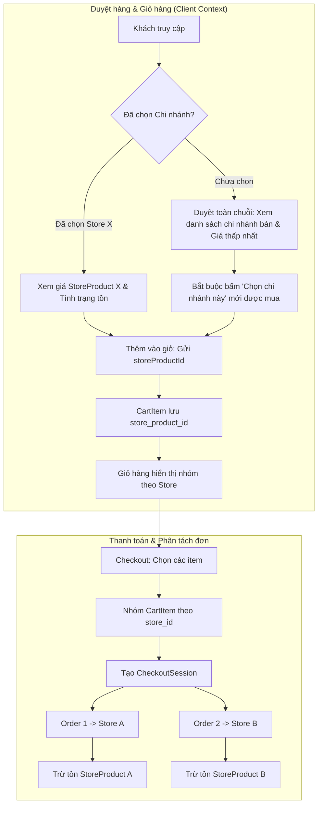
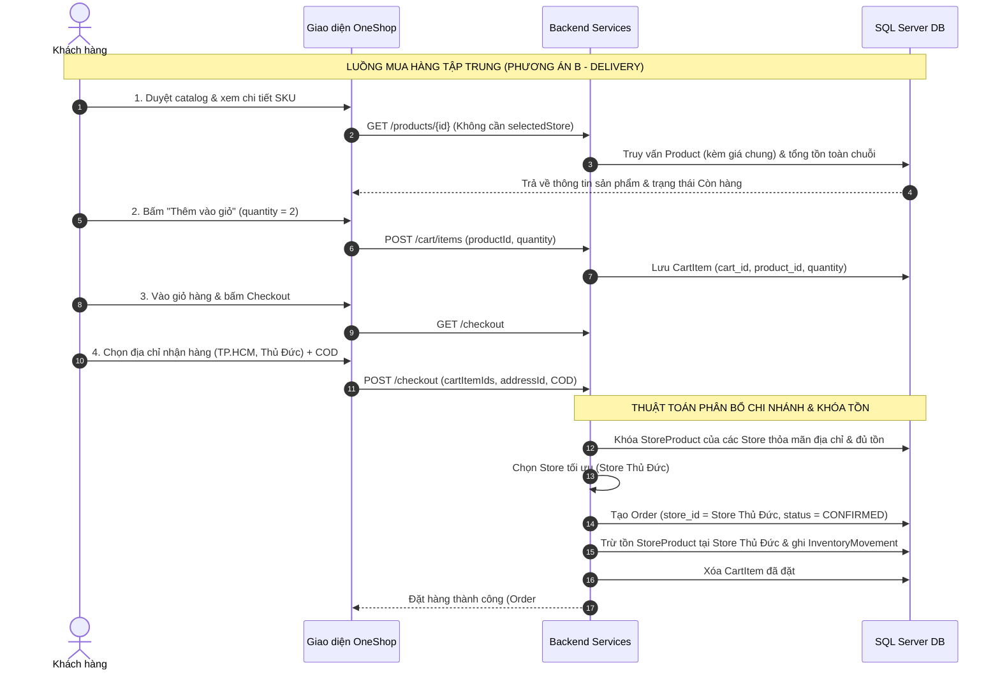
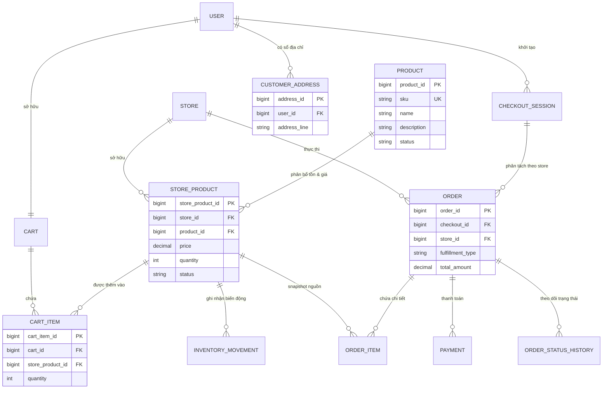
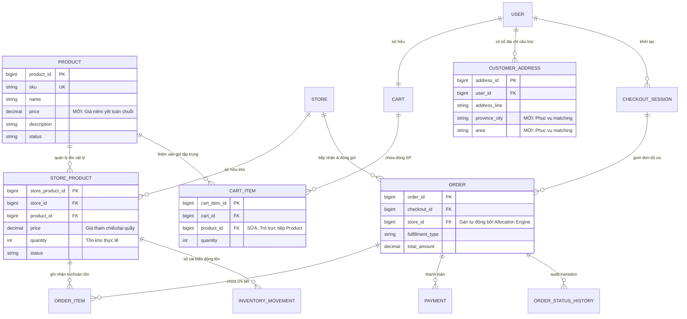
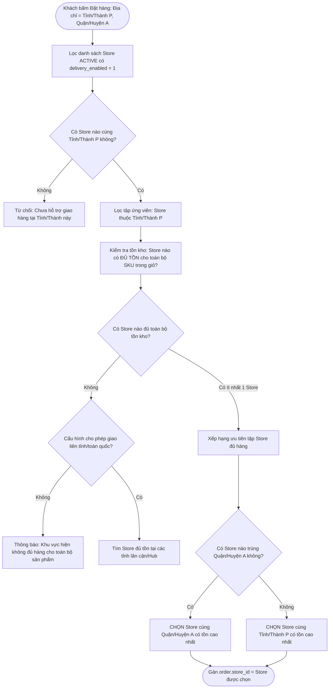

# BÁO CÁO KHẢO SÁT CHUYỂN ĐỔI NGHIỆP VỤ ONESHOP SANG PHƯƠNG ÁN B
## Deep Impact Assessment: Business Model, Database Architecture & Implementation Feasibility

> **Tài liệu khảo sát & Đánh giá kiến trúc phần mềm**  
> **Dự án:** Hệ thống Thương mại Điện tử Bán lẻ Mỹ phẩm Chuỗi OneShop  
> **Phiên bản khảo sát:** 1.0 (Đối chiếu từ Roadmap Kỹ thuật V2 sang Phương án B - Mua hàng tập trung)  
> **Tác giả:** Senior Software Architect, Business Analyst & Database Architect  
> **Trạng thái:** DỰ THẢO KHẢO SÁT & ĐỀ XUẤT (Chờ Chủ dự án phê duyệt — Tuyệt đối không chỉnh sửa source code/database ở giai đoạn này)

---

## MỤC LỤC CHI TIẾT

1. [Executive Summary](#1-executive-summary)
2. [Mô hình OneShop V2 Hiện tại (Phương án A)](#2-mô-hình-oneshop-v2-hiện-tại-phương-án-a)
3. [Mục tiêu và Kỳ vọng của Phương án B](#3-mục-tiêu-và-kỳ-vọng-của-phương-án-b)
4. [Khảo sát Thực tế và Đối chiếu Đa chiều](#4-khảo-sát-thực-tế-và-đối-chiếu-đa-chiều)
5. [So sánh Chi tiết 20 Luồng Nghiệp vụ (Business Flow Comparison A vs B)](#5-so-sánh-chi-tiết-20-luồng-nghiệp-vụ-business-flow-comparison-a-vs-b)
6. [Đánh giá Hệ thống Hiện đang Triển khai (As-Is Architecture Review)](#6-đánh-giá-hệ-thống-hiện-đang-triển-khai-as-is-architecture-review)
7. [Ma trận Tác động Business Rules (BR-01 đến BR-18)](#7-ma-trận-tác-động-business-rules-br-01-đến-br-18)
8. [Đánh giá Tác động Chuyên sâu Cơ sở Dữ liệu (Deep Database Impact Assessment — 19 Bảng)](#8-đánh-giá-tác-động-chuyên-sâu-cơ-sở-dữ-liệu-deep-database-impact-assessment--19-bảng)
9. [Sơ đồ Quan hệ Thực thể Logic (ERD Logic Before & After)](#9-sơ-đồ-quan-hệ-thực-thể-logic-erd-logic-before--after)
10. [Thiết kế Chi tiết Các Phân hệ Cốt lõi (Core Domain Redesign)](#10-thiết-kế-chi-tiết-các-phân-hệ-cốt-lõi-core-domain-redesign)
11. [Chiến lược Xác định và Phân bổ Chi nhánh (Store Allocation Strategies)](#11-chiến-lược-xác-định-và-phân-bổ-chi-nhánh-store-allocation-strategies)
12. [Phân tích Tính Nhất quán về Giá bán và Tồn kho (Price & Stock Consistency)](#12-phân-tích-tính-nhất-quán-về-giá-bán-và-tồn-kho-price--stock-consistency)
13. [Đánh giá Tác động Lên Backend (Spring Boot & JPA Architecture)](#13-đánh-giá-tác-động-lên-backend-spring-boot--jpa-architecture)
14. [Đánh giá Tác động Lên Frontend và Trải nghiệm Người dùng (UI/UX)](#14-đánh-giá-tác-động-lên-frontend-và-trải-nghiệm-người-dùng-uiux)
15. [Ma trận Tác động Bộ Kiểm thử Bắt buộc (TC-01 đến TC-18 & Test Mới)](#15-ma-trận-tác-động-bộ-kiểm-thử-bắt-buộc-tc-01-đến-tc-18--test-mới)
16. [So sánh Toàn diện Ba Phương án Kiến trúc (B1 vs B2 vs B3)](#16-so-sánh-toàn-diện-ba-phương-án-kiến-trúc-b1-vs-b2-vs-b3)
17. [Phân tích Rủi ro Kỹ thuật và Biện pháp Kiểm soát](#17-phân-tích-rủi-ro-kỹ-thuật-và-biện-pháp-kiểm-soát)
18. [Chiến lược Di chuyển Dữ liệu Bảo toàn (Data Migration Strategy)](#18-chiến-lược-di-chuyển-dữ-liệu-bảo-toàn-data-migration-strategy)
19. [Danh sách Quyết định Nghiệp vụ Cần Chủ Dự án Phê duyệt](#19-danh-sách-quyết-định-nghiệp-vụ-cần-chủ-dự-án-phê-duyệt)
20. [Phương án Khuyến nghị Cuối cùng](#20-phương-án-khuyến-nghị-cuối-cùng)
- [Phần bổ sung A: Danh mục Thay đổi Bắt buộc Theo Mức Độ Ưu tiên (P0 / P1 / P2)](#phần-bổ-sung-a-danh-mục-thay-đổi-bắt-buộc-theo-mức-độ-ưu-tiên-p0--p1--p2)
- [Phần bổ sung B: Tổng kết Tác động Tinh gọn (Impact Summary)](#phần-bổ-sung-b-tổng-kết-tác-động-tinh-gọn-impact-summary)

---

## 1. EXECUTIVE SUMMARY

Báo cáo này được thực hiện nhằm đánh giá tác động toàn diện (**Deep Impact Assessment**) của việc chuyển đổi mô hình mua sắm trên hệ thống OneShop từ **Phương án A (Mua hàng phân mảnh theo chi nhánh được chọn trước)** sang **Phương án B (Mua hàng tập trung — Centralized Brand Shopping Experience)** tương tự như trải nghiệm của các chuỗi bán lẻ mỹ phẩm lớn (Hasaki, Watsons, Sephora).

### 1.1. Bối cảnh Hệ thống Hiện tại
Hệ thống OneShop hiện tại đã hoàn thành triển khai toàn bộ các giai đoạn từ Phase 1 đến Phase 12 theo **Roadmap Kỹ thuật V2**, đạt mốc nghiệm thu kỹ thuật với **928 automated tests (927 PASS, 0 FAIL, 0 ERROR, 1 live verification opt-in)** trên cơ sở dữ liệu Microsoft SQL Server thật. Kiến trúc hiện tại bám sát mô hình chuỗi phân tán:
- Khách hàng bắt buộc phải chọn chi nhánh trước khi thêm sản phẩm vào giỏ (`CartItem` trỏ tới `StoreProduct`).
- Giỏ hàng chia nhóm theo từng chi nhánh.
- Một lần checkout phân tách thành nhiều `Order` tương ứng với từng chi nhánh.
- Giá bán và tồn kho được quản lý độc lập tại từng `StoreProduct`.

### 1.2. Thách thức Cốt lõi của Phương án B
Khi chuyển sang Phương án B, mục tiêu là mang lại cho khách hàng trải nghiệm duyệt danh mục, thêm vào giỏ và mua hàng thống nhất toàn chuỗi mà **không cần chọn chi nhánh từ trước đối với đơn giao hàng (DELIVERY)**; chỉ chọn chi nhánh đối với đơn nhận tại cửa hàng (STORE_PICKUP). Việc chuyển đổi này tạo ra hai bài toán kiến trúc sống còn:
1. **Bài toán Giá bán (The Price Dilemma):** Nếu không chọn chi nhánh trước, sản phẩm hiển thị trên trang chủ và trang chi tiết với mức giá nào khi `StoreProduct.price` giữa các cửa hàng có sự chênh lệch?
2. **Bài toán Phân bổ Đơn hàng (Store Allocation & Stock Dilemma):** Tại thời điểm checkout, hệ thống dựa trên tiêu chí nào để phân bổ đơn hàng cho một chi nhánh cụ thể mà không phá vỡ tính toàn vẹn tồn kho, không gây overselling và không vi phạm giới hạn kỹ thuật (không dùng GPS, bản đồ hay bài toán tối ưu logistics phức tạp)?

### 1.3. Kết luận và Khuyến nghị Sơ bộ
- **Tính khả thi:** Việc chuyển đổi sang Phương án B là **hoàn toàn khả thi** trong phạm vi đồ án công nghệ (Spring Boot + Thymeleaf + JPA + SQL Server) **NẾU VÀ CHỈ NẾU** áp dụng phương án tái cấu trúc có kiểm soát (**Phương án B2**).
- **Phạm vi tác động cơ sở dữ liệu:** Trong tổng số 19 bảng của Roadmap V2, có **16 bảng giữ nguyên hoàn toàn**, chỉ cần sửa đổi **3 bảng** (`products`, `customer_addresses`, `cart_items`) và **0 bảng mới bắt buộc**.
- **Chính sách giá bán khuyến nghị:** Bắt buộc áp dụng **Giá bán thống nhất toàn chuỗi (Chain-wide Uniform Pricing)** bằng cách bổ sung cột `price` vào bảng `products`. Mọi nỗ lực duy trì giá riêng theo chi nhánh trong luồng mua tập trung đều dẫn đến xung đột trải nghiệm nghiêm trọng (nhảy giá tại checkout).
- **Chính sách phân bổ khuyến nghị:** Phân bổ đơn hàng theo **khu vực hành chính (Tỉnh/Thành phố & Quận/Huyện) kết hợp kiểm tra đủ tồn kho toàn bộ giỏ hàng (Single-Store Fulfillment)**. Không triển khai chia đơn tự động phức tạp hay định tuyến vận chuyển đa điểm.

---

## 2. MÔ HÌNH ONESHOP V2 HIỆN TẠI (PHƯƠNG ÁN A)

Theo tài liệu *OneShop Roadmap Kỹ thuật V2* và hiện trạng mã nguồn, hệ thống đang vận hành theo mô hình chuỗi bán lẻ có sự phân mảnh điểm bán ngay từ giao diện khách hàng:



### Các đặc trưng kỹ thuật then chốt của Phương án A:
1. **Product là SKU chung:** Bảng `products` đại diện cho một SKU mỹ phẩm cụ thể nhưng **không có giá bán** và **không có số lượng tồn kho**.
2. **StoreProduct là nguồn sự thật (Single Source of Truth):** Bảng `store_products` lưu trữ `price`, `quantity`, `status` cho từng cặp `(store_id, product_id)`.
3. **Ngữ cảnh duyệt hàng (Browsing Context):** Khách duyệt hàng ở chế độ "Toàn chuỗi" chỉ có thể xem danh sách các chi nhánh đang bán và giá thấp nhất; không thể thêm vào giỏ hàng nếu chưa chuyển ngữ cảnh sang một chi nhánh cụ thể thông qua cookie `selectedStore`.
4. **CartItem gắn chặt StoreProduct:** Bảng `cart_items` có khóa ngoại `store_product_id`. Nếu khách mua cùng 1 SKU tại 2 chi nhánh khác nhau, giỏ hàng sẽ có 2 dòng riêng biệt.
5. **Checkout đa chi nhánh:** Người dùng chọn các item cần mua, hệ thống gom nhóm theo `store_id`, mỗi nhóm chọn phương thức nhận hàng (`DELIVERY` hoặc `STORE_PICKUP`) và thanh toán riêng, tạo thành các `Order` độc lập thuộc cùng một `CheckoutSession`.
6. **Bảo mật và Vận hành Staff:** Nhân viên (`ROLE_STAFF`) chỉ được phân công vào các chi nhánh nhất định (`staff_store_assignments`) và chỉ được xem, xử lý các đơn hàng có `orders.store_id` thuộc phạm vi phụ trách.

---

## 3. MỤC TIÊU VÀ KỲ VỌNG CỦA PHƯƠNG ÁN B

Phương án B hướng tới việc xóa bỏ rào cản chọn chi nhánh ban đầu, nâng cao tỷ lệ chuyển đổi (conversion rate) và đồng nhất nhận diện thương hiệu OneShop theo mô hình mua sắm hiện đại:

### 3.1. Đối với Khách hàng Giao hàng Tận nơi (DELIVERY)
1. **Duyệt hàng tập trung:** Khách truy cập danh mục sản phẩm, tìm kiếm, xem chi tiết và nhìn thấy **một mức giá bán niêm yết duy nhất** của thương hiệu OneShop.
2. **Hành động tức thì:** Nút **"Thêm vào giỏ hàng"** và **"Mua ngay"** luôn khả dụng nếu sản phẩm còn hàng tại bất kỳ chi nhánh nào trong hệ thống, không yêu cầu người dùng phải chọn chi nhánh trước.
3. **Giỏ hàng thống nhất:** Giỏ hàng là một danh sách sản phẩm phẳng, liền mạch, không bị chia cắt theo chi nhánh.
4. **Checkout tự động điều phối:** Khi khách hàng nhập địa chỉ giao hàng (Tỉnh/Thành, Quận/Huyện):
   - Hệ thống tự động xác định chi nhánh phù hợp nhất theo quy tắc nghiệp vụ định trước.
   - Hệ thống kiểm tra điều kiện tồn kho và khóa bản ghi.
   - Đơn hàng được tạo tự động với `store_id` được gán cho chi nhánh xử lý.
5. **Fulfillment nội bộ:** Nhân viên chi nhánh được phân công nhận đơn và tiến hành đóng gói, giao hàng mà không cần khách hàng phải quan tâm đơn được xuất từ kho nào.

### 3.2. Đối với Khách hàng Nhận tại Cửa hàng (STORE_PICKUP)
1. Khách hàng lựa chọn phương thức "Nhận tại cửa hàng" tại trang chi tiết hoặc trang giỏ hàng/checkout.
2. Khách hàng chủ động chọn chi nhánh thuận tiện để đến nhận.
3. Hệ thống kiểm tra khả năng đáp ứng tồn kho tại đúng chi nhánh đó.
4. Đơn hàng tạo thành công với mã nhận hàng `pickup_code`, chi nhánh được chọn chuẩn bị hàng và xác nhận giao khi khách đến.

---

## 4. KHẢO SÁT THỰC TẾ VÀ ĐỐI CHIẾU ĐA CHIỀU

Nhằm đảm bảo tính khách quan và khoa học, quá trình phân tích thực hiện đối chiếu đa chiều giữa 4 nguồn dữ liệu:

| Tiêu chí | (1) Roadmap V2 Quy định | (2) Source Code Thực tế Đang chạy | (3) Website Thực tế Xác minh (Hasaki / Watsons / Sephora) | (4) Đề xuất Kỹ thuật Mới cho Phương án B |
| :--- | :--- | :--- | :--- | :--- |
| **Giá bán sản phẩm** | Nằm trong `StoreProduct.price`. Mỗi chi nhánh có thể có giá khác nhau. | Đúng như quy định: `Product` không có giá; `StoreProduct` lưu giá riêng; seed data có SKU giá 129k, 135k, 139k. | **Hasaki / Sephora / Watsons:** Hiển thị 1 giá bán duy nhất trên catalog/detail toàn quốc. Giá đồng nhất toàn hệ thống. | **Đề xuất B:** Chuyển giá bán niêm yết thành thuộc tính chung của `Product` (`products.price`). Đồng nhất giá toàn chuỗi. |
| **Thêm vào giỏ hàng** | Khách phải chọn chi nhánh trước; `CartItem` trỏ tới `StoreProduct`. | Code tại `ProductController`, template `detail.html` ẩn nút Add-to-cart nếu chưa có store; `CartServiceImpl.addItem` nhận `storeProductId`. | **Hasaki:** Bấm thêm vào giỏ lập tức mà không cần quan tâm chi nhánh. Chỉ hỏi địa chỉ khi giao 2H hoặc checkout. | **Đề xuất B:** `CartItem` trỏ trực tiếp tới `Product`. Cho phép thêm vào giỏ mọi lúc nếu hệ thống còn tồn kho. |
| **Cấu trúc Giỏ hàng** | Nhóm theo Store (`CartStoreGroupResponse`). Khách tick chọn từng nhóm. | Code `CartServiceImpl.toResponse` nhóm theo `Store`. Giao diện checkout nhận danh sách item theo store. | **Hasaki / Sephora:** Giỏ hàng là 1 danh sách phẳng thống nhất của thương hiệu. | **Đề xuất B:** Giỏ hàng phẳng toàn chuỗi. Tổng tiền = tổng giá trị các SKU trong giỏ. |
| **Xác định Chi nhánh (Fulfillment)** | Do khách hàng tự chọn ngay từ đầu thông qua việc chọn store mua hàng. | Khách tự chọn; Order sinh ra mang `store_id` của nhóm sản phẩm được chọn. | **Hasaki:** Backend tự động phân bổ kho/cửa hàng gần nhất phục vụ theo địa chỉ nhận hàng (NowFree 2H hoặc tiêu chuẩn). | **Đề xuất B:** Backend tự động phân bổ chi nhánh tại bước Checkout dựa trên địa chỉ giao hàng và tồn kho. |
| **Nhận tại cửa hàng (Pickup)** | Khách chọn store, đơn thuộc store đó; sinh `pickup_code` khi READY. | Đã triển khai hoàn chỉnh ở `PickupFulfillmentServiceImpl`, có mã nhận hàng, thời gian `ready_at`, `picked_up_at`. | **Sephora / Ulta / Hasaki:** Khách chọn cửa hàng nhận hàng (BOPIS / Click & Collect), hệ thống kiểm tra tồn tại cửa hàng đó. | **Đề xuất B:** TÁI SỬ DỤNG 100% luồng BOPIS hiện tại, chỉ thay đổi vị trí khách chọn cửa hàng (chọn khi checkout pickup). |
| **Công nghệ & Logistics** | Monolith Spring Boot, SQL Server, không GPS, không map, không WMS. | Đúng 100% phạm vi: monolith, kiểm tra giao dịch SQL Server ACID với Pessimistic Locking. | Các hệ thống lớn dùng OMS/WMS chuyên biệt và bản đồ số tính khoảng cách. | **Đề xuất B:** Tuyệt đối KHÔNG dùng GPS/Bản đồ. Phân bổ chi nhánh thuần túy dựa trên so khớp Tỉnh/Thành, Quận/Huyện. |

---

## 5. SO SÁNH CHI TIẾT 20 LUỒNG NGHIỆP VỤ (BUSINESS FLOW COMPARISON A vs B)

Dưới đây là bảng phân tích chi tiết toàn diện 20 luồng nghiệp vụ giữa Phương án A và Phương án B:



### Bảng chi tiết 20 Luồng:

| STT | Luồng Nghiệp vụ | Hiện tại (Phương án A) | Mục tiêu (Phương án B) | Bước Loại bỏ | Bước Bổ sung | Bước Giữ nguyên | Rủi ro & Tác động |
| :--- | :--- | :--- | :--- | :--- | :--- | :--- | :--- |
| **1** | **Duyệt danh mục** | Phụ thuộc `selectedStoreId`. Nếu có store: chỉ hiện SP của store đó; nếu không: hiện toàn chuỗi kèm danh sách store bán. | Duyệt danh mục chung toàn chuỗi. Hiển thị giá niêm yết duy nhất và nhãn Còn hàng/Hết hàng toàn chuỗi. | Loại bỏ bộ lọc ngầm theo `selectedStoreId` trên thanh điều hướng. | Thêm tính toán trạng thái còn hàng tổng hợp toàn chuỗi. | Truy vấn phân trang, tìm kiếm theo tên, danh mục, thương hiệu. | Tác động câu truy vấn Catalog; cần tối ưu index kiểm tra tồn toàn chuỗi. |
| **2** | **Xem chi tiết sản phẩm** | Phải có store mới hiện giá và nút Mua. Nếu chưa chọn store: hiện thông báo "Chọn chi nhánh để xem giá và đặt mua". | Hiển thị đầy đủ giá chung, mô tả, ảnh, nút "Thêm vào giỏ" và "Mua ngay". Có bảng tra cứu khả dụng tại các store (tham khảo). | Loại bỏ điều kiện chặn nút Mua khi chưa có store. Loại bỏ cảnh báo bắt buộc chọn store. | Thêm danh sách trực quan: "Xem cửa hàng có sẵn sản phẩm này gần bạn". | Hiển thị ảnh Cloudinary, thông tin thương hiệu, danh mục, review. | Cần điều chỉnh DTO `ProductDetailResponse` và template Thymeleaf `detail.html`. |
| **3** | **Hiển thị giá** | Lấy từ `StoreProduct.price` của store đang chọn. Giá có thể khác nhau giữa các store. | Hiển thị giá niêm yết thống nhất toàn chuỗi từ `Product.price`. | Loại bỏ hiển thị giá biến thiên theo store trên trang sản phẩm chính. | Hiển thị thống nhất một giá bán duy nhất trên toàn hệ thống. | Định dạng tiền tệ VND (`fragments/components :: price`). | Cần chuẩn hóa dữ liệu giá trong database. |
| **4** | **Hiển thị tồn kho** | Hiển thị tình trạng Còn/Hết hàng tại store đang chọn (`StoreProduct.quantity > 0`). | Hiển thị Còn hàng nếu tổng tồn toàn chuỗi `SUM(quantity) > 0`. | Loại bỏ phụ thuộc vào tồn kho của một store duy nhất khi duyệt web. | Bổ sung hàm tính tổng tồn khả dụng toàn hệ thống. | Giữ nguyên quy tắc BR-15: Khách không thấy số lượng cụ thể, chỉ thấy Còn/Hết. | Nếu sản phẩm còn hàng ở tỉnh xa nhưng hết ở khu vực khách, có thể gây thất vọng khi checkout. |
| **5** | **Thêm vào giỏ** | Request gửi `storeProductId` và `quantity`. Kiểm tra tồn của đúng `StoreProduct` đó. | Request gửi `productId` và `quantity`. Kiểm tra tồn toàn chuỗi có `>= quantity`. | Loại bỏ tham số `storeProductId` trong request. | Kiểm tra tổng tồn toàn chuỗi trước khi thêm vào giỏ. | Logic tăng số lượng nếu đã có trong giỏ; chặn số lượng âm/bằng 0. | Cấu trúc bảng `cart_items` bị thay đổi khóa ngoại. |
| **6** | **Cập nhật/Xóa giỏ** | Kiểm tra số lượng mới với `StoreProduct.quantity` của store đã chọn. | Kiểm tra số lượng mới với tổng tồn toàn chuỗi. Xóa bình thường. | Bỏ kiểm tra tồn cục bộ một store khi sửa số lượng trong giỏ. | Bổ sung kiểm tra tổng tồn toàn chuỗi. | Logic xóa item khỏi giỏ, tính lại tổng tiền giỏ hàng. | Ít rủi ro; giảm thiểu lỗi khách bị chặn oan khi store cũ hết hàng. |
| **7** | **Mua ngay (Buy Now)** | Yêu cầu đã chọn store, tạo giỏ hoặc đưa thẳng vào checkout của store đó. | Đưa thẳng 1 SKU vào phiên checkout tập trung mà không qua chọn store. | Loại bỏ bước yêu cầu chọn store trước khi bấm Mua ngay. | Tự động tạo checkout preview cho 1 SKU với giá chung. | Logic thanh toán và tạo đơn. | Cải thiện mạnh mẽ tỷ lệ chuyển đổi UX. |
| **8** | **Nhập địa chỉ giao** | Địa chỉ chỉ dùng để nhân viên giao hàng; không ảnh hưởng tới việc chọn chi nhánh. | Địa chỉ (Tỉnh/Thành, Quận/Huyện) là **cơ sở quyết định** để hệ thống tìm chi nhánh phân bổ. | Không loại bỏ bước nào. | Bắt buộc thu thập Tỉnh/Thành, Quận/Huyện có cấu trúc (thay vì 1 chuỗi tự do). | Lưu địa chỉ vào sổ địa chỉ khách hàng (`customer_addresses`). | Cần chuẩn hóa bảng `customer_addresses` để có trường lọc chuẩn xác. |
| **9** | **Chọn phương thức nhận** | Chọn riêng cho từng Store group trong giỏ hàng (Group A chọn Delivery, Group B chọn Pickup). | Khách chọn 1 phương thức nhận hàng cho toàn bộ giỏ hàng (`DELIVERY` hoặc `STORE_PICKUP`). | Loại bỏ việc chọn phương thức nhận hàng phân mảnh theo từng store group. | Bổ sung lựa chọn phương thức nhận hàng mức đơn hàng tổng. | Hỗ trợ 2 phương thức: `DELIVERY` và `STORE_PICKUP`. | Đơn giản hóa biểu mẫu checkout rất nhiều. |
| **10** | **Xác định chi nhánh** | Khách tự xác định từ đầu (qua nút chọn store hoặc add từ store cụ thể). | Hệ thống tự động phân bổ qua thuật toán Matching tại thời điểm Checkout. | Loại bỏ quyền chỉ định store của khách đối với đơn `DELIVERY`. | Thêm Service phân bổ chi nhánh: `StoreAllocationService`. | Khách vẫn được chọn store nếu là đơn `STORE_PICKUP`. | Đây là logic nghiệp vụ cốt lõi mới cần thiết kế chặt chẽ. |
| **11** | **Kiểm tra & Giữ tồn** | Khóa `StoreProduct` của các store đã chọn, trừ tồn trực tiếp. | Sau khi thuật toán chọn được Store, khóa `StoreProduct` của Store đó và trừ tồn. | Bỏ việc khóa store do client chỉ định. | Khóa tồn theo Store do thuật toán đề xuất; rollback nếu phát hiện thiếu hàng. | Sử dụng `@Lock(PESSIMISTIC_WRITE)` và SQL transaction ACID. | Tránh triệt để Deadlock bằng cách sắp xếp ID khóa tăng dần. |
| **12** | **Checkout nhiều SP** | Giỏ hàng có nhiều store -> Sinh nhiều Order tương ứng từng store. | Cố gắng gom toàn bộ giỏ vào 1 Order do 1 Store xử lý (Single-Store fulfillment). | Bỏ giao diện checkout phân mảnh thành nhiều khối chi nhánh. | Cơ chế cảnh báo nếu giỏ hàng không thể gom về 1 chi nhánh duy nhất. | Tạo `CheckoutSession` để quản lý phiên checkout. | Tránh việc khách bị nhận hàng xé lẻ từ nhiều shipper khác nhau. |
| **13** | **Tạo Order/OrderItem** | Tạo 1 Order cho mỗi Store group. `OrderItem` lưu `store_product_id`. | Tạo 1 Order gắn với Store được phân bổ. `OrderItem` lưu `store_product_id` của store đó. | Bỏ vòng lặp tạo đa Order theo client group. | Gán `store_id` từ kết quả thuật toán phân bổ. | `OrderItem` vẫn snapshot đầy đủ: `product_name`, `unit_price`, `quantity`, `subtotal`. | Cấu trúc bảng `orders` và `order_items` được giữ nguyên vẹn. |
| **14** | **Xử lý thanh toán** | Thanh toán riêng cho từng Order (Order 1 COD, Order 2 VNPAY/Online). | Khách thanh toán 1 lần cho toàn bộ đơn hàng (hoặc phiên checkout). | Bỏ việc chọn phương thức thanh toán rời rạc từng chi nhánh. | Một giao dịch thanh toán duy nhất cho toàn bộ giỏ hàng. | Các phương thức: `COD`, `ONLINE`, `PAY_AT_STORE`. | Khách hàng thuận tiện hơn rất nhiều khi thanh toán Online. |
| **15** | **Xử lý đơn giao hàng** | Nhân viên store của Order thực hiện: CONFIRMED -> PREPARING -> PACKED -> SHIPPING -> COMPLETED. | Nhân viên chi nhánh được phân bổ tiếp nhận và xử lý fulfillment y hệt luồng hiện tại. | Không loại bỏ bước nào trong quy trình của nhân viên. | Không bổ sung bước mới cho nhân viên. | Giữ nguyên 100% State Machine của `DeliveryFulfillmentService`. | Nhân viên không bị ảnh hưởng quy trình làm việc. |
| **16** | **Nhận tại cửa hàng** | Khách chọn store từ đầu; đến đúng store đó nhận; nhân viên nhập `pickup_code`. | Khách chọn store muốn nhận tại bước checkout; nhân viên store đó tiếp nhận. | Bỏ chọn store ở trang chi tiết sản phẩm. | Khách chọn store nhận hàng tại Checkout. | Giữ nguyên 100% State Machine của `PickupFulfillmentService` và sinh `pickup_code`. | Giữ vững tính năng BOPIS đã hoàn thiện ở Phase 9 & 10. |
| **17** | **Hủy đơn & Hoàn tồn** | Hủy Order -> hoàn tồn về đúng `store_product_id` trong snapshot -> ghi `CANCEL_ORDER`. | Hủy Order -> hoàn tồn về đúng `store_product_id` của chi nhánh đã xử lý đơn. | Không loại bỏ. | Không bổ sung. | Giữ nguyên 100% logic hoàn kho của `InventoryServiceImpl.restoreForCancelledOrder`. | Bảo đảm số lượng tồn kho luôn cân bằng tuyệt đối. |
| **18** | **Theo dõi trạng thái** | Khách xem danh sách Order, mỗi Order hiển thị tên chi nhánh phụ trách. | Khách xem danh sách Order; hiển thị "Chi nhánh phục vụ: OneShop X". | Không loại bỏ. | Thêm hiển thị thông tin chi nhánh điều phối trên giao diện theo dõi. | Giữ nguyên timeline và `order_status_history`. | Minh bạch thông tin xuất kho cho khách hàng. |
| **19** | **Quản lý đơn Staff** | Staff chỉ thấy và xử lý đơn thuộc store được phân công (`StaffStoreScopeService`). | Staff vẫn chỉ thấy và xử lý đơn thuộc store được phân công. | Không loại bỏ. | Không bổ sung. | Giữ nguyên 100% cơ chế bảo mật và phân quyền Staff Store Scope. | Không làm xáo trộn phân quyền bảo mật cốt lõi. |
| **20** | **Quản lý SP/Tồn Admin** | Admin quản lý SKU, StoreProduct ma trận, chỉnh sửa tồn từng store. | Admin quản lý SKU + Giá niêm yết chung; quản lý tồn kho từng chi nhánh. | Bỏ nhập giá riêng từng store (hoặc chỉ dùng giá store làm giá bán tại quầy). | Bổ sung ô nhập giá niêm yết tại màn hình Quản lý Sản phẩm chung (`AdminProductController`). | Quản lý tồn kho theo chi nhánh, lịch sử điều chỉnh `STOCK_ADJUST`. | Đơn giản hóa việc quản lý giá cho Admin chuỗi. |

---

## 6. ĐÁNH GIÁ HỆ THỐNG HIỆN ĐANG TRIỂN KHAI (AS-IS ARCHITECTURE REVIEW)

Khảo sát trực tiếp toàn bộ mã nguồn tại `d:\One_Shop` cho thấy hiện trạng triển khai kỹ thuật như sau:

### 6.1. Tầng Thực thể (JPA Entities)
- **19 Entity tương ứng 19 bảng:** Đầy đủ các quan hệ theo Roadmap V2 (`Product`, `StoreProduct`, `Store`, `Cart`, `CartItem`, `CheckoutSession`, `Order`, `OrderItem`, `Payment`, `InventoryMovement`, `OrderStatusHistory`, `Review`, v.v.).
- **Điểm neo chặt vào Phương án A:**
  - `Product.java`: Không có trường `price` hay `quantity`. Chú thích ghi rõ: *"One sellable SKU, shared by the whole chain (BR-01). It has no price or quantity of its own: those live in StoreProduct."*
  - `CartItem.java`: Dòng 31 có quan hệ `@ManyToOne` trỏ tới `StoreProduct`, ràng buộc Unique `UQ_cart_items_cart_store_product` trên `(cart_id, store_product_id)`.
  - `CustomerAddress.java`: Chỉ có trường `address_line` (chuỗi văn bản 500 ký tự), **hoàn toàn chưa có cột tách biệt** cho `province_city` hay `area`.
  - `Store.java`: Đã có sẵn `province_city` (NVARCHAR 100) và `area` (NVARCHAR 100), cùng các cờ `delivery_enabled` và `pickup_enabled`.

### 6.2. Tầng Dịch vụ (Service Layer)
- **CartService / CartServiceImpl:** Toàn bộ logic phụ thuộc vào `storeProductId`. Hàm `addItem` nhận `storeProductId`, kiểm tra tồn kho tại store đó, gán `item.setStoreProduct(storeProduct)`. Hàm `toResponse` thực hiện gom nhóm phức tạp theo `Store` để trả về `List<CartStoreGroupResponse>`.
- **CheckoutService / CheckoutServiceImpl:** Hàm `placeOrder` nhận `CheckoutRequest` chứa danh sách `StoreGroupCheckoutRequest`. Kiểm tra khóa `StoreProduct` theo từng store, sinh `Order` riêng cho mỗi store.
- **InventoryService / InventoryServiceImpl:** Xử lý trừ kho (`deductForOrder`) và hoàn kho (`restoreForCancelledOrder`) dựa trên `StoreProduct`. Đã hoàn thiện việc ghi chép `InventoryMovement` với đầy đủ `quantity_before`, `quantity_change`, `quantity_after`, `reference_order_id`. Logic này rất chặt chẽ và chuẩn mực.
- **OrderService & State Machine:** Phân tách hoàn hảo giữa chính sách chuyển đổi trạng thái (`OrderTransitionPolicy`) và ghi nhận dữ liệu audit (`OrderServiceImpl`, `OrderStatusHistoryRepository`).
- **StaffStoreScopeService:** Đã bảo vệ nghiêm ngặt ở tầng backend: Staff chỉ có thể truy vấn đơn hàng và tồn kho thuộc các chi nhánh trong `staff_store_assignments`.

### 6.3. Tầng Giao diện và Web Interceptor
- `SelectedStoreInterceptor` & `SelectedStoreCookie`: Đọc và ghi chi nhánh đang chọn từ cookie trình duyệt (`oneshop_selected_store`), đưa vào `request.setAttribute("selectedStore", ...)`.
- Template Thymeleaf (`product/detail.html`): Chặn hành vi mua hàng nếu `selectedStore == null` (hiển thị alert: *"Bạn đang xem toàn chuỗi. Chọn một chi nhánh bên dưới để xem giá và đặt mua"*).

### 6.4. Hiện trạng Kiểm thử (Test Suite)
- Toàn bộ 18 test cases cốt lõi (`TC-01` đến `TC-18`) đã được viết hoàn chỉnh trong các file tích hợp Spring Boot (`*IntegrationTest.java`).
- Chạy thực tế trên SQL Server thật: 928 tests, bảo đảm không có lỗi hồi quy (regression) và bảo đảm tính toàn vẹn concurrency.

---

## 7. MA TRẬN TÁC ĐỘNG BUSINESS RULES (BR-01 ĐẾN BR-18)

Bắt buộc rà soát toàn bộ 18 Business Rules theo Roadmap V2 để xác định mức độ điều chỉnh khi chuyển sang Phương án B:

| Mã Rule | Nội dung Quy định tại Roadmap V2 | Phù hợp B? | Hành động | Nội dung Điều chỉnh Cần thiết trong Phương án B | Mức độ Tác động |
| :--- | :--- | :---: | :---: | :--- | :---: |
| **BR-01** | Một `Product` là một SKU bán được cụ thể và có thể xuất hiện tại nhiều Store. | CÓ | **KEEP** | Giữ nguyên định nghĩa: Mỗi Product là một SKU cụ thể (không tạo bảng Variant riêng). | Thấp |
| **BR-02** | `StoreProduct` là nguồn sự thật về price, quantity và status của SKU tại một Store. | MỘT PHẦN | **MODIFY** | `StoreProduct` tiếp tục là nguồn sự thật về **quantity** và **status** tại từng chi nhánh. Giá bán niêm yết chuyển lên `Product.price`. `StoreProduct.price` có thể giữ làm giá bán tại quầy hoặc đồng bộ. | Cao |
| **BR-03** | Client có thể duyệt toàn chuỗi hoặc chọn `selectedStoreId` để chuyển sang ngữ cảnh một chi nhánh. | MỘT PHẦN | **MODIFY** | Client duyệt toàn chuỗi làm mặc định duy nhất. Khái niệm chọn chi nhánh chỉ kích hoạt khi khách hàng chọn hình thức `STORE_PICKUP`. | Trung bình |
| **BR-04** | Khi không chọn Store, kết quả cho biết SKU đang có ở những Store nào; khi đã chọn Store, chỉ trả dữ liệu `StoreProduct` của Store đó. | KHÔNG | **REPLACE** | Trang danh mục và chi tiết luôn trả dữ liệu sản phẩm toàn chuỗi kèm giá niêm yết chung. Trạng thái còn hàng được tổng hợp từ toàn bộ các chi nhánh ACTIVE. | Cao |
| **BR-05** | `CartItem` luôn tham chiếu `StoreProduct`; do đó một SKU ở hai Store là hai lựa chọn mua khác nhau. | KHÔNG | **REPLACE** | `CartItem` chuyển sang tham chiếu trực tiếp `Product`. Khách hàng mua sản phẩm của thương hiệu OneShop, không mua sản phẩm gắn với chi nhánh cụ thể. | Rất Cao |
| **BR-06** | Cart có thể chứa `CartItem` từ nhiều Store và UI phải nhóm rõ theo Store. | KHÔNG | **REPLACE** | Cart là một giỏ mua sắm thống nhất toàn chuỗi, hiển thị danh sách phẳng, không phân nhóm theo Store. | Cao |
| **BR-07** | Một checkout có thể tạo nhiều Order; một Order chỉ thuộc đúng một Store. | MỘT PHẦN | **MODIFY** | Vẫn giữ nguyên bất biến: **Một Order chỉ thuộc đúng một Store**. Tuy nhiên, checkout ưu tiên phân bổ để tạo ra **duy nhất 1 Order** do 1 Store xử lý (Single-Store fulfillment). Chỉ tạo nhiều Order nếu kích hoạt chính sách tách đơn khi giỏ hàng thiếu hàng cục bộ. | Cao |
| **BR-08** | Mỗi Store group tại checkout có `fulfillment_type` và `payment_method` riêng. | KHÔNG | **REPLACE** | Mỗi phiên checkout chỉ có 1 `fulfillment_type` và 1 `payment_method` chung cho toàn bộ đơn hàng/giỏ hàng. | Trung bình |
| **BR-09** | Checkout luôn tải lại price/quantity từ DB, lock/kiểm tra tồn và trừ kho trong transaction. | CÓ | **KEEP** | Giữ nguyên 100%. Đây là nền tảng chống overselling và gian lận giá của hệ thống. | Thấp |
| **BR-10** | Staff không duyệt việc có cho tạo Order hay không; hệ thống tự xác nhận đơn hợp lệ. Staff chỉ xử lý fulfillment. | CÓ | **KEEP** | Giữ nguyên 100%. Hệ thống tự động xác nhận đơn và điều phối về cho chi nhánh phù hợp. | Thấp |
| **BR-11** | `STORE_PICKUP` sử dụng `READY_FOR_PICKUP` và `pickup_code`. | CÓ | **KEEP** | Giữ nguyên 100%. Luồng nhận tại cửa hàng không thay đổi sau khi đơn được gán cho store. | Thấp |
| **BR-12** | Hủy Order hợp lệ phải hoàn tồn đúng `StoreProduct` và ghi nhận biến động kho. | CÓ | **KEEP** | Giữ nguyên 100%. Đơn do Store nào xử lý khi hủy sẽ hoàn tồn chính xác về Store đó qua `OrderItem.store_product_id`. | Thấp |
| **BR-13** | Mọi thay đổi trạng thái Order được kiểm tra transition ở Service và ghi `OrderStatusHistory`. | CÓ | **KEEP** | Giữ nguyên 100%. State Machine và Audit Ledger giữ nguyên vẹn. | Thấp |
| **BR-14** | Staff chỉ truy cập Store được phân công; điều kiện Store phải được kiểm tra ở backend. | CÓ | **KEEP** | Giữ nguyên 100%. Phân quyền bảo mật của nhân viên chi nhánh không thay đổi. | Thấp |
| **BR-15** | Client chỉ thấy Còn hàng/Hết hàng; số lượng tồn chính xác chỉ dành cho Staff/Admin. | CÓ | **KEEP** | Giữ nguyên 100%. Bảo mật dữ liệu tồn kho thương mại đối với người dùng phổ thông. | Thấp |
| **BR-16** | Không tự chuyển `CartItem` sang Store khác khi người dùng đổi `selectedStoreId`. | KHÔNG | **REMOVE** | Bãi bỏ hoàn toàn vì giỏ hàng không còn gắn với `selectedStoreId`. | Trung bình |
| **BR-17** | Không xóa cứng dữ liệu đã có lịch sử giao dịch; dùng status INACTIVE/HIDDEN. | CÓ | **KEEP** | Giữ nguyên 100%. Tính toàn vẹn dữ liệu lịch sử được bảo toàn. | Thấp |
| **BR-18** | Payment gắn với Order, không gắn trực tiếp CheckoutSession. | CÓ | **KEEP** | Giữ nguyên 100%. Đảm bảo thanh toán đối soát chính xác theo từng đơn hàng thực tế. | Thấp |

---

## 8. ĐÁNH GIÁ TÁC ĐỘNG CHUYÊN SÂU CƠ SỞ DỮ LIỆU (DEEP DATABASE IMPACT ASSESSMENT — 19 BẢNG)

### 8.1. Ma trận Đánh giá Đầy đủ 19 Bảng Dữ liệu

| STT | Bảng | Vai trò Hiện tại (Phương án A) | Tác động của Phương án B | Đánh giá | Thay đổi Trường / FK / Constraint | Lý do Kỹ thuật |
| :---: | :--- | :--- | :--- | :---: | :--- | :--- |
| **1** | `roles` | Lưu quyền: CUSTOMER, STAFF, ADMIN | Không tác động | **GIỮ NGUYÊN** | Không thay đổi | Phân quyền người dùng giữ nguyên vẹn. |
| **2** | `users` | Tài khoản, mật khẩu, thông tin cá nhân | Không tác động | **GIỮ NGUYÊN** | Không thay đổi | Định danh người dùng giữ nguyên. |
| **3** | `customer_addresses` | Lưu địa chỉ giao hàng dạng chuỗi tự do (`address_line`) | **Tác động lớn:** Cần dữ liệu cấu trúc để hệ thống so khớp chi nhánh giao hàng mà không dùng bản đồ | **SỬA** | **Thêm cột:**<br>- `province_city NVARCHAR(100) NULL`<br>- `area NVARCHAR(100) NULL` | Hiện tại bảng chỉ có `address_line NVARCHAR(500)`. Để backend phân bổ được store cùng Tỉnh/Quận mà không cần Google Geocoding API, bắt buộc phải có 2 trường này. |
| **4** | `stores` | Metadata chi nhánh: code, name, address, province_city, area, cờ delivery/pickup | Không tác động cấu trúc; đã có sẵn `province_city` và `area` | **GIỮ NGUYÊN** | Không thay đổi | Cấu trúc hiện tại đã có đủ thông tin địa giới hành chính phục vụ matching. |
| **5** | `staff_store_assignments` | Phân công Staff -> Store | Không tác động | **GIỮ NGUYÊN** | Không thay đổi | Nhân viên vẫn vận hành theo phạm vi chi nhánh được phân công. |
| **6** | `categories` | Danh mục sản phẩm | Không tác động | **GIỮ NGUYÊN** | Không thay đổi | Cấu trúc phân loại sản phẩm không đổi. |
| **7** | `brands` | Thương hiệu sản phẩm | Không tác động | **GIỮ NGUYÊN** | Không thay đổi | Thông tin thương hiệu không đổi. |
| **8** | `products` | SKU chung toàn chuỗi; không có giá, không có tồn kho | **Tác động rất lớn:** Cần một giá niêm yết thống nhất toàn chuỗi khi khách duyệt hàng tập trung | **SỬA** | **Thêm cột:**<br>- `price DECIMAL(18,2) NOT NULL DEFAULT 0`<br>**Thêm Constraint:**<br>- `CK_products_price CHECK (price >= 0)` | Phương án B đòi hỏi giá hiển thị đồng nhất toàn quốc. Đưa giá vào `products` giải quyết triệt để bài toán hiển thị giá và giỏ hàng. |
| **9** | `product_images` | Ảnh Cloudinary theo sản phẩm | Không tác động | **GIỮ NGUYÊN** | Không thay đổi | Quản lý đa phương tiện giữ nguyên. |
| **10** | `store_products` | Nguồn sự thật về price, quantity, status tại từng Store | Chỉ còn là nguồn sự thật về **quantity** và **status**. Cột `price` có thể giữ làm giá tại quầy hoặc đồng bộ | **GIỮ NGUYÊN**<br>*(hoặc sửa nhẹ)* | **Giữ nguyên cấu trúc bảng**.<br>Cột `price` giữ nguyên hoặc nullable/sync với `products.price` | Không cần xóa cột `price` để tránh làm gãy các store procedure, view hoặc code cũ; chỉ cần quy ước nghiệp vụ. |
| **11** | `inventory_movements` | Audit biến động kho theo StoreProduct: ORDER, CANCEL_ORDER, STOCK_ADJUST | Không tác động cấu trúc. Vẫn audit biến động kho của từng `store_product_id` | **GIỮ NGUYÊN** | Không thay đổi | Toàn bộ cơ chế sổ cái tồn kho được tái sử dụng 100%. |
| **12** | `carts` | Mỗi User sở hữu đúng 1 Cart | Không tác động | **GIỮ NGUYÊN** | Không thay đổi | Vẫn duy trì quan hệ 1-1 giữa User và Cart. |
| **13** | `cart_items` | Lưu sản phẩm trong giỏ; trỏ tới `store_product_id` | **Tác động rất lớn:** Khách thêm SP khi chưa chọn store, nên không thể trỏ tới `StoreProduct` | **SỬA** | **Thay đổi cột & FK:**<br>- Đổi FK từ `store_product_id` sang `product_id`<br>- Đổi Unique Constraint từ `UQ_cart_items_cart_store_product` thành `UQ_cart_items_cart_product(cart_id, product_id)` | Khách thêm sản phẩm vào giỏ hàng chung của thương hiệu OneShop, không gắn với cửa hàng cụ thể nào. |
| **14** | `checkout_sessions` | Nhóm các Order của một phiên checkout | Không tác động | **GIỮ NGUYÊN** | Không thay đổi | Vẫn dùng để nhóm các đơn hàng sinh ra từ cùng một hành động checkout của khách. |
| **15** | `orders` | Mỗi Order thuộc đúng 1 Store; lưu fulfillment, payment, status | Không tác động cấu trúc. `store_id` được gán giá trị sau khi thuật toán phân bổ chạy xong | **GIỮ NGUYÊN** | Không thay đổi | Duy trì nguyên tắc cốt lõi: 1 Order thuộc 1 Store để Staff vận hành, đóng gói và in phiếu xuất kho. |
| **16** | `order_items` | Snapshot tên SP, đơn giá, số lượng, subtotal; lưu `store_product_id` để hoàn tồn | Không tác động cấu trúc. Sau khi Store được chọn, `store_product_id` của store đó được ghi vào đây | **GIỮ NGUYÊN** | Không thay đổi | Bảo toàn hoàn hảo khả năng hoàn kho chính xác khi hủy đơn (`BR-12`). |
| **17** | `payments` | Giao dịch thanh toán gắn theo Order | Không tác động | **GIỮ NGUYÊN** | Không thay đổi | Thanh toán theo Order giữ nguyên tính độc lập và đối soát. |
| **18** | `order_status_history` | Audit lịch sử chuyển trạng thái Order | Không tác động | **GIỮ NGUYÊN** | Không thay đổi | Timeline đơn hàng giữ nguyên 100%. |
| **19** | `reviews` | Đánh giá sản phẩm sau khi đơn hoàn tất; gắn với `order_id` | Không tác động | **GIỮ NGUYÊN** | Không thay đổi | Đã liên kết `order_id` ở Phase V2.1 (DEXUAT.md), suy ra chi nhánh qua `orders.store_id`. |

---

### 8.2. Phân tích Chuyên sâu 8 Chủ đề Cốt lõi (A đến H)

#### A. Product và StoreProduct
- **Có tiếp tục giữ Product là một SKU chung toàn chuỗi không?**  
  **Có.** Giữ nguyên 100%. Mỗi `Product` đại diện cho một SKU bán được cụ thể (ví dụ son BBIA màu #06 là 1 Product, màu #08 là 1 Product). Điều này giúp hệ thống không phát sinh module `ProductVariant` phức tạp.
- **StoreProduct có tiếp tục là nơi quản lý tồn kho không?**  
  **Có.** `StoreProduct` vẫn là nơi duy nhất lưu trữ số lượng tồn kho vật lý (`quantity`) và trạng thái kinh doanh (`status`) của SKU tại từng chi nhánh.
- **Giá bán có cần được tách hoặc chuẩn hóa lại không?**  
  **Bắt buộc.** Cần đưa `price` vào bảng `products` làm giá niêm yết bán lẻ toàn hệ thống. Tại bảng `store_products`, cột `price` có thể giữ lại để phục vụ trường hợp giá bán trực tiếp tại quầy trong tương lai hoặc tự động đồng bộ theo `Product.price`.
- **Cần thay đổi quan hệ Product–StoreProduct hay không?**  
  **Không.** Quan hệ vẫn là 1-N (`Product 1--N StoreProduct N--1 Store`). Khóa duy nhất `UQ_store_products_store_product (store_id, product_id)` giữ nguyên vẹn.

#### B. Cart và CartItem
- **`CartItem` còn nên tham chiếu trực tiếp `StoreProduct` không?**  
  **Tuyệt đối không.** Nếu `CartItem` vẫn tham chiếu `StoreProduct`, khách hàng bắt buộc phải chọn chi nhánh trước khi thêm giỏ, điều này phủ định hoàn toàn mục tiêu của Phương án B.
- **CartItem phải lưu thông tin gì trong Phương án B?**  
  `CartItem` chỉ lưu: `cart_item_id`, `cart_id`, `product_id`, `quantity`, `created_at`, `updated_at`.
- **Cách làm tránh thay đổi quá nhiều bảng?**  
  Chỉ sửa duy nhất bảng `cart_items` (đổi cột `store_product_id` thành `product_id`). Toàn bộ cấu trúc bảng `carts` giữ nguyên.
- **Dữ liệu giỏ hàng cũ cần xử lý ra sao?**  
  Trước khi chạy migration, chạy script chuyển đổi: lấy `product_id` từ `store_products` tương ứng điền vào `cart_items`, gộp các dòng trùng `(cart_id, product_id)` bằng hàm `SUM(quantity)`. Chi tiết xem mục 18.

#### C. CheckoutSession
- **Có tiếp tục sử dụng CheckoutSession không?**  
  **Có.** `CheckoutSession` đóng vai trò là container gom nhóm phiên thanh toán. Dù phiên checkout sinh ra 1 Order (Single-Store) hay nhiều Order (nếu chia đơn), `CheckoutSession` vẫn là điểm neo để hiển thị trang kết quả đơn hàng (`/checkout/{checkoutId}`).
- **Một checkout còn có thể tạo nhiều Order không?**  
  Về mặt kiến trúc CSDL: **Vẫn hoàn toàn hỗ trợ** quan hệ 1-N (`CheckoutSession 1--N Order`). Về mặt nghiệp vụ: Thuật toán phân bổ ưu tiên tối đa việc gom tất cả sản phẩm về 1 Order duy nhất.
- **Tính toàn vẹn giao dịch được bảo đảm ra sao?**  
  Toàn bộ quá trình: Phân bổ Store -> Khóa tồn kho `StoreProduct` -> Tạo `CheckoutSession` -> Tạo `Order` & `OrderItem` -> Trừ kho -> Xóa `CartItem` đều thực thi bên trong một transaction duy nhất với mức cô lập mặc định của SQL Server (`READ COMMITTED` kết hợp `UPDLOCK/XLOCK` thông qua JPA Pessimistic Write).

#### D. Order và OrderItem
- **Có tiếp tục giữ ràng buộc một Order thuộc một Store không?**  
  **Bắt buộc giữ.** Đây là quy tắc bất biến để hệ thống phân quyền Staff hoạt động. Một đơn hàng phải có một cửa hàng vật lý chịu trách nhiệm in vận đơn, đóng gói và bàn giao cho bưu tá hoặc giao cho khách pickup.
- **`store_id` được xác định khi nào?**  
  Được xác định tại thời điểm thực thi phương thức `CheckoutService.placeOrder()`, ngay sau khi thuật toán phân bổ tìm ra chi nhánh tối ưu và trước khi câu lệnh `orderRepository.save(order)` được gọi.
- **Có cần trạng thái trung gian trước khi phân bổ không?**  
  **Không cần thiết.** Vì trong kiến trúc nguyên khối (monolith), việc phân bổ diễn ra đồng bộ (synchronous) ngay trong request checkout. Nếu không tìm được store thỏa mãn, transaction bị rollback và ném ngoại lệ `BadRequestException` báo lỗi ngay trên form checkout, không tạo ra đơn hàng "mồ côi" không có store.
- **Lưu snapshot sản phẩm ra sao?**  
  `OrderItem` tiếp tục lưu: `product_name`, `unit_price` (lấy từ giá niêm yết tại thời điểm mua), `quantity`, `subtotal`, và `store_product_id` (của store được phân bổ).
- **Có cần bảng phân bổ đơn riêng không?**  
  **Không.** Tái sử dụng trực tiếp cột `orders.store_id`. Việc thêm bảng phân bổ là dư thừa và làm phức tạp hóa mô hình dữ liệu.

#### E. InventoryMovement
- **Lúc nào phát sinh biến động kho?**  
  Phát sinh ngay khi đơn hàng được tạo thành công trong transaction checkout.
- **Ghi nhận chi nhánh nào?**  
  Ghi nhận vào `store_product_id` của chi nhánh được hệ thống phân bổ xử lý đơn hàng.
- **Rollback và Hoàn kho thế nào?**  
  - Nếu transaction checkout lỗi: Rollback toàn bộ, không có bản ghi `InventoryMovement` nào được lưu (tính ACID của CSDL).
  - Nếu đơn hàng bị hủy hợp lệ sau đó: Service đọc danh sách `order_items`, lấy đúng `store_product_id` đã lưu và thực hiện hoàn tồn kho, ghi nhận bản ghi `CANCEL_ORDER` với `quantity_change > 0`. Logic này được tái sử dụng 100% từ hàm `InventoryServiceImpl.restoreForCancelledOrder()`.

#### F. Payment
- **Payment theo Order có tiếp tục phù hợp không?**  
  **Hoàn toàn phù hợp.** Mỗi `Order` gắn với 1 hoặc nhiều bản ghi `Payment`. Khi đơn hàng được phân bổ cho 1 chi nhánh, 1 `Order` duy nhất được sinh ra, kèm theo 1 bản ghi `Payment` tương ứng.
- **Nếu một checkout chia thành nhiều Order thì sao?**  
  Nếu áp dụng chiến lược chia đơn, mỗi Order sẽ có trạng thái thanh toán riêng. Khách có thể thanh toán Online chung thông qua cổng hoặc thanh toán COD khi từng shipper giao hàng tới.
- **Không đáp ứng được một phần đơn?**  
  Do kiểm tra tồn kho đồng bộ trước khi tạo đơn, không bao giờ xảy ra tình trạng "đơn đã tạo nhưng thiếu hàng" tại thời điểm checkout.

#### G. Store và CustomerAddress
- **Dữ liệu hiện tại đã đủ để phân bổ chi nhánh chưa?**  
  **Chưa đủ.** Hiện tại `stores` có `province_city` và `area`, nhưng `customer_addresses` chỉ có một chuỗi `address_line NVARCHAR(500)` tự do (ví dụ: *"12 Võ Văn Ngân, P. Linh Chiểu, TP. Thủ Đức"*). Backend không thể so khớp chính xác nếu không có cấu trúc chuẩn.
- **Bổ sung phạm vi phục vụ thế nào mà không cần GPS/Bản đồ?**  
  Bổ sung vào bảng `customer_addresses` 2 cột: `province_city NVARCHAR(100)` và `area NVARCHAR(100)`. Khi khách nhập hoặc chọn địa chỉ, chọn Tỉnh/Thành và Quận/Huyện từ danh mục chuẩn.
- **Cơ chế matching:**  
  So khớp trực tiếp:
  ```sql
  WHERE s.status = 'ACTIVE' 
    AND s.delivery_enabled = 1 
    AND s.province_city = customer_address.province_city
  ```
  Ưu tiên chi nhánh có `s.area = customer_address.area`. Nếu không có, mở rộng ra các chi nhánh khác trong cùng `province_city`.

#### H. StaffStoreAssignment và OrderStatusHistory
- **Phân quyền nhân viên có thay đổi không?**  
  **Không thay đổi.** Bảng `staff_store_assignments` và class `StaffStoreScopeService` được giữ nguyên vẹn. Nhân viên chỉ nhìn thấy và xử lý các đơn hàng có `orders.store_id` thuộc chi nhánh của mình.
- **Có cần trạng thái đơn mới không?**  
  **Không.** State machine hiện tại (`PENDING_PAYMENT`, `CONFIRMED`, `PREPARING`, `PACKED`, `SHIPPING`, `READY_FOR_PICKUP`, `COMPLETED`, `CANCELLED`) là hoàn chỉnh và đáp ứng 100% nghiệp vụ bán lẻ.

---

## 9. SƠ ĐỒ QUAN HỆ THỰC THỂ LOGIC (ERD LOGIC BEFORE & AFTER)

### 9.1. Sơ đồ ERD Hiện tại (Phương án A — Roadmap V2)
Trong mô hình này, `CartItem` trỏ trực tiếp tới `StoreProduct`. `Product` không có giá bán:



---

### 9.2. Sơ đồ ERD Mục tiêu (Phương án B — Centralized Brand Shopping)
Trong mô hình mới:
- `Product` có thêm trường `price` (giá niêm yết toàn chuỗi).
- `CartItem` trỏ trực tiếp vào `Product` (không còn phụ thuộc `StoreProduct`).
- `customer_addresses` bổ sung `province_city` và `area` để phục vụ tự động phân bổ chi nhánh.
- `Order` và `OrderItem` vẫn giữ nguyên quan hệ với `Store` và `StoreProduct` sau khi phân bổ thành công.



---

## 10. THIẾT KẾ CHI TIẾT CÁC PHÂN HỆ CỐT LÕI (CORE DOMAIN REDESIGN)

### 10.1. Phân hệ Sản phẩm và Tồn kho (Product & Inventory)
- **Danh mục & Chi tiết sản phẩm:** Khách hàng duyệt sản phẩm lấy thông tin trực tiếp từ bảng `products`. Thuộc tính `price` được lấy từ `products.price`.
- **Kiểm tra tồn kho tổng hợp (Chain-wide Availability):**
  - Trạng thái `inStock = (SELECT SUM(quantity) FROM store_products WHERE product_id = :pId AND status = 'ACTIVE') > 0`.
  - Khách hàng không nhìn thấy số lượng cụ thể (tuân thủ `BR-15`), chỉ thấy nhãn: **Còn hàng** hoặc **Tạm hết hàng**.
- **Tra cứu tồn theo chi nhánh (In-Store Availability Widget):** Ngay tại trang chi tiết sản phẩm, cung cấp một khối tra cứu (Accordion hoặc Modal) hiển thị danh sách các chi nhánh đang có sẵn hàng (dựa trên các `store_products` có `quantity > 0`). Điều này tương đồng với tính năng *"Check in-store availability"* của Watsons, Sephora và Ulta Beauty, giúp khách hàng có nhu cầu mua trực tiếp hoặc Click & Collect biết trước địa điểm có hàng.

### 10.2. Phân hệ Giỏ hàng (Centralized Cart)
- `CartItem` được chuẩn hóa:
  ```java
  public class CartItem extends TimestampedEntity {
      // ...
      @ManyToOne(fetch = FetchType.LAZY, optional = false)
      @JoinColumn(name = "product_id", nullable = false)
      private Product product;

      @Column(nullable = false)
      private int quantity;
  }
  ```
- **Thêm vào giỏ:** API `POST /cart/items` chỉ nhận `productId` và `quantity`. Service kiểm tra tổng tồn khả dụng toàn chuỗi. Nếu tổng tồn `>= quantity`, thêm mới hoặc cộng dồn vào `CartItem`.
- **Hiển thị giỏ:** Dữ liệu trả về là danh sách phẳng `CartItemResponse`. Thành tiền từng dòng = `product.getPrice() * quantity`. Tổng tiền giỏ hàng = tổng các dòng. Không còn các khối `CartStoreGroupResponse`.

### 10.3. Phân hệ Checkout & Tạo Đơn (Smart Checkout & Order Creation)
- **Đầu vào Checkout:**
  - Khách hàng tick chọn các `cartItemId`.
  - Đối với `DELIVERY`: Chọn địa chỉ nhận hàng (`addressId`) hoặc nhập người nhận, điện thoại, Tỉnh/Thành, Quận/Huyện, Địa chỉ chi tiết.
  - Đối với `STORE_PICKUP`: Chọn chi nhánh muốn đến nhận (`storeId`).
  - Chọn phương thức thanh toán: `COD` hoặc `ONLINE` (đối với Delivery); `PAY_AT_STORE` hoặc `ONLINE` (đối với Pickup).
- **Quy trình Xử lý Giao dịch tại `CheckoutService.placeOrder()`:**
  1. **Khóa giỏ hàng:** Khóa bản ghi `Cart` của khách hàng (`UPDLOCK`).
  2. **Tải dữ liệu SKU & Giá:** Tải lại thông tin các `Product` được chọn từ DB, tính toán tổng tiền chuẩn xác từ giá niêm yết DB (chống giả mạo giá - `BR-09`).
  3. **Xác định Chi nhánh (Store Allocation):**
     - Nếu `STORE_PICKUP`: Lấy `storeId` do khách chọn. Kiểm tra `store.isPickupEnabled() == true` và chi nhánh có đủ tồn cho tất cả các SKU đã chọn.
     - Nếu `DELIVERY`: Gọi `StoreAllocationPolicy` để tìm chi nhánh tối ưu có `delivery_enabled == true` và có đủ tồn cho toàn bộ giỏ hàng tại khu vực giao hàng.
  4. **Khóa bản ghi tồn kho:** Khóa các dòng `StoreProduct` của chi nhánh được chọn theo thứ tự ID tăng dần (`findAllByIdForUpdate`) để tránh deadlock.
  5. **Xác thực tồn kho lần cuối:** Kiểm tra `storeProduct.quantity >= line.quantity`. Nếu không đủ, ném ngoại lệ thông báo hết hàng.
  6. **Sinh đơn hàng:**
     - Tạo `CheckoutSession`.
     - Tạo 1 `Order` với `store_id` của chi nhánh đã chọn/phân bổ.
     - Tạo các `OrderItem` snapshot đầy đủ tên sản phẩm, giá niêm yết, số lượng, subtotal, và gắn khóa ngoại `store_product_id`.
  7. **Trừ tồn và Audit:** Gọi `inventoryService.deductForOrder()` để trừ số lượng và ghi bản ghi `InventoryMovement` loại `ORDER`.
  8. **Xóa dòng giỏ hàng:** Xóa các `CartItem` đã checkout thành công.

---

## 11. CHIẾN LƯỢC XÁC ĐỊNH VÀ PHÂN BỔ CHI NHÁNH (STORE ALLOCATION STRATEGIES)

### 11.1. Khảo sát 9 Tình huống Tồn kho và Vận hành Thực tế

1. **Sản phẩm còn hàng tại nhiều chi nhánh:** Hệ thống ưu tiên chọn chi nhánh nằm cùng Quận/Huyện với khách hàng. Nếu có nhiều chi nhánh cùng Quận/Huyện, chọn chi nhánh có tổng tồn kho dồi dào nhất.
2. **Sản phẩm chỉ còn tại một chi nhánh duy nhất:** Nếu chi nhánh đó hỗ trợ giao hàng toàn thành phố hoặc toàn quốc, phân bổ cho chi nhánh đó xử lý.
3. **Giỏ hàng nhiều sản phẩm, không chi nhánh nào đủ toàn bộ:**
   - *Theo Chiến lược Single-Store:* Báo lỗi rõ ràng cho khách hàng: *"Một số sản phẩm không có sẵn tại cùng một chi nhánh trong khu vực của bạn. Vui lòng tách đơn hoặc giảm số lượng."*
   - *Theo Chiến lược Multi-Store Split:* Tự động chia giỏ hàng thành 2 đơn hàng thuộc 2 chi nhánh khác nhau.
4. **Sản phẩm hết hàng toàn chuỗi:** Nút Mua bị vô hiệu hóa ngay từ trang sản phẩm/giỏ hàng. Nếu khách cố tình gửi request, backend chặn với mã lỗi 400.
5. **Chi nhánh có hàng nhưng không phục vụ khu vực giao hàng:** Hệ thống bỏ qua chi nhánh này trong danh sách ứng viên matching, tìm chi nhánh khác có phạm vi phục vụ phù hợp.
6. **Nhiều khách đồng thời mua SKU cuối cùng:** Áp dụng `@Lock(LockModeType.PESSIMISTIC_WRITE)` trên bản ghi `StoreProduct`. Giao dịch đến trước sẽ trừ tồn thành công; giao dịch đến sau thấy `quantity = 0` và bị từ chối an toàn, không gây âm kho (`CK_store_products_quantity CHECK (quantity >= 0)`).
7. **Khách thay đổi địa chỉ trước khi checkout:** Mỗi lần đổi địa chỉ trên form checkout, frontend gọi API tính toán lại hoặc form submit sẽ thực hiện phân bổ lại theo địa chỉ mới.
8. **Chi nhánh được chọn không còn đủ tồn tại thời điểm xác nhận:** Transaction bị rollback toàn bộ, trả về thông báo lỗi thân thiện để khách hàng cập nhật lại giỏ hàng.
9. **Đơn hàng gồm nhiều SKU phải lấy từ nhiều chi nhánh:** Trong phạm vi đồ án, khuyến nghị áp dụng giải pháp tối giản để kiểm soát độ phức tạp (xem mục 11.2).

---

### 11.2. Đánh giá Ba Chiến lược Phân bổ Đơn hàng

| Tiêu chí Đánh giá | Chiến lược 1: Single-Store Fulfillment (Ưu tiên 1 Store đủ cả giỏ) | Chiến lược 2: Multi-Store Split Order (Tự động chia giỏ thành nhiều Order) | Chiến lược 3: Regional Hub Assignment (Phân bổ theo Store trung tâm vùng) |
| :--- | :--- | :--- | :--- |
| **Mô tả nghiệp vụ** | Thuật toán tìm 1 chi nhánh duy nhất thỏa mãn cả 2 điều kiện: (1) Phục vụ khu vực nhận hàng; (2) Có đủ toàn bộ các mặt hàng trong giỏ. | Thuật toán tối ưu hóa (Greedy) chia các mặt hàng trong giỏ thành số lượng Order ít nhất, mỗi Order do 1 Store xử lý. | Quy định 1 Store lớn nhất tại mỗi Tỉnh/Thành làm Store xử lý giao hàng mặc định cho toàn tỉnh đó. |
| **Độ phức tạp Nghiệp vụ** | **Thấp - Trung bình:** Logic rõ ràng, khách nhận 1 kiện hàng duy nhất. | **Rất Cao:** Khách nhận nhiều kiện, theo dõi nhiều mã vận đơn, phát sinh phí ship riêng. | **Rất Thấp:** Gán cứng Store theo Tỉnh/Thành. |
| **Ảnh hưởng CSDL** | **0 bảng mới.** Tái sử dụng nguyên vẹn cấu trúc `CheckoutSession 1--1 Order`. | **0 bảng mới.** Tái sử dụng cấu trúc `CheckoutSession 1--N Order` của Roadmap V2. | **0 bảng mới.** Chỉ cần cấu hình flag hoặc priority trong bảng `stores`. |
| **Ảnh hưởng Thanh toán** | **Cực kỳ đơn giản:** 1 thanh toán COD hoặc 1 giao dịch Online duy nhất. | **Phức tạp:** Thanh toán Online gộp hay tách? Nếu hủy 1 đơn con trong gói thì hoàn tiền ra sao? | **Cực kỳ đơn giản:** 1 thanh toán duy nhất. |
| **Chi phí & Logistics** | Tối ưu chi phí giao hàng, khách hàng hài lòng nhất. | Đội chi phí giao hàng (2-3 lần phí ship), dễ gây hiểu lầm cho khách hàng. | Đơn giản nhưng nếu Hub hết hàng thì không tận dụng được hàng ở các store phụ. |
| **Rủi ro Overselling** | Rất thấp; kiểm soát trong 1 transaction khóa các StoreProduct của 1 store. | Trung bình; phải khóa StoreProduct trên nhiều store cùng lúc, nguy cơ deadlock cao hơn. | Rất thấp. |
| **Độ phù hợp Đồ án** | **Cực kỳ phù hợp (Khuyến nghị số 1).** Đạt chuẩn chuyên nghiệp, không làm phình to hệ thống. | **Không khuyến nghị.** Vượt quá quy mô đồ án sinh viên, khó demo mượt mà. | Phù hợp làm phương án dự phòng (fallback). |

---

### 11.3. Thiết kế Thuật toán Phân bổ Không Dùng GPS / Geolocation

Để tuyệt đối không vi phạm nguyên tắc giới hạn phạm vi của Roadmap V2 (không tích hợp Google Maps API, tọa độ GPS hay routing phức tạp), thuật toán phân bổ theo khu vực hành chính (**Administrative Area Matching Algorithm**) được thiết kế như sau:



#### Quy tắc Xếp hạng Ưu tiên (Priority Scoring):
1. **Ưu tiên 1 (Exact Area Match):** `stores.province_city == address.province_city` VÀ `stores.area == address.area` (Điểm ưu tiên: 100).
2. **Ưu tiên 2 (Same City Match):** `stores.province_city == address.province_city` (Điểm ưu tiên: 50).
3. **Ưu tiên 3 (Stock Capacity):** Nếu có nhiều chi nhánh cùng mức ưu tiên, chọn chi nhánh có tổng số lượng tồn kho của các SKU trong giỏ lớn nhất (`SUM(StoreProduct.quantity)` lớn nhất).
4. **Tiêu chí phụ (Tie-breaker):** Chọn chi nhánh có `store_id` nhỏ nhất để đảm bảo kết quả có tính xác định (deterministic).

---

## 12. PHÂN TÍCH TÍNH NHẤT QUÁN VỀ GIÁ BÁN VÀ TỒN KHO (PRICE & STOCK CONSISTENCY)

### 12.1. Phân tích Bài toán Giá bán (The Price Dilemma)

Đây là rủi ro nghiệp vụ lớn nhất khi chuyển từ A sang B. Trong Phương án A, giá nằm ở `StoreProduct`, nghĩa là cùng một thỏi son có thể bán 189.000đ ở Thủ Đức nhưng 195.000đ ở Gò Vấp.

#### Khảo sát Hai Phương án Quản lý Giá:

| Tiêu chí | Phương án Giá 1: Giá Đồng nhất Toàn chuỗi (Uniform Pricing) | Phương án Giá 2: Giá Động theo Chi nhánh (Dynamic Store Pricing) |
| :--- | :--- | :--- |
| **Cơ chế hoạt động** | Thêm cột `price` vào bảng `products`. Toàn bộ chuỗi bán chung một giá niêm yết cho từng SKU. | Giữ nguyên cấu trúc `StoreProduct.price`. Catalog/Detail hiển thị giá tạm tính (giá min hoặc store mặc định). Đến khi nhập địa chỉ, hệ thống tính lại giá theo store được phân bổ. |
| **Trải nghiệm Khách hàng** | **Xuất sắc:** Khách duyệt giá nào, thêm vào giỏ giá đó, thanh toán đúng giá đó. Minh bạch, tạo sự tin tưởng tuyệt đối. | **Rất Kém:** Hiện tượng "Nhảy giá" tại Checkout. Khách thấy giá 189k, nhập địa chỉ xong tổng tiền nhảy lên thành 195k -> Khách cảm thấy bị lừa dối, tỷ lệ hủy đơn cao. |
| **Tác động Database** | Sửa bảng `products` (thêm cột `price`). Cập nhật seed data. | Không sửa bảng `products`. Giữ nguyên cấu trúc cũ. |
| **Tác động Backend** | Đơn giản: `Product.price` là nguồn sự thật duy nhất cho giá bán. DTO và Service tính toán cực kỳ gọn gàng. | Rất phức tạp: Phải xử lý logic cảnh báo đổi giá khi đổi địa chỉ; giỏ hàng không thể chốt giá trước checkout. |
| **Tính thực tế ngành Mỹ phẩm** | **Rất cao:** Các chuỗi mỹ phẩm chính hãng (Hasaki, Watsons, Guardian) đều niêm yết giá bán lẻ chuẩn theo hãng trên toàn quốc. | Thấp: Mô hình giá phân tán chỉ phù hợp với siêu thị thực phẩm tươi sống hoặc vùng sâu vùng xa có chi phí vận chuyển chênh lệch lớn. |
| **Khuyến nghị** | **KHUYẾN NGHỊ TUYỆT ĐỐI CHỌN PHƯƠNG ÁN NÀY.** | **BÁC BỎ.** Không khả thi về mặt UX và tính nhất quán giao dịch. |

#### Thời điểm Cố định Giá bán:
Giá bán của đơn hàng phải được **cố định vĩnh viễn (immutable snapshot)** tại thời điểm người dùng bấm "Đặt hàng" (`placeOrder`). 
- Cột `order_items.unit_price` ghi nhận giá tại thời điểm đặt hàng.
- Sau khi đơn được tạo, dù Admin có vào chỉnh sửa `products.price` thì đơn hàng cũ vẫn giữ nguyên giá trị snapshot (bảo toàn theo kiểm thử `TC-14`).

---

### 12.2. Tính Nhất quán Tồn kho và Chống Overselling

Để đảm bảo không bao giờ xảy ra tình trạng bán vượt tồn kho (overselling) khi nhiều khách hàng cùng tranh mua SKU cuối cùng:
1. **Kiểm tra sơ bộ (Optimistic Check):** Tại trang xem chi tiết và giỏ hàng, hệ thống chỉ kiểm tra tồn dạng đọc (`readOnly = true`) để hiển thị thông báo.
2. **Khóa bản ghi nghiêm ngặt (Pessimistic Locking):** Khi vào `placeOrder()`, hệ thống bắt buộc sử dụng `@Lock(LockModeType.PESSIMISTIC_WRITE)` trên các bản ghi `StoreProduct` của chi nhánh được chọn:
   ```java
   @Lock(LockModeType.PESSIMISTIC_WRITE)
   @Query("SELECT sp FROM StoreProduct sp WHERE sp.id IN :ids ORDER BY sp.id ASC")
   List<StoreProduct> findAllByIdForUpdate(@Param("ids") List<Long> ids);
   ```
3. **Thứ tự khóa chống Deadlock:** Các ID của `StoreProduct` luôn được sắp xếp theo thứ tự tăng dần (`ids.stream().sorted()`) trước khi gửi vào câu truy vấn khóa. Điều này bảo đảm hai giao dịch đồng thời không bao giờ rơi vào tình trạng deadlock tuần hoàn (Circular Deadlock).
4. **Tuyến phòng thủ cuối cùng tại CSDL:** Ràng buộc `CONSTRAINT CK_store_products_quantity CHECK (quantity >= 0)` bảo đảm ở tầng vật lý SQL Server không bao giờ tồn tại giá trị âm.

---

## 13. ĐÁNH GIÁ TÁC ĐỘNG LÊN BACKEND (SPRING BOOT & JPA ARCHITECTURE)

### 13.1. Danh mục Thành phần Backend Giữ nguyên 100%
- Toàn bộ cơ chế Security: `JwtAuthenticationFilter`, `JwtCookieService`, `JwtService`, `AppUserDetails`, `CustomUserDetailsService`.
- Toàn bộ phân hệ Staff Scope: `StaffStoreScopeService`, `StaffStoreScopeInterceptor`.
- Phân hệ Fulfillment & State Machine: `OrderTransitionPolicy`, `DeliveryFulfillmentService`, `DeliveryFulfillmentServiceImpl`, `PickupFulfillmentService`, `PickupFulfillmentServiceImpl`.
- Phân hệ Thanh toán: `PaymentService`, `PaymentServiceImpl` (xử lý COD, PAY_AT_STORE, ONLINE).
- Phân hệ Lưu trữ đám mây: `CloudinaryService`, `CloudinaryServiceImpl`.
- Phân hệ Đánh giá: `ReviewService`, `ReviewServiceImpl`.
- Quản lý Category & Brand: `CategoryService`, `AdminCategoryController`, `AdminBrandController`.

### 13.2. Danh mục Thành phần Backend Cần Chỉnh sửa Nghiệp vụ
1. **`Product.java` & `ProductMapper.java`:** Bổ sung trường `price` kiểu `BigDecimal`. Cập nhật các DTO `ProductResponse` và mapper tương ứng.
2. **`CartItem.java`:** Thay đổi trường `storeProduct` thành `product`.
3. **`CartService` & `CartServiceImpl`:**
   - Sửa hàm `addItem`: Nhận `productId` thay vì `storeProductId`.
   - Sửa hàm `getCart`: Không nhóm theo Store nữa, trả về danh sách phẳng các dòng sản phẩm.
   - Sửa `CartResponse`: Bỏ `List<CartStoreGroupResponse>`, chuyển thành `List<CartItemResponse>`.
4. **`CheckoutService` & `CheckoutServiceImpl`:**
   - Loại bỏ tham số `groups` dạng `List<StoreGroupCheckoutRequest>` trong `CheckoutRequest`.
   - Bổ sung bước gọi `StoreAllocationService` để tự động chọn chi nhánh.
   - Khóa các `StoreProduct` của chi nhánh được chọn và tiến hành trừ tồn.
5. **`StoreProductService` & `StoreProductServiceImpl`:**
   - Sửa hàm `getChainCatalog`: Trả về danh mục toàn chuỗi với giá từ `Product.price`.
   - Sửa hàm `getProductDetail`: Trả về giá chung, trạng thái còn hàng tổng hợp và danh sách các chi nhánh có sẵn hàng.
6. **`CustomerAddress.java` & DTO:** Bổ sung `provinceCity` và `area`.

### 13.3. Dịch vụ Mới Cần Bổ sung
- **`StoreAllocationService` (Interface & Implementation):**
  - Chịu trách nhiệm thực thi thuật toán phân bổ chi nhánh.
  - Nhận vào: Danh sách SKU + số lượng cần mua, Địa chỉ giao hàng (`province_city`, `area`), Loại fulfillment (`DELIVERY` / `STORE_PICKUP`), ID store khách chọn (nếu là Pickup).
  - Trả về: `Long allocatedStoreId` tối ưu nhất hoặc ném ngoại lệ nếu không có chi nhánh nào đáp ứng.

---

## 14. ĐÁNH GIÁ TÁC ĐỘNG LÊN FRONTEND VÀ TRẢI NGHIỆM NGƯỜI DÙNG (UI/UX)

| Trang / Thành phần Giao diện | Hiện trạng (Phương án A) | Thay đổi Cần thiết trong Phương án B | Đánh giá Mức độ Tác động |
| :--- | :--- | :--- | :---: |
| **Thanh Header & Navbar** | Luôn hiển thị dropdown "Chi nhánh đang chọn" (`SelectedStoreCookie`). Nếu chưa chọn, nhắc người dùng chọn. | Chuyển thành hiển thị tiện ích "Tìm cửa hàng gần bạn" (Store Locator) mang tính chất tham khảo. Không ép buộc người dùng phải chọn chi nhánh để mua sắm. | Trung bình |
| **Trang Danh mục (`/products`)** | Hiển thị giá theo store đã chọn hoặc nhãn "Xem giá tại chi nhánh". | Luôn hiển thị giá niêm yết chuẩn và nhãn "Còn hàng" / "Hết hàng". Trải nghiệm mua sắm đồng nhất. | Thấp |
| **Trang Chi tiết (`/products/{id}`)** | Nếu chưa chọn store: ẩn nút "Thêm vào giỏ", hiện alert bắt chọn store. | Luôn hiển thị giá, stepper chọn số lượng, nút **"Thêm vào giỏ hàng"** và **"Mua ngay"**. Thêm widget tra cứu: *"Có sẵn tại X cửa hàng"*. | Cao |
| **Giỏ hàng (`/cart`)** | Giao diện bị phân mảnh thành nhiều bảng card theo từng Chi nhánh. Mỗi nhóm có checkbox riêng. | Giao diện giỏ hàng phẳng chuẩn mực thương mại điện tử. Tất cả sản phẩm nằm chung trong một bảng danh sách. | Cao |
| **Trang Checkout (`/checkout`)** | Hiển thị lặp lại nhiều form con cho từng chi nhánh, mỗi chi nhánh bắt chọn Delivery/Pickup và thanh toán riêng. | Giao diện thanh toán tập trung 1 trang (One-page Checkout): Chọn địa chỉ -> Chọn phương thức nhận hàng -> Chọn thanh toán -> Bấm Đặt hàng. | Rất Cao |
| **Thông báo Hết hàng** | Thông báo hết hàng tại một chi nhánh cụ thể. | Thông báo rõ ràng: Sản phẩm hết hàng toàn chuỗi hoặc khu vực giao hàng hiện chưa có chi nhánh đáp ứng đủ số lượng. | Trung bình |
| **Trang Chi tiết Đơn hàng (`/orders/{id}`)** | Hiển thị thông tin store do khách đã chọn từ trước. | Hiển thị thông tin minh bạch: *"Đơn hàng được chuẩn bị và giao từ: OneShop [Tên Chi Nhánh]"*. | Thấp |

---

## 15. MA TRẬN TÁC ĐỘNG BỘ KIỂM THỬ BẮT BUỘC (TC-01 ĐẾN TC-18 & TEST MỚI)

Bộ kiểm thử TC-01 đến TC-18 theo Roadmap V2 cần được đánh giá lại chi tiết:

| Mã TC | Nội dung Kiểm thử Hiện tại | Đánh giá với Phương án B | Hướng Điều chỉnh |
| :---: | :--- | :---: | :--- |
| **TC-01** | Một SKU có tại 3 Store: Global view hiển thị đúng availability/giá theo Store. | **MODIFY** | Sửa thành: Global view hiển thị đúng **giá niêm yết chung** của SKU và trạng thái còn hàng nếu ít nhất 1 Store có tồn. |
| **TC-02** | Chọn Store A rồi tìm: Chỉ trả StoreProduct của Store A. | **REMOVE** | Bãi bỏ test này trên luồng client shopping vì khách không còn duyệt catalog bị lọc cứng theo 1 store. |
| **TC-03** | Product Detail đổi Store: Giá/availability đổi đúng; cart cũ không tự đổi Store. | **MODIFY** | Đổi thành: Product Detail hiển thị widget tra cứu các store có hàng; Cart lưu Product độc lập với Store. |
| **TC-04** | Thêm cùng StoreProduct 2 lần: Một CartItem, quantity tăng. | **MODIFY** | Sửa thành: Thêm cùng **Product** 2 lần: Một CartItem, quantity tăng cộng dồn. |
| **TC-05** | Cart từ 3 Store: UI chia đúng 3 group. | **REPLACE** | Thay thế bằng: Cart từ nhiều sản phẩm hiển thị chung 1 danh sách phẳng thống nhất toàn chuỗi. |
| **TC-06** | Checkout item từ 3 Store: Tạo 3 Order, mỗi Order đúng một Store. | **REPLACE** | Thay thế bằng: Checkout giỏ hàng tự động phân bổ về 1 Store tối ưu và tạo đúng 1 Order cho Store đó. |
| **TC-07** | Hai khách mua SKU cuối: Không âm kho; chỉ transaction hợp lệ được commit. | **KEEP** | **Giữ nguyên 100%.** Kiểm thử concurrency với Pessimistic Lock trên StoreProduct của chi nhánh được phân bổ. |
| **TC-08** | Giá client bị sửa: Backend dùng giá hệ thống. | **MODIFY** | Sửa thành: Backend kiểm tra và sử dụng `Product.price` từ cơ sở dữ liệu, bỏ qua mọi tham số giá từ request. |
| **TC-09** | DELIVERY + COD: Trải qua đủ vòng đời trạng thái. | **KEEP** | **Giữ nguyên 100%.** CONFIRMED -> PREPARING -> PACKED -> SHIPPING -> COMPLETED. |
| **TC-10** | STORE_PICKUP + PAY_AT_STORE: Đủ vòng đời + sinh pickup_code. | **KEEP** | **Giữ nguyên 100%.** CONFIRMED -> PREPARING -> READY_FOR_PICKUP -> COMPLETED. |
| **TC-11** | Staff A mở Order B: Backend từ chối (403/404). | **KEEP** | **Giữ nguyên 100%.** Phân quyền Store Scope của nhân viên chi nhánh không thay đổi. |
| **TC-12** | Hủy Order hợp lệ: CANCELLED + hoàn đúng StoreProduct + movement. | **KEEP** | **Giữ nguyên 100%.** Đơn hàng của Store nào khi hủy hoàn đúng tồn về StoreProduct của Store đó. |
| **TC-13** | Staff chỉnh tồn: Quantity thay đổi và có InventoryMovement STOCK_ADJUST. | **KEEP** | **Giữ nguyên 100%.** Kiểm thử kiểm kê tồn kho vật lý tại quầy của Staff. |
| **TC-14** | Đổi giá sau mua: OrderItem cũ giữ unit_price snapshot. | **KEEP** | **Giữ nguyên 100%.** Đổi giá niêm yết trong `products` không làm ảnh hưởng giá đơn hàng lịch sử. |
| **TC-15** | Payment khác nhau trong cùng checkout: Độc lập. | **MODIFY** | Điều chỉnh theo mô hình thanh toán tập trung của phiên checkout. |
| **TC-16** | Timeline trạng thái: OrderStatusHistory ghi đủ transition. | **KEEP** | **Giữ nguyên 100%.** Audit log lịch sử trạng thái đơn hàng. |
| **TC-17** | Upload ảnh: Cloudinary lưu file; SQL Server chỉ lưu URL/public_id. | **KEEP** | **Giữ nguyên 100%.** Không ảnh hưởng bởi luồng mua hàng. |
| **TC-18** | Store INACTIVE: Không cho tạo Order mới, dữ liệu lịch sử vẫn xem được. | **KEEP** | **Giữ nguyên 100%.** Thuật toán phân bổ tự động loại bỏ các Store INACTIVE. |

### Các Test Case Mới Bắt Buộc cho Phương án B:
- **TC-NEW-01 (Direct Add to Cart):** Khách vãng lai và khách đăng nhập thêm sản phẩm vào giỏ hàng thành công mà không có cookie `selectedStore`.
- **TC-NEW-02 (Store Allocation Matching):** Đặt hàng với địa chỉ tại Quận Thủ Đức -> Hệ thống tự động phân bổ chính xác cho Chi nhánh Thủ Đức (Store có sẵn hàng gần nhất).
- **TC-NEW-03 (Allocation Fallback to City):** Địa chỉ giao hàng tại Quận 2 (nơi không có store) -> Hệ thống tự động phân bổ cho Store cùng TP.HCM còn đủ hàng.
- **TC-NEW-04 (Allocation Failure Insufficient Stock):** Giỏ hàng có số lượng vượt quá khả năng đáp ứng của từng store riêng lẻ -> Hệ thống từ chối an toàn, hiển thị thông báo lỗi rõ ràng, không tạo đơn rác.
- **TC-NEW-05 (Store Pickup Explicit Branch):** Khách chọn nhận hàng tại Store Gò Vấp -> Đơn hàng gắn đúng `store_id` của Gò Vấp, kiểm tra tồn của riêng Gò Vấp và sinh mã `pickup_code`.

---

## 16. SO SÁNH TOÀN DIỆN BA PHƯƠNG ÁN KIẾN TRÚC (B1 vs B2 vs B3)

Nhằm cung cấp góc nhìn đa chiều cho chủ dự án, ba phương án kỹ thuật được đặt lên bàn cân:

- **Phương án B1 (Thay đổi tối thiểu — Virtual/Default Store Wrapper):** Giữ nguyên 100% CSDL hiện tại. Giao diện người dùng tự động gán ngầm một chi nhánh mặc định (Store 1) vào session/cookie của khách mà khách không biết. `CartItem` vẫn trỏ `store_product_id` của Store mặc định.
- **Phương án B2 (Tái cấu trúc có kiểm soát — Controlled Restructure):** Tách giá niêm yết lên `Product`. `CartItem` trỏ `Product`. Xây dựng `StoreAllocationService` phân bổ đơn hàng tự động tại thời điểm Checkout dựa trên khu vực hành chính và tồn kho.
- **Phương án B3 (Mô hình mở rộng — Asynchronous Routing & Split OMS):** Cho phép đặt đơn ở trạng thái `PENDING_ALLOCATION` (chưa có store). Sau khi thanh toán, hệ thống chạy background worker để định tuyến, tách đơn đa chi nhánh và điều phối logistics liên kho.

### Bảng So sánh 11 Tiêu chí Kỹ thuật:

| Tiêu chí So sánh | Phương án B1: Minimal Wrapper | Phương án B2: Controlled Restructure (Khuyến nghị) | Phương án B3: Extended Split OMS |
| :--- | :---: | :---: | :---: |
| **1. Độ chính xác Nghiệp vụ** | Kém (Bản chất vẫn là mua ở Store 1, không phản ánh đúng chuỗi) | **Rất Cao** (Đúng chuẩn trải nghiệm Hasaki/Watsons) | Rất Cao (Chuẩn hệ thống thương mại điện tử lớn) |
| **2. Trải nghiệm Khách hàng** | Trung bình (Dễ lỗi hết hàng ảo nếu Store mặc định hết hàng dù Store khác còn) | **Xuất sắc** (Mượt mà, tiện lợi, không rào cản) | Xuất sắc nhưng phức tạp khi nhận nhiều kiện hàng |
| **3. Số bảng CSDL cần sửa** | **0 bảng** | **3 bảng** (`products`, `customer_addresses`, `cart_items`) | 4-6 bảng (Thêm bảng routing, shipment, allocation) |
| **4. Mức độ thay đổi CSDL** | Không thay đổi | Thấp (Chỉ thêm cột và đổi 1 khóa ngoại) | Rất Cao (Thêm nhiều bảng và quan hệ mới) |
| **5. Mức độ thay đổi Backend** | Rất thấp (Chỉ sửa controller/interceptor) | **Trung bình** (Sửa Cart, Checkout, thêm Allocation Service) | Rất Cao (Thêm Message Queue, Job Worker, OMS Service) |
| **6. Khả năng tái sử dụng code cũ** | 95% | **85%** (Tái sử dụng toàn bộ Fulfillment, Inventory, Security, Staff) | Dưới 50% (Phải viết lại toàn bộ luồng đơn hàng) |
| **7. Độ khó triển khai** | Rất Dễ | **Vừa phải** (Hoàn toàn nằm trong tầm kiểm soát) | Rất Khó (Nguy cơ vỡ tiến độ rất cao) |
| **8. Rủi ro lỗi & Mất dữ liệu** | Cao về mặt logic tồn kho | **Rất Thấp** (Có chiến lược migration bảo toàn) | Cao (Phức tạp giao dịch phân tán) |
| **9. Độ mượt mà khi Demo** | Trung bình (Dễ bị lộ điểm yếu nếu thầy cô hỏi sâu) | **Rất Cao** (Luồng đi thông suốt, logic chặt chẽ, thuyết phục) | Rủi ro cao nếu worker xử lý chậm |
| **10. Khả thi trong phạm vi đồ án** | 100% | **100% (Khả thi tối ưu)** | Dưới 40% (Vượt quá chuẩn đồ án đại học) |
| **11. Nhất quán Giá & Tồn kho** | Thấp | **Tuyệt đối** | Trung bình - Phức tạp |

---

## 17. PHÂN TÍCH RỦI RO KỸ THUẬT VÀ BIỆN PHÁP KIỂM SOÁT

| Rủi ro Kỹ thuật | Khả năng xảy ra | Mức độ nghiêm trọng | Biện pháp Kiểm soát Cụ thể |
| :--- | :---: | :---: | :--- |
| **Lỗi phân bổ: Không chi nhánh nào đủ tồn kho toàn bộ giỏ** | Trung bình | Cao | Bắt lỗi tại Service, trả về thông báo chi tiết: liệt kê chính xác SKU nào đang thiếu hàng tại khu vực; gợi ý khách giảm số lượng. |
| **Xung đột khóa đồng thời (Deadlock) khi nhiều khách checkout** | Thấp | Rất Cao | Sắp xếp danh sách `store_product_id` theo thứ tự tăng dần trước khi gọi `@Lock(PESSIMISTIC_WRITE)`. Bắt ngoại lệ `ConcurrencyFailureException` và hướng dẫn khách thử lại. |
| **Đứt gãy dữ liệu giỏ hàng cũ sau khi chạy Migration** | Trung bình | Trung bình | Viết migration script bảo toàn: tự động gom nhóm `store_product_id` về `product_id`, cộng dồn số lượng trước khi xóa cột cũ. |
| **Nhập sai địa chỉ dẫn đến không match được chi nhánh nào** | Cao | Trung bình | Giao diện chọn địa chỉ bắt buộc sử dụng Dropdown (Select box) chọn Tỉnh/Thành và Quận/Huyện thay vì cho người dùng gõ tự do. |
| **Sai lệch giá giữa dữ liệu cũ và mới** | Thấp | Cao | Khi thêm cột `products.price`, script tự động lấy giá trung bình hoặc giá từ Store chính (Store 1) điền vào, đảm bảo `price > 0`. |

---

## 18. CHIẾN LƯỢC DI CHUYỂN DỮ LIỆU BẢO TOÀN (DATA MIGRATION STRATEGY)

Quá trình chuyển đổi cấu trúc CSDL từ Phương án A sang Phương án B phải tuân thủ nguyên tắc **Idempotent** và **Bảo toàn 100% dữ liệu lịch sử**:

### 18.1. Thứ tự Thực hiện Migration (4 Bước Tiêu chuẩn)

```text
[Bước 1: Backup CSDL] ---> [Bước 2: Sửa bảng products] ---> [Bước 3: Sửa bảng customer_addresses] ---> [Bước 4: Sửa bảng cart_items]
```

### 18.2. Kịch bản SQL Logic Dự kiến (Minh họa giải thuật, không chạy ở giai đoạn này)

1. **Bổ sung giá bán vào bảng `products`:**
   ```sql
   -- Thêm cột price
   ALTER TABLE dbo.products ADD price DECIMAL(18,2) NULL;
   
   -- Cập nhật giá niêm yết từ giá của StoreProduct chính (store_id = 1 hoặc giá nhỏ nhất)
   UPDATE p
   SET p.price = sp.price
   FROM dbo.products p
   CROSS APPLY (
       SELECT TOP 1 price FROM dbo.store_products 
       WHERE product_id = p.product_id AND status = 'ACTIVE' 
       ORDER BY store_id ASC
   ) sp;
   
   -- Thiết lập NOT NULL và CHECK constraint
   ALTER TABLE dbo.products ALTER COLUMN price DECIMAL(18,2) NOT NULL;
   ALTER TABLE dbo.products ADD CONSTRAINT CK_products_price CHECK (price >= 0);
   ```

2. **Bổ sung Tỉnh/Thành và Quận/Huyện vào `customer_addresses`:**
   ```sql
   ALTER TABLE dbo.customer_addresses ADD province_city NVARCHAR(100) NULL;
   ALTER TABLE dbo.customer_addresses ADD area NVARCHAR(100) NULL;
   
   -- Cập nhật dữ liệu mẫu cho các địa chỉ hiện có
   UPDATE dbo.customer_addresses 
   SET province_city = N'TP. Hồ Chí Minh', area = N'Thủ Đức' 
   WHERE address_line LIKE N'%Thủ Đức%';
   
   UPDATE dbo.customer_addresses 
   SET province_city = N'TP. Hồ Chí Minh', area = N'Gò Vấp' 
   WHERE address_line LIKE N'%Gò Vấp%';
   ```

3. **Chuyển đổi dữ liệu bảng `cart_items`:**
   ```sql
   -- Thêm cột tạm product_id
   ALTER TABLE dbo.cart_items ADD product_id BIGINT NULL;
   
   -- Điền product_id từ store_products
   UPDATE ci
   SET ci.product_id = sp.product_id
   FROM dbo.cart_items ci
   JOIN dbo.store_products sp ON ci.store_product_id = sp.store_product_id;
   
   -- Xóa các dòng trùng lặp bằng cách gộp số lượng (nếu khách từng add cùng 1 SKU ở 2 store)
   ;WITH Aggregated AS (
       SELECT cart_id, product_id, SUM(quantity) as total_qty, MIN(cart_item_id) as keep_id
       FROM dbo.cart_items
       GROUP BY cart_id, product_id
   )
   UPDATE ci
   SET ci.quantity = a.total_qty
   FROM dbo.cart_items ci
   JOIN Aggregated a ON ci.cart_item_id = a.keep_id;
   
   DELETE ci
   FROM dbo.cart_items ci
   WHERE NOT EXISTS (
       SELECT 1 FROM (
           SELECT MIN(cart_item_id) as keep_id 
           FROM dbo.cart_items 
           GROUP BY cart_id, product_id
       ) k WHERE k.keep_id = ci.cart_item_id
   );
   
   -- Đổi ràng buộc khóa ngoại và xóa cột cũ
   ALTER TABLE dbo.cart_items DROP CONSTRAINT FK_cart_items_store_product;
   ALTER TABLE dbo.cart_items DROP CONSTRAINT UQ_cart_items_cart_store_product;
   ALTER TABLE dbo.cart_items DROP COLUMN store_product_id;
   
   ALTER TABLE dbo.cart_items ALTER COLUMN product_id BIGINT NOT NULL;
   ALTER TABLE dbo.cart_items ADD CONSTRAINT FK_cart_items_product FOREIGN KEY (product_id) REFERENCES dbo.products(product_id);
   ALTER TABLE dbo.cart_items ADD CONSTRAINT UQ_cart_items_cart_product UNIQUE (cart_id, product_id);
   ```

---

## 19. DANH SÁCH QUYẾT ĐỊNH NGHIỆP VỤ CẦN CHỦ DỰ ÁN PHÊ DUYỆT

Trước khi bước vào giai đoạn lập trình, **Chủ dự án (Project Owner)** bắt buộc phải đưa ra quyết định chính thức về 14 câu hỏi sau:

1. **Quyết định 1 (Phê duyệt Mô hình):** Có chính thức phê duyệt chuyển đổi từ mô hình chọn chi nhánh trước (Phương án A) sang mô hình mua sắm tập trung toàn chuỗi (Phương án B) hay không?
2. **Quyết định 2 (Lựa chọn Kiến trúc):** Có đồng ý lựa chọn **Phương án B2 (Tái cấu trúc có kiểm soát)** làm phương án kiến trúc triển khai chính thức hay không?
3. **Quyết định 3 (Chính sách Giá bán):** Có phê duyệt chuyển đổi sang **Giá bán thống nhất toàn chuỗi (Uniform Pricing)** bằng việc đưa cột `price` vào bảng `products` hay không?
4. **Quyết định 4 (Xử lý Cột Giá Cũ):** Có đồng ý giữ nguyên cột `store_products.price` làm giá tham chiếu tại quầy và đồng bộ với giá chung không?
5. **Quyết định 5 (Cấu trúc Giỏ hàng):** Có đồng thuận việc chuyển đổi `cart_items` sang liên kết trực tiếp với `product_id` và làm phẳng giỏ hàng không?
6. **Quyết định 6 (Quy tắc Phân bổ Chi nhánh):** Có đồng ý với thuật toán phân bổ theo cặp `(province_city, area)` kết hợp kiểm tra đủ tồn kho mà không dùng GPS/bản đồ không?
7. **Quyết định 7 (Chuẩn hóa Sổ địa chỉ):** Có đồng ý bổ sung 2 trường `province_city` và `area` vào bảng `customer_addresses` và bắt buộc khách chọn từ dropdown không?
8. **Quyết định 8 (Xử lý khi Thiếu hàng Cục bộ):** Khi không có chi nhánh nào đủ toàn bộ giỏ hàng, hệ thống sẽ **báo lỗi yêu cầu giảm số lượng (Khuyến nghị)** hay **tự động chia đơn**?
9. **Quyết định 9 (Bảo toàn Bất biến Đơn hàng):** Xác nhận tiếp tục duy trì nguyên tắc: **Một Order thuộc đúng một Store** để nhân viên chi nhánh đóng gói và xử lý?
10. **Quyết định 10 (Phương thức STORE_PICKUP):** Xác nhận giữ nguyên 100% quy trình nhận tại cửa hàng (sinh mã `pickup_code`, kiểm tra tại quầy), khách chỉ chọn store tại bước Checkout?
11. **Quyết định 11 (Phân quyền Nhân viên):** Xác nhận giữ nguyên 100% cơ chế bảo mật: Nhân viên chỉ xem và xử lý đơn thuộc store được phân công?
12. **Quyết định 12 (Điều chỉnh Bộ Kiểm thử):** Đồng ý điều chỉnh bộ test TC-01 đến TC-18 và bổ sung các test case mới cho luồng mua tập trung?
13. **Quyết định 13 (Tác động Dữ liệu Hiện có):** Chấp thuận kịch bản chạy script migration bảo toàn dữ liệu giỏ hàng và đơn hàng cũ?
14. **Quyết định 14 (Kế hoạch Tiến độ):** Phê duyệt thời gian ước tính 3–4 ngày làm việc để thực hiện tái cấu trúc B2 theo đúng các tiêu chí P0/P1?

---

## 20. PHƯƠNG ÁN KHUYẾN NGHỊ CUỐI CÙNG

### 20.1. Kiến trúc Khuyến nghị: Phương án B2 (Controlled Restructure)
Đội ngũ kiến trúc **khuyến nghị mạnh mẽ lựa chọn Phương án B2** vì các lý do mang tính quyết định:
1. **Đúng bản chất thương mại điện tử hiện đại:** Đem lại trải nghiệm mượt mà, chuyên nghiệp chuẩn Hasaki/Watsons, giải phóng khách hàng khỏi việc phải tự mò mẫm chi nhánh nào còn hàng.
2. **Chi phí thay đổi thấp nhất trong các phương án đúng:** Chỉ sửa 3 bảng CSDL, giữ nguyên 16 bảng. Không phát sinh thêm bất kỳ bảng mới nào.
3. **Bảo tồn trọn vẹn các thành quả cốt lõi của Roadmap V2:**
   - Giữ nguyên 100% State Machine của Delivery và Store Pickup.
   - Giữ nguyên cơ chế sổ cái tồn kho `InventoryMovement` và timeline `OrderStatusHistory`.
   - Giữ nguyên phân quyền bảo mật Store Scope của Staff.
   - Giữ nguyên cơ chế chống overselling bằng Pessimistic Lock và Database Constraint.
4. **Tuyệt đối an toàn về phạm vi đồ án:** Không sa đà vào các bài toán logistics phức tạp (bản đồ, định vị, chia đơn đa điểm), bảo đảm đồ án hoàn thành xuất sắc và demo ổn định 100%.

---

## PHẦN BỔ SUNG A: DANH MỤC THAY ĐỔI BẮT BUỘC THEO MỨC ĐỘ ƯU TIÊN (P0 / P1 / P2)

### Mức P0 — Bắt buộc phải thực hiện để Phương án B hoạt động đúng
- **DB-P0-1:** Thêm cột `price DECIMAL(18,2) NOT NULL` và constraint vào bảng `products`. Cập nhật giá niêm yết từ dữ liệu hiện có.
- **DB-P0-2:** Sửa bảng `cart_items`: Đổi FK từ `store_product_id` sang `product_id`, đổi Unique constraint tương ứng.
- **DB-P0-3:** Thêm cột `province_city NVARCHAR(100)` và `area NVARCHAR(100)` vào bảng `customer_addresses`.
- **BE-P0-1:** Cập nhật Entity `Product`, `CartItem`, `CustomerAddress` và các Mapper, DTO liên quan.
- **BE-P0-2:** Viết mới `StoreAllocationService` thực hiện thuật toán phân bổ chi nhánh theo khu vực và tồn kho.
- **BE-P0-3:** Sửa `CartServiceImpl`: Thêm sản phẩm theo `productId`, làm phẳng giỏ hàng, bỏ gom nhóm theo store.
- **BE-P0-4:** Sửa `CheckoutServiceImpl`: Tự động phân bổ store khi checkout Delivery, khóa tồn kho theo store được chọn, tạo Order chuẩn xác.
- **BE-P0-5:** Sửa `StoreProductServiceImpl`: Hiển thị danh mục toàn chuỗi lấy giá từ `Product.price`.
- **UI-P0-1:** Cập nhật trang chi tiết sản phẩm (`detail.html`): Bỏ chặn nút Mua, cho phép thêm giỏ ngay lập tức.
- **UI-P0-2:** Cập nhật trang giỏ hàng (`cart/index.html`): Chuyển thành giao diện phẳng.
- **UI-P0-3:** Cập nhật trang thanh toán (`checkout/index.html`): Form checkout tập trung một trang.
- **TEST-P0-1:** Điều chỉnh các test case bị ảnh hưởng trong bộ TC-01 đến TC-18; bổ sung 5 test case mới cho phân bổ đơn.

### Mức P1 — Nên thực hiện để hệ thống hoàn chỉnh và chuyên nghiệp
- **UI-P1-1:** Xây dựng widget tra cứu *"Kiểm tra cửa hàng có sẵn sản phẩm"* trên trang chi tiết sản phẩm.
- **UI-P1-2:** Cập nhật thanh Header: Chuyển dropdown chọn chi nhánh thành widget Store Locator tra cứu địa chỉ/giờ mở cửa.
- **UI-P1-3:** Chuẩn hóa form nhập địa chỉ giao hàng bằng Dropdown động 2 cấp (Tỉnh/Thành -> Quận/Huyện).
- **BE-P1-1:** Bổ sung cơ chế ghi log chi tiết lý do phân bổ chi nhánh (Allocation Audit Log) trong ghi chú đơn hàng.

### Mức P2 — Có thể trì hoãn hoặc làm sau khi demo ổn định
- **ADM-P2-1:** Nâng cấp màn hình quản trị Admin: Cho phép cấu hình độ ưu tiên giao hàng của từng chi nhánh.
- **UI-P2-2:** Hiển thị dự kiến thời gian giao hàng dựa trên khoảng cách hành chính (ví dụ: cùng Quận giao 2-4h, khác Quận giao trong ngày).

---

## PHẦN BỔ SUNG B: TỔNG KẾT TÁC ĐỘNG TINH GỌN (IMPACT SUMMARY)

| Chỉ số / Hạng mục Đánh giá | Số liệu / Nhận định Cụ thể | Ghi chú & Căn cứ Kỹ thuật |
| :--- | :---: | :--- |
| **Tổng số Bảng CSDL khảo sát** | **19 bảng** | Toàn bộ danh mục bảng theo Roadmap V2 mục 7.2. |
| **Số Bảng Giữ nguyên hoàn toàn** | **16 bảng (84.2%)** | Bao gồm: `roles`, `users`, `stores`, `staff_store_assignments`, `categories`, `brands`, `product_images`, `store_products`, `inventory_movements`, `carts`, `checkout_sessions`, `orders`, `order_items`, `payments`, `order_status_history`, `reviews`. |
| **Số Bảng Cần Chỉnh sửa** | **3 bảng (15.8%)** | `products` (thêm `price`), `customer_addresses` (thêm `province_city`, `area`), `cart_items` (đổi sang FK `product_id`). |
| **Số Bảng Mới Bắt buộc** | **0 bảng (0%)** | Hoàn toàn không cần tạo thêm bảng mới. |
| **Số Service Backend bị ảnh hưởng** | **4 / 11 Services** | Bị ảnh hưởng: `CartService`, `CheckoutService`, `StoreProductService`, `ProductService`. Giữ nguyên 7 Services còn lại. |
| **Số Service Viết mới** | **1 Service** | `StoreAllocationService` (chịu trách nhiệm thuật toán matching chi nhánh). |
| **Thay đổi Nghiệp vụ Lớn nhất** | **Đồng nhất Giá & Tự động Phân bổ** | Khách không phải chọn chi nhánh khi mua; hệ thống tự gán chi nhánh xử lý tại Checkout. |
| **Rủi ro Kỹ thuật Lớn nhất** | **Xung đột Khóa Tồn kho & Thiếu hàng** | Đã được kiểm soát bằng Pessimistic Locking và Rollback transaction an toàn. |
| **Mức độ Tương thích Roadmap V2** | **90%** | Giữ nguyên 100% công nghệ (Spring Boot, Thymeleaf, JPA, SQL Server); giữ nguyên các ràng buộc Out-of-Scope (không GPS, không microservice). |
| **Phương án Tối ưu Khuyến nghị** | **Phương án B2** | **Tái cấu trúc có kiểm soát** — Cân bằng hoàn hảo giữa nghiệp vụ và độ phức tạp. |
| **Trạng thái Thực thi Hiện tại** | **DỪNG LẠI & CHỜ PHÊ DUYỆT** | **Tuyệt đối không sửa mã nguồn hoặc CSDL** cho đến khi có văn bản phê duyệt 14 quyết định từ Chủ dự án. |

---
*Báo cáo kết thúc tại đây. Kính trình Chủ dự án xem xét và phê duyệt.*

