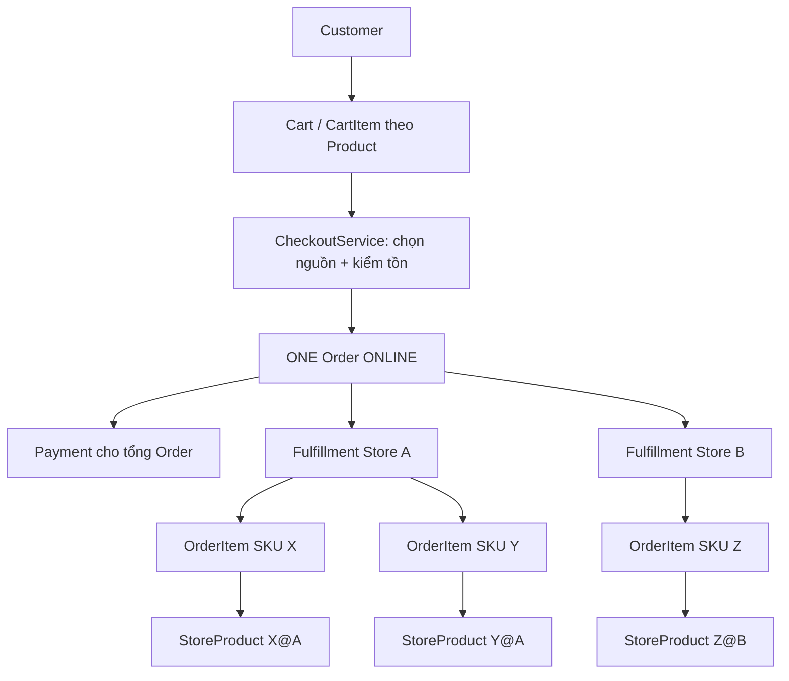
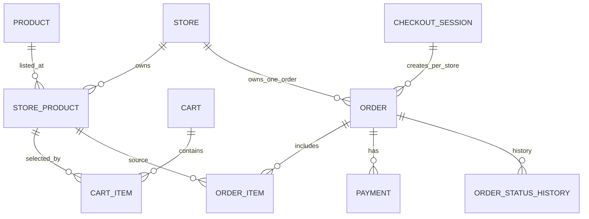
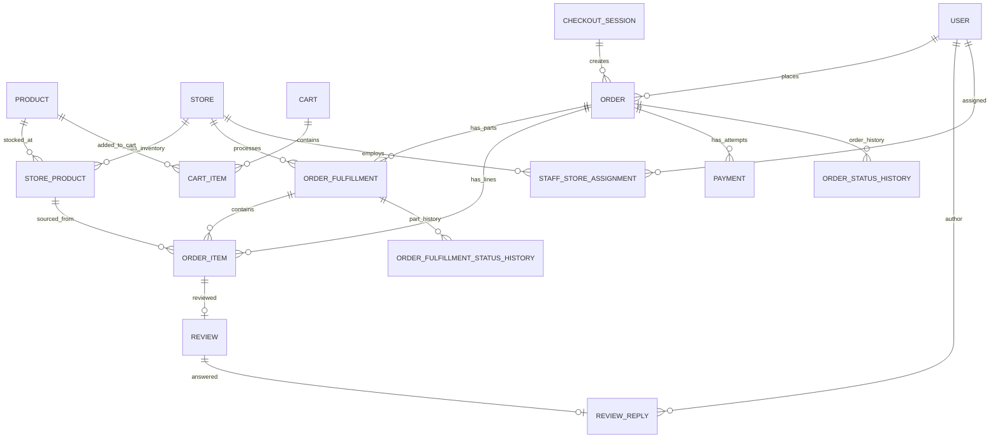

# ONESHOP V3 — ĐẶC TẢ NGHIỆP VỤ VÀ MA TRẬN CHUYỂN ĐỔI DATABASE TỪ V2 SANG V3

> **Đề tài:** Xây dựng website bán mỹ phẩm OneShop theo mô hình chuỗi cửa hàng  
> **Mô hình đích:** Centralized Commerce – Distributed Inventory & Fulfillment  
> **Phiên bản tài liệu:** V3.0 — *Business & Data Architecture Specification / Đề xuất để phê duyệt*  
> **Ngày biên soạn:** 12/10/2026  
> **Trạng thái:** **CHỈ ĐẶC TẢ VÀ PHÂN TÍCH — KHÔNG TRIỂN KHAI**  
> **Phạm vi công nghệ giữ nguyên:** Spring Boot + Thymeleaf + Bootstrap + JPA + SQL Server + SiteMesh + JWT + Cloudinary.

---

## Hướng dẫn đọc và độ tin cậy của thông tin

Các nhãn sau được áp dụng xuyên suốt:

- **[ĐÃ CHỐT]**: yêu cầu nghiệp vụ do chủ dự án xác nhận trong cuộc trao đổi này; ưu tiên so với V2 nếu có xung đột.
- **[TỪ V2]**: quy tắc mô tả trong tài liệu Roadmap V2 hoặc kế hoạch phân phase V2.
- **[ĐỀ XUẤT]**: thiết kế bổ sung để hiện thực hóa yêu cầu đã chốt; **không mặc nhiên là quyết định cuối cùng**.
- **[CẦN CHỐT]**: quyết định có nhiều hướng hợp lệ, chưa được chủ dự án lựa chọn.
- **[CẦN KIỂM CHỨNG REPO]**: số liệu, class/schema/trạng thái hiện tại chỉ được nhắc đến trong báo cáo AI Coding trước đó, chưa được tái xác minh độc lập bằng source repository và SQL Server thực tế trong lần viết tài liệu này.

**Các nguồn dùng làm baseline:**

1. `OneShop_Roadmap_KyThuat_V2_KhaoSatChuoiCuaHang.docx` — định nghĩa 19 bảng, BR-01..BR-18, TC-01..TC-18, các luồng và stack V2.
2. `OneShop_PhanChiaGiaiDoan_ThucHien_TheoRoadmapV2.docx` — phạm vi và điều kiện hoàn thành 13 giai đoạn V2.
3. `Văn bản đã dán (1).txt` — báo cáo AI Coding khảo sát B2; **chỉ là báo cáo khảo sát**, không phải bằng chứng độc lập rằng repo đã hoàn thiện 928 tests hoặc schema trùng tuyệt đối.
4. Quyết định mới do chủ dự án chốt trong trao đổi: giá chung; tồn từng chi nhánh; mua không chọn Store; phân bổ ưu tiên một Store đủ cả giỏ, thiếu thì tìm Store khác; **ONLINE một Order, một lần thanh toán, nhiều phần giao; không có Order con**; COD một Store, COD nhiều Store chỉ tạo các **đơn độc lập** nếu khách xác nhận phương án tách; Staff và Review bám nguồn hàng; khách hủy trước PREPARING; hoàn tiền ONLINE là mô phỏng.

**Điểm chuyển mô hình căn bản:** V2 gắn `Order` với một `Store` và `CartItem` với `StoreProduct`. V3 **không** còn ràng buộc `orders.store_id` là chi nhánh xử lý duy nhất; thay bằng `Order → OrderFulfillment → OrderItem → StoreProduct → Store`.

---

## 0. Executive summary

### 0.1. Quyết định cốt lõi đã chốt

| Mã | Quyết định V3 | Trạng thái |
|---|---|---|
| DEC-01 | OneShop là **một thương hiệu** với nhiều chi nhánh, không phải marketplace | **ĐÃ CHỐT** |
| DEC-02 | Mỗi `Product` là một SKU bán được cụ thể, giá bán online thống nhất toàn chuỗi | **ĐÃ CHỐT** |
| DEC-03 | Mỗi `StoreProduct` quản lý tồn kho/trạng thái tại một Store; quantity khác nhau giữa Store | **ĐÃ CHỐT** |
| DEC-04 | Client mua Product không cần chọn Store; giỏ không phân nhóm Store | **ĐÃ CHỐT** |
| DEC-05 | Hệ thống cố gắng dùng **một Store đủ toàn bộ giỏ**; nếu không đủ, phân bổ SKU thiếu từ Store khác | **ĐÃ CHỐT** |
| DEC-06 | ONLINE: **một Order, một nghĩa vụ thanh toán, nhiều Fulfillment/kiện từ nhiều Store**; tuyệt đối không tạo Order con | **ĐÃ CHỐT** |
| DEC-07 | `OrderItem` là chi tiết dòng hàng, có truy vết được Store cấp hàng qua `StoreProduct` | **ĐÃ CHỐT** |
| DEC-08 | Staff vẫn thuộc Store, quản lý tồn/chuẩn bị/giao phần hàng của Store mình; không được xử lý phần của Store khác | **ĐÃ CHỐT** |
| DEC-09 | COD chỉ áp dụng trực tiếp nếu toàn bộ sản phẩm trong Order được một Store cung cấp | **ĐÃ CHỐT** |
| DEC-10 | Nếu giỏ nhiều Store và muốn COD, hệ thống **đề xuất** chuyển ONLINE hoặc khách đồng ý tạo **nhiều Order độc lập** theo Store | **ĐÃ CHỐT** |
| DEC-11 | STORE_PICKUP: khách chọn một Store có đủ hàng, nhân viên Store đó chuẩn bị và xác minh mã pickup | **ĐÃ CHỐT theo định hướng**, cách kiểm tra đủ cả giỏ là **đề xuất chi tiết** |
| DEC-12 | Khách hủy được khi Order/chưa phần nào chuyển sang PREPARING; phải hoàn tồn đúng StoreProduct | **ĐÃ CHỐT** |
| DEC-13 | Hủy Order đã thanh toán ONLINE: thông báo, ghi nhận **hoàn tiền mô phỏng**, không thực hiện hoàn tiền thật | **ĐÃ CHỐT** |
| DEC-14 | Review có thể truy nguồn tới chi nhánh của OrderItem; Staff đúng chi nhánh được phản hồi Review | **ĐÃ CHỐT** |

### 0.2. Kết luận kiến trúc

- **Có sẵn** bảng **`order_items`** trong schema V2: không cần tạo bảng “chi tiết đơn hàng” mới.
- **[ĐỀ XUẤT] Bắt buộc thêm về mặt thiết kế** bảng **`order_fulfillments`** để một Order phân công công việc/trạng thái riêng tới nhiều Store; `order_items` tham chiếu `fulfillment_id`.
- **[ĐỀ XUẤT]** Thêm **`order_fulfillment_status_history`** để audit các chuyển trạng thái tại từng Store; thêm **`review_replies`** nếu schema thực tế chưa có nơi lưu phản hồi độc lập.
- Đối với V3 ONLINE, `payments.order_id` **tiếp tục gắn Order**, không gắn từng `order_item`, không dời sang `checkout_sessions`. Mỗi SKU/phần giao chỉ là nguồn để *phân bổ, audit, đánh giá và kiểm tra quyền*, không là hóa đơn thanh toán riêng.
- Trên phương diện DB cần phân biệt **bảng đổi cấu trúc**, **bảng giữ cấu trúc nhưng đổi nghĩa/logic**, và **bảng bổ sung**; kết luận khảo sát B2 “chỉ sửa 3 bảng” **không áp dụng** cho V3.

---

## 1. Phạm vi và thuật ngữ

### 1.1. In scope

Khách vãng lai/khách hàng: danh mục toàn chuỗi, tra cứu còn hàng, giỏ chung, checkout ONLINE/COD/PICKUP, theo dõi từng phần giao trong một đơn, hủy hợp lệ, đánh giá hàng đã nhận. Staff: quản lý Fulfillment và tồn kho của Store được phân công, phản hồi Review phát sinh từ OrderItem nguồn. Admin: quản lý SKU/giá chung, kho từng Store, Store, nhân sự, Order/Fulfillment toàn hệ thống, kiểm duyệt Review, theo dõi hoàn tiền mô phỏng.

### 1.2. Out of scope giữ từ V2

Không thay stack, không thêm React/Vue/Angular, microservices, Redis, message queue, GPS/bản đồ định tuyến, kho trung tâm/chuyển kho, courier integration, AI recommendation, promotion/voucher engine, loyalty, marketplace và các hệ thống hoàn tiền ngân hàng thật. **Fulfillment nhiều Store là yêu cầu nghiệp vụ mới; việc cập nhật quy trình này không đồng nghĩa triển khai logistics tối ưu phức tạp.**

### 1.3. Thuật ngữ nghiệp vụ

| Thuật ngữ | Định nghĩa V3 |
|---|---|
| `Product` | Một SKU duy nhất trong danh mục chung, có `price` bán online thống nhất. |
| `Store` | Chi nhánh vật lý cùng thuộc OneShop; không phải seller độc lập. |
| `StoreProduct` | Quan hệ Product–Store, là nguồn tồn kho vật lý, trạng thái bán tại điểm đó. |
| `CartItem` | Sản phẩm và số lượng khách muốn mua, **không gắn Store**. |
| `CheckoutSession` | Dấu vết một thao tác checkout; ONLINE thông thường 1 Order, COD được khách xác nhận tách có thể nhiều Order **độc lập**. |
| `Order` | Cam kết mua hàng của khách, tổng tiền, thông tin nhận và nghĩa vụ thanh toán. ONLINE nhiều Store vẫn duy nhất một Order. |
| `OrderItem` | Một dòng phân bổ nguồn hàng: SKU, số lượng, snapshot giá, FK StoreProduct và Fulfillment. |
| `OrderFulfillment` | Nhóm OrderItem do **một Store** xử lý để giao một phần hàng/kiện; có trạng thái vận hành riêng. Không phải Order con. |
| `Payment` | Bản ghi lần thử/ghi nhận thanh toán của Order; **một lần thu thành công** cho một nghĩa vụ thanh toán. |
| `Review` | Đánh giá của khách đối với dòng hàng đã mua/nhận, có thể xác định Store nguồn. |
| `ReviewReply` | Phản hồi chính thức của nhân viên Store có quyền đối với Review. |
| `InventoryMovement` | Sổ cái trừ/hoàn/điều chỉnh tồn đúng StoreProduct. |

---

## 2. Tác nhân và ma trận chức năng V3

| Tác nhân | Chức năng | Phạm vi quyền và điều kiện |
|---|---|---|
| Guest | Tìm, lọc, xem chi tiết/giá chung, tra cứu điểm có hàng, đăng nhập/đăng ký | Không thấy số tồn thực tế; hành động đặt hàng cần nhận diện khách theo chính sách Auth V2 |
| Customer | Thêm/sửa/xóa CartItem theo Product; chọn địa chỉ/hình thức nhận/thanh toán; đặt hàng; theo dõi Order và từng phần giao; hủy trước PREPARING; tạo Review | Chỉ Order/Review thuộc bản thân; không được chọn Store cho DELIVERY theo ý muốn để vượt thuật toán phân bổ |
| Staff Store | Xem Fulfillment thuộc Store; PREPARING/PACKED/SHIPPING/COMPLETED, pickup code; xem/chỉnh tồn; InventoryMovement; phản hồi Review Store nguồn | Kiểm tra assignment ACTIVE phía backend; **không** tự cập nhật `orders.order_status` tổng hoặc trạng thái Fulfillment Store khác |
| Admin | CRUD/ẩn Product/SKU, quản lý **giá chung**, StoreProduct tồn theo Store, User/Store/Assignment, Order và Fulfillment toàn chuỗi, Review/Reply, xử lý ngoại lệ/hoàn tiền mô phỏng | Toàn chuỗi, nhưng mọi thao tác nhạy cảm phải có audit/authorization |
| System | Phân bổ nguồn, tính giá từ Product, khóa trừ kho atomic, sinh Fulfillment, tính trạng thái Order từ phần giao, xử lý hủy/hoàn tồn, mô phỏng refund | Không tin price/store_id/total từ client; quy tắc trong Service và SQL constraints |

### 2.1. Nghiệp vụ quản trị giá thống nhất

1. Admin tạo/đổi `Product.price`; đây là **nguồn giá bán online duy nhất**.
2. Giá bán online khi catalog/cart/checkout luôn xuất phát từ `products.price`; không dùng `store_products.price` để tự ý thay đổi tổng tiền.
3. Một SKU ở N Store dùng một giá; cập nhật giá Product có hiệu lực cho đơn **chưa tạo** sau khi xác thực lại.
4. Khi tạo OrderItem, chụp `unit_price`, `product_name`, `quantity`, `subtotal`; đơn cũ không đổi khi sửa Product sau này.
5. Giá không được âm; sản phẩm chưa có giá bán hợp lệ không cho đặt (không dựa vào mặc định `0` để bán giá 0).
6. `store_products.price` từ V2 cần chiến lược migration: **tạm giữ để tương thích**, khóa sử dụng khỏi luồng bán online; xóa sau khi rà soát schema, dependency và kiểm thử. Không duy trì hai nguồn giá cạnh tranh lâu dài.
7. UI Admin bỏ bảng chỉnh giá theo Store cho mua online, thay bằng quản trị giá Product; Staff chỉ xem giá bán online, không có quyền tạo giá riêng.

---

## 3. Luồng nghiệp vụ khách hàng

### 3.1. Catalog và Product Detail

**[ĐÃ CHỐT]** Duyệt SKU toàn chuỗi, hiển thị `Product.price`, tình trạng có hàng toàn chuỗi; không bắt chọn `selectedStoreId`. Bộ tra cứu còn hàng theo Store là thông tin bổ trợ, không phải bước mua bắt buộc. **Chỉ hiển thị Còn hàng/Hết hàng**, không lộ exact stock cho Client.

**[ĐỀ XUẤT]** Chỉ coi `Còn hàng` khi có ít nhất một StoreProduct ACTIVE, quantity dương tại Store ACTIVE và có thể đáp ứng sơ bộ; không hứa chắc giao được tới mọi địa chỉ. Khi nhập địa chỉ, cập nhật trạng thái “khả dụng để giao đến khu vực” và chỉ xác nhận tại checkout.

### 3.2. Cart và mua ngay

- Add/update API dùng `productId`, `quantity`; `cart_items` unique `(cart_id, product_id)`.
- Nút **Mua ngay** tạo phiên preview/checkout SKU đã chọn mà không tạo Order sớm và không chọn Store trước.
- Giỏ hiển thị một danh sách theo SKU; chọn item checkout như V2, không group theo Store.
- Giá ở giỏ có tính tham khảo tại thời điểm xem; giá cuối xác định lại từ DB khi khách xác nhận. Khi giá thay đổi giữa preview và xác nhận, phải hiển thị giá mới và yêu cầu xác nhận lại, tránh thay đổi âm thầm.
- Việc giỏ có hàng không đồng nghĩa giữ chỗ tồn kho; kiểm tra và lock khi checkout.

### 3.3. DELIVERY với ONLINE: Một Order, nhiều phần giao

1. Customer chọn CartItem, địa chỉ, phương thức DELIVERY + ONLINE.
2. Backend đọc lại Product/Cart/địa chỉ, xác thực giá chung, status và quantity.
3. Bộ phân bổ tìm một Store có đủ **toàn bộ** giỏ trước; nếu không có, ưu tiên Store bao phủ nhiều mặt hàng rồi bổ sung từ Store khác.
4. Xác thực tất cả Store có thể giao tới khu vực nhận theo quy tắc cấu hình; không lấy Store hết hàng/INACTIVE.
5. Trong transaction: khóa các `StoreProduct` cấp hàng, xác minh lại, tạo **một Order**, tạo các `OrderFulfillment` theo Store, tạo `OrderItem` gắn đúng StoreProduct/Fulfillment, ghi movements trừ kho, xóa những CartItem đã checkout.
6. Tạo payment attempt ONLINE của toàn bộ Order; trạng thái Order `PENDING_PAYMENT` cho tới khi thanh toán được xác nhận.
7. Sau thành công, một Payment thành công cho **tổng Order**; mỗi Staff Store nhìn thấy Fulfillment được giao.
8. Khách nhận nhiều phần/kiện giao, nhưng chỉ có **một mã Order và một lần thanh toán**.
9. Order hoàn tất khi tất cả Fulfillment hoàn tất và điều kiện thanh toán thỏa mãn.

**Transaction với payment gateway:** trong phạm vi V3 demo, không giữ transaction SQL mở trong lúc chờ thanh toán; stock đã được trừ/dành trong transaction tạo đơn và cần chính sách hủy/giải phóng tồn cho `PENDING_PAYMENT` quá hạn hoặc FAILED. Không gọi thanh toán bên ngoài trong transaction dài. **[CẦN CHỐT]** timeout/huỷ pending payment cụ thể.

### 3.4. DELIVERY với COD một Store

1. Hệ thống đã phân bổ thử các dòng sản phẩm.
2. Nếu **một Store** đủ toàn bộ SKU/số lượng thì cho chọn COD.
3. Tạo một Order, một Fulfillment tại Store đó; Order CONFIRMED, payment UNPAID; khi giao xong và đã thu đủ tiền, cập nhật PAID.
4. Nếu cần nhiều Store, không cho đặt một Order COD nhiều Store trực tiếp.

### 3.5. DELIVERY với COD nhiều Store — ngoại lệ có xác nhận

Khi đơn chỉ có thể phân bổ từ nhiều Store và khách chọn COD, UI bắt buộc đề xuất rõ hai hành động:

- **Lựa chọn A:** đổi sang ONLINE → một Order, một Payment, nhiều Fulfillment.
- **Lựa chọn B:** khách **chủ động xác nhận tách đơn** → tạo **nhiều Order độc lập**, mỗi Order gắn **một Store**, có tổng tiền và COD riêng; cùng `CheckoutSession` nếu cần lưu dấu một lượt xác nhận.

**Lưu ý cốt lõi:** Đây là **nhiều đơn độc lập** khi khách chọn COD, **không phải Order con**, **không phải** cấu trúc Order tổng → Order con; và **không áp dụng cho ONLINE**. Mỗi Order COD có thể được hủy/theo dõi/thu tiền độc lập. Phải hiển thị trước số đơn, sản phẩm từng đơn và tiền phải trả mỗi lần nhận; chỉ tạo sau khi khách đồng ý. **[ĐỀ XUẤT]** Toàn bộ các Order COD tách được tạo atomic trong một transaction ở bước xác nhận.

### 3.6. STORE_PICKUP

- Khách chọn STORE_PICKUP khi checkout, hệ thống cho chọn Store đang ACTIVE, `pickup_enabled`, có đủ toàn bộ giỏ.
- **[ĐỀ XUẤT]** Chỉ hỗ trợ một địa điểm nhận cho một Order Pickup và **không chuyển kho liên Store**.
- Có một Order, một Fulfillment tại Store đã chọn, tiền ONLINE hoặc PAY_AT_STORE.
- Staff Store đó chuyển `CONFIRMED → PREPARING → READY_FOR_PICKUP → COMPLETED`, cấp và xác minh pickup_code theo V2.
- Nếu không Store nào đủ toàn bộ giỏ: cho khách đổi Store, điều chỉnh giỏ hoặc chuyển DELIVERY; không nhận “pickup nhiều chi nhánh” ngầm.

### 3.7. Thông tin khách cần nhìn thấy sau khi đặt

- **ONLINE:** một Order ID, một tổng tiền/Payment, danh sách sản phẩm; phía dưới có N phần giao theo Store với tình trạng riêng. Không hiển thị như N Order mới.
- **COD một Store:** một Order, COD khi nhận, một phần giao.
- **COD tách:** N Order ID độc lập, mỗi Order có tiền COD riêng; có thể nhóm hình thức trình bày dưới một CheckoutSession với nhãn “Đơn phát sinh từ cùng lần đặt” để tránh hiểu là Order con.
- **PICKUP:** một Order, Store đến nhận, trạng thái READY_FOR_PICKUP/mã nhận khi sẵn sàng.

---

## 4. Thuật toán phân bổ SKU theo chi nhánh

### 4.1. Ràng buộc cứng

- Chỉ Store ACTIVE và StoreProduct ACTIVE với tồn không âm/đủ cho lượng phân bổ; DELIVERY yêu cầu delivery_enabled; PICKUP yêu cầu pickup_enabled.
- Chỉ Store thỏa **vùng phục vụ** khách. `province_city/area` là địa chỉ Store, **không tự là chứng cứ Store phục vụ mọi địa chỉ cùng tỉnh**. V3 phải có quy tắc vùng phục vụ tối giản trước khi triển khai; không giả định GPS/nearest.
- Tồn được tính theo từng StoreProduct; **không** dùng tổng tồn toàn chuỗi làm bằng chứng một Store đủ giỏ.
- Nếu không phân bổ đủ toàn bộ giỏ, phải thất bại toàn bộ checkout (không tạo Order thiếu sản phẩm) theo chính sách P0.
- Khi checkout kiểm tra hàng và giá từ DB, khóa/ghi với transaction; không tin product_price/store_id/allocatedStore từ request.
- Phân bổ có tính xác định (deterministic): quy tắc tie-break rõ và test được.

### 4.2. Chiến lược ưu tiên

**Mức 1 — One-Store Full Cart:** lọc các Store có đủ toàn bộ số lượng mỗi SKU, sau đó chọn Store có khả năng phục vụ địa chỉ phù hợp nhất; ưu tiên vùng và tiêu chí nhất quán khi hòa.

**Mức 2 — Multi-Store Coverage:** nếu không một Store đủ giỏ, tìm Store phù hợp bao phủ nhiều **dòng SKU đủ lượng** nhất rồi tìm Store khác cho các dòng còn thiếu. Mục tiêu hạn chế số Fulfillment, nhưng **không cần giải bài toán tối ưu tuyến giao hàng**.

**Mức 3 — Trường hợp thiếu lượng của một SKU:** nếu không Store nào có đủ trọn quantity nhưng tổng khả dụng đủ, dữ liệu `order_items` được thiết kế hỗ trợ nhiều dòng cùng Product ở nhiều Store; **[CẦN CHỐT]** V3 P0 có bật tách quantity trong một SKU hay chỉ hỗ trợ SKU nguyên dòng.

**Tie-break [ĐỀ XUẤT]:** khu vực đã cấu hình phục vụ → số dòng SKU thỏa mãn → tổng khả dụng của các SKU cần mua → `store_id` tăng dần. Đây là chính sách xác định nguồn, **không cam kết tối ưu chi phí vận chuyển thực tế**.

### 4.3. Ví dụ phân bổ

| SKU (quantity=1) | Thủ Đức | Gò Vấp | Kết quả |
|---|---:|---:|---|
| Son 3CE | 4 | 0 | Thủ Đức |
| Serum | 3 | 2 | Thủ Đức (ưu tiên một Store nhiều SKU) |
| Kem chống nắng | 0 | 8 | Gò Vấp |

=> `Order #1001` chứa 3 OrderItem; `Fulfillment #F1` ở Thủ Đức chứa Son + Serum; `Fulfillment #F2` ở Gò Vấp chứa Kem chống nắng; một Payment tổng. Nếu cả 3 SKU đủ tại một Store, chỉ tạo một Fulfillment.

### 4.4. Đồng thời và khóa tồn

**[ĐỀ XUẤT kỹ thuật]:** thuật toán xác định ứng viên ngoài transaction ngắn có thể dùng dữ liệu snapshot để hiển thị preview; lúc `placeOrder`, thực hiện kiểm tra và khóa lại trên các StoreProduct sẽ dùng trong transaction. Nếu thiếu do giao dịch khác đã mua, phân bổ lại với số lần retry giới hạn hoặc yêu cầu khách thử lại. Sắp xếp khóa giúp giảm nguy cơ deadlock nhưng **không đảm bảo loại bỏ deadlock tuyệt đối**; cần timeout/retry an toàn và constraint `quantity >= 0`.

---

## 5. Kiến trúc đơn hàng, chi tiết và phần giao

### 5.1. Cấu trúc nghiệp vụ bắt buộc



Không có `orders.parent_order_id` và không có entity `SubOrder` trong luồng ONLINE. `Fulfillment` **không phải** hóa đơn/đơn con; nó là nhóm thao tác xử lý và giao hàng.

### 5.2. Tính tiền

- `OrderItem.unit_price = Product.price` snapshot lúc chốt; `subtotal = unit_price × quantity`.
- `Order.total_amount = Σ OrderItem.subtotal + phí giao (nếu có chính sách được chốt)`.
- `Payment.amount = Order.total_amount` cho lần thanh toán thành công; không phân chia Payment theo StoreProduct.
- Hiển thị giá chung nhất quán trên catalog, detail, cart, checkout, OrderItem và hóa đơn giao dịch; thay đổi Product.price không ảnh hưởng Order cũ.
- **[CẦN CHỐT]** cách tính phí giao khi một Order có nhiều kiện; không tự thêm N phí vận chuyển sau khi khách đã xác nhận tổng.

### 5.3. Quan hệ giữa Order và OrderItem

Mỗi OrderItem phải có `order_id`, `fulfillment_id`, `store_product_id`, `quantity`, `unit_price`, `subtotal` và snapshot. **Không cho phép** OrderItem trỏ Fulfillment thuộc Order khác hoặc StoreProduct thuộc Store khác với Fulfillment. Những bất biến liên bảng này phải kiểm tra ở Service, test và, khi phù hợp, gia cố bằng composite FK/unique index tại SQL Server.

### 5.4. CheckoutSession

ONLINE bình thường: 1 CheckoutSession → 1 Order → N Fulfillment. COD tách có xác nhận: 1 CheckoutSession → N Order **độc lập**, mỗi Order một Store. `CheckoutSession` **không phải đối tượng thanh toán**, giữ đúng tinh thần V2 rằng Payment gắn Order. Không có quan hệ Order–Order cha/con.

---
## 6. Ma trận chuyển đổi cơ sở dữ liệu — đầy đủ 19 bảng V2

**Cách đọc:** “Giữ cấu trúc” nghĩa là không bắt buộc `ALTER TABLE`, **không** đồng nghĩa không thay đổi Service/Repository/DTO/test đang sử dụng bảng. Các trường hiện trạng chi tiết phải được kiểm tra trên database thực tế trước khi tạo migration.

| STT | Bảng V2 | Chức năng V2 | V3: thay đổi nghiệp vụ | Tác động DDL dự kiến | Migration/kiểm thử bắt buộc | Mức độ |
|---:|---|---|---|---|---|---|
| 01 | `roles` | Vai trò CUSTOMER/STAFF/ADMIN | Giữ vai trò và authorization | **Giữ cấu trúc** | Kiểm thử phân quyền API mới; không tự thêm role | Thấp |
| 02 | `users` | User và trạng thái | Customer đặt Order chung; Staff trả lời review theo assignment | **Giữ cấu trúc** | Bảo toàn tài khoản/khóa; `review_replies.staff_user_id` FK tới users | Thấp |
| 03 | `customer_addresses` | Địa chỉ khách | Có địa chỉ chuẩn hóa để chọn Store giao hàng | **Sửa có điều kiện:** `province_city`, `area`/mã khu vực nếu chưa có | Backfill **không đoán tự động** từ chuỗi tùy ý; khách xác nhận địa chỉ chưa đủ | Trung bình |
| 04 | `stores` | Điểm bán, cờ DELIVERY/PICKUP, khu vực | Store là đơn vị Fulfillment; tính năng dịch vụ/vùng giao là tiêu chí phân bổ | **Giữ cấu trúc cơ bản**; cân nhắc bảng vùng phục vụ riêng | Xác minh `delivery_enabled`, `pickup_enabled`, `status`; vùng phục vụ phải được chốt | Trung bình |
| 05 | `staff_store_assignments` | Phân công nhân viên → Store | Giữ; kiểm tra quyền thao tác Fulfillment và ReviewReply | **Giữ cấu trúc** | Test Staff A không xử lý/đọc riêng tư phần Store B | Cao về logic |
| 06 | `categories` | Phân loại Product | Không đổi | **Giữ cấu trúc** | Regression catalog | Không |
| 07 | `brands` | Thương hiệu Product | Không đổi | **Giữ cấu trúc** | Regression catalog | Không |
| 08 | `products` | SKU chung, V2 không có giá | **Nguồn giá bán online chung**, Price Admin quản lý toàn chuỗi | **Thêm** `price DECIMAL(18,2)` + CHECK; NOT NULL sau backfill | Chủ dự án/Admin duyệt bảng giá chung từng SKU; snapshot order cũ không đổi | **Rất cao** |
| 09 | `product_images` | Ảnh Cloudinary của SKU | Không đổi | **Giữ cấu trúc** | Bảo toàn URL/public_id, không lưu binary SQL | Không |
| 10 | `store_products` | SKU tại Store, V2 chứa price/quantity/status | **Nguồn tồn kho và khả dụng theo Store**, không còn giá online riêng | **Giai đoạn 1 giữ cột `price` (legacy), giai đoạn sau cân nhắc DROP** sau rà soát | Bỏ dùng giá cũ trong catalog/cart/checkout/Admin; giữ unique store/product, quantity≥0 | **Rất cao về logic** |
| 11 | `inventory_movements` | ORDER/CANCEL_ORDER/STOCK_ADJUST | Trừ/hoàn theo StoreProduct của từng OrderItem ở nhiều Fulfillment | **Giữ cấu trúc**, nếu cần bổ sung link OrderItem cho đối soát là lựa chọn P1 | Bảo toàn audit Order V2; không cộng/trừ trùng khi retry/hủy | Cao về logic |
| 12 | `carts` | Một Cart/User | Giỏ chung Product | **Giữ cấu trúc** | Bảo toàn cart_id/user_id | Thấp |
| 13 | `cart_items` | FK `store_product_id` | FK trực tiếp `product_id`; không gắn Store | **Sửa FK + unique**, đổi `store_product_id` thành `product_id` sau backfill | Gộp cart rows cũ trùng cùng SKU đúng quy tắc; sao lưu & kiểm tra quantity | **Rất cao** |
| 14 | `checkout_sessions` | Gộp nhiều Order một checkout | ONLINE 1 Order; COD split N **Order độc lập** cùng checkout khi đồng ý | **Giữ cấu trúc** | Không biến thành tài khoản thu tiền; test mô hình 1:N hợp lệ | Trung bình |
| 15 | `orders` | Bắt buộc thuộc 1 Store, trạng thái và thông tin Pickup/Payment | Một Order ONLINE đa Store; trạng thái tổng hợp; COD split tạo đơn riêng | **Sửa:** bỏ `store_id NOT NULL` làm bất biến V2; điều chỉnh enum/status; dời thuộc tính pickup sang Fulfillment khi khả thi | Bảo toàn Order lịch sử, backfill Fulfillment, rà FK/index Staff, kiểm thử không tạo Order con | **Rất cao** |
| 16 | `order_items` | Dòng hàng snapshot gắn StoreProduct | Chi tiết nguồn SKU của các Fulfillment; hỗ trợ nhiều Store trong cùng Order | **Thêm** `fulfillment_id` FK, giữ `store_product_id`; ràng buộc khớp Order/Store | Backfill từ đơn V2; kiểm tra không dòng mồ côi/sai nguồn | **Rất cao** |
| 17 | `payments` | Payment per Order, trạng thái & mã giao dịch | ONLINE thanh toán một lần **tổng Order**; COD split mỗi Order COD độc lập; refund giả lập | **Giữ FK `order_id`**; **đề xuất thêm** `refund_status`, `refund_amount`, `refunded_at`, `refund_note` hoặc bảng refund ledger tối giản | Ngăn 2 lần SUCCESS cho cùng nghĩa vụ; test callback/retry/partial failure | **Cao** |
| 18 | `order_status_history` | Audit trạng thái Order V2 | Audit trạng thái **tổng hợp** của Order; không thay audit từng Store | **Giữ cấu trúc**, bổ sung tên enum V3 nếu có CHECK hạn chế | Backfill không tạo lịch sử giả; test transition tổng | Trung bình |
| 19 | `reviews` | Review Product sau mua; schema chi tiết cần xác minh | Review gắn nguồn mua để Staff đúng Store phản hồi | **Thêm hoặc chuẩn hóa** `order_item_id` FK; chỉ cho review khi Fulfillment đã giao | Backfill review cũ chỉ khi map chính xác; xử lý bản ghi chưa xác định được OrderItem | **Cao** |

### 6.1. Những bảng V3 đề xuất bổ sung

| Bảng mới | Mục đích | Ưu tiên | Có thể bỏ? |
|---|---|---|---|
| **`order_fulfillments`** | Một bản ghi phân công và tiến độ xử lý cho mỗi Store thuộc một Order; ràng buộc quyền Staff | **P0 bắt buộc để đáp ứng đa Store/độc lập trạng thái** | Không nên bỏ; nếu không sẽ phải nhồi trạng thái đa Store vào `orders`/`order_items` thiếu rõ ràng |
| **`order_fulfillment_status_history`** | Lưu transition riêng của từng phần giao, ai đổi, lúc nào | **P0/P1: khuyến nghị P0** | Có thể P1 nếu hạn chế thời gian, nhưng mất lịch sử chi tiết phần giao |
| **`review_replies`** | Lưu phản hồi Staff có kiểm tra Store scope, tách khỏi đánh giá khách | **P0 nếu chức năng phản hồi Review nằm trong MVP V3** | Nếu schema thực tế đã có bảng/thuộc tính đạt yêu cầu thì tái sử dụng, không tạo trùng |
| `store_delivery_areas` *(tùy chọn)* | Mapping Store với khu vực được phép giao, không dùng tọa độ | **CẦN CHỐT** | Có, nếu toàn bộ Store dùng một chính sách vùng phục vụ đơn giản đã được chốt |

**Tổng kết DDL dự kiến:** tối thiểu thay đổi cấu trúc tại `products`, `cart_items`, `orders`, `order_items`, `reviews` và có thể `customer_addresses`, `payments`, `store_products`; thêm `order_fulfillments`, đề xuất `order_fulfillment_status_history`, `review_replies`. **Không công bố con số chính xác “X bảng thay đổi” khi schema repo chưa được xác minh.**

---

## 7. Data dictionary đề xuất cho các bảng trọng tâm

Các tên field/types dưới đây là **đích logic**, chưa phải DDL chạy trực tiếp. Khóa, kiểu ID, enum và timestamp phải đồng bộ với schema SQL Server hiện hành.

### 7.1. `products` — bảng giá chung

| Trường | Kiểu tham chiếu | Rule |
|---|---|---|
| `product_id` | BIGINT PK | Giữ ID lịch sử |
| `sku` | NVARCHAR UNIQUE | Mỗi Product = một SKU, không ProductVariant |
| `name`, `description` | NVARCHAR | Dữ liệu chung toàn chuỗi |
| `price` | DECIMAL(18,2) NOT NULL | `price >= 0`; sản phẩm ACTIVE để bán cần có mức giá hợp lệ đã duyệt |
| `brand_id`, `category_id` | FK | Như V2 |
| `status` | enum/string | ACTIVE/HIDDEN/INACTIVE theo schema thật |
| `updated_at` | datetime | Audit thay đổi giá |

**Không** lưu stock tổng vào Product. Nếu cần `available` trên client, tính từ StoreProduct ACTIVE/Store ACTIVE ở thời điểm truy vấn.

### 7.2. `store_products` — kho tại Store

| Trường | Rule |
|---|---|
| `store_product_id` | PK, là nguồn truy vết OrderItem |
| `store_id` | FK `stores`, một Store vật lý |
| `product_id` | FK `products`, SKU chung |
| `quantity` | INT NOT NULL, CHECK >= 0 |
| `status` | ACTIVE/INACTIVE theo rule |
| `price` *(V2 legacy)* | **Không còn dùng làm giá mua online**; không xóa ở bước đầu nếu code/schema cũ còn phụ thuộc |
| `updated_at` | Theo schema thật |

**Giữ:** `UNIQUE(store_id, product_id)`; index theo `(product_id, status)` và `(store_id, status, quantity)` tương đương V2.

### 7.3. `cart_items`

```text
cart_item_id PK
cart_id      FK -> carts
product_id   FK -> products            -- V3 thay store_product_id
quantity     INT NOT NULL CHECK > 0
created_at / updated_at (nếu đang có)
UNIQUE(cart_id, product_id)
```

Cần migration gộp các dòng V2 có cùng Product từ nhiều Store thành một dòng V3; **không xóa cột cũ trước khi validate đầy đủ**.

### 7.4. `orders`

```text
order_id            PK
checkout_id         FK -> checkout_sessions
user_id             FK -> users
fulfillment_type    DELIVERY | STORE_PICKUP
payment_method      ONLINE | COD | PAY_AT_STORE
payment_status      PENDING | UNPAID | PAID | REFUND_* (quy ước chi tiết bên dưới)
order_status        enum tổng hợp V3
receiver_name/phone, shipping_address snapshot (nếu Delivery)
total_amount        DECIMAL(18,2)
created_at, updated_at
store_id            V2 LEGACY / nullable ở giai đoạn chuyển đổi
pickup_code/ready_at/picked_up_at  V2 LEGACY -> dự kiến chuyển về fulfillment
```

**CHECK nghiệp vụ:** COD chỉ được tạo nếu đúng một Store phân bổ cho Order; ONLINE có thể nhiều Store; PAY_AT_STORE chỉ với PICKUP. Các CHECK liên bảng không đủ bằng `CHECK` thông thường → xác thực trong Service và test tích hợp.

`orders.store_id`: không còn bắt buộc ở đơn mới; cân nhắc giữ nullable để đọc đơn V2 đã phát sinh, nhưng **không viết logic V3 dựa vào giá trị này**. Khi đã backfill và di trú toàn bộ code, quyết định drop legacy ở phase sau.

### 7.5. `order_fulfillments` — NEW/P0

| Trường | Kiểu đề xuất | Ràng buộc |
|---|---|---|
| `fulfillment_id` | BIGINT PK | Định danh phần giao |
| `order_id` | BIGINT FK NOT NULL | Thuộc đúng một Order |
| `store_id` | BIGINT FK NOT NULL | Do một Store thực hiện |
| `status` | NVARCHAR(32) NOT NULL | Enum Fulfillment hợp lệ |
| `pickup_code` | NVARCHAR(..) NULL | Chỉ pickup; sinh khi READY_FOR_PICKUP |
| `ready_at`, `picked_up_at` | DATETIME2 NULL | Thời gian pickup |
| `prepared_at`, `packed_at`, `shipped_at`, `completed_at` | DATETIME2 NULL *(tùy scope)* | Dễ audit, lịch sử transition vẫn là nguồn audit chính |
| `created_at`, `updated_at` | DATETIME2 NOT NULL | Audit |
| `note` | NVARCHAR NULL | Ghi chú xử lý theo Store, không thông tin nhạy cảm dư thừa |

**[ĐỀ XUẤT]:** `UNIQUE(order_id, store_id)` đối với đơn V3 nếu mỗi Store chỉ có một phần giao. Nếu tương lai một Store có nhiều đợt giao cho cùng Order thì phải bỏ unique này và bổ sung phân biệt `batch_no`, nhưng hiện nằm ngoài scope. Index `(store_id, status, created_at)` phục vụ queue Staff; index `(order_id, status)` phục vụ Order detail/aggregate.

`fulfillment_type` có thể kế thừa từ Order để tránh lệch; nếu vẫn lưu bản sao, phải có ràng buộc/service đồng bộ. **Khuyến nghị chỉ giữ fulfillment type ở Order** trong P0 (một cách nhận áp dụng cho toàn Order).

### 7.6. `order_items` — chi tiết sản phẩm đã mua, không phải “bảng riêng từng sản phẩm”

| Trường | Quy tắc V3 |
|---|---|
| `order_item_id` | PK hiện có |
| `order_id` | FK Order chung, giữ nguyên |
| `fulfillment_id` | **NEW FK** tới phần giao tại Store |
| `store_product_id` | **Giữ FK** tới SKU nguồn tại Store |
| `product_name` | Snapshot sản phẩm lúc mua |
| `unit_price` | Snapshot **Product.price**, không lấy StoreProduct.price |
| `quantity` | Số lượng của dòng được phân bổ, >0 |
| `subtotal` | `unit_price × quantity` tại thời điểm tạo |

**Một dòng = một SKU ở một nguồn StoreProduct trong một Fulfillment.** Nếu cùng SKU quantity=5 được chia từ A (3) và B (2), sẽ có hai OrderItem với cùng SKU nhưng hai `store_product_id`/`fulfillment_id` khác nhau; không mất liên kết tổng Order.

**Bất biến quan hệ:**

1. `order_items.order_id == order_fulfillments.order_id`.
2. `order_fulfillments.store_id == store_products.store_id` của `order_items.store_product_id`.
3. `order_items.unit_price` của các dòng cùng Product trong cùng Order là giá snapshot chung.
4. Tổng quantity các dòng OrderItem theo Product == quantity giỏ đã được khách xác nhận.
5. `SUM(order_items.subtotal)` khớp phần tổng hàng của Order.

Để cưỡng chế #1/#2 chặt ở DB, có thể bổ sung **composite alternate key và composite FK**, ví dụ `UNIQUE(fulfillment_id, order_id)` kết hợp FK kép từ OrderItem; #2 có thể cần thêm `source_store_id` được kiểm soát trong OrderItem hoặc DB trigger. Không thêm cột chỉ để thỏa mỹ thuật ERD nếu ứng dụng Service/transaction và test đủ trong phạm vi đồ án; tuy nhiên phải ghi rõ mức đảm bảo DB so với Service.

### 7.7. `payments` và mô phỏng hoàn tiền

**[ĐÃ CHỐT]:** ONLINE một lần thu cho toàn bộ Order. **[ĐỀ XUẤT kỹ thuật]:** giữ quan hệ `Order 1 — N PaymentAttempt` như V2 cho lịch sử lần thử; bảo đảm **tối đa một Payment SUCCESS còn hiệu lực** cho cùng khoản phải thu của Order, tránh callback trùng qua transaction/idempotency key và unique index phù hợp.

**Refund demo (hủy trước PREPARING):** đề xuất lưu `refund_status` (`NONE`, `PENDING_SIMULATION`, `SIMULATED_REFUNDED`, `SIMULATION_FAILED`), `refund_amount`, `refund_requested_at`, `refunded_at`, `refund_reason` vào record Payment thành công hoặc một **refund ledger** nếu dự án sau này cần hỗ trợ nhiều lần refund. P0 chỉ mô phỏng **hoàn toàn bộ tiền Order đã thanh toán**; không gọi cổng hoàn tiền thật. Cần giữ trạng thái Payment ban đầu SUCCESS làm bằng chứng đã thu, đồng thời ghi trạng thái refund riêng, không xóa lịch sử giao dịch.

**Không tạo Payment theo OrderItem**; giá trị từng dòng nằm trong `order_items`, dùng đối chiếu mà không tách khoản thu.

### 7.8. `reviews`, `review_replies`

**Reviews [ĐỀ XUẤT]:**

```text
review_id           PK
user_id             FK -> users
product_id          FK -> products      (nếu đang có)
order_item_id       FK -> order_items   -- NEW / cần enforce đúng nguồn
rating              INT CHECK BETWEEN 1 AND 5
content             ...
created_at, updated_at, status ...
UNIQUE(user_id, order_item_id) hoặc UNIQUE(order_item_id) tùy model owner
```

**ReviewReplies [ĐỀ XUẤT]:**

```text
reply_id       PK
review_id      FK -> reviews
staff_user_id  FK -> users
content        NVARCHAR(MAX) NOT NULL
created_at, updated_at
UNIQUE(review_id)      -- một phản hồi chính thức mỗi Review, phiên bản MVP
```

Quyền phản hồi được xác định bằng `reviews.order_item_id → order_items.fulfillment_id → order_fulfillments.store_id → staff_store_assignments`. Đảm bảo `reviews.product_id` (nếu giữ) trùng Product của `store_product_id` nguồn; tránh Review trỏ tới SKU khác. Không cho Staff tự đổi store_id của Review/Reply hay phản hồi của Store khác qua tham số request.

### 7.9. `order_fulfillment_status_history` — NEW/đề xuất

```text
history_id             PK
fulfillment_id         FK -> order_fulfillments
old_status             nullable
new_status             NOT NULL
changed_by_user_id     FK -> users nullable (system action)
note                   nullable
changed_at             DATETIME2 NOT NULL
```

Giữ `order_status_history` cho Order tổng; **hai bảng lịch sử có nhiệm vụ riêng**. Có index `(fulfillment_id, changed_at)` và không xóa/sửa các bản ghi lịch sử đã phát sinh.

---

## 8. ERD logic V2 và V3

### 8.1. V2 (rút gọn các quan hệ tác động)



### 8.2. V3 (cấu trúc đích)



**Lưu ý:** Quan hệ `OrderItem 0..1 Review` biểu diễn chính sách mỗi dòng mua tối đa một review của khách trong MVP; nếu dữ liệu hoặc chính sách review cũ khác, phải kiểm tra trước migration. `CHECKOUT_SESSION → N ORDER` được giữ **chỉ để xử lý trường hợp khách chủ động tách COD**, không biểu diễn Order con trong ONLINE.

---
## 9. State machine: hai tầng trạng thái độc lập

### 9.1. Fulfillment status (nhân viên thao tác theo Store)

| Status | Nghĩa | Ai kích hoạt | Hợp lệ tiếp theo |
|---|---|---|---|
| `CONFIRMED` | Phần hàng được phân công, chưa bắt đầu chuẩn bị | System sau Order hợp lệ/đã đủ điều kiện thanh toán | `PREPARING`, `CANCELLED` nếu **toàn Order** đủ điều kiện hủy |
| `PREPARING` | Staff bắt đầu chuẩn bị hàng | Staff của Store | `PACKED` (DELIVERY), `READY_FOR_PICKUP` (PICKUP) |
| `PACKED` | Hàng đã được đóng gói | Staff của Store | `SHIPPING` |
| `SHIPPING` | Đã bàn giao/đang giao | Staff của Store | `COMPLETED`, `FAILED` theo chính sách ngoại lệ |
| `READY_FOR_PICKUP` | Pickup sẵn sàng, có pickup_code | Staff của Store | `COMPLETED`, ngoại lệ theo chính sách |
| `COMPLETED` | Đã giao/đã nhận thành công | Staff Store xác nhận hợp lệ | Terminal trong luồng thường |
| `CANCELLED` | Phần hàng bị hủy khi Order hủy hợp lệ | System | Terminal, có InventoryMovement hoàn tồn |
| `FAILED` | Phần giao không thành công | Hệ thống/Staff có quyền, cần lý do | `NEEDS_ATTENTION` ở Order; cách khắc phục **CẦN CHỐT** |

**Ràng buộc:** với DELIVERY, không được nhảy `CONFIRMED → SHIPPING`; với PICKUP, `READY_FOR_PICKUP` chỉ khi mã đã được tạo và Store xác nhận sẵn hàng. Trạng thái `PREPARING` là **ranh giới quyền hủy của khách**.

### 9.2. Order status (do hệ thống tổng hợp)

| Status đề xuất | Điều kiện điển hình | Ghi chú |
|---|---|---|
| `PENDING_PAYMENT` | ONLINE chờ xác nhận thanh toán | Không cho Staff chuyển phần hàng sang PREPARING |
| `CONFIRMED` | Đã đủ điều kiện xử lý; toàn bộ Fulfillment còn `CONFIRMED` | Với COD là đã tạo hợp lệ; với ONLINE là PAID |
| `PROCESSING` | Có phần đang PREPARING hoặc PACKED, chưa hoàn tất phần nào | Trạng thái tổng |
| `SHIPPING` | Có phần đang SHIPPING, chưa phần nào COMPLETED; chỉ DELIVERY | Không áp dụng Pickup thuần túy |
| `PARTIALLY_COMPLETED` | Ít nhất một phần COMPLETED, vẫn còn phần chưa COMPLETED | Không xem Order đã giao đủ |
| `COMPLETED` | **Tất cả** Fulfillment COMPLETED và điều kiện thanh toán đúng | Có thể cho review từng dòng sớm hơn khi phần đó hoàn tất |
| `CANCELLED` | Cả Order đã được hủy hợp lệ và hoàn tồn/tạo yêu cầu refund theo rule | Không dùng trạng thái này cho một Fulfillment giao thất bại riêng |
| `NEEDS_ATTENTION` | Có phần FAILED hoặc ngoại lệ giao hàng/thanh toán cần xử lý | Đề xuất P1/P0 tùy scope |

**Phân biệt:** `order.payment_status` / refund_status là chiều **tiền**, `orders.order_status` là chiều **vòng đời đơn**, `order_fulfillments.status` là chiều **vận hành từng Store**. Không đồng nhất ba khái niệm.

### 9.3. Quy tắc tổng hợp minh họa

| A | B | Order status |
|---|---|---|
| CONFIRMED | CONFIRMED | CONFIRMED nếu đã qua payment gate |
| PREPARING | CONFIRMED | PROCESSING |
| PACKED | PREPARING | PROCESSING |
| SHIPPING | PACKED | SHIPPING |
| COMPLETED | SHIPPING | PARTIALLY_COMPLETED |
| COMPLETED | COMPLETED | COMPLETED |
| FAILED | COMPLETED | NEEDS_ATTENTION |
| CANCELLED | CANCELLED | CANCELLED nếu đây là hủy toàn Order hợp lệ |

**Độ ưu tiên tính aggregate [ĐỀ XUẤT]:** ngoại lệ FAILED → NEEDS_ATTENTION; toàn CANCELLED → CANCELLED; toàn COMPLETED → COMPLETED; có COMPLETED → PARTIALLY_COMPLETED; có SHIPPING → SHIPPING; có PREPARING/PACKED/READY_FOR_PICKUP → PROCESSING; tất cả CONFIRMED → CONFIRMED; PENDING_PAYMENT được xác định từ payment gate trước hết. Không tính riêng Pickup READY_FOR_PICKUP là Order COMPLETED.

**Tính nhất quán:** khi Staff cập nhật Fulfillment, trong cùng transaction kiểm tra quyền Store, transition, ghi fulfillment_history, tính lại Order status từ DB, chỉ khi thay đổi mới ghi order_status_history. Không cho Staff gửi request trực tiếp sửa `orders.order_status`.

### 9.4. Thanh toán và hoàn tiền (state machine tiền)

| Phương thức | Khi tạo Order | Khi xử lý | Khi hoàn tất | Khi hủy đủ điều kiện |
|---|---|---|---|---|
| ONLINE | PENDING_PAYMENT, Payment pending | Đã thu thành công → PAID và mở xử lý Fulfillment | Không thu lại | `refund_status = PENDING_SIMULATION → SIMULATED_REFUNDED`; Order CANCELLED, hoàn tồn; giữ audit thanh toán cũ |
| COD 1 Store | UNPAID, Order CONFIRMED | Staff chuẩn bị/giao | Xác nhận thu đủ một lần khi giao: PAID | Hủy Order, hoàn tồn, không refund (chưa thu) |
| PAY_AT_STORE Pickup | UNPAID, Order CONFIRMED | PREPARING → READY_FOR_PICKUP | Xác nhận mã + thu tiền tại quầy trước COMPLETED | Hủy Order, hoàn tồn, không refund nếu chưa thu |
| COD N Store (khách xác nhận tách) | **N Order độc lập**, mỗi Order UNPAID | Mỗi Store xử lý Order của mình | Mỗi Order được thu riêng | Hủy độc lập Order chưa PREPARING |

Không triển khai refund tiền thật; UI **phải ghi rõ “Hoàn tiền mô phỏng”** và không thông báo như thể ngân hàng đã nhận tiền hoàn.

---

## 10. Nghiệp vụ hủy, hoàn tồn và ngoại lệ

### 10.1. Hủy từ Customer — quy tắc P0 đã chốt

**Điều kiện cho một Order:**

- Owner đúng User; Order chưa CANCELLED/COMPLETED và không trong xử lý ngoại lệ khóa.
- **Tất cả** Fulfillment của Order còn `CONFIRMED` (hoặc chưa bắt đầu) — không có phần nào PREPARING, PACKED, SHIPPING, READY_FOR_PICKUP, COMPLETED.
- Với ONLINE PENDING_PAYMENT, hủy theo rule và vô hiệu payment attempt đang chờ nếu có; nếu tiền vừa về đồng thời, dùng transaction/idempotent logic quyết định có refund hay không.
- Nếu bất kỳ Fulfillment chuyển PREPARING trước thao tác hủy: trả lỗi nghiệp vụ (ví dụ HTTP 409, `ORDER_ALREADY_PREPARING`); **không hủy nửa đơn**.

**Transaction hủy:** Lock Order và những StoreProduct tương ứng → xác minh trạng thái hiện tại của mọi Fulfillment → đánh dấu CANCELLED Order & Fulfillments → hoàn đúng quantity của từng OrderItem về đúng StoreProduct → ghi `InventoryMovement(CANCEL_ORDER)` cho mỗi dòng/StoreProduct theo cách idempotent → ghi cả hai tầng history. Nếu Order ONLINE đã PAID, ghi yêu cầu refund mô phỏng gắn Payment tương ứng; trạng thái hoàn tiền có thể hoàn tất theo mô phỏng sau đó.

**Chống double refund/restore:** hủy và callback thanh toán phải có khóa/idempotency check; không bao giờ hoàn kho hoặc refund 2 lần cho cùng phần đã hủy.

### 10.2. Khi một Fulfillment thất bại sau PREPARING

**[CHƯA CHỐT NGHIỆP VỤ]** Đây không thuộc quyền tự hủy đơn bình thường. Đề xuất tối thiểu:

1. Fulfillment đánh dấu FAILED kèm lý do, Order → NEEDS_ATTENTION.
2. Các phần giao COMPLETED không bị đảo trạng thái/hủy tự động.
3. Chỉ Admin hoặc chính sách xử lý ngoại lệ được quyền quyết định giao lại/hoàn trả/hoàn tiền một phần.
4. Không tự cộng trả hàng đã xuất/giao vào kho; chỉ ghi tăng tồn khi có bằng chứng hàng đã quay về Store.
5. Nếu cần refund một phần, phải thiết kế đối soát theo OrderItem/fulfillment với một Payment gốc — có thể bổ sung `payment_refunds` ở P1. Không tự giả định refund từng OrderItem ngay trong P0.

### 10.3. Customer UI khi hủy

- Nếu đủ điều kiện: nút “Hủy đơn”, hộp xác nhận, thông báo giải phóng hàng; ONLINE hiển thị rõ **“Yêu cầu hoàn tiền mô phỏng đã được ghi nhận”** và trạng thái hoàn tiền giả lập.
- Nếu không đủ: ẩn/disable nút với giải thích hoặc cho xem chính sách; backend vẫn bắt buộc chặn URL/API trực tiếp.
- Trên Order detail nhiều Store: hiển thị thông báo **“Bạn chỉ có thể hủy toàn bộ trước khi bất kỳ chi nhánh nào bắt đầu chuẩn bị”**.

---

## 11. Staff Store Operations V3

### 11.1. Danh sách công việc cho từng Store

Nguồn queue không còn là `orders.store_id` mà là `order_fulfillments.store_id` qua `StaffStoreAssignment` ACTIVE:

```text
Staff đăng nhập
  → xác minh ROLE_STAFF và assignment ACTIVE
  → truy vấn Fulfillments WHERE store_id thuộc assignment hợp lệ
  → chỉ liệt kê OrderItems có fulfillment_id thuộc Store đó
  → thao tác PREPARING/PACKED/SHIPPING/COMPLETED hoặc Pickup code
```

### 11.2. Ma trận chức năng Staff V2 → V3

| Chức năng cũ | V3 | Tác động API/Service |
|---|---|---|
| Dashboard Store được phân công | **Giữ** | Đếm Fulfillments theo Store; tồn kho cũ vẫn theo Store |
| Danh sách đơn của Store | **Đổi nguồn dữ liệu** | Queue theo Fulfillment, Order ID vẫn hiển thị để truy vết |
| Chi tiết đơn | **Đổi phạm vi** | Chỉ dữ liệu cần thiết và OrderItem của Store; tránh lộ dữ liệu Store khác |
| Chuyển PREPARING/PACKED/SHIPPING/COMPLETED | **Giữ thao tác, đổi thực thể đích** | Update Fulfillment, không cập nhật Order tổng trực tiếp |
| Pickup queue và pickup_code | **Giữ**, di chuyển mã/timestamp về Fulfillment | Verify Store scope + mã + PAY_AT_STORE đã được thu |
| Xem/chỉnh tồn kho | **Giữ** | `StoreProduct.quantity`, `InventoryMovement` như V2 |
| Xem lịch sử biến động kho | **Giữ** | Scope Store, ghi OrderItem/Order ref đúng khi thực hiện |
| Xem Review chi nhánh | **Mới** | Join Review → OrderItem → Fulfillment → Store |
| Trả lời Review | **Mới** | Kiểm tra assignment ACTIVE; audit `staff_user_id` và thời điểm |

### 11.3. Mô hình quyền truy cập cụ thể

| Hành động | Customer owner | Staff Store A | Staff Store B | Admin |
|---|---|---|---|---|
| Xem toàn bộ Order của mình | Có | Chỉ phần cần thiết khi A được phân công | Chỉ phần cần thiết khi B được phân công | Có |
| Sửa Fulfillment A | Không | Có nếu hợp lệ | **Không** | Có theo quyền Admin |
| Sửa Fulfillment B | Không | **Không** | Có nếu hợp lệ | Có theo quyền Admin |
| Xem exact stock A | Không | Có | Không | Có |
| Hủy Order trước PREPARING | Có nếu owner | Không mặc định | Không mặc định | Theo chính sách Admin |
| Review một OrderItem đã nhận | Có nếu đã mua | Không | Không | Không đại diện khách |
| Reply Review nguồn A | Không | Có nếu assignment A ACTIVE | **Không** | **[CẦN CHỐT]** quyền phản hồi đại diện Admin |

**Không bao giờ tin `store_id` từ request làm nguồn phân quyền.** `fulfillmentId`, `reviewId` chỉ là locator; Service phải resolve quan hệ Store và kiểm tra assignment hiện hành. Nếu Staff được phân công nhiều Store, áp dụng đúng tập Store được cấp quyền.

---

## 12. Review và phản hồi theo nguồn hàng

### 12.1. Luồng tạo Review

1. Customer mở lịch sử Order, xem từng OrderItem.
2. Hệ thống kiểm tra Fulfillment của OrderItem đã `COMPLETED` (không cần toàn bộ Order COMPLETED).
3. Customer tạo Review gồm rating/content, gắn `order_item_id` và user_id xác thực.
4. Backend xác minh Order thuộc Customer, OrderItem thuộc Order, SKU khớp Product, không tồn tại review trùng cho OrderItem.
5. Review lưu Store nguồn **gián tiếp**, không cần nhập `store_id` từ client: `Review.order_item_id → OrderItem.fulfillment_id → Store`.

### 12.2. Luồng Staff phản hồi

1. Staff mở Review queue theo Store của mình.
2. Backend tìm Store cấp SKU đã được mua của Review qua OrderItem/Fulfillment.
3. Staff có `StaffStoreAssignment ACTIVE` tại đúng Store đó mới có thể tạo/sửa reply theo quyền.
4. Reply ghi `staff_user_id`, nội dung và timestamp; nếu có mô hình chỉ một phản hồi chính thức thì `UNIQUE(review_id)`.
5. Không cho Staff sửa rating/nội dung Review của khách; quyền kiểm duyệt giữ riêng.

### 12.3. Trường hợp một SKU lấy từ hai Store

Ví dụ khách đặt SKU X quantity 5, hệ thống lấy 3 từ Store A, 2 từ Store B:

```text
Order #1001
  OrderItem #11 -> SKU X x3 -> Fulfillment A -> Review #R11 -> Staff A
  OrderItem #12 -> SKU X x2 -> Fulfillment B -> Review #R12 -> Staff B
```

Đây là hệ quả tự nhiên khi Review dựa trên nguồn; UI có thể nhóm “SKU X” nhưng cần giữ review context từng Store. **[CẦN CHỐT]** có muốn khách được review hai lần cho cùng SKU cùng Order nếu lấy từ hai Store hay không; phương án P0 an toàn là **mỗi OrderItem chỉ một Review**, phù hợp phân quyền trả lời.

### 12.4. Review cũ khi migration

Nếu Review V2 chỉ có Product/User hoặc Order, không phải lúc nào cũng truy được OrderItem duy nhất. **Không tự liên kết ngẫu nhiên**. Các bản ghi không map chính xác giữ nguyên lịch sử, đánh dấu cần kiểm chứng/chưa gắn nguồn và **không cấp Staff quyền trả lời dựa trên Store suy đoán**. Có thể giữ Admin quản lý Review cũ theo phạm vi hiện có.

---

## 13. Tác động lên kiến trúc Spring Boot/Thymeleaf

**Không đổi stack/kiến trúc monolith**. Không chèn SQL nghiệp vụ vào UI/Controller; transaction/Store scope/allocation ở Service và JPA Repository.

| Thành phần | V2 → V3 | Trách nhiệm chính |
|---|---|---|
| `ProductService` / Catalog Controller | MODIFY | Product.price chung, availability toàn chuỗi, lọc SKU |
| `StoreService` | MODIFY | Store finder, metadata và quy tắc vùng phục vụ (nếu được chọn) |
| `StoreProductService` | MODIFY | Chỉ tồn và trạng thái theo Store; bỏ store-dependent online price |
| `CartService` | REWORK | `productId` thay `storeProductId`; giỏ phẳng, tổng theo Product.price |
| `CheckoutService` | **MAJOR REWORK** | Allocation + atomic create Order/Fulfillments/Items + trừ kho + COD split chỉ khi consent |
| `OrderService` | **MAJOR REWORK** | Aggregate trạng thái Order; cancel toàn bộ, history, quyền Owner |
| `OrderFulfillmentService` | **NEW / hoặc tách từ OrderService** | Staff queue, transition, pickup, multi-Store scope |
| `StoreAllocationService` / Policy | **NEW / hoặc lớp bên trong CheckoutService** | Chọn nguồn ưu tiên one-Store, fallback đa Store, tie-break |
| `InventoryService` | MODIFY + reuse | Batch deduct/restore đúng nhiều `StoreProduct`, idempotency |
| `PaymentService` | MODIFY | ONLINE một Payment charge toàn Order, COD one-Store, refund simulation |
| `ReviewService` | MODIFY | Gắn review OrderItem, kiểm chứng giao thành công, reply Store scope |
| `CloudinaryService` | KEEP | Ảnh chung Product/Brand; URL/public_id |
| `AuthService`, JWT, SiteMesh | KEEP phần lớn | Auth/role HttpOnly, Staff Store Scope được dùng lại và mở rộng |

Báo cáo B2 có nhắc các tên class `CartServiceImpl`, `CheckoutServiceImpl`, `SelectedStoreInterceptor`, `PickupFulfillmentServiceImpl`, `StaffStoreScopeService`… **[CẦN KIỂM CHỨNG REPO]**; chỉ dùng đúng tên/class khi tìm được trên project thực tế, không viết code dựa vào tên giả định.

### 13.1. Request/response cần chuẩn hóa

| Endpoint logic *(minh họa, không ép route)* | Input | Kết quả/điều kiện |
|---|---|---|
| `POST /cart/items` | `productId`, `quantity` | Add theo Product, không nhận Store |
| `GET /checkout/preview` | cartItemIds, address/fulfillmentType | Tổng tiền chung, số Store/kiện dự kiến, COD hợp lệ hay không |
| `POST /checkout` | chọn item, addressId hoặc địa chỉ snapshot, fulfillmentType, paymentMethod, pickupStoreId khi pickup, consentSplitCOD nếu cần | ONLINE: 1 Order; COD 1 Store: 1 Order; COD split được xác nhận: N independent Orders |
| `GET /orders/{id}` | Auth owner | Order + Payment + danh sách Fulfillments/OrderItems |
| `POST /orders/{id}/cancel` | Auth owner, CSRF | Chỉ khi mọi Fulfillment chưa PREPARING, hoàn tồn + refund demo |
| `GET /staff/fulfillments` | JWT Staff | Chỉ Fulfillment của Store assignment ACTIVE |
| `POST /staff/fulfillments/{id}/status` | trạng thái tiếp theo | Quyền Store, state transition, history |
| `POST /reviews` | orderItemId, rating/content | Fulfillment đã hoàn tất, đúng Customer, không trùng |
| `POST /staff/reviews/{id}/reply` | content | Staff đúng Store nguồn, lưu Reply |

**Bảo vệ:** POST/PUT/PATCH/DELETE dùng CSRF phù hợp JWT cookie HttpOnly như V2; lỗi input và permissions không tiết lộ kho nội bộ ngoài quyền.

### 13.2. Giao diện Client

- Header không bắt chọn Store; nút “Tìm cửa hàng” là chức năng tra cứu.
- Product Detail: một giá online, ảnh/đánh giá, Còn hàng, Add to Cart/Mua ngay; tùy chọn xem Store có hàng.
- Cart: list Product và quantity, tổng tiền; không nhóm Store.
- Checkout: địa chỉ; DELIVERY/PICKUP; số phần giao dự kiến; ONLINE/COD/PAY_AT_STORE hợp lệ; nếu COD đa Store phải có màn xác nhận **tách thành các Order độc lập** hoặc đổi ONLINE.
- Order Detail ONLINE: **một mã Order**, nhiều phần giao theo Store và timeline; thanh toán một lần.
- Hủy: hiển thị điều kiện “trước khi bất kỳ phần nào bắt đầu chuẩn bị”; refund ONLINE ghi rõ mô phỏng.
- Review: tạo Review cho từng OrderItem đã nhận, hiển thị reply của Store nguồn.

### 13.3. Giao diện Admin

- CRUD Product có trường **giá online chung**; màn StoreProduct chỉ điều chỉnh tồn/trạng thái.
- Order list có filter Store qua Fulfillment, không `orders.store_id`.
- Order Detail hiển thị tổng quan Order/Payment và ma trận Fulfillment theo Store.
- Dashboard số đơn phải phân biệt **số Order toàn chuỗi** và **số Fulfillment theo Store**, tránh đếm một Order đa Store thành nhiều đơn bán.
- Review moderation/Staff assignment/Refund simulation giữ nhật ký quyền hạn.

---
## 14. Ma trận Business Rules V2 → V3 (đầy đủ BR-01 đến BR-18)

| Rule V2 | Ý nghĩa V2 (rút gọn) | Tác động | Quy tắc V3 thay thế/tiếp tục |
|---|---|---|---|
| BR-01 | Product = SKU tại nhiều Store | **KEEP** | Product đại diện SKU chung toàn chuỗi |
| BR-02 | StoreProduct là nguồn price/quantity/status | **MODIFY** | Product.price là nguồn giá online; StoreProduct chỉ là nguồn quantity/status của Store |
| BR-03 | Toàn chuỗi hoặc selectedStoreId | **MODIFY** | Duyệt toàn chuỗi mặc định; Store selection cho tra cứu/PICKUP, không ràng buộc cart |
| BR-04 | Chọn Store thì catalog chỉ Store đó | **MODIFY** | Catalog chung; availability theo từng Store là tra cứu phụ; nguồn giao do phân bổ |
| BR-05 | CartItem → StoreProduct | **REPLACE** | CartItem → Product; chỉ OrderItem sau phân bổ mới trỏ StoreProduct |
| BR-06 | Giỏ nhóm Store | **REPLACE** | Giỏ chung phẳng; group Store nội bộ sau checkout tại Fulfillment |
| BR-07 | Một Checkout nhiều Order, một Order một Store | **REPLACE** | **ONLINE một Order nhiều Fulfillment Store**; ngoại lệ COD tách N **Order độc lập** với consent, không Order con |
| BR-08 | Payment/fulfillment type riêng từng group Store tại checkout | **REPLACE** | Một ONLINE Order có một phương thức nhận/chi trả, N Fulfillment; COD tách thì mỗi Order độc lập có payment riêng |
| BR-09 | Backend re-read price/quantity/lock/transaction | **KEEP + MODIFY PRICE SOURCE** | Giá từ Product; stock từ các StoreProduct được phân bổ; lock, trừ kho, create Order/Items/Fulfillments atomic |
| BR-10 | System xác nhận, Staff chỉ fulfillment | **KEEP** | Staff không duyệt tạo Order; hệ thống phân bổ và xác nhận |
| BR-11 | Pickup READY_FOR_PICKUP + code | **KEEP/RELOCATE** | pickup_code/state chuyển về Fulfillment của Store nhận |
| BR-12 | Hủy hoàn kho đúng StoreProduct | **KEEP/EXTEND** | Hoàn tất cả dòng OrderItem thuộc nhiều Store atomic trước PREPARING |
| BR-13 | State machine + OrderStatusHistory | **MODIFY** | Fulfillment transition riêng + fulfillment history; Order status tổng hợp + order history |
| BR-14 | Staff Store Scope backend | **KEEP/REWIRE** | Check `Fulfillment.store_id` và Review nguồn, không `orders.store_id` |
| BR-15 | Client chỉ Còn/Hết, không exact quantity | **KEEP** | Giữ trong catalog, detail, availability widget |
| BR-16 | Đổi selectedStore không chuyển CartItem cũ | **RETIRE** | Cart không gắn Store nên rule không còn đối tượng; không thay bằng auto-mutate cart |
| BR-17 | Không hard-delete dữ liệu lịch sử | **KEEP** | Soft status với Product/Store và giữ đơn/review/payment lịch sử |
| BR-18 | Payment gắn Order thay vì CheckoutSession | **KEEP** | ONLINE payment toàn Order; COD split payment từng Order độc lập |

### 14.1. Business Rules V3 mới (đề xuất đánh số V3-BR-01…)

| Mã | Nội dung | Trạng thái |
|---|---|---|
| V3-BR-01 | Một SKU có một giá bán online chung tại Product; Staff không chỉnh giá theo Store | Đã chốt về nghiệp vụ |
| V3-BR-02 | Tồn và trạng thái bán của SKU do StoreProduct tại mỗi Store kiểm soát | Đã chốt |
| V3-BR-03 | Khách thêm CartItem theo Product mà không chọn Store | Đã chốt |
| V3-BR-04 | Ưu tiên một Store đáp ứng cả giỏ; thiếu thì phân bổ thêm các Store khác | Đã chốt |
| V3-BR-05 | ONLINE đặt nhiều Store vẫn đúng một Order và một khoản thanh toán | Đã chốt |
| V3-BR-06 | Mỗi OrderItem có nguồn StoreProduct và thuộc một Fulfillment của Store đó | Đã chốt về truy vết, cấu trúc Fulfillment là đề xuất |
| V3-BR-07 | Mỗi Fulfillment chỉ được Staff đúng Store xử lý; Order tổng do System điều phối | Đã chốt về quyền, đề xuất cụ thể về Service |
| V3-BR-08 | COD được đặt trực tiếp nếu một Store đáp ứng toàn bộ giỏ | Đã chốt |
| V3-BR-09 | COD nhiều Store: chỉ tạo Order độc lập sau khi Customer chấp nhận tách | Đã chốt |
| V3-BR-10 | Pickup cho khách chọn một Store đáp ứng đủ giỏ | Đề xuất chi tiết phù hợp hướng đã chốt |
| V3-BR-11 | Khách chỉ được hủy toàn bộ Order khi không phần nào đã PREPARING | Đã chốt |
| V3-BR-12 | Hủy ONLINE PAID tạo refund **mô phỏng**; hoàn stock theo đúng nguồn | Đã chốt |
| V3-BR-13 | Review của OrderItem được gán quyền reply theo Store nguồn và assignment Staff ACTIVE | Đã chốt |
| V3-BR-14 | Một Order COMPLETED khi toàn bộ Fulfillment COMPLETED và điều kiện tiền hợp lệ | Đề xuất state aggregation |
| V3-BR-15 | Hệ thống không thu cùng khoản tiền ONLINE hai lần kể cả retry/callback trùng | Ràng buộc kỹ thuật bắt buộc |
| V3-BR-16 | Không xác nhận giỏ chỉ vì tổng tồn toàn chuỗi đủ; mỗi lượng hàng phải phân bổ được Store hợp lệ | Ràng buộc kỹ thuật bắt buộc |

---

## 15. Kiểm thử nghiệm thu: chuyển TC-01..TC-18 và bổ sung V3

### 15.1. Ma trận TC từ V2

| TC V2 | Mục tiêu V2 | Xử lý ở V3 | Minh chứng mới cần có |
|---|---|---|---|
| TC-01 | SKU có ở 3 Store, giá/availability theo Store | **MODIFY** | Một Product.price chung; availability/tồn khác Store |
| TC-02 | Chọn Store A → Catalog của A | **REPLACE** | Catalog toàn chuỗi không cần selectedStore; Pickup chọn Store độc lập |
| TC-03 | Product Detail đổi Store → giá/tồn và cart không đổi nguồn | **REPLACE** | Giá luôn giống nhau; widget tồn theo Store, Cart độc lập Store |
| TC-04 | Add cùng StoreProduct 2 lần | **MODIFY** | Add cùng Product hai lần gộp một CartItem và cộng quantity |
| TC-05 | Cart nhóm 3 Store | **REPLACE** | Giỏ chung, không chứa StoreProduct; checkout phân bổ sau |
| TC-06 | Checkout 3 Store tạo 3 Order | **REPLACE** | ONLINE ba Store tạo **1 Order**, 3 Fulfillment, 1 charge; COD split khác phải có consent |
| TC-07 | Hai khách mua SKU cuối không âm kho | **KEEP/EXTEND** | Cạnh tranh cả một Store và phân bổ nhiều Store; stock không âm và atomic |
| TC-08 | Sửa giá client bị từ chối | **MODIFY** | Giá chỉ lấy Product.price, giá snapshot không bị giả mạo |
| TC-09 | DELIVERY COD state flow | **KEEP/REBASE** | COD một Store, chuyển Fulfillment; Order status tổng hợp đúng |
| TC-10 | STORE_PICKUP PAY_AT_STORE/code | **KEEP/REBASE** | Pickup Fulfillment Store được chọn, code đúng Store |
| TC-11 | Staff A mở Order B bị từ chối | **EXTEND** | Staff A không đọc/sửa Fulfillment B hoặc reply Review nguồn B |
| TC-12 | Cancel + restore + movement | **EXTEND** | Một Order nhiều Store hủy toàn bộ atomic; hoàn mỗi StoreProduct đúng, refund demo |
| TC-13 | Staff chỉnh tồn ghi movement | **KEEP** | Scope Store, movement trước/sau và actor |
| TC-14 | Đổi giá sau mua không sửa OrderItem | **KEEP/UPDATE** | Đổi `Product.price`, snapshot unit_price của OrderItem bất biến |
| TC-15 | Payment theo Order trong checkout nhiều Store | **REPLACE/EXTEND** | ONLINE một charge cho một Order nhiều phần; COD split Payment theo từng Order độc lập |
| TC-16 | OrderStatusHistory đủ transition | **EXTEND** | Order tổng + Fulfillment history không thiếu/không trùng |
| TC-17 | Cloudinary URL/public_id | **KEEP** | Upload/đọc sản phẩm đúng |
| TC-18 | Store INACTIVE chặn đơn mới, lịch sử còn | **KEEP/EXTEND** | Allocation không chọn Store inactive; dữ liệu OrderItem/Fulfillment cũ vẫn đọc được |

### 15.2. Bộ test V3 bắt buộc (đề xuất)

| Mã | Scenario | Điều kiện chấp nhận |
|---|---|---|
| V3-T01 | Giá chung một SKU ở 3 Store | Catalog/detail/checkout cùng Product.price, Staff Store không sửa giá online |
| V3-T02 | Add to cart không selectedStore | Add thành công nếu SKU hợp lệ; CartItem FK Product |
| V3-T03 | Một Store có đủ toàn giỏ | Allocation chọn một Store, một Fulfillment |
| V3-T04 | Store A thiếu một SKU, Store B có | Một Order ONLINE, hai Fulfillments và các dòng nguồn đúng |
| V3-T05 | Ba Store cung cấp ba SKU | Một Order, một lần thu, ba Fulfillments; không sinh Order con |
| V3-T06 | Một SKU quantity lớn | Quyết định theo rule chốt: chia 2 Store hoặc báo thiếu; không oversell |
| V3-T07 | Tổng toàn chuỗi đủ nhưng một Store không đủ | Phân bổ hợp lệ hoặc lỗi đúng rule, không dựa SUM làm bằng chứng đủ từng Store |
| V3-T08 | Không đủ hàng cuối cùng | Không tạo Order nửa chừng; transaction rollback |
| V3-T09 | Hai checkout cạnh tranh SKU cuối ở hai Store | Không âm kho; tất cả FK/quantity đúng, retry/deadlock kiểm soát |
| V3-T10 | ONLINE đa Store | **Duy nhất một Order**, một successful charge, mỗi OrderItem FK đúng StoreProduct/Fulfillment |
| V3-T11 | COD một Store | Cho đặt và thu COD khi giao |
| V3-T12 | COD nhiều Store chưa consent | Không tạo Order; hiển thị đề xuất ONLINE/COD split |
| V3-T13 | COD split có consent | Tạo N Order độc lập, mỗi Store và payment riêng; không parent_order_id |
| V3-T14 | Pickup chọn Store đủ hàng | Một Store, đúng code, trạng thái READY_FOR_PICKUP, PAY_AT_STORE đúng |
| V3-T15 | Pickup chọn Store thiếu SKU | Không đặt; thông báo điều chỉnh hoặc DELIVERY |
| V3-T16 | Staff Store A sửa Fulfillment B | Backend từ chối 403/404 kể cả thay path/id |
| V3-T17 | Staff A chuyển A PREPARING | Order aggregate chuyển PROCESSING; Fulfillment B không đổi |
| V3-T18 | A COMPLETED, B SHIPPING | Order PARTIALLY_COMPLETED; không báo giao đủ |
| V3-T19 | A/B đều COMPLETED | Order COMPLETED khi điều kiện payment đạt |
| V3-T20 | Cancel khi tất cả CONFIRMED | Cancel toàn bộ, hoàn đúng các StoreProduct, ghi movements + history |
| V3-T21 | Cancel khi một Fulfillment PREPARING | 409/không cho hủy; không thay đổi tồn/tiền/trạng thái |
| V3-T22 | Cancel PAID ONLINE trước PREPARING | Refund simulation được ghi nhận đúng một lần, UI ghi rõ mô phỏng |
| V3-T23 | Retry cancel/refund/callback | Không trừ/hoàn stock hoặc thu/refund mô phỏng hai lần |
| V3-T24 | Product.price đổi sau Order | Mọi OrderItem.unit_price cũ giữ nguyên |
| V3-T25 | Review phần A COMPLETED, B đang giao | Khách được Review OrderItem A, chưa được Review B |
| V3-T26 | Staff A reply Review từ Store B | Backend từ chối; Staff đúng Store A và ACTIVE được reply nguồn A |
| V3-T27 | Review trùng trên cùng OrderItem | Bị chặn bằng Service + UNIQUE tương ứng |
| V3-T28 | Không phục vụ địa chỉ giao | Không phân bổ Store dù còn hàng; thông báo đúng |
| V3-T29 | Store INACTIVE sau khi có lịch sử | Không cấp đơn mới, Order/Fulfillment/Review cũ vẫn đọc và audit được |
| V3-T30 | Chuyển dữ liệu Order V2 | Một Fulfillment/Store lịch sử backfill đúng, totals/history/reviews không sai |

**Kiểm thử hệ thống thật:** Test DB cần chạy transaction rollback/seed riêng, không xóa cứng dữ liệu lịch sử; đo số Order trong ONLINE đa Store, vì nhầm Fulfillment thành Order là regression nghiêm trọng.

---

## 16. Chiến lược migration bảo toàn dữ liệu V2 → V3 (KHÔNG THỰC THI TRONG TÀI LIỆU)

> **Cảnh báo:** Đây là **kế hoạch**. Không coi đoạn mã minh họa từ báo cáo B2 là SQL migration production-ready. Phải khảo sát schema/foreign keys/index/stored procedure/schema migrations hiện tại trước khi viết SQL.

### 16.1. Điều kiện tiên quyết

- Chụp backup SQL Server có thể restore; thử restore thành công trong môi trường riêng.
- Kiểm kê row counts, FK/PK/UNIQUE/CHECK/index, NOT NULL, triggers, JPA mappings, thủ tục và code đang đọc `store_products.price`, `orders.store_id`, `cart_items.store_product_id`, `orders.pickup_code`.
- Khóa ghi hoặc có cơ chế chuyển phiên bản phù hợp trong cửa sổ migration; không cho app cũ ghi vào schema mới dở dang.
- Chủ dự án/Admin phê duyệt danh sách **giá online chung** của mọi Product; không tự chọn giá MIN/AVG/Store1 làm giá chuẩn.
- Xác định phương án xử lý CartItem cũ nhiều Store cho cùng SKU, Order/Review cũ không đủ thông tin, địa chỉ dạng chuỗi chưa chuẩn hóa.
- Chuẩn bị test V3 P0/rollback trước khi thay đổi DB thật.

### 16.2. Trình tự expand → backfill → switch → contract

**M0 — Audit & snapshot**

1. Backup DB và source/tag hiện tại; export schema, row counts, số Order theo trạng thái, tổng amount/stock.
2. Phân loại Order lịch sử: DELIVERY, PICKUP, PENDING_PAYMENT, CONFIRMED, COMPLETED, CANCELLED; xác định xử lý những Order **đang vận hành dở dang** khi chuyển.
3. Kiểm tra `reviews` hiện có FK `order_id`, `product_id` hay `order_item_id` (báo cáo B2 có đề cập thay đổi trước đó nhưng chưa kiểm chứng).

**M1 — Expand không phá code cũ**

1. Thêm `products.price` nullable tạm; chưa NOT NULL cho tới khi backfill hợp lệ.
2. Tạo `order_fulfillments` và `order_fulfillment_status_history` (nếu chốt); thêm `order_items.fulfillment_id` nullable tạm.
3. Thêm `cart_items.product_id` nullable tạm; giữ `store_product_id` V2 trong bước trung gian.
4. Thêm `reviews.order_item_id` nullable tạm; tạo `review_replies` nếu được chốt và chưa có.
5. Thêm cấu trúc vùng phục vụ/địa chỉ/refund nếu đã phê duyệt.
6. `orders.store_id` vẫn tồn tại để đọc V2; chưa xóa pickup legacy.

**M2 — Backfill an toàn**

1. Giá Product: từ bảng giá được Admin phê duyệt, kiểm tra tất cả SKU ACTIVE có giá bán hợp lệ.
2. Cart: map từng `cart_items.store_product_id` → `store_products.product_id`, gộp các dòng `(cart_id, product_id)` trùng; tổng quantity phải bằng tổng cũ cho cùng SKU. Nếu lượng gộp vượt khả năng đáp ứng, giữ CartItem và cảnh báo khi checkout thay vì âm thầm xóa bớt số lượng.
3. Order lịch sử V2: từ `orders.store_id`, sinh **một Fulfillment lịch sử** tương ứng cho mỗi Order V2; backfill `order_items.fulfillment_id` bằng Fulfillment thuộc đúng Order và StoreProduct nguồn.
4. Với Order V2 có Pickup, sao chép `pickup_code`, `ready_at`, `picked_up_at` vào Fulfillment khi có nguồn rõ; giữ legacy cho đến khi đối chiếu xong.
5. State legacy: map trạng thái Fulfillment dựa trên trạng thái Order V2; không tự tạo các sự kiện lịch sử giả với người thao tác/thời điểm giả. Giữ nguyên OrderStatusHistory thật.
6. Review cũ: chỉ link OrderItem nếu xác định duy nhất chính xác cặp User, Product, Order/OrderItem từ dữ liệu thật; ghi report trường hợp ambiguous, không guess.
7. Địa chỉ cũ: nếu chuỗi không xác minh được `province_city`/`area`, đánh dấu cần khách cập nhật; không dùng heuristic mơ hồ như SQL `LIKE '%Thủ Đức%'` làm nguồn sự thật cho phân bổ.

**M3 — Validate và switch ứng dụng**

1. Kiểm tra `OrderItem → Fulfillment → StoreProduct` đúng Order/Store, không orphan.
2. Kiểm tra tổng giá/order snapshots lịch sử trước/sau không thay đổi; Payment order_id còn đúng.
3. So row counts, lượng Cart theo Product, total stock per StoreProduct, tổng `InventoryMovement` với snapshot.
4. Cài/kiểm thử code V3 tương thích song song khi schema chưa xóa cột legacy; chặn app V2 cũ ghi dữ liệu không tương thích.
5. Kích hoạt not-null/unique/FK mới sau khi mọi row đã hợp lệ.

**M4 — Contract sau ổn định**

- Bỏ references tới `cart_items.store_product_id`; chỉ khi mọi read/write đã đổi sang Product thì drop cột + constraint cũ.
- Bỏ sử dụng giá online `store_products.price`; xem xét drop sau khi chứng minh không Service, seed, report hay migration legacy phụ thuộc.
- `orders.store_id` và Pickup legacy chỉ drop sau khi toàn bộ UI/Service/Staff/Admin/Order cũ đọc thành công qua Fulfillment.
- Không tự xóa các Order, Payment, InventoryMovement, History, Review cũ để ép schema hợp lệ.

### 16.3. Kiểm tra đối soát dữ liệu

| Đối tượng | Invariant trước/sau migration |
|---|---|
| Product | SKU và Product IDs giữ nguyên; price mới được duyệt có căn cứ |
| StoreProduct | Quantity từng StoreProduct không đổi khi chỉ migration schema |
| CartItem | Với mỗi Cart + Product, tổng quantity cũ = quantity mới |
| Orders | Số Order cũ và `total_amount` lịch sử giữ nguyên; không tạo Order con từ lịch sử |
| OrderItems | Số lượng/giá snapshot/Subtotal cũ giữ nguyên |
| Fulfillments lịch sử | Mỗi Order V2 có một Fulfillment hợp lệ tương ứng Store nguồn cũ nếu dữ liệu nhất quán |
| Payment | Mọi payment attempt/status/transaction_code và FK Order được bảo toàn |
| InventoryMovement | Không bị chạy lại deduction chỉ vì backfill Fulfillment |
| Review | Không xóa, không gán sai Store nguồn khi không thể xác minh |
| Staff assignment | Không thay đổi quyền; Staff Store nào chỉ thấy Fulfillment Store đó |

### 16.4. Rollback

- Trước switch: rollback bằng transaction đối với DDL hỗ trợ và script migration phù hợp, hoặc restore bản backup đã kiểm tra.
- Sau switch nếu V3 đã ghi Order mới đa Store, **không thể đơn giản quay code/schema V2** vì V2 không hiểu một Order nhiều Store; cần đóng băng ghi và dùng kế hoạch rollback dữ liệu/mốc cutover riêng. Vì vậy yêu cầu staging/test data gần production, dry-run và xác nhận trước triển khai.
- Không drop legacy columns trong đợt phát hành đầu tiên; chỉ contract khi vận hành V3 đã ổn định.

---

## 17. Kế hoạch thực hiện theo giai đoạn chuyển đổi (chưa cấp phép code)

| Phase | Tên | DB | Backend | Frontend | Gate |
|---|---|---|---|---|---|
| V3-P0 | Chốt đặc tả | Chốt ERD/constraints/migration | Chốt policies và DTO | Chốt user flows | Không còn mâu thuẫn ONLINE/COD/PICKUP/Cancel/Review |
| V3-P1 | Audit repository/SQL Server thật | Mapping schema/constraint và backup | Dependency map | Template inventory | Baseline đầy đủ, test V2/backup xác minh |
| V3-P2 | Giá chung | Product.price, legacy price plan | Product/Catalog/Admin Price | Giá SKU trên client/admin | Một giá online, Order cũ bất biến |
| V3-P3 | Cart thống nhất | CartItem → Product | CartService | Cart/Buy Now | Add no Store, migration cart đúng |
| V3-P4 | Multi-Store fulfillment data | Fulfillment/history, OrderItem FK | StoreAllocation, Inventory | Order preview nhiều Store | Phân bổ/trừ kho an toàn |
| V3-P5 | Checkout và Payment | Order semantics/refund fields | One Order ONLINE, COD split consent, payment idempotency | One-page checkout và COD prompt | ONLINE multi Store = 1 Order/1 charge |
| V3-P6 | Staff vận hành | Index Store queue, history | Fulfillment Service + Store scope | Staff queue/Detail/Pickup | Staff Store A không sửa Store B |
| V3-P7 | Review và Reply | Review.order_item_id, replies | ReviewService + authorization | Review/Reply views | Đúng quyền nguồn và tránh review trùng |
| V3-P8 | Cancel/Refund/Exception | Audit & refund simulation | Atomic cancel/restore, aggregate state | Cancel UI, refund simulation | Không hủy sau PREPARING, không hoàn kho 2 lần |
| V3-P9 | Regression + deploy | Dry-run/validation/contract plan | Tests concurrency/security | Responsive flow/UI tests | TC-V2 chuyển đổi + V3-T01..T30 đạt |

Đây là **phân chia chuyển đổi kiến trúc**, không thay thế hay tự tuyên bố DONE cho các phase V2; thực thi chỉ sau khi chủ dự án xác nhận.

---

## 18. Danh sách quyết định cần chốt trước khi triển khai

| Mã | Điểm cần xác nhận | Phương án khuyến nghị | Tác động nếu khác |
|---|---|---|---|
| OPEN-01 | Một SKU quantity lớn có được chia nguồn A/B? | Hỗ trợ trong schema; có thể bật ngay V3 P0 nếu mong muốn không bỏ lỡ đơn | Allocation, số OrderItem/review, thông báo nhiều kiện |
| OPEN-02 | Quy tắc địa bàn Store giao hàng | Chỉ những vùng được cấu hình/được phép; không mặc định cùng tỉnh là phục vụ | CSDL vùng giao, form địa chỉ, StoreAllocation |
| OPEN-03 | Khi giao từ nhiều Store tính phí giao ra sao? | Một tổng phí được hiển thị trước xác nhận; không phát sinh phí ẩn | Pricing/Payment/UX |
| OPEN-04 | Timeout PENDING_PAYMENT và auto cancel/restore | Có TTL rõ và xử lý idempotent, không bắt buộc background queue | Stock reservation, scheduler nếu dùng trong monolith |
| OPEN-05 | Một SKU phân bổ hai Store, khách có thể đánh giá hai lần? | Mỗi OrderItem tối đa một Review | DB UNIQUE, UX Review |
| OPEN-06 | Review Reply có cho Admin trả lời thay Staff không? | Giữ quyền trả lời theo Staff Store như yêu cầu, Admin chỉ moderation trừ khi duyệt khác | Authorization |
| OPEN-07 | Refund chỉ full trước PREPARING hay có partial refund sau giao lỗi? | P0 refund mô phỏng full cancellation; ngoại lệ sau giao để quy trình riêng | Schema refund/exception |
| OPEN-08 | Với COD split, cho một CheckoutSession liên kết N Order độc lập? | Có, để truy xuất nguồn của một lượt xác nhận | DB không đổi; semantics API/UX |
| OPEN-09 | Giá bán Product.price = 0 có hợp lệ với SKU ACTIVE? | Chặn bán nếu giá chưa được Admin xác nhận, trừ sản phẩm tặng nếu scope khác | Constraint/business validation |
| OPEN-10 | Trạng thái FAILED/NEEDS_ATTENTION và xử lý giao thất bại | Lưu ngoại lệ và Admin can thiệp; không auto refund/restore | State machine, permissions |

**Không phải câu hỏi mở**: ONLINE nhiều Store vẫn một Order; COD nếu nhiều Store thì chỉ tách Order khi Customer xác nhận; hủy chỉ trước PREPARING; hoàn tiền chỉ mô phỏng; một SKU chỉ một mức giá bán online. Các quyết định này đã được chốt.

---

## 19. Định nghĩa hoàn thành (Definition of Done) của đặc tả/triển khai tương lai

### 19.1. Điều kiện duyệt thiết kế trước khi code

- [ ] Chủ dự án phê duyệt BR mới và chính sách mở cần thiết trong mục 18.
- [ ] Bản chụp schema V2 thực tế (PK/FK/CHECK/INDEX/NULL/status) đối chiếu với mục 6–8, mọi khác biệt được ghi nhận.
- [ ] Có bảng giá chung Product được phê duyệt; không lấy MIN/AVG price một cách tự phát.
- [ ] Chốt cách phân bổ SKU, vùng giao hàng, cách tính phí nhiều kiện, payment timeout.
- [ ] Chốt refund simulation, cancellation, review source, Staff permission và exception.
- [ ] Kiểm tra dry-run migration có thể bảo toàn Order/OrderItem/Review/Payment/InventoryMovement cũ.

### 19.2. Điều kiện nghiệm thu sau triển khai

- [ ] Mỗi SKU có một giá online thống nhất; nhiều Store chỉ khác tồn/trạng thái.
- [ ] Không cần chọn Store để thêm giỏ/mua online.
- [ ] Allocation ưu tiên một Store đủ cả giỏ, fallback nhiều Store nếu thiếu.
- [ ] **ONLINE đa Store tạo đúng một Order, một khoản thu thành công, N Fulfillment; không Order con.**
- [ ] COD một Store hoạt động; COD nhiều Store bắt buộc khách đồng ý tạo N Order độc lập hoặc chuyển ONLINE.
- [ ] Mỗi OrderItem truy vết SKU, giá snapshot, StoreProduct và Fulfillment chính xác.
- [ ] Các Store xem/chuẩn bị/giao độc lập; Order tổng chỉ COMPLETED khi tất cả phần giao đạt.
- [ ] Staff không đọc/sửa trái quyền Store; Staff đúng Store mới reply Review nguồn.
- [ ] Khách chỉ hủy Order trước khi bất kỳ Fulfillment nào PREPARING; hoàn đúng kho atomic.
- [ ] Hủy PAID ONLINE ghi refund simulation rõ, không thực chuyển tiền; không thể refund giả lập/trừ kho hai lần.
- [ ] Historical price, Order V2, Review cũ, logs/audit và các ràng buộc DB được giữ nhất quán.
- [ ] Bộ test tương ứng TC-01..TC-18 cũ sau điều chỉnh và bộ V3 mới đạt, không có blocking security/concurrency issues.
- [ ] Giữ nguyên Spring Boot/Thymeleaf/Bootstrap/JPA/SQL Server/SiteMesh/JWT/Cloudinary và các giới hạn out-of-scope.

---

## 20. Kết luận và bàn giao

**V3 là thay đổi domain nghiệp vụ, không đơn thuần thay giao diện:** một thương hiệu OneShop, **một giá online cho mỗi SKU**, nhiều Store giữ tồn riêng, **một Order ONLINE + một khoản thanh toán + nhiều Fulfillment**, mỗi OrderItem biết nguồn Store để Staff vận hành, review/reply đúng chi nhánh và hoàn kho an toàn.

**Ranh giới kiến trúc:**

- **Order:** đơn và nghĩa vụ thanh toán của khách.
- **OrderItem:** dòng hàng đã mua, giá snapshot, số lượng, nguồn hàng.
- **OrderFulfillment:** phần việc của chi nhánh, tình trạng chuẩn bị/giao hàng; **không phải Order con**.
- **StoreProduct:** tồn/khả dụng tại điểm bán; không còn giá online khác nhau.
- **Payment:** thanh toán tổng Order; một lần thu thành công; refund mô phỏng khi hủy hợp lệ.
- **Review/Reply:** đánh giá gắn OrderItem, reply do Staff của Store đã cung cấp hàng.

**Đầu ra tài liệu:** đặc tả đủ để chuẩn bị phiên bản Roadmap V3 và kế hoạch migration/implementation chi tiết. **Chưa tạo/chỉnh sửa SQL Server schema, mã nguồn, migration thực thi hoặc tài liệu Roadmap V2 gốc.**

---

## Phụ lục A. Checklist truy vết nguồn và giới hạn khảo sát

| Nhận định | Cơ sở |
|---|---|
| V2 có 19 bảng, gồm `order_items`, `store_products`, `payments`, `reviews` | Roadmap V2 mục 7.2 |
| V2 gắn CartItem với StoreProduct; Order thuộc đúng một Store | Roadmap V2 BR-05, BR-07, mục 6.2–6.3 |
| V2 xác nhận đơn tự động; Staff chỉ xử lý fulfillment | Roadmap V2 BR-10 và mục 6.5–6.8 |
| V2 Payment gắn Order; InventoryMovement và OrderStatusHistory | Roadmap V2 BR-12, BR-13, BR-18, mục 7.3 |
| B2 đề xuất 3 bảng sửa và allocation one-Store | Báo cáo khảo sát B2; **không đủ làm kết luận V3** |
| Một Order ONLINE nhiều Store, giá chung, review Store, COD split consent | Quyết định nghiệp vụ mới từ chủ dự án trong trao đổi |
| `order_fulfillments`, fulfillment history, review_replies, service area | **Đề xuất kiến trúc** mới trong tài liệu này, phải kiểm tra repo và phê duyệt trước khi code |
| “928 tests, Phase 1–12 đã DONE” | Chỉ là nội dung do báo cáo AI Coding cung cấp; **chưa xác minh repo/test log** |

## Phụ lục B. Glossary kỹ thuật

- **Atomic:** thành công tất cả thay đổi trong một transaction hoặc rollback tất cả.
- **Source Store:** Store cung cấp hàng vật lý của một OrderItem.
- **Snapshot price:** `unit_price` lưu tại thời điểm mua; không đổi theo Product.price tương lai.
- **Fulfillment aggregate:** trạng thái Order được tổng hợp từ tất cả nhóm giao hàng.
- **Idempotent:** thao tác lặp từ retry/callback/cancel không tạo kết quả trùng.
- **COD split consent:** xác nhận rõ của Customer để chuyển giỏ nhiều Store thành **các Order độc lập** khi thanh toán lúc nhận hàng.
- **Simulated refund:** ghi nhận hoàn tiền cho mục đích demo, không chuyển tiền thật.
- **Legacy compatibility:** cột/hành vi V2 tạm giữ để đọc dữ liệu cũ trong quá trình nâng cấp.

**HẾT TÀI LIỆU — ONESHOP V3.0**
