# BÁO CÁO KỸ THUẬT: KIẾN TRÚC ỨNG DỤNG, SƠ ĐỒ HOẠT ĐỘNG VÀ GIAO DIỆN ONESHOP

Đề tài: Xây dựng website bán mỹ phẩm OneShop theo mô hình chuỗi cửa hàng. Công nghệ: Spring Boot, Thymeleaf, Bootstrap, Spring Data JPA, SQL Server, SiteMesh, JWT, Cloudinary. Ngày lập: 25/10/2026.


*(Mục lục, danh mục hình, bảng, đoạn mã được tạo tự động trong tệp Word.)*


# Chương 1. KIẾN TRÚC ỨNG DỤNG


## 1.1. Sơ đồ kiến trúc ứng dụng

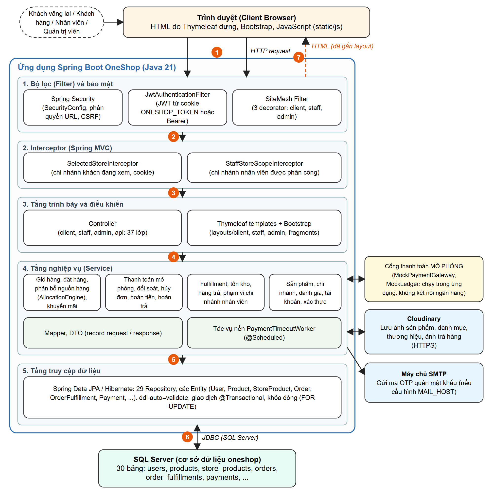

Sơ đồ ở trên thể hiện các tầng thực tế của ứng dụng.

- (1) Trình duyệt gửi yêu cầu HTTP tới ứng dụng; mọi yêu cầu đi qua chuỗi bộ lọc của Spring Security (kiểm tra CSRF, phân quyền theo URL) và JwtAuthenticationFilter, bộ lọc này đọc JWT từ cookie ONESHOP_TOKEN hoặc header Bearer.
- (2) Các Interceptor của Spring MVC xác định phạm vi: SelectedStoreInterceptor cho trang khách hàng, StaffStoreScopeInterceptor cho khu vực /staff.
- (3) Controller kiểm tra dữ liệu đầu vào (Bean Validation) và gọi tầng Service; Controller không chứa nghiệp vụ.
- (4) Service thực hiện nghiệp vụ trong giao dịch (@Transactional), gọi cổng thanh toán mô phỏng, Cloudinary hoặc máy chủ thư khi cần.
- (5) Repository (Spring Data JPA, Hibernate) truy vấn và ghi các Entity, có dùng khóa dòng (FOR UPDATE) ở các luồng tranh chấp.
- (6) SQL Server lưu dữ liệu qua JDBC; lược đồ do các tệp SQL quản lý, Hibernate chỉ kiểm tra (ddl-auto=validate).
- (7) Controller đặt dữ liệu vào Model, Thymeleaf dựng HTML, SiteMesh gắn layout theo khu vực rồi trả về trình duyệt.


## 1.2. Mô tả kiến trúc ứng dụng

OneShop là ứng dụng Spring Boot nguyên khối (Java 21, Maven) theo kiến trúc nhiều tầng kiểu MVC. Tầng trình bày gồm các mẫu Thymeleaf dựng HTML phía máy chủ, Bootstrap, một số tệp JavaScript tĩnh và SiteMesh, bộ lọc gắn một trong ba layout (khách hàng, nhân viên, quản trị viên) vào mọi trang HTML. Tầng điều khiển gồm 37 lớp Controller chia theo khu vực (client, staff, admin, api); phần REST gồm đăng nhập, đăng ký, kiểm tra sức khỏe (/health) và một số endpoint JSON gợi ý tìm kiếm. Tầng nghiệp vụ gồm các Service và các gói chuyên biệt: phân bổ nguồn hàng (allocation), xử lý phần giao (fulfillment), thanh toán và hoàn tiền (payment), khuyến mãi (promotion), trả hàng (returns), đánh giá (review) và xử lý ảnh (image). Tầng truy cập dữ liệu gồm 29 Repository Spring Data JPA trên các Entity ánh xạ tới 30 bảng SQL Server.

Một yêu cầu được xử lý theo trình tự: bộ lọc bảo mật xác thực người dùng và kiểm tra quyền truy cập URL; Interceptor xác định chi nhánh đang xem hoặc chi nhánh được phân công; Controller kiểm tra dữ liệu rồi gọi Service; Service thực hiện quy tắc nghiệp vụ trong một giao dịch, đọc ghi qua Repository; kết quả quay lại Controller để Thymeleaf dựng giao diện hoặc để chuyển hướng (mẫu Post/Redirect/Get). Các lỗi nghiệp vụ được biểu diễn bằng ngoại lệ (BadRequestException, CheckoutConflictException, FulfillmentConflictException...) và Controller chuyển thành thông báo gắn đúng trường hoặc mã trạng thái HTTP phù hợp; giao dịch bị hoàn tác khi có ngoại lệ.

Xác thực dùng JWT không trạng thái (không có phiên HTTP): token được lưu trong cookie HttpOnly, SameSite=Lax hoặc gửi bằng header Bearer cho API, nhưng vai trò và trạng thái tài khoản luôn được nạp lại từ cơ sở dữ liệu theo user_id nên khóa tài khoản hay đổi vai trò có hiệu lực ngay; biểu mẫu được bảo vệ bằng CSRF. Phân quyền theo URL gồm công khai (trang chủ, sản phẩm, cửa hàng, đăng nhập), CUSTOMER (giỏ hàng, đặt hàng, đơn hàng, đánh giá), STAFF (/staff/**) và ADMIN (/admin/**). Dữ liệu theo chi nhánh được tổ chức quanh StoreProduct (tồn kho của từng chi nhánh) và OrderFulfillment (phần giao của từng chi nhánh trong một đơn). Phạm vi của nhân viên là các phân công ACTIVE trong bảng staff_store_assignments, được đọc lại ở mỗi request và kiểm tra lại trên dòng dữ liệu đã khóa trước khi ghi; không bao giờ lấy từ tham số hay token.

SQL Server lưu toàn bộ dữ liệu nghiệp vụ và bảo vệ tính toàn vẹn bằng khóa duy nhất, ràng buộc CHECK, chỉ mục duy nhất có lọc (ví dụ một ảnh chính cho mỗi sản phẩm) và khóa dòng khi tranh chấp (đặt hàng đồng thời, thanh toán, hủy). Cloudinary lưu hình ảnh sản phẩm, danh mục, thương hiệu và ảnh trả hàng; cơ sở dữ liệu chỉ giữ URL và public_id, việc xóa ảnh cũ thực hiện sau khi giao dịch thành công. Máy chủ SMTP (nếu cấu hình) dùng để gửi mã OTP quên mật khẩu. Thanh toán trực tuyến dùng cổng mô phỏng chạy trong ứng dụng (MockPaymentGateway), không kết nối ngân hàng; tác vụ nền PaymentTimeoutWorker hủy các đơn ONLINE quá hạn 15 phút và hoàn tồn. Nghiệp vụ hiện hành là V3 (một giá online trên Product, giỏ hàng theo sản phẩm, tồn kho theo StoreProduct, một Order có nhiều Fulfillment), được xác minh từ mã nguồn và cơ sở dữ liệu đang chạy; các tài liệu đặc tả V3 được README nhắc tới không có trong thư mục docs của kho mã nên không được dùng làm căn cứ.


# Chương 2. SƠ ĐỒ HOẠT ĐỘNG CÁC CHỨC NĂNG

Chương này trình bày sơ đồ hoạt động (UML Activity Diagram) của từng chức năng nghiệp vụ đang được triển khai, theo ba nhóm tác nhân. Mỗi chức năng gồm bốn phần: mô tả, sơ đồ, đoạn mã nguồn thực tế trích từ kho mã (kèm đường dẫn và số dòng) và giải thích. Các sơ đồ dùng hai làn bơi (tác nhân và hệ thống); ô màu xám là thao tác truy cập hoặc cập nhật cơ sở dữ liệu. Căn cứ để vẽ là mã nguồn hiện hành; chỉ các chức năng có bằng chứng trong dự án mới được đưa vào.


## 2.1. Khách hàng


### 2.1.1. Đăng ký tài khoản (KH-01)

**A. Mô tả chức năng**

Chức năng cho phép khách vãng lai tạo tài khoản khách hàng để mua sắm. Người dùng nhập email, tên đăng nhập, họ tên, số điện thoại (tùy chọn) và mật khẩu tại trang /register; không cần đăng nhập trước. Hệ thống kiểm tra dữ liệu bằng Bean Validation, kiểm tra lại mẫu tên đăng nhập và giới hạn 72 byte của BCrypt, kiểm tra trùng email/tên đăng nhập, mã hóa mật khẩu và luôn gán vai trò CUSTOMER. Kết quả là một bản ghi trong bảng users và trình duyệt được chuyển đến /login?registered.

*Tác nhân: Khách vãng lai. Trạng thái triển khai: Hoạt động.*

**B. Sơ đồ hoạt động**

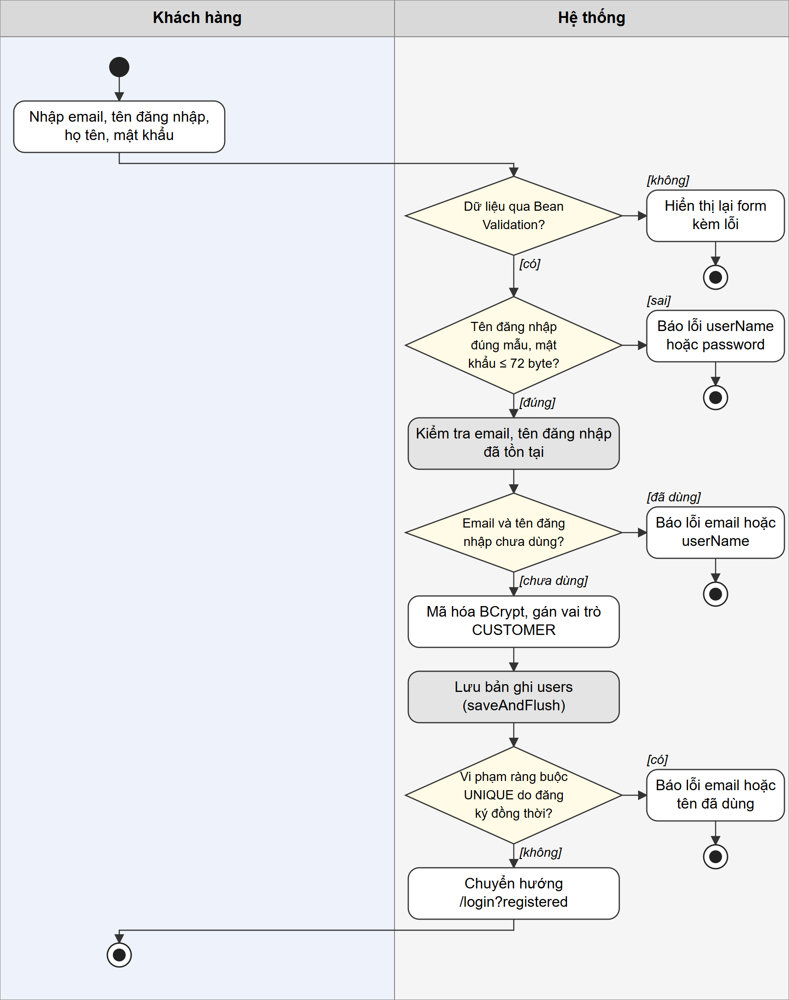

*Hình 2.1. Sơ đồ hoạt động chức năng Đăng ký tài khoản.* Mã nguồn sơ đồ: `diagrams/customer/KH-01.json`.

**C. Code xử lý chức năng**

**Đoạn mã 2.1. Kiểm tra dữ liệu đăng ký**

`src/main/java/com/oneshop/service/impl/AuthServiceImpl.java` (dòng 70-87)

```java
public UserResponse register(RegisterRequest request) {
    String email = normalize(request.getEmail());
    String userName = request.getUserName() == null ? "" : request.getUserName().trim();
    if (!USER_NAME_PATTERN.matcher(userName).matches()) {
        throw new BadRequestException("userName",
                "Tên đăng nhập từ 4 đến 30 ký tự, chỉ gồm chữ, số, dấu _ và dấu chấm, không chứa @");
    }
    // BCrypt refuses more than 72 BYTES; the DTO checks this too, re-checked here for every caller of the Service
    if (request.getPassword().getBytes(StandardCharsets.UTF_8).length > BCRYPT_MAX_BYTES) {
        throw new BadRequestException("password",
                "Mật khẩu tối đa " + BCRYPT_MAX_BYTES + " byte (ký tự có dấu chiếm 2-3 byte), hãy dùng mật khẩu ngắn hơn");
    }
    if (userRepository.existsByEmail(email)) {
        throw new BadRequestException("email", "Email đã được sử dụng");
    }
    if (userRepository.existsByUserNameIgnoreCase(userName)) {
        throw new BadRequestException("userName", "Tên đăng nhập đã được sử dụng");
    }
```

**Đoạn mã 2.2. Tạo tài khoản CUSTOMER**

`src/main/java/com/oneshop/service/impl/AuthServiceImpl.java` (dòng 88-106)

```java
// roles is a fixed lookup table seeded by database/02_seed.sql (CHECK limits it to 3 names)
Role customerRole = roleRepository.findByName(RoleName.CUSTOMER)
        .orElseThrow(() -> new IllegalStateException("Role CUSTOMER is missing: run the database scripts"));

User user = new User();
user.setEmail(email);
user.setUserName(userName);
user.setFullName(request.getFullName().trim());
user.setPhone(request.getPhone() == null || request.getPhone().isBlank() ? null : request.getPhone().trim());
user.setPasswordHash(passwordEncoder.encode(request.getPassword()));
user.setRole(customerRole);
User saved;
try {
    saved = userRepository.saveAndFlush(user);
} catch (DataIntegrityViolationException ex) {
    // Two concurrent registrations passed the exists* checks: the unique constraints decide.
    throw new BadRequestException("Email hoặc tên đăng nhập đã được sử dụng");
}
return new UserResponse(saved.getId(), saved.getEmail(), saved.getUserName(), saved.getFullName());
```

**D. Giải thích code**

Phương thức register của AuthServiceImpl chạy trong một giao dịch. Đoạn đầu chuẩn hóa email, kiểm tra tên đăng nhập bằng USER_NAME_PATTERN và giới hạn 72 byte, rồi dùng UserRepository.existsByEmail / existsByUserNameIgnoreCase để loại trùng; mỗi lỗi ném BadRequestException gắn với một trường. Đoạn sau lấy Role CUSTOMER từ RoleRepository, mã hóa mật khẩu bằng PasswordEncoder và lưu User; nếu hai yêu cầu đồng thời cùng qua bước kiểm tra, ràng buộc UNIQUE của CSDL gây DataIntegrityViolationException và được đổi thành thông báo lỗi. Controller AuthController bắt BadRequestException để gắn lỗi vào đúng ô nhập, khớp với các nhánh lỗi của sơ đồ. Luồng này được thể hiện trong Hình 2.1 và mã nguồn trong Đoạn mã 2.1, Đoạn mã 2.2.


### 2.1.2. Đăng nhập và đăng xuất (KH-02)

**A. Mô tả chức năng**

Chức năng xác thực dùng chung cho cả ba vai trò. Người dùng nhập email hoặc tên đăng nhập cùng mật khẩu tại /login. Hệ thống xác thực qua AuthenticationManager, sinh JWT và ghi vào cookie HttpOnly ONESHOP_TOKEN; sau đó chuyển hướng theo vai trò (ADMIN → /admin, STAFF → /staff, còn lại → /). Ở mỗi request sau, JwtAuthenticationFilter đọc lại người dùng và vai trò từ CSDL theo user_id trong token. Đăng xuất (POST /logout) xóa cookie và quay về /login?logout.

*Tác nhân: Khách hàng, nhân viên, quản trị viên. Trạng thái triển khai: Hoạt động.*

**B. Sơ đồ hoạt động**

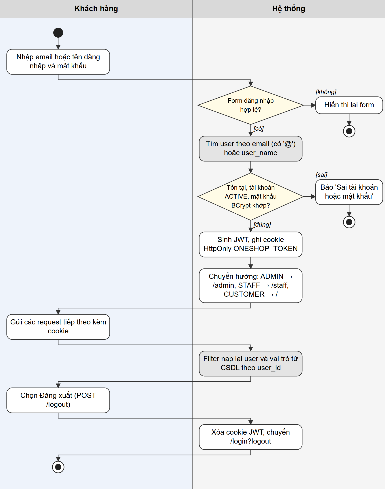

*Hình 2.2. Sơ đồ hoạt động chức năng Đăng nhập và đăng xuất.* Mã nguồn sơ đồ: `diagrams/customer/KH-02.json`.

**C. Code xử lý chức năng**

**Đoạn mã 2.3. Đăng nhập: AuthController**

`src/main/java/com/oneshop/controller/client/AuthController.java` (dòng 37-51)

```java
@PostMapping("/login")
public String login(@Valid @ModelAttribute("loginRequest") LoginRequest request, BindingResult bindingResult,
                    Model model, HttpServletResponse response) {
    if (bindingResult.hasErrors()) {
        return "auth/login";
    }
    try {
        AuthResponse auth = authService.login(request);
        cookieService.addTokenCookie(response, auth.accessToken(), auth.expiresInSeconds());
        return "redirect:" + homeOf(auth);
    } catch (AuthenticationException ex) {
        model.addAttribute("loginError", "Sai tài khoản hoặc mật khẩu");
        return "auth/login";
    }
}
```

**Đoạn mã 2.4. Xác thực và sinh JWT**

`src/main/java/com/oneshop/service/impl/AuthServiceImpl.java` (dòng 54-66)

```java
public AuthResponse login(LoginRequest request) {
    // The identifier is an e-mail or a user_name; CustomUserDetailsService decides by the presence of '@'.
    // An unknown identifier and a wrong password both end in the same BadCredentialsException.
    Authentication authentication = authenticationManager.authenticate(
            new UsernamePasswordAuthenticationToken(request.getIdentifier().trim(), request.getPassword()));
    UserDetails principal = (UserDetails) authentication.getPrincipal();
    return new AuthResponse(
            jwtService.generateToken(principal),
            TOKEN_TYPE,
            jwtService.getExpirationSeconds(),
            principal.getUsername(),
            principal.getAuthorities().stream().map(GrantedAuthority::getAuthority).toList());
}
```

**Đoạn mã 2.5. Xác thực mỗi request bằng JWT**

`src/main/java/com/oneshop/security/jwt/JwtAuthenticationFilter.java` (dòng 43-64)

```java
protected void doFilterInternal(HttpServletRequest request, HttpServletResponse response, FilterChain chain)
        throws ServletException, IOException {
    String token = cookieService.resolveToken(request);
    if (token != null && SecurityContextHolder.getContext().getAuthentication() == null) {
        authenticate(token, request);
    }
    chain.doFilter(request, response);
}

private void authenticate(String token, HttpServletRequest request) {
    try {
        UserDetails userDetails = userDetailsService.loadUserById(jwtService.extractUserId(token));
        if (jwtService.isTokenValid(token, userDetails)) {
            UsernamePasswordAuthenticationToken authentication = UsernamePasswordAuthenticationToken.authenticated(
                    userDetails, null, userDetails.getAuthorities());
            authentication.setDetails(new WebAuthenticationDetailsSource().buildDetails(request));
            SecurityContextHolder.getContext().setAuthentication(authentication);
        }
    } catch (JwtException | IllegalArgumentException | UsernameNotFoundException ex) {
        log.debug("Rejected JWT: {}", ex.getClass().getSimpleName());
    }
}
```

**D. Giải thích code**

AuthController.login kiểm tra form, gọi AuthService.login rồi ghi token vào cookie; mọi AuthenticationException đều cho cùng một thông báo để không lộ tài khoản có tồn tại hay không. AuthServiceImpl.login chuyển việc kiểm tra cho AuthenticationManager (CustomUserDetailsService chọn tìm theo email hay user_name tùy dấu '@') và dùng JwtService để tạo token. Trong JwtAuthenticationFilter, token lấy từ cookie hoặc header Bearer; người dùng được nạp lại bằng loadUserById nên khóa tài khoản hoặc đổi vai trò có hiệu lực ngay, không phụ thuộc nội dung token. Phân quyền URL do SecurityConfig đảm nhiệm. Luồng này được thể hiện trong Hình 2.2 và mã nguồn trong Đoạn mã 2.3, Đoạn mã 2.4, Đoạn mã 2.5.


### 2.1.3. Quên mật khẩu bằng mã OTP (KH-03)

**A. Mô tả chức năng**

Chức năng giúp người dùng đặt lại mật khẩu khi quên, gồm ba bước: gửi mã OTP 6 chữ số tới email, nhập mã để chứng minh quyền sở hữu, rồi đặt mật khẩu mới. Email phải thuộc một tài khoản đang ACTIVE. Mã chỉ có hiệu lực 10 phút, chỉ được gửi lại sau 60 giây, tối đa 5 lần mỗi giờ và sai tối đa 5 lần. Khi nhập đúng, hệ thống cấp một vé ký HMAC; chỉ vé này mới cho phép đổi mật khẩu. Việc gửi thư cần cấu hình SMTP; nếu chưa có, hệ thống báo chưa gửi được và không lưu mã.

*Tác nhân: Khách hàng (chưa đăng nhập). Trạng thái triển khai: Hoạt động (gửi thư cần cấu hình MAIL_HOST; không có SMTP thì chức năng báo chưa gửi được).*

**B. Sơ đồ hoạt động**

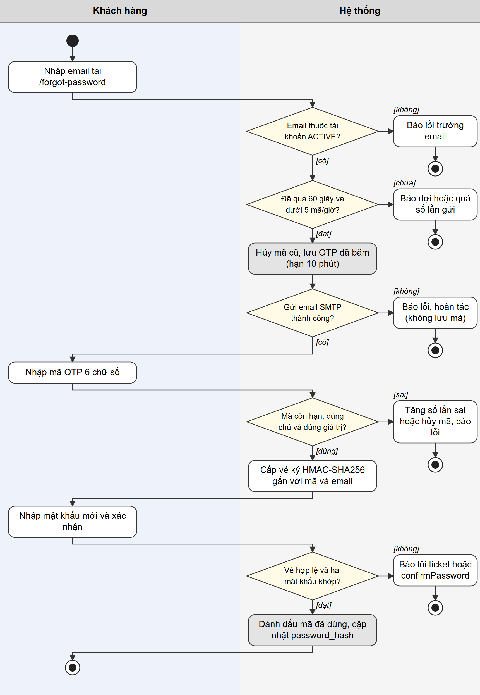

*Hình 2.3. Sơ đồ hoạt động chức năng Quên mật khẩu bằng mã OTP.* Mã nguồn sơ đồ: `diagrams/customer/KH-03.json`.

**C. Code xử lý chức năng**

**Đoạn mã 2.6. Bước 1: gửi mã OTP**

`src/main/java/com/oneshop/service/PasswordResetService.java` (dòng 75-98)

```java
public void requestOtp(String rawEmail) {
    String email = normalize(rawEmail);
    User user = requireActiveAccount(email);
    LocalDateTime now = LocalDateTime.now(clock).withNano(0);

    otps.findFirstByEmailOrderByIdDesc(email).ifPresent(last -> {
        long wait = RESEND_COOLDOWN_SECONDS - Duration.between(last.getCreatedAt(), now).getSeconds();
        if (wait > 0) {
            throw new BadRequestException("email", "Vui lòng đợi " + wait + " giây trước khi gửi lại mã.");
        }
    });
    if (otps.countByEmailAndCreatedAtAfter(email, now.minusHours(1)) >= MAX_SENDS_PER_HOUR) {
        throw new BadRequestException("email", "Bạn đã yêu cầu mã quá nhiều lần. Vui lòng thử lại sau 1 giờ.");
    }

    String code = String.format("%06d", RANDOM.nextInt(1_000_000));
    otps.consumeAllOpen(email, now);
    otps.save(new PasswordResetOtp(user.getId(), email, encoder.encode(code), now.plusMinutes(OTP_VALID_MINUTES), now));
    try {
        mailer.sendOtp(email, user.getFullName(), code, OTP_VALID_MINUTES);
    } catch (OtpMailSender.MailUnavailableException ex) {
        throw new BadRequestException("email", ex.getMessage());
    }
}
```

**Đoạn mã 2.7. Bước 2: xác minh mã OTP**

`src/main/java/com/oneshop/service/PasswordResetService.java` (dòng 108-139)

```java
public String verifyOtp(String rawEmail, String rawOtp) {
    String email = normalize(rawEmail);
    User user = requireActiveAccount(email);
    LocalDateTime now = LocalDateTime.now(clock).withNano(0);

    PasswordResetOtp row = otps.findFirstByEmailAndConsumedAtIsNullOrderByIdDesc(email)
            .orElseThrow(() -> new BadRequestException("otp",
                    "Chưa có mã OTP hợp lệ cho email này. Vui lòng gửi mã mới."));
    // the code must belong to exactly this account and this e-mail
    if (!user.getId().equals(row.getUserId()) || !email.equals(row.getEmail())) {
        otps.consumeAllOpen(email, now);
        throw new BadRequestException("otp", "Mã OTP không hợp lệ. Vui lòng gửi mã mới.");
    }
    if (!row.getExpiresAt().isAfter(now)) {
        otps.consume(row.getId(), now);
        throw new BadRequestException("otp", "Mã OTP đã hết hạn. Vui lòng gửi mã mới.");
    }
    if (row.getAttempts() >= MAX_WRONG_TRIES) {
        otps.consume(row.getId(), now);
        throw new BadRequestException("otp", "Bạn đã nhập sai quá nhiều lần. Vui lòng gửi mã mới.");
    }
    String otp = rawOtp == null ? "" : rawOtp.trim();
    if (!encoder.matches(otp, row.getOtpHash())) {
        otps.addAttempt(row.getId());
        int left = MAX_WRONG_TRIES - (row.getAttempts() + 1);
        if (left <= 0) {
            otps.consume(row.getId(), now);
            throw new BadRequestException("otp", "Bạn đã nhập sai quá nhiều lần. Vui lòng gửi mã mới.");
        }
        throw new BadRequestException("otp", "Mã OTP không đúng. Bạn còn " + left + " lần thử.");
    }
    return issueTicket(row);
```

**Đoạn mã 2.8. Bước 3: đặt mật khẩu mới**

`src/main/java/com/oneshop/service/PasswordResetService.java` (dòng 148-169)

```java
public void resetPassword(String rawEmail, String ticket, String newPassword, String confirmPassword) {
    String email = normalize(rawEmail);
    User user = requireActiveAccount(email);
    LocalDateTime now = LocalDateTime.now(clock).withNano(0);

    Long otpId = readTicket(ticket, email, user.getId(), now);
    PasswordResetOtp row = otpId == null ? null : otps.findById(otpId).orElse(null);
    if (row == null || row.getConsumedAt() != null || !row.getExpiresAt().isAfter(now)
            || !user.getId().equals(row.getUserId()) || !email.equals(row.getEmail())) {
        throw new BadRequestException("ticket", "Phiên đặt lại mật khẩu đã hết hạn. Vui lòng nhập lại mã OTP.");
    }
    if (newPassword == null || !newPassword.equals(confirmPassword)) {
        throw new BadRequestException("confirmPassword", "Mật khẩu nhập lại không khớp");
    }
    if (otps.consume(row.getId(), now) != 1) {
        throw new BadRequestException("ticket", "Phiên đặt lại mật khẩu đã hết hạn. Vui lòng nhập lại mã OTP.");
    }
    if (users.updatePasswordHash(email, encoder.encode(newPassword), now) != 1) {
        throw new BadRequestException("email", "Tài khoản không còn hoạt động.");
    }
    otps.consumeAllOpen(email, now);
}
```

**D. Giải thích code**

requestOtp kiểm tra tài khoản, thời gian chờ và hạn mức gửi, hủy các mã còn mở, lưu mã đã băm BCrypt vào PasswordResetOtp rồi gọi OtpMailSender; nếu gửi thất bại, BadRequestException làm giao dịch hoàn tác. verifyOtp (noRollbackFor để vẫn ghi số lần sai) kiểm tra mã thuộc đúng tài khoản và email, còn hạn, chưa sai quá 5 lần, so khớp bằng PasswordEncoder rồi trả về vé. resetPassword đọc và kiểm tra chữ ký vé, đối chiếu hai mật khẩu, 'tiêu thụ' mã đúng một lần và cập nhật mật khẩu bằng UserRepository.updatePasswordHash. Các nhánh lỗi trong sơ đồ tương ứng với các BadRequestException trong ba đoạn mã. Luồng này được thể hiện trong Hình 2.3 và mã nguồn trong Đoạn mã 2.6, Đoạn mã 2.7, Đoạn mã 2.8.


### 2.1.4. Xem danh sách, tìm kiếm và lọc sản phẩm (KH-04)

**A. Mô tả chức năng**

Trang /products hiển thị sản phẩm đang bán, hỗ trợ tìm theo từ khóa (tên hoặc SKU), lọc theo danh mục và thương hiệu, phân trang 12 sản phẩm. Nếu khách đã chọn một chi nhánh để xem (lưu trong cookie), danh mục được lấy từ hàng bán được của chi nhánh đó; nếu chưa chọn, danh mục tính trên toàn chuỗi kèm danh sách chi nhánh còn hàng. Mọi sản phẩm dùng một giá online duy nhất. Chức năng không yêu cầu đăng nhập.

*Tác nhân: Khách vãng lai, khách hàng. Trạng thái triển khai: Hoạt động.*

**B. Sơ đồ hoạt động**

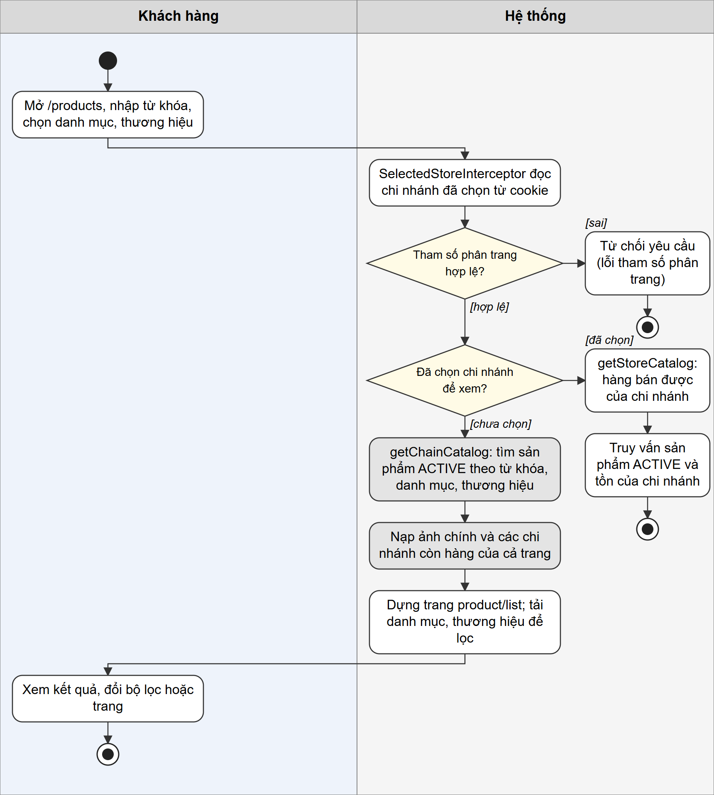

*Hình 2.4. Sơ đồ hoạt động chức năng Xem danh sách, tìm kiếm và lọc sản phẩm.* Mã nguồn sơ đồ: `diagrams/customer/KH-04.json`.

**C. Code xử lý chức năng**

**Đoạn mã 2.9. ProductController.list**

`src/main/java/com/oneshop/controller/client/ProductController.java` (dòng 52-69)

```java
@GetMapping("/products")
public String list(@RequestParam(name = "q", required = false) String keyword,
                   @RequestParam(required = false) Long categoryId,
                   @RequestParam(required = false) Long brandId,
                   @RequestParam(defaultValue = "0") int page,
                   @RequestAttribute(name = SelectedStoreInterceptor.SELECTED_STORE, required = false) StoreResponse selectedStore,
                   Model model) {
    ProductSearchCriteria criteria = new ProductSearchCriteria(keyword, categoryId, brandId);
    Pageable pageable = com.oneshop.service.query.Paging.page(page, PAGE_SIZE);

    model.addAttribute("catalog", selectedStore == null
            ? storeProductService.getChainCatalog(criteria, pageable)
            : storeProductService.getStoreCatalog(selectedStore.id(), criteria, pageable));
    model.addAttribute("criteria", criteria);
    model.addAttribute("categories", productService.getActiveCategories());
    model.addAttribute("brands", productService.getActiveBrands());
    return "product/list";
}
```

**Đoạn mã 2.10. Tìm kiếm sản phẩm hiển thị**

`src/main/java/com/oneshop/service/impl/ProductServiceImpl.java` (dòng 78-91)

```java
public Page<ProductResponse> searchProducts(ProductSearchCriteria criteria, Pageable pageable) {
    com.oneshop.service.query.Paging.validate(pageable);
    var words = com.oneshop.service.search.TextSearch.words(criteria.keyword());
    Page<Product> page = words.isEmpty()
            ? productRepository.searchVisible(criteria.likePattern(), criteria.categoryId(),
                    criteria.brandId(), pageable)
            : com.oneshop.service.search.TextSearch.slice(
                    productRepository.searchVisible("%", criteria.categoryId(), criteria.brandId(),
                                    Pageable.unpaged(pageable.getSort())).getContent().stream()
                            .filter(p -> com.oneshop.service.search.TextSearch.matchesAll(words, p.getSku(), p.getName()))
                            .toList(), pageable);
    Map<Long, String> primaryImages = getPrimaryImageUrls(page.getContent().stream().map(Product::getId).toList());
    return page.map(product -> productMapper.toResponse(product, primaryImages.get(product.getId())));
}
```

**D. Giải thích code**

ProductController.list tạo ProductSearchCriteria từ q, categoryId, brandId và chọn getStoreCatalog khi request có thuộc tính chi nhánh đã chọn, ngược lại getChainCatalog. ProductServiceImpl.searchProducts kiểm tra tham số phân trang bằng Paging.validate, gọi ProductRepository.searchVisible (chỉ sản phẩm hiển thị) hoặc lọc theo nhiều từ khóa bằng TextSearch, rồi gắn ảnh chính qua getPrimaryImageUrls. Dữ liệu trả về là các record ProductResponse, không lộ entity ra giao diện. Luồng này được thể hiện trong Hình 2.4 và mã nguồn trong Đoạn mã 2.9, Đoạn mã 2.10.


### 2.1.5. Xem chi tiết sản phẩm và tình trạng còn hàng theo chi nhánh (KH-05)

**A. Mô tả chức năng**

Trang /products/{id} cho xem mô tả, giá, bộ ảnh, tình trạng còn hàng tại từng chi nhánh và các đánh giá của khách. Sản phẩm không hiển thị (ngừng bán hoặc danh mục/thương hiệu bị ẩn) trả về 404. Khi khách đã đăng nhập, trang còn liệt kê các dòng hàng đã nhận có thể đánh giá. Chức năng này đồng thời là cách khách tra cứu tình trạng còn hàng theo từng chi nhánh.

*Tác nhân: Khách vãng lai, khách hàng. Trạng thái triển khai: Hoạt động.*

**B. Sơ đồ hoạt động**

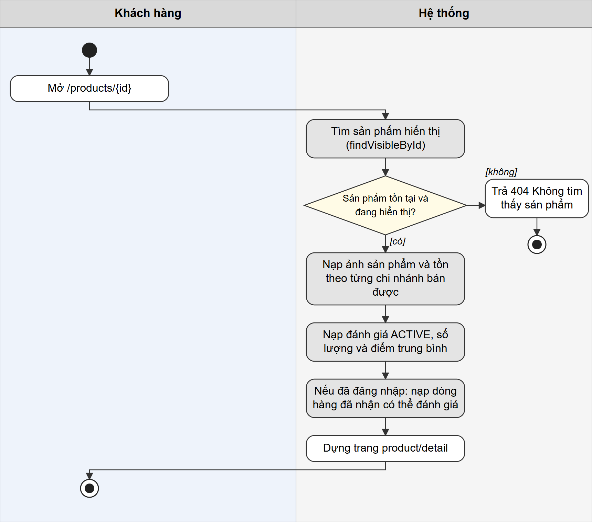

*Hình 2.5. Sơ đồ hoạt động chức năng Xem chi tiết sản phẩm và tình trạng còn hàng theo chi nhánh.* Mã nguồn sơ đồ: `diagrams/customer/KH-05.json`.

**C. Code xử lý chức năng**

**Đoạn mã 2.11. ProductController.detail**

`src/main/java/com/oneshop/controller/client/ProductController.java` (dòng 71-78)

```java
@GetMapping("/products/{id}")
public String detail(@PathVariable Long id,
                     Principal principal, Model model) {
    model.addAttribute("detail", storeProductService.getProductDetail(id, null));
    model.addAttribute("productReviews", reviewService.getProductReviews(id));
    model.addAttribute("reviewItems", reviewService.getProductReviewItems(principal == null ? null : principal.getName(), id));
    return "product/detail";
}
```

**Đoạn mã 2.12. Chi tiết sản phẩm và tồn theo chi nhánh**

`src/main/java/com/oneshop/service/impl/StoreProductServiceImpl.java` (dòng 152-165)

```java
public ProductDetailResponse getProductDetail(Long productId, Long selectedStoreId) {
    ProductResponse product = productService.getProduct(productId);
    List<StoreAvailabilityResponse> sellable = storeProductRepository.findSellableByProductIds(List.of(productId))
            .stream().map(storeProductMapper::toAvailability).toList();

    StoreAvailabilityResponse atSelectedStore = sellable.stream()
            .filter(availability -> availability.storeId().equals(selectedStoreId))
            .findFirst().orElse(null);
    List<StoreAvailabilityResponse> otherStores = sellable.stream()
            .filter(availability -> !availability.storeId().equals(selectedStoreId))
            .toList();
    return new ProductDetailResponse(product, productService.getProductImages(productId), atSelectedStore,
            otherStores);
}
```

**D. Giải thích code**

ProductController.detail gọi StoreProductService.getProductDetail, ReviewService.getProductReviews và getProductReviewItems (rỗng nếu chưa đăng nhập). getProductDetail dùng ProductService.getProduct để ném ResourceNotFoundException khi sản phẩm không hiển thị (ứng với nhánh 404), sau đó lấy danh sách StoreProduct bán được của sản phẩm và chuyển thành StoreAvailabilityResponse. Trang chi tiết không phụ thuộc chi nhánh đã chọn nên tham số selectedStoreId được truyền null. Luồng này được thể hiện trong Hình 2.5 và mã nguồn trong Đoạn mã 2.11, Đoạn mã 2.12.


### 2.1.6. Tra cứu và chọn chi nhánh (KH-06)

**A. Mô tả chức năng**

Trang /stores liệt kê chi nhánh của chuỗi, lọc theo tỉnh/thành và khu vực, hiển thị địa chỉ, giờ mở cửa, khả năng giao tận nơi hoặc nhận tại cửa hàng. Khách có thể chọn một chi nhánh để duyệt sản phẩm theo tồn kho của chi nhánh đó; lựa chọn được lưu trong cookie và có thể bỏ chọn để quay về toàn chuỗi. Việc chọn chi nhánh này chỉ ảnh hưởng đến cách xem danh mục, không quyết định nguồn hàng khi đặt đơn.

*Tác nhân: Khách vãng lai, khách hàng. Trạng thái triển khai: Hoạt động.*

**B. Sơ đồ hoạt động**

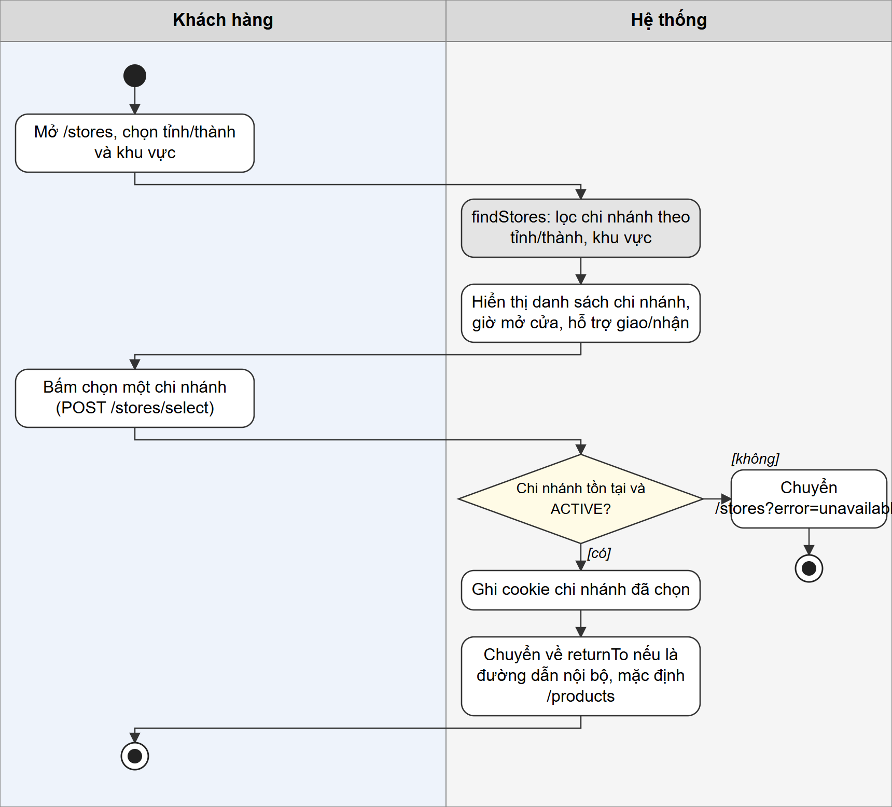

*Hình 2.6. Sơ đồ hoạt động chức năng Tra cứu và chọn chi nhánh.* Mã nguồn sơ đồ: `diagrams/customer/KH-06.json`.

**C. Code xử lý chức năng**

**Đoạn mã 2.13. Chọn chi nhánh**

`src/main/java/com/oneshop/controller/client/StoreController.java` (dòng 42-51)

```java
@PostMapping("/stores/select")
public String select(@RequestParam(required = false) Long storeId,
                     @RequestParam(required = false) String returnTo, HttpServletResponse response) {
    try {
        selectedStoreCookie.write(response, storeService.requireSelectableStore(storeId).id());
    } catch (BadRequestException ex) {
        return "redirect:/stores?error=unavailable";
    }
    return "redirect:" + localPath(returnTo);
}
```

**Đoạn mã 2.14. Tra cứu chi nhánh theo tỉnh/thành, khu vực**

`src/main/java/com/oneshop/service/impl/StoreServiceImpl.java` (dòng 50-58)

```java
@Override
public List<StoreResponse> findStores(String provinceCity, String area) {
    // a chain has a handful of Stores: filtering in memory keeps the three filter combinations in one place
    return storeRepository.findAllByOrderByProvinceCityAscAreaAscNameAsc().stream()
            .filter(store -> matches(provinceCity, store.getProvinceCity()))
            .filter(store -> matches(area, store.getArea()))
            .map(storeMapper::toResponse)
            .toList();
}
```

**D. Giải thích code**

StoreController.select chỉ ghi cookie sau khi StoreService.requireSelectableStore xác nhận chi nhánh tồn tại và ACTIVE; nếu không, nó chuyển về /stores?error=unavailable. Hàm localPath (cùng controller) chỉ chấp nhận đường dẫn bắt đầu bằng '/' của chính website để tránh chuyển hướng mở sang miền khác. StoreServiceImpl.findStores lọc trong bộ nhớ theo tỉnh/thành và khu vực (chuỗi chỉ có vài chi nhánh) và trả StoreResponse. Luồng này được thể hiện trong Hình 2.6 và mã nguồn trong Đoạn mã 2.13, Đoạn mã 2.14.


### 2.1.7. Thêm sản phẩm vào giỏ hàng (KH-07)

**A. Mô tả chức năng**

Khách đã đăng nhập thêm sản phẩm vào giỏ hàng từ trang danh sách hoặc chi tiết. Giỏ hàng V3 chứa các dòng theo sản phẩm (SKU), không gắn cố định chi nhánh; tồn kho được kiểm tra trên tổng tồn bán được toàn chuỗi. Hệ thống khóa giỏ của khách trong giao dịch, cộng dồn nếu sản phẩm đã có và từ chối khi số lượng sau cộng vượt tồn. Giá không bao giờ được gửi từ trình duyệt.

*Tác nhân: Khách hàng. Trạng thái triển khai: Hoạt động.*

**B. Sơ đồ hoạt động**

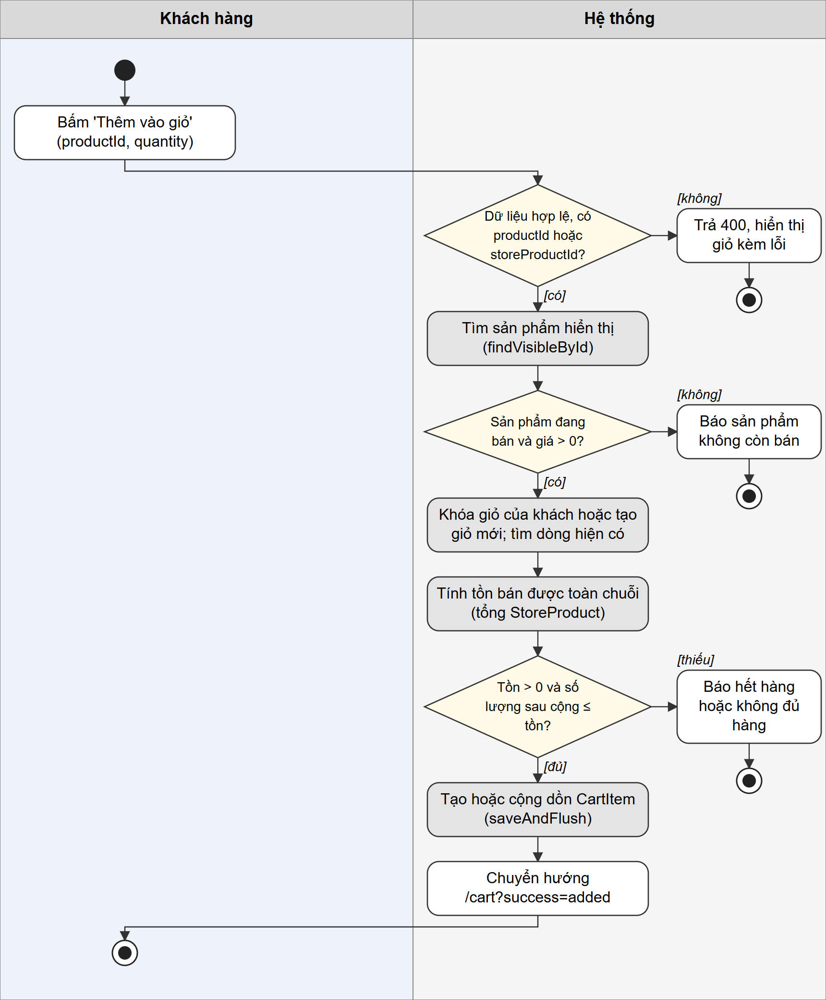

*Hình 2.7. Sơ đồ hoạt động chức năng Thêm sản phẩm vào giỏ hàng.* Mã nguồn sơ đồ: `diagrams/customer/KH-07.json`.

**C. Code xử lý chức năng**

**Đoạn mã 2.15. CartController.add**

`src/main/java/com/oneshop/controller/client/CartController.java` (dòng 43-55)

```java
@PostMapping("/items")
public String add(@Valid @ModelAttribute AddCartItemRequest request, BindingResult bindingResult,
                  Principal principal, Model model, HttpServletResponse response) {
    if (bindingResult.hasErrors() || (request.productId() == null && request.storeProductId() == null)) {
        return rejected(principal, model, response, "Không thể thêm vào giỏ: thiếu sản phẩm hoặc số lượng không hợp lệ.");
    }
    try {
        cartService.addItem(principal.getName(), request);
    } catch (BadRequestException ex) {
        return rejected(principal, model, response, ex.getMessage());
    }
    return "redirect:/cart?success=added";
}
```

**Đoạn mã 2.16. Khóa giỏ, kiểm tra tồn, lưu dòng hàng**

`src/main/java/com/oneshop/service/impl/CartServiceImpl.java` (dòng 164-198)

```java
Cart cart = cartRepository.findByUserIdForUpdate(user.getId()).orElseGet(() -> createCart(user));
CartItem item = cartItemRepository.findByCartIdAndProductId(cart.getId(), product.getId()).orElse(null);
if (item == null && storeProduct != null) {
    item = cartItemRepository.findByCartIdAndStoreProductId(cart.getId(), storeProduct.getId()).orElse(null);
}
long resulting = (item == null ? 0L : item.getQuantity()) + quantity;

// A legacy StoreProduct only identifies the SKU; V3 Cart never chooses its inventory source.
long availableStock = getChainAvailableStock(product.getId());
if (availableStock <= 0) {
    throw new BadRequestException("quantity", OUT_OF_STOCK);
}
if (resulting > availableStock || resulting > Integer.MAX_VALUE) {
    throw new BadRequestException("quantity", item == null ? NOT_ENOUGH : NOT_ENOUGH_WITH_CART);
}

if (item == null) {
    item = new CartItem();
    item.setCart(cart);
    item.setProduct(product);
    if (storeProduct != null) {
        item.setStoreProduct(storeProduct);
    } else {
        List<StoreProduct> sellable = storeProductRepository.findSellableByProductIds(List.of(product.getId()));
        if (!sellable.isEmpty()) {
            item.setStoreProduct(sellable.get(0));
        }
    }
} else {
    if (item.getStoreProduct() == null && storeProduct != null) {
        item.setStoreProduct(storeProduct);
    }
}
item.setQuantity((int) resulting);
cartItemRepository.saveAndFlush(item);
```

**D. Giải thích code**

CartController.add bắt BadRequestException và hiển thị lại giỏ với mã 400. Trong doAddItem, giỏ được khóa bằng findByUserIdForUpdate (hoặc tạo mới), số lượng sau khi cộng so với getChainAvailableStock; vượt tồn thì ném BadRequestException. Dòng CartItem được tạo mới hoặc cập nhật số lượng rồi saveAndFlush. Nếu hai yêu cầu song song cùng tạo giỏ hoặc dòng, addItem bắt DataIntegrityViolationException và chạy lại một lần để cộng vào bản ghi vừa được commit. Luồng này được thể hiện trong Hình 2.7 và mã nguồn trong Đoạn mã 2.15, Đoạn mã 2.16.


### 2.1.8. Cập nhật số lượng và xóa sản phẩm trong giỏ hàng (KH-08)

**A. Mô tả chức năng**

Tại trang /cart, khách đổi số lượng hoặc xóa một dòng hàng. Chỉ dòng thuộc giỏ của chính khách mới được thao tác (không có tham số nào nêu tên người dùng hay giỏ). Khi cập nhật, hệ thống kiểm tra số lượng tối thiểu 1, sản phẩm còn bán và số lượng không vượt tổng tồn toàn chuỗi. Khi xóa, dòng hàng bị loại khỏi giỏ.

*Tác nhân: Khách hàng. Trạng thái triển khai: Hoạt động.*

**B. Sơ đồ hoạt động**

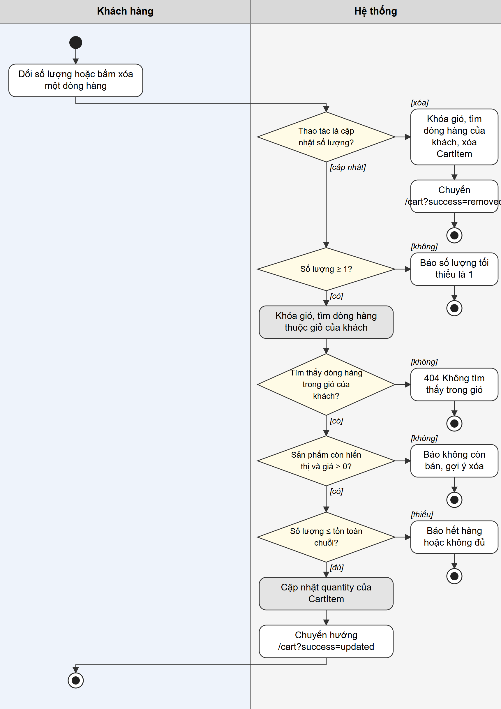

*Hình 2.8. Sơ đồ hoạt động chức năng Cập nhật số lượng và xóa sản phẩm trong giỏ hàng.* Mã nguồn sơ đồ: `diagrams/customer/KH-08.json`.

**C. Code xử lý chức năng**

**Đoạn mã 2.17. Cập nhật và xóa dòng hàng**

`src/main/java/com/oneshop/service/impl/CartServiceImpl.java` (dòng 214-248)

```java
@Transactional
public void updateItemQuantity(String customerEmail, Long cartItemId, int quantity) {
    requirePositive(quantity);
    CartItem item = ownItem(customerEmail, cartItemId);
    Product product = item.getProduct();

    if (productRepository.findVisibleById(product.getId()).isEmpty()
            || product.getPrice() == null || product.getPrice().signum() <= 0) {
        throw new BadRequestException("quantity", NOT_ON_SALE + " Bạn có thể xóa sản phẩm khỏi giỏ.");
    }

    long available = getChainAvailableStock(product.getId());

    if (available <= 0) {
        throw new BadRequestException("quantity", OUT_OF_STOCK);
    }
    if (quantity > available) {
        throw new BadRequestException("quantity", NOT_ENOUGH);
    }
    item.setQuantity(quantity);
}

@Override
@Transactional
public void removeItem(String customerEmail, Long cartItemId) {
    cartItemRepository.delete(ownItem(customerEmail, cartItemId));
}

/** The line, only if it is in the cart of this customer; the cart row is locked for the rest of the transaction. */
private CartItem ownItem(String customerEmail, Long cartItemId) {
    return userRepository.findByEmail(customerEmail)
            .flatMap(user -> cartRepository.findByUserIdForUpdate(user.getId()))
            .flatMap(cart -> cartItemRepository.findByIdAndCartId(cartItemId, cart.getId()))
            .orElseThrow(() -> new ResourceNotFoundException("Không tìm thấy sản phẩm này trong giỏ hàng của bạn."));
}
```

**D. Giải thích code**

updateItemQuantity gọi requirePositive, ownItem (tìm dòng bằng giỏ đã khóa của khách, nếu không thấy ném ResourceNotFoundException), kiểm tra sản phẩm còn hiển thị rồi so sánh số lượng với getChainAvailableStock trước khi gán quantity. removeItem dùng chính ownItem để chỉ xóa dòng của khách hiện tại. CartController.update/remove chuyển kết quả thành các redirect /cart?success=updated|removed, còn lỗi nghiệp vụ được hiển thị lại trên trang giỏ. Luồng này được thể hiện trong Hình 2.8 và mã nguồn trong Đoạn mã 2.17.


### 2.1.9. Xem trước đơn hàng và áp mã khuyến mãi (KH-09)

**A. Mô tả chức năng**

Từ giỏ hàng, khách chọn các dòng muốn mua và mở trang thanh toán /checkout. Hệ thống tính trước kế hoạch đặt hàng mà không ghi dữ liệu: cách nhận (giao tận nơi hoặc nhận tại cửa hàng), phương thức thanh toán hợp lệ, nguồn hàng được phân bổ cho từng chi nhánh, số đơn sẽ tạo, phí giao hàng 30.000 VNĐ mỗi đơn (nhận tại cửa hàng miễn phí) và giảm giá nếu khách nhập hoặc chọn mã khuyến mãi. Kết quả gồm một chữ ký kế hoạch dùng để phát hiện thay đổi khi khách xác nhận.

*Tác nhân: Khách hàng. Trạng thái triển khai: Hoạt động.*

**B. Sơ đồ hoạt động**

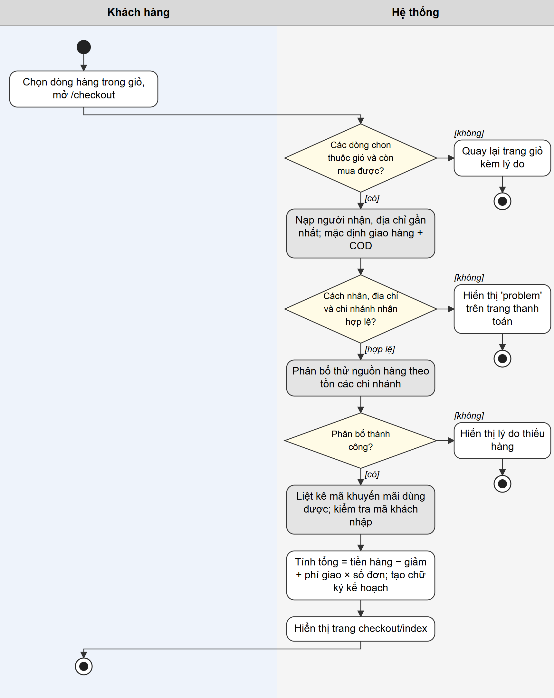

*Hình 2.9. Sơ đồ hoạt động chức năng Xem trước đơn hàng và áp mã khuyến mãi.* Mã nguồn sơ đồ: `diagrams/customer/KH-09.json`.

**C. Code xử lý chức năng**

**Đoạn mã 2.18. CheckoutServiceImpl.preview: chọn nhánh xử lý**

`src/main/java/com/oneshop/service/impl/CheckoutServiceImpl.java` (dòng 203-236)

```java
if (type == FulfillmentType.DELIVERY && deliveryBlocked != null) {
    problem = deliveryBlocked;
} else if (type == FulfillmentType.DELIVERY && StringUtils.hasText(suggestedAddress)
        && addressProblem(suggestedAddress) != null) {
    problem = addressProblem(suggestedAddress);
} else if (type == FulfillmentType.STORE_PICKUP && pickupStoreId == null) {
    problem = pickupStores.isEmpty()
            ? "Hiện chưa có chi nhánh nào đủ toàn bộ sản phẩm để nhận tại cửa hàng."
            : "Vui lòng chọn chi nhánh nhận hàng.";
} else {
    AllocationResult result = allocationService.preview(demands, type, pickupStoreId, suggestedAddress);
    if (!result.success()) {
        problem = failureMessage(result, productNames(selection));
    } else {
        plan = planOf(result, selection);
        splitConsent = method == PaymentMethod.COD && type == FulfillmentType.DELIVERY
                && result.fulfillmentCount() > 1;
        orderCount = splitConsent ? result.fulfillmentCount() : 1;
        // the promotion takes off the goods only; the shipping fee of every Order is added after it
        promotionOptions = promotionService.options(user.getId(), plan.itemsTotal());
        PromotionService.Check check = promotionService.check(user.getId(), promotionCode, plan.itemsTotal());
        applied = check.applied();
        promotionProblem = check.problem();
        discount = applied == null ? BigDecimal.ZERO : applied.discount();
        if (fee != null) {
            grandTotal = plan.itemsTotal().subtract(discount).add(fee.multiply(BigDecimal.valueOf(orderCount)));
        }
        // the fingerprint covers the whole plan the customer is shown: who, what, from where, how, how much
        plan = new AllocationPlanResponse(contextSignature(user.getId(), type, method, pickupStoreId,
                suggestedAddress, demands, result, fee, orderCount, grandTotal,
                applied == null ? null : applied.code(), discount),
                plan.fulfillmentCount(), plan.itemsTotal(), plan.parts());
    }
}
```

**Đoạn mã 2.19. PromotionService.problem: điều kiện mã khuyến mãi**

`src/main/java/com/oneshop/service/promotion/PromotionService.java` (dòng 158-178)

```java
String problem(Promotion p, long usedByCustomer, BigDecimal goods, LocalDateTime now) {
    if (p.getStatus() != PromotionStatus.ACTIVE) {
        return "Mã khuyến mãi đã ngừng áp dụng.";
    }
    if (p.getStartAt() != null && now.isBefore(p.getStartAt())) {
        return "Mã khuyến mãi chưa đến thời gian áp dụng.";
    }
    if (p.getEndAt() != null && now.isAfter(p.getEndAt())) {
        return "Mã khuyến mãi đã hết hạn.";
    }
    if (p.getUsedCount() >= p.getUsageLimit()) {
        return "Mã khuyến mãi đã hết lượt sử dụng.";
    }
    if (usedByCustomer >= p.getPerUserLimit()) {
        return "Bạn đã dùng hết số lần cho phép của mã này.";
    }
    if (goods == null || goods.compareTo(p.getMinOrderAmount()) < 0) {
        return "Cần tiền hàng từ " + vnd(p.getMinOrderAmount()) + " để dùng mã này.";
    }
    return null;
}
```

**D. Giải thích code**

Phương thức preview là giao dịch chỉ đọc. Nó lần lượt loại các trường hợp giao hàng chưa mở, địa chỉ sai hoặc chưa chọn chi nhánh nhận, rồi gọi StoreAllocationService.preview; nếu thất bại, failureMessage tạo lý do hiển thị. Khi thành công, nó tính số đơn (COD giao từ nhiều chi nhánh sẽ tách thành nhiều đơn độc lập), lấy các mã khả dụng và kiểm tra mã nhập bằng PromotionService.check, tính tổng tiền và gắn contextSignature vào kế hoạch. PromotionService.problem quyết định mã có dùng được hay không (trạng thái, thời gian, số lượt toàn hệ thống và của từng khách, mức tiền hàng tối thiểu); lý do lỗi của mã không chặn việc xem đơn. Luồng này được thể hiện trong Hình 2.9 và mã nguồn trong Đoạn mã 2.18, Đoạn mã 2.19.


### 2.1.10. Đặt hàng (phân bổ nguồn hàng, tạo Order và Fulfillment) (KH-10)

**A. Mô tả chức năng**

Khi khách xác nhận, hệ thống tạo đơn trong một giao dịch duy nhất theo mô hình V3. Cart khóa theo khách, các StoreProduct ứng viên bị khóa theo id tăng dần rồi AllocationEngine phân bổ: ưu tiên một chi nhánh đủ toàn bộ giỏ; nếu không có thì ghép nhiều chi nhánh. Thanh toán ONLINE tạo một Order có nhiều OrderFulfillment (trạng thái PENDING_PAYMENT và một Payment chờ); COD giao từ nhiều chi nhánh chỉ được tạo khi khách đồng ý tách thành các Order độc lập; nhận tại cửa hàng cần một chi nhánh đủ hàng. Tồn kho bị trừ ngay khi tạo đơn và có một InventoryMovement loại ORDER. Chỉ các dòng đã đặt mới bị xóa khỏi giỏ.

*Tác nhân: Khách hàng. Trạng thái triển khai: Hoạt động (ONLINE dùng cổng thanh toán mô phỏng; profile prod đóng ONLINE).*

**B. Sơ đồ hoạt động**

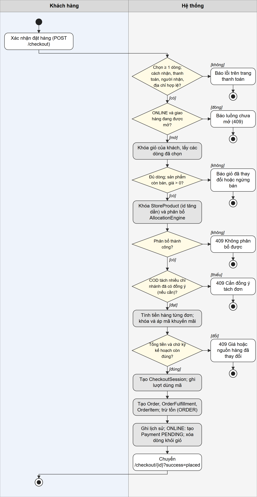

*Hình 2.10. Sơ đồ hoạt động chức năng Đặt hàng (phân bổ nguồn hàng, tạo Order và Fulfillment).* Mã nguồn sơ đồ: `diagrams/customer/KH-10.json`.

**C. Code xử lý chức năng**

**Đoạn mã 2.20. Khóa giỏ, kiểm tra SKU và phân bổ**

`src/main/java/com/oneshop/service/impl/CheckoutServiceImpl.java` (dòng 312-345)

```java
// 1. The customer's own cart, locked: a second click or tab finds these lines already gone.
Cart cart = cartRepository.findByUserIdForUpdate(user.getId())
        .orElseThrow(() -> new BadRequestException("cartItemIds", CART_CHANGED));
List<CartItem> lines = cartItemRepository.findByCartId(cart.getId()).stream()
        .filter(line -> wantedIds.contains(line.getId()))
        .toList();
if (lines.size() != wantedIds.size()) {
    throw new BadRequestException("cartItemIds", CART_CHANGED);
}

// 2. SKUs and the single online price. The StoreProduct of a cart line, if any, is deliberately not read.
Map<Long, CartItem> lineByProduct = new LinkedHashMap<>();
for (CartItem line : lines) {
    Product product = line.getProduct();
    if (product.getStatus() != ProductStatus.ACTIVE || product.getPrice() == null
            || product.getPrice().signum() <= 0) {
        throw new BadRequestException("cartItemIds", "\"" + product.getName() + "\" hiện không còn bán. "
                + "Vui lòng bỏ sản phẩm này khỏi lựa chọn.");
    }
    lineByProduct.put(product.getId(), line);
}
List<AllocationDemand> demands = lineByProduct.entrySet().stream()
        .map(entry -> new AllocationDemand(entry.getKey(), entry.getValue().getQuantity())).toList();

// 3. Allocation on StoreProduct rows locked in ascending id order, read under that lock.
LockedAllocation locked = allocationService.allocateForUpdate(demands, type, request.pickupStoreId(),
        request.shippingAddress());
AllocationResult plan = locked.result();
if (!plan.success()) {
    Map<Long, String> names = lineByProduct.entrySet().stream().collect(Collectors.toMap(Map.Entry::getKey,
            entry -> entry.getValue().getProduct().getName()));
    throw new CheckoutConflictException(CheckoutConflictException.CODE_NOT_ALLOCATABLE,
            failureMessage(plan, names));
}
```

**Đoạn mã 2.21. Tạo phiên thanh toán và các Order**

`src/main/java/com/oneshop/service/impl/CheckoutServiceImpl.java` (dòng 405-424)

```java
    CheckoutSession session = new CheckoutSession();
    session.setUser(user);
    session.setStatus(CheckoutStatus.CREATED);
    session.setTotalAmount(sessionTotal);
    checkoutSessionRepository.save(session);

    if (promotion != null) {
        promotionService.commitUse(promotion, user, session);
    }
    for (int i = 0; i < groups.size(); i++) {
        createOrder(session, user, request, groups.get(i), orderTotals.get(i), fee, lineByProduct, locked,
                orderDiscounts.get(i), promotion == null ? null : promotion.promotion().getCode());
    }

    // 6. Only the lines that were checked out leave the cart.
    cartItemRepository.deleteAll(lines);
    cartItemRepository.flush();

    return toResult(session);
}
```

**Đoạn mã 2.22. Tạo Fulfillment, OrderItem và trừ tồn**

`src/main/java/com/oneshop/service/impl/CheckoutServiceImpl.java` (dòng 461-484)

```java
for (StoreAllocation allocation : stores) {
    Store store = locked.lockedStoreProducts().get(allocation.lines().get(0).storeProductId()).getStore();
    OrderFulfillment fulfillment = new OrderFulfillment();
    fulfillment.setOrder(order);
    fulfillment.setStore(store);
    fulfillment.setFulfillmentType(request.fulfillmentType());
    fulfillment.setStatus(OrderFulfillmentStatus.CONFIRMED);
    fulfillmentRepository.save(fulfillment);

    for (AllocatedLine line : allocation.lines()) {
        StoreProduct storeProduct = locked.lockedStoreProducts().get(line.storeProductId());
        Product product = lineByProduct.get(line.productId()).getProduct();
        OrderItem item = new OrderItem();
        item.setOrder(order);
        item.setFulfillment(fulfillment);
        item.setStoreProduct(storeProduct);
        item.setProductName(product.getName());
        item.setUnitPrice(product.getPrice());
        item.setQuantity(line.quantity());
        item.setSubtotal(product.getPrice().multiply(BigDecimal.valueOf(line.quantity())));
        item.setDiscountAmount(lineDiscounts.get(lineNo++));
        orderItemRepository.save(item);
        // stock leaves the StoreProduct now, with an ORDER movement; no reservation, no later deduction
        inventoryService.deductForOrder(storeProduct, line.quantity(), order);
```

**Đoạn mã 2.23. AllocationEngine: ưu tiên một chi nhánh đủ giỏ**

`src/main/java/com/oneshop/service/allocation/AllocationEngine.java` (dòng 52-66)

```java
// Strategy 1: a Store that supplies the whole cart
Long best = null;
long bestTotal = -1;
for (Map.Entry<Long, Map<Long, StockOffer>> store : byStore.entrySet()) {
    if (coversAll(store.getValue(), wanted)) {
        long total = totalAvailable(store.getValue(), wanted.keySet());
        if (total > bestTotal) { // ascending store id order: the first of equal totals wins
            best = store.getKey();
            bestTotal = total;
        }
    }
}
if (best != null) {
    return AllocationResult.success(List.of(allocation(best, byStore.get(best), wanted)));
}
```

**D. Giải thích code**

placeOrder kiểm tra lựa chọn rồi khóa Cart; các sản phẩm phải còn ACTIVE với giá lớn hơn 0 và giá luôn lấy từ Product, không từ yêu cầu. allocateForUpdate khóa StoreProduct theo thứ tự id để tránh deadlock và trả AllocationResult; AllocationEngine.allocate thử 'Strategy 1' (một chi nhánh đủ toàn bộ giỏ, chọn chi nhánh có tổng tồn lớn nhất) trước khi chuyển sang ghép nhiều chi nhánh. Sau khi kiểm tra đồng ý tách đơn, tổng tiền và chữ ký, createOrder tạo Order, OrderFulfillment cho từng chi nhánh, OrderItem gắn StoreProduct và gọi InventoryService.deductForOrder; Order ONLINE ở PENDING_PAYMENT, các loại khác ở CONFIRMED. Mọi lỗi nghiệp vụ ném CheckoutConflictException hoặc BadRequestException khiến toàn bộ giao dịch hoàn tác, đúng với các nhánh lỗi trong sơ đồ. Luồng này được thể hiện trong Hình 2.10 và mã nguồn trong Đoạn mã 2.20, Đoạn mã 2.21, Đoạn mã 2.22, Đoạn mã 2.23.


### 2.1.11. Thanh toán trực tuyến qua cổng mô phỏng (KH-11)

**A. Mô tả chức năng**

Với đơn ONLINE ở trạng thái PENDING_PAYMENT, khách có 15 phút để thanh toán tại /orders/{id}/payments. Hệ thống không có cổng thật: nút 'Thanh toán' kích hoạt cổng mô phỏng ở phía máy chủ; trình duyệt chỉ chọn kịch bản, còn trạng thái, số tiền và thời điểm do máy chủ ghi. Kết quả được xác minh bằng sổ cái của cổng: thu thành công trước hạn thì đơn thành CONFIRMED và PAID; thu sau hạn thì hủy đơn, hoàn tồn và hoàn tiền mô phỏng; thất bại hoặc quá hạn thì hủy đơn và hoàn tồn; kết quả không xác định thì chờ đối soát.

*Tác nhân: Khách hàng. Trạng thái triển khai: Hoạt động (cổng mô phỏng, không kết nối ngân hàng thật).*

**B. Sơ đồ hoạt động**

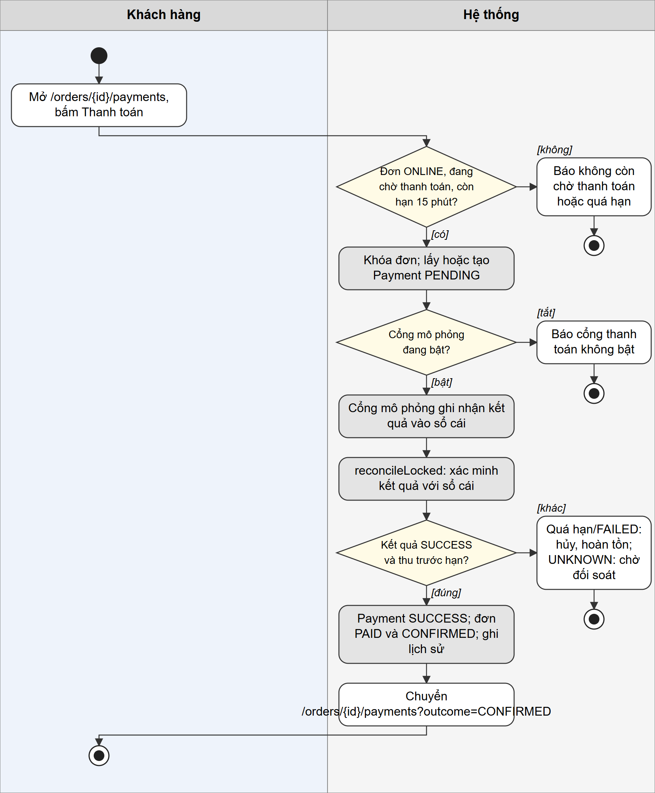

*Hình 2.11. Sơ đồ hoạt động chức năng Thanh toán trực tuyến qua cổng mô phỏng.* Mã nguồn sơ đồ: `diagrams/customer/KH-11.json`.

**C. Code xử lý chức năng**

**Đoạn mã 2.24. PaymentController: bắt đầu thanh toán**

`src/main/java/com/oneshop/controller/client/PaymentController.java` (dòng 46-53)

```java
@PostMapping("/attempts")
public String start(@PathVariable Long orderId, Principal principal) {
    PaymentResponse attempt = paymentService.createOnlinePaymentAttempt(principal.getName(), orderId);
    // Demo gateway: pressing "pay" always succeeds; the ledger is still verified server side.
    PaymentOutcome outcome = reconciliation.simulate(principal.getName(), orderId, attempt.paymentId(),
            PaymentReconciliationService.SimulatedResult.SUCCESS);
    return "redirect:/orders/" + orderId + "/payments?outcome=" + outcome.name();
}
```

**Đoạn mã 2.25. PaymentReconciliationService.simulate**

`src/main/java/com/oneshop/service/payment/PaymentReconciliationService.java` (dòng 97-129)

```java
    if (state == LedgerState.SETTLED) {
        return PaymentOutcome.ALREADY_PAID; // duplicate callback: no second SUCCESS, no history
    }
    OrderStatus status = order.getOrderStatus();
    if (status == OrderStatus.CANCELLED) {
        if (scenario == SimulatedResult.SUCCESS) {
            return recordLateCollection(order, attempt, now, null, Trigger.CUSTOMER_CALLBACK);
        }
        return PaymentOutcome.ALREADY_CANCELLED;
    }
    if (status != OrderStatus.PENDING_PAYMENT && status != OrderStatus.NEEDS_ATTENTION) {
        throw new PaymentConflictException(PaymentConflictException.PAYMENT_NOT_PAYABLE,
                "Đơn hàng không còn chờ thanh toán trực tuyến.");
    }
    switch (state) {
        case IN_DOUBT -> throw new PaymentConflictException(PaymentConflictException.PAYMENT_RECONCILING,
                "Kết quả thanh toán đang được đối soát; chưa thể thanh toán lại.");
        case AWAITING -> {
            switch (scenario) {
                case SUCCESS -> gateway.capture(attempt, now);
                case FAILED -> gateway.decline(attempt);
                case UNKNOWN -> gateway.markInDoubt(attempt, now);
            }
            payments.saveAndFlush(attempt);
        }
        default -> { /* CAPTURED / DECLINED: the ledger already holds the answer; apply it below */ }
    }
    PaymentOutcome outcome = reconcileLocked(order, Trigger.CUSTOMER_CALLBACK, null);
    if (outcome == PaymentOutcome.AWAITING && MockLedger.stateOf(attempt) == LedgerState.IN_DOUBT) {
        return PaymentOutcome.IN_DOUBT_RECORDED;
    }
    return outcome;
}
```

**Đoạn mã 2.26. reconcileLocked: bảng quyết định**

`src/main/java/com/oneshop/service/payment/PaymentReconciliationService.java` (dòng 167-194)

```java
switch (verification.result()) {
    case SUCCESS -> {
        Payment row = rowOf(rows, verification.reference());
        LocalDateTime at = verification.capturedAt();
        if (at != null && at.isBefore(deadline)) {
            return confirm(order, row, at, actor, trigger, verification);
        }
        return cancelForLatePayment(order, row, at, actor, trigger, verification, deadline);
    }
    case FAILED -> {
        cancellation.cancelAndRestore(order,
                "Hoàn tồn do thanh toán ONLINE thất bại - Order #" + order.getId(),
                note("PAYMENT_FAILED", trigger, "ref", verification.reference(),
                        "kết quả", "cổng xác thực thất bại, không thu tiền"),
                actor, OrderPaymentStatus.FAILED);
        return PaymentOutcome.CANCELLED_PAYMENT_FAILED;
    }
    case NOT_PAID -> {
        if (now.isBefore(deadline)) {
            return PaymentOutcome.AWAITING;
        }
        cancellation.cancelAndRestore(order,
                "Hoàn tồn do quá hạn thanh toán ONLINE - Order #" + order.getId(),
                note("PAYMENT_TIMEOUT", trigger, "ref", verification.reference(),
                        "kết quả", "hết hạn, cổng xác nhận chưa thu tiền", "hạn", deadline),
                actor, OrderPaymentStatus.FAILED);
        return PaymentOutcome.CANCELLED_TIMEOUT;
    }
```

**D. Giải thích code**

PaymentController.start tạo (hoặc lấy) lần thanh toán đang chờ rồi gọi PaymentReconciliationService.simulate với kịch bản SUCCESS. simulate khóa đơn của chính khách, kiểm tra trạng thái sổ cái (SETTLED trả ALREADY_PAID, đơn đã hủy chỉ ghi nhận khoản thu muộn rồi hoàn tiền) và để cổng capture, decline hoặc markInDoubt. reconcileLocked áp bảng quyết định: SUCCESS trước hạn gọi confirm (PAID, CONFIRMED); SUCCESS sau hạn gọi cancelForLatePayment; FAILED gọi OrderCancellationService.cancelAndRestore; NOT_PAID chờ hoặc hủy khi hết hạn; UNKNOWN chờ, vào cửa sổ đối soát hoặc chuyển NEEDS_ATTENTION. Các nhánh này được gom thành nhánh 'khác' của sơ đồ để giữ sơ đồ dễ đọc. Luồng này được thể hiện trong Hình 2.11 và mã nguồn trong Đoạn mã 2.24, Đoạn mã 2.25, Đoạn mã 2.26.


### 2.1.12. Theo dõi đơn hàng (KH-12)

**A. Mô tả chức năng**

Khách xem danh sách đơn của mình tại /orders và chi tiết một đơn tại /orders/{id}: sản phẩm, tổng tiền, trạng thái đơn và thanh toán, các phần giao theo từng chi nhánh với trạng thái riêng, mã vận đơn hoặc mã nhận hàng, lịch sử đơn, khoản hoàn tiền, dòng hàng có thể đánh giá và khả năng trả hàng. Chỉ đơn của chính khách mới xem được. Khi đơn ONLINE đang chờ thanh toán đã quá 15 phút, việc mở trang kích hoạt đối soát: hủy đơn và hoàn tồn.

*Tác nhân: Khách hàng. Trạng thái triển khai: Hoạt động.*

**B. Sơ đồ hoạt động**

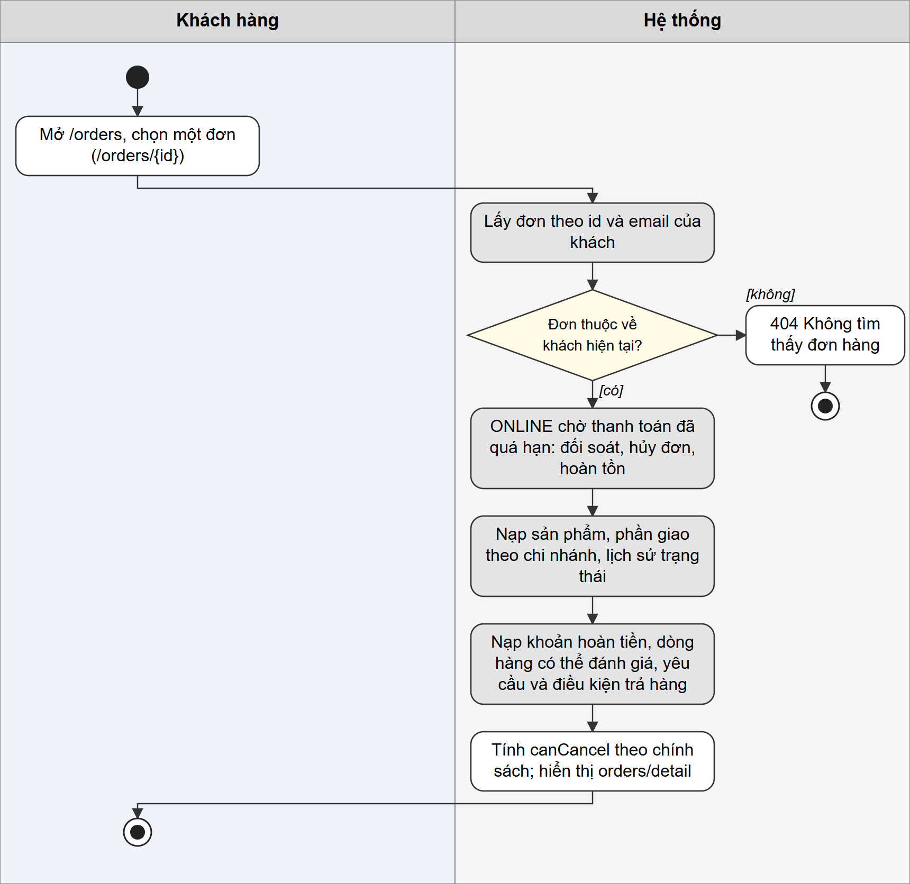

*Hình 2.12. Sơ đồ hoạt động chức năng Theo dõi đơn hàng.* Mã nguồn sơ đồ: `diagrams/customer/KH-12.json`.

**C. Code xử lý chức năng**

**Đoạn mã 2.27. CustomerOrderController.detail**

`src/main/java/com/oneshop/controller/client/CustomerOrderController.java` (dòng 51-80)

```java
@GetMapping("/{orderId}")
public String detail(@PathVariable Long orderId, Principal principal, Model model) {
    var detail = orders.getOrder(principal.getName(), orderId);
    var order = detail.order();
    if (order.paymentMethod() == com.oneshop.entity.PaymentMethod.ONLINE
            && order.orderStatus() == com.oneshop.entity.OrderStatus.PENDING_PAYMENT) {
        var paymentInfo = payments.getOrderPayments(principal.getName(), orderId);
        if (paymentInfo.expired()) {
            // the 15 minutes are over: cancel the unpaid order and give the stock back now
            reconciliation.reconcile(orderId, com.oneshop.service.payment.PaymentReconciliationService.Trigger.TIMEOUT_SCAN);
            detail = orders.getOrder(principal.getName(), orderId);
            order = detail.order();
        } else {
            model.addAttribute("paymentInfo", paymentInfo);
        }
    }
    model.addAttribute("orderDetail", detail);
    model.addAttribute("orderNumber", orderNumbers(orders.getOrders(principal.getName())).get(orderId));
    var info = orders.getOrderItems(principal.getName()).get(orderId);
    model.addAttribute("orderLines", info == null ? null : info.lines());
    model.addAttribute("refund", refundView.forCustomer(principal.getName(), orderId));
    model.addAttribute("reviewItems", reviews.getOrderReviewItems(principal.getName(), orderId));
    // post-delivery return: the request already made, or whether one may be made now (3 days from receipt)
    var orderReturn = returns.find(principal.getName(), orderId);
    model.addAttribute("orderReturn", orderReturn.orElse(null));
    model.addAttribute("returnEligibility", orderReturn.isPresent() ? null : returns.eligibility(principal.getName(), orderId));
    model.addAttribute("canCancel", policy.canCustomerCancel(order.orderStatus(), order.fulfillmentType(),
            order.paymentMethod(), order.paymentStatus()));
    return "orders/detail";
}
```

**Đoạn mã 2.28. Lấy đơn của chính khách**

`src/main/java/com/oneshop/service/impl/CustomerOrderServiceImpl.java` (dòng 69-74)

```java
public OrderDetailResponse getOrder(String email, Long id) {
    requireCustomer(email);
    var order = orders.findByIdAndUserEmail(id, email)
            .orElseThrow(() -> new ResourceNotFoundException("Không tìm thấy đơn hàng của bạn."));
    return views.detail(order, true, null);
}
```

**D. Giải thích code**

CustomerOrderController.detail gọi CustomerOrderService.getOrder, vốn dùng findByIdAndUserEmail nên đơn của người khác cho kết quả ResourceNotFoundException (404). Với đơn ONLINE đang PENDING_PAYMENT, controller kiểm tra hạn thanh toán và gọi PaymentReconciliationService.reconcile trước khi đọc lại đơn. Sau đó nó nạp thêm thông tin hoàn tiền, các dòng hàng có thể đánh giá, yêu cầu trả hàng và cờ canCancel từ OrderTransitionPolicy. Mã đơn hiển thị cho khách là số thứ tự riêng của khách, còn đường dẫn vẫn dùng id thật. Luồng này được thể hiện trong Hình 2.12 và mã nguồn trong Đoạn mã 2.27, Đoạn mã 2.28.


### 2.1.13. Hủy đơn hàng (KH-13)

**A. Mô tả chức năng**

Khách chỉ được hủy khi cửa hàng chưa bắt đầu chuẩn bị. Đơn ONLINE chờ thanh toán được hủy (trừ khi kết quả cổng đang chờ đối soát); đơn ở trạng thái CONFIRMED mà mọi phần giao còn CONFIRMED được hủy: tồn kho hoàn lại đúng StoreProduct nguồn một lần, các phần giao thành CANCELLED, và đơn ONLINE đã thanh toán được hoàn tiền toàn phần (mô phỏng). Đơn đang xử lý, đang giao hoặc chờ quản trị viên xử lý bị từ chối. Yêu cầu lặp lại không gây tác dụng phụ.

*Tác nhân: Khách hàng. Trạng thái triển khai: Hoạt động.*

**B. Sơ đồ hoạt động**

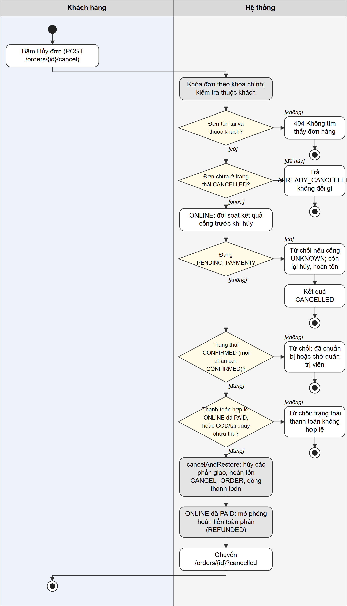

*Hình 2.13. Sơ đồ hoạt động chức năng Hủy đơn hàng.* Mã nguồn sơ đồ: `diagrams/customer/KH-13.json`.

**C. Code xử lý chức năng**

**Đoạn mã 2.29. CustomerOrderCancellationService.cancel (1)**

`src/main/java/com/oneshop/service/payment/CustomerOrderCancellationService.java` (dòng 56-88)

```java
public Result cancel(User customer, Long orderId) {
    if (orderId == null) {
        throw notFound();
    }
    // PK-only lock first (same order as payment, fulfillment and timeout), ownership checked on the locked row
    Order order = orders.findByIdForUpdate(orderId)
            .filter(o -> o.getUser().getId().equals(customer.getId()))
            .orElseThrow(CustomerOrderCancellationService::notFound);
    if (order.getOrderStatus() == OrderStatus.CANCELLED) {
        return Result.ALREADY_CANCELLED;
    }
    if (order.getPaymentMethod() == PaymentMethod.ONLINE) {
        // a conclusive gateway result that is waiting to be applied decides first (payment before cancel)
        reconciliation.reconcileLocked(order, PaymentReconciliationService.Trigger.CUSTOMER_CANCEL, null);
        if (order.getOrderStatus() == OrderStatus.CANCELLED) {
            return Result.ALREADY_CANCELLED; // timeout / verified failure / late payment already cancelled it
        }
    }
    OrderStatus status = order.getOrderStatus();
    String stockNote = "Hoàn tồn do khách hủy đơn - Order #" + order.getId();
    String historyNote = "Khách hàng hủy đơn trước khi chuẩn bị hàng";

    if (status == OrderStatus.PENDING_PAYMENT) {
        if (order.getPaymentMethod() == PaymentMethod.ONLINE) {
            GatewayVerification verification = reconciliation.currentVerification(order);
            if (verification.result() == GatewayVerification.Result.UNKNOWN) {
                throw new PaymentConflictException(PaymentConflictException.PAYMENT_RECONCILING,
                        "Kết quả thanh toán đang được đối soát nên chưa thể hủy đơn. Vui lòng thử lại sau.");
            }
        }
        cancellation.cancelAndRestore(order, stockNote, historyNote, customer, OrderPaymentStatus.UNPAID);
        return Result.CANCELLED;
    }
```

**Đoạn mã 2.30. CustomerOrderCancellationService.cancel (2)**

`src/main/java/com/oneshop/service/payment/CustomerOrderCancellationService.java` (dòng 89-115)

```java
    if (status == OrderStatus.NEEDS_ATTENTION) {
        throw new FulfillmentConflictException(FulfillmentConflictException.ORDER_NEEDS_ATTENTION,
                "Đơn hàng đang chờ quản trị viên xử lý nên chưa thể hủy.");
    }
    if (status != OrderStatus.CONFIRMED) {
        throw new FulfillmentConflictException(FulfillmentConflictException.ORDER_ALREADY_PREPARING,
                "Cửa hàng đã bắt đầu xử lý đơn hàng nên không thể hủy.");
    }
    // CONFIRMED: every part is still CONFIRMED (the cancellation re-checks them under their locks)
    if (order.getPaymentMethod() == PaymentMethod.ONLINE) {
        if (order.getPaymentStatus() != OrderPaymentStatus.PAID) {
            throw new PaymentConflictException(PaymentConflictException.PAYMENT_NOT_PAYABLE,
                    "Trạng thái thanh toán của đơn hàng không hợp lệ để hủy.");
        }
        cancellation.cancelAndRestore(order, stockNote, historyNote, customer, OrderPaymentStatus.PAID);
        RefundService.Result refund = refunds.simulate(order,
                "Khách hủy đơn trước khi chuẩn bị hàng; hoàn tiền toàn phần");
        return refund == RefundService.Result.SIMULATION_FAILED ? Result.CANCELLED_REFUND_FAILED
                : Result.CANCELLED_AND_REFUNDED;
    }
    if (order.getPaymentStatus() != OrderPaymentStatus.UNPAID) {
        throw new PaymentConflictException(PaymentConflictException.PAYMENT_NOT_PAYABLE,
                "Chỉ hủy đơn chưa thanh toán, trước khi cửa hàng chuẩn bị hàng.");
    }
    cancellation.cancelAndRestore(order, stockNote, historyNote, customer, OrderPaymentStatus.UNPAID);
    return Result.CANCELLED;
}
```

**Đoạn mã 2.31. OrderCancellationService.cancelAndRestore**

`src/main/java/com/oneshop/service/payment/OrderCancellationService.java` (dòng 65-86)

```java
public void cancelAndRestore(Order lockedOrder, String stockNote, String historyNote, User actor,
                             OrderPaymentStatus paymentStatusAfter) {
    OrderStatus status = lockedOrder.getOrderStatus();
    if (status == OrderStatus.CANCELLED) {
        throw new BadRequestException("Đơn hàng đã được hủy.");
    }
    List<OrderFulfillment> parts = fulfillments.findByOrderIdForUpdate(lockedOrder.getId());
    for (OrderFulfillment part : parts) {
        OrderFulfillmentStatus partStatus = part.getStatus();
        if (partStatus != OrderFulfillmentStatus.CONFIRMED && partStatus != OrderFulfillmentStatus.CANCELLED) {
            // preparation began (or a part failed after it): never cancel half an Order, never restock a part
            // that left the shelf
            throw new FulfillmentConflictException(FulfillmentConflictException.ORDER_ALREADY_PREPARING,
                    "Cửa hàng đã bắt đầu xử lý đơn hàng nên không thể hủy.");
        }
    }
    if (movements.hasRestorationForLockedOrder(lockedOrder.getId())) {
        throw new FulfillmentConflictException(FulfillmentConflictException.INCONSISTENT_FULFILLMENT,
                "Tồn kho của đơn hàng đã được hoàn trước đó.");
    }

    inventory.restoreForCancelledOrder(lockedOrder, stockNote);
```

**D. Giải thích code**

CustomerOrderServiceImpl.cancelOrder ủy quyền cho CustomerOrderCancellationService.cancel. Phương thức này khóa Order bằng khóa chính rồi kiểm tra chủ sở hữu trên dòng đã khóa; với ONLINE nó gọi reconcileLocked để áp dụng kết quả thanh toán đang chờ trước (thanh toán thắng hủy). Nhánh PENDING_PAYMENT hủy và hoàn tồn nếu kết quả không phải UNKNOWN; nhánh CONFIRMED yêu cầu mọi phần giao còn CONFIRMED, ONLINE phải PAID và được hoàn tiền mô phỏng qua RefundService. OrderCancellationService.cancelAndRestore khóa các Fulfillment, từ chối nếu có phần đã chuẩn bị và kiểm tra tồn chưa từng được hoàn trước khi gọi InventoryService.restoreForCancelledOrder. Luồng này được thể hiện trong Hình 2.13 và mã nguồn trong Đoạn mã 2.29, Đoạn mã 2.30, Đoạn mã 2.31.


### 2.1.14. Yêu cầu trả hàng sau khi nhận (KH-14)

**A. Mô tả chức năng**

Khi đơn đã COMPLETED, khách có 3 ngày kể từ lúc phần giao cuối cùng hoàn tất để yêu cầu trả toàn bộ hàng đã nhận, kèm lý do 5–500 ký tự và 1–3 ảnh. Hệ thống kiểm tra điều kiện dưới khóa đơn, sao chép các dòng hàng của những phần đã COMPLETED, tải ảnh lên Cloudinary và lưu yêu cầu ở trạng thái REQUESTED chờ quản trị viên duyệt. Số tiền hoàn là giá trị hàng sau khuyến mãi, phí giao hàng không hoàn. Trạng thái đơn và phần giao không thay đổi.

*Tác nhân: Khách hàng. Trạng thái triển khai: Hoạt động.*

**B. Sơ đồ hoạt động**

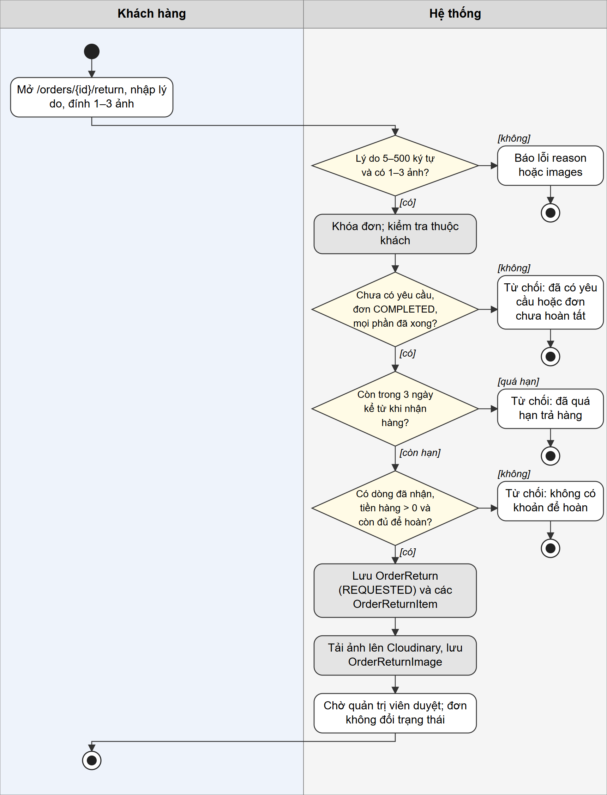

*Hình 2.14. Sơ đồ hoạt động chức năng Yêu cầu trả hàng sau khi nhận.* Mã nguồn sơ đồ: `diagrams/customer/KH-14.json`.

**C. Code xử lý chức năng**

**Đoạn mã 2.32. Ghi nhận yêu cầu trả hàng**

`src/main/java/com/oneshop/service/returns/CustomerOrderReturnService.java` (dòng 128-148)

```java
public OrderReturnResponse request(String email, Long orderId, String reason, List<MultipartFile> files) {
    User customer = requireCustomer(email);
    String cleanReason = cleanReason(reason);
    List<MultipartFile> photos = photos(files);

    Order order = orders.findByIdForUpdate(orderId)
            .filter(o -> o.getUser().getId().equals(customer.getId()))
            .orElseThrow(() -> new ResourceNotFoundException("Không tìm thấy đơn hàng của bạn."));
    Plan plan = plan(order);
    if (!plan.eligibility().allowed()) {
        throw new BadRequestException(plan.eligibility().message());
    }

    OrderReturn request = new OrderReturn();
    request.setOrder(order);
    request.setUser(customer);
    request.setReason(cleanReason);
    request.setReceivedAt(plan.receivedAt());
    request.setRefundAmount(plan.eligibility().refundAmount());
    request.setRequestedAt(LocalDateTime.now(clock).withNano(0));
    returns.saveAndFlush(request);
```

**Đoạn mã 2.33. Điều kiện trả hàng (1)**

`src/main/java/com/oneshop/service/returns/CustomerOrderReturnService.java` (dòng 181-206)

```java
private Plan plan(Order order) {
    if (returns.existsByOrderId(order.getId())) {
        return blocked("Đơn hàng này đã có yêu cầu trả hàng.");
    }
    if (order.getOrderStatus() != OrderStatus.COMPLETED) {
        return blocked("Chỉ đơn hàng đã hoàn tất (đã nhận hàng) mới được trả hàng.");
    }
    List<OrderFulfillment> parts = fulfillments.findByOrderIdOrderByAssignedAtAscIdAsc(order.getId());
    if (parts.stream().anyMatch(p -> p.getStatus() != OrderFulfillmentStatus.COMPLETED
            && p.getStatus() != OrderFulfillmentStatus.CANCELLED)) {
        return blocked("Đơn hàng còn phần giao chưa hoàn tất nên chưa thể trả hàng.");
    }
    List<OrderFulfillment> delivered = parts.stream().filter(p -> p.getStatus() == OrderFulfillmentStatus.COMPLETED)
            .toList();
    if (delivered.isEmpty() || delivered.stream().anyMatch(p -> p.getCompletedAt() == null)) {
        return blocked("Chưa xác định được thời điểm nhận hàng của đơn hàng này.");
    }
    LocalDateTime receivedAt = delivered.stream().map(OrderFulfillment::getCompletedAt)
            .max(Comparator.naturalOrder()).orElseThrow();
    LocalDateTime deadline = receivedAt.plus(RETURN_WINDOW);
    if (LocalDateTime.now(clock).isAfter(deadline)) {
        // receivedAt / deadline are kept so the order page can still explain why the window is closed
        return new Plan(new ReturnEligibilityResponse(false, "Đã quá " + RETURN_WINDOW.toDays()
                + " ngày kể từ khi bạn nhận hàng (hạn trả hàng là " + deadline.format(WHEN) + ").",
                receivedAt, deadline, null), List.of(), receivedAt);
    }
```

**Đoạn mã 2.34. Điều kiện trả hàng (2)**

`src/main/java/com/oneshop/service/returns/CustomerOrderReturnService.java` (dòng 207-226)

```java
List<OrderItem> lines = orderItems.findByOrderId(order.getId()).stream()
        .filter(i -> i.getFulfillment() != null && i.getFulfillment().getStatus() == OrderFulfillmentStatus.COMPLETED)
        .sorted(Comparator.comparing(OrderItem::getId)).toList();
BigDecimal amount = lines.stream().map(OrderItem::getNetSubtotal).reduce(BigDecimal.ZERO, BigDecimal::add);
if (lines.isEmpty()) {
    return blocked("Đơn hàng không có sản phẩm nào đã nhận để trả.");
}
if (amount.signum() <= 0) {
    return blocked("Tiền hàng của đơn đã được khuyến mãi giảm hết nên không có khoản nào để hoàn lại.");
}
List<Payment> collected = payments.findByOrderIdOrderByIdAsc(order.getId()).stream()
        .filter(p -> p.getStatus() == PaymentStatus.SUCCESS).toList();
if (collected.size() != 1) {
    return blocked("Đơn hàng chưa có khoản thanh toán thành công để hoàn tiền.");
}
Payment payment = collected.get(0);
if (amount.compareTo(payment.getAmount().subtract(refunds.sumCommitted(payment.getId()))) > 0) {
    return blocked("Số tiền còn có thể hoàn của đơn hàng không đủ để trả hàng.");
}
return new Plan(new ReturnEligibilityResponse(true, null, receivedAt, deadline, amount), lines, receivedAt);
```

**D. Giải thích code**

request kiểm tra lý do và ảnh bằng cleanReason và photos, khóa đơn của khách rồi tính plan(order). plan lần lượt từ chối khi đã có yêu cầu, đơn chưa COMPLETED, còn phần giao chưa xong hoặc đã quá RETURN_WINDOW (3 ngày); sau đó lấy các OrderItem thuộc phần đã COMPLETED, tính tiền hàng bằng getNetSubtotal và so với số tiền còn có thể hoàn của khoản thanh toán thành công. Khi đủ điều kiện, yêu cầu và các dòng hàng được lưu, ảnh được tải qua ImageTransactionCoordinator. Mọi lý do từ chối là BadRequestException với thông báo riêng, khớp các nhánh của sơ đồ. Luồng này được thể hiện trong Hình 2.14 và mã nguồn trong Đoạn mã 2.32, Đoạn mã 2.33, Đoạn mã 2.34.


### 2.1.15. Đánh giá sản phẩm đã nhận (KH-15)

**A. Mô tả chức năng**

Khách chỉ đánh giá được dòng hàng đã nhận và thanh toán hợp lệ, mỗi dòng hàng một lần, với số sao từ 1 đến 5 và nhận xét tùy chọn. Đánh giá gắn với OrderItem nên truy được chi nhánh nguồn để nhân viên đúng chi nhánh phản hồi. Hệ thống khóa đơn để các lần gửi trùng được tuần tự hóa, lưu Review ở trạng thái ACTIVE và chuyển về trang đơn hoặc trang sản phẩm.

*Tác nhân: Khách hàng. Trạng thái triển khai: Hoạt động.*

**B. Sơ đồ hoạt động**

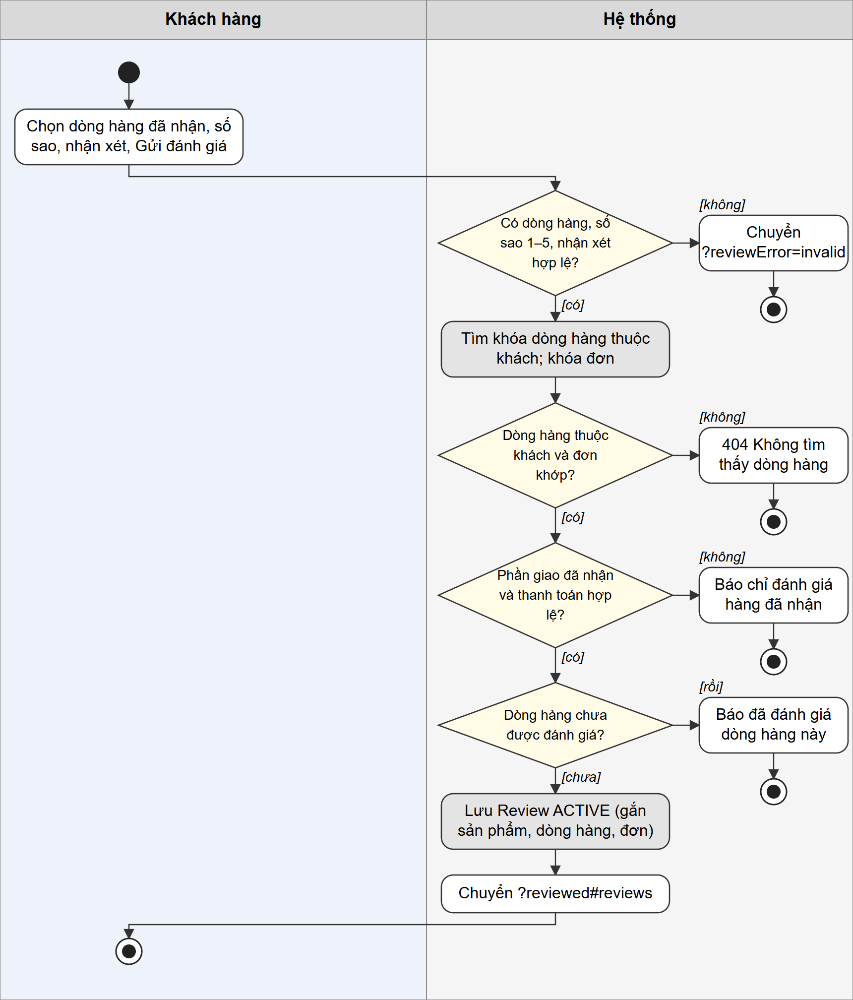

*Hình 2.15. Sơ đồ hoạt động chức năng Đánh giá sản phẩm đã nhận.* Mã nguồn sơ đồ: `diagrams/customer/KH-15.json`.

**C. Code xử lý chức năng**

**Đoạn mã 2.35. ReviewServiceImpl.submit**

`src/main/java/com/oneshop/service/impl/ReviewServiceImpl.java` (dòng 62-97)

```java
    if (request.rating() == null || request.rating() < 1 || request.rating() > 5) {
        throw new BadRequestException("rating", "Đánh giá từ 1 đến 5 sao.");
    }
    String comment = ReviewContent.comment(request.comment());
    var key = items.findReviewKey(request.orderItemId()).filter(k -> Objects.equals(k.getUserId(), customer.getId()))
            .orElseThrow(ReviewServiceImpl::notFound);
    if (orderId != null && !Objects.equals(orderId, key.getOrderId())) throw notFound();
    // No Order has been loaded before this parent lock. Receipt/payment facts are re-read after the lock,
    // the same first lock used by Fulfillment and cancellation. Duplicate submissions serialize here.
    var order = orders.findByIdForUpdate(key.getOrderId()).orElseThrow(ReviewServiceImpl::notFound);
    OrderItem item = items.findForReview(request.orderItemId()).orElseThrow(ReviewServiceImpl::notFound);
    if (!Objects.equals(order.getUser().getId(), customer.getId())
            || !Objects.equals(item.getOrder().getId(), order.getId())) throw notFound();
    if (!ReviewSource.received(item)) {
        throw new BadRequestException("orderItemId", "Chỉ có thể đánh giá phần hàng đã nhận và thanh toán hợp lệ.");
    }
    var product = item.getStoreProduct().getProduct();
    if (request.productId() != null && !Objects.equals(request.productId(), product.getId())) throw notFound();
    if (reviews.existsByOrderItemId(item.getId())) {
        throw new BadRequestException("Bạn đã đánh giá dòng hàng này rồi.");
    }
    Review review = new Review();
    review.setUser(customer);
    review.setProduct(product);
    review.setOrderItem(item);
    review.setOrder(order);
    review.setRating(request.rating());
    review.setComment(comment);
    review.setStatus(VisibilityStatus.ACTIVE);
    try {
        reviews.saveAndFlush(review);
    } catch (DataIntegrityViolationException ex) {
        throw new BadRequestException("Không thể lưu đánh giá trùng hoặc có nguồn hàng không hợp lệ.");
    }
    return ReviewReadMapper.publicReview(review);
}
```

**D. Giải thích code**

submit kiểm tra orderItemId, số sao và nhận xét (ReviewContent.comment), tìm khóa dòng hàng thuộc đúng khách rồi khóa Order trước khi đọc dữ liệu giao nhận, đúng thứ tự khóa của các luồng khác. ReviewSource.received xác nhận phần giao đã COMPLETED và thanh toán hợp lệ; reviews.existsByOrderItemId chặn đánh giá trùng. Review được lưu bằng saveAndFlush; ràng buộc duy nhất của CSDL bắt trường hợp hai yêu cầu đồng thời. ReviewController chuyển BadRequestException thành tham số reviewError trên URL để giao diện hiển thị thông báo. Luồng này được thể hiện trong Hình 2.15 và mã nguồn trong Đoạn mã 2.35.


### 2.1.16. Cập nhật thông tin tài khoản (KH-16)

**A. Mô tả chức năng**

Tại /account, người dùng đã đăng nhập sửa họ tên và số điện thoại. Email và tên đăng nhập là định danh bất biến, chỉ hiển thị. Việc cập nhật dựa hoàn toàn vào Principal hiện tại và thực hiện bằng một câu lệnh UPDATE chỉ áp dụng cho tài khoản ACTIVE nên tài khoản bị khóa không thể ghi.

*Tác nhân: Khách hàng. Trạng thái triển khai: Hoạt động.*

**B. Sơ đồ hoạt động**

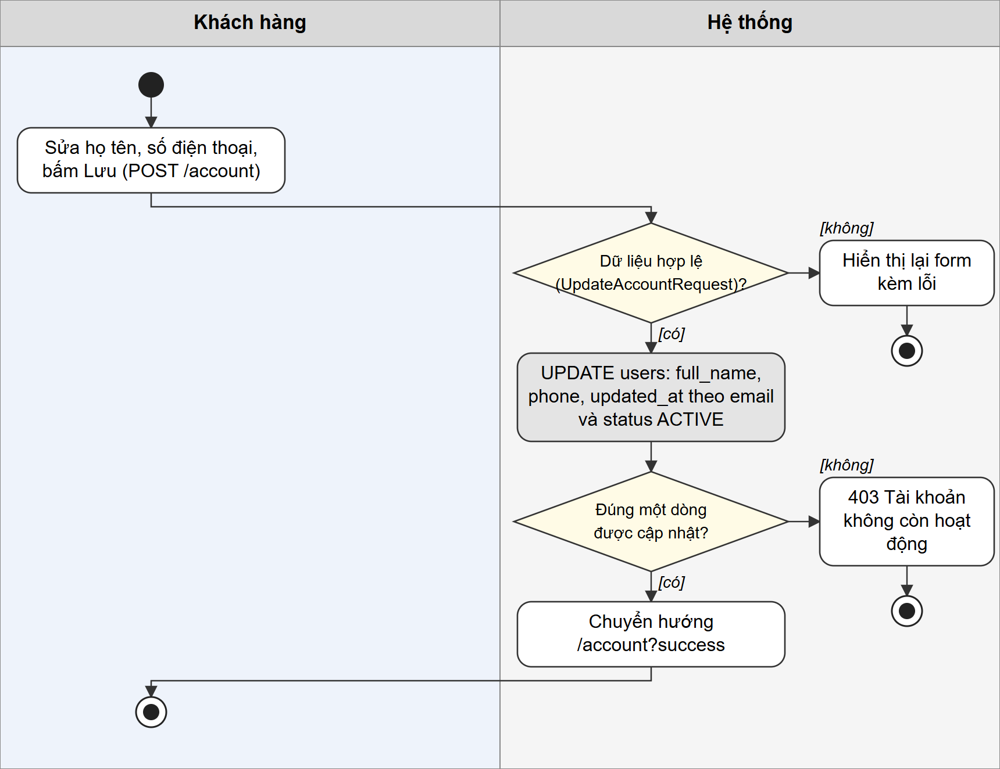

*Hình 2.16. Sơ đồ hoạt động chức năng Cập nhật thông tin tài khoản.* Mã nguồn sơ đồ: `diagrams/customer/KH-16.json`.

**C. Code xử lý chức năng**

**Đoạn mã 2.36. AccountController.updateProfile**

`src/main/java/com/oneshop/controller/client/AccountController.java` (dòng 58-72)

```java
@PostMapping
public String updateProfile(Principal principal,
                            @Valid @ModelAttribute("updateAccountRequest") UpdateAccountRequest request,
                            BindingResult bindingResult,
                            Model model) {
    if (bindingResult.hasErrors()) {
        populateModel(getUser(principal), model);
        return "account/profile";
    }

    if (principal == null) throw new ResourceNotFoundException("Chưa đăng nhập.");
    profiles.update(principal.getName(), request);

    return "redirect:/account?success";
}
```

**Đoạn mã 2.37. AccountProfileService.update**

`src/main/java/com/oneshop/service/AccountProfileService.java` (dòng 57-64)

```java
public void update(String email, @NotNull @Valid UpdateAccountRequest request) {
    String phone = request.getPhone();
    // The status predicate and the two-column write are one SQL statement under the User row write lock.
    // If Admin commits first, a disabled account cannot write; if this statement wins, Admin writes last.
    int changed = users.updateProfileFields(email, request.getFullName().trim(),
            phone == null || phone.isBlank() ? null : phone.trim(), LocalDateTime.now().withNano(0));
    if (changed != 1) throw new AccessDeniedException("Tài khoản không còn hoạt động. Vui lòng đăng nhập lại.");
}
```

**D. Giải thích code**

AccountController.updateProfile kiểm tra BindingResult rồi gọi AccountProfileService.update với Principal.getName(). Phương thức này có @PreAuthorize bảo đảm email tham số trùng người đang đăng nhập và gọi UserRepository.updateProfileFields; kết quả khác 1 nghĩa là tài khoản không còn ACTIVE nên ném AccessDeniedException. Nhờ vậy không thể sửa hồ sơ của người khác hay khôi phục thuộc tính bảo mật cũ. Luồng này được thể hiện trong Hình 2.16 và mã nguồn trong Đoạn mã 2.36, Đoạn mã 2.37.


### 2.1.17. Đổi mật khẩu (KH-17)

**A. Mô tả chức năng**

Người dùng đổi mật khẩu tại /account bằng cách nhập mật khẩu hiện tại, mật khẩu mới và xác nhận. Hệ thống yêu cầu mật khẩu hiện tại đúng, hai mật khẩu mới khớp và mật khẩu mới khác mật khẩu cũ. Khi có lỗi, không lưu gì và biểu mẫu không nhận lại giá trị mật khẩu đã nhập.

*Tác nhân: Khách hàng (và mọi tài khoản đã đăng nhập). Trạng thái triển khai: Hoạt động.*

**B. Sơ đồ hoạt động**

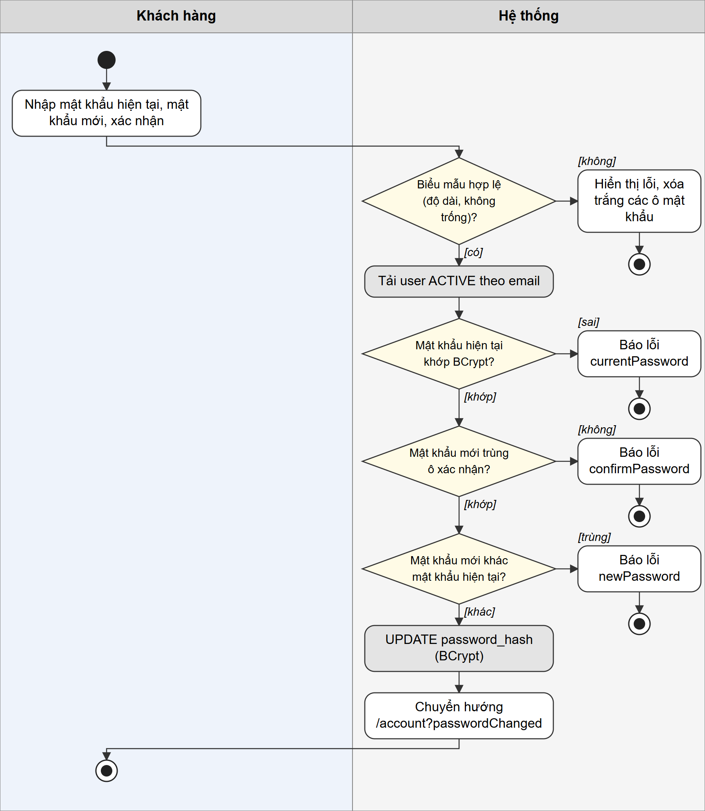

*Hình 2.17. Sơ đồ hoạt động chức năng Đổi mật khẩu.* Mã nguồn sơ đồ: `diagrams/customer/KH-17.json`.

**C. Code xử lý chức năng**

**Đoạn mã 2.38. AccountController.changePassword**

`src/main/java/com/oneshop/controller/client/AccountController.java` (dòng 75-96)

```java
@PostMapping("/password")
public String changePassword(Principal principal,
                             @Valid @ModelAttribute("changePasswordRequest") ChangePasswordRequest request,
                             BindingResult bindingResult,
                             Model model) {
    if (principal == null) throw new ResourceNotFoundException("Chưa đăng nhập.");
    if (!bindingResult.hasErrors()) {
        try {
            profiles.changePassword(principal.getName(), request);
            return "redirect:/account?passwordChanged";
        } catch (BadRequestException ex) {
            bindingResult.rejectValue(ex.getField() == null ? "currentPassword" : ex.getField(), "invalid", ex.getMessage());
        }
    }
    User user = getUser(principal);
    populateModel(user, model);
    model.addAttribute("updateAccountRequest", new UpdateAccountRequest(user.getFullName(), user.getPhone()));
    request.setCurrentPassword(null);
    request.setNewPassword(null);
    request.setConfirmPassword(null);
    return "account/profile";
}
```

**Đoạn mã 2.39. AccountProfileService.changePassword**

`src/main/java/com/oneshop/service/AccountProfileService.java` (dòng 36-53)

```java
public void changePassword(String email, @NotNull @Valid ChangePasswordRequest request) {
    var user = users.findByEmail(email)
            .filter(u -> u.isActive())
            .orElseThrow(() -> new AccessDeniedException("Tài khoản không còn hoạt động. Vui lòng đăng nhập lại."));
    if (user.getPasswordHash() == null
            || !passwordEncoder.matches(request.getCurrentPassword(), user.getPasswordHash())) {
        throw new BadRequestException("currentPassword", "Mật khẩu hiện tại không đúng");
    }
    if (!request.getNewPassword().equals(request.getConfirmPassword())) {
        throw new BadRequestException("confirmPassword", "Mật khẩu nhập lại không khớp");
    }
    if (request.getNewPassword().equals(request.getCurrentPassword())) {
        throw new BadRequestException("newPassword", "Mật khẩu mới phải khác mật khẩu hiện tại");
    }
    int changed = users.updatePasswordHash(email, passwordEncoder.encode(request.getNewPassword()),
            LocalDateTime.now().withNano(0));
    if (changed != 1) throw new AccessDeniedException("Tài khoản không còn hoạt động. Vui lòng đăng nhập lại.");
}
```

**D. Giải thích code**

changePassword của AccountProfileService tải user đang ACTIVE, so khớp mật khẩu hiện tại bằng PasswordEncoder.matches, đối chiếu xác nhận và yêu cầu mật khẩu mới khác mật khẩu cũ; mỗi lỗi là BadRequestException có tên trường. AccountController gắn lỗi vào đúng trường bằng bindingResult.rejectValue, xóa các giá trị mật khẩu khỏi đối tượng form và hiển thị lại trang. Khi thành công, updatePasswordHash ghi mật khẩu đã băm. Luồng này được thể hiện trong Hình 2.17 và mã nguồn trong Đoạn mã 2.38, Đoạn mã 2.39.


## 2.2. Quản trị viên


### 2.2.1. Quản lý tài khoản người dùng (QT-01)

**A. Mô tả chức năng**

Quản trị viên xem danh sách tài khoản (lọc theo vai trò, trạng thái, từ khóa), tạo tài khoản mới với vai trò CUSTOMER, STAFF hoặc ADMIN và sửa thông tin, vai trò, trạng thái của tài khoản đã có. Tài khoản không bị xóa: khóa tài khoản là đặt trạng thái INACTIVE. Email không đổi được sau khi tạo, mật khẩu không đổi qua biểu mẫu sửa, quản trị viên không thể tự khóa mình hay bỏ quyền ADMIN của chính mình, và khi một nhân viên bị đổi khỏi vai trò STAFF thì các phân công chi nhánh bị vô hiệu.

*Tác nhân: Quản trị viên. Trạng thái triển khai: Hoạt động.*

**B. Sơ đồ hoạt động**

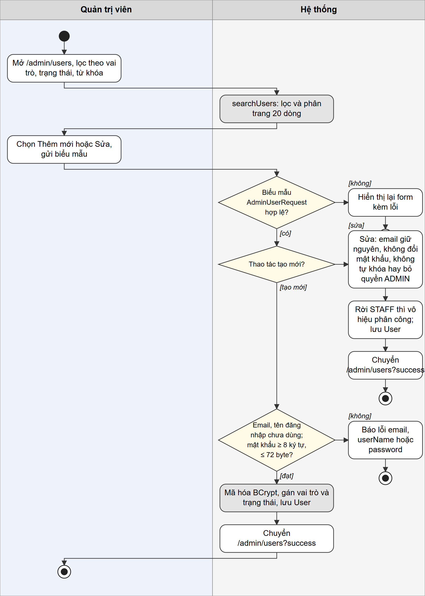

*Hình 2.18. Sơ đồ hoạt động chức năng Quản lý tài khoản người dùng.* Mã nguồn sơ đồ: `diagrams/admin/QT-01.json`.

**C. Code xử lý chức năng**

**Đoạn mã 2.40. AdminUserService.create**

`src/main/java/com/oneshop/service/AdminUserService.java` (dòng 87-105)

```java
public AdminUserResponse create(@NotNull @Valid AdminUserRequest request) {
    String email = request.email().trim().toLowerCase(Locale.ROOT);
    if (users.existsByEmail(email)) throw new BadRequestException("email", "Email đã được sử dụng.");
    String userName = userName(request);
    if (userName != null && users.existsByUserNameIgnoreCase(userName)) {
        throw new BadRequestException("userName", "Tên đăng nhập đã được sử dụng.");
    }
    String password = request.password();
    if (password == null || password.isBlank() || password.length() < 8
            || password.getBytes(StandardCharsets.UTF_8).length > 72) {
        throw new BadRequestException("password", "Mật khẩu cần ít nhất 8 ký tự và tối đa 72 byte.");
    }
    User user = new User();
    user.setEmail(email);
    user.setUserName(userName);
    user.setPasswordHash(passwords.encode(password));
    apply(user, request);
    return response(users.saveAndFlush(user));
}
```

**Đoạn mã 2.41. AdminUserService.update**

`src/main/java/com/oneshop/service/AdminUserService.java` (dòng 108-134)

```java
public AdminUserResponse update(Long id, @NotNull @Valid AdminUserRequest request) {
    User user = users.findByIdForUpdate(id).orElseThrow(AdminUserService::notFound);
    if (!user.getEmail().equals(request.email())) {
        throw new BadRequestException("email", "Email của tài khoản đã tạo không được thay đổi.");
    }
    if (request.password() != null && !request.password().isBlank()) {
        throw new BadRequestException("Không đổi mật khẩu bằng form cập nhật thông tin.");
    }
    String userName = userName(request);
    if (userName != null && !userName.equalsIgnoreCase(user.getUserName())
            && users.existsByUserNameIgnoreCase(userName)) {
        throw new BadRequestException("userName", "Tên đăng nhập đã được sử dụng.");
    }
    user.setUserName(userName);
    if (user.getEmail().equals(SecurityContextHolder.getContext().getAuthentication().getName())
            && (request.role() != RoleName.ADMIN || request.status() != ActiveStatus.ACTIVE)) {
        throw new BadRequestException("Không thể tự tắt tài khoản hoặc bỏ quyền Admin đang sử dụng.");
    }
    // The same User lock serializes assignment creation and role changes. Leaving STAFF revokes rows;
    // changing back to STAFF never silently restores an earlier assignment.
    if (user.getRole().getName() == RoleName.STAFF && request.role() != RoleName.STAFF) {
        assignments.findByUserId(id).forEach(a -> a.setStatus(ActiveStatus.INACTIVE));
    }
    apply(user, request);
    users.flush();
    return response(user);
}
```

**D. Giải thích code**

AdminUserService được bảo vệ bởi @PreAuthorize("hasRole('ADMIN')"). create chuẩn hóa email, kiểm tra trùng email/tên đăng nhập, yêu cầu mật khẩu từ 8 ký tự và tối đa 72 byte rồi lưu User đã băm mật khẩu. update khóa dòng User bằng findByIdForUpdate, từ chối đổi email hoặc mật khẩu, không cho quản trị viên tự khóa hay bỏ quyền ADMIN, và khi vai trò rời STAFF thì đặt mọi StaffStoreAssignment về INACTIVE; việc quay lại STAFF không tự khôi phục phân công cũ. Lỗi được FormErrors gắn vào trường tương ứng của biểu mẫu. Luồng này được thể hiện trong Hình 2.18 và mã nguồn trong Đoạn mã 2.40, Đoạn mã 2.41.


### 2.2.2. Phân công và chuyển chi nhánh cho nhân viên (QT-02)

**A. Mô tả chức năng**

Chức năng xác định chi nhánh mà mỗi nhân viên được phép xử lý. Quản trị viên gán nhân viên vào chi nhánh, tạm ngưng hoặc khôi phục phân công, hoặc chuyển nhân viên sang chi nhánh khác. Chỉ tài khoản STAFF đang ACTIVE và chi nhánh ACTIVE được bật phân công, và mỗi nhân viên chỉ làm việc tại một chi nhánh: muốn đổi nơi làm việc phải dùng 'Chuyển chi nhánh'. Phân công ACTIVE chính là phạm vi dữ liệu mà backend áp dụng cho nhân viên đó.

*Tác nhân: Quản trị viên. Trạng thái triển khai: Hoạt động.*

**B. Sơ đồ hoạt động**

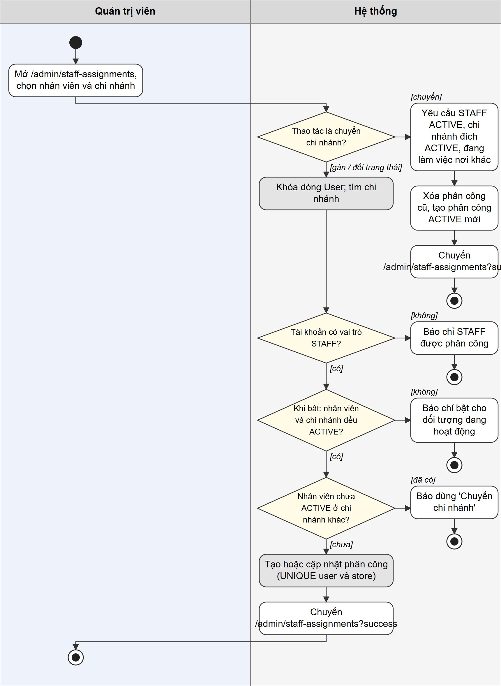

*Hình 2.19. Sơ đồ hoạt động chức năng Phân công và chuyển chi nhánh cho nhân viên.* Mã nguồn sơ đồ: `diagrams/admin/QT-02.json`.

**C. Code xử lý chức năng**

**Đoạn mã 2.42. AdminStaffAssignmentService.assign**

`src/main/java/com/oneshop/service/AdminStaffAssignmentService.java` (dòng 63-80)

```java
public StaffAssignmentResponse assign(@NotNull @Valid StaffAssignmentRequest request) {
    User user = users.findByIdForUpdate(request.userId())
            .orElseThrow(() -> new ResourceNotFoundException("Không tìm thấy nhân viên."));
    Store store = stores.findById(request.storeId())
            .orElseThrow(() -> new ResourceNotFoundException("Không tìm thấy chi nhánh."));
    if (user.getRole().getName() != RoleName.STAFF) {
        throw new BadRequestException("userId", "Chỉ tài khoản STAFF được phân công chi nhánh.");
    }
    requireActive(user, store, request.status());
    if (request.status() == ActiveStatus.ACTIVE) {
        requireNoOtherWorkplace(user, store.getId(), "userId");
    }
    var assignment = assignments.findByUserIdAndStoreId(user.getId(), store.getId()).orElseGet(() -> {
        var created = new StaffStoreAssignment(); created.setUser(user); created.setStore(store); return created;
    });
    assignment.setStatus(request.status());
    return response(assignments.saveAndFlush(assignment));
}
```

**Đoạn mã 2.43. AdminStaffAssignmentService.transfer**

`src/main/java/com/oneshop/service/AdminStaffAssignmentService.java` (dòng 105-132)

```java
public StaffAssignmentResponse transfer(@NotNull @Valid StaffTransferRequest request) {
    User user = users.findByIdForUpdate(request.userId())
            .orElseThrow(() -> new ResourceNotFoundException("Không tìm thấy nhân viên."));
    Store target = stores.findById(request.storeId())
            .orElseThrow(() -> new ResourceNotFoundException("Không tìm thấy chi nhánh."));
    if (user.getRole().getName() != RoleName.STAFF) {
        throw new BadRequestException("userId", "Chỉ tài khoản STAFF được chuyển chi nhánh.");
    }
    requireActive(user, target, ActiveStatus.ACTIVE);
    var working = assignments.findByUserIdAndStatus(user.getId(), ActiveStatus.ACTIVE);
    if (working.isEmpty()) {
        throw new BadRequestException("userId",
                "Nhân viên chưa làm việc tại chi nhánh nào. Dùng \"Gán nhân viên\" hoặc \"Khôi phục\".");
    }
    if (working.size() == 1 && working.get(0).getStore().getId().equals(target.getId())) {
        throw new BadRequestException("storeId", "Nhân viên đang làm việc tại chi nhánh này.");
    }
    // the Staff moves: the old workplace is removed (it is not a suspension, so it must not stay behind as a
    // "suspended" row that could be restored), and any old row for the target Store is replaced by a fresh one
    assignments.deleteAll(working);
    assignments.findByUserIdAndStoreId(user.getId(), target.getId()).ifPresent(assignments::delete);
    assignments.flush();
    var created = new StaffStoreAssignment();
    created.setUser(user);
    created.setStore(target);
    created.setStatus(ActiveStatus.ACTIVE);
    return response(assignments.saveAndFlush(created));
}
```

**Đoạn mã 2.44. Một nhân viên chỉ làm việc tại một chi nhánh**

`src/main/java/com/oneshop/service/AdminStaffAssignmentService.java` (dòng 135-144)

```java
private void requireNoOtherWorkplace(User user, Long storeId, String field) {
    assignments.findByUserIdAndStatus(user.getId(), ActiveStatus.ACTIVE).stream()
            .filter(a -> !a.getStore().getId().equals(storeId))
            .findFirst()
            .ifPresent(a -> {
                String message = "Nhân viên đang làm việc tại " + a.getStore().getName()
                        + ". Mỗi nhân viên chỉ làm việc tại một chi nhánh: dùng \"Chuyển chi nhánh\" để đổi nơi làm việc.";
                throw field == null ? new BadRequestException(message) : new BadRequestException(field, message);
            });
}
```

**D. Giải thích code**

assign khóa dòng User, kiểm tra vai trò STAFF, requireActive và requireNoOtherWorkplace rồi upsert cặp (user, store). transfer yêu cầu nhân viên đang có đúng phân công làm việc, xóa phân công cũ (không để lại dòng 'tạm ngưng' có thể khôi phục) và tạo dòng ACTIVE mới tại chi nhánh đích, trong cùng một giao dịch nên nhân viên không bao giờ làm việc ở hai nơi hay không ở đâu cả. requireNoOtherWorkplace tạo thông báo hướng dẫn dùng chức năng chuyển chi nhánh. Phạm vi này được StaffStoreScopeInterceptor đọc lại từ CSDL ở mỗi request của nhân viên (mục NV-01). Luồng này được thể hiện trong Hình 2.19 và mã nguồn trong Đoạn mã 2.42, Đoạn mã 2.43, Đoạn mã 2.44.


### 2.2.3. Quản lý chi nhánh (QT-03)

**A. Mô tả chức năng**

Quản trị viên xem, tìm kiếm, thêm và sửa chi nhánh: mã, tên, địa chỉ, tỉnh/thành, khu vực, số điện thoại, giờ mở cửa, khả năng giao tận nơi, nhận tại cửa hàng và trạng thái. Mã chi nhánh là duy nhất. Chi nhánh ngừng hoạt động bằng trạng thái INACTIVE, không bị xóa, nên lịch sử đơn hàng và tồn kho vẫn được giữ.

*Tác nhân: Quản trị viên. Trạng thái triển khai: Hoạt động.*

**B. Sơ đồ hoạt động**

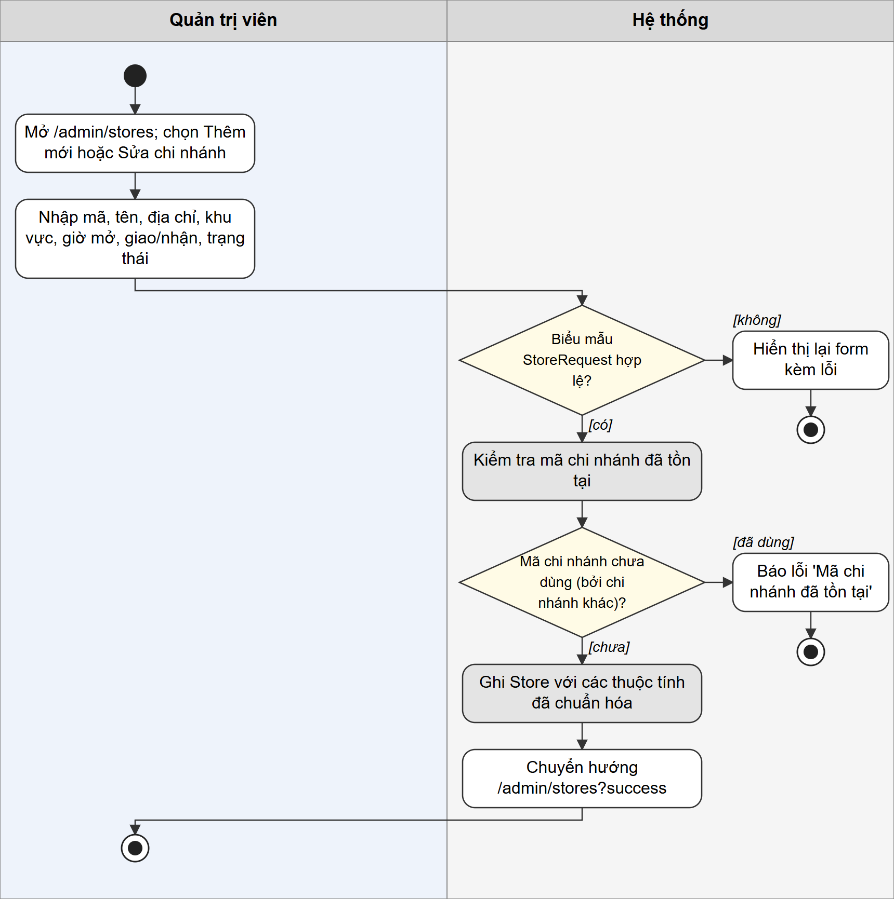

*Hình 2.20. Sơ đồ hoạt động chức năng Quản lý chi nhánh.* Mã nguồn sơ đồ: `diagrams/admin/QT-03.json`.

**C. Code xử lý chức năng**

**Đoạn mã 2.45. StoreServiceImpl.createStore, updateStore**

`src/main/java/com/oneshop/service/impl/StoreServiceImpl.java` (dòng 133-166)

```java
public StoreResponse createStore(StoreRequest request) {
    String code = request.getCode().trim();
    if (storeRepository.existsByCode(code)) {
        throw new BadRequestException("code", "Mã chi nhánh đã tồn tại");
    }
    Store store = new Store();
    apply(store, code, request);
    return storeMapper.toResponse(storeRepository.save(store));
}

@Override
@Transactional
public StoreResponse updateStore(Long id, StoreRequest request) {
    Store store = store(id);
    String code = request.getCode().trim();
    if (storeRepository.existsByCodeAndIdNot(code, id)) {
        throw new BadRequestException("code", "Mã chi nhánh đã tồn tại");
    }
    apply(store, code, request);
    return storeMapper.toResponse(store);
}

private static void apply(Store store, String code, StoreRequest request) {
    store.setCode(code);
    store.setName(request.getName().trim());
    store.setAddress(request.getAddress().trim());
    store.setProvinceCity(request.getProvinceCity().trim());
    store.setArea(request.getArea().trim());
    store.setPhone(StringUtils.hasText(request.getPhone()) ? request.getPhone().trim() : null);
    store.setOpeningHours(StringUtils.hasText(request.getOpeningHours()) ? request.getOpeningHours().trim() : null);
    store.setDeliveryEnabled(request.isDeliveryEnabled());
    store.setPickupEnabled(request.isPickupEnabled());
    store.setStatus(request.getStatus());
}
```

**D. Giải thích code**

createStore và updateStore kiểm tra mã bằng existsByCode hoặc existsByCodeAndIdNot rồi gọi apply để gán các thuộc tính (cắt khoảng trắng, số điện thoại và giờ mở cửa có thể để trống, cờ giao/nhận, trạng thái). Lỗi trùng mã là BadRequestException gắn vào trường code. Danh sách chi nhánh đọc bằng searchStores với bộ lọc từ khóa, khu vực, trạng thái. Luồng này được thể hiện trong Hình 2.20 và mã nguồn trong Đoạn mã 2.45.


### 2.2.4. Quản lý danh mục và thương hiệu (QT-04)

**A. Mô tả chức năng**

Quản trị viên thêm, sửa, ẩn danh mục và thương hiệu sản phẩm, kèm ảnh danh mục hoặc logo thương hiệu. Hai chức năng có cùng cấu trúc nên được trình bày chung: tên là duy nhất, trạng thái ACTIVE hoặc INACTIVE quyết định việc hiển thị với khách, ảnh được lưu trên Cloudinary và ảnh cũ chỉ bị xóa sau khi giao dịch thành công.

*Tác nhân: Quản trị viên. Trạng thái triển khai: Hoạt động.*

**B. Sơ đồ hoạt động**

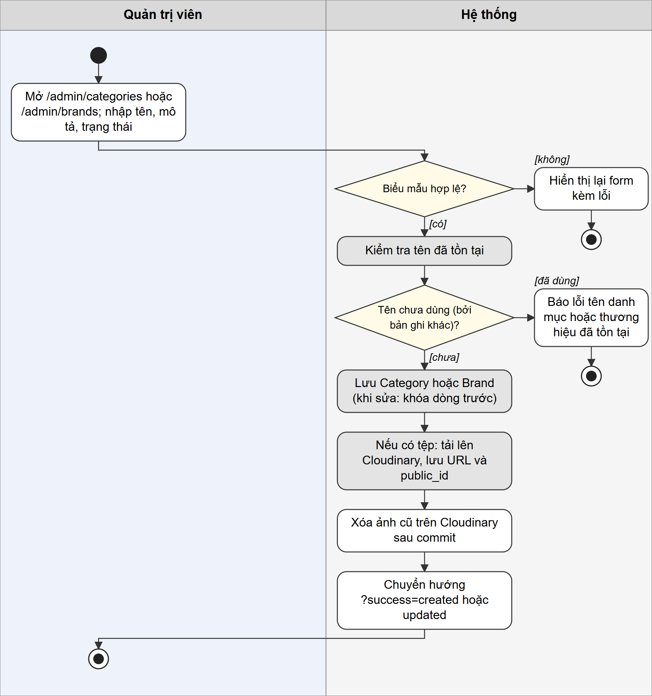

*Hình 2.21. Sơ đồ hoạt động chức năng Quản lý danh mục và thương hiệu.* Mã nguồn sơ đồ: `diagrams/admin/QT-04.json`.

**C. Code xử lý chức năng**

**Đoạn mã 2.46. Tạo danh mục**

`src/main/java/com/oneshop/service/impl/ProductServiceImpl.java` (dòng 163-177)

```java
public CategoryResponse createCategory(CategoryRequest request, MultipartFile file) {
    String name = request.getName().trim();
    if (categoryRepository.existsByName(name)) {
        throw new BadRequestException("name", "Tên danh mục đã tồn tại");
    }
    Category category = new Category();
    apply(category, name, request);

    if (file != null && !file.isEmpty()) {
        ImageUploadResult uploaded = images.upload(file, CATEGORY_FOLDER);
        category.setImageUrl(uploaded.url());
        category.setImagePublicId(uploaded.publicId());
    }
    return catalogMapper.toResponse(categoryRepository.save(category));
}
```

**Đoạn mã 2.47. Sửa danh mục và thay ảnh**

`src/main/java/com/oneshop/service/impl/ProductServiceImpl.java` (dòng 187-204)

```java
public CategoryResponse updateCategory(Long id, CategoryRequest request, MultipartFile file) {
    Category category = categoryForUpdate(id);
    String name = request.getName().trim();
    if (categoryRepository.existsByNameAndIdNot(name, id)) {
        throw new BadRequestException("name", "Tên danh mục đã tồn tại");
    }
    apply(category, name, request);

    if (file != null && !file.isEmpty()) {
        String previousPublicId = category.getImagePublicId();
        ImageUploadResult uploaded = images.upload(file, CATEGORY_FOLDER);
        category.setImageUrl(uploaded.url());
        category.setImagePublicId(uploaded.publicId());
        categoryRepository.saveAndFlush(category);
        images.deleteAfterCommit(previousPublicId);
    }
    return catalogMapper.toResponse(category);
}
```

**Đoạn mã 2.48. Tạo và sửa thương hiệu**

`src/main/java/com/oneshop/service/impl/ProductServiceImpl.java` (dòng 252-272)

```java
public BrandResponse createBrand(BrandRequest request) {
    String name = request.getName().trim();
    if (brandRepository.existsByName(name)) {
        throw new BadRequestException("name", "Tên thương hiệu đã tồn tại");
    }
    Brand brand = new Brand();
    apply(brand, name, request);
    return catalogMapper.toResponse(brandRepository.save(brand));
}

@Override
@Transactional
public BrandResponse updateBrand(Long id, BrandRequest request) {
    Brand brand = brandForUpdate(id);
    String name = request.getName().trim();
    if (brandRepository.existsByNameAndIdNot(name, id)) {
        throw new BadRequestException("name", "Tên thương hiệu đã tồn tại");
    }
    apply(brand, name, request);
    return catalogMapper.toResponse(brand);
}
```

**D. Giải thích code**

ProductServiceImpl kiểm tra tên bằng existsByName hoặc existsByNameAndIdNot, gán thuộc tính bằng apply rồi lưu. Khi có tệp, ImageTransactionCoordinator tải ảnh lên Cloudinary và trả về url cùng publicId; ảnh trước đó được xóa bằng deleteAfterCommit để không mất ảnh nếu giao dịch hoàn tác. Logo thương hiệu và ảnh danh mục có thêm các thao tác tải lên và gỡ ảnh riêng (uploadBrandLogo, removeBrandLogo, uploadCategoryImage, removeCategoryImage). Controller AdminCategoryController và AdminBrandController chuyển kết quả thành tham số success hoặc error trên URL. Luồng này được thể hiện trong Hình 2.21 và mã nguồn trong Đoạn mã 2.46, Đoạn mã 2.47, Đoạn mã 2.48.


### 2.2.5. Quản lý sản phẩm và giá bán (QT-05)

**A. Mô tả chức năng**

Quản trị viên tìm kiếm, thêm và sửa sản phẩm: SKU, tên, mô tả, danh mục, thương hiệu, giá bán online duy nhất, giá gốc và trạng thái. Theo mô hình V3, giá chỉ nằm trên Product và áp dụng cho mọi chi nhánh. Sản phẩm không bị xóa mà được ngừng bán bằng trạng thái; sản phẩm đang bán phải có giá lớn hơn 0. Sau khi tạo, hệ thống chuyển đến trang sửa để thêm ảnh.

*Tác nhân: Quản trị viên. Trạng thái triển khai: Hoạt động.*

**B. Sơ đồ hoạt động**

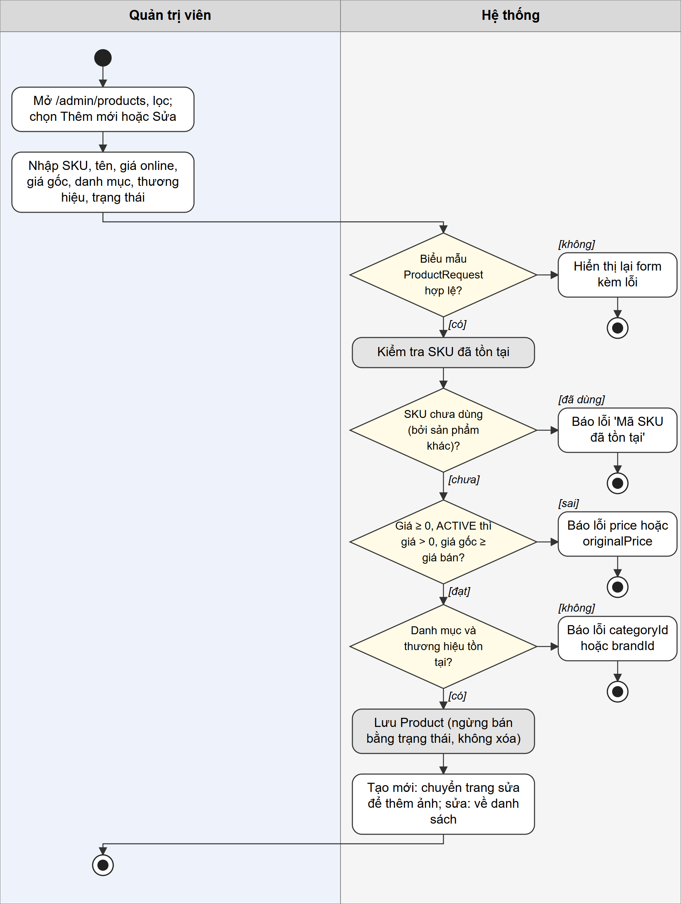

*Hình 2.22. Sơ đồ hoạt động chức năng Quản lý sản phẩm và giá bán.* Mã nguồn sơ đồ: `diagrams/admin/QT-05.json`.

**C. Code xử lý chức năng**

**Đoạn mã 2.49. Tạo và cập nhật sản phẩm**

`src/main/java/com/oneshop/service/impl/ProductServiceImpl.java` (dòng 352-372)

```java
public AdminProductResponse createProduct(ProductRequest request) {
    String sku = normalizeSku(request.getSku());
    if (productRepository.existsBySku(sku)) {
        throw new BadRequestException("sku", "Mã SKU đã tồn tại");
    }
    Product product = new Product();
    apply(product, sku, request);
    return catalogMapper.toAdminResponse(productRepository.save(product));
}

@Override
@Transactional
public AdminProductResponse updateProduct(Long id, ProductRequest request) {
    Product product = product(id);
    String sku = normalizeSku(request.getSku());
    if (productRepository.existsBySkuAndIdNot(sku, id)) {
        throw new BadRequestException("sku", "Mã SKU đã tồn tại");
    }
    apply(product, sku, request);
    return catalogMapper.toAdminResponse(product);
}
```

**Đoạn mã 2.50. Kiểm tra giá, danh mục, thương hiệu**

`src/main/java/com/oneshop/service/impl/ProductServiceImpl.java` (dòng 374-398)

```java
private void apply(Product product, String sku, ProductRequest request) {
    var price = request.getPrice();
    var original = request.getOriginalPrice();
    if (price == null || price.signum() < 0 || price.stripTrailingZeros().scale() > 2
            || price.compareTo(new java.math.BigDecimal("9999999999999999.99")) > 0) {
        throw new BadRequestException("price", "Giá bán online không hợp lệ.");
    }
    if (request.getStatus() == com.oneshop.entity.ProductStatus.ACTIVE && price.signum() == 0) {
        throw new BadRequestException("price", "Giá bán online phải lớn hơn 0 khi sản phẩm đang bán.");
    }
    if (original != null && (original.compareTo(price) < 0 || original.stripTrailingZeros().scale() > 2
            || original.compareTo(new java.math.BigDecimal("9999999999999999.99")) > 0)) {
        throw new BadRequestException("originalPrice", "Giá gốc phải hợp lệ và không thấp hơn giá bán online.");
    }
    product.setSku(sku);
    product.setName(request.getName().trim());
    product.setDescription(trimToNull(request.getDescription()));
    product.setStatus(request.getStatus());
    product.setPrice(price);
    product.setOriginalPrice(original);
    product.setCategory(categoryRepository.findById(request.getCategoryId())
            .orElseThrow(() -> new BadRequestException("categoryId", "Danh mục không tồn tại")));
    product.setBrand(brandRepository.findById(request.getBrandId())
            .orElseThrow(() -> new BadRequestException("brandId", "Thương hiệu không tồn tại")));
}
```

**D. Giải thích code**

createProduct và updateProduct chuẩn hóa SKU, kiểm tra trùng bằng existsBySku hoặc existsBySkuAndIdNot rồi gọi apply. apply từ chối giá âm, giá có hơn hai chữ số lẻ hoặc vượt giới hạn, giá bằng 0 khi sản phẩm ACTIVE và giá gốc thấp hơn giá bán; sau đó nạp Category và Brand, báo lỗi theo trường nếu không tồn tại. AdminProductController.create dẫn tới /admin/products/{id}/edit?success=created, còn update quay về danh sách. Danh sách quản trị dùng searchAllProducts với bộ lọc từ khóa, danh mục, thương hiệu và trạng thái. Luồng này được thể hiện trong Hình 2.22 và mã nguồn trong Đoạn mã 2.49, Đoạn mã 2.50.


### 2.2.6. Quản lý hình ảnh sản phẩm (QT-06)

**A. Mô tả chức năng**

Trong trang sửa sản phẩm, quản trị viên tải ảnh lên, chọn ảnh chính hoặc xóa ảnh. Ảnh được lưu trên Cloudinary (tối đa 5MB, kiểm tra loại tệp), thông tin url và public_id nằm trong bảng product_images. Ảnh đầu tiên tự là ảnh chính; mỗi sản phẩm chỉ có một ảnh chính (chỉ mục duy nhất có lọc). Mọi thao tác ảnh khóa dòng Product nên tuần tự hóa kể cả khi có nhiều máy chủ.

*Tác nhân: Quản trị viên. Trạng thái triển khai: Hoạt động.*

**B. Sơ đồ hoạt động**

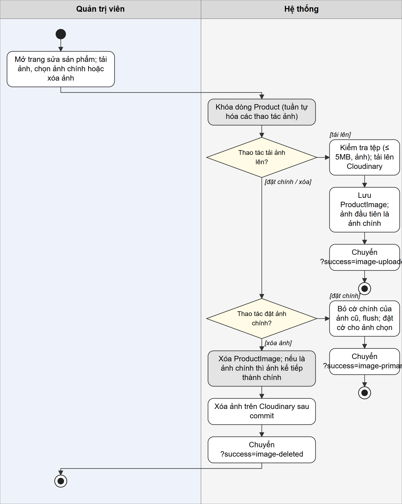

*Hình 2.23. Sơ đồ hoạt động chức năng Quản lý hình ảnh sản phẩm.* Mã nguồn sơ đồ: `diagrams/admin/QT-06.json`.

**C. Code xử lý chức năng**

**Đoạn mã 2.51. Thêm ảnh và đặt ảnh chính**

`src/main/java/com/oneshop/service/impl/ProductServiceImpl.java` (dòng 409-434)

```java
public ProductImageResponse addProductImage(Long productId, MultipartFile file) {
    Product product = productForUpdate(productId);
    List<ProductImage> existing = productImageRepository.findByProductIdOrderBySortOrderAsc(productId);

    ImageUploadResult uploaded = images.upload(file, PRODUCT_FOLDER);
        ProductImage image = new ProductImage();
        image.setProduct(product);
        image.setImageUrl(uploaded.url());
        image.setPublicId(uploaded.publicId());
        image.setPrimary(existing.stream().noneMatch(ProductImage::isPrimary));
        image.setSortOrder(existing.stream().mapToInt(ProductImage::getSortOrder).max().orElse(-1) + 1);
        return catalogMapper.toResponse(productImageRepository.saveAndFlush(image));
}

@Override
@Transactional
public void setPrimaryProductImage(Long productId, Long imageId) {
    productForUpdate(productId); // every image mutator serializes on this Product, even across app instances
    ProductImage chosen = image(productId, imageId);
    productImageRepository.findByProductIdOrderBySortOrderAsc(productId)
            .forEach(image -> image.setPrimary(false));
    // SQL Server's filtered unique index is immediate: remove the old key before inserting the new one.
    productImageRepository.flush();
    chosen.setPrimary(true);
    productImageRepository.flush();
}
```

**Đoạn mã 2.52. Xóa ảnh**

`src/main/java/com/oneshop/service/impl/ProductServiceImpl.java` (dòng 438-451)

```java
public void deleteProductImage(Long productId, Long imageId) {
    productForUpdate(productId);
    ProductImage image = image(productId, imageId);
    String publicId = image.getPublicId();
    boolean wasPrimary = image.isPrimary();

    productImageRepository.delete(image);
    productImageRepository.flush();
    if (wasPrimary) {
        productImageRepository.findByProductIdOrderBySortOrderAsc(productId).stream().findFirst()
                .ifPresent(next -> next.setPrimary(true));
    }
    images.deleteAfterCommit(publicId);
}
```

**D. Giải thích code**

addProductImage khóa Product bằng productForUpdate, tải tệp qua ImageTransactionCoordinator, đặt cờ primary nếu sản phẩm chưa có ảnh chính và sortOrder tiếp theo. setPrimaryProductImage bỏ cờ của mọi ảnh, flush rồi mới đặt cờ cho ảnh chọn vì chỉ mục duy nhất của SQL Server được kiểm tra ngay. deleteProductImage xóa dòng, chuyển ảnh chính sang ảnh kế tiếp nếu cần và gọi deleteAfterCommit để xóa tệp trên Cloudinary sau khi commit. AdminProductController bắt BadRequestException và ImageStorageException để trả error=image-size, image-invalid hoặc image-storage. Luồng này được thể hiện trong Hình 2.23 và mã nguồn trong Đoạn mã 2.51, Đoạn mã 2.52.


### 2.2.7. Quản lý tồn kho toàn chuỗi (gắn sản phẩm vào chi nhánh) (QT-07)

**A. Mô tả chức năng**

Quản trị viên xem tồn kho của mọi chi nhánh (trang tồn kho với thống kê tổng, sắp hết, hết hàng) và quản lý các bản ghi StoreProduct: gắn một sản phẩm vào chi nhánh, đổi số lượng và trạng thái bán. Mỗi cặp (chi nhánh, sản phẩm) tồn tại một lần và không có giá riêng. Số lượng mở bán ban đầu và mọi lần điều chỉnh đều được ghi thành InventoryMovement loại STOCK_ADJUST; tồn không được âm hoặc thấp hơn số lượng đang được giữ.

*Tác nhân: Quản trị viên. Trạng thái triển khai: Hoạt động.*

**B. Sơ đồ hoạt động**

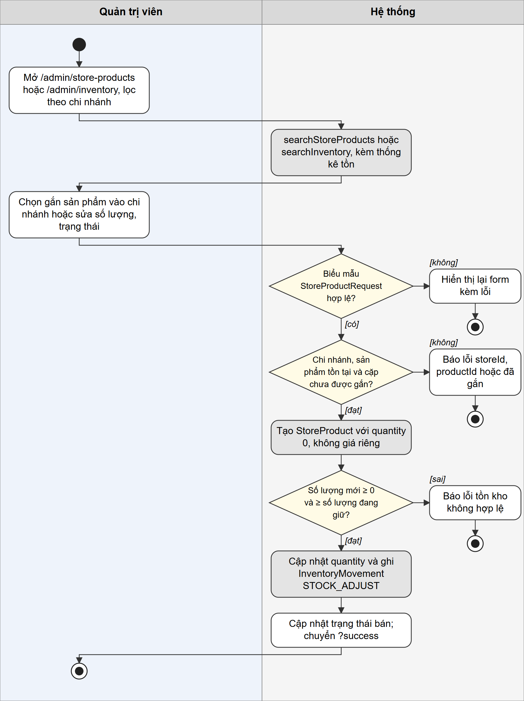

*Hình 2.24. Sơ đồ hoạt động chức năng Quản lý tồn kho toàn chuỗi (gắn sản phẩm vào chi nhánh).* Mã nguồn sơ đồ: `diagrams/admin/QT-07.json`.

**C. Code xử lý chức năng**

**Đoạn mã 2.53. Gắn sản phẩm vào chi nhánh, cập nhật**

`src/main/java/com/oneshop/service/impl/StoreProductServiceImpl.java` (dòng 246-283)

```java
public StoreProductStockResponse createStoreProduct(StoreProductRequest request, String adminEmail) {
    Store store = storeRepository.findById(request.getStoreId())
            .orElseThrow(() -> new BadRequestException("storeId", "Chi nhánh không tồn tại"));
    Product product = productRepository.findById(request.getProductId())
            .orElseThrow(() -> new BadRequestException("productId", "Sản phẩm không tồn tại"));
    if (storeProductRepository.existsByStoreIdAndProductId(store.getId(), product.getId())) {
        throw new BadRequestException("productId", DUPLICATE_MESSAGE);
    }

    StoreProduct storeProduct = new StoreProduct();
    storeProduct.setStore(store);
    storeProduct.setProduct(product);
    // no Store price: the online price is Product.price (the legacy column stays NULL)
    storeProduct.setStatus(request.getStatus());
    // starts empty: the opening quantity is booked below as an InventoryMovement, like every later change
    storeProduct.setQuantity(0);
    try {
        storeProductRepository.saveAndFlush(storeProduct);
    } catch (DataIntegrityViolationException ex) {
        // UQ_store_products_store_product: another request created the same pair in the meantime
        throw new BadRequestException("productId", DUPLICATE_MESSAGE);
    }
    inventoryService.adjustStock(storeProduct.getId(), request.getQuantity(), adminEmail,
            noteOr(request.getNote(), OPENING_STOCK_NOTE));
    return storeProductMapper.toStockView(storeProduct);
}

@Override
@Transactional
public StoreProductStockResponse updateStoreProduct(Long id, StoreProductRequest request, String adminEmail) {
    // Lock before the first entity load: a later lock cannot refresh an already cached JPA quantity.
    StoreProduct storeProduct = storeProductRepository.findByIdForUpdate(id)
            .orElseThrow(() -> new ResourceNotFoundException("Không tìm thấy sản phẩm tại chi nhánh #" + id));
    inventoryService.adjustStock(id, request.getQuantity(), adminEmail,
            noteOr(request.getNote(), ADMIN_ADJUST_NOTE));
    storeProduct.setStatus(request.getStatus());
    return storeProductMapper.toStockView(storeProduct);
}
```

**Đoạn mã 2.54. InventoryServiceImpl.adjustStock**

`src/main/java/com/oneshop/service/impl/InventoryServiceImpl.java` (dòng 48-75)

```java
public void adjustStock(Long storeProductId, int newQuantity, String userEmail, String note) {
    if (newQuantity < 0) {
        throw new BadRequestException("quantity", "Tồn kho không được âm");
    }
    StoreProduct storeProduct = storeProductRepository.findByIdForUpdate(storeProductId)
            .orElseThrow(() -> new ResourceNotFoundException("Không tìm thấy sản phẩm tại chi nhánh #" + storeProductId));
    if (newQuantity < storeProduct.getReservedQuantity()) {
        throw new BadRequestException("quantity", "Tồn kho không được thấp hơn số lượng đang được giữ.");
    }
    int before = storeProduct.getQuantity();
    if (before == newQuantity) {
        return;
    }
    User user = userRepository.findByEmail(userEmail)
            .orElseThrow(() -> new IllegalStateException("Authenticated user not found: " + userEmail));

    storeProduct.setQuantity(newQuantity);

    InventoryMovement movement = new InventoryMovement();
    movement.setStoreProduct(storeProduct);
    movement.setType(InventoryMovementType.STOCK_ADJUST);
    movement.setQuantityBefore(before);
    movement.setQuantityChange(newQuantity - before);
    movement.setQuantityAfter(newQuantity);
    movement.setStaff(user);
    movement.setNote(StringUtils.hasText(note) ? note.trim() : DEFAULT_ADJUST_NOTE);
    movementRepository.save(movement);
}
```

**D. Giải thích code**

createStoreProduct kiểm tra chi nhánh, sản phẩm và tính duy nhất của cặp (bắt cả DataIntegrityViolationException khi tạo đồng thời), tạo StoreProduct với quantity 0 rồi gọi InventoryService.adjustStock để ghi tồn ban đầu thành một InventoryMovement. updateStoreProduct khóa dòng trước khi nạp thực thể, gọi adjustStock và cập nhật trạng thái. adjustStock từ chối số âm hoặc thấp hơn reservedQuantity, bỏ qua khi số lượng không đổi và ghi quantityBefore, quantityChange, quantityAfter cùng người thực hiện. Luồng này được thể hiện trong Hình 2.24 và mã nguồn trong Đoạn mã 2.53, Đoạn mã 2.54.


### 2.2.8. Quản lý đơn hàng toàn chuỗi (QT-08)

**A. Mô tả chức năng**

Quản trị viên xem toàn bộ đơn của chuỗi, lọc theo chi nhánh, trạng thái đơn, trạng thái thanh toán, hình thức nhận, khoảng ngày và từ khóa (mã đơn hoặc khách hàng), hoặc chỉ xem các đơn cần xử lý. Trang chi tiết đơn hiển thị khách hàng, các phần giao theo chi nhánh, ngoại lệ giao hàng, thông tin hoàn tiền và yêu cầu trả hàng. Quản trị viên chỉ xem và xử lý ngoại lệ ở đây; trạng thái đơn không bao giờ được sửa tay.

*Tác nhân: Quản trị viên. Trạng thái triển khai: Hoạt động.*

**B. Sơ đồ hoạt động**

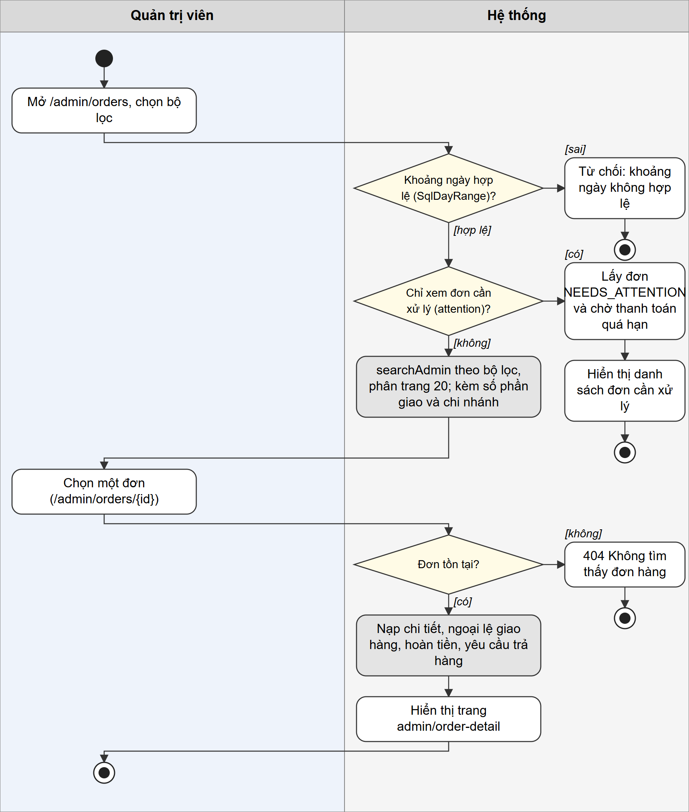

*Hình 2.25. Sơ đồ hoạt động chức năng Quản lý đơn hàng toàn chuỗi.* Mã nguồn sơ đồ: `diagrams/admin/QT-08.json`.

**C. Code xử lý chức năng**

**Đoạn mã 2.55. AdminOrderController**

`src/main/java/com/oneshop/controller/admin/AdminOrderController.java` (dòng 32-67)

```java
@GetMapping
public String list(@RequestParam(required = false) Long storeId,
                   @RequestParam(required = false) String q,
                   @RequestParam(required = false) OrderStatus orderStatus,
                   @RequestParam(required = false) OrderPaymentStatus paymentStatus,
                   @RequestParam(required = false) FulfillmentType fulfillmentType,
                   @RequestParam(required = false) @DateTimeFormat(iso = DateTimeFormat.ISO.DATE) LocalDate from,
                   @RequestParam(required = false) @DateTimeFormat(iso = DateTimeFormat.ISO.DATE) LocalDate to,
                    @RequestParam(defaultValue = "0") int page,
                    @RequestParam(required = false, defaultValue = "false") boolean attention, Model model) {
    // Validate date semantics before the attention/list split: malformed ranges are never ignored.
    com.oneshop.service.query.SqlDayRange.of(from, to);
    model.addAttribute("orders", attention ? operations.getOrdersNeedingAttention(storeId, page)
            : operations.getOrders(storeId, q, orderStatus, paymentStatus, fulfillmentType, from, to, page));
    model.addAttribute("attention", attention);
    model.addAttribute("stores", stores.getAllStores());
    model.addAttribute("storeId", storeId);
    model.addAttribute("q", q);
    model.addAttribute("orderStatus", orderStatus);
    model.addAttribute("paymentStatus", paymentStatus);
    model.addAttribute("fulfillmentType", fulfillmentType);
    model.addAttribute("from", from);
    model.addAttribute("to", to);
    model.addAttribute("orderStatuses", OrderStatus.values());
    model.addAttribute("paymentStatuses", OrderPaymentStatus.values());
    model.addAttribute("fulfillmentTypes", FulfillmentType.values());
    return "admin/orders";
}
@GetMapping("/{id}")
public String detail(@PathVariable Long id, Model model) {
    model.addAttribute("orderDetail", operations.getOrder(id));
    model.addAttribute("exception", exceptions.getException(id));
    model.addAttribute("refund", refundView.forAdmin(id));
    model.addAttribute("orderReturn", orderReturns.findByOrder(id).orElse(null));
    return "admin/order-detail";
}
```

**Đoạn mã 2.56. AdminOperationsService.getOrders, getOrder**

`src/main/java/com/oneshop/service/AdminOperationsService.java` (dòng 41-57)

```java
public Page<AdminOrderSummaryResponse> getOrders(Long storeId, String q, OrderStatus orderStatus,
        OrderPaymentStatus paymentStatus, FulfillmentType fulfillmentType,
        java.time.LocalDate from, java.time.LocalDate to, int page) {
    var range = com.oneshop.service.query.SqlDayRange.of(from, to);
    var words = orderQuery(q).isEmpty() ? com.oneshop.service.search.TextSearch.words(q) : java.util.List.<String>of();
    if (!words.isEmpty()) {
        var matched = orders.searchAdmin(storeId, "", "", orderStatus, paymentStatus, fulfillmentType,
                        range.fromInclusive(), range.toExclusive(), org.springframework.data.domain.Pageable.unpaged())
                .getContent().stream()
                .filter(o -> com.oneshop.service.search.TextSearch.matchesAll(words, o.getUser().getFullName(), o.getUser().getEmail()))
                .toList();
        return com.oneshop.service.search.TextSearch.slice(matched, com.oneshop.service.query.Paging.page(page, 20)).map(this::summary);
    }
    return orders.searchAdmin(storeId, orderQuery(q), likePattern(q), orderStatus, paymentStatus, fulfillmentType,
                    range.fromInclusive(), range.toExclusive(), com.oneshop.service.query.Paging.page(page, 20))
            .map(this::summary);
}
```

**D. Giải thích code**

AdminOrderController.list kiểm tra khoảng ngày bằng SqlDayRange.of trước khi tách nhánh 'attention'; AdminOperationsService.getOrders gọi OrderRepository.searchAdmin hoặc, khi từ khóa là nhiều từ, lọc theo tên và email khách bằng TextSearch. Mỗi dòng gồm tóm tắt đơn, số phần giao và tên các chi nhánh. detail gọi getOrder (ném ResourceNotFoundException khi không có đơn), AdminFulfillmentExceptionService.getException, OrderRefundViewService.forAdmin và AdminOrderReturnService.findByOrder để dựng trang. Luồng này được thể hiện trong Hình 2.25 và mã nguồn trong Đoạn mã 2.55, Đoạn mã 2.56.


### 2.2.9. Xử lý ngoại lệ giao hàng thất bại (QT-09)

**A. Mô tả chức năng**

Khi nhân viên báo một phần giao thất bại, phần giao ở trạng thái FAILED và đơn ở NEEDS_ATTENTION. Quản trị viên quyết định riêng cho từng phần giao, kèm lý do 5–400 ký tự: giao lại (FAILED → PACKED hoặc READY_FOR_PICKUP) hoặc xác nhận không giao được (FAILED → CANCELLED) với tình trạng hàng. Hàng đã về chi nhánh thì hoàn tồn đúng StoreProduct một lần; hàng thất lạc không đổi tồn; chưa xác nhận được thì chỉ ghi chú và ngoại lệ vẫn mở. Đơn ONLINE đã thanh toán được hoàn tiền mô phỏng theo giá trị hàng của phần đó. Trạng thái đơn được tổng hợp lại từ các phần giao.

*Tác nhân: Quản trị viên. Trạng thái triển khai: Hoạt động.*

**B. Sơ đồ hoạt động**

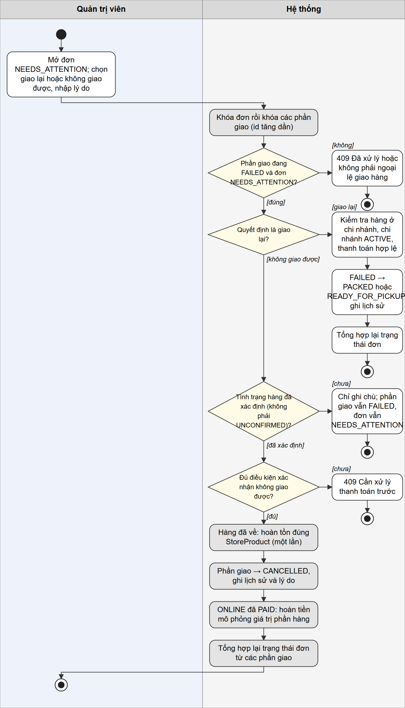

*Hình 2.26. Sơ đồ hoạt động chức năng Xử lý ngoại lệ giao hàng thất bại.* Mã nguồn sơ đồ: `diagrams/admin/QT-09.json`.

**C. Code xử lý chức năng**

**Đoạn mã 2.57. Quyết định giao lại**

`src/main/java/com/oneshop/service/fulfillment/AdminFulfillmentExceptionService.java` (dòng 222-253)

```java
public Outcome redeliver(Long orderId, Long fulfillmentId, boolean goodsAtStore, String reason) {
    User admin = currentAdmin();
    String why = reason(reason);
    Locked locked = lock(orderId, fulfillmentId);
    Order order = locked.order();
    OrderFulfillment part = locked.part();
    requireFailed(order, part);
    if (!goodsAtStore) {
        throw new BadRequestException("goodsAtStore", "Vui lòng xác nhận hàng đang ở chi nhánh và đủ điều kiện giao lại.");
    }
    String blocked = redeliverBlocked(order, part);
    if (blocked != null) {
        throw new FulfillmentConflictException(REDELIVERY_NOT_POSSIBLE, blocked);
    }

    OrderFulfillmentStatus target = part.getFulfillmentType() == FulfillmentType.DELIVERY
            ? OrderFulfillmentStatus.PACKED : OrderFulfillmentStatus.READY_FOR_PICKUP;
    String note = OrderStatusWriter.abbreviate("[ADMIN_REDELIVER] " + admin.getFullName() + ": " + why);
    if (target == OrderFulfillmentStatus.PACKED) {
        // the parcel is back and packed; Staff hand it to the carrier again (a new tracking code, a new SHIPPING time)
        part.setShippedAt(null);
        part.setTrackingCode(null);
    }
    part.setNote(note);
    history(part, target, admin, note);
    part.setStatus(target);
    fulfillments.saveAndFlush(part);

    OrderStatus status = settle(order, locked.parts(), admin,
            "[ADMIN_REDELIVER] Phần giao #" + part.getId() + " được giao lại: " + why);
    return new Outcome(Kind.REDELIVERY_OPENED, status, false, false, false, null, failedLeft(locked.parts()));
}
```

**Đoạn mã 2.58. Xác nhận không giao được (1)**

`src/main/java/com/oneshop/service/fulfillment/AdminFulfillmentExceptionService.java` (dòng 258-294)

```java
public Outcome markUndeliverable(Long orderId, Long fulfillmentId, GoodsStatus goods, String reason) {
    User admin = currentAdmin();
    String why = reason(reason);
    if (goods == null) {
        throw new BadRequestException("goods", "Vui lòng chọn tình trạng hàng hóa.");
    }
    Locked locked = lock(orderId, fulfillmentId);
    Order order = locked.order();
    OrderFulfillment part = locked.part();
    requireFailed(order, part);

    if (goods == GoodsStatus.UNCONFIRMED) {
        // not a decision: the goods are not known yet, so nothing is cancelled, restored or refunded
        String note = OrderStatusWriter.abbreviate("[ADMIN_PENDING_VERIFICATION][GOODS:" + goods.name() + "] "
                + admin.getFullName() + ": " + why);
        history(part, OrderFulfillmentStatus.FAILED, admin, note);
        fulfillments.flush();
        writer.audit(order, admin, "[ADMIN_PENDING_VERIFICATION] Phần giao #" + part.getId()
                + " chờ xác minh tình trạng hàng: " + why);
        return new Outcome(Kind.AWAITING_VERIFICATION, order.getOrderStatus(), false, false, false, null,
                failedLeft(locked.parts()));
    }

    String blocked = undeliverableBlocked(order, part, locked.parts());
    if (blocked != null) {
        throw new FulfillmentConflictException(PARTIAL_SETTLEMENT_REQUIRED, blocked);
    }

    String note = OrderStatusWriter.abbreviate("[ADMIN_UNDELIVERABLE][GOODS:" + goods.name() + "] "
            + admin.getFullName() + " · " + goods.label() + ": " + why);
    boolean restored = false;
    if (goods == GoodsStatus.RETURNED) {
        // inside this transaction the Fulfillment leaves FAILED right below, so this can run at most once
        inventory.restoreForUndeliverableFulfillment(order, part, OrderStatusWriter.abbreviate(
                "Hoàn tồn phần giao #" + part.getId() + " không giao được (hàng đã về chi nhánh) - Order #" + order.getId()));
        restored = true;
    }
```

**Đoạn mã 2.59. Xác nhận không giao được (2)**

`src/main/java/com/oneshop/service/fulfillment/AdminFulfillmentExceptionService.java` (dòng 295-317)

```java
    LocalDateTime now = LocalDateTime.now().withNano(0);
    history(part, OrderFulfillmentStatus.CANCELLED, admin, note);
    part.setStatus(OrderFulfillmentStatus.CANCELLED);
    part.setCancelledAt(now);
    part.setCancelReason(OrderStatusWriter.abbreviate(UNDELIVERABLE_PREFIX + why));
    part.setNote(note);
    fulfillments.saveAndFlush(part);

    PartialRefundService.Result refund = null;
    if (order.getPaymentMethod() == PaymentMethod.ONLINE && order.getPaymentStatus() == OrderPaymentStatus.PAID) {
        refund = refunds.refundUndeliverable(order, part, locked.parts(), admin,
                "Hoàn tiền: phần giao #" + part.getId() + " không giao được. " + why);
    }

    int failedLeft = failedLeft(locked.parts());
    String orderNote = "[ADMIN_UNDELIVERABLE] Phần giao #" + part.getId() + " không giao được (" + goods.label() + "): "
            + why + (refund == null || refund.status() == PartialRefundService.Status.NOT_APPLICABLE ? ""
            : " · hoàn tiền " + refund.total().toPlainString());
    OrderStatus status = settle(order, locked.parts(), admin, orderNote);
    boolean closed = status == OrderStatus.CANCELLED && failedLeft == 0;
    boolean partially = status == OrderStatus.COMPLETED && failedLeft == 0;
    return new Outcome(Kind.UNDELIVERABLE_RECORDED, status, closed, partially, restored, refund, failedLeft);
}
```

**D. Giải thích code**

redeliver và markUndeliverable đều chạy trong một giao dịch: khóa Order rồi các Fulfillment, requireFailed bảo đảm phần giao còn FAILED nên yêu cầu lặp lại không có tác dụng. redeliver chuyển phần giao sang PACKED hoặc READY_FOR_PICKUP và xóa mã vận đơn cũ; markUndeliverable với GoodsStatus.UNCONFIRMED chỉ ghi lịch sử, với RETURNED gọi restoreForUndeliverableFulfillment, rồi đặt CANCELLED và gọi refundUndeliverable khi đơn ONLINE đã PAID. Cuối cùng settle dùng OrderStatusAggregator.derive để tính lại trạng thái đơn; nếu còn phần FAILED khác, đơn vẫn NEEDS_ATTENTION. Nhân viên chỉ báo thất bại, không thể hủy hay hoàn tồn. Luồng này được thể hiện trong Hình 2.26 và mã nguồn trong Đoạn mã 2.57, Đoạn mã 2.58, Đoạn mã 2.59.


### 2.2.10. Quản lý thanh toán ONLINE: đối soát, chốt cổng, hoàn tiền (QT-10)

**A. Mô tả chức năng**

Trang thanh toán của quản trị viên liệt kê các đơn ONLINE theo nhóm (cần xử lý, chờ thanh toán, đang đối soát, đã thu, đã hoàn, thất bại). Với từng đơn, quản trị viên có ba thao tác bị giới hạn bởi bằng chứng của sổ cái cổng: kiểm tra lại (đối soát), chốt kết quả của lần thanh toán chưa xác định (đã thu hoặc chưa thu, chỉ khi cổng mô phỏng bật) và thử lại hoàn tiền mô phỏng đã thất bại. Không có cách đặt trạng thái tùy ý, đánh dấu PAID khi chưa có bằng chứng, sửa tồn kho hay hồi sinh đơn đã hủy.

*Tác nhân: Quản trị viên. Trạng thái triển khai: Hoạt động (mô phỏng, không kết nối ngân hàng).*

**B. Sơ đồ hoạt động**

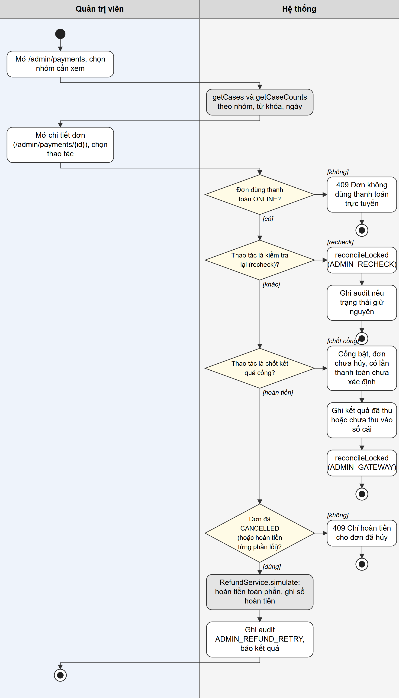

*Hình 2.27. Sơ đồ hoạt động chức năng Quản lý thanh toán ONLINE: đối soát, chốt cổng, hoàn tiền.* Mã nguồn sơ đồ: `diagrams/admin/QT-10.json`.

**C. Code xử lý chức năng**

**Đoạn mã 2.60. Kiểm tra lại và chốt cổng**

`src/main/java/com/oneshop/service/payment/AdminPaymentService.java` (dòng 216-253)

```java
@Transactional
public PaymentOutcome recheck(Long orderId) {
    User admin = currentAdmin();
    Order order = lockOnline(orderId);
    PaymentOutcome outcome = reconciliation.reconcileLocked(order,
            PaymentReconciliationService.Trigger.ADMIN_RECHECK, admin);
    auditWhenUnchanged(order, admin, "ADMIN_RECHECK", outcome);
    return outcome;
}

/**
 * Mock operator answer for an in-doubt attempt, then the same reconciliation. Only while the mock gateway is
 * enabled; an attempt that is not in doubt is refused (an administrator cannot invent a collection).
 */
@Transactional
public PaymentOutcome settleGateway(Long orderId, boolean collected) {
    if (!gateway.enabled()) {
        throw new PaymentConflictException(PaymentConflictException.GATEWAY_DISABLED,
                "Cổng thanh toán không được bật trong môi trường này.");
    }
    User admin = currentAdmin();
    Order order = lockOnline(orderId);
    if (order.getOrderStatus() == OrderStatus.CANCELLED) {
        throw new PaymentConflictException(PaymentConflictException.PAYMENT_ALREADY_FINAL,
                "Đơn hàng đã hủy; không thể đổi kết quả cổng thanh toán.");
    }
    Payment doubtful = payments.findForLockedOrder(orderId).stream()
            .filter(p -> p.getMethod() == PaymentMethod.ONLINE && MockLedger.stateOf(p) == LedgerState.IN_DOUBT)
            .findFirst().orElseThrow(() -> new PaymentConflictException(
                    PaymentConflictException.NOT_A_PAYMENT_CASE,
                    "Không có lần thanh toán nào ở trạng thái chưa xác định."));
    gateway.settleInDoubt(doubtful, collected);
    payments.saveAndFlush(doubtful);
    PaymentOutcome outcome = reconciliation.reconcileLocked(order,
            PaymentReconciliationService.Trigger.ADMIN_GATEWAY, admin);
    auditWhenUnchanged(order, admin, collected ? "ADMIN_GATEWAY_COLLECTED" : "ADMIN_GATEWAY_NOT_COLLECTED", outcome);
    return outcome;
}
```

**Đoạn mã 2.61. Thử lại hoàn tiền**

`src/main/java/com/oneshop/service/payment/AdminPaymentService.java` (dòng 256-281)

```java
@Transactional
public RefundService.Result retryRefund(Long orderId) {
    User admin = currentAdmin();
    Order order = lockOnline(orderId);
    boolean partFailed = refundLedger.findByOrderIdAndStatus(orderId, PaymentRefundStatus.SIMULATION_FAILED).stream()
            .anyMatch(r -> r.getComponent() != com.oneshop.entity.PaymentRefundComponent.WHOLE_ORDER);
    if (partFailed) {
        // OPEN-10.1: retry only the ledger rows that failed; finished rows are never refunded again
        PartialRefundService.Status status = partialRefunds.retryFailed(order);
        writer.audit(order, admin, "[ADMIN_REFUND_RETRY] hoàn một phần, kết quả=" + status);
        return status == PartialRefundService.Status.SIMULATION_FAILED ? RefundService.Result.SIMULATION_FAILED
                : RefundService.Result.REFUNDED;
    }
    if (order.getOrderStatus() != OrderStatus.CANCELLED) {
        // money is only given back for an Order that cannot continue; an active Order is never refunded
        throw new PaymentConflictException(PaymentConflictException.NOT_A_PAYMENT_CASE,
                "Chỉ hoàn tiền cho đơn đã hủy.");
    }
    RefundService.Result result = refunds.simulate(order, "Admin thử lại hoàn tiền");
    if (result == RefundService.Result.NOT_APPLICABLE) {
        throw new PaymentConflictException(PaymentConflictException.NOTHING_TO_REFUND,
                "Đơn hàng không có khoản thu trực tuyến nào để hoàn.");
    }
    writer.audit(order, admin, "[ADMIN_REFUND_RETRY] kết quả=" + result);
    return result;
}
```

**D. Giải thích code**

Mỗi thao tác lấy quản trị viên từ SecurityContext (currentAdmin), khóa đơn bằng lockOnline (từ chối đơn không phải ONLINE) rồi gọi PaymentReconciliationService.reconcileLocked với tác nhân tương ứng; auditWhenUnchanged ghi lịch sử khi trạng thái đơn không đổi. settleGateway chỉ chạy khi cổng mô phỏng bật và có lần thanh toán IN_DOUBT. retryFailed của PartialRefundService xử lý hoàn tiền từng phần lỗi, còn đơn đã hủy được hoàn toàn phần qua RefundService.simulate; đơn chưa hủy bị từ chối bằng PaymentConflictException. Luồng này được thể hiện trong Hình 2.27 và mã nguồn trong Đoạn mã 2.60, Đoạn mã 2.61.


### 2.2.11. Duyệt hoặc từ chối yêu cầu trả hàng (QT-11)

**A. Mô tả chức năng**

Quản trị viên xem các yêu cầu trả hàng (lý do, ảnh, dòng hàng, số tiền hoàn) và quyết định một lần. Duyệt: trong một giao dịch dưới khóa đơn, hệ thống hoàn tiền mô phỏng giá trị hàng (giữ phí giao hàng) rồi đặt yêu cầu APPROVED; các dòng hàng sau đó xuất hiện trong danh sách xử lý của nhân viên chi nhánh đã giao. Từ chối: bắt buộc nhập lý do 5–400 ký tự và quyết định là cuối cùng. Nếu hoàn tiền mô phỏng thất bại, việc duyệt bị hoàn tác.

*Tác nhân: Quản trị viên. Trạng thái triển khai: Hoạt động.*

**B. Sơ đồ hoạt động**

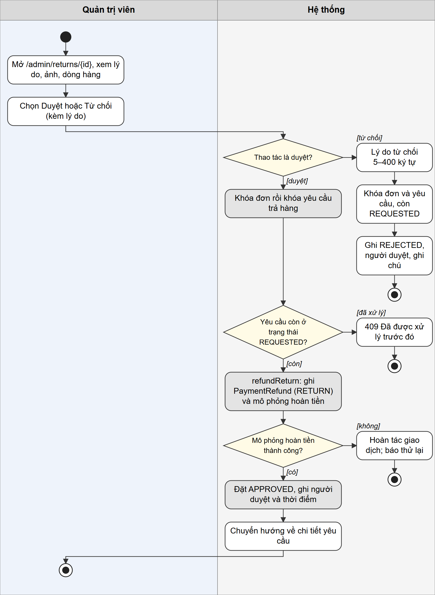

*Hình 2.28. Sơ đồ hoạt động chức năng Duyệt hoặc từ chối yêu cầu trả hàng.* Mã nguồn sơ đồ: `diagrams/admin/QT-11.json`.

**C. Code xử lý chức năng**

**Đoạn mã 2.62. AdminOrderReturnService.approve, reject**

`src/main/java/com/oneshop/service/returns/AdminOrderReturnService.java` (dòng 87-117)

```java
public OrderReturnResponse approve(Long returnId, String adminEmail) {
    User admin = requireAdmin(adminEmail);
    Order order = lockOrder(returnId);
    OrderReturn request = lockedRequest(returnId);
    requireRequested(request);
    refundService.refundReturn(order, request, request.getRefundAmount(), admin,
            "Hoàn tiền hàng trả lại - yêu cầu trả hàng #" + request.getId());
    request.setStatus(OrderReturnStatus.APPROVED);
    request.setReviewedBy(admin);
    request.setReviewedAt(LocalDateTime.now(clock).withNano(0));
    returns.saveAndFlush(request);
    return view(request);
}

@Transactional
public OrderReturnResponse reject(Long returnId, String note, String adminEmail) {
    User admin = requireAdmin(adminEmail);
    String clean = note == null ? "" : note.trim();
    if (clean.length() < MIN_NOTE || clean.length() > MAX_NOTE) {
        throw new BadRequestException("note", "Vui lòng nhập lý do từ chối từ " + MIN_NOTE + " đến " + MAX_NOTE + " ký tự.");
    }
    lockOrder(returnId);
    OrderReturn request = lockedRequest(returnId);
    requireRequested(request);
    request.setStatus(OrderReturnStatus.REJECTED);
    request.setReviewedBy(admin);
    request.setReviewedAt(LocalDateTime.now(clock).withNano(0));
    request.setReviewNote(clean);
    returns.saveAndFlush(request);
    return view(request);
}
```

**Đoạn mã 2.63. PartialRefundService.refundReturn**

`src/main/java/com/oneshop/service/payment/PartialRefundService.java` (dòng 139-168)

```java
public void refundReturn(Order lockedOrder, OrderReturn orderReturn, BigDecimal amount, User admin, String reason) {
    List<Payment> collected = payments.findForLockedOrder(lockedOrder.getId()).stream()
            .filter(p -> p.getStatus() == PaymentStatus.SUCCESS).toList();
    if (collected.size() != 1) {
        throw new FulfillmentConflictException(FulfillmentConflictException.INCONSISTENT_FULFILLMENT,
                "Đơn hàng không có đúng một khoản thanh toán đã thu để hoàn tiền.");
    }
    Payment payment = collected.get(0);
    BigDecimal remaining = payment.getAmount().subtract(refunds.sumCommitted(payment.getId()));
    if (amount == null || amount.signum() <= 0 || amount.compareTo(remaining) > 0) {
        throw new FulfillmentConflictException(FulfillmentConflictException.INCONSISTENT_FULFILLMENT,
                "Số tiền hoàn vượt quá số tiền còn có thể hoàn của khoản thanh toán; không thực hiện hoàn tiền.");
    }
    PaymentRefund row = new PaymentRefund();
    row.setPayment(payment);
    row.setOrder(lockedOrder);
    row.setOrderReturn(orderReturn);
    row.setComponent(PaymentRefundComponent.RETURN);
    row.setAmount(amount);
    row.setStatus(PaymentRefundStatus.PENDING_SIMULATION);
    row.setReason(OrderStatusWriter.abbreviate(reason));
    row.setRequestedBy(admin);
    row.setRequestedAt(LocalDateTime.now().withNano(0));
    refunds.saveAndFlush(row);
    if (!simulate(row)) {
        throw new FulfillmentConflictException(FulfillmentConflictException.INCONSISTENT_FULFILLMENT,
                "Hoàn tiền chưa thành công; yêu cầu trả hàng chưa được duyệt, vui lòng thử lại.");
    }
    closeWhenFullyRefunded(lockedOrder, payment, reason);
}
```

**D. Giải thích code**

approve và reject cùng gọi lockOrder rồi lockedRequest (khóa đơn trước, đúng thứ tự khóa toàn hệ thống) và requireRequested; yêu cầu đã xử lý trả FulfillmentConflictException. approve gọi PartialRefundService.refundReturn: kiểm tra có đúng một khoản thanh toán đã thu, số tiền không vượt phần còn hoàn được, ghi PaymentRefund và mô phỏng; nếu simulate trả false, ngoại lệ làm cả giao dịch phê duyệt hoàn tác. reject kiểm tra độ dài lý do và ghi trạng thái REJECTED cùng ghi chú. Đơn và phần giao không bị sửa. Luồng này được thể hiện trong Hình 2.28 và mã nguồn trong Đoạn mã 2.62, Đoạn mã 2.63.


### 2.2.12. Quản lý khuyến mãi (QT-12)

**A. Mô tả chức năng**

Quản trị viên tạo, sửa và xóa mã khuyến mãi (giảm theo phần trăm có mức trần hoặc theo số tiền), đặt tiền hàng tối thiểu, số lượt dùng tổng và mỗi khách, thời gian áp dụng và trạng thái. Mã gồm 3–30 ký tự A–Z, 0–9, '_' hoặc '-', duy nhất và không đổi sau khi tạo. Số lượt tối đa không được nhỏ hơn số lượt đã dùng; mã đã có người dùng không xóa được mà chỉ chuyển sang INACTIVE. Thay đổi chỉ ảnh hưởng đơn đặt sau đó.

*Tác nhân: Quản trị viên. Trạng thái triển khai: Hoạt động.*

**B. Sơ đồ hoạt động**

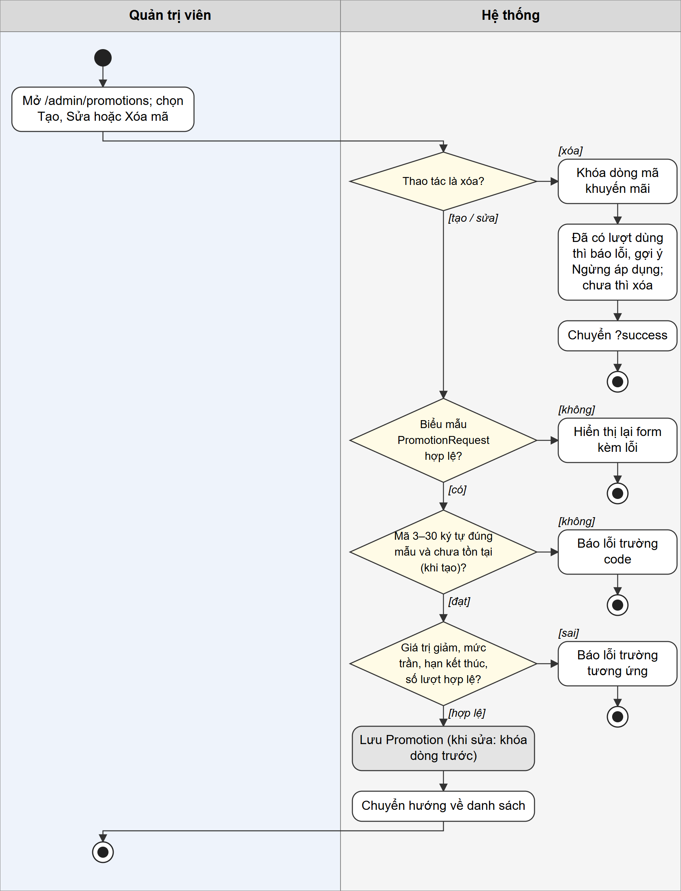

*Hình 2.29. Sơ đồ hoạt động chức năng Quản lý khuyến mãi.* Mã nguồn sơ đồ: `diagrams/admin/QT-12.json`.

**C. Code xử lý chức năng**

**Đoạn mã 2.64. Tạo, sửa, xóa mã**

`src/main/java/com/oneshop/service/promotion/AdminPromotionService.java` (dòng 77-107)

```java
public PromotionResponse create(PromotionRequest request) {
    String code = PromotionService.normalize(request.getCode());
    if (code == null || !CODE.matcher(code).matches()) {
        throw new BadRequestException("code", "Mã gồm 3 đến 30 ký tự: chữ không dấu, số, dấu _ và dấu -.");
    }
    if (promotions.existsByCodeIgnoreCase(code)) {
        throw new BadRequestException("code", "Mã khuyến mãi này đã tồn tại.");
    }
    Promotion promotion = new Promotion();
    promotion.setCode(code);
    apply(promotion, request, 0);
    return response(promotions.saveAndFlush(promotion));
}

@Transactional
public PromotionResponse update(Long id, PromotionRequest request) {
    Promotion promotion = promotions.findByIdForUpdate(id).orElseThrow(AdminPromotionService::notFound);
    apply(promotion, request, promotion.getUsedCount());
    return response(promotions.saveAndFlush(promotion));
}

@Transactional
public void delete(Long id) {
    Promotion promotion = promotions.findByIdForUpdate(id).orElseThrow(AdminPromotionService::notFound);
    if (usages.existsByPromotionId(id) || promotion.getUsedCount() > 0) {
        throw new BadRequestException("Mã đã được khách hàng sử dụng nên không thể xóa (lịch sử đơn hàng được giữ lại). "
                + "Hãy chuyển mã sang \"Ngừng áp dụng\".");
    }
    promotions.delete(promotion);
    promotions.flush();
}
```

**Đoạn mã 2.65. Kiểm tra giá trị và điều kiện**

`src/main/java/com/oneshop/service/promotion/AdminPromotionService.java` (dòng 111-139)

```java
private void apply(Promotion promotion, PromotionRequest request, int usedCount) {
    PromotionType type = request.getDiscountType();
    BigDecimal value = request.getDiscountValue();
    if (type == PromotionType.PERCENT) {
        if (value.compareTo(BigDecimal.ONE) < 0 || value.compareTo(BigDecimal.valueOf(100)) > 0
                || value.stripTrailingZeros().scale() > 0) {
            throw new BadRequestException("discountValue", "Giảm theo phần trăm phải là số nguyên từ 1 đến 100.");
        }
    } else if (value.stripTrailingZeros().scale() > 0) {
        throw new BadRequestException("discountValue", "Số tiền giảm phải là số đồng nguyên (không có phần lẻ).");
    }
    BigDecimal cap = request.getMaxDiscountAmount();
    if (cap != null && type != PromotionType.PERCENT) {
        throw new BadRequestException("maxDiscountAmount", "Mức giảm tối đa chỉ dùng cho giảm theo phần trăm.");
    }
    if (cap != null && cap.stripTrailingZeros().scale() > 0) {
        throw new BadRequestException("maxDiscountAmount", "Mức giảm tối đa phải là số đồng nguyên.");
    }
    BigDecimal min = request.getMinOrderAmount();
    if (min.stripTrailingZeros().scale() > 0) {
        throw new BadRequestException("minOrderAmount", "Tiền hàng tối thiểu phải là số đồng nguyên.");
    }
    if (request.getStartAt() != null && request.getEndAt() != null
            && !request.getEndAt().isAfter(request.getStartAt())) {
        throw new BadRequestException("endAt", "Thời gian kết thúc phải sau thời gian bắt đầu.");
    }
    if (request.getUsageLimit() < usedCount) {
        throw new BadRequestException("usageLimit", "Số lượt sử dụng không được nhỏ hơn số lượt đã dùng (" + usedCount + ").");
    }
```

**D. Giải thích code**

create chuẩn hóa mã, kiểm tra mẫu CODE và existsByCodeIgnoreCase rồi gọi apply. update khóa dòng bằng findByIdForUpdate (không xen kẽ với một lần thanh toán đang dùng mã) và truyền usedCount cho apply. delete từ chối khi đã có PromotionUsage hoặc usedCount lớn hơn 0. apply bảo đảm giảm phần trăm là số nguyên 1–100, số tiền là số đồng nguyên, mức trần chỉ dùng cho phần trăm, hạn kết thúc sau bắt đầu và usageLimit không nhỏ hơn số lượt đã dùng; mỗi lỗi ném BadRequestException gắn với trường tương ứng. Luồng này được thể hiện trong Hình 2.29 và mã nguồn trong Đoạn mã 2.64, Đoạn mã 2.65.


### 2.2.13. Kiểm duyệt đánh giá (QT-13)

**A. Mô tả chức năng**

Quản trị viên xem mọi đánh giá của khách, lọc theo từ khóa, trạng thái hiển thị và tình trạng đã được phản hồi, kèm các số liệu tổng, chưa phản hồi và đang ẩn. Vai trò của quản trị viên chỉ là kiểm duyệt: đặt đánh giá ở trạng thái hiển thị (ACTIVE) hoặc ẩn (HIDDEN). Việc trả lời đánh giá thuộc nhân viên của chi nhánh nguồn; URL phản hồi của quản trị viên được giữ lại nhưng luôn bị từ chối.

*Tác nhân: Quản trị viên. Trạng thái triển khai: Hoạt động (phản hồi bị chặn có chủ đích: thuộc về nhân viên).*

**B. Sơ đồ hoạt động**

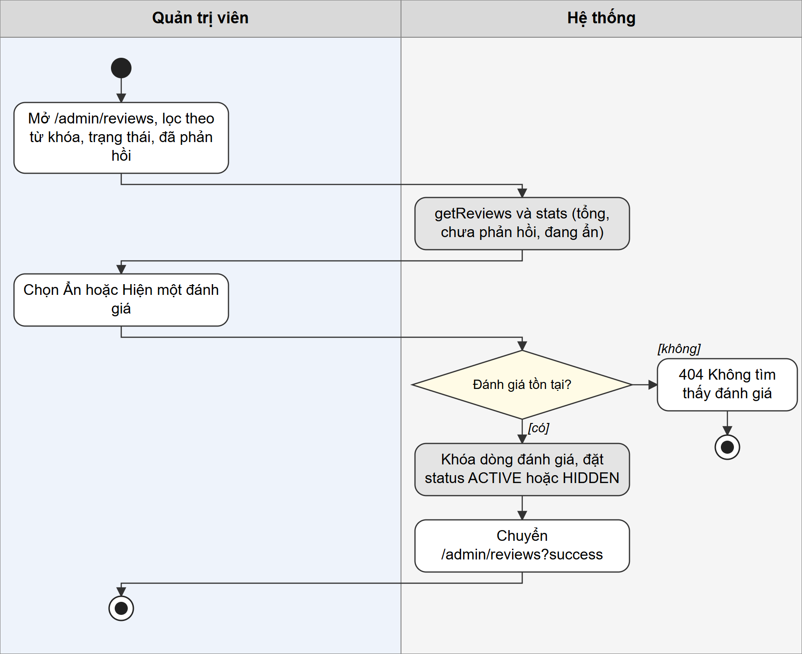

*Hình 2.30. Sơ đồ hoạt động chức năng Kiểm duyệt đánh giá.* Mã nguồn sơ đồ: `diagrams/admin/QT-13.json`.

**C. Code xử lý chức năng**

**Đoạn mã 2.66. AdminReviewController**

`src/main/java/com/oneshop/controller/admin/AdminReviewController.java` (dòng 44-53)

```java
@PostMapping("/{id}/status")
public String status(@PathVariable Long id, @RequestParam VisibilityStatus status) {
    reviews.setStatus(id, status); return "redirect:/admin/reviews?success";
}
/** OPEN-06 decided: retained URL fails closed for old forms/bookmarks. Admin moderates only. */
@PostMapping("/{id}/reply")
public String reply(@PathVariable Long id, @RequestParam(required = false) String reply,
                    @RequestParam(defaultValue = "0") int page) {
    throw new AccessDeniedException("Admin chỉ kiểm duyệt đánh giá; phản hồi thuộc nhân viên chi nhánh nguồn.");
}
```

**Đoạn mã 2.67. AdminReviewService.setStatus, stats**

`src/main/java/com/oneshop/service/AdminReviewService.java` (dòng 88-100)

```java
/** Live dashboard counts for the moderation screen header. */
public record AdminReviewStats(long total, long unanswered, long hidden) { }
public AdminReviewStats stats() {
    return new AdminReviewStats(reviews.count(), reviews.countByReviewReplyIsNullAndReplyIsNull(),
            reviews.countByStatus(VisibilityStatus.HIDDEN));
}

@Transactional
public void setStatus(Long id, @NotNull VisibilityStatus status) {
    var review = reviews.findByIdForUpdate(id).orElseThrow(() -> new ResourceNotFoundException("Không tìm thấy đánh giá."));
    review.setStatus(status);
    reviews.flush();
}
```

**D. Giải thích code**

AdminReviewController.status chỉ nhận id và VisibilityStatus rồi gọi AdminReviewService.setStatus; dịch vụ khóa dòng Review bằng findByIdForUpdate (ném ResourceNotFoundException nếu không có) và đặt trạng thái. Endpoint /{id}/reply luôn ném AccessDeniedException để các biểu mẫu hoặc đường dẫn cũ không thể cho quản trị viên trả lời. Bộ lọc dùng Specification theo trạng thái, tình trạng phản hồi và từ khóa trên khách hoặc sản phẩm. Luồng này được thể hiện trong Hình 2.30 và mã nguồn trong Đoạn mã 2.66, Đoạn mã 2.67.


### 2.2.14. Xem dashboard và thống kê chuỗi (QT-14)

**A. Mô tả chức năng**

Trang /admin cho quản trị viên cái nhìn tổng quan chuỗi: tổng số đơn, số phần giao đang mở, số đơn cần xử lý, số đơn đang đối soát thanh toán và số dòng SKU–chi nhánh hết hàng, cùng bảng theo từng chi nhánh (kể cả chi nhánh ngừng hoạt động): số đơn, đơn cần xử lý, đơn hoàn tất, đơn hủy, số mặt hàng, sắp hết, hết hàng và số nhân viên. Tất cả số liệu được tính trực tiếp từ dữ liệu hiện có, có thể thu hẹp theo một chi nhánh.

*Tác nhân: Quản trị viên. Trạng thái triển khai: Hoạt động.*

**B. Sơ đồ hoạt động**

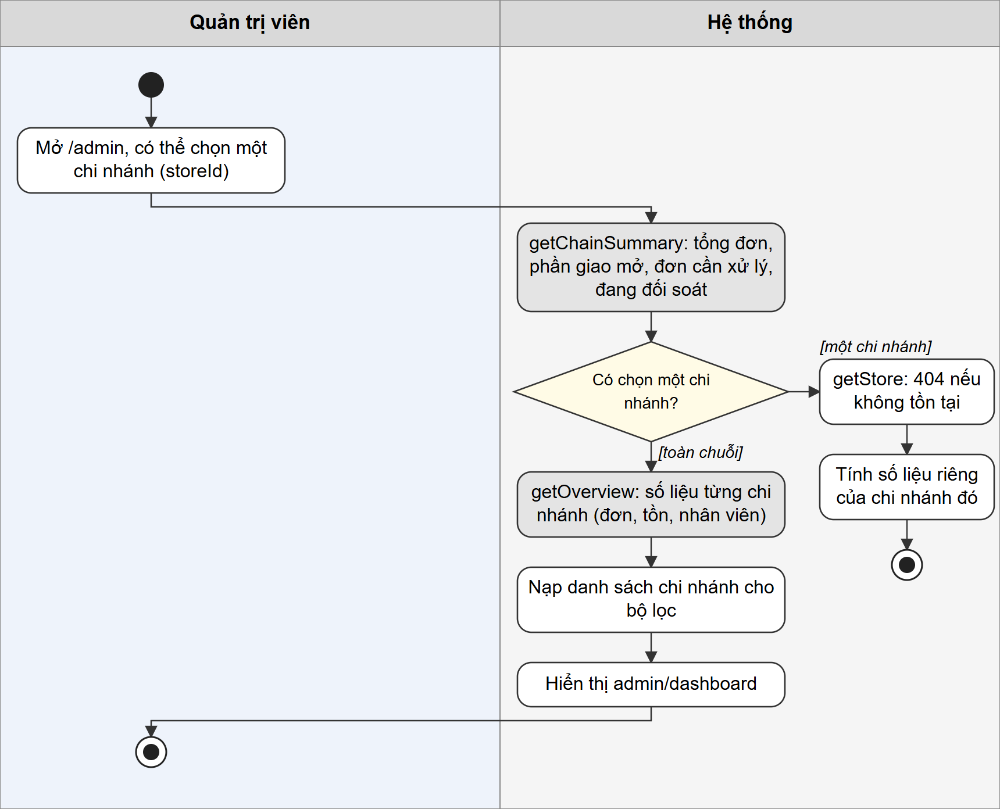

*Hình 2.31. Sơ đồ hoạt động chức năng Xem dashboard và thống kê chuỗi.* Mã nguồn sơ đồ: `diagrams/admin/QT-14.json`.

**C. Code xử lý chức năng**

**Đoạn mã 2.68. AdminDashboardController**

`src/main/java/com/oneshop/controller/admin/AdminDashboardController.java` (dòng 25-32)

```java
@GetMapping
public String dashboard(@RequestParam(required = false) Long storeId, Model model) {
    model.addAttribute("chain", operations.getChainSummary());
    model.addAttribute("overview", operations.getOverview(storeId));
    model.addAttribute("stores", stores.getAllStores());
    model.addAttribute("storeId", storeId);
    return "admin/dashboard";
}
```

**Đoạn mã 2.69. AdminOperationsService.getChainSummary, getOverview**

`src/main/java/com/oneshop/service/AdminOperationsService.java` (dòng 36-40)

```java
public AdminChainSummaryResponse getChainSummary() {
    var cutoff = deadlines.expiredBefore();
    return new AdminChainSummaryResponse(orders.count(), fulfillments.countByStatusIn(OPEN_FULFILLMENTS),
            orders.countAttention(cutoff), orders.countReconciling(cutoff));
}
```

**Đoạn mã 2.70. getOverview theo chi nhánh**

`src/main/java/com/oneshop/service/AdminOperationsService.java` (dòng 97-107)

```java
public List<AdminStoreOverviewResponse> getOverview(Long storeId) {
    var selected = storeId == null ? stores.getAllStores() : List.of(stores.getStore(storeId));
    var cutoff = deadlines.expiredBefore();
    return selected.stream().map(s -> new AdminStoreOverviewResponse(s,
            orders.countByStoreId(s.id()), orders.countAttentionByStoreId(s.id(), cutoff),
            orders.countByStoreIdAndOrderStatus(s.id(), OrderStatus.COMPLETED),
            orders.countByStoreIdAndOrderStatus(s.id(), OrderStatus.CANCELLED), stock.countByStoreId(s.id()),
            stock.countByStoreIdAndStatusAndQuantityBetween(s.id(), ActiveStatus.ACTIVE, 1, 5),
            stock.countByStoreIdAndStatusAndQuantity(s.id(), ActiveStatus.ACTIVE, 0),
            assignments.countEffectiveStaff(s.id()))).toList();
}
```

**D. Giải thích code**

AdminDashboardController.dashboard gọi getChainSummary, getOverview(storeId) và StoreService.getAllStores. getChainSummary đếm đơn, phần giao ở các trạng thái mở và các đơn cần chú ý theo hạn thanh toán của PaymentDeadlinePolicy. getOverview chọn toàn bộ chi nhánh hoặc một chi nhánh (getStore ném ResourceNotFoundException nếu sai id) rồi tính các bộ đếm đơn, tồn thấp (1–5), hết hàng và số nhân viên hiệu lực. Dashboard không có biểu đồ; số liệu hiển thị dạng thẻ và bảng. Luồng này được thể hiện trong Hình 2.31 và mã nguồn trong Đoạn mã 2.68, Đoạn mã 2.69, Đoạn mã 2.70.


## 2.3. Nhân viên


### 2.3.1. Đăng nhập khu vực nhân viên và xác định phạm vi chi nhánh (NV-01)

**A. Mô tả chức năng**

Nhân viên đăng nhập bằng chức năng chung (mục KH-02) và được chuyển đến /staff. Mọi URL /staff/** và /api/staff/** chỉ dành cho vai trò STAFF. Phạm vi chi nhánh không lấy từ tham số, header hay nội dung JWT: StaffStoreScopeInterceptor đọc từ CSDL, ở mỗi request, danh sách chi nhánh mà nhân viên có phân công ACTIVE. Nhân viên chưa được phân công chỉ vào được trang /staff (hiển thị thông báo); các URL khác trả 403. Khi ghi dữ liệu, Service còn kiểm tra lại chi nhánh thật của dòng dữ liệu đã khóa.

*Tác nhân: Nhân viên. Trạng thái triển khai: Hoạt động.*

**B. Sơ đồ hoạt động**

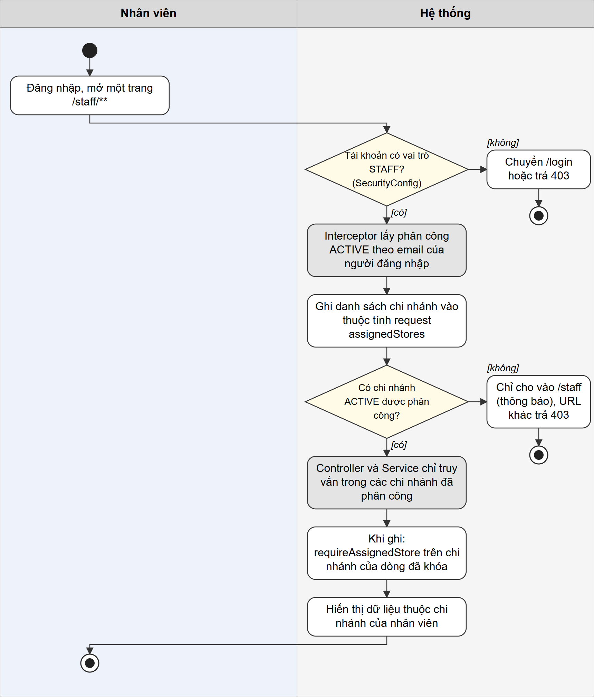

*Hình 2.32. Sơ đồ hoạt động chức năng Đăng nhập khu vực nhân viên và xác định phạm vi chi nhánh.* Mã nguồn sơ đồ: `diagrams/staff/NV-01.json`.

**C. Code xử lý chức năng**

**Đoạn mã 2.71. Phân quyền URL khu vực nhân viên**

`src/main/java/com/oneshop/config/SecurityConfig.java` (dòng 107-111)

```java
.requestMatchers("/admin/**", "/api/admin/**").hasRole("ADMIN")
// Staff: STAFF only, because every page is scoped to the Store(s) the account is assigned
// to (StaffStoreScopeInterceptor). Admin works chain-wide in /admin instead.
.requestMatchers("/staff/**", "/api/staff/**").hasRole("STAFF")
.requestMatchers("/account/**").authenticated()
```

**Đoạn mã 2.72. StaffStoreScopeInterceptor.preHandle**

`src/main/java/com/oneshop/security/StaffStoreScopeInterceptor.java` (dòng 41-54)

```java
public boolean preHandle(HttpServletRequest request, HttpServletResponse response, Object handler)
        throws IOException {
    Principal principal = request.getUserPrincipal();
    List<StoreResponse> stores = principal == null
            ? List.of()
            : storeService.getAssignedStores(principal.getName());
    request.setAttribute(ASSIGNED_STORES, stores);

    if (stores.isEmpty() && !isLandingPage(request)) {
        response.sendError(HttpServletResponse.SC_FORBIDDEN, "Tài khoản chưa được phân công chi nhánh");
        return false;
    }
    return true;
}
```

**Đoạn mã 2.73. StaffStoreScopeService: phạm vi và kiểm tra chi nhánh**

`src/main/java/com/oneshop/service/StaffStoreScopeService.java` (dòng 38-60)

```java
public List<StoreResponse> getAssignedStores() {
    var auth = SecurityContextHolder.getContext().getAuthentication();
    if (auth == null || !auth.isAuthenticated()
            || auth.getAuthorities().stream().noneMatch(a -> "ROLE_STAFF".equals(a.getAuthority()))) {
        throw new AccessDeniedException("Chỉ nhân viên đã đăng nhập được truy cập dữ liệu chi nhánh.");
    }
    var assigned = stores.getAssignedStores(auth.getName());
    if (assigned.isEmpty()) {
        throw new AccessDeniedException("Tài khoản chưa được phân công chi nhánh hoạt động.");
    }
    return List.copyOf(assigned);
}

/** These ids, never request store_id, are the allowed filter passed to Staff repositories. */
public List<Long> getAssignedStoreIds() {
    return getAssignedStores().stream().map(StoreResponse::id).toList();
}

/** A resource's Store (or a requested subset) must belong to the resolved scope; this never grants assignment. */
public StoreResponse requireAssignedStore(Long storeId) {
    return getAssignedStores().stream().filter(s -> s.id().equals(storeId)).findFirst()
            .orElseThrow(() -> new AccessDeniedException("Bạn không được phân công tại chi nhánh này."));
}
```

**Đoạn mã 2.74. Chi nhánh ACTIVE của nhân viên**

`src/main/java/com/oneshop/service/impl/StoreServiceImpl.java` (dòng 176-183)

```java
public List<StoreResponse> getAssignedStores(String staffEmail) {
    if (staffEmail == null) {
        return List.of();
    }
    return assignmentRepository.findActiveStoresByStaffEmail(staffEmail).stream()
            .map(storeMapper::toResponse)
            .toList();
}
```

**D. Giải thích code**

SecurityConfig yêu cầu hasRole('STAFF') cho /staff/**. WebConfig đăng ký StaffStoreScopeInterceptor cho các đường dẫn này; preHandle gọi StoreService.getAssignedStores (truy vấn findActiveStoresByStaffEmail theo tên người dùng đã xác thực) và trả 403 khi danh sách rỗng, trừ trang /staff. StaffStoreScopeService.getAssignedStoreIds là bộ lọc duy nhất được truyền xuống các Repository; requireAssignedStore được gọi lại sau khi khóa dòng dữ liệu để chặn cả yêu cầu giả mạo id. Vì phạm vi được đọc lại ở mỗi request, việc đổi hoặc thu hồi phân công (mục QT-02) có hiệu lực ngay. Luồng này được thể hiện trong Hình 2.32 và mã nguồn trong Đoạn mã 2.71, Đoạn mã 2.72, Đoạn mã 2.73, Đoạn mã 2.74.


### 2.3.2. Xem dashboard chi nhánh được phân công (NV-02)

**A. Mô tả chức năng**

Trang /staff hiển thị cho từng chi nhánh được phân công: số phần giao đang mở, số phần chờ khách nhận, số phần đang giao, số phần bị chặn bởi thanh toán, số phần thất bại, số mặt hàng sắp hết (1–5) và hết hàng, cùng 5 phần giao gần nhất. Đơn mà nhiều chi nhánh cùng cung cấp được tính một lần ở mỗi chi nhánh cho phần của chi nhánh đó.

*Tác nhân: Nhân viên. Trạng thái triển khai: Hoạt động.*

**B. Sơ đồ hoạt động**

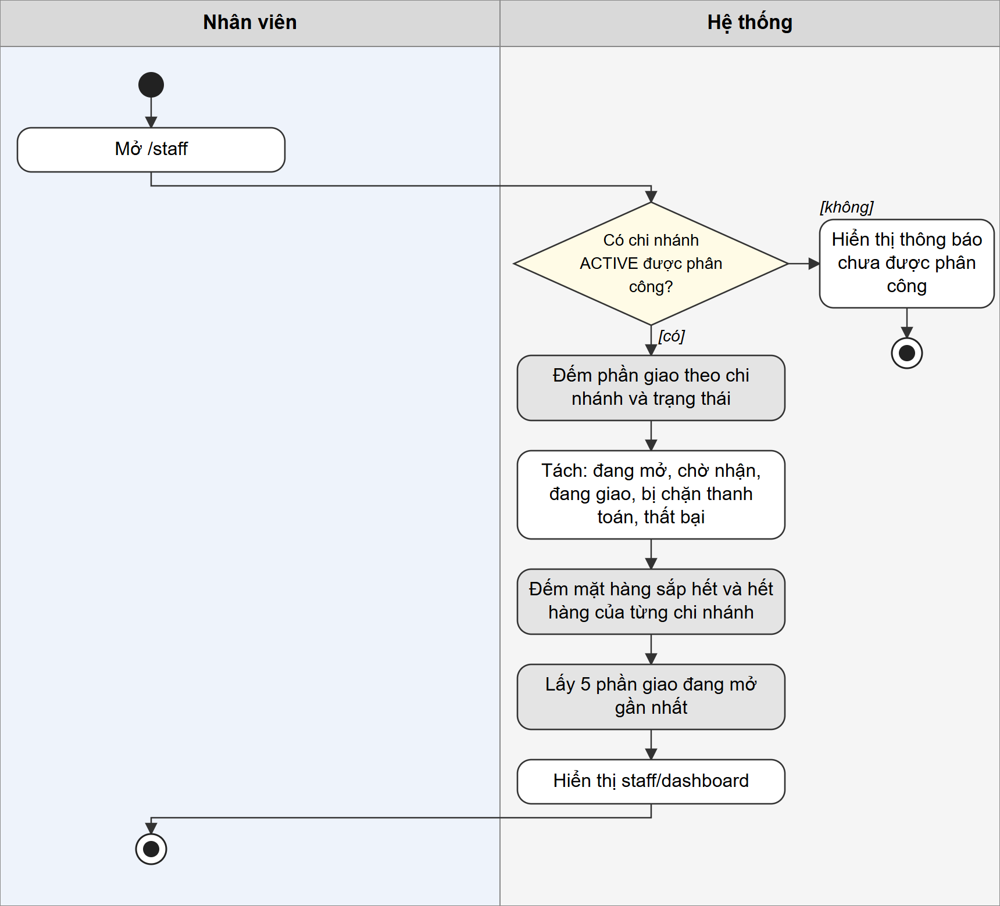

*Hình 2.33. Sơ đồ hoạt động chức năng Xem dashboard chi nhánh được phân công.* Mã nguồn sơ đồ: `diagrams/staff/NV-02.json`.

**C. Code xử lý chức năng**

**Đoạn mã 2.75. StaffDashboardController**

`src/main/java/com/oneshop/controller/staff/StaffDashboardController.java` (dòng 23-28)

```java
@GetMapping({"", "/"})
public String landing(@RequestAttribute(value = "assignedStores", required = false) List<StoreResponse> assigned,
                      Model model) {
    if (assigned != null && !assigned.isEmpty()) model.addAttribute("dashboard", operations.getDashboard());
    return "staff/dashboard";
}
```

**Đoạn mã 2.76. StaffOperationsService.getDashboard**

`src/main/java/com/oneshop/service/StaffOperationsService.java` (dòng 48-79)

```java
public StaffDashboardResponse getDashboard() {
    var assigned = scope.getAssignedStores();
    var ids = assigned.stream().map(StoreResponse::id).toList();
    var byStore = new java.util.HashMap<Long, java.util.List<OrderFulfillmentRepository.StatusCount>>();
    fulfillments.countByStoreAndStatus(ids).forEach(c -> byStore.computeIfAbsent(c.getStoreId(),
            k -> new java.util.ArrayList<>()).add(c));
    var counts = assigned.stream().map(s -> {
        var rows = byStore.getOrDefault(s.id(), java.util.List.of());
        long open = 0;
        long blocked = 0;
        long waiting = 0;
        long shipping = 0;
        long failed = 0;
        for (var row : rows) {
            if (row.getStatus() == OrderFulfillmentStatus.FAILED) {
                failed += row.getTotal();
            } else if (StaffFulfillmentService.openStatuses().contains(row.getStatus())) {
                open += row.getTotal() - row.getBlocked();
                blocked += row.getBlocked();
                if (row.getStatus() == OrderFulfillmentStatus.READY_FOR_PICKUP) {
                    waiting += row.getTotal() - row.getBlocked();
                } else if (row.getStatus() == OrderFulfillmentStatus.SHIPPING) {
                    shipping += row.getTotal() - row.getBlocked();
                }
            }
        }
        return new StaffStoreDashboardResponse(s, open, waiting,
                products.countByStoreIdAndStatusAndQuantityBetween(s.id(), ActiveStatus.ACTIVE, 1, LOW_STOCK_THRESHOLD),
                products.countByStoreIdAndStatusAndQuantity(s.id(), ActiveStatus.ACTIVE, 0), shipping, blocked, failed);
    }).toList();
    return new StaffDashboardResponse(counts, LOW_STOCK_THRESHOLD, fulfillmentService.getRecent(ids, 5));
}
```

**D. Giải thích code**

StaffDashboardController.landing chỉ gọi getDashboard khi thuộc tính assignedStores (do interceptor đặt) không rỗng. getDashboard lấy phạm vi từ StaffStoreScopeService, nhóm số phần giao theo chi nhánh và trạng thái bằng OrderFulfillmentRepository.countByStoreAndStatus rồi trừ phần bị chặn khỏi phần việc cần làm, đếm tồn thấp bằng LOW_STOCK_THRESHOLD và lấy các phần giao gần nhất qua StaffFulfillmentService.getRecent. Các con số được tính từ Fulfillment, không từ trạng thái tổng của Order. Luồng này được thể hiện trong Hình 2.33 và mã nguồn trong Đoạn mã 2.75, Đoạn mã 2.76.


### 2.3.3. Xem hàng đợi phần giao hàng của chi nhánh (NV-03)

**A. Mô tả chức năng**

Đơn vị công việc của nhân viên là một phần giao (OrderFulfillment), không phải cả đơn. Trang /staff/fulfillments (kèm /delivery và /pickup) liệt kê các phần giao thuộc chi nhánh được phân công, mặc định chỉ các phần đang mở, có thể lọc theo chi nhánh, trạng thái, loại, mã đơn, khoảng ngày và từ khóa khách hàng. Với mỗi phần giao, hệ thống tính các thao tác hợp lệ; nếu đơn đang bị chặn (chờ thanh toán, đã hủy, cần quản trị viên xử lý, thanh toán chưa xác nhận) thì thao tác bị ẩn và hiển thị lý do.

*Tác nhân: Nhân viên. Trạng thái triển khai: Hoạt động.*

**B. Sơ đồ hoạt động**

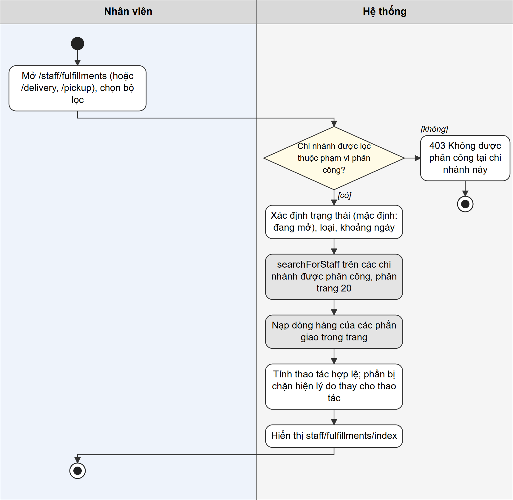

*Hình 2.34. Sơ đồ hoạt động chức năng Xem hàng đợi phần giao hàng của chi nhánh.* Mã nguồn sơ đồ: `diagrams/staff/NV-03.json`.

**C. Code xử lý chức năng**

**Đoạn mã 2.77. StaffFulfillmentController.queue**

`src/main/java/com/oneshop/controller/staff/StaffFulfillmentController.java` (dòng 41-55)

```java
@GetMapping({"/staff/fulfillments", "/staff/orders"})
public String queue(@RequestParam(required = false) Long storeId,
                    @RequestParam(required = false) OrderFulfillmentStatus status,
                    @RequestParam(required = false) FulfillmentType type,
                    @RequestParam(required = false) Long orderId,
                    @RequestParam(required = false) String q,
                    @RequestParam(required = false) String from,
                    @RequestParam(required = false) String to,
                    @RequestParam(defaultValue = "true") boolean open,
                    @RequestParam(defaultValue = "0") int page, HttpServletRequest request, Model model) {
    // one of two fixed paths, never a request value, so the pagination links cannot be steered
    String base = "/staff/orders".equals(request.getRequestURI()) ? "/staff/orders" : "/staff/fulfillments";
    return show(storeId, status, type, orderId, q, from, to, open && status == null, page,
            null, base, model);
}
```

**Đoạn mã 2.78. StaffFulfillmentService.getQueue**

`src/main/java/com/oneshop/service/fulfillment/StaffFulfillmentService.java` (dòng 116-150)

```java
public Page<FulfillmentQueueItemResponse> getQueue(FulfillmentQueueFilter filter, int page, String customer) {
    FulfillmentQueueFilter f = filter == null ? FulfillmentQueueFilter.none() : filter;
    List<Long> assigned = scope.getAssignedStoreIds();
    List<Long> storeIds = assigned;
    if (f.storeId() != null) {
        if (!assigned.contains(f.storeId())) {
            throw new AccessDeniedException("Bạn không được phân công tại chi nhánh này.");
        }
        storeIds = List.of(f.storeId());
    }
    Collection<OrderFulfillmentStatus> statuses = f.status() != null ? List.of(f.status())
            : f.openOnly() ? OPEN_STATUSES : List.of(OrderFulfillmentStatus.values());
    Collection<FulfillmentType> types = f.type() != null ? List.of(f.type())
            : List.of(FulfillmentType.values());
    var range = com.oneshop.service.query.SqlDayRange.of(f.from(), f.to());
    LocalDateTime from = f.from() == null ? MIN_TIME : range.fromInclusive();
    LocalDateTime to = f.to() == null ? MAX_TIME : range.toExclusive();
    var words = com.oneshop.service.search.TextSearch.words(customer);
    if (!words.isEmpty()) {
        var matched = fulfillments.searchForStaff(storeIds, statuses, types,
                        f.orderId() == null ? 0L : f.orderId(), from, to, "",
                        org.springframework.data.domain.Pageable.unpaged())
                .getContent().stream()
                .filter(row -> com.oneshop.service.search.TextSearch.matchesAll(words, row.getOrder().getUser().getFullName(),
                        row.getOrder().getUser().getEmail(), row.getOrder().getReceiverName(),
                        row.getOrder().getReceiverPhone()))
                .toList();
        return toQueueItems(com.oneshop.service.search.TextSearch.slice(matched, com.oneshop.service.query.Paging.page(page, PAGE_SIZE)));
    }
    String pattern = likePattern(customer);
    Page<OrderFulfillment> rows = fulfillments.searchForStaff(storeIds, statuses, types,
            f.orderId() == null ? 0L : f.orderId(), from, to,
            pattern, com.oneshop.service.query.Paging.page(page, PAGE_SIZE));
    return toQueueItems(rows);
}
```

**Đoạn mã 2.79. Thao tác hợp lệ của từng phần giao**

`src/main/java/com/oneshop/service/fulfillment/StaffFulfillmentService.java` (dòng 428-440)

```java
private FulfillmentQueueItemResponse toItem(OrderFulfillment f, List<OrderItem> lines) {
    Order order = f.getOrder();
    boolean open = OPEN_STATUSES.contains(f.getStatus());
    String blockedCode = open ? blockedCode(order) : null;
    List<FulfillmentAction> actions = !open || blockedCode != null ? List.<FulfillmentAction>of()
            : Arrays.stream(FulfillmentAction.values())
                    .filter(a -> a.appliesTo(f.getFulfillmentType()) && a.getFrom() == f.getStatus()).toList();
    return new FulfillmentQueueItemResponse(f.getId(), order.getId(), f.getStore().getId(),
            f.getStore().getName(), f.getFulfillmentType(), f.getStatus(), order.getOrderStatus(),
            order.getPaymentMethod(), order.getPaymentStatus(), order.getUser().getFullName(),
            order.getReceiverName(), lines.size(), lines.stream().mapToInt(OrderItem::getQuantity).sum(),
            f.getAssignedAt(), actions, blockedCode == null ? null : blockedMessage(blockedCode));
}
```

**D. Giải thích code**

getQueue lấy danh sách chi nhánh đã phân công, từ chối storeId ngoài phạm vi bằng AccessDeniedException và chỉ truyền các id hợp lệ vào OrderFulfillmentRepository.searchForStaff cùng bộ lọc trạng thái, loại, khoảng ngày và từ khóa. toItem lọc FulfillmentAction theo loại phần giao và trạng thái hiện tại; blockedCode quyết định việc thao tác bị ẩn khi đơn đang chờ thanh toán, đã hủy hoặc cần xử lý. Đường dẫn cũ /staff/orders của V2 chỉ hiển thị cùng hàng đợi hoặc chuyển hướng đọc. Luồng này được thể hiện trong Hình 2.34 và mã nguồn trong Đoạn mã 2.77, Đoạn mã 2.78, Đoạn mã 2.79.


### 2.3.4. Xử lý phần giao tận nơi (chuẩn bị, đóng gói, giao, hoàn tất, thất bại) (NV-04)

**A. Mô tả chức năng**

Nhân viên thay đổi trạng thái của một phần giao tận nơi theo trình tự CONFIRMED → PREPARING → PACKED → SHIPPING → COMPLETED hoặc FAILED. Mỗi thao tác chỉ áp dụng cho phần giao của chi nhánh mình, chỉ khi đơn không bị chặn bởi thanh toán, và chỉ từ đúng trạng thái trước đó. 'Bàn giao vận chuyển' có thể kèm mã vận đơn; 'Xác nhận giao thành công' của đơn COD ghi nhận thu tiền; 'Giao hàng không thành công' bắt buộc có lý do 5–500 ký tự. Nhân viên không sửa trạng thái Order: OrderStatusAggregator tự tính lại trạng thái đơn trong cùng giao dịch, và không thao tác nào chạm vào tồn kho.

*Tác nhân: Nhân viên. Trạng thái triển khai: Hoạt động.*

**B. Sơ đồ hoạt động**

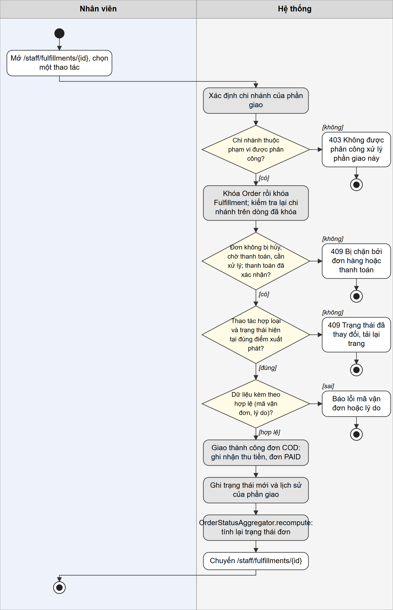

*Hình 2.35. Sơ đồ hoạt động chức năng Xử lý phần giao tận nơi (chuẩn bị, đóng gói, giao, hoàn tất, thất bại).* Mã nguồn sơ đồ: `diagrams/staff/NV-04.json`.

**C. Code xử lý chức năng**

**Đoạn mã 2.80. Các thao tác hợp lệ của nhân viên**

`src/main/java/com/oneshop/service/fulfillment/FulfillmentAction.java` (dòng 14-26)

```java
PREPARE("prepare", null, OrderFulfillmentStatus.CONFIRMED, OrderFulfillmentStatus.PREPARING, "Bắt đầu chuẩn bị"),
PACK("pack", FulfillmentType.DELIVERY, OrderFulfillmentStatus.PREPARING, OrderFulfillmentStatus.PACKED, "Đã đóng gói"),
SHIP("ship", FulfillmentType.DELIVERY, OrderFulfillmentStatus.PACKED, OrderFulfillmentStatus.SHIPPING, "Bàn giao vận chuyển"),
MARK_READY("ready-for-pickup", FulfillmentType.STORE_PICKUP, OrderFulfillmentStatus.PREPARING, OrderFulfillmentStatus.READY_FOR_PICKUP,
        "Sẵn sàng cho khách nhận"),
COMPLETE_DELIVERY("complete-delivery", FulfillmentType.DELIVERY, OrderFulfillmentStatus.SHIPPING, OrderFulfillmentStatus.COMPLETED,
        "Xác nhận giao thành công"),
COMPLETE_PICKUP("complete-pickup", FulfillmentType.STORE_PICKUP, OrderFulfillmentStatus.READY_FOR_PICKUP,
        OrderFulfillmentStatus.COMPLETED, "Xác nhận khách đã nhận hàng"),
FAIL_DELIVERY("fail-delivery", FulfillmentType.DELIVERY, OrderFulfillmentStatus.SHIPPING, OrderFulfillmentStatus.FAILED,
        "Giao hàng không thành công"),
FAIL_PICKUP("fail-pickup", FulfillmentType.STORE_PICKUP, OrderFulfillmentStatus.READY_FOR_PICKUP, OrderFulfillmentStatus.FAILED,
        "Khách không nhận hàng");
```

**Đoạn mã 2.81. StaffFulfillmentService.perform (1)**

`src/main/java/com/oneshop/service/fulfillment/StaffFulfillmentService.java` (dòng 216-239)

```java
List<Long> assigned = scope.getAssignedStoreIds(); // fails closed for an unassigned or invalid account
OrderFulfillmentRepository.FulfillmentKey key = requireInScope(fulfillmentId, assigned);

// Lock order is Order, then Fulfillment: the same order every other writer (cancel, payment) uses.
Order order = orders.findByIdForUpdate(key.getOrderId())
        .orElseThrow(() -> new ResourceNotFoundException("Không tìm thấy đơn hàng."));
OrderFulfillment f = fulfillments.findByIdForUpdate(fulfillmentId)
        .orElseThrow(() -> new ResourceNotFoundException("Không tìm thấy phần giao hàng."));
if (!f.getOrder().getId().equals(order.getId())) {
    throw new FulfillmentConflictException(FulfillmentConflictException.INCONSISTENT_FULFILLMENT,
            "Dữ liệu phần giao không nhất quán. Vui lòng tải lại trang.");
}
scope.requireAssignedStore(f.getStore().getId()); // the locked row's actual Store, before any write
User actor = currentStaff();

requireWorkable(order);
if (!action.appliesTo(f.getFulfillmentType()) || f.getStatus() != action.getFrom()) {
    throw new FulfillmentConflictException(FulfillmentConflictException.STATUS_CHANGED,
            "Trạng thái phần giao đã thay đổi hoặc không phù hợp với thao tác. Vui lòng tải lại trang.");
}
requireMethodMatchesType(order, f);

String historyNote = action.getLabel();
LocalDateTime now = gate.now().withNano(0);
```

**Đoạn mã 2.82. StaffFulfillmentService.perform (2)**

`src/main/java/com/oneshop/service/fulfillment/StaffFulfillmentService.java` (dòng 240-264)

```java
switch (action) {
    case PREPARE -> f.setPreparedAt(now);
    case PACK -> f.setPackedAt(now);
    case SHIP -> {
        String tracking = trackingCode(input);
        f.setShippedAt(now);
        if (tracking != null) {
            f.setTrackingCode(tracking);
            historyNote = historyNote + " · Mã vận đơn " + tracking;
        }
    }
    case MARK_READY -> {
        if (f.getPickupCode() != null || f.getReadyAt() != null) {
            throw new FulfillmentConflictException(FulfillmentConflictException.INCONSISTENT_FULFILLMENT,
                    "Thông tin nhận hàng đã tồn tại không nhất quán. Vui lòng tải lại trang.");
        }
        f.setPickupCode(newPickupCode(f.getStore().getId()));
        f.setReadyAt(now);
    }
    case COMPLETE_DELIVERY -> {
        if (order.getPaymentMethod() == PaymentMethod.COD) {
            payments.recordOfflineCollected(order, f); // before the status changes: it checks SHIPPING
        }
        f.setCompletedAt(now);
    }
```

**Đoạn mã 2.83. StaffFulfillmentService.perform (3)**

`src/main/java/com/oneshop/service/fulfillment/StaffFulfillmentService.java` (dòng 284-301)

```java
        case FAIL_DELIVERY, FAIL_PICKUP -> {
            String reason = reason(input);
            f.setNote(reason);
            historyNote = historyNote + " · " + reason;
        }
    }

    OrderFulfillmentStatusHistory entry = new OrderFulfillmentStatusHistory();
    entry.setFulfillment(f);
    entry.setOldStatus(f.getStatus());
    entry.setNewStatus(action.getTo());
    entry.setChangedBy(actor);
    entry.setNote(historyNote.length() > 500 ? historyNote.substring(0, 500) : historyNote);
    f.setStatus(action.getTo());
    fulfillments.saveAndFlush(f);
    histories.save(entry);
    aggregator.recompute(order, actor, "Tổng hợp từ phần giao #" + f.getId() + ": " + action.getLabel());
}
```

**Đoạn mã 2.84. OrderStatusAggregator.derive**

`src/main/java/com/oneshop/service/fulfillment/OrderStatusAggregator.java` (dòng 50-75)

```java
public static OrderStatus derive(Collection<OrderFulfillmentStatus> statuses, boolean paid) {
    if (statuses == null || statuses.isEmpty()) {
        return null;
    }
    if (statuses.contains(OrderFulfillmentStatus.FAILED)) {
        return OrderStatus.NEEDS_ATTENTION;
    }
    List<OrderFulfillmentStatus> live = statuses.stream()
            .filter(s -> s != OrderFulfillmentStatus.CANCELLED).toList();
    if (live.isEmpty()) {
        return OrderStatus.CANCELLED;
    }
    if (live.stream().allMatch(s -> s == OrderFulfillmentStatus.COMPLETED)) {
        return paid ? OrderStatus.COMPLETED : OrderStatus.NEEDS_ATTENTION;
    }
    if (live.contains(OrderFulfillmentStatus.COMPLETED)) {
        return OrderStatus.PARTIALLY_COMPLETED;
    }
    if (live.contains(OrderFulfillmentStatus.SHIPPING)) {
        return OrderStatus.SHIPPING;
    }
    if (live.stream().allMatch(s -> s == OrderFulfillmentStatus.CONFIRMED)) {
        return OrderStatus.CONFIRMED;
    }
    return OrderStatus.PROCESSING;
}
```

**D. Giải thích code**

FulfillmentAction là bảng chuyển trạng thái duy nhất: mỗi hằng số nêu loại phần giao, trạng thái nguồn và đích. perform xác định phạm vi trước khi khóa (requireInScope), khóa Order rồi Fulfillment (cùng thứ tự với luồng hủy và thanh toán), kiểm tra lại chi nhánh trên dòng đã khóa, kiểm tra cổng thanh toán requireWorkable, khớp hành động với trạng thái, rồi áp tác dụng phụ trong switch (ví dụ recordOfflineCollected cho COMPLETE_DELIVERY của COD). Lịch sử OrderFulfillmentStatusHistory được ghi và aggregator.recompute suy ra trạng thái Order từ các phần giao: FAILED cho NEEDS_ATTENTION, tất cả hoàn tất cho COMPLETED, một phần hoàn tất cho PARTIALLY_COMPLETED, có phần đang giao cho SHIPPING. Mọi lỗi ném ngoại lệ trước khi ghi nên giao dịch được hoàn tác. Luồng này được thể hiện trong Hình 2.35 và mã nguồn trong Đoạn mã 2.80, Đoạn mã 2.81, Đoạn mã 2.82, Đoạn mã 2.83, Đoạn mã 2.84.


### 2.3.5. Xử lý nhận hàng tại cửa hàng và xác minh mã nhận hàng (NV-05)

**A. Mô tả chức năng**

Với phần giao STORE_PICKUP, sau khi chuẩn bị xong nhân viên chọn 'Sẵn sàng cho khách nhận': hệ thống sinh mã nhận hàng duy nhất trong chi nhánh và ghi thời điểm sẵn sàng; khách xem mã trong chi tiết đơn của mình. Khi khách đến, nhân viên nhập mã để 'Xác nhận khách đã nhận hàng'. Mã sai không ghi gì và được đếm: sai 5 lần thì mã bị khóa 15 phút. Với đơn thanh toán tại cửa hàng, thao tác này ghi nhận thu tiền. Nếu khách không đến, nhân viên báo 'Khách không nhận hàng' kèm lý do và phần giao FAILED chờ quản trị viên xử lý.

*Tác nhân: Nhân viên. Trạng thái triển khai: Hoạt động.*

**B. Sơ đồ hoạt động**

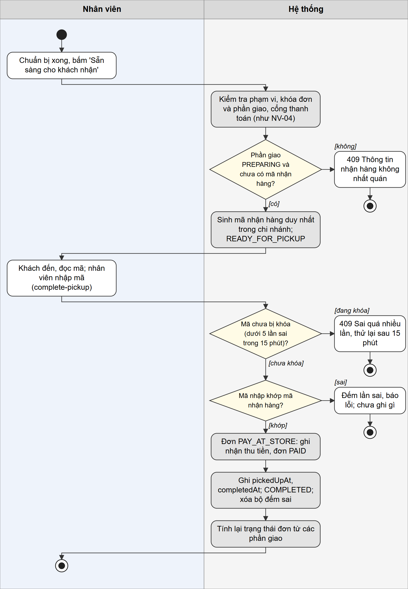

*Hình 2.36. Sơ đồ hoạt động chức năng Xử lý nhận hàng tại cửa hàng và xác minh mã nhận hàng.* Mã nguồn sơ đồ: `diagrams/staff/NV-05.json`.

**C. Code xử lý chức năng**

**Đoạn mã 2.85. Sẵn sàng nhận và xác minh mã**

`src/main/java/com/oneshop/service/fulfillment/StaffFulfillmentService.java` (dòng 251-283)

```java
case MARK_READY -> {
    if (f.getPickupCode() != null || f.getReadyAt() != null) {
        throw new FulfillmentConflictException(FulfillmentConflictException.INCONSISTENT_FULFILLMENT,
                "Thông tin nhận hàng đã tồn tại không nhất quán. Vui lòng tải lại trang.");
    }
    f.setPickupCode(newPickupCode(f.getStore().getId()));
    f.setReadyAt(now);
}
case COMPLETE_DELIVERY -> {
    if (order.getPaymentMethod() == PaymentMethod.COD) {
        payments.recordOfflineCollected(order, f); // before the status changes: it checks SHIPPING
    }
    f.setCompletedAt(now);
}
case COMPLETE_PICKUP -> {
    limiter.requireNotLocked(f.getId());
    try {
        codes.verify(input, f.getPickupCode());
    } catch (BadRequestException wrongCode) {
        limiter.recordFailure(f.getId());
        throw wrongCode; // nothing has been written yet; payment is untouched
    }
    if (f.getReadyAt() == null || f.getPickedUpAt() != null) {
        throw new FulfillmentConflictException(FulfillmentConflictException.INCONSISTENT_FULFILLMENT,
                "Thông tin nhận hàng không nhất quán. Vui lòng tải lại trang.");
    }
    if (order.getPaymentMethod() == PaymentMethod.PAY_AT_STORE) {
        payments.recordOfflineCollected(order, f);
    }
    f.setPickedUpAt(now);
    f.setCompletedAt(now);
    limiter.reset(f.getId());
}
```

**Đoạn mã 2.86. PickupAttemptLimiter**

`src/main/java/com/oneshop/service/fulfillment/PickupAttemptLimiter.java` (dòng 39-63)

```java
public void requireNotLocked(Long fulfillmentId) {
    Attempts state = attempts.get(fulfillmentId);
    if (state == null) {
        return;
    }
    synchronized (state) {
        if (state.lockedUntil != null) {
            if (clock.instant().isBefore(state.lockedUntil)) {
                throw new FulfillmentConflictException(FulfillmentConflictException.PICKUP_CODE_LOCKED,
                        "Nhập sai mã nhận hàng quá nhiều lần. Vui lòng thử lại sau " + LOCK_MINUTES + " phút.");
            }
            state.lockedUntil = null;
            state.failures = 0;
        }
    }
}

public void recordFailure(Long fulfillmentId) {
    Attempts state = attempts.computeIfAbsent(fulfillmentId, id -> new Attempts());
    synchronized (state) {
        state.failures++;
        state.lastFailure = clock.instant();
        if (state.failures >= MAX_FAILURES) {
            state.lockedUntil = state.lastFailure.plus(Duration.ofMinutes(LOCK_MINUTES));
        }
```

**D. Giải thích code**

Trong perform, MARK_READY chỉ chạy khi phần giao chưa có pickupCode hoặc readyAt, sinh mã bằng newPickupCode (thử lại tối đa 8 lần để mã duy nhất trong chi nhánh). COMPLETE_PICKUP gọi limiter.requireNotLocked, so mã bằng PickupCodeService.verify và ghi recordFailure khi sai; vì lỗi làm giao dịch hoàn tác, bộ đếm được giữ trong bộ nhớ (PickupAttemptLimiter) để vẫn đếm được. Khi mã đúng, đơn PAY_AT_STORE gọi payments.recordOfflineCollected, rồi đặt pickedUpAt, completedAt và xóa bộ đếm. Mã nhận hàng bị ẩn khỏi ghi chú và lịch sử bằng redactPickupCode khi nhân viên xem chi tiết. Luồng này được thể hiện trong Hình 2.36 và mã nguồn trong Đoạn mã 2.85, Đoạn mã 2.86.


### 2.3.6. Xem tồn kho chi nhánh và điều chỉnh tồn (NV-06)

**A. Mô tả chức năng**

Trang /staff/stock liệt kê tồn kho của các chi nhánh được phân công, có tìm kiếm theo SKU hoặc tên, lọc mức tồn (hết, sắp hết, đủ), sắp xếp và các thẻ thống kê. Nhân viên điều chỉnh số lượng của một mặt hàng kèm ghi chú; số lượng mới không được âm hoặc thấp hơn số đang được giữ. Chi nhánh được xác định từ dòng StoreProduct đã khóa chứ không từ giá trị gửi lên; mỗi lần đổi ghi một InventoryMovement loại STOCK_ADJUST với người thực hiện. Điều chỉnh về đúng số hiện tại không ghi gì.

*Tác nhân: Nhân viên. Trạng thái triển khai: Hoạt động.*

**B. Sơ đồ hoạt động**

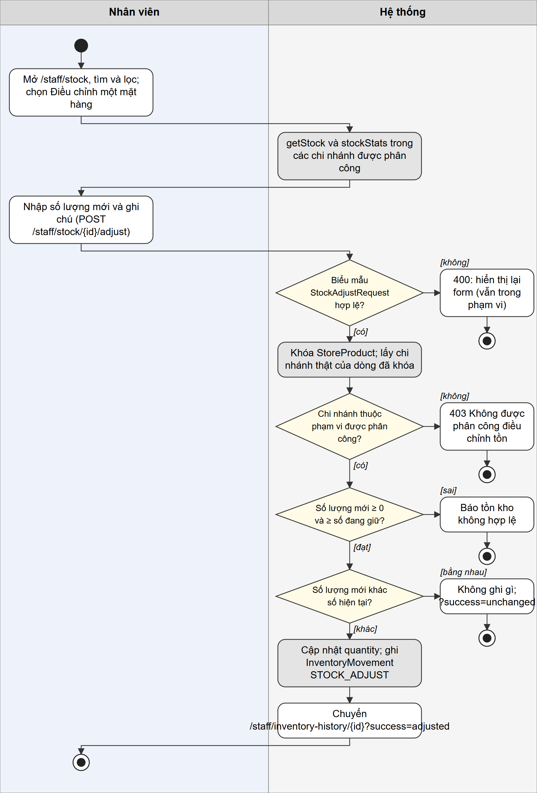

*Hình 2.37. Sơ đồ hoạt động chức năng Xem tồn kho chi nhánh và điều chỉnh tồn.* Mã nguồn sơ đồ: `diagrams/staff/NV-06.json`.

**C. Code xử lý chức năng**

**Đoạn mã 2.87. StaffInventoryService.adjust**

`src/main/java/com/oneshop/service/StaffInventoryService.java` (dòng 187-197)

```java
@Transactional
public boolean adjust(Long id, @NotNull @Valid StockAdjustRequest request) {
    scope.getAssignedStoreIds(); // Authenticate/resolve assignment before resource access.
    if (id == null) throw new ResourceNotFoundException("Không tìm thấy sản phẩm của chi nhánh.");
    var locked = products.findByIdForUpdate(id)
            .orElseThrow(() -> new ResourceNotFoundException("Không tìm thấy sản phẩm của chi nhánh."));
    scope.requireAssignedStore(locked.getStore().getId()); // Actual locked Store, never a posted store_id.
    boolean changed = locked.getQuantity() != request.newQuantity();
    inventory.adjustStock(id, request.newQuantity(), SecurityContextHolder.getContext().getAuthentication().getName(), request.note());
    return changed;
}
```

**Đoạn mã 2.88. InventoryServiceImpl.adjustStock**

`src/main/java/com/oneshop/service/impl/InventoryServiceImpl.java` (dòng 48-75)

```java
public void adjustStock(Long storeProductId, int newQuantity, String userEmail, String note) {
    if (newQuantity < 0) {
        throw new BadRequestException("quantity", "Tồn kho không được âm");
    }
    StoreProduct storeProduct = storeProductRepository.findByIdForUpdate(storeProductId)
            .orElseThrow(() -> new ResourceNotFoundException("Không tìm thấy sản phẩm tại chi nhánh #" + storeProductId));
    if (newQuantity < storeProduct.getReservedQuantity()) {
        throw new BadRequestException("quantity", "Tồn kho không được thấp hơn số lượng đang được giữ.");
    }
    int before = storeProduct.getQuantity();
    if (before == newQuantity) {
        return;
    }
    User user = userRepository.findByEmail(userEmail)
            .orElseThrow(() -> new IllegalStateException("Authenticated user not found: " + userEmail));

    storeProduct.setQuantity(newQuantity);

    InventoryMovement movement = new InventoryMovement();
    movement.setStoreProduct(storeProduct);
    movement.setType(InventoryMovementType.STOCK_ADJUST);
    movement.setQuantityBefore(before);
    movement.setQuantityChange(newQuantity - before);
    movement.setQuantityAfter(newQuantity);
    movement.setStaff(user);
    movement.setNote(StringUtils.hasText(note) ? note.trim() : DEFAULT_ADJUST_NOTE);
    movementRepository.save(movement);
}
```

**Đoạn mã 2.89. StaffStockController.adjust**

`src/main/java/com/oneshop/controller/staff/StaffStockController.java` (dòng 80-90)

```java
@PostMapping("/stock/{id}/adjust")
public String adjust(@PathVariable Long id, @Valid @ModelAttribute("form") StockAdjustRequest form,
                     BindingResult errors, Model model, HttpServletResponse response) {
    if (errors.hasErrors()) {
        model.addAttribute("stock", inventory.getStoreProduct(id)); // Still scoped even on invalid/forged input.
        response.setStatus(HttpStatus.BAD_REQUEST.value());
        return "staff/stock/adjust";
    }
    boolean changed = inventory.adjust(id, form);
    return "redirect:/staff/inventory-history/" + id + "?success=" + (changed ? "adjusted" : "unchanged");
}
```

**D. Giải thích code**

StaffInventoryService.adjust trước hết resolve phạm vi (getAssignedStoreIds), khóa StoreProduct bằng findByIdForUpdate và gọi requireAssignedStore trên chi nhánh thật của dòng đã khóa; chỉ sau đó mới gọi InventoryService.adjustStock, nơi kiểm tra số âm và reservedQuantity rồi ghi InventoryMovement. Giá trị trả về cho biết có thay đổi hay không để controller chọn ?success=adjusted hoặc unchanged. Lỗi AccessDeniedException và DataAccessException được StaffStockController chuyển thành trang lỗi 403 hoặc 409. Luồng này được thể hiện trong Hình 2.37 và mã nguồn trong Đoạn mã 2.87, Đoạn mã 2.88, Đoạn mã 2.89.


### 2.3.7. Xem lịch sử biến động kho (NV-07)

**A. Mô tả chức năng**

Nhân viên xem nhật ký biến động kho của các chi nhánh được phân công (mới nhất trước), lọc theo từ khóa (SKU, sản phẩm, chi nhánh, ghi chú hoặc mã đơn), loại biến động, nhân viên ghi nhận và khoảng ngày; hoặc xem lịch sử của từng mặt hàng. Các dòng do hệ thống tạo (đặt hàng, hủy đơn) không có người ghi nhận và hiển thị là 'Hệ thống'.

*Tác nhân: Nhân viên. Trạng thái triển khai: Hoạt động.*

**B. Sơ đồ hoạt động**

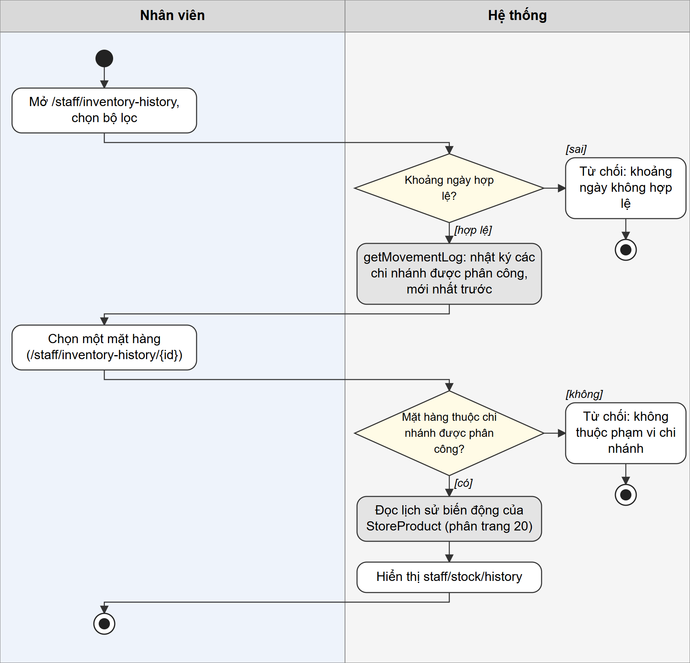

*Hình 2.38. Sơ đồ hoạt động chức năng Xem lịch sử biến động kho.* Mã nguồn sơ đồ: `diagrams/staff/NV-07.json`.

**C. Code xử lý chức năng**

**Đoạn mã 2.90. StaffInventoryService.getMovementLog**

`src/main/java/com/oneshop/service/StaffInventoryService.java` (dòng 120-142)

```java
public Page<InventoryMovementLogResponse> getMovementLog(int page, String q, InventoryMovementType type,
                                                         Long staffId, LocalDate from, LocalDate to) {
    List<Long> storeIds = scope.getAssignedStoreIds();
    String text = q == null ? "" : q.trim();
    boolean numeric = text.matches("\\d+");
    String like = "";
    String query = numeric ? text : "";
    var range = com.oneshop.service.query.SqlDayRange.of(from, to);
    LocalDateTime fromAt = range.fromInclusive();
    LocalDateTime toAt = range.toExclusive();
    var words = numeric ? java.util.List.<String>of() : com.oneshop.service.search.TextSearch.words(text);
    if (!words.isEmpty()) {
        var all = movements.searchLog(storeIds, type, staffId, "", like, fromAt, toAt,
                        org.springframework.data.domain.Pageable.unpaged()).getContent().stream()
                .filter(m -> com.oneshop.service.search.TextSearch.matchesAll(words, m.getStoreProduct().getProduct().getSku(),
                        m.getStoreProduct().getProduct().getName(), m.getStoreProduct().getStore().getName(),
                        m.getNote()))
                .toList();
        return com.oneshop.service.search.TextSearch.slice(all, com.oneshop.service.query.Paging.page(page, 20)).map(this::toLogView);
    }
    return movements.searchLog(storeIds, type, staffId, query, like, fromAt, toAt,
                    com.oneshop.service.query.Paging.page(page, 20)).map(this::toLogView);
}
```

**Đoạn mã 2.91. StaffInventoryService.getHistory**

`src/main/java/com/oneshop/service/StaffInventoryService.java` (dòng 174-184)

```java
public StaffInventoryHistoryResponse getHistory(Long id, int page) {
    var stock = getStoreProduct(id); // Refuse cross-Store/missing resources before reading any history.
    var history = movements.findByStoreProductIdAndStoreProductStoreIdInOrderByCreatedAtDescIdDesc(
            id, scope.getAssignedStoreIds(), com.oneshop.service.query.Paging.page(page, 20)).map(m -> {
        var actor = m.getStaff();
        return new InventoryMovementResponse(m.getId(), m.getType(), m.getQuantityBefore(), m.getQuantityAfter(),
                m.getQuantityChange(), actor == null ? null : actor.getId(), actor == null ? "Hệ thống" : actor.getFullName(),
                m.getNote(), m.getCreatedAt());
    });
    return new StaffInventoryHistoryResponse(stock, history);
}
```

**Đoạn mã 2.92. StaffStoreScopeService.requireStoreProduct**

`src/main/java/com/oneshop/service/StaffStoreScopeService.java` (dòng 70-75)

```java
public StoreProduct requireStoreProduct(Long storeProductId) {
    var ids = getAssignedStoreIds();
    if (storeProductId == null) throw new ResourceNotFoundException("Không tìm thấy sản phẩm của chi nhánh.");
    return products.findByIdAndStoreIdIn(storeProductId, ids)
            .orElseThrow(() -> new ResourceNotFoundException("Không tìm thấy sản phẩm của chi nhánh."));
}
```

**D. Giải thích code**

getMovementLog luôn lọc theo getAssignedStoreIds nên không đọc được nhật ký chi nhánh khác; từ khóa số được hiểu là mã đơn, từ khóa chữ được so khớp trong bộ nhớ trên SKU, tên, chi nhánh và ghi chú. getHistory gọi getStoreProduct, tức StaffStoreScopeService.requireStoreProduct, để từ chối mặt hàng ngoài phạm vi trước khi đọc bất kỳ lịch sử nào, rồi trả các InventoryMovement của chính mặt hàng đó. Luồng này được thể hiện trong Hình 2.38 và mã nguồn trong Đoạn mã 2.90, Đoạn mã 2.91, Đoạn mã 2.92.


### 2.3.8. Xử lý hàng khách trả (nhập lại kho hoặc xử lý) (NV-08)

**A. Mô tả chức năng**

Sau khi quản trị viên duyệt yêu cầu trả hàng, các dòng hàng xuất hiện tại /staff/returns cho nhân viên của chi nhánh đã giao từng dòng. Với mỗi dòng nhân viên chọn một lần: nhập lại kho (tồn của đúng StoreProduct tăng, ghi InventoryMovement loại RETURN_ORDER) hoặc xử lý ngoài hệ thống (không đổi tồn). Nhân viên không đụng đến tiền vì hoàn tiền đã ghi khi quản trị viên duyệt. Khi dòng cuối cùng được xử lý, yêu cầu chuyển sang COMPLETED.

*Tác nhân: Nhân viên. Trạng thái triển khai: Hoạt động.*

**B. Sơ đồ hoạt động**

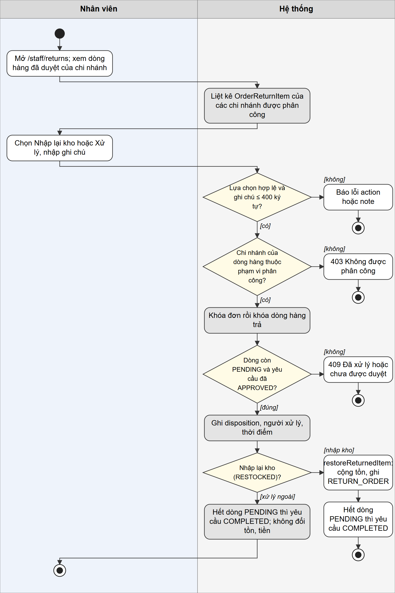

*Hình 2.39. Sơ đồ hoạt động chức năng Xử lý hàng khách trả (nhập lại kho hoặc xử lý).* Mã nguồn sơ đồ: `diagrams/staff/NV-08.json`.

**C. Code xử lý chức năng**

**Đoạn mã 2.93. StaffOrderReturnService.handle (1)**

`src/main/java/com/oneshop/service/returns/StaffOrderReturnService.java` (dòng 78-103)

```java
public StaffReturnItemResponse handle(Long returnItemId, ReturnDisposition target, String note, String staffEmail) {
    if (target != ReturnDisposition.RESTOCKED && target != ReturnDisposition.DISPOSED) {
        throw new BadRequestException("action", "Vui lòng chọn nhập lại kho hoặc xử lý.");
    }
    String cleanNote = note == null ? "" : note.trim();
    if (cleanNote.length() > MAX_NOTE) {
        throw new BadRequestException("note", "Ghi chú tối đa " + MAX_NOTE + " ký tự.");
    }
    User staff = requireStaff(staffEmail);
    // authorization on the Store of the line first, before anything is locked
    OrderReturnItem peek = items.findById(returnItemId).orElseThrow(StaffOrderReturnService::notFound);
    scope.requireAssignedStore(peek.getStore().getId());

    Long orderId = items.findOrderIdById(returnItemId).orElseThrow(StaffOrderReturnService::notFound);
    Order order = orders.findByIdForUpdate(orderId).orElseThrow(StaffOrderReturnService::notFound);
    OrderReturnItem item = items.findByIdForUpdate(returnItemId).orElseThrow(StaffOrderReturnService::notFound);
    scope.requireAssignedStore(item.getStore().getId());
    OrderReturn request = item.getOrderReturn();
    // a line that was already handled answers the same way even after its return became COMPLETED
    if (item.getDisposition() != ReturnDisposition.PENDING) {
        throw new FulfillmentConflictException(FulfillmentConflictException.RETURN_ALREADY_HANDLED,
                "Dòng hàng hoàn này đã được xử lý trước đó; không có thay đổi nào được thực hiện lại.");
    }
    if (request.getStatus() != OrderReturnStatus.APPROVED) {
        throw new BadRequestException("Yêu cầu trả hàng chưa được duyệt; không thể xử lý dòng hàng này.");
    }
```

**Đoạn mã 2.94. StaffOrderReturnService.handle (2)**

`src/main/java/com/oneshop/service/returns/StaffOrderReturnService.java` (dòng 105-123)

```java
    LocalDateTime now = LocalDateTime.now(clock).withNano(0);
    item.setDisposition(target);
    item.setHandledBy(staff);
    item.setHandledAt(now);
    item.setHandleNote(cleanNote.isEmpty() ? null : cleanNote);
    items.saveAndFlush(item);

    if (target == ReturnDisposition.RESTOCKED) {
        String stockNote = "Nhập lại kho do khách trả hàng - Order #" + order.getId() + " (yêu cầu trả hàng #"
                + request.getId() + ")" + (cleanNote.isEmpty() ? "" : ": " + cleanNote);
        inventory.restoreReturnedItem(order, item.getStoreProduct().getId(), item.getStore().getId(),
                item.getQuantity(), staff, stockNote.length() > 500 ? stockNote.substring(0, 500) : stockNote);
    }
    if (items.countByOrderReturnIdAndDisposition(request.getId(), ReturnDisposition.PENDING) == 0) {
        request.setStatus(OrderReturnStatus.COMPLETED);
        request.setCompletedAt(now);
    }
    return view(item);
}
```

**D. Giải thích code**

handle kiểm tra lựa chọn và ghi chú, xác thực quyền trên chi nhánh của dòng trước khi khóa (peek và requireAssignedStore), khóa đơn rồi dòng hàng và kiểm tra lại chi nhánh trên dòng đã khóa. Dòng đã xử lý trả FulfillmentConflictException; yêu cầu chưa APPROVED bị từ chối. RESTOCKED gọi InventoryService.restoreReturnedItem (kiểm tra chi nhánh, cộng tồn bằng Math.addExact, ghi RETURN_ORDER), còn DISPOSED chỉ ghi lựa chọn. Khi countByOrderReturnIdAndDisposition(PENDING) bằng 0, yêu cầu được đặt COMPLETED. Luồng này được thể hiện trong Hình 2.39 và mã nguồn trong Đoạn mã 2.93, Đoạn mã 2.94.


### 2.3.9. Phản hồi đánh giá của khách (NV-09)

**A. Mô tả chức năng**

Nhân viên xem các đánh giá có nguồn hàng thuộc chi nhánh được phân công và trả lời. Chỉ nhân viên của chi nhánh đã giao dòng hàng được đánh giá mới có quyền phản hồi; quản trị viên chỉ kiểm duyệt. Mỗi đánh giá có một phản hồi, gửi lại sẽ cập nhật nội dung phản hồi hiện có.

*Tác nhân: Nhân viên. Trạng thái triển khai: Hoạt động.*

**B. Sơ đồ hoạt động**

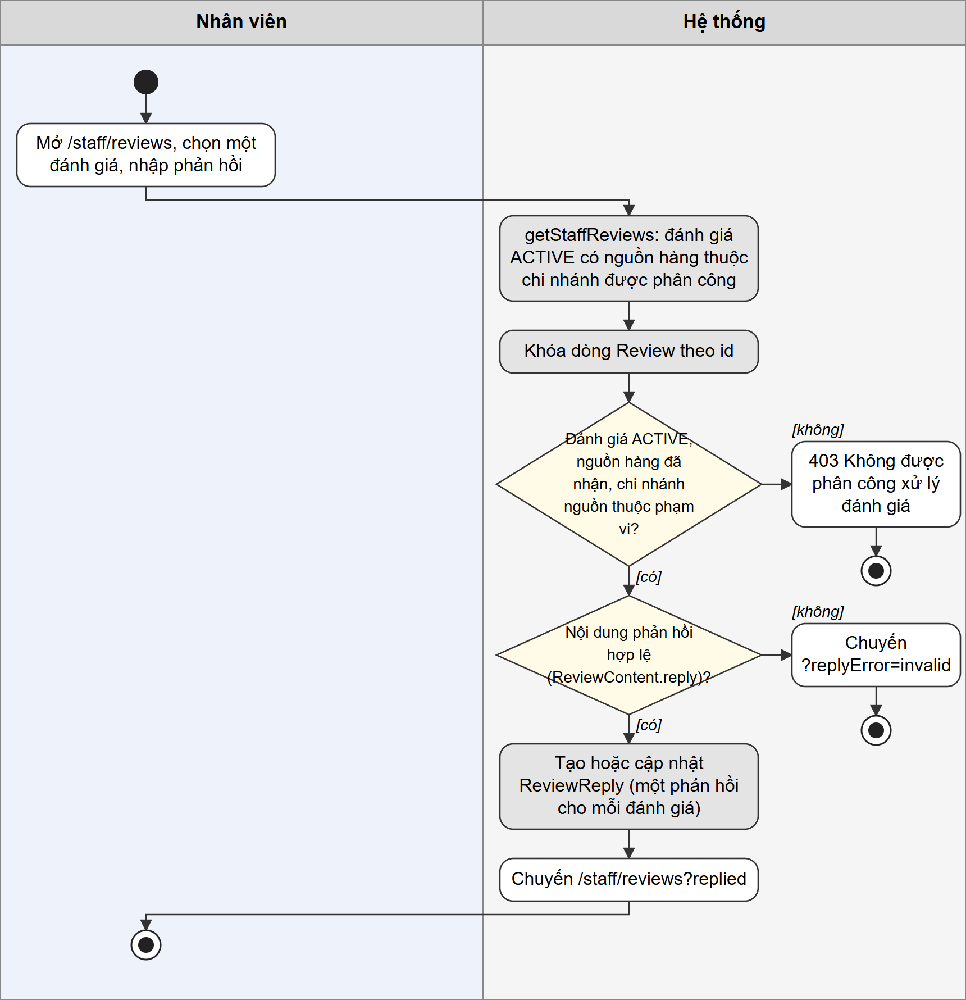

*Hình 2.40. Sơ đồ hoạt động chức năng Phản hồi đánh giá của khách.* Mã nguồn sơ đồ: `diagrams/staff/NV-09.json`.

**C. Code xử lý chức năng**

**Đoạn mã 2.95. ReviewReplyService**

`src/main/java/com/oneshop/service/review/ReviewReplyService.java` (dòng 31-55)

```java
@Transactional
@PreAuthorize("hasRole('STAFF')")
public void reply(Long id, String text) {
    String email = SecurityContextHolder.getContext().getAuthentication().getName();
    var actor = users.findByEmail(email).filter(u -> u.isActive() && u.getRole().getName() == RoleName.STAFF)
            .orElseThrow(() -> new AccessDeniedException("Chỉ nhân viên được phân công mới được phản hồi."));
    Review review = id == null ? null : reviews.findByIdForUpdate(id).orElse(null);
    if (review == null) throw new ResourceNotFoundException("Không tìm thấy đánh giá.");
    requireScope(review, scope);
    String body = ReviewContent.reply(text);
    ReviewReply reply = replies.findByReviewId(id).orElseGet(ReviewReply::new);
    reply.setReview(review);
    reply.setStaff(actor);
    reply.setContent(body);
    replies.saveAndFlush(reply);
    review.setReviewReply(reply);
}

public static void requireScope(Review review, StaffStoreScopeService scope) {
    var item = ReviewSource.verified(review);
    if (item == null || review.getStatus() != VisibilityStatus.ACTIVE || !ReviewSource.received(item)) {
        throw new AccessDeniedException("Đánh giá không có nguồn hàng hợp lệ để phản hồi.");
    }
    scope.requireAssignedStore(item.getFulfillment().getStore().getId());
}
```

**Đoạn mã 2.96. StaffReviewController.reply**

`src/main/java/com/oneshop/controller/staff/StaffReviewController.java` (dòng 29-39)

```java
@PostMapping("/{id}/reply")
public String reply(@PathVariable Long id, @RequestParam(required = false) String reply,
                    @RequestParam(defaultValue = "0") int page) {
    String back = "redirect:/staff/reviews?page=" + Math.max(0, page);
    try {
        reviews.reply(id, reply);
    } catch (BadRequestException ex) {
        return back + "&replyError=invalid";
    }
    return back + "&replied";
}
```

**D. Giải thích code**

ReviewReplyService.reply xác minh người gọi là nhân viên ACTIVE, khóa Review bằng findByIdForUpdate rồi gọi requireScope: đánh giá phải ACTIVE, có nguồn hàng xác thực (ReviewSource.verified), phần giao đã nhận và chi nhánh của phần giao phải thuộc phạm vi phân công (StaffStoreScopeService.requireAssignedStore). Sau đó ReviewContent.reply kiểm tra nội dung và ReviewReply được tạo hoặc cập nhật. StaffReviewController chuyển BadRequestException thành ?replyError=invalid. Luồng này được thể hiện trong Hình 2.40 và mã nguồn trong Đoạn mã 2.95, Đoạn mã 2.96.


# Chương 3. GIAO DIỆN HỆ THỐNG


## 3.1. Giao diện khách hàng

Toàn bộ ảnh trong chương này được chụp từ website OneShop đang chạy thật (Spring Boot, cơ sở dữ liệu SQL Server cục bộ có dữ liệu mô phỏng), đăng nhập lần lượt bằng tài khoản thử nghiệm của khách hàng, quản trị viên và nhân viên, bằng trình duyệt Chrome với độ rộng cửa sổ 1280 px. Các số trên ảnh đánh dấu thành phần chức năng theo thứ tự từ trên xuống dưới, từ trái sang phải; mỗi số tương ứng một dòng của bảng liền sau ảnh. Nhóm này gồm các trang của khách vãng lai và khách hàng. Trang giỏ hàng và trang xác nhận đặt hàng được chụp với một sản phẩm tạm thêm vào giỏ, sau đó được xóa; không có đơn hàng nào được tạo trong quá trình chụp. Trang thanh toán trực tuyến được chụp với một đơn đã thanh toán của khách thử nghiệm.


### 3.1.1. Giao diện trang chủ (phần đầu trang)


*Hình 3.1. Giao diện trang chủ (phần đầu trang) (đường dẫn /).* Ảnh gốc: `screenshots/customer/C01.png`.

**Bảng 3.1. Mô tả các thành phần giao diện trang chủ (phần đầu trang)**

| STT | Thành phần giao diện | Chức năng |
|---|---|---|
| 1 | Dải thông tin đầu trang | Thông báo một giá online chung cho toàn hệ thống và liên kết nhanh tới trang tra cứu cửa hàng, nhận tại cửa hàng. |
| 2 | Thanh điều hướng | Cho phép truy cập các khu vực chính: Trang chủ, Sản phẩm, Hệ thống cửa hàng. |
| 3 | Giỏ hàng | Mở giỏ hàng của khách (chỉ vai trò khách hàng đã đăng nhập mới vào được). |
| 4 | Đăng nhập | Chuyển tới trang đăng nhập bằng email hoặc tên đăng nhập. |
| 5 | Đăng ký | Chuyển tới biểu mẫu tạo tài khoản khách hàng. |
| 6 | Banner giới thiệu | Thông điệp thương hiệu của cửa hàng mỹ phẩm OneShop. |
| 7 | Ô tìm kiếm sản phẩm | Nhập từ khóa (tên hoặc SKU) rồi bấm Tìm để xem danh sách sản phẩm phù hợp. |
| 8 | Danh mục sản phẩm | Hiển thị các danh mục đang hoạt động; chọn một ô để lọc sản phẩm theo danh mục. |


### 3.1.2. Giao diện trang chủ (sản phẩm nổi bật và thương hiệu)

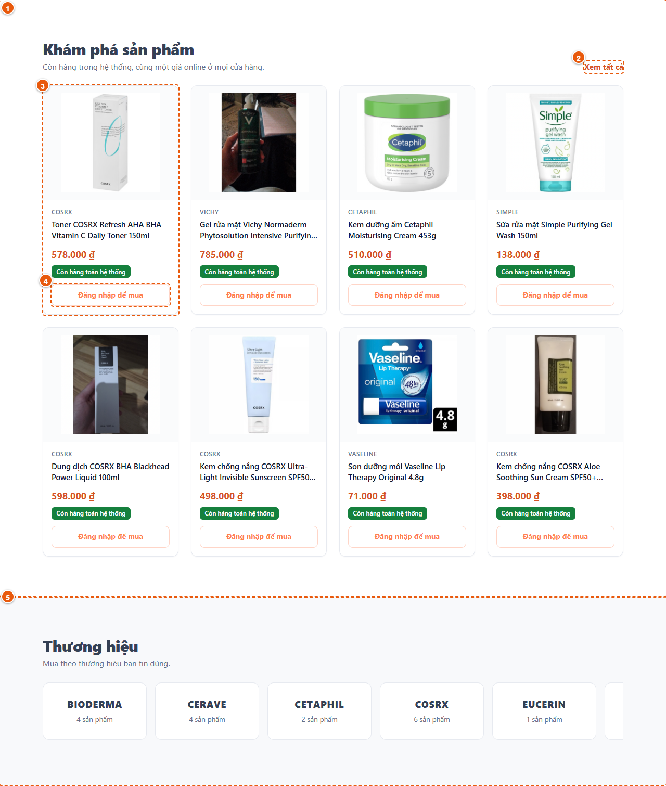

*Hình 3.2. Giao diện trang chủ (sản phẩm nổi bật và thương hiệu) (đường dẫn /).* Ảnh gốc: `screenshots/customer/C02.png`.

**Bảng 3.2. Mô tả các thành phần giao diện trang chủ (sản phẩm và thương hiệu)**

| STT | Thành phần giao diện | Chức năng |
|---|---|---|
| 1 | Khu vực sản phẩm | Danh sách 8 sản phẩm còn hàng được chọn ngẫu nhiên theo giờ, cùng một giá online ở mọi chi nhánh. |
| 2 | Liên kết Xem tất cả | Chuyển tới trang danh sách sản phẩm đầy đủ. |
| 3 | Thẻ sản phẩm | Hiển thị ảnh, tên, giá; bấm vào để xem chi tiết sản phẩm. |
| 4 | Nút Đăng nhập để mua | Khách chưa đăng nhập được yêu cầu đăng nhập trước khi thêm vào giỏ. |
| 5 | Khu vực thương hiệu | Các thương hiệu đang hoạt động kèm số sản phẩm; chọn để lọc sản phẩm theo thương hiệu. |


### 3.1.3. Giao diện trang chủ (hệ thống cửa hàng và chân trang)


*Hình 3.3. Giao diện trang chủ (hệ thống cửa hàng và chân trang) (đường dẫn /).* Ảnh gốc: `screenshots/customer/C03.png`.

**Bảng 3.3. Mô tả các thành phần giao diện trang chủ (cửa hàng và chân trang)**

| STT | Thành phần giao diện | Chức năng |
|---|---|---|
| 1 | Khu vực hệ thống cửa hàng | Giới thiệu các chi nhánh đang hoạt động, địa chỉ, giờ mở cửa và dịch vụ giao tận nơi hoặc nhận tại cửa hàng. |
| 2 | Liên kết Xem tất cả cửa hàng | Chuyển tới trang tra cứu cửa hàng. |
| 3 | Khối kêu gọi hành động | Mô tả ba bước mua hàng và nút Mua sắm ngay dẫn tới danh sách sản phẩm. |
| 4 | Chân trang | Liên kết khám phá, tài khoản, thông tin liên hệ và ghi công hình ảnh. |


### 3.1.4. Giao diện đăng nhập

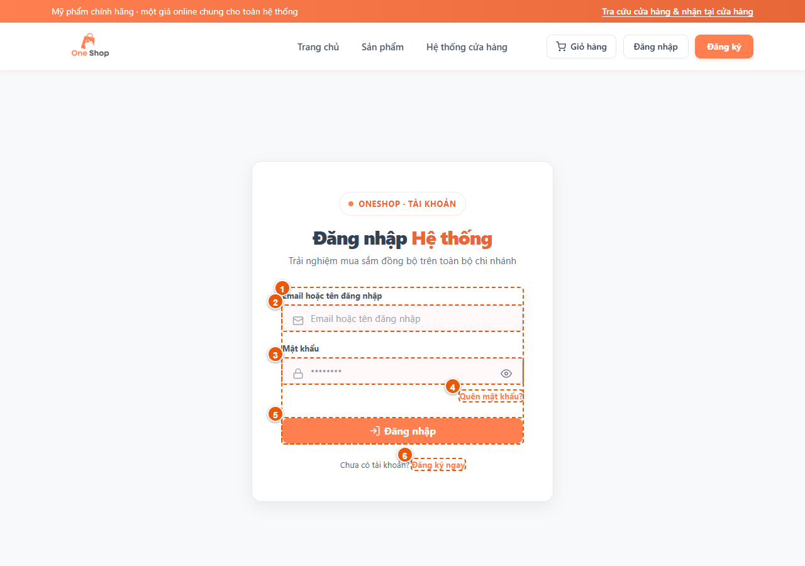

*Hình 3.4. Giao diện đăng nhập (đường dẫn /login).* Ảnh gốc: `screenshots/customer/C04.png`.

**Bảng 3.4. Mô tả các thành phần giao diện đăng nhập**

| STT | Thành phần giao diện | Chức năng |
|---|---|---|
| 1 | Biểu mẫu đăng nhập | Khung nhập thông tin xác thực; gửi bằng phương thức POST có mã CSRF. |
| 2 | Ô email hoặc tên đăng nhập | Nhập email (có ký tự @) hoặc tên đăng nhập của tài khoản. |
| 3 | Ô mật khẩu | Nhập mật khẩu của tài khoản. |
| 4 | Liên kết Quên mật khẩu | Mở luồng đặt lại mật khẩu bằng mã OTP gửi qua email. |
| 5 | Nút Đăng nhập | Gửi biểu mẫu; thành công thì chuyển theo vai trò (quản trị /admin, nhân viên /staff, khách hàng /). |
| 6 | Liên kết Đăng ký | Chuyển tới biểu mẫu tạo tài khoản mới. |


### 3.1.5. Giao diện đăng ký tài khoản

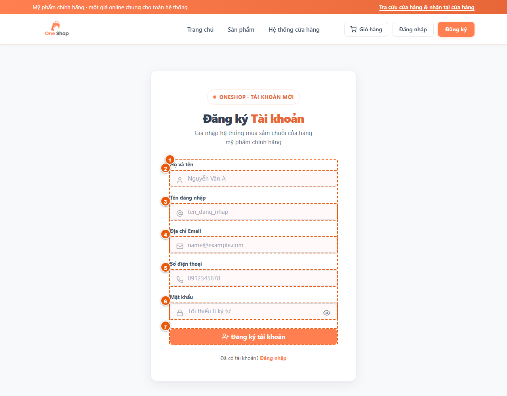

*Hình 3.5. Giao diện đăng ký tài khoản (đường dẫn /register).* Ảnh gốc: `screenshots/customer/C05.png`.

**Bảng 3.5. Mô tả các thành phần giao diện đăng ký tài khoản**

| STT | Thành phần giao diện | Chức năng |
|---|---|---|
| 1 | Biểu mẫu đăng ký | Khung nhập thông tin tài khoản khách hàng mới. |
| 2 | Ô họ và tên | Nhập họ tên đầy đủ (bắt buộc). |
| 3 | Ô tên đăng nhập | Từ 4 đến 30 ký tự gồm chữ, số, dấu _ và dấu chấm, không chứa @. |
| 4 | Ô email | Email duy nhất, dùng để đăng nhập và nhận mã OTP. |
| 5 | Ô số điện thoại | Số điện thoại liên hệ (không bắt buộc). |
| 6 | Ô mật khẩu | Mật khẩu tối đa 72 byte; được mã hóa BCrypt khi lưu. |
| 7 | Nút Đăng ký tài khoản | Gửi biểu mẫu để tạo tài khoản với vai trò khách hàng. |


### 3.1.6. Giao diện quên mật khẩu (bước gửi mã OTP)

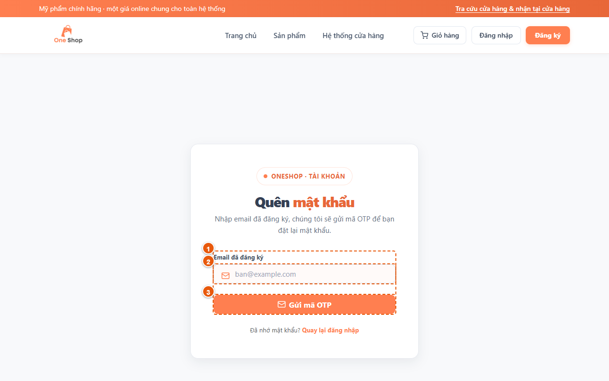

*Hình 3.6. Giao diện quên mật khẩu (bước gửi mã OTP) (đường dẫn /forgot-password).* Ảnh gốc: `screenshots/customer/C06.png`.

**Bảng 3.6. Mô tả các thành phần giao diện quên mật khẩu**

| STT | Thành phần giao diện | Chức năng |
|---|---|---|
| 1 | Biểu mẫu yêu cầu mã OTP | Khung nhập email của tài khoản cần đặt lại mật khẩu. |
| 2 | Ô email | Email của tài khoản đang hoạt động. |
| 3 | Nút Gửi mã OTP | Gửi mã 6 chữ số, có hiệu lực 10 phút, tới email đã nhập. |


### 3.1.7. Giao diện danh sách sản phẩm, tìm kiếm và bộ lọc

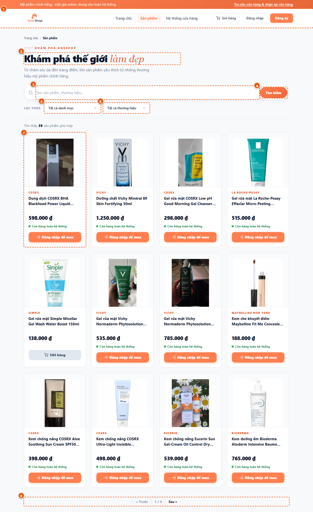

*Hình 3.7. Giao diện danh sách sản phẩm, tìm kiếm và bộ lọc (đường dẫn /products).* Ảnh gốc: `screenshots/customer/C07.png`.

**Bảng 3.7. Mô tả các thành phần giao diện danh sách sản phẩm**

| STT | Thành phần giao diện | Chức năng |
|---|---|---|
| 1 | Thanh điều hướng | Điều hướng giữa các khu vực chính của website. |
| 2 | Tiêu đề trang | Cho biết đang xem danh mục sản phẩm của hệ thống. |
| 3 | Ô tìm kiếm | Tìm theo tên hoặc SKU sản phẩm. |
| 4 | Nút Tìm kiếm | Áp dụng từ khóa và bộ lọc. |
| 5 | Bộ lọc danh mục | Thu hẹp danh sách theo danh mục. |
| 6 | Bộ lọc thương hiệu | Thu hẹp danh sách theo thương hiệu. |
| 7 | Thẻ sản phẩm | Ảnh, tên, giá online và tình trạng còn hàng; bấm để xem chi tiết. |
| 8 | Phân trang | Chuyển giữa các trang kết quả (12 sản phẩm mỗi trang). |


### 3.1.8. Giao diện chi tiết sản phẩm

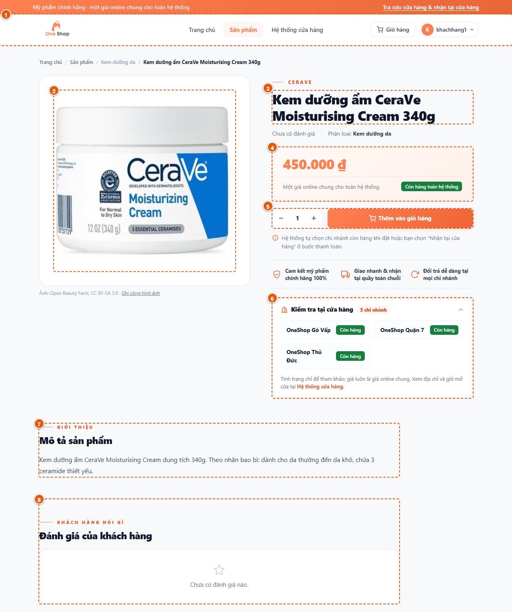

*Hình 3.8. Giao diện chi tiết sản phẩm (đường dẫn /products/1).* Ảnh gốc: `screenshots/customer/C08.png`.

**Bảng 3.8. Mô tả các thành phần giao diện chi tiết sản phẩm**

| STT | Thành phần giao diện | Chức năng |
|---|---|---|
| 1 | Thanh điều hướng | Điều hướng, hiển thị tài khoản khách đang đăng nhập và giỏ hàng. |
| 2 | Ảnh sản phẩm | Ảnh chính của sản phẩm lưu trên Cloudinary. |
| 3 | Tên sản phẩm | Tên đầy đủ của sản phẩm. |
| 4 | Khối giá và tình trạng | Giá online duy nhất, tình trạng còn hàng toàn hệ thống. |
| 5 | Thêm vào giỏ hàng | Chọn số lượng và thêm sản phẩm vào giỏ (chỉ khi đã đăng nhập). |
| 6 | Kiểm tra tại cửa hàng | Tình trạng còn hàng của sản phẩm tại từng chi nhánh (chỉ để tham khảo, giá vẫn là giá online chung). |
| 7 | Mô tả sản phẩm | Thông tin giới thiệu sản phẩm. |
| 8 | Đánh giá của khách hàng | Số đánh giá, điểm trung bình và danh sách nhận xét đã hiển thị. |


### 3.1.9. Giao diện tra cứu hệ thống cửa hàng

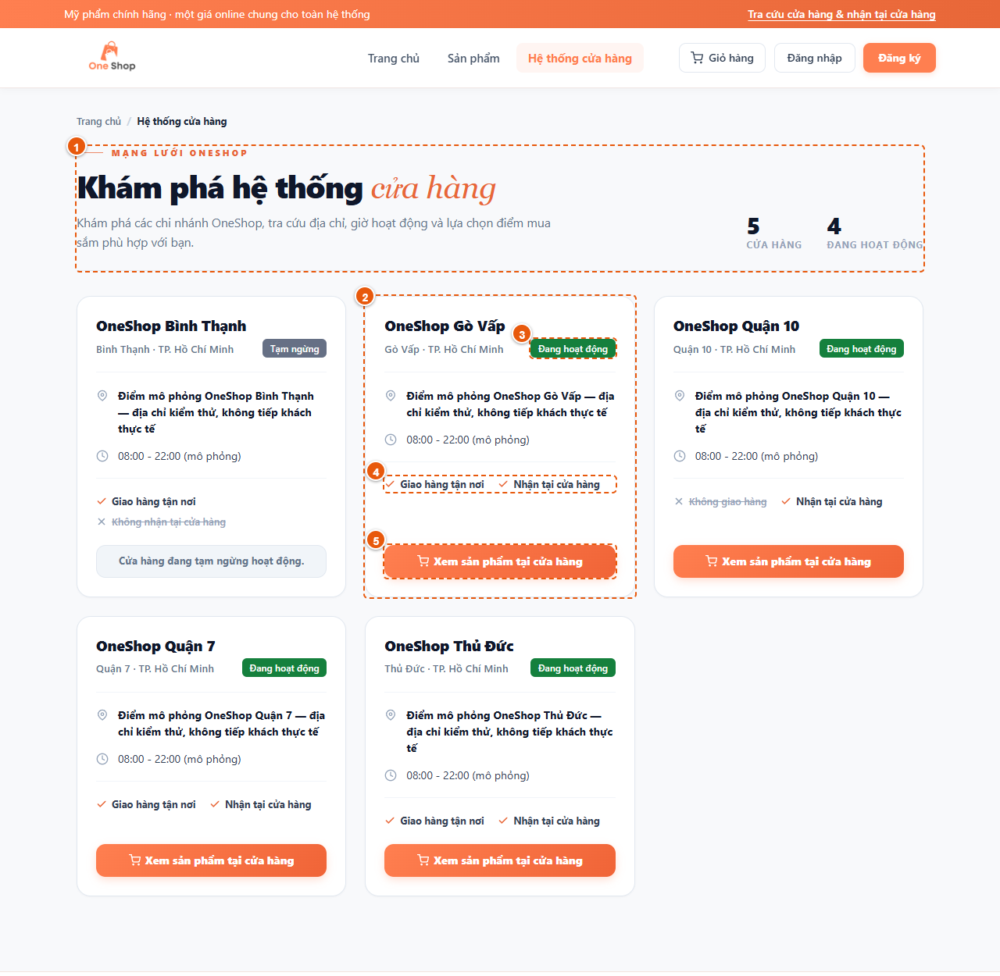

*Hình 3.9. Giao diện tra cứu hệ thống cửa hàng (đường dẫn /stores).* Ảnh gốc: `screenshots/customer/C09.png`.

**Bảng 3.9. Mô tả các thành phần giao diện tra cứu cửa hàng**

| STT | Thành phần giao diện | Chức năng |
|---|---|---|
| 1 | Đầu trang tra cứu | Tiêu đề và mô tả về mạng lưới cửa hàng; chứa bộ lọc tỉnh/thành và khu vực. |
| 2 | Thẻ chi nhánh | Tên, khu vực, trạng thái hoạt động, địa chỉ, giờ mở cửa và dịch vụ của một chi nhánh. |
| 3 | Nhãn trạng thái | Cho biết chi nhánh đang hoạt động hay tạm ngưng (chi nhánh tạm ngưng không chọn được). |
| 4 | Dịch vụ của chi nhánh | Cho biết chi nhánh hỗ trợ giao tận nơi, nhận tại cửa hàng hoặc cả hai. |
| 5 | Nút Xem sản phẩm tại cửa hàng | Lưu chi nhánh đã chọn vào cookie và chuyển tới danh sách sản phẩm theo tồn của chi nhánh. |


### 3.1.10. Giao diện giỏ hàng

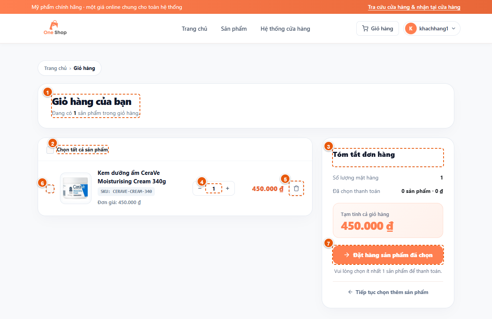

*Hình 3.10. Giao diện giỏ hàng (đường dẫn /cart).* Ảnh gốc: `screenshots/customer/C10.png`.

**Bảng 3.10. Mô tả các thành phần giao diện giỏ hàng**

| STT | Thành phần giao diện | Chức năng |
|---|---|---|
| 1 | Tiêu đề giỏ hàng | Cho biết số sản phẩm đang có trong giỏ của tài khoản. |
| 2 | Chọn tất cả sản phẩm | Chọn hoặc bỏ chọn mọi dòng hàng mua được để đặt hàng. |
| 3 | Tóm tắt đơn hàng | Số mặt hàng, số lượng và tiền các dòng đã chọn, tạm tính cả giỏ. |
| 4 | Số lượng | Tăng hoặc giảm số lượng; hệ thống kiểm tra theo tổng tồn toàn chuỗi. |
| 5 | Nút xóa dòng hàng | Xóa dòng hàng khỏi giỏ của khách. |
| 6 | Hộp chọn dòng hàng | Chọn dòng hàng muốn đặt; dòng hết hàng hoặc ngừng bán không chọn được. |
| 7 | Nút Đặt hàng sản phẩm đã chọn | Chuyển các dòng đã chọn tới trang xác nhận đặt hàng. |


### 3.1.11. Giao diện xác nhận đặt hàng

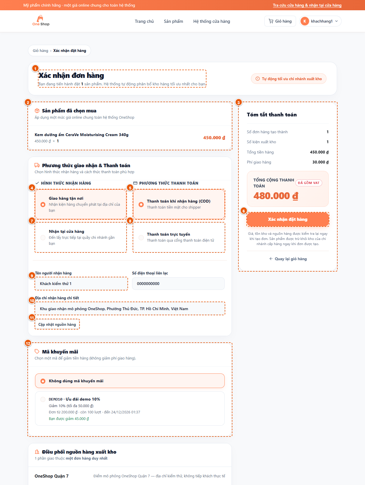

*Hình 3.11. Giao diện xác nhận đặt hàng (đường dẫn /checkout).* Ảnh gốc: `screenshots/customer/C11.png`.

**Bảng 3.11. Mô tả các thành phần giao diện xác nhận đặt hàng**

| STT | Thành phần giao diện | Chức năng |
|---|---|---|
| 1 | Tiêu đề xác nhận đơn hàng | Số sản phẩm đang đặt và thông báo hệ thống tự phân bổ nguồn hàng từ các chi nhánh. |
| 2 | Sản phẩm đã chọn mua | Các dòng hàng đã chọn với đơn giá online chung và số lượng. |
| 3 | Tóm tắt thanh toán | Số đơn tạo thành, số phần giao, tiền hàng, phí giao hàng và tổng cộng. |
| 4 | Giao hàng tận nơi | Hình thức nhận hàng chuyển phát tới địa chỉ khách; phí 30.000 đ mỗi đơn. |
| 5 | Thanh toán khi nhận hàng (COD) | Thu tiền mặt khi giao hàng. |
| 6 | Nút Xác nhận đặt hàng | Gửi yêu cầu tạo đơn; hệ thống kiểm tra lại giá, tồn kho và nguồn hàng. |
| 7 | Nhận tại cửa hàng | Khách đến lấy tại chi nhánh đủ toàn bộ sản phẩm; miễn phí giao hàng. |
| 8 | Thanh toán trực tuyến | Thanh toán qua cổng mô phỏng trong 15 phút kể từ khi tạo đơn. |
| 9 | Tên người nhận | Người nhận hàng, được lưu cùng đơn. |
| 10 | Địa chỉ nhận hàng | Địa chỉ giao hàng chi tiết, được kiểm tra khi đặt đơn giao tận nơi. |
| 11 | Nút Cập nhật nguồn hàng | Tính lại kế hoạch phân bổ theo cách nhận, thanh toán và địa chỉ đã chọn. |
| 12 | Mã khuyến mãi | Chọn hoặc nhập mã; mã chỉ giảm tiền hàng, không giảm phí giao hàng. |


### 3.1.12. Giao diện kết quả đặt hàng


*Hình 3.12. Giao diện kết quả đặt hàng (đường dẫn /checkout/1).* Ảnh gốc: `screenshots/customer/C12.png`.

**Bảng 3.12. Mô tả các thành phần giao diện kết quả đặt hàng**

| STT | Thành phần giao diện | Chức năng |
|---|---|---|
| 1 | Thông báo đặt hàng thành công | Mã phiên đặt hàng, thời gian đặt, số đơn và số phần giao, tổng thanh toán. |
| 2 | Thẻ đơn hàng | Từng đơn được tạo: sản phẩm, trạng thái, cách nhận, thanh toán, người nhận và thành tiền. |
| 3 | Phần giao hàng | Chi nhánh cung cấp hàng cho từng phần giao và trạng thái của phần đó. |
| 4 | Nút Xem chi tiết đơn hàng | Mở trang chi tiết và theo dõi đơn. |
| 5 | Nút Tiếp tục mua sắm | Quay lại danh sách sản phẩm. |


### 3.1.13. Giao diện lịch sử đơn hàng


*Hình 3.13. Giao diện lịch sử đơn hàng (đường dẫn /orders).* Ảnh gốc: `screenshots/customer/C13.png`.

**Bảng 3.13. Mô tả các thành phần giao diện lịch sử đơn hàng**

| STT | Thành phần giao diện | Chức năng |
|---|---|---|
| 1 | Đầu trang đơn hàng | Tiêu đề và tổng số đơn của khách. |
| 2 | Thẻ đơn hàng | Tóm tắt một đơn: mã, thời gian, trạng thái, sản phẩm và tổng tiền. |
| 3 | Dòng sản phẩm | Ảnh, tên và số lượng sản phẩm trong đơn. |
| 4 | Thông tin đơn | Hình thức nhận, phương thức và trạng thái thanh toán. |
| 5 | Chân thẻ đơn | Tổng tiền và liên kết xem chi tiết đơn hàng. |


### 3.1.14. Giao diện chi tiết đơn hàng nhiều chi nhánh (phần đầu)


*Hình 3.14. Giao diện chi tiết đơn hàng nhiều chi nhánh (phần đầu) (đường dẫn /orders/13).* Ảnh gốc: `screenshots/customer/C14.png`.

**Bảng 3.14. Mô tả các thành phần giao diện chi tiết đơn hàng**

| STT | Thành phần giao diện | Chức năng |
|---|---|---|
| 1 | Đường dẫn | Quay lại trang chủ hoặc danh sách đơn hàng. |
| 2 | Tiêu đề và trạng thái đơn | Mã đơn của khách, thời điểm đặt, hình thức nhận, trạng thái đơn và tổng thanh toán. |
| 3 | Sản phẩm đã đặt | Danh sách dòng hàng với đơn giá, số lượng và thành tiền. |
| 4 | Thanh toán | Tiền hàng, phí giao hàng, tổng đơn, phương thức và trạng thái thanh toán. |
| 5 | Phần giao theo chi nhánh | Mỗi chi nhánh xử lý một phần giao riêng với trạng thái, mã vận đơn và sản phẩm của phần đó. |
| 6 | Thông tin giao hàng | Người nhận và địa chỉ giao hàng. |
| 7 | Lịch sử đơn hàng | Dòng thời gian các lần thay đổi trạng thái đơn. |


### 3.1.15. Giao diện chi tiết đơn hàng (đánh giá sản phẩm)


*Hình 3.15. Giao diện chi tiết đơn hàng (đánh giá sản phẩm) (đường dẫn /orders/13).* Ảnh gốc: `screenshots/customer/C15.png`.

**Bảng 3.15. Mô tả các thành phần giao diện đánh giá sản phẩm trong đơn hàng**

| STT | Thành phần giao diện | Chức năng |
|---|---|---|
| 1 | Khối đánh giá sản phẩm | Chỉ hiển thị cho dòng hàng đã nhận và thanh toán hợp lệ; mỗi dòng hàng đánh giá một lần. |
| 2 | Chọn số sao | Số sao từ 1 đến 5 (bắt buộc). |
| 3 | Nhận xét | Nội dung nhận xét không bắt buộc. |
| 4 | Nút Gửi đánh giá | Lưu đánh giá ở trạng thái hiển thị gắn với dòng hàng đã mua. |


### 3.1.16. Giao diện chi tiết đơn hàng đã hoàn tất (trả hàng)


*Hình 3.16. Giao diện chi tiết đơn hàng đã hoàn tất (trả hàng) (đường dẫn /orders/1).* Ảnh gốc: `screenshots/customer/C16.png`.

**Bảng 3.16. Mô tả các thành phần giao diện chi tiết đơn hàng đã hoàn tất**

| STT | Thành phần giao diện | Chức năng |
|---|---|---|
| 1 | Thanh toán | Phương thức, trạng thái thanh toán và các khoản thu. |
| 2 | Giao nhận | Trạng thái từng phần giao, chi nhánh xử lý và mã vận đơn. |
| 3 | Lịch sử đơn hàng | Các thay đổi trạng thái của đơn. |
| 4 | Nút Yêu cầu trả hàng | Mở biểu mẫu trả hàng khi còn trong 3 ngày kể từ lúc nhận. |


### 3.1.17. Giao diện yêu cầu trả hàng


*Hình 3.17. Giao diện yêu cầu trả hàng (đường dẫn /orders/1/return).* Ảnh gốc: `screenshots/customer/C17.png`.

**Bảng 3.17. Mô tả các thành phần giao diện yêu cầu trả hàng**

| STT | Thành phần giao diện | Chức năng |
|---|---|---|
| 1 | Liên kết Quay lại đơn hàng | Trở về chi tiết đơn. |
| 2 | Ô lý do trả hàng | Nhập lý do từ 5 đến 500 ký tự. |
| 3 | Chọn ảnh minh chứng | Đính kèm từ 1 đến 3 ảnh; ảnh được tải lên Cloudinary. |
| 4 | Nút Gửi yêu cầu | Lưu yêu cầu ở trạng thái chờ quản trị viên duyệt. |
| 5 | Nút Hủy | Bỏ biểu mẫu và quay lại đơn. |


### 3.1.18. Giao diện thanh toán đơn hàng trực tuyến


*Hình 3.18. Giao diện thanh toán đơn hàng trực tuyến (đường dẫn /orders/13/payments).* Ảnh gốc: `screenshots/customer/C18.png`.

**Bảng 3.18. Mô tả các thành phần giao diện thanh toán đơn hàng**

| STT | Thành phần giao diện | Chức năng |
|---|---|---|
| 1 | Tiêu đề thanh toán | Mã đơn, nguồn hàng và nhãn cổng thanh toán mô phỏng (Sandbox). |
| 2 | Thông báo cổng thanh toán | Cho biết kết quả chỉ được ghi nhận khi hệ thống xác minh qua cổng; nút trên trình duyệt không đổi trạng thái. |
| 3 | Thông tin giao dịch đơn hàng | Tổng tiền, phương thức, trạng thái thanh toán và trạng thái xử lý đơn. |
| 4 | Lịch sử giao dịch | Các lần thanh toán với trạng thái, mã giao dịch mô phỏng, số tiền và thời điểm. |
| 5 | Liên kết Xem lần đặt hàng | Quay lại kết quả đặt hàng. |


### 3.1.19. Giao diện thông tin tài khoản


*Hình 3.19. Giao diện thông tin tài khoản (đường dẫn /account).* Ảnh gốc: `screenshots/customer/C19.png`.

**Bảng 3.19. Mô tả các thành phần giao diện thông tin tài khoản**

| STT | Thành phần giao diện | Chức năng |
|---|---|---|
| 1 | Thẻ hồ sơ | Ảnh đại diện chữ cái, họ tên, email, vai trò và liên kết nhanh. |
| 2 | Biểu mẫu hồ sơ | Sửa họ tên và số điện thoại; email và tên đăng nhập chỉ xem. |
| 3 | Menu tài khoản | Liên kết tới thông tin cá nhân, đơn hàng của tôi và giỏ hàng. |
| 4 | Nút Lưu thay đổi | Cập nhật hồ sơ của chính tài khoản đang đăng nhập. |
| 5 | Biểu mẫu đổi mật khẩu | Nhập mật khẩu hiện tại, mật khẩu mới và xác nhận. |
| 6 | Nút Đổi mật khẩu | Đổi mật khẩu khi mật khẩu hiện tại đúng, hai lần nhập khớp và khác mật khẩu cũ. |


## 3.2. Giao diện quản trị viên

Nhóm này gồm các trang của khu vực /admin. Các trang thêm hoặc sửa có cấu trúc tương tự (danh mục và thương hiệu, thêm và sửa chi nhánh, thêm và sửa mã khuyến mãi) được gộp bằng một trang đại diện. Trang yêu cầu trả hàng được chụp ở trạng thái rỗng vì dữ liệu mô phỏng chưa có yêu cầu trả hàng nào; không tạo yêu cầu giả để chụp.


### 3.2.1. Giao diện dashboard quản trị


*Hình 3.20. Giao diện dashboard quản trị (đường dẫn /admin).* Ảnh gốc: `screenshots/admin/A01.png`.

**Bảng 3.20. Mô tả các thành phần giao diện dashboard quản trị**

| STT | Thành phần giao diện | Chức năng |
|---|---|---|
| 1 | Thanh tiêu đề quản trị | Hiển thị phạm vi quản trị, liên kết tới trang bán hàng, tài khoản đang đăng nhập và nút Đăng xuất. |
| 2 | Phạm vi quản trị | Cho biết đang xem toàn chuỗi cửa hàng. |
| 3 | Tiêu đề trang | Tổng quan toàn chuỗi cùng mô tả ngắn. |
| 4 | Menu quản trị | Liên kết tới các chức năng: tổng quan, chi nhánh, danh mục, thương hiệu, sản phẩm, sản phẩm theo chi nhánh, phân công nhân viên, tồn kho, đơn hàng, thanh toán, khuyến mãi, trả hàng, đánh giá và người dùng. |
| 5 | Chỉ số và lối tắt cần xử lý | Các chỉ số: đơn hàng, phần giao đang xử lý, đơn cần quản trị viên xử lý, thanh toán chờ đối soát, SKU hết hàng; kèm các nút lối tắt tới đơn và thanh toán cần xử lý. |
| 6 | Bộ lọc theo chi nhánh | Thu hẹp số liệu theo một chi nhánh hoặc xem toàn chuỗi. |
| 7 | Bảng số liệu theo chi nhánh | Đơn, đơn cần xử lý, hoàn tất, đã hủy, SKU sắp hết, hết hàng, nhân viên và lối tắt Đơn hàng / Khác của từng chi nhánh. |


### 3.2.2. Giao diện quản lý người dùng


*Hình 3.21. Giao diện quản lý người dùng (đường dẫn /admin/users).* Ảnh gốc: `screenshots/admin/A02.png`.

**Bảng 3.21. Mô tả các thành phần giao diện quản lý người dùng**

| STT | Thành phần giao diện | Chức năng |
|---|---|---|
| 1 | Tiêu đề trang | Danh sách tài khoản người dùng. |
| 2 | Nút Tạo tài khoản | Mở biểu mẫu tạo tài khoản mới. |
| 3 | Ô tìm kiếm | Tìm theo họ tên, email hoặc tên đăng nhập. |
| 4 | Bộ lọc vai trò | Lọc theo vai trò khách hàng, nhân viên hoặc quản trị viên. |
| 5 | Bộ lọc trạng thái | Lọc theo tài khoản hoạt động hoặc bị khóa. |
| 6 | Nút Áp dụng | Áp dụng bộ lọc. |
| 7 | Bảng người dùng | Họ tên, email, vai trò, trạng thái của từng tài khoản. |
| 8 | Nút Sửa | Mở biểu mẫu cập nhật tài khoản. |


### 3.2.3. Giao diện tạo tài khoản người dùng


*Hình 3.22. Giao diện tạo tài khoản người dùng (đường dẫn /admin/users/new).* Ảnh gốc: `screenshots/admin/A03.png`.

**Bảng 3.22. Mô tả các thành phần giao diện tạo tài khoản người dùng**

| STT | Thành phần giao diện | Chức năng |
|---|---|---|
| 1 | Biểu mẫu tài khoản | Nhập thông tin định danh, vai trò và trạng thái. |
| 2 | Ô email | Email duy nhất; không đổi được sau khi tạo. |
| 3 | Ô tên đăng nhập | Tên đăng nhập tùy chọn, đúng mẫu quy định. |
| 4 | Ô họ và tên | Họ tên người dùng. |
| 5 | Chọn vai trò | Khách hàng, nhân viên hoặc quản trị viên. |
| 6 | Chọn trạng thái | Hoạt động hoặc khóa tài khoản. |
| 7 | Ô mật khẩu | Mật khẩu ban đầu (ít nhất 8 ký tự, tối đa 72 byte). |
| 8 | Nút Lưu | Tạo tài khoản. |


### 3.2.4. Giao diện phân công nhân viên cho chi nhánh


*Hình 3.23. Giao diện phân công nhân viên cho chi nhánh (đường dẫn /admin/staff-assignments).* Ảnh gốc: `screenshots/admin/A04.png`.

**Bảng 3.23. Mô tả các thành phần giao diện phân công nhân viên**

| STT | Thành phần giao diện | Chức năng |
|---|---|---|
| 1 | Tiêu đề trang | Danh sách phân công nhân viên theo chi nhánh. |
| 2 | Nút Tạo Staff mới | Mở biểu mẫu tạo tài khoản nhân viên. |
| 3 | Nút Gán nhân viên | Mở hộp thoại gán nhân viên vào chi nhánh. |
| 4 | Ô tìm kiếm | Tìm theo tên hoặc email nhân viên, tên chi nhánh. |
| 5 | Bộ lọc chi nhánh | Xem phân công của một chi nhánh. |
| 6 | Bảng phân công | Nhân viên, chi nhánh, trạng thái, ngày phân công. |
| 7 | Nút Chuyển chi nhánh | Chuyển nhân viên sang chi nhánh khác trong một bước. |
| 8 | Nút Tạm đình chỉ | Vô hiệu phân công; nhân viên mất phạm vi dữ liệu của chi nhánh. |


### 3.2.5. Giao diện quản lý chi nhánh


*Hình 3.24. Giao diện quản lý chi nhánh (đường dẫn /admin/stores).* Ảnh gốc: `screenshots/admin/A05.png`.

**Bảng 3.24. Mô tả các thành phần giao diện quản lý chi nhánh**

| STT | Thành phần giao diện | Chức năng |
|---|---|---|
| 1 | Tiêu đề trang | Danh sách chi nhánh của chuỗi. |
| 2 | Nút Thêm chi nhánh | Mở biểu mẫu thêm chi nhánh. |
| 3 | Ô tìm kiếm | Tìm theo mã, tên, địa chỉ, khu vực. |
| 4 | Bộ lọc khu vực | Lọc chi nhánh theo khu vực. |
| 5 | Bộ lọc trạng thái | Hoạt động hoặc ngừng hoạt động. |
| 6 | Bảng chi nhánh | Mã, tên, địa chỉ, dịch vụ giao/nhận và trạng thái. |
| 7 | Nút Sản phẩm | Xem sản phẩm đang gắn với chi nhánh. |
| 8 | Nút Sửa | Cập nhật thông tin chi nhánh. |


### 3.2.6. Giao diện thêm chi nhánh


*Hình 3.25. Giao diện thêm chi nhánh (đường dẫn /admin/stores/new).* Ảnh gốc: `screenshots/admin/A06.png`.

**Bảng 3.25. Mô tả các thành phần giao diện thêm chi nhánh**

| STT | Thành phần giao diện | Chức năng |
|---|---|---|
| 1 | Ô mã chi nhánh | Mã duy nhất của chi nhánh. |
| 2 | Ô tên chi nhánh | Tên hiển thị cho khách. |
| 3 | Ô địa chỉ | Địa chỉ chi nhánh. |
| 4 | Ô tỉnh/thành | Dùng để lọc khi khách tra cứu. |
| 5 | Ô khu vực | Quận/huyện hoặc khu vực. |
| 6 | Ô giờ mở cửa | Giờ mở cửa hiển thị cho khách. |
| 7 | Hộp chọn giao tận nơi | Cho phép chi nhánh cung cấp hàng cho đơn giao tận nơi. |
| 8 | Hộp chọn nhận tại cửa hàng | Cho phép khách nhận hàng tại chi nhánh. |
| 9 | Trạng thái | Hoạt động hoặc ngừng hoạt động. |
| 10 | Nút Thêm chi nhánh | Lưu chi nhánh mới. |


### 3.2.7. Giao diện quản lý danh mục


*Hình 3.26. Giao diện quản lý danh mục (đường dẫn /admin/categories).* Ảnh gốc: `screenshots/admin/A07.png`.

**Bảng 3.26. Mô tả các thành phần giao diện quản lý danh mục**

| STT | Thành phần giao diện | Chức năng |
|---|---|---|
| 1 | Tiêu đề trang | Danh sách danh mục sản phẩm. |
| 2 | Nút Thêm danh mục | Mở biểu mẫu thêm danh mục. |
| 3 | Bảng danh mục | Ảnh, tên, mô tả và trạng thái của danh mục. |
| 4 | Nút Sửa | Sửa danh mục và thay ảnh. |


### 3.2.8. Giao diện quản lý thương hiệu


*Hình 3.27. Giao diện quản lý thương hiệu (đường dẫn /admin/brands).* Ảnh gốc: `screenshots/admin/A08.png`.

**Bảng 3.27. Mô tả các thành phần giao diện quản lý thương hiệu**

| STT | Thành phần giao diện | Chức năng |
|---|---|---|
| 1 | Tiêu đề trang | Danh sách thương hiệu. |
| 2 | Nút Thêm thương hiệu | Mở biểu mẫu thêm thương hiệu. |
| 3 | Bảng thương hiệu | Tên, mô tả, trạng thái của thương hiệu. |
| 4 | Nút Sửa | Sửa thương hiệu và logo. |


### 3.2.9. Giao diện quản lý sản phẩm


*Hình 3.28. Giao diện quản lý sản phẩm (đường dẫn /admin/products).* Ảnh gốc: `screenshots/admin/A09.png`.

**Bảng 3.28. Mô tả các thành phần giao diện quản lý sản phẩm**

| STT | Thành phần giao diện | Chức năng |
|---|---|---|
| 1 | Tiêu đề trang | Danh sách sản phẩm theo SKU. |
| 2 | Nút Thêm sản phẩm | Mở biểu mẫu thêm sản phẩm. |
| 3 | Ô tìm kiếm | Tìm theo tên hoặc SKU. |
| 4 | Bộ lọc danh mục | Lọc theo danh mục. |
| 5 | Bộ lọc thương hiệu | Lọc theo thương hiệu. |
| 6 | Bộ lọc trạng thái | Đang bán, ngừng bán. |
| 7 | Bảng sản phẩm | Ảnh, SKU, tên, giá bán online, danh mục, thương hiệu và trạng thái. |
| 8 | Nút Chi nhánh bán | Xem các chi nhánh đang bán sản phẩm. |
| 9 | Nút Sửa | Sửa thông tin và giá của sản phẩm. |


### 3.2.10. Giao diện sửa sản phẩm và quản lý hình ảnh


*Hình 3.29. Giao diện sửa sản phẩm và quản lý hình ảnh (đường dẫn /admin/products/1/edit).* Ảnh gốc: `screenshots/admin/A10.png`.

**Bảng 3.29. Mô tả các thành phần giao diện sửa sản phẩm**

| STT | Thành phần giao diện | Chức năng |
|---|---|---|
| 1 | Biểu mẫu sản phẩm | SKU, tên, giá bán online, giá gốc, danh mục, thương hiệu, mô tả và trạng thái. |
| 2 | Chọn ảnh | Chọn tệp ảnh (tối đa 5MB) để tải lên Cloudinary. |
| 3 | Nút Tải lên | Thêm ảnh; ảnh đầu tiên tự là ảnh chính. |
| 4 | Ô giá bán online | Một giá duy nhất cho mọi chi nhánh; phải lớn hơn 0 khi đang bán. |
| 5 | Ô giá gốc | Giá gốc, không thấp hơn giá bán. |
| 6 | Nút Xóa ảnh | Xóa ảnh khỏi sản phẩm và Cloudinary. |
| 7 | Trạng thái | Đang bán hoặc ngừng bán (sản phẩm không bị xóa). |
| 8 | Nút Lưu thay đổi | Cập nhật sản phẩm. |


### 3.2.11. Giao diện sản phẩm theo chi nhánh


*Hình 3.30. Giao diện sản phẩm theo chi nhánh (đường dẫn /admin/store-products).* Ảnh gốc: `screenshots/admin/A11.png`.

**Bảng 3.30. Mô tả các thành phần giao diện sản phẩm theo chi nhánh**

| STT | Thành phần giao diện | Chức năng |
|---|---|---|
| 1 | Tiêu đề trang | Danh sách sản phẩm và tồn kho theo từng chi nhánh. |
| 2 | Nút Gắn sản phẩm vào chi nhánh | Mở biểu mẫu gắn sản phẩm cho chi nhánh. |
| 3 | Bộ lọc chi nhánh | Xem tồn của một chi nhánh. |
| 4 | Ô tìm kiếm | Tìm theo SKU hoặc tên sản phẩm. |
| 5 | Bộ lọc trạng thái | Lọc theo trạng thái bán. |
| 6 | Bảng sản phẩm theo chi nhánh | Chi nhánh, sản phẩm, số lượng, đang giữ và trạng thái. |
| 7 | Nút Sửa | Điều chỉnh số lượng và trạng thái. |


### 3.2.12. Giao diện gắn sản phẩm vào chi nhánh


*Hình 3.31. Giao diện gắn sản phẩm vào chi nhánh (đường dẫn /admin/store-products/new).* Ảnh gốc: `screenshots/admin/A12.png`.

**Bảng 3.31. Mô tả các thành phần giao diện gắn sản phẩm vào chi nhánh**

| STT | Thành phần giao diện | Chức năng |
|---|---|---|
| 1 | Chọn chi nhánh | Chi nhánh sẽ bán sản phẩm. |
| 2 | Chọn sản phẩm | Sản phẩm cần gắn (mỗi cặp chi nhánh, sản phẩm chỉ một lần). |
| 3 | Số lượng ban đầu | Tồn mở bán, được ghi thành biến động kho. |
| 4 | Trạng thái bán | Đang bán hoặc ngừng bán tại chi nhánh. |
| 5 | Ghi chú | Ghi chú cho biến động kho. |
| 6 | Nút Gắn sản phẩm | Lưu bản ghi sản phẩm theo chi nhánh. |


### 3.2.13. Giao diện tồn kho toàn chuỗi


*Hình 3.32. Giao diện tồn kho toàn chuỗi (đường dẫn /admin/inventory).* Ảnh gốc: `screenshots/admin/A13.png`.

**Bảng 3.32. Mô tả các thành phần giao diện tồn kho toàn chuỗi**

| STT | Thành phần giao diện | Chức năng |
|---|---|---|
| 1 | Tiêu đề trang | Tồn kho của toàn chuỗi. |
| 2 | Bộ lọc chi nhánh | Xem tồn của một chi nhánh. |
| 3 | Ô tìm kiếm | Tìm theo SKU, sản phẩm hoặc chi nhánh. |
| 4 | Bộ lọc mức tồn | Hết hàng, sắp hết hoặc đủ hàng. |
| 5 | Sắp xếp | Theo tên hoặc số lượng. |
| 6 | Bảng tồn kho | Số lượng tồn của từng sản phẩm tại từng chi nhánh. |


### 3.2.14. Giao diện quản lý đơn hàng


*Hình 3.33. Giao diện quản lý đơn hàng (đường dẫn /admin/orders).* Ảnh gốc: `screenshots/admin/A14.png`.

**Bảng 3.33. Mô tả các thành phần giao diện quản lý đơn hàng**

| STT | Thành phần giao diện | Chức năng |
|---|---|---|
| 1 | Tiêu đề trang | Đơn hàng toàn hệ thống. |
| 2 | Nút Cần Admin xử lý | Chỉ xem đơn cần quản trị viên xử lý (ngoại lệ giao hàng, thanh toán). |
| 3 | Chỉ số tổng | Tổng số đơn khớp bộ lọc, số đơn trang hiện tại, chi nhánh đang lọc. |
| 4 | Bộ lọc đơn hàng | Lọc theo chi nhánh, từ khóa, trạng thái đơn, trạng thái thanh toán, hình thức nhận và khoảng ngày. |
| 5 | Bảng đơn hàng | Mã đơn, khách hàng, chi nhánh cấp hàng, phần giao, hình thức, thanh toán, trạng thái và tổng tiền. |
| 6 | Nút Chi tiết | Mở chi tiết đơn hàng. |


### 3.2.15. Giao diện chi tiết đơn hàng của quản trị viên


*Hình 3.34. Giao diện chi tiết đơn hàng của quản trị viên (đường dẫn /admin/orders/13).* Ảnh gốc: `screenshots/admin/A15.png`.

**Bảng 3.34. Mô tả các thành phần giao diện chi tiết đơn hàng của quản trị viên**

| STT | Thành phần giao diện | Chức năng |
|---|---|---|
| 1 | Nút Tất cả đơn hàng | Quay lại danh sách đơn. |
| 2 | Nút Xử lý thanh toán | Mở trang thanh toán của đơn ONLINE. |
| 3 | Tiêu đề đơn hàng | Mã đơn, trạng thái hiện tại và các thông tin tóm tắt. |
| 4 | Thông tin chung và nhận hàng | Trạng thái đơn, thanh toán, nơi cấp hàng, người nhận và địa chỉ giao hàng. |
| 5 | Sản phẩm đã đặt | Các dòng hàng và chi nhánh nguồn. |
| 6 | Phần giao theo chi nhánh | Trạng thái từng phần giao của đơn. |
| 7 | Thanh toán | Phương thức, trạng thái và các lần thanh toán. |
| 8 | Lịch sử trạng thái | Mọi thay đổi trạng thái đơn và người thực hiện. |


### 3.2.16. Giao diện quản lý thanh toán trực tuyến


*Hình 3.35. Giao diện quản lý thanh toán trực tuyến (đường dẫn /admin/payments).* Ảnh gốc: `screenshots/admin/A16.png`.

**Bảng 3.35. Mô tả các thành phần giao diện quản lý thanh toán trực tuyến**

| STT | Thành phần giao diện | Chức năng |
|---|---|---|
| 1 | Tiêu đề trang | Thanh toán trực tuyến. |
| 2 | Nhóm xử lý | Cần xử lý, chờ đối soát, đang chờ thanh toán, đã thanh toán, đã hoàn tiền, thất bại hoặc hủy, tất cả; kèm số lượng từng nhóm. |
| 3 | Ô tìm kiếm | Tìm theo mã đơn hoặc khách hàng. |
| 4 | Nút Áp dụng | Áp dụng bộ lọc và khoảng ngày. |
| 5 | Bảng ca thanh toán | Đơn, khách hàng, kết quả xác minh, trạng thái hoàn tiền, nhóm xử lý. |


### 3.2.17. Giao diện chi tiết thanh toán của một đơn


*Hình 3.36. Giao diện chi tiết thanh toán của một đơn (đường dẫn /admin/payments/8).* Ảnh gốc: `screenshots/admin/A17.png`.

**Bảng 3.36. Mô tả các thành phần giao diện chi tiết thanh toán**

| STT | Thành phần giao diện | Chức năng |
|---|---|---|
| 1 | Nút Danh sách thanh toán | Quay lại danh sách ca thanh toán. |
| 2 | Tiêu đề | Mã đơn đang xử lý thanh toán. |
| 3 | Các lần thanh toán | Từng lần thanh toán với trạng thái sổ cái, số tiền và hoàn tiền. |
| 4 | Các phần giao | Trạng thái từng phần giao của đơn. |
| 5 | Lịch sử trạng thái đơn | Các lần đối soát và thay đổi trạng thái. |


### 3.2.18. Giao diện yêu cầu trả hàng của quản trị viên


*Hình 3.37. Giao diện yêu cầu trả hàng của quản trị viên (đường dẫn /admin/returns).* Ảnh gốc: `screenshots/admin/A18.png`.

**Bảng 3.37. Mô tả các thành phần giao diện yêu cầu trả hàng của quản trị viên**

| STT | Thành phần giao diện | Chức năng |
|---|---|---|
| 1 | Tiêu đề trang | Quy tắc trả hàng: trong 3 ngày, tiền hàng hoàn ngay khi duyệt, hàng hoàn chuyển cho nhân viên chi nhánh đã giao. |
| 2 | Bộ lọc trạng thái | Tất cả, Chờ duyệt (kèm số lượng), Đã duyệt, Từ chối, Hoàn tất. |
| 3 | Danh sách yêu cầu | Trạng thái rỗng khi chưa có yêu cầu trả hàng nào; khi có, mỗi dòng cho mở chi tiết để duyệt hoặc từ chối. |


### 3.2.19. Giao diện quản lý khuyến mãi


*Hình 3.38. Giao diện quản lý khuyến mãi (đường dẫn /admin/promotions).* Ảnh gốc: `screenshots/admin/A19.png`.

**Bảng 3.38. Mô tả các thành phần giao diện quản lý khuyến mãi**

| STT | Thành phần giao diện | Chức năng |
|---|---|---|
| 1 | Tiêu đề trang | Danh sách mã khuyến mãi. |
| 2 | Nút Thêm mã khuyến mãi | Mở biểu mẫu tạo mã. |
| 3 | Ô tìm kiếm | Tìm theo mã hoặc tên. |
| 4 | Bộ lọc trạng thái | Lọc theo trạng thái áp dụng. |
| 5 | Bảng khuyến mãi | Mã, loại giảm, điều kiện, lượt dùng, thời gian và trạng thái. |
| 6 | Nút Sửa | Cập nhật mã. |
| 7 | Nút Xóa | Xóa mã chưa từng được dùng. |


### 3.2.20. Giao diện thêm mã khuyến mãi


*Hình 3.39. Giao diện thêm mã khuyến mãi (đường dẫn /admin/promotions/new).* Ảnh gốc: `screenshots/admin/A20.png`.

**Bảng 3.39. Mô tả các thành phần giao diện thêm mã khuyến mãi**

| STT | Thành phần giao diện | Chức năng |
|---|---|---|
| 1 | Ô mã | 3 đến 30 ký tự A-Z, 0-9, _ hoặc -; duy nhất. |
| 2 | Ô tên | Tên hiển thị cho khách. |
| 3 | Loại giảm | Giảm theo phần trăm hoặc theo số tiền. |
| 4 | Giá trị giảm | Phần trăm nguyên 1-100 hoặc số đồng nguyên. |
| 5 | Mức giảm tối đa | Chỉ dùng cho giảm theo phần trăm. |
| 6 | Tiền hàng tối thiểu | Điều kiện áp dụng theo tiền hàng. |
| 7 | Tổng lượt dùng | Không nhỏ hơn số lượt đã dùng. |
| 8 | Lượt dùng mỗi khách | Giới hạn số lần một khách dùng mã. |
| 9 | Thời gian bắt đầu | Thời điểm bắt đầu áp dụng. |
| 10 | Nút Lưu | Lưu mã khuyến mãi. |


### 3.2.21. Giao diện kiểm duyệt đánh giá


*Hình 3.40. Giao diện kiểm duyệt đánh giá (đường dẫn /admin/reviews).* Ảnh gốc: `screenshots/admin/A21.png`.

**Bảng 3.40. Mô tả các thành phần giao diện kiểm duyệt đánh giá**

| STT | Thành phần giao diện | Chức năng |
|---|---|---|
| 1 | Tiêu đề trang | Đánh giá của khách hàng. |
| 2 | Ô tìm kiếm | Tìm theo khách hàng hoặc sản phẩm. |
| 3 | Bộ lọc trạng thái | Đang hiển thị hoặc đã ẩn. |
| 4 | Bộ lọc phản hồi | Đã hoặc chưa được nhân viên phản hồi. |
| 5 | Bảng đánh giá | Khách hàng, sản phẩm, số sao, nhận xét, phản hồi và trạng thái. |
| 6 | Nút Ẩn | Ẩn đánh giá khỏi trang sản phẩm (quản trị viên chỉ kiểm duyệt). |


## 3.3. Giao diện nhân viên

Nhóm này gồm các trang của khu vực /staff, chụp với tài khoản nhân viên của chi nhánh Thủ Đức; mọi dữ liệu hiển thị chỉ thuộc chi nhánh được phân công. Trang hàng khách trả được chụp ở trạng thái rỗng vì chưa có yêu cầu trả hàng được duyệt.


### 3.3.1. Giao diện dashboard nhân viên


*Hình 3.41. Giao diện dashboard nhân viên (đường dẫn /staff).* Ảnh gốc: `screenshots/staff/S01.png`.

**Bảng 3.41. Mô tả các thành phần giao diện dashboard nhân viên**

| STT | Thành phần giao diện | Chức năng |
|---|---|---|
| 1 | Thanh tiêu đề | Hiển thị chi nhánh được phân công, tài khoản và nút Đăng xuất. |
| 2 | Tiêu đề trang | Tổng quan chi nhánh được phân công. |
| 3 | Menu nhân viên | Liên kết tới tổng quan, đơn cần xử lý, giao tận nơi, nhận tại cửa hàng, tồn kho, hàng khách trả, đánh giá và nhật ký biến động tồn. |
| 4 | Thẻ chi nhánh | Số phần giao đang mở, chờ nhận, đang giao, bị chặn, thất bại và tồn thấp của chi nhánh được phân công. |
| 5 | Liên kết Xem tất cả phần giao | Mở hàng đợi đầy đủ. |
| 6 | Bảng phần giao đang xử lý | Các phần giao mới nhất của chi nhánh, kèm thao tác tiếp theo hợp lệ. |


### 3.3.2. Giao diện hàng đợi phần giao hàng


*Hình 3.42. Giao diện hàng đợi phần giao hàng (đường dẫn /staff/fulfillments).* Ảnh gốc: `screenshots/staff/S02.png`.

**Bảng 3.42. Mô tả các thành phần giao diện hàng đợi phần giao hàng**

| STT | Thành phần giao diện | Chức năng |
|---|---|---|
| 1 | Tiêu đề trang | Hàng đợi phần giao của chi nhánh. |
| 2 | Ô tìm khách hàng | Tìm theo tên, email hoặc người nhận. |
| 3 | Bộ lọc trạng thái | Trạng thái phần giao. |
| 4 | Bộ lọc loại | Giao tận nơi hoặc nhận tại cửa hàng. |
| 5 | Ô mã đơn | Tìm đúng một đơn. |
| 6 | Nút Áp dụng | Áp dụng bộ lọc. |
| 7 | Bảng phần giao | Phần giao, đơn, loại, trạng thái, thanh toán, khách và thao tác. |
| 8 | Nút thao tác | Thao tác hợp lệ tiếp theo của phần giao (khác nhau theo trạng thái). |


### 3.3.3. Giao diện hàng đợi nhận tại cửa hàng


*Hình 3.43. Giao diện hàng đợi nhận tại cửa hàng (đường dẫn /staff/fulfillments/pickup).* Ảnh gốc: `screenshots/staff/S03.png`.

**Bảng 3.43. Mô tả các thành phần giao diện hàng đợi nhận tại cửa hàng**

| STT | Thành phần giao diện | Chức năng |
|---|---|---|
| 1 | Tiêu đề trang | Phần giao nhận tại cửa hàng của chi nhánh. |
| 2 | Bộ lọc | Lọc theo từ khóa, trạng thái, mã đơn, khoảng ngày. |
| 3 | Bảng phần giao | Các phần nhận tại cửa hàng cần xử lý. |
| 4 | Nút xác nhận nhận hàng | Xác nhận bàn giao khi khách đưa đúng mã nhận hàng. |


### 3.3.4. Giao diện chi tiết phần giao đang giao (giao tận nơi)


*Hình 3.44. Giao diện chi tiết phần giao đang giao (giao tận nơi) (đường dẫn /staff/fulfillments/5).* Ảnh gốc: `screenshots/staff/S04.png`.

**Bảng 3.44. Mô tả các thành phần giao diện chi tiết phần giao tận nơi**

| STT | Thành phần giao diện | Chức năng |
|---|---|---|
| 1 | Nút Danh sách phần giao hàng | Quay lại hàng đợi. |
| 2 | Tiêu đề | Phần giao và đơn hàng tương ứng. |
| 3 | Sản phẩm của phần giao | Chỉ các dòng hàng do chi nhánh này cung cấp. |
| 4 | Nút Xác nhận giao thành công | Hoàn tất phần giao; với đơn COD ghi nhận thu tiền. |
| 5 | Ô lý do thất bại | Bắt buộc 5-500 ký tự khi báo giao không thành công. |
| 6 | Nút Giao hàng không thành công | Đặt phần giao FAILED; đơn chuyển NEEDS_ATTENTION chờ quản trị viên. |
| 7 | Lịch sử phần giao | Các thay đổi trạng thái của phần giao và người thực hiện. |


### 3.3.5. Giao diện chi tiết phần giao nhận tại cửa hàng (xác minh mã)


*Hình 3.45. Giao diện chi tiết phần giao nhận tại cửa hàng (xác minh mã) (đường dẫn /staff/fulfillments/6).* Ảnh gốc: `screenshots/staff/S05.png`.

**Bảng 3.45. Mô tả các thành phần giao diện xác minh mã nhận hàng**

| STT | Thành phần giao diện | Chức năng |
|---|---|---|
| 1 | Tiêu đề | Phần giao nhận tại cửa hàng. |
| 2 | Ô mã nhận hàng | Nhập mã khách đọc; sai 5 lần thì khóa 15 phút. |
| 3 | Nút Xác nhận khách đã nhận hàng | Hoàn tất phần giao khi mã đúng; đơn thanh toán tại cửa hàng ghi nhận thu tiền. |
| 4 | Ô lý do | Lý do khi khách không nhận hàng. |
| 5 | Nút Khách không nhận hàng | Đặt phần giao FAILED chờ quản trị viên xử lý. |
| 6 | Lịch sử phần giao | Các thay đổi trạng thái của phần giao. |


### 3.3.6. Giao diện tồn kho chi nhánh


*Hình 3.46. Giao diện tồn kho chi nhánh (đường dẫn /staff/stock).* Ảnh gốc: `screenshots/staff/S06.png`.

**Bảng 3.46. Mô tả các thành phần giao diện tồn kho chi nhánh**

| STT | Thành phần giao diện | Chức năng |
|---|---|---|
| 1 | Tiêu đề trang | Tồn kho của chi nhánh được phân công. |
| 2 | Liên kết Nhật ký biến động tồn | Mở nhật ký biến động kho. |
| 3 | Thẻ thống kê tồn | Số SKU tại chi nhánh, số mặt hàng sắp hết (1 đến 5) và hết hàng còn bán. |
| 4 | Ô tìm kiếm | Tìm theo SKU hoặc tên sản phẩm. |
| 5 | Bộ lọc mức tồn | Hết hàng, sắp hết, đủ hàng. |
| 6 | Sắp xếp | Theo tên hoặc số lượng tồn. |
| 7 | Bảng tồn kho | Sản phẩm, SKU, số lượng, đang giữ và trạng thái. |
| 8 | Nút Điều chỉnh tồn | Mở biểu mẫu điều chỉnh số lượng. |
| 9 | Nút Lịch sử | Xem lịch sử biến động của sản phẩm. |


### 3.3.7. Giao diện điều chỉnh tồn kho


*Hình 3.47. Giao diện điều chỉnh tồn kho (đường dẫn /staff/stock/1/adjust).* Ảnh gốc: `screenshots/staff/S07.png`.

**Bảng 3.47. Mô tả các thành phần giao diện điều chỉnh tồn kho**

| STT | Thành phần giao diện | Chức năng |
|---|---|---|
| 1 | Tiêu đề | Sản phẩm đang điều chỉnh tồn. |
| 2 | Liên kết Tồn kho chi nhánh | Quay lại bảng tồn kho. |
| 3 | Ô số lượng mới | Số lượng tồn mới (không âm, không thấp hơn số đang giữ). |
| 4 | Ô ghi chú | Lý do điều chỉnh, ghi vào biến động kho. |
| 5 | Nút Lưu điều chỉnh | Lưu và ghi biến động STOCK_ADJUST. |


### 3.3.8. Giao diện nhật ký biến động tồn


*Hình 3.48. Giao diện nhật ký biến động tồn (đường dẫn /staff/inventory-history).* Ảnh gốc: `screenshots/staff/S08.png`.

**Bảng 3.48. Mô tả các thành phần giao diện nhật ký biến động tồn**

| STT | Thành phần giao diện | Chức năng |
|---|---|---|
| 1 | Tiêu đề trang | Nhật ký biến động tồn của chi nhánh. |
| 2 | Ô tìm kiếm | Tìm theo SKU, sản phẩm, ghi chú hoặc mã đơn. |
| 3 | Bộ lọc loại biến động | Đặt hàng, hủy đơn, điều chỉnh, hàng trả... |
| 4 | Bộ lọc nhân viên | Nhân viên đã ghi nhận. |
| 5 | Từ ngày | Giới hạn khoảng ngày. |
| 6 | Bảng nhật ký | Thời điểm, sản phẩm, loại, số lượng trước/sau, người thực hiện, ghi chú. |


### 3.3.9. Giao diện lịch sử biến động tồn của một sản phẩm


*Hình 3.49. Giao diện lịch sử biến động tồn của một sản phẩm (đường dẫn /staff/inventory-history/1).* Ảnh gốc: `screenshots/staff/S09.png`.

**Bảng 3.49. Mô tả các thành phần giao diện lịch sử biến động của sản phẩm**

| STT | Thành phần giao diện | Chức năng |
|---|---|---|
| 1 | Tiêu đề | Lịch sử biến động của sản phẩm tại chi nhánh. |
| 2 | Liên kết Nhật ký chung | Quay lại nhật ký toàn chi nhánh. |
| 3 | Nút Điều chỉnh tồn | Mở biểu mẫu điều chỉnh. |
| 4 | Bảng biến động | Các lần biến động của sản phẩm. |


### 3.3.10. Giao diện hàng khách trả


*Hình 3.50. Giao diện hàng khách trả (đường dẫn /staff/returns).* Ảnh gốc: `screenshots/staff/S10.png`.

**Bảng 3.50. Mô tả các thành phần giao diện hàng khách trả**

| STT | Thành phần giao diện | Chức năng |
|---|---|---|
| 1 | Tiêu đề trang | Dòng hàng trả đã được quản trị viên duyệt cho chi nhánh. |
| 2 | Danh sách dòng hàng trả | Mỗi dòng cho phép chọn nhập lại kho hoặc xử lý; trạng thái rỗng khi chưa có hàng trả. |


### 3.3.11. Giao diện đánh giá của chi nhánh


*Hình 3.51. Giao diện đánh giá của chi nhánh (đường dẫn /staff/reviews).* Ảnh gốc: `screenshots/staff/S11.png`.

**Bảng 3.51. Mô tả các thành phần giao diện đánh giá của chi nhánh**

| STT | Thành phần giao diện | Chức năng |
|---|---|---|
| 1 | Tiêu đề trang | Đánh giá từ hàng đã giao của chi nhánh; mỗi đánh giá có một phản hồi, có thể sửa lại. |
| 2 | Thẻ đánh giá | Sản phẩm, số sao, đơn và phần giao nguồn, nhận xét của khách và trạng thái phản hồi. |
| 3 | Nhãn Đã phản hồi | Cho biết nhân viên đã trả lời đánh giá. |
| 4 | Nút Xem / sửa phản hồi | Mở ô nhập để trả lời hoặc sửa phản hồi. |


### 3.3.12. Giao diện chi tiết đánh giá và phản hồi


*Hình 3.52. Giao diện chi tiết đánh giá và phản hồi (đường dẫn /staff/reviews/1).* Ảnh gốc: `screenshots/staff/S12.png`.

**Bảng 3.52. Mô tả các thành phần giao diện chi tiết đánh giá**

| STT | Thành phần giao diện | Chức năng |
|---|---|---|
| 1 | Liên kết Đánh giá của chi nhánh | Quay lại danh sách đánh giá. |
| 2 | Ô phản hồi | Nội dung phản hồi của nhân viên chi nhánh nguồn. |
| 3 | Nút Lưu phản hồi | Lưu phản hồi (mỗi đánh giá một phản hồi). |
