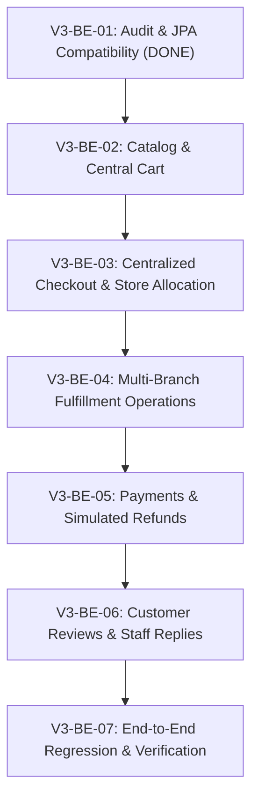

# ONESHOP V3 — BACKEND MIGRATION PLAN
**Phases:** V3-BE-02 through V3-BE-07  
**Architecture:** Centralized Commerce — Distributed Multi-Store Inventory & Fulfillment  
**Database:** Microsoft SQL Server (22 Tables, Verified Seed Data)  

---

## 1. Migration Overview & Guiding Principles

With **Phase V3-BE-01: Backend Audit & JPA Compatibility** successfully completed, the foundation is secured:
* All 22 SQL Server V3 tables are accurately mapped in Spring Data JPA.
* Hibernate schema validation (`ddl-auto=validate`) passes 100%.
* Existing services and test suites remain functional via backward-compatible bridges.

The goal of the subsequent backend phases is to incrementally transition the business logic from the V2 store-centric model to the V3 centralized commerce model without disrupting application stability or corrupting transaction integrity.

### Core Principles:
1. **Incremental Delivery:** Each phase addresses a self-contained domain (Catalog/Cart -> Checkout/Allocation -> Fulfillment -> Payments/Refunds -> Reviews).
2. **Atomic Invariants:**
   - Physical stock (`quantity`) is never deducted before fulfillment packing.
   - Reserved stock (`reserved_quantity`) must always satisfy: `0 <= reserved_quantity <= quantity`.
   - Master `Order.order_status` must always be a deterministic function of its underlying `OrderFulfillment` package statuses.
3. **Zero Schema Modification:** The SQL Server schema is frozen and locked; no DDL alterations are permitted.
4. **Comprehensive Automated Verification:** Every phase concludes with targeted integration tests matching the domain before proceeding to the next phase.

---

## 2. Phased Backend Roadmap

---

### Phase V3-BE-02: Core Catalog & Central Cart Refactoring
**Estimated Duration:** 2 Days  
**Primary Focus:** Centralize product pricing and shopping cart line management.

#### Tasks:
1. **Catalog Pricing Update:**
   - Refactor `ProductService` and `StoreProductService` to serve `Product.price` as the authoritative online retail price.
   - Update `ProductCardResponse`, `ProductDetailResponse`, and `CatalogItemResponse` to serialize `Product.price` and `Product.originalPrice`.
   - Update client product catalog views to display chain-wide availability without requiring upfront store selection.
2. **Central Cart Refactoring:**
   - Refactor `CartService.addCartItem` to accept `productId` instead of `storeProductId`.
   - Verify chain-wide availability: check that the sum of available stock across all active stores is `>= requestedQuantity`.
   - Update `CartItemRepository` usages to query by `(cartId, productId)`.
   - Eliminate `CartStoreGroupResponse`; replace with flat `CartResponse` containing product-level lines.
   - Update `CartController` endpoints and Thymeleaf cart templates.
3. **Phase Deliverables & Verification:**
   - Unit tests: `CartServiceV3Test`, `ProductServiceV3Test`.
   - Integration tests: `CentralCartIntegrationTest` verifying cart addition without store context.

---

### Phase V3-BE-03: Centralized Checkout & Multi-Branch Order Allocation
**Estimated Duration:** 3 Days  
**Primary Focus:** Single order creation, inventory reservation, and dynamic store allocation.

#### Tasks:
1. **Store Allocation Engine (`StoreAllocationService`):**
   - Implement greedy/priority allocation algorithm:
     * **Strategy 1 (Single Store Priority):** If a single active store has sufficient stock for all cart items, allocate 100% of the order to that store (minimizing shipping packages).
     * **Strategy 2 (Split Store Allocation):** If no single store can fulfill the entire order, allocate lines to the minimum number of stores based on stock availability and province/city proximity.
     * **Strategy 3 (Store Pickup):** If fulfillment type is `STORE_PICKUP`, strictly validate that the chosen store has all items in stock.
2. **Pessimistic Stock Reservation:**
   - Lock `StoreProduct` rows via `storeProductRepository.findAllByIdForUpdate()`.
   - Increment `StoreProduct.reserved_quantity` atomically.
   - Reject checkout immediately with descriptive error if stock is insufficient.
3. **Order & Fulfillment Creation:**
   - Create 1 `Order` record per checkout session (store `store_id = NULL` for multi-store delivery).
   - Create `OrderFulfillment` records (1 per allocated store branch).
   - Create `OrderItem` records linking each line to its parent `OrderFulfillment` and `StoreProduct`.
   - Write initial `OrderStatusHistory` and `OrderFulfillmentStatusHistory` entries.
4. **Phase Deliverables & Verification:**
   - Concurrency tests: Verify that parallel checkout requests for the same SKU never exceed physical inventory.
   - Allocation tests: Test single-store vs. split-store allocation scenarios against real seed data.

---

### Phase V3-BE-04: Multi-Branch Fulfillment Operations
**Estimated Duration:** 3 Days  
**Primary Focus:** Staff console migration to fulfillment packages and state machine aggregation.

#### Tasks:
1. **Staff Console Endpoint Migration:**
   - Refactor `StaffDeliveryController` and `StaffPickupController` to query `OrderFulfillmentRepository` scoped to the staff member's assigned store (`staff_store_assignments`).
   - Transition endpoints:
     * `POST /staff/fulfillments/{id}/prepare` -> `status = PREPARING`
     * `POST /staff/fulfillments/{id}/pack` -> `status = PACKED` (deducts physical `quantity`, decrements `reserved_quantity`, writes `InventoryMovement`)
     * `POST /staff/fulfillments/{id}/ship` -> `status = SHIPPING` (records `tracking_code`)
     * `POST /staff/fulfillments/{id}/ready-for-pickup` -> `status = READY_FOR_PICKUP` (generates pickup code)
     * `POST /staff/fulfillments/{id}/handover` -> `status = COMPLETED`
2. **Order State Aggregation Engine (`OrderStateAggregator`):**
   - Automatically recompute master `Order.order_status` on every fulfillment state change:
     * If all fulfillments are `COMPLETED` -> `Order.order_status = COMPLETED`.
     * If any fulfillment is `SHIPPING` or `READY_FOR_PICKUP` -> `Order.order_status = SHIPPING` or `PROCESSING`.
     * If all fulfillments are `CANCELLED` -> `Order.order_status = CANCELLED`.
     * If some fulfillments are `COMPLETED` and others `CANCELLED` -> `Order.order_status = PARTIALLY_COMPLETED`.
3. **Phase Deliverables & Verification:**
   - Fulfillment transition unit and integration tests.
   - Verification of `InventoryMovement` audit records upon stock release.

---

### Phase V3-BE-05: Payments & Simulated Refund Workflows
**Estimated Duration:** 2 Days  
**Primary Focus:** Central order payment processing and refund simulation.

#### Tasks:
1. **Central Payment Handling:**
   - Bind `Payment` to the master `Order.total_amount` (items subtotal + `shipping_fee`).
   - Support `ONLINE` (VNPay/Card simulation), `COD` (collected upon delivery of final fulfillment package), and `PAY_AT_STORE`.
2. **Simulated Refund Engine (`RefundService`):**
   - When an order with `payment_status = PAID` is cancelled (in full or partially due to an unfulfillable package):
     * Set `Payment.refund_status = PENDING_SIMULATION`.
     * Execute mock refund transaction: set `Payment.refund_amount`, `Payment.refunded_at = now()`, `Payment.refund_status = SIMULATED_REFUNDED`.
     * Update `Order.payment_status = REFUNDED`.
3. **Phase Deliverables & Verification:**
   - Refund workflow integration tests for full and partial cancellations.

---

### Phase V3-BE-06: Customer Reviews & Staff Replies
**Estimated Duration:** 2 Days  
**Primary Focus:** Item-level reviews and dedicated staff reply records.

#### Tasks:
1. **Purchased Item Verification:**
   - Update `ReviewService.createReview` to require `orderItemId`.
   - Validate that `orderItem.order.user.id == currentUserId` and `orderItem.order.orderStatus == COMPLETED`.
   - Ensure a user can only review each `order_item_id` once.
2. **Staff Review Reply Operations:**
   - Refactor `StaffReviewController`:
     * Staff member creates a `ReviewReply` tied to their authenticated `staff_user_id` and the assigned branch.
     * Stored in `review_replies` table.
   - Update customer product detail view to render official staff responses.
3. **Phase Deliverables & Verification:**
   - Review eligibility and unique constraint tests.
   - Review reply integration tests.

---

### Phase V3-BE-07: Full Regression & Live Integration Verification
**Estimated Duration:** 2 Days  
**Primary Focus:** End-to-end multi-store life cycle testing.

#### Tasks:
1. **Comprehensive Multi-Branch Scenario Tests:**
   - Scenario A: Central checkout resulting in 2 fulfillment packages across Thu Duc and Binh Thanh stores.
   - Scenario B: Store staff independently packing and dispatching their packages.
   - Scenario C: Customer tracking multi-package order status in personal order history.
   - Scenario D: Cancellation of 1 package triggering inventory restock, simulated partial refund, and master order transition to `PARTIALLY_COMPLETED`.
2. **Performance & Concurrency Stress Test:**
   - Multi-threaded checkout competition for low-stock SKUs.
3. **Documentation Finalization:**
   - Complete technical migration summary and operational handover report.

---

## 3. Timeline & Phase Dependencies

| Phase | Milestone | Duration | Dependencies |
|-------|-----------|----------|--------------|
| **V3-BE-01** | Backend Audit & JPA Compatibility | **DONE** | SQL Server V3 Database & Seed Data |
| **V3-BE-02** | Catalog & Central Cart Refactoring | 2 Days | V3-BE-01 |
| **V3-BE-03** | Central Checkout & Store Allocation | 3 Days | V3-BE-02 |
| **V3-BE-04** | Multi-Branch Fulfillment Operations | 3 Days | V3-BE-03 |
| **V3-BE-05** | Payments & Simulated Refunds | 2 Days | V3-BE-04 |
| **V3-BE-06** | Reviews & Staff Replies | 2 Days | V3-BE-04 |
| **V3-BE-07** | Full Regression & Live Integration | 2 Days | V3-BE-05, V3-BE-06 |

---

## 4. Rollback & Fault Tolerance Guidelines

* **Database Schema Immobility:** No DDL scripts or schema modifications will be executed during any of the above phases. If any backend phase encounters an unexpected blocker, the code branch can be rolled back via Git without requiring database rollbacks or reseeding.
* **Compatibility Layer Retention:** Until Phase V3-BE-07, all backward-compatibility helper methods in entities (`setStoreProduct`, nullable store getters) will remain active to prevent unexpected regressions in legacy endpoints.

