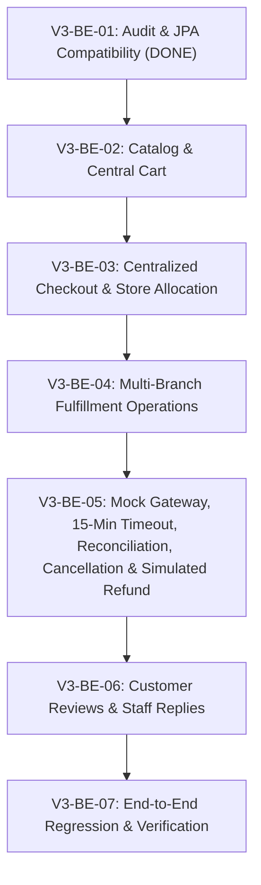

# ONESHOP V3 — BACKEND MIGRATION PLAN
**Phases:** V3-BE-02 through V3-BE-07  
**Architecture:** Centralized Commerce — Distributed Multi-Store Inventory & Fulfillment  
**Database:** Microsoft SQL Server (22 Tables, Verified Seed Data)  

---

## 1. Migration Overview & Guiding Principles

With **Phase V3-BE-01: Backend Audit & JPA Compatibility** successfully completed, the foundation is secured:
* All 22 SQL Server V3 tables are accurately mapped in Spring Data JPA.
* Hibernate schema validation (`ddl-auto=validate`) passes 100%.
* Existing services and test suites remain functional via backward-compatible bridges.

The goal of the subsequent backend phases is to incrementally transition the business logic from the V2 store-centric model to the V3 centralized commerce model without disrupting application stability or corrupting transaction integrity.

### Core Principles:
1. **Incremental Delivery:** Each phase addresses a self-contained domain (Catalog/Cart -> Checkout/Allocation -> Fulfillment -> Payments/Refunds -> Reviews).
2. **Atomic Invariants:**
   - **Inventory decision (FINAL, project owner):** physical stock (`StoreProduct.quantity`) is deducted **immediately and atomically at successful order creation**. There is no reservation-based checkout; `reserved_quantity` is never incremented by checkout.
   - `reserved_quantity` stays in the schema for compatibility only. Availability = `quantity - reserved_quantity` (counts any pre-existing reservation), and the DB invariant `0 <= reserved_quantity <= quantity` must still hold after every deduction.
   - Stock is deducted exactly once per OrderItem and restored at most once (idempotent). Staff status changes (`PREPARING`/`PACKED`/`SHIPPING`/`COMPLETED`) never touch stock.
   - Master `Order.order_status` must always be a deterministic function of its underlying `OrderFulfillment` package statuses, subject to the payment gate (an ONLINE Order in `PENDING_PAYMENT` is never advanced by Staff actions).
3. **ONLINE Payment Policy (FINAL, project owner; mirrors DEC-15..DEC-22 of the business specification):** the full policy is in Section 5.
   - **DEC-15 / DEC-16:** `PENDING_PAYMENT` lasts **15 minutes** from `orders.created_at` (fixed, never extended); stock is deducted immediately at order creation; paid in time -> `CONFIRMED` with **no second deduction**.
   - **DEC-17 Reconciliation window:** 15 minutes after the payment deadline (`reconciliation deadline = created_at + 15 + 15 minutes`), used **only** for payment results that cannot be concluded (UNKNOWN/PENDING). Still unknown when the window ends -> Order `NEEDS_ATTENTION`, stock stays deducted.
   - **DEC-18 Verified FAILED is terminal:** the current ONLINE Order is cancelled and stock restored; no automatic payment retry on the same Order; buying again is a new checkout. A gateway request timeout / lost connection is **not** FAILED.
   - **DEC-19 Admin resolution:** `NEEDS_ATTENTION` payment cases are resolved by Admin only with verifiable evidence; no arbitrary status/stock edits.
   - **DEC-20 Configuration:** `oneshop.payment.pending-timeout-minutes`, `oneshop.payment.reconciliation-window-minutes`, `oneshop.payment.timeout-scan-interval-ms`.
   - **DEC-21 Mock Payment Gateway:** server-side mock ledger; a browser "success/failure" action is never evidence of payment.
   - **DEC-22 No Cross-Store Transfer:** multi-store orders are fulfilled by independent Fulfillments; stock is never moved between stores.
   - **DEC-23 Same-SKU split (OPEN-01):** the quantity of one SKU may come from several StoreProducts; one OrderItem per source.
   - **DEC-24 National delivery (OPEN-02):** every ACTIVE store with `delivery_enabled` may supply any valid address in Vietnam; no GPS, no distance, no nearest-store, no province rule.
   - **DEC-25 Shipping fee (OPEN-03):** DELIVERY costs 30.000 VND once per Order (not per Fulfillment); every independent Order of a COD split pays its own; STORE_PICKUP is free; computed on the backend.
   - Payment callback, timeout worker, customer cancellation, Admin resolution and Staff `PREPARING` are serialized by the Order row lock; every path is idempotent (no double restoration, no double simulated refund, no duplicate payment confirmation).
   - An Order already `CANCELLED` is never revived by a late callback; collected money is reconciled through the simulated refund.
4. **Schema freeze with one explicit owner-approved exception (14/10/2026, BE-06 / DEC-26):** replace review uniqueness only, using `database/migrations/20261014_be06_review_uniqueness.sql`: unique non-null `order_item_id`, plus unique `(user_id, product_id)` for legacy null-source rows. No table/column/seed change; all 22 tables remain. Other phases' schema freeze still applies.
5. **Comprehensive Automated Verification:** Every phase concludes with targeted integration tests matching the domain before proceeding to the next phase.

---

## 2. Phased Backend Roadmap



---

### Phase V3-BE-02: Core Catalog & Central Cart Refactoring
**Estimated Duration:** 2 Days  
**Primary Focus:** Centralize product pricing and shopping cart line management.

#### Tasks:
1. **Catalog Pricing Update:**
   - Refactor `ProductService` and `StoreProductService` to serve `Product.price` as the authoritative online retail price.
   - Update `ProductCardResponse`, `ProductDetailResponse`, and `CatalogItemResponse` to serialize `Product.price` and `Product.originalPrice`.
   - Update client product catalog views to display chain-wide availability without requiring upfront store selection.
2. **Central Cart Refactoring:**
   - Refactor `CartService.addCartItem` to accept `productId` instead of `storeProductId`.
   - Verify chain-wide availability: check that the sum of available stock across all active stores is `>= requestedQuantity`.
   - Update `CartItemRepository` usages to query by `(cartId, productId)`.
   - Eliminate `CartStoreGroupResponse`; replace with flat `CartResponse` containing product-level lines.
   - Update `CartController` endpoints and Thymeleaf cart templates.
3. **Phase Deliverables & Verification:**
   - Unit tests: `CartServiceV3Test`, `ProductServiceV3Test`.
   - Integration tests: `CentralCartIntegrationTest` verifying cart addition without store context.

---

### Phase V3-BE-03: Centralized Checkout & Multi-Branch Order Allocation
**Estimated Duration:** 3 Days  
**Primary Focus:** Single order creation, immediate stock deduction, and dynamic store allocation.

#### Tasks:
1. **Store Allocation Engine (`StoreAllocationService`):**
   - Implement greedy/priority allocation algorithm:
     * **Strategy 1 (Single Store Priority):** If a single active store has sufficient stock for all cart items, allocate 100% of the order to that store (minimizing shipping packages).
     * **Strategy 2 (Multi-Store, whole lines):** If no single store can fulfill the entire order, repeatedly take the store that supplies the most still-missing lines in full (tie-break: units, store already in the plan, total available, lowest `store_id`). Greedy: it does not guarantee the minimum number of stores and uses stock only, never distance, province or shipping cost.
     * **Strategy 2b (same-SKU quantity split, DEC-23):** only when no single store can still supply the whole remaining quantity of a line, that quantity is split between stores (each gives what it has, up to the missing quantity). Each part is its own `OrderItem` (one `StoreProduct`, one Fulfillment). Invariant: per SKU the allocated quantities add up to the requested quantity, each part `> 0` and `<= quantity - reserved_quantity`.
     * **Strategy 3 (Store Pickup):** If fulfillment type is `STORE_PICKUP`, strictly validate that the chosen store has all items in stock. Stock is never transferred between stores to satisfy a pickup (DEC-22).
   - Multi-store allocation produces independent Fulfillments only. No stock transfer movement, no transfer request, no warehouse module, no table for stock transfers, and a store's quantity is never changed because another store is short.
2. **Immediate Stock Deduction (replaces former "Pessimistic Stock Reservation"):**
   - Lock the allocated `StoreProduct` rows in ascending id order via `storeProductRepository.findAllByIdForUpdate()`; re-read the latest `quantity`/`reserved_quantity` after the lock.
   - Per allocated line require `quantity - reserved_quantity >= requested`; otherwise reject the whole checkout (or re-allocate within a bounded retry). No partial order, no partial deduction.
   - In the **same transaction** as order creation: decrement `StoreProduct.quantity` by the allocated quantity and write `InventoryMovement(type = ORDER, quantity_before, quantity_change < 0, quantity_after, reference_order_id)` per `StoreProduct`.
   - Do **not** touch `reserved_quantity`. Do **not** add `RESERVE`/`RELEASE`/`OUTBOUND` movement types (the DB `CK_inventory_movements_type` only allows `ORDER`, `CANCEL_ORDER`, `STOCK_ADJUST`, and DDL is frozen).
   - Applies to every Order produced by a checkout: ONLINE multi-store = 1 Order; COD split (after explicit consent) = N independent Orders, each deducting its own lines.
   - ONLINE `PENDING_PAYMENT`: stock is already deducted at creation and the payment deadline is 15 minutes from `created_at` (Section 5). Verified payment failure, expiry with a concluded "not paid" result, or valid cancellation goes through the cancel-and-restore path implemented in BE-05; an inconclusive (UNKNOWN) payment is **not** cancelled automatically (reconciliation window, Section 5.1).
3. **Order & Fulfillment Creation:**
   - Create 1 `Order` record per checkout for ONLINE / COD single-store / PICKUP (`store_id = NULL` for multi-store delivery); N independent Orders only for consented COD split.
   - Create `OrderFulfillment` records (1 per allocated store branch).
   - Create `OrderItem` records linking each line to its parent `OrderFulfillment` and `StoreProduct`.
   - Write initial `OrderStatusHistory` and `OrderFulfillmentStatusHistory` entries.
   - Delete the checked-out `CartItem` rows. Any failure rolls back Order, Fulfillments, Items, deduction, movements, history and cart changes together.
4. **PENDING_PAYMENT Initialization & Payment Deadline:**
   - Create ONLINE Orders with `order_status = PENDING_PAYMENT`, `payment_status = UNPAID`, one `Payment` attempt `PENDING` (`refund_status = NONE`), and Fulfillments in `CONFIRMED` (the only initial value the schema allows; they stay payment-gated).
   - Payment deadline = `Order.created_at + 15 minutes`, computed (no new column), read through one injectable `Clock`; expose it in the checkout result/order detail so the UI can show the remaining time. The value comes from `oneshop.payment.pending-timeout-minutes` (default 15), never from the client. Reconciliation deadline = payment deadline + `oneshop.payment.reconciliation-window-minutes` (default 15).
   - Stock is deducted inside the order-creation transaction (`ORDER`, negative `quantity_change`); Cart does not hold stock.
   - **Mock Payment Gateway preparation:** when the Payment attempt is created, the backend creates the gateway-side transaction reference (the mock ledger entry) and links it to the attempt. BE-03 defines the integration boundary only; simulating results, verification and callbacks belong to BE-05.
   - **No client confirmation:** BE-03 never accepts `PAID` / `SUCCESS` / `FAILED` from the browser, never marks an ONLINE Order `CONFIRMED`/`PAID`, and never simulates a successful payment without a verified confirmation. The V2 customer-triggered `/orders/{orderId}/payments/{paymentId}/success|failure` endpoints must not be a path to payment confirmation in V3.
   - Prepare the service boundary BE-05 will use: a single place that answers "is this Order still payable now?" (`ONLINE`, `PENDING_PAYMENT`, `UNPAID`, `now < deadline`, no UNKNOWN payment under reconciliation) and a single cancel-and-restore operation under the Order lock. BE-03 may define these contracts but must not implement the timeout worker, reconciliation, Admin resolution or refund engine.
   - Block Staff transition of any Fulfillment to `PREPARING` while an ONLINE Order is not `PAID`/`CONFIRMED` (`PENDING_PAYMENT`, or `NEEDS_ATTENTION` for a payment case), enforced in the Service, not only in the UI.
   - Block the remaining V2 checkout paths: the current `CheckoutServiceImpl.placeOrder` resolves `line.getStoreProduct()` (nullable since BE-02) and creates one Order per Store from `StoreGroupCheckoutRequest`; this path must be replaced, not kept reachable alongside V3.
   - `CheckoutSession` is only the record of one confirmation action; it is never a payment object (`Payment` stays attached to `Order`).
   - ONLINE multi-store = 1 Order and N Fulfillments (no reservation-based checkout). COD multi-store creates independent Orders only after the customer explicitly confirms the split.
   - **Release gate:** ONLINE checkout must not be declared safe for real operation until BE-05 (timeout worker, reconciliation, cancel/restore, refund simulation) is complete; before that, an unpaid ONLINE Order would hold stock indefinitely.
5. **Phase Deliverables & Verification:**
   - Concurrency tests: parallel checkouts for the same SKU never drive `quantity` below 0 and never oversell; total deducted equals the total of successful orders.
   - Rollback test: a forced failure after deduction leaves no Order and unchanged `quantity` and movements.
   - Allocation tests: single-store vs. multi-store vs. same-SKU split scenarios against real seed data (BE03-F01..F30); invariants (totals, bounds, determinism) over generated carts.
   - Delivery/fee tests: national coverage by delivery-enabled stores, address validation, 30.000 per Order (ONLINE 1/2/3 stores, COD split 2/3 Orders), pickup 0, forged/changed fee refused.
   - Status after the completion work: **DONE for the BE-03 scope**; ONLINE checkout stays closed (`oneshop.checkout.online-enabled=false`) until BE-05.

---

### Phase V3-BE-04: Multi-Branch Fulfillment Operations
**Estimated Duration:** 3 Days  
**Primary Focus:** Staff console migration to fulfillment packages and state machine aggregation.

#### Tasks:
1. **Staff Console Endpoint Migration:**
   - Refactor `StaffDeliveryController` and `StaffPickupController` to query `OrderFulfillmentRepository` scoped to the staff member's assigned store (`staff_store_assignments`).
   - Transition endpoints:
     * `POST /staff/fulfillments/{id}/prepare` -> `status = PREPARING`
     * `POST /staff/fulfillments/{id}/pack` -> `status = PACKED` (status + history only; **no stock change**, stock was already deducted at order creation)
     * `POST /staff/fulfillments/{id}/ship` -> `status = SHIPPING` (records `tracking_code`)
     * `POST /staff/fulfillments/{id}/ready-for-pickup` -> `status = READY_FOR_PICKUP` (generates pickup code)
     * `POST /staff/fulfillments/{id}/handover` -> `status = COMPLETED`
   - Every transition runs under the Order lock (Section 5.3) and re-checks the current state: it is rejected when an ONLINE Order is not yet paid (`PENDING_PAYMENT`, including while a payment result is being reconciled, or `NEEDS_ATTENTION` for a payment case), when it is `CANCELLED`, or when the Fulfillment is not in the expected source state. Staff never write `orders.order_status` directly.
   - A Staff member operates only the Fulfillments of the Store they are assigned to. There is no Cross-Store Transfer: no stock movement between stores, no "transfer" action, no handing a Fulfillment to another store (DEC-22).
2. **Order State Aggregation Engine (`OrderStateAggregator`):**
   - Automatically recompute master `Order.order_status` on every fulfillment state change:
     * If all fulfillments are `COMPLETED` -> `Order.order_status = COMPLETED`.
     * If any fulfillment is `SHIPPING` or `READY_FOR_PICKUP` -> `Order.order_status = SHIPPING` or `PROCESSING`.
     * If all fulfillments are `CANCELLED` -> `Order.order_status = CANCELLED`.
     * If some fulfillments are `COMPLETED` and others `CANCELLED` -> `Order.order_status = PARTIALLY_COMPLETED`.
   - Payment gate first: while an ONLINE Order is `PENDING_PAYMENT` the aggregator never changes `order_status`; the only exits are payment confirmation (`CONFIRMED`) or cancellation (`CANCELLED`), both owned by BE-05.
3. **Phase Deliverables & Verification:**
   - Fulfillment transition unit and integration tests.
   - Assert that PREPARING/PACKED/SHIPPING/READY_FOR_PICKUP/COMPLETED leave `StoreProduct.quantity` and the `inventory_movements` row count unchanged (no second deduction).
   - Payment-gate test: Staff cannot move a Fulfillment of a `PENDING_PAYMENT` Order (including one under reconciliation) or of a payment `NEEDS_ATTENTION` Order to `PREPARING`.
   - Assert that no code path writes a stock-transfer movement (only `ORDER`, `CANCEL_ORDER`, `STOCK_ADJUST` exist).
   - Race test: Customer cancel vs. Staff `PREPARING` on the same Order ends in exactly one outcome (cancelled with stock restored, or 409 `ORDER_ALREADY_PREPARING`), never both.

#### Implementation status (13/10/2026)

- **DONE for the BE-04 scope.** Documents: `docs/v3/backend-fulfillment/` (`V3_BE04_IMPLEMENTATION_REPORT.md`, `V3_BE04_STATE_MACHINE_AND_AUTHORIZATION.md`, `V3_BE04_COMPONENT_CHANGE_MATRIX.md`, `V3_BE04_TEST_RESULTS.md`, `V3_BE04_HANDOVER.md`).
- Endpoints as built: `POST /staff/fulfillments/{id}/{prepare|pack|ship|ready-for-pickup|handover}` plus the explicit `complete-delivery`, `complete-pickup`, `fail-delivery`, `fail-pickup`. `handover` completes a DELIVERY or a STORE_PICKUP Fulfillment by its type (pickup code required for pickup).
- The aggregator class is `OrderStatusAggregator` (`com.oneshop.service.fulfillment`). Where the task list above says "some `COMPLETED` and others `CANCELLED` -> `PARTIALLY_COMPLETED`", the build follows spec 9.3 instead (all live parts `COMPLETED` -> `COMPLETED`): the situation cannot occur because a whole-Order cancel needs every part `CONFIRMED`.
- `FAILED` is allowed from `SHIPPING` (DELIVERY) and `READY_FOR_PICKUP` (STORE_PICKUP) with a mandatory reason and only moves the Order to `NEEDS_ATTENTION` (no restock, no refund); resolving it is BE-05.
- Offline collection (COD at delivery confirmation, PAY_AT_STORE after the code) goes through `PaymentService.recordOfflineCollected`, never through the V2 order-level primitives.
- Staff authorization uses `order_fulfillments.store_id`; the V2 order-level Staff controllers/templates were removed and the old URLs only redirect.

---

### Phase V3-BE-05: Payments, 15-Minute Timeout, Cancellation & Simulated Refund
**Estimated Duration:** 2 Days (scope enlarged by the 15-minute policy, reconciliation, Admin resolution and mock gateway; re-estimate before starting)
**Primary Focus:** Mock payment gateway and verified confirmation, payment deadline and reconciliation, terminal FAILED, whole-Order cancellation with exact stock restoration, Admin resolution of `NEEDS_ATTENTION`, and refund simulation.

#### Tasks:
1. **Central Payment Handling:**
   - Bind `Payment` to the master `Order.total_amount` (items subtotal + `shipping_fee`); never to an `OrderItem`.
   - Support `ONLINE` (Mock Payment Gateway only), `COD` (collected upon delivery) and `PAY_AT_STORE`. The payment deadline and reconciliation apply to `ONLINE` only.
2. **Mock Payment Gateway (server side, DEC-21):**
   - A gateway abstraction with a mock implementation enabled only in dev/test/demo configuration; simulation endpoints are not registered/enabled in production.
   - Flow: backend creates the Payment attempt -> mock gateway creates its own transaction reference -> a server-side mock ledger holds the simulated transaction (state, amount, Order id, Payment id, reference, server timestamp) -> the demo UI triggers a **controlled** simulation of SUCCESS / FAILED / UNKNOWN (authenticated owner + CSRF) that settles the ledger entry -> the backend confirms only after verifying the ledger entry (or an authenticated mock callback).
   - Verified fields: Order id, Payment id, transaction reference, amount (`== Order.total_amount`), state and server-side time. The browser can never supply `payment_status`, `paid_at`, amount or time; browser timestamps are ignored.
   - Duplicate callbacks are idempotent (de-duplicated by transaction reference under the Order lock).
   - Result handling: verified SUCCESS -> confirm if payable; verified FAILED -> terminal cancel (task 5); PENDING -> no decision; UNKNOWN or gateway timeout -> reconciliation; transaction recorded after the deadline or on a cancelled Order -> no normal confirmation, refund simulation if the mock ledger shows money collected.
   - A mock SUCCESS is never described as money really collected by a bank.
3. **Payment confirmation before the deadline:**
   - Under the Order lock verify the Order is still `ONLINE` + `PENDING_PAYMENT` + `UNPAID`, the Payment belongs to it, the transaction was not already recorded, and the verified transaction time is before the deadline.
   - Record `Payment` `SUCCESS` (+ `paid_at` from the server clock/ledger, `transaction_code`), set `payment_status = PAID`, `order_status = CONFIRMED`, write history. **No stock change.** No duplicate `SUCCESS`.
4. **Timeout worker (Spring `@Scheduled`, no Redis / queue):**
   - Interval `oneshop.payment.timeout-scan-interval-ms` (default 60000). Candidate query: `payment_method = ONLINE`, `order_status = PENDING_PAYMENT`, `created_at <= now - pending-timeout`.
   - Per candidate, three steps: (a) verify the payment state with the mock gateway/ledger **outside** any DB transaction; (b) open a short transaction, lock the Order, re-read state; (c) apply the decision and commit. No gateway call is made while a SQL Server transaction is open.
   - Whether a payment is still in time is decided from the deadline and the verified transaction time, never from when the scheduler happens to run.
   - Decision at/after the deadline: **A** concluded "not paid" -> cancel immediately (task 6), stock is not held for another 15 minutes; **B** verified valid SUCCESS in time and Order still open -> `CONFIRMED`, no second deduction, no duplicate `SUCCESS`; **C** UNKNOWN/PENDING -> reconciliation (task 7).
5. **Verified FAILED is terminal (DEC-18):**
   - On a verified FAILED: lock Order, check the current Payment, confirm no successful collection exists, then Order `CANCELLED`, every Fulfillment `CANCELLED`, exact per-`StoreProduct` restoration (`CANCEL_ORDER`), history, one atomic commit.
   - No automatic payment retry on the same Order. A new purchase is a new checkout. An existing `PENDING` attempt may be continued (it is the same attempt; the deadline does not move).
   - Distinguish verified FAILED / PENDING / UNKNOWN; a request timeout or lost connection to the gateway is not FAILED and never triggers cancel/restore by itself.
6. **Customer cancellation:**
   - Owner only; whole Order only; no Fulfillment may have reached `PREPARING`; otherwise `409 ORDER_ALREADY_PREPARING` with no side effect. Partial cancellation does not exist in P0.
   - While the payment result is UNKNOWN under reconciliation the Order must not be cancelled/restored by the customer (money may have been collected); the request is rejected with a business error until the result is concluded. This follows from DEC-17 and must be confirmed during implementation.
7. **Cancel-and-restore (single shared operation for timeout, verified FAILED, customer cancel and Admin resolution):**
   - Lock Order -> check/lock Fulfillments in ascending id -> lock source `StoreProduct` rows in ascending id -> re-check state -> mutate -> commit.
   - Order `CANCELLED`; Fulfillments `CANCELLED`; restore each OrderItem quantity to its source `StoreProduct`; write `InventoryMovement(CANCEL_ORDER, quantity_change > 0, reference_order_id)`; write `OrderStatusHistory` and `OrderFulfillmentStatusHistory`; close the pending `Payment` attempt as `FAILED` (the schema has no `CANCELLED`/`EXPIRED` payment status).
   - Restoration happens only on the transition into `CANCELLED`; a second execution finds `CANCELLED` and does nothing.
8. **Reconciliation window (DEC-17):**
   - Window: `[payment deadline, payment deadline + reconciliation-window-minutes]`, only for UNKNOWN/PENDING results that cannot be concluded. The deadline is **not** extended; the customer cannot start a new payment; Staff cannot `PREPARING`; the Order is not cancelled and stock is not restored while it is unknown.
   - Each worker scan re-verifies. A conclusive result inside the window is handled by tasks 3/5/7. If still UNKNOWN when the window ends -> Order `NEEDS_ATTENTION`, one history note with the reconciliation evidence (transaction reference, last verification result, timestamps), stock stays deducted.
   - `NEEDS_ATTENTION` is an **Order** status; no new Payment status, enum or column is introduced.
9. **Admin resolution of `NEEDS_ATTENTION` payment cases (DEC-19):**
   - Authorization: `ADMIN` only, checked in the backend (JWT/role), CSRF on mutations.
   - Admin may view the Order, Payment attempts, Fulfillments, history and the reason; re-run reconciliation against the mock gateway; confirm payment **when the verification shows a collected payment within the deadline**; confirm "no money collected" and cancel+restore; process the simulated refund for money actually collected on an Order that cannot continue.
   - Admin may **not**: set an arbitrary `order_status`, mark `PAID` without evidence, edit `StoreProduct.quantity`, create manual `InventoryMovement`, revive a `CANCELLED` Order, skip Fulfillment status/history, or perform a partial refund.
   - Outcomes: paid in time -> `CONFIRMED`/`PAID`, no second deduction; not paid -> cancel and restore once; money collected but Order cancelled or collected after the deadline -> Order not confirmed (cancelled and restored once if it was not already), simulated refund for the collected amount once, no second restoration; still unknown -> stays `NEEDS_ATTENTION` with the reason recorded.
   - Audit with existing columns only: `changed_by_user_id`, `changed_at`, `old_status`/`new_status`, and a structured `note` (action, result, reason; max 500 chars) in `order_status_history` / `order_fulfillment_status_history`, plus `payments.refund_reason`. Limit: there is no dedicated audit table; very long reasons must be abbreviated. Do not add tables/columns.
   - Idempotent: the action runs under the Order lock and re-checks status; a repeated request finds the terminal state and returns the same result without side effects.
10. **Late and uncertain payments:**
    - Late callback for an already `CANCELLED` Order: never set it back to `CONFIRMED`, never re-deduct stock. If the mock ledger shows money collected, record it (new `Payment` row `SUCCESS`, de-duplicated by transaction reference under the Order lock) and apply the simulated refund once.
    - Payment completed after the deadline: not confirmed through the normal flow, even if the callback arrives while the Order is still `PENDING_PAYMENT`.
11. **Simulated Refund Engine (`RefundService`):**
    - Only for money recorded as collected (`Payment` `SUCCESS`) on an Order that is validly cancelled or reconciled as late/invalid.
    - Guard `refund_status = NONE` under the Order lock, then `PENDING_SIMULATION` -> set `refund_amount` (= collected amount), `refunded_at` -> `SIMULATED_REFUNDED`; set `Order.payment_status = REFUNDED`. The original `SUCCESS` record is kept as audit evidence.
    - Existing enum values only: `NONE`, `PENDING_SIMULATION`, `SIMULATED_REFUNDED`, `SIMULATION_FAILED`. No real bank refund, no partial refund, no new enum/CHECK.
12. **Configuration (DEC-20):** the three `oneshop.payment.*` properties of Section 5.10 are read through a configuration-properties class; the deadline logic uses the injected `Clock`.
13. **Out of scope / excluded:**
    - No automatic restock for delivered goods or for Fulfillments that failed after `PREPARING` (exception policy, Admin decision).
    - No logistics module, no real payment gateway integration, no Cross-Store Transfer.
14. **Phase Deliverables & Verification:**
    - Callback, deadline-boundary, timeout, reconciliation, terminal FAILED, customer-cancel, Admin-resolution and refund-simulation tests, plus the full race matrix of Section 5.5.
    - Per-`StoreProduct` restoration test across multiple stores; double-restoration and double-refund guard tests.
    - All timing tests use a controlled/fake `Clock`.

#### Implementation status (14/10/2026)

- **DONE for the BE-05 scope.** Documents: `docs/v3/backend-payments/` (`V3_BE05_IMPLEMENTATION_REPORT.md`, `V3_BE05_COMPONENT_CHANGE_MATRIX.md`, `V3_BE05_PAYMENT_STATE_MACHINE_AND_TRANSACTIONS.md`, `V3_BE05_TEST_RESULTS.md`, `V3_BE05_HANDOVER.md`). ONLINE checkout is **not** opened: `oneshop.checkout.online-enabled=false` remains the default.
- **Item "Persistence of the mock ledger" (Section 5.11) resolved without a schema change:** the ledger is the `payments` row of the attempt. AWAITING = `PENDING`/no `paid_at`; IN_DOUBT (UNKNOWN) = `PENDING` + `paid_at` (submission time) + `~UNKNOWN` suffix on `transaction_code`; CAPTURED = `PENDING` + `paid_at` (collection time); DECLINED = `FAILED`; SETTLED = `SUCCESS`. The reference never changes, so de-duplication and late callbacks work across restarts. A restart therefore does **not** lose in-flight simulated states.
- **Items "Customer cancel during reconciliation" and "Final route names and error codes" decided:** `409 PAYMENT_RECONCILING` for cancel and for new payment while UNKNOWN; customer `POST /orders/{id}/payments/{paymentId}/simulate`; Admin `/admin/payments`, `/admin/payments/{orderId}/recheck|gateway|refund`; codes `PAYMENT_RECONCILING`, `PAYMENT_NOT_PAYABLE`, `PAYMENT_ALREADY_FINAL`, `GATEWAY_DISABLED`, `NOT_A_PAYMENT_CASE`, `NOTHING_TO_REFUND`.
- **Item `OrderTransitionPolicy`:** the payment-domain edges (`PENDING_PAYMENT -> NEEDS_ATTENTION`, `NEEDS_ATTENTION -> CONFIRMED/CANCELLED`, `CONFIRMED -> CANCELLED`) live in `OrderStatusWriter`; the V2 graph is untouched.
- Added properties: `oneshop.payment.timeout-worker-enabled` (true; the test suite sets false), `oneshop.payment.scan-batch-size` (200), `oneshop.payment.mock-gateway-enabled` (true; **false in `application-prod.properties`**).
- Test timing uses `orders.created_at` moved back in the test database (the production code reads the injected `Clock`); a fake `Clock` bean was not introduced.

---

### Phase V3-BE-06: Customer Reviews & Staff Replies
**Estimated Duration:** 2 Days  
**Primary Focus:** Item-level reviews and dedicated staff reply records.

#### Tasks:
1. **Purchased Item Verification:**
   - Update `ReviewService.createReview` to require `orderItemId`.
   - Validate ownership and complete source consistency. Eligibility is `orderItem.fulfillment.status == COMPLETED`, with PAID and not CANCELLED/REFUNDED; the whole Order need not be COMPLETED (PARTIALLY_COMPLETED is allowed).
   - Ensure a user can only review each `order_item_id` once.
2. **Staff Review Reply Operations:**
   - Refactor `StaffReviewController`:
     * Staff member creates a `ReviewReply` tied to their authenticated `staff_user_id` and the assigned branch.
     * Stored in `review_replies` table.
   - Update customer product detail view to render official staff responses.
3. **Phase Deliverables & Verification:**
   - Review eligibility and unique constraint tests.
   - Review reply integration tests.

#### Approved BE-06 policy (14/10/2026)

- **DEC-26 / OPEN-05 closed by the owner:** one Review per OrderItem, including same-SKU allocations across Stores. The real SQL Server UNIQUE(user_id, product_id) prevented this; the owner explicitly authorized the data-preserving UNIQUE migration above. Applied to `oneshop_test`; operational database upgrade is a deployment prerequisite, not executed by BE-06 tests.
- **DEC-27 / OPEN-06 closed by the owner:** Admin moderation only; Staff must have a current ACTIVE assignment at the verified `Review -> OrderItem -> Fulfillment -> Store`. No authorization from `Order.store`, no guessed legacy source, no Admin Reply.
- Dedicated `ReviewReply` writes and Admin moderation take the Review lock; review creation takes the parent Order lock and rechecks receipt/payment facts. Legacy Review/Reply columns remain readable and preserved.
- Evidence and handover: `docs/v3/backend-reviews/`. ONLINE checkout keeps its current default (`false`); BE-07 is not implemented by this phase.

#### Implementation status (14/10/2026)

- **DONE for the BE-06 scope.** All 53 new tests and 15 Review Web cases pass; all 343 BE-01..05 V3 acceptance cases pass in the final full run.
- Full per-case baseline comparison: 1522 -> 1575 cases; 1097 -> 1158 PASS; inherited FAIL+ERROR 383 -> 375; 42 unchanged skips; 0 regressions, 8 improved cases, 0 removed cases. The full Maven build remains red because of the inherited V2 failures; this is not a full-suite green claim.
- SQL verification 12/12 groups pass. Both databases' original 22 tables have matching before/after row counts/checksums. Only approved review uniqueness changed on `oneshop_test`; operational `oneshop` was not migrated or written to.
- OPEN-05/06 are resolved. Apply the standalone operational migration before deployment; historical-source limits and BE-07 fixture rebuild are documented in `V3_BE06_HANDOVER.md`.

---

### Phase V3-BE-07: Full Regression & Live Integration Verification
**Estimated Duration:** 2 Days  
**Primary Focus:** End-to-end multi-store life cycle testing.

#### Tasks:
1. **Comprehensive Multi-Branch Scenario Tests:**
   - Scenario A: Central checkout resulting in 2 fulfillment packages across Thu Duc and Binh Thanh stores.
   - Scenario B: Store staff independently packing and dispatching their packages.
   - Scenario C: Customer tracking multi-package order status in personal order history.
   - Scenario D: Cancellation of a whole multi-store Order before any `PREPARING`, restoring every OrderItem to its source `StoreProduct` atomically, with a simulated full refund when PAID. Cancellation after any fulfillment reached `PREPARING` is rejected (409) with no stock, money or status change.
   - Scenario E: Repeated cancel / payment-failure callback / timeout produces exactly one restoration and one simulated refund.
   - Scenario F: ONLINE payment SUCCESS verified before 15 minutes -> `CONFIRMED`, stock unchanged after payment.
   - Scenario G: Verified FAILED -> terminal: cancel and restore once; no retry on the same Order; a new checkout is required.
   - Scenario H: Deadline reached with a concluded "not paid" result -> timeout cancels, all stores restored, history written, stock not held for the reconciliation window.
   - Scenario I: Payment UNKNOWN at the deadline -> reconciliation starts: no new payment allowed, no `PREPARING`, no cancel/restore, deadline not extended.
   - Scenario J: UNKNOWN verified as SUCCESS (transaction before the deadline) within the window -> `CONFIRMED`, no second deduction.
   - Scenario K: UNKNOWN verified as FAILED within the window -> cancel and restore once.
   - Scenario L: UNKNOWN still unknown after the 15-minute window -> `NEEDS_ATTENTION`, history note, stock still deducted.
   - Scenario M: Admin confirms a payment with evidence -> `CONFIRMED`; Admin cannot mark `PAID` without evidence.
   - Scenario N: Admin verifies no money was collected -> cancel and restore once, actor audited; non-Admin gets 403.
   - Scenario O: Customer cancels a `PENDING_PAYMENT` Order before the deadline -> restore once, no refund (nothing collected); a late callback afterwards -> Order stays `CANCELLED`, exactly one simulated refund, no re-deduction.
   - Scenario P: Payment completed after the deadline or after cancellation -> never confirms the Order; simulated refund once; no second restoration.
   - Scenario Q: Duplicate callback, duplicate cancel, concurrent cancel -> one confirmation / one restoration / one refund.
   - Scenario R: Races: timeout vs callback, cancel vs `PREPARING`, two timeout workers, Admin vs worker/late callback, two Admins.
   - Scenario S: Browser-supplied success/failure (including the V2 `/payments/{id}/success|failure` URLs) never updates payment state; simulation endpoints are disabled outside dev/test/demo.
   - Scenario T: Multi-store full restoration; no `PACKED` deduction; no double `InventoryMovement`; no negative stock; no Cross-Store Transfer movement (only `ORDER`, `CANCEL_ORDER`, `STOCK_ADJUST`).
   - Scenario U: Orders `COMPLETED` / `CONFIRMED` / `PROCESSING` / `SHIPPING` are never touched by the timeout worker.
2. **Performance & Concurrency Stress Test:**
   - Multi-threaded checkout competition for low-stock SKUs across single and multiple stores: no negative stock, no oversell, no deadlock beyond bounded retry.
   - Concurrent cancel vs. Staff `PREPARING` race: exactly one wins; no half-cancelled order.
   - Double-restoration guard under concurrent duplicate cancel requests.
   - Timeout/callback/cancel/Admin interleavings run against SQL Server with real locks, using a controlled/fake `Clock` so no test waits 15 real minutes. Integration tests use the dedicated test database and never touch existing data.
3. **Documentation Finalization:**
   - Complete technical migration summary and operational handover report.

---

## 3. Timeline & Phase Dependencies

| Phase | Milestone | Duration | Dependencies |
|-------|-----------|----------|--------------|
| **V3-BE-01** | Backend Audit & JPA Compatibility | **DONE** | SQL Server V3 Database & Seed Data |
| **V3-BE-02** | Catalog & Central Cart Refactoring | 2 Days | V3-BE-01 |
| **V3-BE-03** | Central Checkout & Store Allocation | 3 Days | V3-BE-02 |
| **V3-BE-04** | Multi-Branch Fulfillment Operations | 3 Days | V3-BE-03 |
| **V3-BE-05** | Mock Payment Gateway, 15-Min Timeout, Reconciliation, Admin Resolution, Cancellation & Simulated Refund | 2 Days (re-estimate) | V3-BE-04 |
| **V3-BE-06** | Reviews & Staff Replies | 2 Days | V3-BE-04 |
| **V3-BE-07** | Full Regression & Live Integration | 2 Days | V3-BE-05, V3-BE-06 |

---

## 4. Rollback & Fault Tolerance Guidelines

* **Database Schema Immobility:** No DDL scripts or schema modifications will be executed during any of the above phases. If any backend phase encounters an unexpected blocker, the code branch can be rolled back via Git without requiring database rollbacks or reseeding.
* **Compatibility Layer Retention:** Until Phase V3-BE-07, all backward-compatibility helper methods in entities (`setStoreProduct`, nullable store getters) will remain active to prevent unexpected regressions in legacy endpoints.

---

## 5. ONLINE Payment Deadline, Timeout & Concurrency Policy (cross-phase, FINAL)

This section is the single reference for BE-03, BE-04, BE-05 and BE-07. It uses only existing schema columns and CHECK values (DEC-15..DEC-22).

### 5.1 Deadline and reconciliation rules

- Applies only to `payment_method = ONLINE`. COD and PAY_AT_STORE have no payment deadline.
- `payment deadline = orders.created_at + pending-timeout (15 minutes)`; `reconciliation deadline = payment deadline + reconciliation-window (15 minutes)`. Both are computed; no `payment_expires_at` column is added.
- `created_at` is `DATETIME2(0)` (whole seconds) written by application auditing (`@CreatedDate`, JVM local time) inside the order-creation transaction. The deadline is anchored to this value only: not to opening checkout, opening the payment screen, creating an attempt or receiving a callback.
- Every comparison uses one injectable server `Clock` (`LocalDateTime.now(clock)`), the same time source that writes `created_at` and `paid_at`. Browser-supplied time is never used. Java and SQL Server are assumed to share one timezone convention; tests use a fake `Clock`.
- The deadline is never extended: reloads, continuing a pending attempt and repeated callbacks do not move it. Whether a payment is in time is decided from the deadline and the verified transaction time, not from when the scheduler runs.
- Boundary: `now < deadline` -> a payment may be accepted if state and transaction data are valid. `now >= deadline` -> no new attempt may be created or confirmed through the normal flow.
- The timeout worker may run a few seconds after the deadline. The right to pay ends at the deadline, not at the moment the worker runs.
- At the deadline, three cases:
  - **A. Concluded "not paid"** (verified FAILED, or verified no successful collection): cancel and restore immediately. Stock is not held for the reconciliation window.
  - **B. Verified valid SUCCESS** (transaction time before the deadline, Order still open): `CONFIRMED`, no second deduction, no duplicate `SUCCESS`.
  - **C. UNKNOWN / PENDING that cannot be concluded:** reconciliation window. No new payment, no deadline extension, no Staff `PREPARING`, no automatic cancel/restore while it is unknown. A conclusive result inside the window is handled as A or B; still unknown at the reconciliation deadline -> Order `NEEDS_ATTENTION`, history note with evidence, stock stays deducted until the exception is resolved.
- A payment whose verified transaction time is after the deadline is not confirmed through the normal flow. If the mock ledger shows money collected, it goes to reconciliation/simulated refund (Section 5.6).
- `NEEDS_ATTENTION` is an Order status. It is not a Payment status; no new enum, CHECK or column is introduced.

### 5.2 Mapping onto the existing schema

| Situation | `orders.order_status` | `orders.payment_status` | `payments.status` | `payments.refund_status` | `order_fulfillments.status` | Stock |
|---|---|---|---|---|---|---|
| ONLINE created | `PENDING_PAYMENT` | `UNPAID` | `PENDING` | `NONE` | `CONFIRMED` (payment-gated) | deducted (`ORDER`, negative) |
| Verified SUCCESS before deadline | `CONFIRMED` | `PAID` | `SUCCESS` (+`paid_at`, `transaction_code`) | `NONE` | `CONFIRMED`, now workable | unchanged |
| Verified FAILED (terminal) / concluded "not paid" at deadline | `CANCELLED` | `FAILED` | `FAILED` | `NONE` | `CANCELLED` | restored (`CANCEL_ORDER`, positive) |
| UNKNOWN inside reconciliation window | `PENDING_PAYMENT` | `UNPAID` | `PENDING` | `NONE` | `CONFIRMED` (gated) | still deducted |
| UNKNOWN after reconciliation window | `NEEDS_ATTENTION` | `UNPAID` | `PENDING` | `NONE` | `CONFIRMED` (gated) | still deducted until Admin resolves |
| Customer cancels while unpaid (result concluded) | `CANCELLED` | `UNPAID` | `PENDING` -> `FAILED` | `NONE` | `CANCELLED` | restored |
| Customer cancels after PAID, before `PREPARING` | `CANCELLED` | `PAID` -> `REFUNDED` | `SUCCESS` (kept) | `PENDING_SIMULATION` -> `SIMULATED_REFUNDED` | `CANCELLED` | restored |
| Late/after-deadline `SUCCESS` for a `CANCELLED` Order | `CANCELLED` (never revived) | `REFUNDED` | new row `SUCCESS` | `PENDING_SIMULATION` -> `SIMULATED_REFUNDED` | unchanged | unchanged (no second restoration) |
| Admin: payment verified in time | `CONFIRMED` | `PAID` | `SUCCESS` | `NONE` | workable | unchanged |
| Admin: no money collected | `CANCELLED` | `FAILED` | `FAILED` | `NONE` | `CANCELLED` | restored once |
| Admin: money collected after deadline / invalid | `CANCELLED` | `REFUNDED` | `SUCCESS` (kept/recorded) | `PENDING_SIMULATION` -> `SIMULATED_REFUNDED` | `CANCELLED` | restored once (not twice) |

Notes:
- `payments.status` has only `PENDING`/`SUCCESS`/`FAILED`; `orders.order_status` has no `EXPIRED`. `UNKNOWN` therefore exists only as a verification result (mock ledger / gateway answer), represented in the database by a `PENDING` attempt. The reason (timeout, payment failure, customer cancel, reconciliation, Admin action) is recorded in the `note` of `order_status_history` / `order_fulfillment_status_history` and `payments.refund_reason`.
- If the refund simulation fails: `refund_status = SIMULATION_FAILED`, `payment_status` stays `PAID`, an Admin retries. Stock restoration is not repeated.
- DDL has no unique index on successful payments or `transaction_code`; "one successful payment per obligation" and de-duplication are enforced in the Service under the Order lock.
- A `NEEDS_ATTENTION` Order caused by payment is not cleared by the Order State Aggregator; only the Admin resolution (or a conclusive reconciliation result) leaves this state.

### 5.3 Lock order (all competing flows)

1. Lock the `Order` row.
2. Check/lock the related `OrderFulfillment` rows in ascending id when needed.
3. Lock the `StoreProduct` rows in ascending id when stock changes.
4. Re-read and re-validate state after the locks are held.
5. Apply the mutation.
6. Commit.

Order creation has no Order id yet: lock candidate `StoreProduct` rows in ascending id, then create the Order in the same transaction. A consistent order reduces but does not eliminate deadlocks: every flow needs lock timeout handling and a bounded, safe retry. No payment gateway call is made while a database transaction is open.

### 5.4 Timeout worker

- Spring Boot `@Scheduled`; interval `oneshop.payment.timeout-scan-interval-ms` (default 60000); no Redis, no message queue.
- Candidates: `ONLINE`, `PENDING_PAYMENT`, `created_at <= now - pending-timeout`. "In reconciliation" is derived from time (`deadline <= now < reconciliation deadline`) and the verification result, so no extra marker column is needed. The worker does not write a history row for every scan.
- Verify payment state with the mock gateway/ledger outside the transaction; then short transaction: lock Order, re-read, decide (A/B/C of Section 5.1), commit.
- Only if it is certain that no successful payment exists and nothing awaits reconciliation -> cancel-and-restore. A gateway timeout or lost connection is UNKNOWN, not FAILED.
- Multiple instances / overlapping runs are safe because the decision is taken under the Order lock and re-checks `PENDING_PAYMENT`.

### 5.5 Mandatory race cases

| # | Race | Required outcome |
|---|---|---|
| 1 | Callback succeeds before timeout | Order `CONFIRMED`; worker re-reads, sees non-`PENDING_PAYMENT`, does nothing; no restore |
| 2 | Timeout before callback | Cancel + one restoration; later callback cannot make the Order `CONFIRMED`; if money verifiably collected -> reconciliation + one simulated refund |
| 3 | Customer cancel vs. callback | Whoever gets the Order lock first decides. Payment confirmed first -> valid cancel then cancels the whole Order with simulated refund. Cancel first -> callback cannot confirm. Never `CONFIRMED` with a cancelled payment, never restored twice |
| 4 | Customer cancel vs. Staff `PREPARING` | Cancel first -> Staff cannot start `PREPARING` on a `CANCELLED` Fulfillment. `PREPARING` first -> cancel rejected `409 ORDER_ALREADY_PREPARING`. Never both |
| 5 | Two timeout workers | Exactly one performs `PENDING_PAYMENT` -> `CANCELLED`; the other finds the new state and writes no movement |
| 6 | Two cancel requests | One state transition and one restoration; the other has no side effect and returns a consistent idempotent response |
| 7 | Duplicate payment callback | One `SUCCESS`, no duplicate history, no second refund; client state is never proof of payment |
| 8 | Payment right at the deadline | Decided by the verified transaction time (Section 5.1). Order already cancelled -> not revived, restored stock not re-taken; money actually collected goes to reconciliation/simulated refund, never ignored |
| 9 | Admin resolution vs. timeout worker / late callback | Order lock decides; the second actor re-reads the terminal state and has no side effect |
| 10 | Two Admin actions at once | One transition and one restoration/refund; the other returns the same result |
| 11 | Customer cancel during reconciliation | Rejected until the result is concluded; no restore while money may have been collected |

### 5.6 Late callback and uncertainty

- A callback for an Order that is `CANCELLED` is verified (source, transaction reference, amount, Order ownership). If valid and the mock ledger shows money collected: record it, simulate the refund once, keep the Order `CANCELLED`.
- A transaction recorded after the deadline is never turned into a normal confirmation, even when the Order is still `PENDING_PAYMENT`.
- An invalid or unverifiable callback changes nothing and is logged.
- "No callback yet" is not "failed". Uncertain Orders are re-checked for the reconciliation window, then escalated to `NEEDS_ATTENTION`; they are never pending without end.
- If a mock transaction is recorded with a timestamp, the timestamp comes from the server-side mock ledger, not the browser.

### 5.7 Admin resolution of payment `NEEDS_ATTENTION` (DEC-19)

- **Allowed:** view Order / Payment attempts / Fulfillments / history / reason; re-run reconciliation with the mock gateway; confirm payment when verification shows money collected within the deadline; confirm no money collected and cancel + restore; process the simulated refund for collected money on an Order that cannot continue.
- **Forbidden:** arbitrary `order_status` edits; marking `PAID` without evidence; editing `StoreProduct.quantity`; manual/fake `InventoryMovement`; reviving a `CANCELLED` Order; bypassing Fulfillment status/history; partial refund (P0).
- **Resolution paths:** paid in time -> `CONFIRMED`/`PAID`, no second deduction; no money -> cancel + restore once, history with actor; money collected but Order already cancelled or collected after the deadline -> Order not confirmed, simulated refund once, no second restoration; still unknown -> remains `NEEDS_ATTENTION` with the reason recorded.
- **Authorization and audit:** `ADMIN` role checked in the backend; actor, time, action, result and reason stored in existing `order_status_history.changed_by_user_id` / `changed_at` / `note` (and `payments.refund_reason`). Limit: no dedicated audit table and `note` is 500 characters. Idempotent under the Order lock.
- Illustrative routes (not binding): `GET /admin/orders/{id}` (already shows Order/Payments/Fulfillments), `POST /admin/orders/{id}/payment-reconciliation/recheck`, `POST /admin/orders/{id}/payment-reconciliation/resolve`.

### 5.8 Mock Payment Gateway (DEC-21)

- Server-side only; no real bank/gateway integration. Enabled only in dev/test/demo configuration; the simulation endpoints are disabled/not registered in production.
- Flow: Payment attempt created -> mock gateway creates its own transaction reference -> mock ledger records the simulated transaction (state, amount, Order id, Payment id, reference, server timestamp) -> the demo UI triggers a controlled simulation of SUCCESS/FAILED/UNKNOWN -> the backend confirms only after verifying the ledger entry (or an authenticated/signed mock callback) against Order id, Payment id, reference, amount, state and time.
- The browser never sends `payment_status`, `paid_at` or amount that is trusted. CSRF and ownership checks apply to Customer-triggered simulation. The V2 `/orders/{id}/payments/{paymentId}/success|failure` routes must be removed or rewritten to this flow.
- Result matrix: verified SUCCESS -> `PAID` if payable; verified FAILED -> terminal cancel + restore; PENDING -> no decision; UNKNOWN -> reconciliation when needed; duplicate callback -> no side effect; transaction after deadline or on cancelled Order -> no normal confirmation, simulated refund if the ledger shows collection, no second restoration.
- A mock SUCCESS is not a claim that a bank collected real money.

### 5.9 Configuration (DEC-20)

```properties
oneshop.payment.pending-timeout-minutes=${ONESHOP_PAYMENT_PENDING_TIMEOUT_MINUTES:15}
oneshop.payment.reconciliation-window-minutes=${ONESHOP_PAYMENT_RECONCILIATION_WINDOW_MINUTES:15}
oneshop.payment.timeout-scan-interval-ms=${ONESHOP_PAYMENT_TIMEOUT_SCAN_INTERVAL_MS:60000}
```

- `pending-timeout-minutes`: 15 minutes for the customer to pay. `reconciliation-window-minutes`: 15 minutes after the deadline for UNKNOWN results. `timeout-scan-interval-ms`: scan interval, default 60 seconds.
- On the demo environment the approved values are 15 and 15; the business deadline is not changed through environment variables without the project owner's approval. The scan interval may be tuned operationally.
- Use an injectable `Clock`; one consistent time convention between Java and SQL Server; never client time; the scheduler's schedule never decides whether a payment is in time; no Redis/message queue; no DB transaction open during a gateway call.
- This document only specifies the properties; `application.properties` is not modified by this documentation task.

### 5.10 No Cross-Store Transfer (DEC-22)

- Multi-store ONLINE = 1 Order, N independent Fulfillments; each Store handles only its allocated part and the parts may be delivered separately.
- No transfer of Product between stores, no stock-transfer movement, no transfer request, no warehouse module, no stock-transfer table; a store's quantity never changes because another store is short.

### 5.11 Items left for implementation only

| Item | Notes |
|---|---|
| Persistence of the mock ledger | Existing tables only. The ledger is a server-side component; final outcomes are written to `payments`. A restart may lose in-flight simulated states, which then surface as UNKNOWN and follow reconciliation. Any richer persistence needs a separate owner decision (no schema change here) |
| Customer cancel during reconciliation | Rejection rule is derived from DEC-17; confirm exact error code/UX |
| Exact `note` format for audit | Convention (action / result / reason) within 500 characters |
| `OrderTransitionPolicy` | New explicit transitions for `NEEDS_ATTENTION` -> `CONFIRMED` / `CANCELLED` by Admin; aggregator must not override a payment `NEEDS_ATTENTION` |
| Signed vs. internal mock callback | Choose a simple mechanism; do not build a complex payment system |
| Final route names and error codes | Illustrative routes above are not binding |

---

## 6. BE-07 regression completion (14-10-2026)

The current V3 implementation was verified with `mvn -o -B test`: **1,585 PASS, 0 failures, 0 errors, 0 skipped**. The baseline-to-final comparison preserved every original test identity, improved 417 prior non-PASS cases, introduced 10 V3 checks, and found no regression.

Evidence covers SQL Server concurrency, payment idempotence/reconciliation, store-scoped fulfillment/review reply authorization, real Chrome flows, 22-table integrity, and the rerunnable BE-06 Review uniqueness migration. See `docs/v3/backend-regression/` for the detailed reports and browser evidence.

**Scope record:** V3-T30 source-V2 Order backfill is excluded from BE-07 acceptance by project-owner confirmation because no V2 backup/dataset exists in this repository. The acceptance result applies to the present V3 database and data-preserving Review uniqueness migration only. No operational database deployment was performed.
