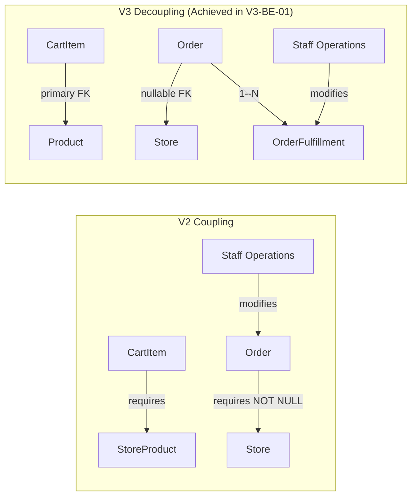
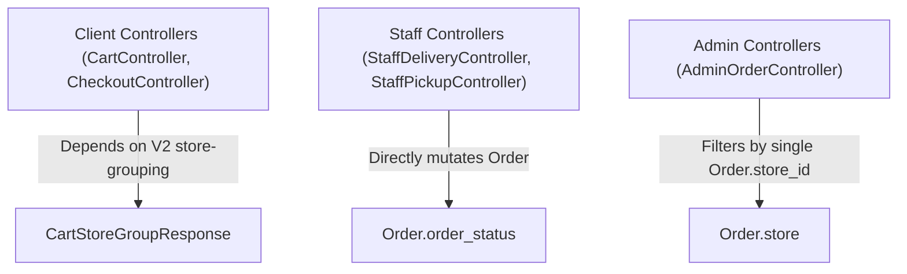

> Historical phase evidence (up to 14/10/2026). Superseded script names and readiness claims describe that run only. Current setup: [database README](../../../database/README.md); current acceptance: [deep audit](../final-deep-audit/DEEP_AUDIT_REPORT.md).

# ONESHOP V2 TO V3 — BACKEND DEPENDENCY MAP
**Phase:** V3-BE-01: Backend Audit & JPA Compatibility  
**Purpose:** Comprehensive trace of V2 business dependencies across all backend layers and targeted refactoring roadmap for V3  

---

## 1. Executive Summary

In OneShop V2, the system was designed around a **Store-Centric Model**:
* The customer browses and selects products within the context of a chosen branch.
* A cart item requires `store_product_id`.
* The checkout process groups items by branch and spawns multiple `Order` records per checkout session (1 Order per Store).
* Store staff directly transitions the `Order.order_status` through fulfillment milestones.

In OneShop V3, the system transitions to a **Centralized Commerce — Distributed Multi-Store Model**:
* The catalog has a single unified online price (`Product.price`).
* The cart contains products directly (`CartItem.product_id`).
* Checkout creates a single central `Order` per session.
* A dynamic Store Allocation Engine analyzes multi-store inventory and creates `OrderFulfillment` packages.
* Store staff operates on `OrderFulfillment` packages; the master `Order` status is aggregated automatically.

This document maps all backend components currently coupled to the V2 design, detailing their exact dependencies, impact radius, and required transformation strategy.

---

## 2. Layer-by-Layer Dependency Inventory

### 2.1. Domain & Entity Layer Dependencies

| Component | Current V2 State | V3 Architectural Requirement | Compatibility Bridge in V3-BE-01 |
|-----------|------------------|------------------------------|-----------------------------------|
| `Product` | No price field; relied on `StoreProduct.price`. | Master online price in `Product.price`. | Added `price` & `originalPrice`. Preserved existing relationships. |
| `StoreProduct` | Single source of selling price & physical stock. | Physical stock & reserved quantity. Price is legacy nullable. | Added `reservedQuantity`. Made `price` nullable. |
| `CartItem` | `storeProduct` is mandatory (`nullable = false`). | `product` is mandatory. `storeProduct` is legacy optional. | Added `@ManyToOne Product`. Auto-populates `product` if `storeProduct` is set. |
| `Order` | `store` is mandatory (`nullable = false`). | `store` is nullable (central orders have null store). | Changed `store` to nullable. Added `shippingFee` and `@OneToMany fulfillments`. |
| `OrderItem` | Linked only to `order` and `storeProduct`. | Must link to `order_fulfillments` package. | Added `@ManyToOne OrderFulfillment fulfillment`. |
| `Payment` | Basic payment capture. | Simulated refund support. | Added `refundStatus` enum and refund audit fields. |
| `Review` | Embedded text columns for staff replies; loose `order_id`. | Links to `order_items`; staff replies normalized to `review_replies`. | Added `orderItem` FK and `reviewReply` 1--1 relation. |

---

### 2.2. Repository Layer Dependencies

| Repository | V2 Queries / Coupling | Required V3 Evolution (Phases V3-BE-02 to V3-BE-06) |
|------------|-----------------------|-----------------------------------------------------|
| `CartItemRepository` | `findByCartIdAndStoreProductId`, `findByCartIdOrderByIdAsc` (fetches `storeProduct.store`). | Add `findByCartIdAndProductId`. In V3-BE-02, update cart projection to fetch `product.category`, `product.brand`. |
| `OrderRepository` | `findByStoreIdIn...`, `searchAdmin` filtering by `storeId`. | In V3, orders for online delivery have `store_id = NULL`. Staff queues must query `OrderFulfillmentRepository` instead of `OrderRepository`. |
| `StoreProductRepository` | `findSellableByProductIds` joins `stores` and `products`. | Needs bulk reservation queries (`update store_products set reserved_quantity = reserved_quantity + :qty`). |
| `OrderFulfillmentRepository` | **NEW in V3-BE-01** | Will serve as the primary query source for staff delivery and pickup consoles. |
| `ReviewRepository` | `findByOrderStoreIds` joins `o.store.id`. | Needs query via `orderItem.fulfillment.store.id` for branch-scoped review replies. |

---

### 2.3. Service Layer Business Logic Dependencies

The service layer contains the highest density of V2 business assumptions. The following table identifies all specific service methods requiring refactoring:

#### A. Cart Domain (`CartService` / `CartServiceImpl`)
* **Current V2 Flow:**
  - `addCartItem(userId, storeProductId, quantity)` verifies `StoreProduct` existence and branch stock before inserting.
  - Cart view groups items by `Store` (`CartStoreGroupResponse`).
* **V3 Target Flow (Phase V3-BE-02):**
  - `addCartItem(userId, productId, quantity)` verifies active `Product` and chain-wide availability.
  - Cart view renders a unified item list with aggregate price, without branch segregation.

#### B. Checkout Domain (`CheckoutService` / `CheckoutServiceImpl`)
* **Current V2 Flow:**
  - `createCheckoutSession` validates cart items grouped by store.
  - `checkoutStoreGroup(userId, checkoutId, storeId, ...)` creates 1 `Order` for that specific branch.
  - Multiple checkout calls are needed if the cart contains items from multiple stores.
* **V3 Target Flow (Phase V3-BE-03):**
  - `processCentralCheckout(userId, checkoutRequest)` executes a single checkout call.
  - Invokes `StoreAllocationService` to split items into `OrderFulfillment` packages based on store availability, proximity, and pickup preferences.
  - Deducts `reserved_quantity` atomically.
  - Generates 1 master `Order` and 1 or more `OrderFulfillment` records.

#### C. Order & Fulfillment Domain (`OrderService`, `DeliveryFulfillmentService`, `PickupFulfillmentService`)
* **Current V2 Flow:**
  - `OrderService.transition(orderId, fromStatus, toStatus, ...)` directly modifies `Order.order_status` (`PREPARING`, `PACKED`, `SHIPPING`, `READY_FOR_PICKUP`).
  - `DeliveryFulfillmentService` and `PickupFulfillmentService` take `orderId` and perform store-scoping against `order.store.id`.
* **V3 Target Flow (Phase V3-BE-04):**
  - Staff operations take `fulfillmentId` instead of `orderId`.
  - Operations update `OrderFulfillment.status`.
  - Master `Order.order_status` transitions automatically via an Aggregator State Machine:
    * All packages completed -> `Order.COMPLETED`.
    * Some completed, some shipping -> `Order.PROCESSING` / `PARTIALLY_COMPLETED`.
    * All packages cancelled -> `Order.CANCELLED`.

#### D. Payment Domain (`PaymentService` / `PaymentServiceImpl`)
* **Current V2 Flow:**
  - Payments are bound to single-store orders.
* **V3 Target Flow (Phase V3-BE-05):**
  - Payment covers the total amount of the master central order (items + shipping fee).
  - Online cancellation triggers simulated refund (`refundStatus = SIMULATED_REFUNDED`).

#### E. Review Domain (`ReviewService` / `ReviewServiceImpl`)
* **Current V2 Flow:**
  - Validates purchase by checking if customer has a completed order containing the product (`hasCompletedPurchase`).
  - Staff reply is written directly to `review.reply` text column.
* **V3 Target Flow (Phase V3-BE-06):**
  - Validates purchase against `OrderItem` (`order_item_id`).
  - Staff reply creates a record in `ReviewReplyRepository`.

---

### 2.4. Controllers & Web Presentation Dependencies

| Controller Class | V2 Endpoints Coupled to Legacy Model | Required V3 Transformation | Target Phase |
|------------------|---------------------------------------|----------------------------|--------------|
| `CartController` | `POST /cart/items` (takes `storeProductId`), `GET /cart` (renders store-grouped cart). | Switch request to `productId`. Render centralized unified cart. | Phase V3-BE-02 |
| `CheckoutController` | `POST /checkout/preview`, `POST /checkout/{storeId}` (per-store checkout). | Unified checkout endpoint with delivery address / pickup store selection. | Phase V3-BE-03 |
| `StaffDeliveryController` | `POST /staff/delivery/{orderId}/pack`, `/ship` operates on `orderId`. | Switch endpoints to `POST /staff/delivery/fulfillments/{fulfillmentId}/...` | Phase V3-BE-04 |
| `StaffPickupController` | `POST /staff/pickup/{orderId}/ready`, `/handover` operates on `orderId`. | Switch endpoints to `POST /staff/pickup/fulfillments/{fulfillmentId}/...` | Phase V3-BE-04 |
| `StaffReviewController` | `POST /staff/reviews/{reviewId}/reply` writes string to `Review`. | Create `ReviewReply` entity and link staff user ID. | Phase V3-BE-06 |
| `AdminOrderController` | Detail view assumes single branch per order. | Render fulfillment packages under master order detail view. | Phase V3-BE-04 |

---

### 2.5. Data Transfer Objects (DTOs) Dependencies

| DTO File | Current V2 Fields | Required V3 Update |
|----------|-------------------|--------------------|
| `AddCartItemRequest` | `Long storeProductId`, `int quantity` | `Long productId`, `int quantity` |
| `CartItemResponse` | Exposes `storeProductId`, `storeId`, `storeName` | Exposes `productId`, `productName`, `sku`, `price`, `imageUrl` |
| `CartStoreGroupResponse` | Groups lines under `storeId` | Obsolete in V3; replace with flat `CartResponse` |
| `CheckoutRequest` | Contains `storeId` | Contains `deliveryAddressId`, `fulfillmentType`, `pickupStoreId` |
| `OrderDetailResponse` | Assumes single store `storeName`, `storeAddress` | Contains list of `FulfillmentPackageResponse` |
| `StaffOrderDetailResponse` | Binds to `orderId` | Binds to `fulfillmentId` and shows items in that package |

---

## 3. High-Impact Migration Roadblocks & Decoupling Strategy

1. **Non-Breaking Bridge Strategy (Implemented in V3-BE-01):**
   - Maintained both `product` and `storeProduct` on `CartItem` so old and new code can coexist during phased transitions.
   - Maintained both `Order.order_status` and `OrderFulfillment.status`.
   - Maintained `OrderStatus` legacy enum constants (`PREPARING`, `PACKED`, `READY_FOR_PICKUP`) alongside new V3 constants (`PROCESSING`, `PARTIALLY_COMPLETED`, `NEEDS_ATTENTION`).

2. **Phase Decoupling Sequence:**
   - **Step 1 (Catalog & Cart):** Switch client browsing and cart addition to use `Product.price` and `CartItem.product`. No branch selection needed in cart.
   - **Step 2 (Checkout & Allocation):** Build allocation algorithm. Order creation creates 1 Order + N Fulfillments.
   - **Step 3 (Staff Consoles):** Switch staff console queries to `OrderFulfillmentRepository`.
   - **Step 4 (Reviews & Cleanup):** Transition reviews and remove legacy V2 fallback getters.

